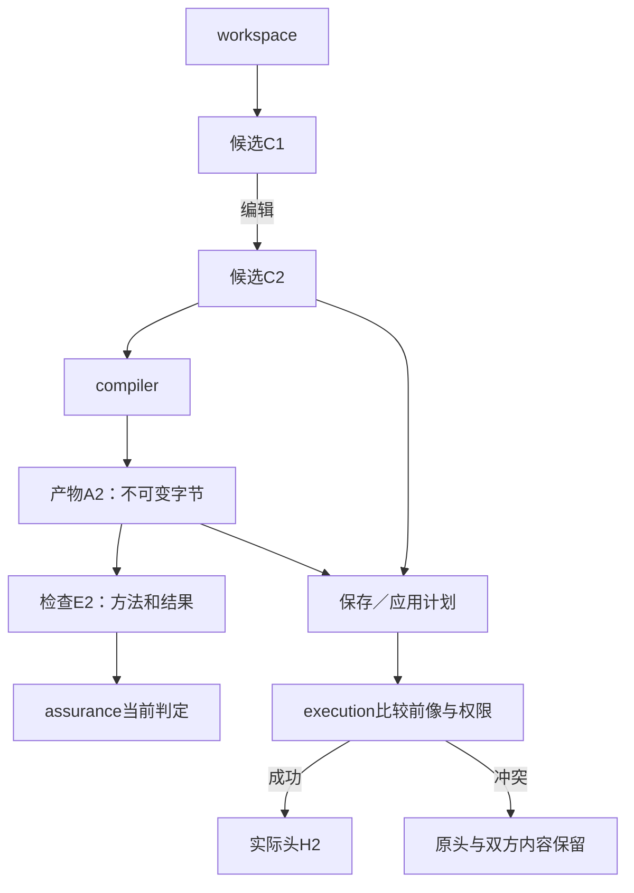

# 部署维度与代表性装配；旧入口和重复表的承接

## 部署维度与代表性装配

### 图解：作者、产物、检查与实际头的写入归属

不同对象用各自引用连接；箭头表示生产或评价，不代表修改被评价对象。只有比较提交路径推进实际头。

这里的“纯库、本地受控、团队托管、离线边缘”只是四个**代表性组合**，不是 `DeploymentKind` 枚举、Profile 全集或必须实现的四套服务。真实部署由相交维度组合：是否持久化及其权威、写者/共享与冲突域、执行位置、连接连续性、租户/信任边界、现实作用、耐久与恢复、资源/时限、升级与旧实例共存。浏览器内本地、serverless、集群、嵌入式、混合云或以后出现的形态，只要这些责任能够组合闭合，就不新增 Core 部署类型。

| 部署维度 | 需要回答的问题 | 不能由名称推断的内容 |
|---|---|---|
| state / authority | 哪些状态只是缓存，哪些有持久权威；谁能提交 current head | “用了数据库”不等于数据库拥有全部真值 |
| sharing / conflict | 单写、多写、共享读、租户隔离和真实冲突域是什么 | “团队版”不自动要求全局串行化 |
| execution locality | 同进程、worker、独立进程、远端节点或设备如何取得/结算资源 | “本地”不等于可信，“远端”不等于不确定 |
| connectivity | 连续在线、断续、离线自治时哪些操作允许、如何重连 | “离线支持”不授予离线不可逆作用权限 |
| trust / tenancy | 内容、秘密、执行主体、Provider 与租户边界怎样隔离 | 目录/进程名不构成安全边界 |
| effect / recovery | 文件、网络、设备、发布等作用如何标识、读回、补偿或保持未知 | 数据库 rollback 不撤销现实世界作用 |
| resource / timing | CPU/内存/GPU/带宽/费用/deadline 怎样准入和结算 | 一次快测不定义运行画像 |
| upgrade / coexistence | 新旧内容、解释、运行实例和恢复责任怎样并存及退役 | 新版本安装不热改旧实例 |

下面四节只展示这些维度怎样得到不同装配；实现和产品无需先选择一个家族标签。

### 纯库与无状态编译

进程内装配workspace的内存内容视图、当前语义方法和compiler。固定输入可直接调用compileFrozen；需要公共工具时加application/entry。无持久头、无外部效果就没有StateStore、数据库、消息或模型SDK前置。结果由调用方接管或取得有限内容引用；不让内存解析自动访问文件环境。

缺输入可以返回给调用者；给定的读取提供者必须有明确范围。分析失败不修改原源，运行预算结束不将残缺目标标成完整。纯调用没有必要为每个中间值创建摘要或回执。

### 本地受控工作区

默认一个短CLI或可选暖进程拥有用例协调，冲突域允许并行只读和非冲突操作。需要跨重启恢复时接本地事务存储；数据库作者模式与文件作者模式分别选择，不能同时维护两份可编辑定义。

小型本地优先SQLite关键内容同库。现行默认回滚日志和明确同步策略，启用外键；需要合格并发读的环境再选择WAL，不同时强制两种模式。备份、检查点和真实耐久范围依持久化规范，不仅看模式名称。WAL的同宿主共享内存要求不能被网络文件共享当成分布式数据库。

`BUSY`在明确预算内退避；前像冲突重观察而非盲重试；权威变化重新准入；元数据坏了不创建同身份空状态。普通编译不使用`claimOutbox`：确有事务性外部交付要求时，由相交 effect/transaction adapter 承担这项接口，而不是所有StateStore的必需方法。

### 团队与托管

真实跨机器共享写入时，采用一个事务服务拥有对应冲突域，可由PostgreSQL等合格Provider实现，内容用不可变对象存储。隔离级别与锁/约束按共同不变量选，串行化冲突重做相交完整决定，不只重发最后一条语句。资源worker不能直接推进团队头或合并源。

租户、数据驻留、秘密、执行主体与内容共享分别处理。共享内容缓存不合并两个用户的读取权。跨域硬原子要求使用真能参加的共同提交或有明确语义的协调，不能因应用只有一个协调者就声称全局原子。

从本地换到团队属于有条件实施：冻结相交新写、结算/转交在途、复制合格快照及可达内容、核对权限/身份与读写兼容、启动新Provider、读回后切换路由。没有真实消费者就不强制双写；需要旧解释与恢复时保留；新写旧版本不能解读时不假回滚，采用前向修复。

### 离线与边缘

默认可以读取固定源、创作候选和生成本地结果，重新联网后比较当前状态。需要离线真实写入时，单独规定授权、预留资源、时间有效性、冲突后果和不可逆动作；没有这些合同不能从“离线支持”推导全权自治。

重连先检查版本、身份、撤销、墓碑与旧写者资格，再合并候选。可交换性须对实际不变量成立，不因用了CRDT名字就放行唯一资源或余额冲突。永久失联时按合同到达本地自治、隔离或准确结束，不让一个节点卡住全工程。设备作用不能用数据库回滚从现实中撤销。

## 进程、内存、调度和取消的真正生命周期

### 阶段值的物理所有权与取消

SourceBlob在入口复制外部可变字节一次，或真正转移所有权；共享可写buffer未受相应协议保护时不作为固定输入。内部可信阶段借读固定内容，不逐阶段深复制。builder封存撤销外部可写别名；readonly标注和摘要都不是内存隔离。可复用数组/类型表按实际寿命管理，返回不能泄漏可写后备存储。

来自目标工具的坐标须按该工具单位映射到冻结源；只读字符串处理的UTF-16索引不能当UTF-8字节偏移。大文件用固定分块与内容引用，不能为方便转换将整工程反复复制。

### CPU、内存和嵌套执行

宿主总池约束所有请求，每个请求与其子工作还要受本次预算。父任务等待时保存续体让出CPU，仍保留的输入与堆对象继续计入内存。只有依赖图无环不能保证进展；内存不足时降低并发、合法释放重算或准确结束，不无限加线程。

资源池、PreparedJob和operation通过[共同预留与结算](../../50-执行运行与观测/权限与资源/资源核算调度与交接.md#budget-reservation-settlement)引用同一实际份额；共享查询、多个Runtime或嵌套工具不能复制余额。纯阶段只得到需要的预算/取消视图，不从该引用取得授权、写权或全局服务定位能力。真实消费点检查与代码依赖方向分开，不能为传一个资源量让semantics反向导入execution实现。

嵌套外部编译器按真实jobserver支持共享令牌，否则限制启动数与内部并行；每层独占满核是假预算。高风险远程读取/执行分别核发送许可、execution/target平台、固定工具和结果归属。没有资格或收益时继续本地，远程不是纯函数的前置。具体S调度由[递归并行与远程编译](../../40-目标与制品/递归并行与远程编译.md)拥有。

### 不可信方法与硬截止期

可信纯方法可以同进程；计算隔离可以使用worker；不可信插件按要求使用真正限制文件、网络、秘密和资源的进程/容器/解释器Provider。子进程名称不等于沙箱，模块依赖门禁也不约束恶意JavaScript全局。

自有算法在token、节点、统一、图工作项和输出边界检查取消。第三方同步API可能不响应；硬期限使用可中止执行器。Promise超时只结束等待，实际线程继续运行时不得释放其输入或报告从未执行。杀进程只能结束这次进程，不补偿已发出的业务作用。

### 启动、监听、升级与退出

短CLI无需Daemon。重复任务真正获益时才保留暖缓存、受限editRef和文件观察器。Watcher只提供变化提示；重复、漏报或溢出后在有限范围重新捕获，不把事件序列直接当完整作者内容。相交通知由[原调和队列](../../50-执行运行与观测/运行生命周期/运行实例-订阅部署与调和.md#reconcile-wakeup-handoff)合并与交接，处理期间的新变化不会被旧完成清除。队列满以有界重同步或准确停止处理，不再给每个事件创建一个Runtime；纯单次捕获仍无需Watcher。

退出顺序为停止新准入，允许已具备完成条件的有限任务结束，取消或转交剩余工作，结算结果和必要持久引用，释放没有消费者的image/内容/连接。持久动作先有恢复者再解除原拥有者；普通可重建查询可以直接丢失，二者不能共用同一TTL。

旧请求迟到不能推进新头。其固定纯结果经过内容、动作、方法和当前披露验证后仍可复用，不要求无意义销毁正确字节。C0/C1/C2自举实例分别构建与采用，不是在旧进程热改函数后沿用旧正确性记录；第一自用对象依据真实消费者和风险选择，不自动取得合并/发布权。

## 实现语言、成熟工具与可执行架构约束

控制面保留TypeScript/Bun默认宿主；纯kernel按[Rust单一生产owner与逐能力门禁](../演进与实施/实现语言与机制演进.md#compiler-kernel-rust-substrate)迁入，已存在TS能力未通过门禁前仍保留原生产责任。它们不是用户目标语言或所有宿主的前提。实际工具版本在所选发行和安装时固定，本章不把历史package声明当已运行事实。目标工具API族在adapter内，公共语义不导入TS AST/Type、数据库行或某SDK实例。

实现设置采用strict、exactOptionalPropertyTypes、noUncheckedIndexedAccess；边界从unknown解码；品牌或封装区分对象身份、内容摘要、修订、字节范围和资源量；判别联合明确状态。穷尽分支与构造器验证不能由任意as、非空断言或checked:true绕过。首发JSON结构交换采用[JSON Schema 2020-12与严格codec/语义验证](源码分区与机器合同.md#machine-contract-source)，由准确源生成Rust/TS结构绑定；Zod或其他成熟库可作为明确的实现工具，不成为第二结构真源。进程内临时值无需全部编码。

Bun专用I/O限于宿主适配、启动和明确的热点实现；纯语言与编译规则不读取环境、cwd或Bun.file。Code-OSS Extension是明确的Node/Web宿主消费者，其适配与Bun Runtime发行闭包分开；不为无消费者的其他运行时制造兼容负担。Rust kernel按既定方向与门禁采用；其他语言/原生bridge需要结构性理由、相同批量/数值/错误/取消合同与总成本证据，不以内核微基准代替端到端收益。

实现层的准入包括：导入方向、公共签名、禁止共享可写头、SDK泄漏、隐式I/O、声明的能力与实际方法、外部调用范围、许可证与依赖体积。检查机制可以采用项目引用、导出边界和静态规则；它只证明其实际检查范围，不冒充恶意代码隔离。

## 成品架构的符合性检查与重开条件

| 检查轨迹 | 应取得的结果 |
|---|---|
| 全部外部执行适配未安装，处理闭合纯函数 | 能完成源检查和已装载纯目标生成，无数据库/AI/网络初始化 |
| 并发请求分别固定旧、新image | 各自按准确版本处理，不混合默认与方法 |
| 补读发现同一固定引用不同内容 | 明确冲突或新输入基础，旧键不承载两份内容 |
| 任务明确选择多目标时，同一候选产生对应源码与资源包 | 各根独立状态，完整成员和AND要求仍正确 |
| a1检查通过后追加检查失败或撤销依据 | a1内容身份不变，当前适用性准确变化 |
| c1的写回与外部改动竞争 | 当前前像冲突，双方内容保留；不把纯fork当提交 |
| 重启、Watcher溢出、缓存删除 | 从实际内容/持久状态恢复；缓存丢失不丢作者工作 |
| worker迟到、取消或远程失联 | 旧尝试不推进当前头，真实资源与未结算责任保留 |
| 关闭领域功能 | 未使用方法不加载；旧数据/交付责任有退役路径 |
| 更换内部数据结构或目标API族 | 公共合同保持；实际实现/方法键与符合性相应更新 |

这里给的是可复查的设计与预期。Windows/Linux文件保持、特定数据库、团队隔离、远程和离线只在相应支持范围参加验证。问题严重但未启用，不强迫无关任务先部署它；功能已被要求，则不能借可选标签忽略。

## 现有生产入口到纯编译服务的迁移

旧代码接入按[版本化来源适配](../演进与实施/实施/仓库迁移与自托管.md#旧来源归属的版本化适配)取得真实接口与消费者。旧入口的有效保护不能为了预览直接删除，独立模块也不应伪造 Block。适配只约束对应旧输入，不成为所有新工程的永久字段。

## 旧入口和重复表的承接

本章唯一维护逻辑模块、依赖方向、状态所有者与装配生命周期；[源码分区](源码分区与机器合同.md)唯一维护物理蓝图，[worker协议](内核工作进程与交换协议.md)维护所选跨语言交换。已发布接口、持久数据、原生语义、离线授权与故障责任由相应合同约束；内部包名和目录调整不能改变这些对外承诺。

**关联规范：**[逻辑职责与部署/物理目录一致](../../00-系统与原则/总体架构.md#design-b33)。
