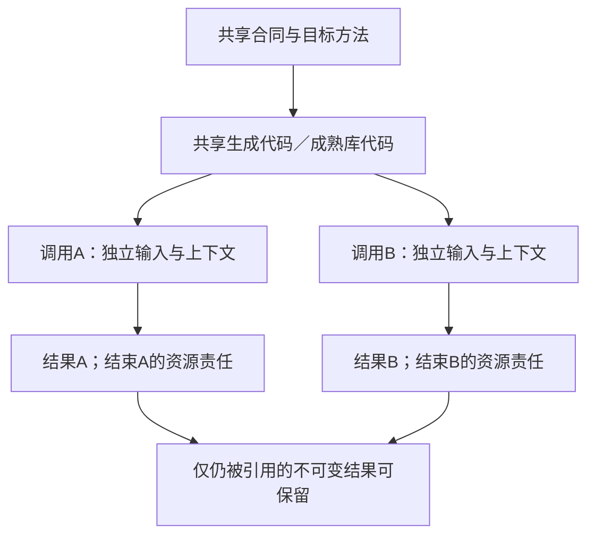
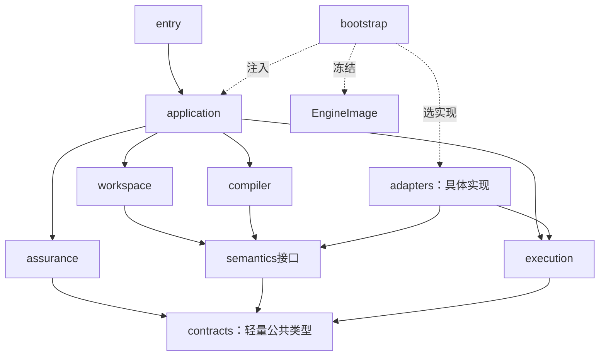

# 源绑定与解释映像

跨表示捕获、精确输入与目标的阶段接口见[多表示输入与统一编译接合](多表示输入与统一编译接合.md)；本篇拥有真实供给、`EngineImage` 和方法装配，不将 SDK 的宿主语言程序视为可在确定性编译期间任意执行的隐含生成器。

<a id="根接合机制的最小物理装配"></a>
<a id="可替换接缝与默认宿主"></a>
<a id="源前端与目标后端不得反向拥有公共模型"></a>
<a id="更换一个内部实现"></a>
<a id="接口边界的落实与自用装配"></a>
<a id="能力控制和全资产支持如何装配"></a>
<a id="意图完成与问题管理的实际装配"></a>
<a id="任务投影与上游适配的实际装配"></a>

<a id="supply-physical-layout"></a>
## 源、导入视图与实现使用点的物理落位

十个逻辑责任保持；下面保留原TS文件名作为已有接缝的定位示例，不是“先完整实现TS再翻译Rust”的新指令，也不是本地包已读回当前仓库物理路径的声明。自身compiler-kernel的已采用方向由[实现语言](../演进与实施/实现语言与机制演进.md#compiler-kernel-rust-substrate)拥有：已有生产能力逐项按MIG0—MIG5切换，新增纯内核能力直接进入该物理方向；TS生态／产品接线仍可保留。实际crate、文件或符号布局由实施时的准确代码与owner对应决定，不靠改后缀制造迁移完成。

这些责任允许不改变公开语义的局部拆并，不新建同名服务。工具私有类型止于adapter，普通业务名不进入中央switch。

```text
semantics/
  modules.ts             作者模块与导入模块的共同公开符号入口
  callable-contracts.ts  值域、错误、效果、寿命与所需观察的只读合同索引
  author-elaboration.ts  声明种子、有限类型约束、潜在效果联动及原作者省略来源
  checking/              现有语言/语义模块的实际作者主体分析
compiler/
  resolve-use.ts         为准确使用点与目标解析已有Binding，形成内部UseBinding
  lower-call.ts          统一编排主体、直接调用和必要适配
  edit-correspondence.ts  记录实际写回能力与补充，输出布局后封存映射
  compose-artifacts.ts   目标级符号、初始化、成员和依赖汇合
  dependency-roles.ts    构建、运行、检查、生成期及资源的贡献与选择核对
workspace/
  imported-view.ts       将真实导出/声明/准确合同组成只读ImportedModuleView
  generated-edit.ts      固定目标草稿与源基础，调用映射写回并形成作者候选
adapters/
  native/typescript/     使用成熟符号与类型服务读取导出，不执行模块顶层
  target/node/           Node目标导入、接收者、调用/格式/生命周期规则
  target/<selected>/    已选目标/ABI适配；Rust目标按其画像落实，不预建未被任务采用的其他目标目录
  packages/              已选择包工具的精确解析、锁与实际安装结果接口
application/
  prepare-job.ts         固定任务、源和导入内容，处理Needs后建立新准备代
  present-change.ts      按作者变化与实际依赖呈现结果，不抄内部UseBinding
```

`ImportedModuleView` 是既有 SignatureView 的模块边界只读投影；`UseBinding` 是调用/导出使用点在选定 Target 下的派生绑定。它们不是作者源、永久 IR、工具参数或全局包登记。按需在本次查询中产生，缓存时必须记录真实依赖；本章唯一拥有 ImportedModuleView 的字段/能力投影，其余导入消费者只能引用，不定义第二份同名合同。

### 数据所有者与不可伪造的完成范围

| 数据 | 必要内容 | 产生与失效 |
|---|---|---|
| 作者`ModuleRevision` | 原源、实际声明/主体、解释、来源与编辑映射 | 真正读取作者文本或结构；没有主体就不造空body |
| `ImportedModuleView` | 模块与精确提供者引用、source language 与 syntax capability、symbols/public surface、types、可引用 contracts/effects、dependencies、assumptions/invariants、source mapping、round-trip capability、成员 coverage、来源与 unknown frontier | 原生前端或被接受的合同导入器；来源、语言/语法能力、条件导出、依赖、合同、映射或 round-trip 能力变化使相交视图失效 |
| `CallableIndex` | 作者fn/静态函数值及外部合同的引用，和当前可用/未知范围 | COMP2记录声明，COMP3类型与效果等合格后冻结；导入类型可用不等于运行实现就绪 |
| `UseBinding` | 使用点、定义与目标、realizationBindingRef、实现分支、调用安排/表示、必要适配、依赖与资格引用 | COMP4沿[原RES交接](../../30-实现解析/实现选择/实现解析与候选资格.md#realization-binding-handoff)解析真实Binding；不手工复制每个字段的完整合同或另作选择 |
| 目标贡献 | 本使用点的声明/导入/调用/资源/初始化/依赖及来源 | 既有LoweringResult；目标组合器唯一汇合 |
| 运行实例 | 某次调用实际创建的上下文、句柄、输入与停止责任 | 目标程序或执行适配器；编译缓存不拥有它 |

ImportedModuleView 对每个实际能力范围记录已证投影：`opaque → structural → typed → contract-aware → semanticized → managed`。`opaque`只保全可读取内容与边界；`structural`增加结构、声明和公开成员；`typed`增加合格类型与签名；`contract-aware`增加可引用合同、效果和适用前提；`semanticized`表示相交含义已被有权关系接纳；`managed`再要求编辑映射、round-trip、影响与变更责任闭合。后一级必须保留前一级的来源和 unknown，不能由默认值补齐。该序列是逐能力的已证范围，不是模块总体成熟度；同一模块可以在不同成员或操作上处于不同范围，首次导入也不要求全仓达到最高一级。

成熟库API的私有checker符号不能越过固定工具实例寿命被另一个版本复用。导入器在受信边界将它们变成有来源的只读值或在工具会话内保留受限句柄；不能深冻结一个外部SDK对象就宣称已得到跨版本公共模型。

### 内部函数的具体交接

```text
resolveModule(ref, exactBindings, capturedInputs, image)
  -> AuthorModule(ModuleRevision)
   | ImportedModule(ImportedModuleView)
   | Needs | ModuleFailure

linkHeaders(authorModules, importedViews, scope, semanticRules, limits)
  -> ModuleSemanticResult（HeaderIndex、CallableIndex、主体摘要、Diagnostics和Needs）

resolveUse(useSite, acceptedContract, target, existingBindings, allowedChoices)
  -> Resolved(UseBinding) | Needs | ContractConflict | Unsupported

lowerBoundUse(useBinding, evaluatedArguments, region, targetRules)
  -> LoweringResult | Needs | LoweringFailure

composeTarget(rootSet, contributions, existingDependencyResolution, layout)
  -> CompleteArtifactRoot | DependencyResolutionNeed | CompositionFailure
```

`resolveModule` 只解析已固定的可得内容：不安装依赖、不执行作者顶层或 Target 工厂。外部不透明符号可保全并取得有限类型资格；跨目标使用必须再核公开合同。`linkHeaders` 经 `Semantics.analyzeHeaders` 收集种子、补足已采用类型、检查 Body/Effect 并冻结 CallableHeaders；外部无 body 的导出直接消费锁定合同。`resolveUse` 逐使用点选择，未知和冲突保留 Needs，新增适配器引入的控制、效果和借用须重新进行相交语义检查。

`lowerBoundUse`只生成目标动作，不能在编译进程创建目标运行的hash对象、文件或数据库连接。它取得已按源码次序计算的值引用；目标参数重排只排列这些值，接收者求值一次。目标运行工厂在声明的调用/会话/应用范围执行；相同库版本只允许共享代码，不自动共享可变实例。

<a id="fig-supply-ownership"></a>
### 图解：供给代码共享与调用状态分离

框内是只读的编译内容；两个调用分别创建运行状态。箭头不表示状态可以从编译缓存恢复。



正常全内存预览只装配固定内容、相关读取/检查/生成方法。真实工具结果需外部执行时返回Needs，由application请求execution；不用给compiler注入任意I/O回调。工具调用成功、输入固定、供给可调用、优化资格与本次写权限仍是不同条件。

### 有限作者组合在装配中的交接

结构读取器消费绑定到实际内容的[有限组合合同](../../10-作者与输入/作者源/结构化源码.md#finite-requirement-composition)，在原prepare-job/模块读取过程中取得完整参数与Rule头；能力表只能声称已实现的构造，不从同一草案名称推断字段支持。实例化结果保留静态外部缺参、有限待选见证和真正运行输入的区别，不能要求先运行产品才能读它的需求。

原resolveUse及其联合计划消费完整作用域和共享主体，绑定选择与假设必须回到准确根。编译器需要选择时先复用合格现有绑定；高层指标未知不由低层数字偷偷裁决。partial根可以保留，共同资源/配置有冲突时不能以分项成功对外宣布整体完成。lowerBoundUse消费的是同一选定分支和见证，方法新增前提后须返回相交核验，不由后端自行换一项要求。

结构源、候选解析、方法选择、实际检查和运行作用分别留在原拥有者。新组合不增加第十一模块、公共工具或持久求解服务；简单任务可以单进程、有界全量检查，更大任务在真实读集与预算下共享分析。完整算法见[作用域选择与偏好](../../30-实现解析/实现选择/实现解析与候选资格.md#scoped-realization)。

<a id="qualified-binding-consumption"></a>
### 从取得资料到可消费绑定的逐根算法

这是`prepare-job.ts`、`resolveModule`、`linkHeaders`、`resolveUse`和`composeTarget`的共同接合，不新增对外步骤或另一种绑定文件。用户仍给结构源、已有引用及本次目标；内部将准确选择送到实际消费者，而不是要求作者逐一填写资料、实现和证明的关系台账。

**BIND0 取准确输入。** application在原PreparedJob中固定本次输出根、使用画像和源层。workspace解析清单/锁及已取得内容；外部位置、搜索摘要、文档旧址只提供取得线索，不能覆盖锁内精确选择。纯编译遇到新外部读取或执行需求仍返回原Needs，经有权的补取形成新准备代，不在旧代中偷读latest。

**BIND1 解引用和解释。** `resolveModule`沿[ModuleUse解析域](../../10-作者与输入/作者源/工程源/工程准备视图与编译输入.md#module-use-binding-domain)取得该命名域、主体、修订、内容域与实际规则；导入联合索引不以裸moduleId覆盖合法多版本。别名迁移到同字节的合格镜像可以继续；若得到的是新版本、不同来源角色或缺必要上下文，则保持ModuleFailure/Needs或相交冲突，不能因导出名字一样而接受。合同目录只表达其已有字段和含义，不提供缺失的可调用方法。私有SDK句柄仍受原工具实例寿命限制。

**BIND2 形成共同头与主体关系。** `linkHeaders`按固定规则检查类型、潜在效果、公开合同和结构实例化；用实际源/编辑映射连接发生位置。两个use都传入同一subject时保持共同主体，各自产生的私有subject不能被内容去重合并。数组重排只能改变该快照的位置索引，不能自动把正在运行的状态转移给另一使用点；对应不唯一时保留作者/迁移缺项。

**BIND3 核每个使用点的供给。** `resolveUse`将本使用点实际接受的合同与方法支持的合同修订、目标、资源和作用前提比较。M@2针对Q@2成立，不能凭Q@3与Q@2同签名就免查语义、数值、失败和进展。旧方法若有范围明确且可取得的保持依据，可以合法支持后继；没有时选择其他合格方法、在已委派范围创作并检查，或返回原Needs/ContractConflict/Unsupported。不将需求降级来凑成功，也不统一拒绝仍合格的旧供给。

**BIND4 降低与共享成员汇合。** `lowerBoundUse`消费已满足本次用途前提、可追到准确RealizationBinding的UseBinding；首次选择由原RES产生并随分根结果保留，不写锁或热改输入映像，不再次以目录别名选择方法。验证用途可以带明确未证明义务形成被测候选；生产消费者仍须核其要求的资格，不能由同一引用的存在推断。新适配的类型/效果/资源重新经过原检查；`composeTarget`按共享配置、类型身份、初始化和真实成员核多根兼容。一个根完整而另一根缺宿主时可以保存前者；若任务要求共同发行，则共同完成条件仍未满足。共享必需成员有冲突时，不能以“各根分别成功”消除冲突。

**BIND5 证据与用途裁决。** 编译器提供实际源对应和构造依据，assurance按声明所需的Claim、被测对象、环境及方法评价。语义保持能承接某些纯值性质，不自动承接安装、权限、性能和外部效果证据。检查需要现实执行时交原执行边界；文档链接、签名目录或本包核验通过都不自造CheckRecord。已取得的独立合格结果可复用，不为形式齐全强造一次新测试。

**BIND6 发布准确结果及后继。** application返回分根结果、残余义务和准确输入身份；当前显示另核请求代与披露。真实保存/运行/发布使用该制品及当前准入，不把旧读权当新写权。输入或实际解释变化形成后继PreparedJob/image，旧工作、旧制品和旧运行不原地换义；取得失败只释放本次实际拥有且无消费者的资源，保留在途操作的原恢复责任。

这条算法在没有外部资料、只有一个已绑定纯函数时可以退化为固定内容和直接调用；不强制先查旧址、启动服务或创建持久操作。依赖粒度由真实读集决定：文档库整体散列负责该库交付完整性，不天然属于每个用户程序的动作键。具体失效条件由[依赖角色](../../30-实现解析/增量与性能/复用资格与失效案例.md#reference-role-invalidation)拥有。

BIND3的跨部件前提由[组合闭合](../../30-实现解析/组合前提与进展闭合.md)处理：支持带主体、分支和实际条件，有状态环需要初态/保持依据，进展另证。BIND4中的原生Pass按[变换接纳](../../40-目标与制品/编译内核/变换接纳与分析保持.md)取得私有写域并发布新IR及适用分析；失败保留原合格基础，不用半变换对象继续发射。原十职责和方法接口不增加平行平台。

**可检查的正反情景。** 库根K采用Q@2/M@2，说明默认移到Q@3，调试根D还缺工具。K继续沿准确@2完成，D返回缺项，联合发行仍不完整。明确把K改到Q@3后，只重核相交绑定及消费者；若保持依据不成立，不把旧生成物贴上新源标识。保存新说明位置不能触发目标程序重新执行，恢复旧运行则仍按其原制品与当前控制资格处理。

### 编辑器/工作区的联合捕获接口

在既有workspace读取责任中实现内部`captureWorkingSet`，不新增公开工具或专用编辑器：输入是准确工程根、内容层绑定、版本化变更/完整内容、元数据基础、读取许可和预算；输出是已固定候选及覆盖/一致性说明，或准确的缺内容、层冲突和拒绝原因。具体CAPTURE0—CAPTURE5由[原生观察](../../80-开发者与接口/原生维护/语言前端与直接编辑.md#text-workspace-capture)唯一维护。

entry/已有工具适配取得编辑器版本或文件捕获，application协调输入与任务，workspace建立SourceBlob、声明映射和候选；compiler只读取固定结果。语法/类型诊断在共享semantics方法中按需运行。待处理改动可在客户端缓冲合并，无需每个按键创建Operation；不同客户端基础不能由共享lastCandidate覆盖。

已写盘的输入只是新前像，不再调用execution重复保存。要将另一个候选回写工作区才进入原提交机制。观察回调不能自带隐式运行或网络权限；普通watch失效事件不能直接覆盖未接纳的生成文件草稿。

对无来源的恢复，adapters提供实际语言/二进制观察，semantics产生有范围的行为及高层候选，assurance记录相应支持；workspace仅在合法采用时改变作者归属。候选规则不是历史作者事实，compiler不在普通构建时重新推测它。

### 逆向编辑在既有模块中的具体接口

```text
classifyEditOwnership(artifactOrSource, capturedChanges, exactImage)
  -> NativeAuthor | ManagedTarget | ImportedPublic | UnknownOrigin

prepareGeneratedEdit(baseC1, artifactG0, changes, scope, retainedOrigins)
  -> TargetDraft(C0, C1, G0, Tstar, mapping) | NeedOrigin | RequestFailure

putBackRegion(targetDraft, correspondence, allowedChanges)
  -> AuthorPatch | PresentationPatch | NeedsDecision | Unmapped | RuleFailure

reconcileAuthorPatch(baseC0, patch, currentC1, semanticChecks)
  -> CandidateC2 | SourceConflict | NeedsInput

verifyRegeneration(candidateC2, targetDraft, fixedTargetRules)
  -> MappedResult | PreservationFailure | TargetFailure
```

这些函数是实现合同，不是已存在SDK。`prepareGeneratedEdit`在引用保留协议内同时固定输入，之后锁外解析；`putBackRegion`只返回补丁，不能直接写作者头。语义层检查作用域、求值、效果与公共要求；compiler再生成；application汇总准确结果；实际保存仍由execution承担。

原生TS读取/重构使用绑定版本的语言服务，在源切片上应用变化，不将任意TS AST对象保存成跨版本协议。高级目标没有相应写回规则时，`ImportedModuleView`仍可供调用和诊断，但不能被转换器当成内部源码。

`EditCorrespondence`与源补充附着于既有生成结果/内容引用；正常运行目标不携带编辑器。只有承诺可恢复编辑的维护内容需要保留来源。回收前由原内容服务核有效保留根，不增加另一个逆向数据库或权限体系。

### 简洁作者补全的具体文件和调用交接

`semantics/author-elaboration.ts`在现有semantics模块中拥有声明种子、签名依赖和有限约束补全；调用`TypeStore`及当前推断/作用域接口，不拥有内容存储或执行器。`semantics/modules.ts`先汇合真实声明和导入；`callable-contracts.ts`在freezeCallableHeaders后只发布类型、效果和来源均合格的fn/函数值入口；仅type-ready的分析态不能流入resolveUse或execution。上述是代码责任设计，不是已存在的新软件文件。

```text
workspace.captureWorkingSet -> 固定ModuleRevision/ImportedModuleView
semantics.collectHeaderSeeds -> 名字、显式类型和待推导头
semantics.completeCallableSignatures -> 类型就绪视图/约束 | Needs | AnnotationRequired | 类型冲突
semantics.check(module, signatureTypes, summaries, rules, limits) -> 主体约束
semantics.closeEffects(analyses, signatureTypes, importedContracts, rules, limits) -> 效果摘要/准确未知
semantics.freezeCallableHeaders -> CallableFreezeResult：合格头/调用索引＋逐项问题
compiler.resolveUse/lowerBoundUse -> 普通函数或合法静态函数值的目标入口
workspace.edit -> 依据原源和对应作最小修改；不覆盖成推导展开文本
```

分析状态属于当前不可变输入的一次工作，不能把一个请求的类型变量塞进共享已发布TypeStore。变化函数体的签名推导是语言分析，不执行第三方库或取得新权限。application返回局部注解位置或实际依赖缺项；根结果只在真实类型闭合后成为可调用。执行层仍消费精确制品，不能凭作者名字或export标签运行未检查值。

解析器支持这套短写法以后，工作区、CallableIndex、输出根和compute-eval必须同批接合；只做前端而让后端要求作者再写一份fn，不算本能力完成。

## EngineImage：解释装配和更新协议

<a id="fig-package-dependencies"></a>

**解释映像版本。（消费条件）：** 插件或方言被替换之后应固定所采用的解释能力和缺省含义；字节能被旧解析器读懂不代表降级后仍保持同一效果。 合同归属：[协议协商中的降级、未知字段与旧客户端保护](../演进与实施/兼容迁移/生态协议与版本演进.md#gift-capability-downgrade)。

### 图解：静态代码依赖与装配注入

实线A→B表示A引用B的公开合同；bootstrap虚线表示装配注入，不是运行期绕过权限。接口可以同进程部署，不要求每框独立服务。



`EngineImage`是实际解释绑定及其已装载方法的只读聚合，复用已有Binding与内容引用，不新增作者语言、全局注册服务或每请求的序列化文件。

| 必要部分 | 具体保存 | 何时决定 |
|---|---|---|
| image本地引用与内容来源 | 组成的精确版本及创建记录；引用不是执行权 | 装配时 |
| 语言/语义入口 | 语言ID、体编码合同、版本、语法/类型/效果规则及支持表 | 按所选能力解析 |
| 方法分发表 | 接口ID、方法ID、输入输出合同、阶段、运行类别、实际实现 | 激活前检查 |
| 控制与默认 | 描述符、值域、producer/authority/scope传播、owner merge/default规则、互斥和目标消费者 | 与其解释内容绑定；不保存通用来源优先级 |
| 目标和格式能力 | 合格目标、AST/工具API族、格式编辑器和后端职责 | 按当前目标与资产加载 |
| 静态装配缺项 | 构建时哪些合同/实现尚未满足；不把空函数当合格支持。当前健康、权限、余量另由使用时观察 | 封存时固定；动态观察不回写image |

仅固定已知依赖，不要求一次发现全世界方法。运行中的纯编译发现新增语言/工具要求时，先返回类型化Needs；application请bootstrap按原任务许可构建新image，形成新的PreparedJob。只有新image对旧已消费接口保持相同解释时才复用旧分析；否则相交重算。原请求中的image实例保持只读，新代际和结果身份明确，不在同一ActionKey内混代。新增能力不能借续接扩大下载/执行许可。

### 解释升级与运行调节的不同输入

EngineImage固定描述符、默认、类型解释和方法实现，不保存不断变化的遥测、Grant或当前调节值。允许在线自适应时，映像只提供已绑定政策及其接口，运行实例持有实际观察与状态；二者的来源、代次及取消／恢复分别在[运行合同](../../50-执行运行与观测/运行生命周期/运行实例-订阅部署与调和.md#adaptive-runtime-control)处理。政策自身升级形成新选择，不原地修改正在解释旧请求的方法。

旧未知字段被新映像识别时，先沿[解释与激活](../../20-语义与组合/组合/语义扩展-执行许可与解释激活.md#extension-interpretation-activation)比较新增含义、消费者和效果；保全原件不等于已接受该新含义。已有明确升级委派及保持证据可自动采用，否则保留相交差异／未决。装载方法成功也不创造当前执行权。

两个扩展声明同一接口并不说明可以任意选一个。ASM2须核定义身份、精确内容和实际实现，冲突交由显式绑定解决；不得依注册次序、动态发现时机或同一个短名称偷偷换实现。旧规则可隔离读取并解释历史，不因此允许重新执行已撤销信任的代码。

### 一种装配机制，不为每个语义族建平台

合同名、库名、结构编码与执行方法不是四个都要常驻的组件。默认语言组合在解析前固定，方法按所需阶段与输出根装配；`EngineImage`继续是已有绑定与可调用方法的只读视图，不因为`gift.object/1`存在再增加对象Profile服务。Rust区域内仍可用进程内只读表和直接函数调用；TS/Bun与Rust的首发接合固定为[本地warm worker](内核工作进程与交换协议.md)，不把方法表转成逐节点RPC。动态插件、远程发现和独立服务仅在真实需求下启用。

一个简单函数只消费基础方法；class使对象检查与实际目标实现进入闭包；流和AD调用使各自方法进入闭包。方法所需依赖沿现有Done/Needs/Stopped继续取得，未安装方法不能由目录声明补成成功。解析可见性、静态分析与目标运行装配分别裁剪，相关合同的标识由[语言组合](../../20-语义与组合/基础语义/计算基础/紧凑表示与程序范式.md#合同标识默认语言组合与按需能力)唯一解释。

### ASM0—ASM6的完整装配过程

**ASM0 选择。** bootstrap取得当前配置与接受的语言/目标要求。已有image仍合格可复用；纯调用可直接由调用者提供固定方法，不启动扫描市场或联网取最新。

**ASM1 解析。** 按包角色、公开出口和精确内容取得定义与实际实现。缺项保持解析失败或部分可用，不能执行作者模块来猜配置。接口签名加载不等于执行插件初始化。

**ASM2 验证。** 检查同ID同版本是否出现不同内容、声明的能力是否有真实方法、参数/结果类型是否兼容、目标是否接受该语义。不可变规则按自身身份去重；两个有状态提供者即使配置相同也不自动合成一个实例。

**ASM3 构造。** 建立方法依赖图。纯声明可按合法SCC装载；运行初始化按自己的前置顺序进行。严格初始化循环没有种子时返回装配失败，不补空句柄。受信方法可同进程装入；不可信过程的实际启动走宿主隔离，不能让任意模块顶层代码先跑完再声称已审查。

**ASM4 封存。** 在builder内补齐分发表和默认，封存后不暴露可写Map或SDK后备对象。按实际可用能力发布image；没有Java后端可以发布仅支持其他目标的image，但不得把Java列成合格能力。

**ASM5 使用与替换。** 每个请求在[运行代接纳点](../../50-执行运行与观测/运行生命周期/运行实例-控制调试与Provider.md#runtime-generation-cutover)同段取得选定image的引用保护，不先读指针再补pin。升级构建另一个image，按预期旧路由切换新请求默认；旧请求不被热替换，锁定旧解释的新请求使用明确保留的合格入口或独立新装配。真实安全撤销可以阻断旧方法的新作用；不能借升级改写旧任务的类型或恢复意图。

**ASM6 释放。** 旧代未来无保护入口已关闭，且没有请求、缓存中的运行引用、依赖其代码的结果、回调/设备或恢复责任还引用旧实例时，才释放实际可释放部分。进程/连接必须实际停止或转移；仅image引用计数为零不证明外部设备已结束。宿主不支持独立卸载时保留到真实退出或按有权的进程边界替换，不用移出分发表冒称卸载。失联资源转入对应未结算责任，不阻塞不相交纯结果释放；连续新代的共存峰值和待退役积压受同一预算约束。

image整体引用便于装配生命周期管理，**不把全image摘要作为所有编译查询唯一键**。方法、规则、默认、库与环境的实际读集决定失效；新增无关语言不重算已有纯函数。 但方法发现若查询了“满足条件的候选集合”，集合成员和不存在条件本身也是输入：按该查询域的目录修订记录，不仅记录最后选中的方法。新增相关候选可能使“最佳”判断需重评，已有合格固定绑定是否更换仍按采用政策；不能为保持局部缓存而漏掉候选集合变化。来源、控制和任务可读资格不因缓存共享而合并。

MLIR要求Pass在多线程期间遵守局部可变范围，并提前声明依赖方言；其分析失效机制也与已保留分析分开。这支持当前固定装配与显式失效的机制选择，不表示Gift采用了其全套对象模型或继承了正确性。参见[PassManagement](https://mlir.llvm.org/docs/PassManagement/)。

<a id="gift-source-interpretation-upgrade"></a>
### 老源解释升级与隐式新效果的采纳资格

更换Schema、解释器、模块、默认值或插件时，旧作者字节可以完全不变而**可执行含义已改变**。本次生成/运行必须固定所采用解释映像和源内容的组合身份；若新解释识别了旧文档过去被当作opaque的效果字段、将缺省值改成有副作用的功能或改变导入优先级，则不能借原保存时间视为作者已采纳新效果。应产生保留原字节的候选解释差异，并要求对应原作者authority按变化范围接受。

解析失败、未知扩展和声明未识别有不同结论；完全不能安全解释时返回缺项或拒绝，不执行任意初始化脚本尝试“修复”。升级验证至少比较新旧可观察行为、权限、资源、目标ABI和公开接口；只有业务语义保持或变更已获授权，才能把新的EngineImage用于正式产物。撤回不合格解释后，已产生的Artifact/Effect按原修订继续被真实记录，不能用新版映像逆写旧日志。

## 合同目录与可调用方法的装配边界

`semantics`持有本请求可读取的语言/语义定义；`compiler`和相应适配通过实际MethodSpec执行其支持阶段。目录中的Definition可以没有已安装方法：源与接口可分析到已支持范围，需求到达缺失方法才返回明确Needs/Stopped。`bootstrap`不为缺方法构造always-success对象，`application`也不以返回空值代表完成。

当前装配提供文本parser、结构decoder和已选原生读取器。新前端需要先改变作者基线的采用决定，再增加adapter；公共contracts不暴露宿主AST。未采用SDK不增加reader、依赖或发行项。

内部实现替换按公开合同、错误/取消、资源、数据和实际版本作组合检查；旧请求固定原image，新的方法只进入新装配。方法是否存在与执行当时是否有权分别判定。完整外部协议由实际需求拥有者给出，未决定的未来协议不得以宽泛method参数伪装全覆盖。

## 作者表示选择与供给复用的实际消费

本节沿既有绑定函数工作，不增加表示管理器。`prepare-job.ts`按真实源范围捕获结构作者、计算文本或原生区域及其编辑拥有者；`resolveModule`选择实际解释与模块环境；结构源不经文本打印中转。`linkHeaders`得到公开边界但不提升成行为证明；`resolveUse`同时消费需求、原生/中立实现、画像、实际适配和证据；`lowerBoundUse`生成必要差额；`composeTarget`闭合本次交付应当解决的成员，保留合法公共宿主输入。

同一源字节可以共享合格解析；原语言、锁、画像或公开接受条件不同，不得共享未经核对的语义结论。选择原生实现不要求新建同义中立主体。无相交方法时仍可保存作者意图；已完整的独立输出不被另一目标缺能力抹去。正式拥有权转移及原生使用点步骤由[混合作者与供给](../../80-开发者与接口/原生维护/语言前端与直接编辑.md#mixed-author-supply)拥有。

阅读构建不是用户产品编译的一条隐含阶段。文档工具有自己的输入清单、渲染依赖与产物；只有任务确实消费这份文档、规则或工具时，其变化才进入对应读集。HTML成功不产生Gift产品的CheckRecord，不取得发布或运行权。

## 方法适用域与运行访问的接合

`resolveUse`可以固定[有条件实现](../../30-实现解析/有条件实现与公共行为保持.md)的守卫与全部实际分支，而不是把子域方法注册为全域实现。守卫读取哪份值、前提来自哪个能力、分支的错误/资源/同步合同和全部依赖都属于该UseBinding的输入；无独立`dispatch.json`或第二个方法库。

`lowerBoundUse`消费同一捕获实参，只求值一次，再按固定条件进入分支；`composeTarget`汇合所有运行可达分支成员。验证用途的候选产物与生产可用绑定分开，不因需要候选运行证据形成“先证明再生成被测对象”的循环。实际检测需要原执行准入。

`prepare-operation.ts`和实际适配将合同落实为[访问与生命周期](../../50-执行运行与观测/跨实现调用与数据寿命.md)：复制/借用/转移的取得、回调登记、接受未知、结果拥有及最后释放。不注入目标原生库到纯编译器以探测能力；装载和初始化通过获准边界进行。这里只规定原阶段的消费者，不给使用者增加必填对象。

## 解释映像与入口装配不变量

### 一次解释装配：使成品不因插件加载顺序改变含义

一项请求固定当前实际使用的语言定义、Definition body/语义合同、模块解析规则、库要求、控制描述符、分析/降低方法、目标工具和默认政策。它们形成**只读解释装配视图**，在物理章称为`EngineImage`。这只是已有绑定与实现对象的聚合，不是新增作者文件、全平台注册数据库或永久大IR。

装配先解析依赖和兼容范围，检查同一公开标识是否被两个不同含义抢占，再建立完整实例。声明互引可以按其规则成组处理；具有副作用的插件初始化不以“有环可求SCC”掩盖。需要外部进程或数据时先取得相应条件；普通导入不能直接执行不受信代码。

一次请求拿到image引用后，不在中途改动它。更新建立新image，新请求选择新image；旧请求保留旧解释，除非当前安全边界要求取消其相交作用。新增不相关库不能使当前任务默认改类型、函数绑定或输出。

**后续才发现新语言或工具时。** 不为了冻结而预加载全部生态。仅缺普通内容时，在原image下形成PreparedJob后继；若新内容确实需要未装载的解释/方法，由bootstrap在本次允许范围建立新image，并形成新的准备输入代际。旧image不修改，已有阶段结果只在实际消费的解释与依赖仍相同时复用。新要求需要改动已固定的语言含义、超出依赖政策或执行许可时，返回明确的采用/能力缺项，不静默继续。公共请求可以协调这个有记录的续接，但同一编译动作键不混用两代方法。

编译键只包含实际消费的方法与定义，不把整个全局目录摘要塞进每个查询。旧方法结果不能因为接口名字相同就给新方法使用；需要适配时，它自身也有版本、输入、输出与保持条件。

这项设计借鉴[MLIR对并行Pass及依赖方言装载的约束](https://mlir.llvm.org/docs/PassManagement/)：可复用的方法不应该依赖全局可变状态或未受控的装载时序。Gift不因此必须使用MLIR，其领域合同也没有自动获得证明。

<a id="从任务要求到可兑现实现的根接合"></a>
<a id="新知识怎样进入而不改变旧操作"></a>
<a id="用户工作与机器操作的关系"></a>
<a id="任务族作用域与最小实现"></a>
<a id="计算算法与事务操作的共同接缝"></a>
<a id="一次联合变更如何正常完成"></a>

### 作者入口的确定装配

当前新产品从[结构化意图与Block](../../10-作者与输入/作者源/结构化源码.md)经该区域固定SourceProfile进入共同语义，计算文本与原生区域沿各自已选解释。application不会为每个请求重新评选SourceProfile、SDK或codec；已有区域要改变作者表示须经过显式迁移。EngineImage按所请求范围装配真实读取能力，不声明未采用的host-builder，也不要求普通协议客户端导入作者构造SDK。

扩展接口保留可替换性，但可替换不等于所有实现都需要现在交付。候选出现、方案可行、当前采用和实际装载分别处理；采用决定由对应正文和D理由记录，不由适配器安装顺序产生。

<a id="本责任的相交定案"></a>

**关联规范：**[原生实现选择的单源绑定](../../10-作者与输入/作者源/工程源/工程清单模块与绑定锁协议.md#design-a03)。
