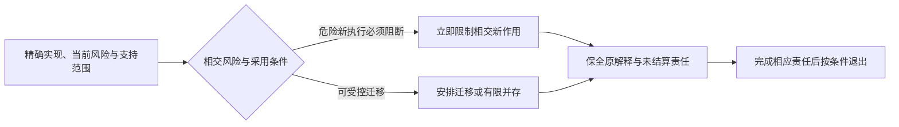

# 历史知识与支持

## 历史证据、知识保全与来源迁移

### 删除 active 文档不等于删除历史价值

旧设计、事故、对话、PR、日志和测试可能包含唯一事实，但它们不能继续作为当前 authority。需要分类、提炼和可定位保全。

### SourceDisposition

```text
migrated-canonical
code-owned
contract-owned
test-owned
machine-ledger
historical-only
extract-required
superseded-duplicate
rejected
unknown
```

### 提炼

按 claim、diagram、state machine、scenario、failure、tradeoff 和 decision 粒度映射到新 owner，不只按文件填一个 destination。无法证明等价的内容保留为 extract-required 或 historical evidence。

### 迁移依据与当前状态

使用 exact repository/ref/path/blob/digest 和时间，避免复制整个旧 corpus 到 active docs。外部或丢失 source 保留可验证摘要和限制。

### 当前事实

历史运行SHA、临时计划和“当前已完成”不散入稳定规范；需要当前工程状态时重新观察。用于定义协议、解释规则、具体算法或固定来源的版本与身份可以是必要设计条件，保留精确范围，不能因包含版本号就删掉。引用版本不自动证明当前采用或运行成功。

### 文档迁移

标题、路径和语言变化不改变 `DocumentUnit` identity；翻译和 projection 是派生物。旧链接可用有界 redirect，但有 retirement。

### 验证

来源文件清点、标题与声明映射、仅对已知语料达到未映射为零、当前真值重复、历史精确引用、被删除的唯一声明、旧动态状态和来源损坏。

### 历史执行与当前重跑

历史报告绑定旧源码，不随当前实现升级而改写。当前运行另存新回执，并允许同一测试ID在不同源码快照下重跑；不同版本的重复运行不计为新性质。保存历史成员摘要和修改前后块，可核对已取得的父内容；未保存的派生阅读器不能仅凭摘要恢复，父ZIP仍独立存在。

## 工程文档的多语言设计

### 中文源与后续译文

当前维护的规范正文是中文。类型、字段、枚举、错误码、命令、路径、协议和标准名称保留原文。未来译文是带来源版本的派生视图；翻译服务或审查者不能以改译文的方式改变源规范。

这是文档工具链设计，不要求 Gift 编译器本体首先实现多语言网站。没有实际目标语言使用者时只维护中文，不制造空的语言目录。

### 文档与单元身份

翻译单元可以是段落、完整表格、图或具备完整作用域的规范片段。需要跨修订稳定绑定的规范闭包引用其显式 `gift-unit-*` Contract Unit；翻译记录同时固定源 revision、源内容摘要、上下文摘要和依赖引用。没有稳定 Unit 的普通片段只按固定 revision 内 locator 绑定，不从标题、行号或文本摘要反向铸造永久身份。

内容摘要用于判断内容变化；身份用于判断“还是同一个单元”。两者分开。移动章节保留身份并更新位置；拆分生成新单元并记录 `splitFrom`；合并记录所有 `mergedFrom`；删除保留墓碑及历史版本。匹配歧义转入有权的映射复核或明确待决；自动证据足以消歧时可以自动完成，实际政策要求时由人工参与，不把最高相似度当确定身份。

### 翻译状态与发布

```text
缺失 → 候选 → 适用检查通过 → 满足发布政策所要求的复核 → 可发布
                     ↘ 失败，退回候选
可发布 → 源或上下文改变 → 陈旧 → 重新处理
可发布 → 发现错误/撤销 → 不可用
```

发布门检查源版本、上下文、术语、代码保护规则和审查证据。已翻译状态不等于对应当前版本；已审核译文也可能因源变更而陈旧。

按指定语言构建一个发布 generation，包含页面、导航、搜索与引用路由。指针只在全套输出验证后切换，避免页面和搜索指向不同版本。源版本与译文版本均在页面可见。

### 什么变化使译文失效

单元文本变化、被引用的术语或定义变义、上级否定/例外作用域变化、表格单位变化和链接目标语义变化均影响翻译。只跟踪段落自身字节会漏掉上下文；把整个中文仓库摘要加入所有单元又会造成无谓全量重译。

因此翻译键由单元内容、必要上下文、目标语言、术语版本、保护规则、翻译方法和检查策略构成。位置只是渲染依赖；不影响含义的移动不必重译，但需要重建导航。未知上下文依赖可保守扩大审查，不能标为无影响。

### 保护与检查

数字、范围、单位、逻辑否定、主体、条件、例外、时间作用域与规范强度单独比对。代码和协议字面量不做自然语言改写；可翻译的是注释或解释，并保持其代码关系。图的可见标签可译，内部节点身份和边语义保持。表格行列合并、排序和空值都需结构检查。

自动检查发现歧义时生成源澄清建议；同源错误不能因为翻译流畅而通过。机器检查只提供结构与差异证据，不声称证明自然语言完全等价。

### 缺失、陈旧和回退

不存在当前译文时明确回退中文并显示原因。历史译文可以在选定旧版本下阅读，不冒充当前规范。用户提交英文修订建议时，先形成中文语义变更，再生成对应译文；不是拒绝其他语言贡献，而是保持一个明确的规范采纳流程。

法律上分别生效的文本不使用普通译文关系；它需要独立权威、适用地域、差异解决和版本合同。此类个案由有权主体决定，不由文档生成器裁判。

### 验收与替代方案

验证单元移动、重命名、拆并、上下文否定、数值单位、图边标签、跨页引用、发布切换失败、源与审查版本不符、缺译回退和旧版本阅读。简单逐文件翻译成本低，但粒度粗且难以独立演进；稳定单元增加索引维护，因此只在真实多语言需求形成后实现。

## 支持生命周期与历史解释

### 目标

通用工程编译器会长期解释旧工程、旧 IR、旧锁文件、旧制品和旧验证证据。支持生命周期必须同时解决两个相反目标：当前系统不能被所有历史实现永久拖住，历史工程又不能因升级而失去可解释、可迁移和可审计能力。

### 支持对象

支持状态绑定精确对象和范围：

```ts
interface SupportDeclaration {
  readonly subjectRef: SubjectRef;
  readonly subjectRevisionRange: RevisionRange;
  readonly supportedHostProfiles: readonly HostProfileRef[];
  readonly supportedInputSchemas: readonly SchemaRange[];
  readonly supportedOutputSchemas: readonly SchemaRange[];
  readonly capabilityScope: readonly CapabilityRef[];
  readonly supportLevel: SupportLevel;
  readonly effectiveFrom: LogicalTime;
  readonly reviewAt: LogicalTime;
  readonly endAt?: LogicalTime;
  readonly migrationPaths: readonly MigrationRef[];
  readonly historicalInterpreterRefs: readonly InterpreterRef[];
}
```

“支持某版本”必须说明支持哪些输入、能力、平台、错误修复、安全更新和迁移路径。

<a id="support-commitment-contract"></a>
### SupportCommitment：支持承诺不是测试通过标签

`SupportCommitment`是工程对某个精确主体、能力/环境单元和时间范围承担的版本化维护/支持责任，不是 Assurance `Claim` 的别名，也不能由 package 存在、一次测试通过或文档措辞自动生成。需要判断这项承诺在某个主体/时点是否兑现时，由 Assurance 从该承诺派生准确 `Claim` 并使用 Evidence/Verdict；承诺本身继续由支持生命周期 owner 持有，验证不能反写承诺范围。

```text
SupportCommitment = exact {
  supportCommitmentRef, supportCommitmentRevision,
  subjectRef, subjectRevision,
  capabilityAndEnvironmentCell,
  minimumAndReferenceVersions,
  qualificationEvidenceUseRefs,
  knownLimitations,
  incidentAndMaintenanceBoundary,
  supportWindow,
  deprecationAndWithdrawalConditions,
  lifecycleAndInvalidation
}
```

同一实现可以在不同环境、能力单元或支持窗口拥有不同 SupportCommitment；同一验证结果也不能自动外推到未覆盖的地域、版本、流量或维护承诺。撤销危险执行资格不必删除历史解释资格，支持到期也不改写历史上曾经成立的证据。

### 生命周期状态

```text
Experimental → Preview → Supported
Supported → MaintenanceOnly → EndOfSupport
Supported → LongTermSupported → MaintenanceOnly
Experimental / Preview → Withdrawn
EndOfSupport → HistoricalInterpretationOnly
HistoricalInterpretationOnly → Uninterpretable（解释材料确实不可获得时）
```

`LongTermSupported` 是显式维护承诺，不是每个版本必经状态；`Deprecated` 是对能力/接口的弃用标记，可以与多个支持状态并存。`RevokedForSecurity` 是执行资格限制，不自动删除历史读取资格。各维度分别附生效范围、责任和证据。

`HistoricalInterpretationOnly` 表示可以读取、审计或迁移旧制品，但禁止创建新的活动绑定。`Uninterpretable` 只在密钥、格式、依赖或法律限制使解释不再可能时使用，并必须记录原因和影响。

### 支持维度

| 维度 | 可能的支持承诺 |
| --- | --- |
| 输入读取 | 可解析、可诊断、可迁移 |
| 输出生成 | 可新建、可更新、仅只读 |
| 行为 | 兼容、修复、安全补丁 |
| 数据 | 读取、写入、迁移、删除 |
| 协议 | 客户端范围、协商和桥接 |
| Host | 操作系统、架构、Runtime |
| Provider | 版本、能力和替代路径 |
| 验证 | 旧证据解释和重新验证 |
| 文档 | 中文规范 revision 与派生译文 |
| 运维 | 安装、恢复、安全响应和支持期限 |

单一“支持/不支持”状态无法表达这些差异。

### 历史解释包

```text
HistoricalInterpretationPackage = {
  subject schemas,
  canonical encodings,
  migration graph,
  required dependencies,
  trust material,
  interpreters,
  verification rules,
  known defects,
  data classifications,
  legal constraints
}
```

历史解释包内容寻址并可离线验证。它不自动获得执行权限；解释器默认只读、隔离、资源受限。

### 可重建与必须保留

优先保留规范源和可重建材料，而不是永久保存所有派生物：

- 规范定义和 Schema；
- 迁移器；
- 内容寻址源码和依赖锁；
- 构建和来源证明；
- 必要密钥或可验证信任链；
- 删除墓碑和法律保留；
- 关键 Evidence；
- 已知缺陷和适用边界。

缓存、索引、普通日志和可重生成制品可按策略清理，但清理不能破坏承诺的历史解释。

### 兼容解释与迁移

读取旧对象时按顺序选择：

1. 当前解释器直接支持；
2. 兼容解释器读取并投影；
3. 无损迁移到当前 Schema；
4. 有损迁移并要求显式决定；
5. 在隔离旧环境中只读解释；
6. 返回结构化不支持或不可解释。

禁止把未知字段丢弃后宣称无损迁移。所有迁移记录原输入摘要、迁移器 revision、输出摘要、损失和验证结果。

### 退役触发

支持降级或退役可由以下事实触发：

- 上游维护终止；
- 安全缺陷无法修复；
- Host 或 Runtime 无法继续运行；
- 许可证或法律条件变化；
- 使用者和消费者接近清零；
- 维护成本超过有权阈值；
- 替代路径已成熟；
- 验证基础不再可信；
- 密钥或签名算法退役。

触发只启动评估，不能自动删除历史能力。

### 支持与历史解释分流



这是支持演进的分支关系，不要求所有旧实现先迁移后才能撤权。保留历史解释不授予继续执行权。

### 退役计划

计划记录支持对象、通知与时间条件、消费者观察范围、替代/迁移/拒绝路线、回退边界、历史保留及负责的角色。普通弃用可以先迁移再撤销；安全撤销可先停止危险执行，再处理受影响消费者，不等待开放世界消费者全部消失。

离线节点、备份、支持工具、恢复脚本、审计导出和历史环境分别安排。仍须读取旧对象不意味着旧版本能继续联网写入。物理删除在相交义务解除后进行，不把只读解释自动当成无风险，仍须隔离、数据许可与资源预算。

### 安全修复与旧版本

安全事件时需要区分：

- 立即撤销新执行；
- 是否仍允许只读解释；
- 是否必须重新构建历史制品；
- 旧 Evidence 是否可信；
- 是否需要迁移数据或轮换秘密；
- 哪些用户或项目必须通知；
- 何时允许例外及谁有权接受风险。

支持期限不能成为继续运行已知危险版本的自动理由。

### 多语言和文档历史

中文规范文档按 generation 保留。未来译文只绑定源文档单元和术语 generation。旧译文可以用于历史阅读，但：

- 必须显示对应中文源 revision；
- 陈旧状态不可隐藏；
- 不能用于签发新决定；
- 法律独立文本必须另建权威对象；
- 术语变化不应改写旧审计记录。

### 可观测与支持证据

支持状态的运行证据包括：

- 活跃消费者和版本分布；
- 迁移成功率与失败分类；
- 安全和可靠性事件；
- 维护成本和修复时延；
- 历史解释成功率；
- 未迁移离线节点；
- 支持例外和到期；
- 旧执行权限残留。

遥测缺失不能解释为消费者清零。

### 故障场景

- 删除旧解释器后发现备份只能用该格式恢复；
- 旧 Provider 消失导致历史 Evidence 无法重放；
- 升级迁移静默丢弃未知字段；
- 已宣告退役但离线节点继续写旧协议；
- 安全撤销只更新注册表，活动进程仍持有能力；
- 历史签名算法失效但审计仍依赖它；
- 旧译文被当作当前规范；
- “零活跃用户”源于遥测中断；
- 许可证变化使历史分发不再合法。

### 验收条件

- 支持声明绑定精确范围和时间；
- 支持维度不压成一个布尔值；
- 历史解释与新执行权限分离；
- 迁移明确无损、有损和不可解释；
- 退役包含备份、离线、恢复和支持消费者；
- 安全事件能撤销活动能力和相关证据；
- 中文规范历史可追踪，译文不形成第二权威；
- 消费者清零由多源证据证明；
- 物理删除不破坏承诺的历史解释；
- 所有例外具有 owner、期限和反转条件。
