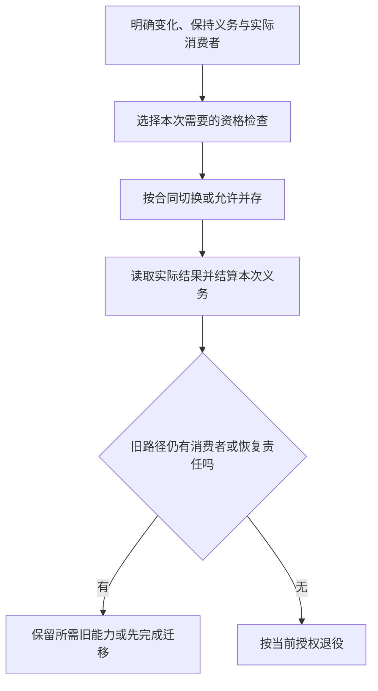

# 迁移切换与退役

<a id="gift-unit-7741f5e699e7585aae9eb3a5cb798cbb"></a>
## 演进、迁移与退役计划

### 目的

`EvolutionProgram`是按需派生的迁移计划，表示从旧定义、实现或物理状态到新代际的合法过渡。版本号变化不自动要求数据迁移。临时竞争双写有边界与退出条件；长期多协议服务是另一种有权威和一致性合同的稳定架构，不能凭其名字永久豁免迁移义务。

### 结构

它不是第二份当前状态数据库；真实attempt/effect/readback仍由执行与恢复owner持有。

```text
EvolutionProgram = exact {
  evolutionRef, evolutionRevision,
  subjectAndScopeRefs,
  oldAndNewDefinitionRefs,
  compatibilityDecisionRefs,
  currentConsumerAndWriterCensus,
  preservationAndTransformationRules,
  migrationOperationDag,
  qualificationAndOptionalShadowPlan,
  readerWriterCompatibilityAndCutoverPlan,
  recoveryAndFallbackBoundaries,
  supportWindow,
  retirementPredicates,
  evidenceAndUnknownFrontier
}
```

### 兼容维度

结构兼容、语义兼容、行为兼容、数据兼容、权限兼容、操作兼容、部署兼容和支持兼容分别判定。字段可解析不代表含义兼容。

### 阶段与路线选择

```text
proposed → qualified → cutover-ready → active-new → old-restricted → retired
```

这表示可能的业务阶段，不是全部任务的强制管线。`qualified`可以来自足够的静态保持检查、有限符合性验证或需要时的影子运行；数据回填、双读/写、分批流量和恢复检查按所选路线作为有依赖的子任务。修改没有状态的文档或实现不要求创建影子服务。路线、观测方法、失败状态和撤销条件归[迁移合同](#兼容迁移切换与退役)。

### 迁移失败

实际作用步骤明确前提、效果、检查点、读回，及可回滚、可补偿、只能向前或尚未知的恢复能力。无法保证恢复的步骤先显示不可逆点与当前准入条件，不能写成“每阶段都可恢复”。取消或预算耗尽不修改已发生事实。

### 退役：演进、迁移与退役计划

退役针对声明的支持和权威范围确认：旧在线写入已切走或被目标端拒绝；必要消费者已有替代、明确退出或隔离；历史读取、备份与未结算恢复内容按真实保留义务处理。不要求找到开放世界全部消费者才撤销危险版本，也不因活动实现退役删除唯一历史解释或恢复路径。简单删重文档不套运行退役流程。

### 验证：演进、迁移与退役计划

覆盖旧数据、混合版本、部分迁移、并发 writer、回滚失败、离线节点回归、旧备份复活、消费者漏计、兼容窗口过期和新旧语义不等价。

## 兼容、迁移、切换与退役

**兼容分量。（消费条件）：** 公共API签名没变并不代表ABI布局、分配器边界、线程要求与错误语义兼容；切换准入按真实消费者逐项核验。 合同归属：[跨ABI、异步调用与资源释放的共同协议](../../../50-执行运行与观测/跨实现调用与数据寿命.md#gift-abi-lifetime-contract)。

**迁移性质。（消费条件）：** 仅能读旧文档不等于保持旧行为；新解释激活额外效果须另核权限与作者采用。 合同归属：[老源解释升级与隐式新效果的采纳资格](../../实现与装配/源绑定与解释映像.md#gift-source-interpretation-upgrade)。

### 兼容是多维的

```text
SourceCompatibility
BinaryCompatibility
SchemaCompatibility
ProtocolCompatibility
BehaviorCompatibility
DataCompatibility
OperationalCompatibility
SecurityCompatibility
```

一个“兼容”布尔值不足以描述工程变化。

### 变化产品

```text
TargetDesignGeneration
ObservedImplementationGeneration
ReconciliationResult
MigrationPlan
TransitionExecution
ConformanceEvidence
```

目标、当前事实和迁移不能混成同一文档或状态。

### 迁移路线不是固定长流程



这是已请求迁移时的控制图；并存和退役由实际消费者决定。正常设计或纯生成不执行此图，失败与未结算分支使用本章迁移协议。
影子运行、双读写、分批流量、数据回填和恢复演练，只在对应风险与前提成立时加入。无状态保持修改可以直接经充分检查切换；具有不可逆外部效果的影子执行不允许重复产生真实作用，需观察/模拟或隔离端口。影子结果不等于所有输入等价。

阶段失败保留实际状态，不无限循环“直到消费者清零”。关闭旧在线入口可以先于处理离线历史读者；后者采用明确的兼容、离线迁移或拒绝政策。活动代码退役不删除仍必要的恢复内容。

### 读写组合与迁移准入

兼容至少绑定生产者、消费者、方向、格式版本和要求保持的含义。同名字段能解析，不说明默认值、未知变体、溢出、权限或回写保持。

| 组合 | 准入必须检查 | 不满足时的路线 |
|---|---|---|
| 旧写者 → 新读者 | 旧值、缺省、单位、异常和排序按新读者仍保留原含义 | 先扩展新读能力或明确转换；不能凭新版本号放行 |
| 新写者 → 旧读者 | 新字段/变体、范围、编码和默认含义是否被旧读者支持 | 限制新写能力、隔离旧读者或先升级读者 |
| 新值 → 旧读改写 → 新读者 | 中间路径是否保留未知字段、变体、精度和存在性 | 旧写端只读化、原字节转发或有保全能力的版本；不能只测解码 |
| 当前数据 → 回滚版本 | 新写入是否仍可解释，安全修复与外部状态是否允许退回 | 采用前向修复，或在切换前建立确实可用的逆变换/备份恢复 |
| 旧备份/离线节点 → 当前系统 | 读取版本、删除/撤权记录、外部资源身份与再准入条件 | 受控恢复/迁移，不让旧writer和已删除内容无条件复活 |

例如新增一个和类型分支，可能保持字节格式可读却破坏旧代码的穷尽匹配。字段“缺失”、显式null与默认值不同；旧读者把未知字段删掉后重新编码，会造成信息损失，即使新旧双方都成功解析。ProtoJSON的未知字段能力不同于Protobuf二进制，经过JSON转换不能继承二进制保全结论；具体协议映射见[来源](../../../../research/sources/语言编译与目标工具.md#语言编译与目标工具)。

持久字段/变体的标识在支持范围内不复用给不同含义；显示名、序列化名和稳定语义ID分别迁移。开放未知变体要保留标签与原载荷，并允许显式unknown处理；存在性、顺序与重数沿[未知 occurrence 保全](../../../20-语义与组合/组合/语义扩展-执行许可与解释激活.md#unknown-occurrence-fidelity)检查，不能由旧代码 getter 的默认值冒认原值，也不能因未知集合仍在就声称有序字段往返无损。任意自描述数据不能自动授权加载解释器或运行迁移。

一次演进使用上表导出真实前置。例如旧writer仍可能覆写新字段时，先停止/升级旧writer或启用无损中转，再允许新写；不是所有项目都按“读切换然后写切换”排列。最低协议版本只有在真实端点强制才有约束力；清单声明本身不围住离线写者。

<a id="authority-bearing-format-migration"></a>
### 授权与证据载体的版本解释

一个作用域内的规范责任和最终准入必须明确，不等于所有持久载体永久使用一种 schema。格式演进先按上面的读写组合检查；没有真实不兼容变化时不制造新版本，有真实不兼容变化时也不能仅为维持版本号而把新增含义强塞入旧默认或额外制品。

授权、签名、摘要、回执及证据载体的版本路径按以下边界处理：只在受支持的有限解释集合中选择与载体或其已绑定外层描述符相符的版本；选择解码路径本身不授予可信地位，也不允许从载荷动态装载任意代码。先按该版本原规定的字节、签名/摘要域及规范化算法验真，再做内部表示转换；不能把重编码后的对象当成旧字节已验真的证据。版本选择只使用有界解码及受信的静态解释映像，不在验真前执行载荷回调。版本选择失败或验真失败时，不试用更宽松解析器寻找可接受结果。转换保留原版本、来源和缺失/null/未知的区别，只有原含义确实支持时才能补出相应值。

新字段影响准入而旧执行者不理解时，字节可读、未知字段可往返或旧签名有效都不足以让旧执行者继续作用。例如加入地域、收款人或最大额度约束后，忽略字段的旧处理者不能据此执行未经约束的操作。真实作用点应按所选迁移路线限制写者、隔离或升级消费者，并取得必要的新授权；没有新授权不从旧载体默认出新增权利。关键未知字段不能被忽略后继续准入；只读保全或无损转发不获得执行资格。新 schema 被正确解析仍须满足当前对象、载荷、撤销和作用前提，历史授权不因转换自动恢复有效。

是否独立为 owner artifact/receipt，按独立签发者、更新/保留周期、原子提交关系和真实消费者判断。同一责任、同一更新周期且需要原子保持的字段，可以采用一份有版本的载体；有独立权威或生命周期的事实可以采用受绑定的独立载体。两种方式都须保留真实身份、完整性和组合验真；不得把拆分文件当成隔离证明，也不得合并本应分别授权的动作。取舍与迁移沿原拥有者完成，不新设版本总控服务。

切换前列明实际接受、签发、回写、重放和恢复的方向；切换失败保留已发生效果和准确在途操作，不把解码失败改成“未执行”。旧格式退出以所支持读者和未结算责任为界：旧在线执行入口可以因安全要求先行拒绝，必要的只读历史解释与受限恢复仍按原合同保留。只读解释不取得再次执行权；当约定支持和恢复义务均已结束时才退役相应解释路径，不为了历史兼容永久维持可写旁路。

### 函数契约与闭合类型的演进

同名函数及同一参数类型不等于行为可替换。前置变强、正常结果或错误集合改变、潜在效果扩大、契约入口被移除，都要按实际调用者范围审查；函数存进容器、经回调或跨模块传递后仍是消费者，不只扫描直接文本调用。用户明确收紧业务输入是合法产品变更，却不能被标为无行为变化的实现替换。

名义类型的公开合同、构造器集合及依赖解释参与兼容判断。新增变体使旧的模式覆盖结果陈旧；旧程序有通配分支也只说明它有一条运行路径，不证明它理解新增业务。旧缓存的构造器全集、已专门化函数和省去的guard按实际依赖失效。纯私有布局优化在保持公共合同的情况下不必更换作者身份或强制所有消费者迁移。

这类变化不预设双写或永久兼容壳。先选择同源重建、显式适配、限制旧写者或独立版本；无法满足保持条件才阻断相交采用，其他独立模块和设计仍可继续。

### 数据迁移

按读写矩阵选择扩展、回填、校验、切换与收缩的依赖次序。每阶段明确可逆、需补偿、只能前向或未知；不可逆点之前取得相应许可和可用恢复方案，不承诺任意阶段都能回到原状。临时双写要说明一致性、对账与退出，不能让同一业务副作用被两路重复结算。

### 协议迁移

- 能力协商；
- 双读/双写仅在必要范围；
- 旧客户端支持窗口；
- 错误和完成语义保持；
- 版本桥可观测；
- 不兼容请求明确拒绝；
- 最终移除旧协议。

### IR 和定义迁移

持久 IR 带 schema revision。迁移记录原字节、算法、输出和有损字段。不可无损迁移时保留旧解释器或要求重新观测/决定。

### 实现替换

先确定候选身份、目标与保持范围，再选择满足范围的资格检查。可证明的局部重构不强制双跑；状态或环境敏感迁移可采用隔离影子、独立检查或分批真实流量。验证与切换绑定精确候选，切换后读回，旧活动绑定按支持域排空、迁移或拒绝。必要历史解释与恢复材料独立保留，不因为旧提供项撤销就全部删除。

### 方案代价与重新裁决

完整双运行增加资源与共同原因风险；直接切换减少过渡状态却扩大一次失败范围。当前默认是选择足以承担已声明风险的最小路线，不凭没有生产证据停止设计；未知影响实际准入。观测无法区分新旧行为、对账不能收敛或旧writer不能有效限制时，回到读写矩阵和权威边界，不能只延长超时。

### 回滚和前滚

回滚只在旧版本仍兼容当前数据、协议和安全状态时合法。不可逆数据或外部效果优先前滚修复。迁移计划必须标记不可逆点。

### 消费者清零

清点范围包括：

- 在线读写者；
- 后台作业；
- 缓存和索引；
- 消息和重放；
- 备份与灾难恢复；
- 离线节点；
- Provider 和插件；
- 权限和审计；
- 文档、工具、脚本和支持流程。

上述集合按项目实际支持和观察域清点；开放世界未知消费者不能被伪装成零，也不构成永远不能停止不安全版本的理由。到期或安全撤销可在端点拒绝旧接入，并记录仍需处理的历史/合同义务。所谓consumer-zero仅在该封闭集合、版本与时间条件内使用。

### 退役：兼容、迁移、切换与退役

活动能力退役不是删除文件。按资源和承诺选择下列适用步骤，依赖来自实际风险，不把它套给删重文字或未启用候选：

1. 阻止新绑定；
2. 迁移和排空活动实例；
3. 撤销权限、密钥和发布入口；
4. 保留必要历史解释和数据读取；
5. 清理缓存、索引和监控；
6. 验证所声明范围的消费者迁移、排空或拒绝；
7. 删除不再承载活动、历史读取或恢复义务的代码和物理资源；
8. 发布退役证据。

### 局部性

迁移按责任、契约或消费者闭包分片。公共身份和协议根变化可能广泛，但影响图、双版本窗口和退出条件必须可计算。

### 验收

- 当前和目标分开；
- 迁移每阶段可判定；
- 有不可逆点和恢复策略；
- 按路线适用的静态、独立检查、影子或差分证据；
- 切换后权威读回；
- 旧写权撤销；
- 支持范围内消费者处理完整，未知边界与保留责任明确；
- 退役后旧机制不能复活；
- 历史制品仍可按支持策略解释。

<a id="gift-mixed-release-compatibility"></a>
### 灰度发布中的读写兼容矩阵与不可逆分界

发布一个新版本不表示所有调用者同时切换。迁移计划将 `oldReader/newReader × oldWriter/newWriter × oldStoredData/newStoredData × oldRuntime/newRuntime` 作为**可能的兼容维度**，只验证实际可达、正在用或按恢复义务必须支持的组合，明确不可达组合及其隔离依据，不要求无条件测试全部笛卡尔积；新写者产生旧读者不能解释的数据之前仍须证明旧消费清零、双写/兼容读或隔离边界。中间版本可以暂时增加桥接字段，但不得仅因为某一实例回滚成功就宣布持久数据和外部效果均可回滚。

完整切换至少区分：准备兼容能力、扩展读者、部署兼容写者、确认真实旧消费者持有/在途数量、收缩旧格式、退役旧恢复路径。它们不是每次必须完整运行的固定流水线；根据需求可走前滚、短暂停机、蓝绿或双读，但必须满足各自不变量。中断时按准确代际停止不安全新写；对于已写入不可逆新格式或已触发外部Effect的情况，回滚应降格为受控前滚或补偿工作，不伪造旧状态。

## 分阶段发布、金丝雀、回滚与向前修复

### 发布不是一个布尔值

```text
built
→ verified artifact
→ staged
→ canary
→ ring rollout
→ broadly deployed
→ supported
```

每层绑定 exact artifact、环境、配置、流量和 Evidence。

### RolloutPlan

```text
RolloutPlan = exact {
  artifactAndEnvironmentRefs,
  populationAndRingPolicy,
  trafficAndDataCompatibility,
  preconditionsAndGuardrails,
  monitoringAndDecisionWindows,
  rollbackAndForwardFixOptions,
  authorityAndCommunication,
  completionAndRetirement
}
```

### 金丝雀代表性

内部低风险流量不能代表峰值、关键租户、长尾数据和特殊地域。每个 Claim 指明 canary 支持的外推范围。

### 旧写者排空与混合版本的可接受时间窗

有状态系统滚动部署时，新旧读者和新旧写者可能同时存在。所谓expand/contract可用，前提是当前确有一段两者共同能解释/提交的兼容区：新schema先加字段不代表旧代码会正确保全新值，旧代码继续写可能丢字段、触发旧约束或把新状态改坏；数据格式可解码也不代表旧业务不变量仍成立。新写格式开始之前须确认旧写者停止、受限迁移写通过共同协议，或有已验证的双写/转换算法；独立双写两个源不是容错后备而是竞争权威。

切换应依照所选目标能力确定：谁能拒绝旧generation提交、旧服务有没有在途事务、哪些客户端仍可传旧载荷、读端怎样发现准确schema、backfill按哪个水位检查、新读者是否容忍尚未迁移的记录。没有实际围栏或端点隔离时，既无法确定旧写入停止，也不能宣称迁移已越过不可逆切面。先暂停破坏性清理、限制混读路径并保留完整当前可用服务；不能为完成发布图示而删除剩余可解释的旧数据。

真实恢复分三个不同后继：可证明无实际新写/效果则回退候选；已产生兼容状态的按证据选择回滚或前滚；已有不可逆外部Effect则独立结算并进行有权补偿/向前修复。上述转换由本迁移owner决定，Target release selector只执行已选的制品版本，不给不可逆的旧消息撤销权。

### 回滚

代码可回滚不代表数据、外部 Effect 和客户端兼容可回滚。回滚前检查 schema、消息、缓存、凭证和第三方状态。

### 向前修复

当回滚更危险或不可能时，进入 forward recovery：冻结进一步变化、限制 blast radius、发布最小修复、验证和清理残留。

### 验证：分阶段发布、金丝雀、回滚与向前修复

金丝雀样本选择错误、监控延迟、回滚与新模式不兼容、部分区域发布、新旧客户端并存、功能开关漂移、制品不匹配、沟通失败和回滚后残留。

## 删除、墓碑、备份复活与遗忘权

### 删除不是只从主库移除

数据可能存在于副本、缓存、索引、日志、导出、模型、备份、离线节点和第三方 Provider。删除需要传播和防复活。

### DeletionObligation

```text
DeletionObligation = exact {
  subjectAndDataScope,
  authorityAndLegalBasis,
  storageAndConsumerInventory,
  deletionOrAnonymizationMethod,
  propagationAndTombstone,
  backupAndOfflinePolicy,
  verificationAndExceptions,
  completionAndRetentionEvidence
}
```

### Tombstone

墓碑有 identity、subject、deletion generation、scope、retention 和 authority。恢复旧备份、离线节点或迟到消息时，墓碑优先阻止数据重新激活。

### 备份

立即物理改写所有备份可能不可行；策略可在恢复时过滤、限制保留期和隔离访问。例外如法律 hold 必须明确 authority 和 expiry。

### 派生数据和模型

删除原始记录不一定能从聚合或模型中完全移除。必须说明可识别性、可逆性、重新训练/机器遗忘能力和 residual risk，不能虚假承诺。

### 验证：删除、墓碑、备份复活与遗忘权

缓存与索引、搜索、分析、日志、导出、第三方、备份恢复、离线同步、迟到事件、法律保留到期和租户删除。

## 稳定接缝与安全替换

<a id="语言体系与工程系统的边界"></a>
<a id="生态成熟也保留选择和不确定性的准确边界"></a>
<a id="进展条件和资源边界"></a>
<a id="先稳定什么怎样限制返工"></a>

### 什么稳定，什么可以变，怎样避免无谓返工

稳定对象是公开语义、作者归属、版本化交接和真实副作用责任。公共要求不变时，私有算法、数据结构、目标打印器、存储实现和并发方式可以在对应边界内替换。扩展包新增能力不能迫使所有消费者重新写源；可见行为、ABI、持久数据或运行假设改变时，必须处理真实迁移，不能用一个adapter名称掩盖。

本版选定模块化单体，不先建设一套分布式平台；选择稀疏作者源和局部投影，不先物化全世界图；复用成熟解析器、数据库与目标工具，不重做已具备的能力；保存实际新增的规则与接缝，不把上游测试成绩当作Gift全体系证明。

没有无条件的“任何未来要求都不会大改”保证。可以检验的是：遵守公开合同的消费者，在替代实现保持该使用域合同、ABI和环境要求时，不必因为私有改变而重写作者源。无需重写、无需重编译、无需迁数据和无需更改部署仍然分别判断。

六类基础接缝按产品目标和机制定义。旧实现符合合同就复用，不符合则适配或替换；迁移用于评估实际成本和路径，不能反过来决定用户必须怎样创作。
