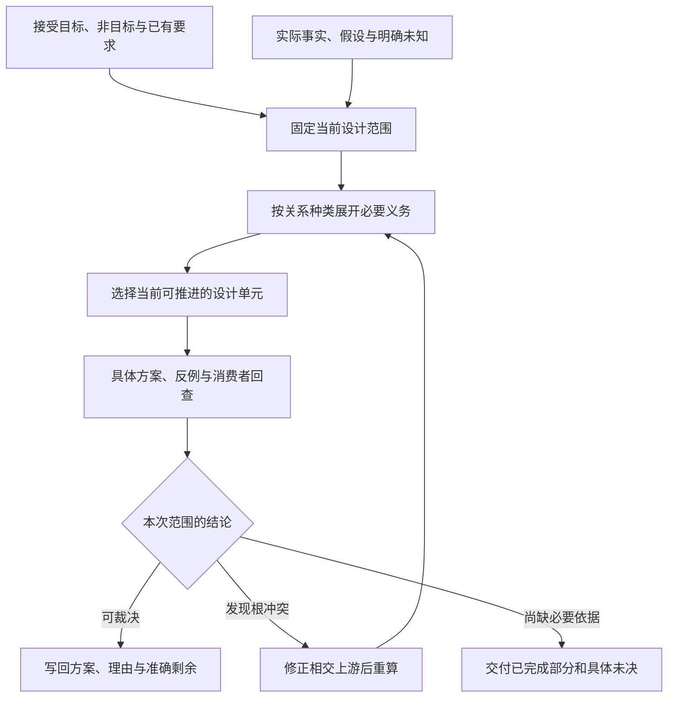
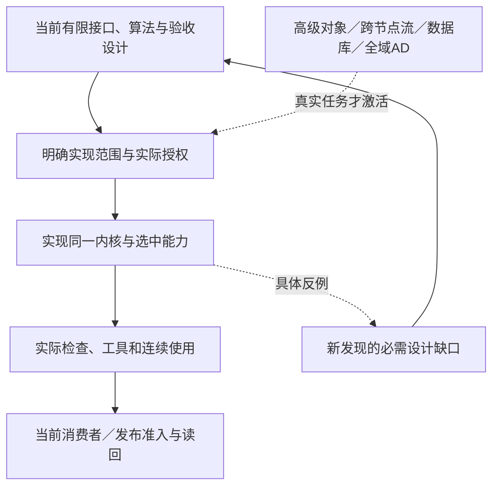

# 工作组织、优先级与成熟度准入

## 工作组织、优先级与成熟度准入

### 问题优先级与当前可推进前沿

当前采用[作者基线](../../../10-作者与输入/作者源/可替换表示与适用范围-语言定位与作者基线.md#当前作者面实施基线与决策状态)：新产品意图/Block以逻辑 AuthorModule/Requirement dialect 进入同一编译链，物理字节由每个 AuthorRegion 的合格 SourceProfile 承载；严格 JSON 只是可选结构 profile/codec。明确选择的计算源与原生资产保留，不交付嵌套作者 SDK。广义小工具、业务和复杂算法共用成品职责；数据库/中间件内部深化是否暂缓按具体任务，外部合同及已发生作用的责任不撤销。

当前规划先区分三种真实交付：尚缺算法/接口的事项继续设计；已有完整规格的事项进入实现与符合性；真实环境与收益通过对应运行取得。设计任务只推进第一类及必要的规范维护，不通过改名把它自动变成产品编码。技术比较线索不增加实施项。

下一设计交付由问题条目的实际剩余决定。有限私有函数抽取/内联已由[语义编辑](../../../20-语义与组合/组合/结构编辑/编辑重构与确定回写.md#私有函数抽取与局部内联)给出；有限对象、流和AD已有独立规范，下一步区分其实现/符合性与尚未纳入的高级子域。没有新反例，不重开已选定的公共架构。

本节拥有**设计与工程工作的选择算法**。[自主发现](../工程挑战-发现推导与覆盖.md#目标到义务的自主发现主循环)负责产生和攻击义务；**[当前实施闭包](../../../90-治理与参考/状态/实施闭包.md)汇总尚缺的真实产品实现与证据；未闭合设计问题回到准确 canonical owner。编译期间调度已固定的查询/动作，由[编译调度](../../../40-目标与制品/递归并行与远程编译.md)负责。产品规划、编译动作和目标程序运行不能共享一个含义不明的priority。

#### 先拆开必要性重要性紧迫性与优先级

**必要性**说明某项义务为什么进入所选目标：不可绕过的语义/安全前提、所选方案引出的实现义务、可替代方案之一、可选改进，或没有已确认消费者。一个具体组件不是目标本身；存在合格更小替代时，不能把原组件标成永远必须。

**重要性**描述遗漏或错误的后果：会改变哪个结果，影响哪些主体与范围，是否泄露或破坏内容，是否能恢复，及发现时已投入多少相交成本。后果可以很严重却暂未激活；远程数据泄露在选择远程执行时是硬边界，不使完全离线的纯生成必须先建远程身份平台。

**紧迫性**来自真实期限、正在累积的损害、不可逆点和延期成本。没有日期就不捏造截止期；未来可能很重要不等于现在发生事故。

**就绪度**回答本次允许的动作能否推进：完整设计可能只需已有材料，而修改仓库还需要当前前像与另行授权。缺运行结果通常不阻止给出设计方案；设计尚未说明类型或错误，则不能把它伪装成纯实现问题。

**不确定性与工作量**分别记录。未知不是零风险、无穷困难或无收益。没有可靠工时就记录需先决定的变量和下一份可交付内容，不用任意小时、百分数或1至10打分制造精确感。

**优先级**是本次范围下，综合上述事实、前置关系与机会成本形成的工作顺序，不是问题永久属性。优先级可以降低，但问题和其真实必要性继续存在。

#### PLAN0至PLAN7：从问题全集得到当前可执行选择

PLAN编号只定位工作规划；编译章的COMP0—COMP7仍专指产品编译阶段，二者不混用对象。

**PLAN0 固定当前目的与约束。** 确定本次只设计、允许实施、允许检查还是实际恢复；读入已接受目标、当前问题和本次新事实。仅有假设事故时做情景设计，不按正在发生的事故抢占。实际已发生且仍有不可逆后果的作用，先按其真实权威与恢复合同处理。

**PLAN1 激活义务。** 从本次选中的结果根，沿必须共同满足的AND关系展开；OR关系保留合格替代，不同时要求完成所有备选；条件关系先检查条件；未来可选能力保留问题但不进入本次阻塞集合。禁止项是过滤条件，不因看起来成本更低而进入备用路线。

**PLAN2 检查前置与共同设计。** 只有“这份交付在逻辑上必须先使用那个结果”才建立硬前置。共同讨论的接口与实现方案采用协同组，不强制先后；生产者/消费者、验证、冲突、失效和历史来源分别有型。硬前置形成环时，先检查是不是误把协同当顺序；真实联合问题建立一个可裁决的工作组，不能任意打断一条依赖来画成DAG。

**PLAN3 计算当前工作前沿。** 取当前目的允许、所需事实可以取得、必要前置已满足或可以在同组完成的交付。只设计时，前沿可以包含协议、算法、反例与迁移选择，不包含未经授权的程序执行。阻塞项保留缺的具体输入、取得责任和允许独立继续的子域；不得因为某个问题没有完整方案就从表里删除。

**PLAN4 排当前设计档位。** DP0处理会使本次既有目标/公共含义/作用安全错误，或使大量下一步建立在错误基础上的设计；DP1处理已选定范围中的具体能力闭合与真实消费者；DP2处理有条件的后续画像、增强与优化设计。这里是设计工作顺序，不是漏洞严重性评级。强实时、远程或多租户一旦成为本次硬要求，其相交DP2义务随激活进入必要前沿。

**PLAN5 在同档内作明确选择。** 先解除当前真实阻塞和会使后续返工的决定，再完成能让整条路径成立的缺口。比较实际解锁的交付和能否用一项有限阅读或设计区分最强备选。存在已接受期限时计入延期；不存在可比较成本时，采用稳定的发现顺序/问题编号作为最后平局规则，并写明没有最优性证据。原本相交的父项需要某个较低档前置时，只提升那项必需子交付，不把整个主题宇宙一起提升。

**PLAN6 执行一份闭合交付。** 工作包写明当前输入、要作出的决定、所属规范、相交消费者、成功路径、失败分支和可检查的结束条件。一个工作包可以解决多个协同问题，也可以只关闭一个大问题的明确子范围。不能为了多报完成项，把一份必须共同成立的合同按段落拆开；也不能让一个题为“完成所有语言”的任务永久吞掉所有进展。

**PLAN7 重新计算而非机械下移一行。** 完成后更新真实决定、未决和依赖；发现新根前提就回到相应上游，扩展影响；已有方案仍成立就直接沿用。下一项从新的就绪前沿选，未激活的严重问题不被伪称已解决。相同主题在没有新材料和反例时不再无限重审；无实际进展的重复迭代必须改换取得信息的方法或准确结束当前路径。

算法产出是一份**本次选择与理由**，不是一份新的永久产品账本。完整问题内容归准确的规范 owner、[当前实施闭包](../../../90-治理与参考/状态/实施闭包.md)或证据来源；当前工作包只引用其精确范围，改变顺序不改需求含义。未进行代价测量时，只给条件性的当前排序，不给“重要度87%”或假精确总分。

#### 当前总表怎样阅读与何时更新

[当前前沿](../../../90-治理与参考/状态/README.md)是尚缺能力类型的阅读视图；[实施闭包](../../../90-治理与参考/状态/实施闭包.md)只跟踪已定设计所缺的生产实现与现实证据。目标、要求和算法仍在对应 canonical owner，采用理由在相应 D 决策，设计尚未闭合的准确问题由其 owner 直接表述；本章只按 PLAN0—PLAN7 从这些有来源的事实选择当次工作，不保存第二份全部问题总表或独立优先级真相。

第一次读可以看到全景；具体工作只读取根、相交问题、规范及反例。没有要求每个AI请求发送整份问题记录，更不因为以后问题增多就增加工具表或作者字段。新增项目、语言、画像或真实事故会增加对应义务；问题总数没有固定上限，但新增要有可定位的独立需求、机制、反例或决定价值。

PLAN4 的 DP0—DP2 只表明当前优先处理的**设计范围**，不代表已实现的软件存在漏洞；理由页的 D 决策编号也不是成熟度等级。发现与规划协议已定义；实际自动装载、映射质量、长期消重和运行工具支持仍按相交 owner 实施。并行/远程同样是已定调度方案及尚需落实的支持范围，统一见[当前实施闭包](../../../90-治理与参考/状态/实施闭包.md)，不得以“文档已写”关闭实现与性能。

#### 当前首先推进的具体交付组

下面是当前已知资料下的工作前沿，不是五项永不改变的产品阶段。相交设计可以同组裁决；具体实现需明确代码范围与授权，修改现有资产时读取其当前内容和消费者，独立新模块不先做无关迁移。已定范围直接进入相应获准实现，不以所有未来问题清零为条件。

| 工作组 | 要形成的完整交付 | 为什么在这里 | 关联问题及顺序 |
|---|---|---|---|
| 作者与基础合同 | 对已声明支持的一个库/模块，固定文本与结构可表达范围、公开类型与契约、库导入、草稿和正常错误；每种操作给完整输入/输出 | 这是后端和AI操作共同消费的含义，错误会复制到后续实现 | [AuthorSource / SourceProfile 实施闭包](../../../90-治理与参考/状态/实施闭包.md#impl-author-source)；先解决具体缺定义合同，不为保住旧 tracking 数量删必要能力 |
| 意图与控制接合 | 用同一作者内容承载当前意图、继承规则、局部覆盖和未决；给管脚/源码相同变化与后端控制的完整例 | 避免高层名称和低层行为脱节，也避免让AI手填推导 | AuthorSource、Requirement、Control、Binding 与 AI task projection 共用 canonical owner；实现状态见[AuthorSource](../../../90-治理与参考/状态/实施闭包.md#impl-author-source)与[客户端](../../../90-治理与参考/状态/实施闭包.md#impl-workbench-clients)闭包 |
| 一条完整生成与连续变化 | 声明链接、表示保持、原生/目标边界、文件与资源、稳定布局、错误定位及第二次修改连成一条真实产品路径 | 不让解析器、库、工具分别成功却没有实际使用闭环 | 先闭合[TS Target](../../../90-治理与参考/状态/实施闭包.md#impl-ts-target)的正确顺序版；增量/并行/远程按真实收益和权限从[相应闭包](../../../90-治理与参考/状态/实施闭包.md#impl-parallel-remote)激活 |
| 首个真实消费者与自用 | 固定真实消费者合同，完成封装替换与后续修改；比较同等保证的原生基线；Gift自身选一个可隔离单元自用 | 验证作者负担、库演进和架构边界，而不是只累积示例 | 真实消费者与产品自用分别按[TS Target](../../../90-治理与参考/状态/实施闭包.md#impl-ts-target)和[自用/自举闭包](../../../90-治理与参考/状态/实施闭包.md#impl-self-hosting)关闭；读当前源码只是实施前事实 |
| 条件增强与高层画像 | 由所选真实目标触发对象、层级状态、关系、流/实时、微分以及权限/发布/恢复的完整合同 | 保留全产品覆盖，但不把所有未来能力并入当前简单编译前置 | 按[条件能力实施闭包](../../../90-治理与参考/状态/实施闭包.md#impl-conditional-domains)和相交 Provider/Target/Assurance 激活，不按主题知名度预装 |

当前文本/结构体、局部修改、私有抽取与CST回写已有具体规则；实现按既定读取器、共同检查与目标接口进行，不重新以SDK作为备选队列。当前只设计时，继续从条目中真正缺少的高级子域、实现接缝或新根反例形成下一完整合同，不重复起草已有有限对象/流/AD接口；历史版本的进展不另作一套当前路线。

若任务明确要求有状态服务，其实际外部合同及相交作用义务立即进入当前交付；内部深化按本次范围安排，不等待“计算库成功以后才准设计”，也不要求先实现全部中间件。若当前任务是图像算法，身份平台和Outbox保持未激活。产品目标不由本表最新一个案例改写。

#### 一个从目标到排程的可复查例

以下是**另行明确选择双目标时**的排程反例，不是当前路线前置：AI对一个两模块中立库作局部修改；生成TS与Java两套源码和一个包含图标的发行候选；公共接口保持；不联网，不写真实工作树。

从目标得到AND义务：源解释、跨模块绑定、公开合同、两个目标映射、资产存在与成员闭包、稳定布局和准确返回。目标执行方式有OR备选：顺序本地、并行本地，及只有取得相应新授权才可考虑的远程；当前禁止网络使远程不进入本次候选。无需账户数据库、生产部署和消息投递。

首先补共同模块的类型与语言映射缺项，然后TS和Java后端/图标观察在输入齐全后可以独立推进；完整发行必须等所需三份结果。只完成TS时，可以发布准确标注的TS独立结果，但不把全发行标成完成。新增一个复合应用模块或压力样本不进入本次闭包；图标确实缺失却不能以“它不是源码”从发行义务里删除。

发生一个问题时先定位责任：Java类型映射缺项修后端合同；AI没有说明要改变公共接口则保留原接口；不支持并行时采用正确串行；没有布局基础时不能声称历史结构保持。这样产生实际先后与可并行工作，而不是把全部历史问题编号排序后机械逐个解决。

#### 如何避免发现与管理本身吞掉产品

每轮至少形成一项明确设计决定或一个精确缺口及取得办法；仅将问题换标题、增加总纲、重复搜索同一稳定命题不算进展。这个要求不强制捏造新问题：发现的变化只有同义重复时，应交付已复用依据和当前没有新独立结论的范围。

反例检查由同一模型也可以承担，但不得声称获得了独立人员或独立实现验证。任务分工可以分别从成功轨迹、失败条件、最小替代和消费者倒推，再核对交叉结果。真正需要独立证据时保持那项义务，不用给一个角色起名“审计员”代替。

发现器、问题表和排程都只拥有自己的知识与工作状态，不能自动扩大实现、执行、发布或数据访问权限。明确的设计续作请求足以授权继续文档设计；是否运行目标、安装工具和修改仓库仍依其真实边界。新结果写回当前包，使下一次任务可以读取；没有实际后台执行能力时，不承诺会话结束后持续工作。

- [安全工程、威胁建模、审计与响应](安全构建发布与环境.md#安全工程威胁建模审计与响应)
- [实现成熟度、证据与不可绕过门禁](#实现成熟度证据与不可绕过门禁)
- [工程工作编制与实现准入](#工程工作编制与实现准入)
- [当前仓库到目标系统的重构总图](仓库迁移与自托管.md#当前仓库到目标系统的重构总图)
- [性能测量、基线、剖析、预算与回归](安全构建发布与环境.md#性能测量基线剖析预算与回归)
- [持续集成、合并授权、主分支健康与发布](安全构建发布与环境.md#持续集成合并授权主分支健康与发布)
- [测试目录、责任元数据与验证动作编译](安全构建发布与环境.md#测试目录责任元数据与验证动作编译)
- [现有仓库迁移方法](仓库迁移与自托管.md#现有仓库迁移方法)
- [纵向切片与自举计划](仓库迁移与自托管.md#纵向切片与自举计划)
- [自托管、逐步接管与旧机制清零](仓库迁移与自托管.md#自托管逐步接管与旧机制清零)
- [设计闭包、冻结与未来义务](#设计闭包冻结与未来义务)
- [配置、密钥、环境与部署画像](安全构建发布与环境.md#配置密钥环境与部署画像)
- [错误码、接口模式与兼容策略](安全构建发布与环境.md#错误码接口模式与兼容策略)
- [验收门禁与证据计划](#验收门禁与证据计划)

### 实现成熟度、证据与不可绕过门禁

本节区分设计依据、实现依据和实际采用，不另设一条每项工作都必须到部署的状态机。[准入与完成](#验收门禁与证据计划)唯一规定本次采用的条件。普通解析器的编码可以依据已定接口和验收设计开始，不先取得尚不存在的程序通过记录。

高价值要求追踪到其设计拥有者、实际接口和消费者；开始编码后再关联实现符号与检查结果。只有要求涉及真实安全边界、旧消费者替换或部署时，才继续关联强制机制、迁移与读回。未相交不是一条失败状态，更不能伪造Evidence来补齐固定链。

候选可以按已接受的验证方法自测、修错，不能靠修改原要求、验收期望或授权根取得通过。独立复核只在真实声明和政策要求时启用。主分支写入、合并、发布和目标部署分别有当前准入，设计选择不自动授权这些动作。真实旁路、新旧解释冲突或依据失效只撤销相交资格，历史事实不被改写。

### 工程工作编制与实现准入

#### 工作描述跟随目的，不强迫每项任务进入生产流水线

工作描述是当前任务的可执行投影，不是第二套需求源，也不是所有任务都要填满的工作流表单。它引用任务目的、所选设计、真实输入、范围、预算和完成条件；独有的实现前像、迁移、效果、验证、恢复字段仅在相应动作需要时存在。

只设计时，输入可以是需求、现有设计与显式假设，输出为设计及理由；不伪造尚未读取的生产仓库修订。要修改实际源码，才要求精确仓库或缓冲区观察、可定位写集和当前能力。需要写入共享模型、交付、迁移或部署，再分别增加其不变量和前后像。设计文档本身不是这些动作的授权。

#### 从要求得到工作范围

先按[目标到义务的主循环](../工程挑战-发现推导与覆盖.md#目标到义务的自主发现主循环)还原本次要改变的行为或资料，再查询相应语义责任、实际实现绑定、物理位置、消费者和验收。文件名不单独决定责任；没有可靠细粒度映射时，以较大区域保守协调，不假称可以对任意 AST 节点安全并发。

只有会影响所请求结果的条件才进入工作前置。尚无迁移、不产生外部效果的纯设计任务，不应被要求提供生产恢复通道。新建工程没有现存权威前像时，记录目标不存在和新建范围即可；不能为了沿用一个公式先创造虚假仓库。

实现准入同时检查本次目的允许实现、当前输入适用、读写范围明确、必要约束和效果合法、资源可用、适用验收与恢复已安排。缺项指出受影响动作，不把全项目标成禁止。查询或生成候选可先返回部分结果；不把未知当作无影响。

#### 并行、子任务与重规划

任务依赖、语义共享不变量、物理冲突、环境占用和原子提交组分别建模。不同文件可能因同一数据库约束冲突；同一文件的精确独立区域在宿主支持时也可组合。只读分析、候选实现、独立复核和实际外部操作使用不同委派权限。

子任务不能扩大目的、数据范围或工具能力。它可以在上级明确委派的设计自由度内决定实现细节；不能一概禁止任何新设计选择，也不能自己修改上级验收、签发权限或替换可信验证规则。独立复核者不能偷偷修改被审对象，建议作为另一个候选返回。

基础内容、需求或证据变化时，仅重新规划受影响范围。重规划产生新候选和新的适用性检查；不会把一次重试变成无限加大预算，也不会因无关变化无条件丢弃所有已得结果。并行执行中发现共享不变量，先停止相应冲突动作并协调，不通过最后写入者覆盖。

#### 按任务结束，不按默认分支结束

| 请求目的 | 可以完成的条件 | 不自动要求 |
|---|---|---|
| 审查 | 交付有依据的问题、裁决和未知范围 | 编写修复、创建 PR |
| 设计 | 所要求的语义、接口、例外、理由与操作逻辑已写入指定文档；冲突已解释 | 创建参考项目、执行构建、合并 main |
| 生成候选 | 指定输入下生成了可辨识候选及未决项 | 采纳设计、覆盖工作树 |
| 实现候选 | 实际改动与目标一致，完成被要求的检查或明确未完成项 | 合并主分支、发布、删除全部临时历史 |
| 整合到指定分支 | 相关候选、主分支前像、合并结果与适用检查成立 | 上线或受监管认证 |
| 发布或恢复 | 所要求环境中实际作用已结算，未决或不可逆状态说明清楚 | 其他环境同时完成 |

“Agent 返回了”不是自动完成；但当用户确实只要求设计文档时，文档和必要审查交付就可以完成。不能为了否定空泛完成声明，反过来要求每个任务一直运行到 main 健康、部署和旧系统退役。

#### 失败与恢复

仓库前像变化时重观测；设计假设被反例推翻时修改对应设计；候选错误时重新设计或实现；验证工具本身错误时修复工具而不是放宽验收；写集冲突时分组或串行；资源不足时在既定范围内缩小工作、释放资源或报告缺口。实际效果不确定时按目标合同选择查询，或在真实同键去重保证下重试原操作；两者都没有时保留未结算状态。不能用重新运行整项需求替代恢复原意图。

临时分支、环境、凭证和资源按明确所有权处理。长期适配器可以长期保留；本次确实替换的旧消费者才有相应退出条件。为了宣称“清零”删除仍在使用的资产，属于破坏而不是优化。

#### 实施时才需要的真实映射

在得到实施授权并取得当前仓库后，建立目标责任与实际符号、消费者和测试的对应，区分缺项、冲突、冗余和未知。不要按文档目录先创建大量空文件；也不要把旧独立原型原样塞进生产仓库。选一个实际消费者完成纵向变化，是实施策略，不是设计任务必须偷偷实现的义务。

验收设计包括范围升级拒绝、未读输入不作缺失、并行共享约束、前像变化、同操作重试、工具与验收分离、取消后真实效果、任务只设计的正常结束和当前权限撤销。具体状态和动作接口见[操作语义接口与批处理](../../../80-开发者与接口/工具协议/六工具与请求.md)。

### 设计闭包、冻结与未来义务

#### 设计闭包的意义

工程设计无需在实施前回答整个未来，但必须对即将实现的影响闭包给出足够完整的合同。设计闭包回答：哪些问题已具有可实施答案，哪些问题仍未知，未知是否会改变本次实现，及未来发现新事实时如何局部回退。

#### 闭包对象

```ts
interface DesignClosure {
  readonly targetScope: ScopeRef;
  readonly acceptedGoals: readonly GoalRef[];
  readonly nonGoals: readonly GoalRef[];
  readonly normativeDefinitions: readonly DefinitionRef[];
  readonly constraints: readonly ConstraintRef[];
  readonly decisions: readonly DecisionRef[];
  readonly boundaryContracts: readonly ContractRef[];
  readonly failureModels: readonly FailureModelRef[];
  readonly migrationObligations: readonly MigrationRef[];
  readonly verificationObligations: readonly ClaimRef[];
  readonly assumptions: readonly AssumptionRef[];
  readonly unknowns: readonly KnowledgeGapRef[];
  readonly futureObligations: readonly FutureObligationRef[];
  readonly dependencyClosure: DependencyClosureRef;
}
```

闭包不是“文档写完”。机器检查已声明的有限合同、依赖和义务是否闭合；它不判断所有自然语言需求是否完整，也不能从缺少生产证据推出设计不可继续。冻结必须注明针对哪个动作和哪类声明。

#### 闭包维度

每个准备实施的范围至少检查：

- 语义：对象、关系、状态和不变量；
- 责任：谁定义、谁决定、谁实现、谁验证；
- 接口：输入、输出、版本、错误和取消；
- 数据：身份、持久化、模式、迁移、保留和删除；
- 效果：物理写入、网络、进程、秘密和外部系统；
- 权限：签发、委派、撤销和读回；
- 资源：预算、背压、结算和恢复余量；
- 并发：冲突域、原子性、顺序和围栏；
- 故障：失败、部分完成、不确定完成和恢复；
- 兼容：当前消费者、双版本和退役；
- 验证：声明、方法、环境、证据和独立性；
- 局部性：实际输入、反向依赖和失效边界。

#### 知识缺口分型

缺口的**原因、对当前动作的影响、处理时点和解决状态**是四个不同维度。将延期、阻塞和缺依据放进同一个互斥状态，会把无需与未做、局部缺口与全局不可用混淆。本设计按实际使用点分别记录：

| 维度 | 允许内容 | 正常处理 |
|---|---|---|
| 缺什么 | 观察、语义决定、算法/接口规格、实现、目标能力、权限、方法/证据、采用收益 | 对应责任域取得信息、作决定、设计或实现，不用一个unknown吞掉 |
| 影响哪里 | 当前输出/动作及所需前提、可用替代、已闭合范围 | 只限制必需依赖；共享不变量的真实组仍共同处理 |
| 何时处理 | 当前必须、已批准延期及触发、未来范围、已证明不适用 | 延期保持存在；不适用需要明确条件，不能由未运行推导 |
| 已做到哪步 | 待分析、方案未定、有限方案已定、实现未核验、待相应验证、限定范围关闭 | 状态不互相代签；设计写完不变成已部署 |

这些维度是当前问题与工作描述的投影，不要求每个表达式实例化四个状态对象。目标与未定设计留在相交的产品要求或领域规范，已定设计未实现/未取证的[实施闭包](../../../90-治理与参考/状态/实施闭包.md)维护当前行动；[前沿入口](../../../90-治理与参考/状态/README.md)只汇总路径，不重复保存全产品问题。一个运行任务只消费本次真实相交的规范、缺项与依赖。

观察缺口有权可读则采集，不可读时保留明确假设/条件路径，不把假设记作事实。决定缺口先确认是否真的存在未委派行为差异；多个合法实现本来可以由策略选择。缺算法或接口时继续设计输入、状态、步骤、资源和验收，尚无完整方案也必须保持记录。研究可行性不明时提出有限可检验方案，而不把取得运行证据当成默认写产品的授权。

合法替代或已闭合独立根可以继续；原任务必要条件没有满足且无替代时，保留所影响动作的明确缺项。问题延期不改变其严重性，纯设计完成也不要求提前拥有将来所有实际环境。

#### 安全工作前沿

具体选择算法由本章[问题优先级与当前可推进前沿](#问题优先级与当前可推进前沿)统一拥有；本节限定设计闭包的动作资格，不再维护第二份排程。

对动作a收集其真实必需前提P(a)，按当前范围、版本和信任判断是否已有材料或可用替代。设计草稿需要实际任务和可用资料，不以产品运行证据为前置；实现需要实现授权和真实源码范围；实验需要实验本身的隔离、资源与许可，无需先有实验成功；发布需要真实当前资格和目标；结算需要已发生操作的原意图与读回材料。

缺现场延迟数据可阻止硬实时保证，不阻止设计调度器、离线生成和有权仿真。缺仓库revision可阻止直接写仓库，不阻止完成设计；范围适合且另有实施授权后才进入实际程序修改。非相交实现切片可以继续，但当前只设计请求不因此自动取得实施权。分析、观察、接口候选与故障设计按自己的真实前提完成，未知不被替换为无来源默认。

#### 未来义务

```ts
interface FutureObligation {
  readonly obligationId: ObligationId;
  readonly trigger: TriggerExpression;
  readonly affectedScopes: readonly ScopeRef[];
  readonly requiredDecisionOrEvidence: RequirementRef;
  readonly defaultSafeBehavior: SafeBehavior;
  readonly owner: AuthorityRef;
  readonly deadlinePolicy?: DeadlinePolicyRef;
  readonly retirementCondition: PredicateRef;
}
```

典型未来义务：

- 在持久化或跨边界交换出现时即明确协议版本；第二个外部消费者不是开始版本化的前提；
- 首次支持离线节点时补充撤销同步；
- 首次增加第二后端时启用跨后端符合性套件；
- 数据规模超过单机上限时重新评估分片；
- 高风险效果首次启用时检查该范围已采纳的职责分离政策；确实要求两个独立有权角色时分别批准，不把所有高风险工作硬编码为两个人点击；
- 某 Provider 失去维护时启动替代迁移。

未来义务必须由真实触发条件激活，不能成为无限期拖延当前必要设计的借口。

#### 设计冻结

```ts
interface DesignFreezeReceipt {
  readonly candidateRef: DesignCandidateRef;
  readonly candidateRevision: string; // 固定本次审查提案而非复用同名旧稿
  readonly basisReadSetRef: string; // 可读回候选所依赖的准确正/负基础
  readonly basisQualificationRef: string; // 现行基础上的相交约束检查结果及未知
  readonly closureRef: DesignClosureRef;
  readonly targetScope: ScopeRef;
  readonly acceptedConstraints: readonly ConstraintRef[];
  readonly acceptedDecisions: readonly DecisionRef[];
  readonly boundedUnknowns: readonly KnowledgeGapRef[];
  readonly futureObligations: readonly FutureObligationRef[];
  readonly rejectedAlternatives: readonly RejectedCandidateRef[];
  readonly requiredImplementationEvidence: readonly ClaimRef[];
  readonly authoritySignatures?: readonly AuthoritySignature[];
  readonly expiresOnChange: readonly InvalidationRule[];
}
```

冻结表示设计输入和选择足以进入指定范围的实现工作，而不是需要运行编译器再次挑选作者语言。回执的 `candidateRevision`、`basisReadSetRef` 和 `basisQualificationRef` 必须对应[同一候选评价基础](../../../30-实现解析/实现选择/设计空间搜索与求解.md#基础资格和并发采纳)：该基础变动后旧回执仍是历史来源，不能用其签发新采纳。与本次结果无关的外部变化不自动作废候选。小型设计可用本版规范、明确范围和理由记录这一决定；上述回执只是将来确有机读审查需要时的内部投影。可选authoritySignatures仅在实际政策要求签名时填写；字段名不产生授权，当前文档不伪造签名。它不意味着：

- 所有未知都消失；
- 实现已完成；
- 测试已通过；
- 运行风险为零；
- 未来不能修订设计。

#### 局部冻结

冻结应按稳定责任和影响闭包进行，而不是冻结整个系统：

```text
Freeze(scope A)
≠ Freeze(all Gift)
```

局部冻结需要：

- A 的边界接口稳定；
- A 所依赖的上游合同已冻结或版本化；
- A 对下游暴露的契约明确；
- A 内部未知不会泄漏到边界；
- A 的实现和验证义务可枚举。

邻域之外的设计继续演进，不应使 A 自动解冻。

#### 解冻和回退

以下变化使相交的选择或资格记录需要重新检查；运行权限的变化本身不使无关语言规格变义，也不改写历史事实：

- 目标或非目标改变；
- 根约束改变；
- 新事实推翻关键假设；
- 权限或安全边界改变；
- 目标平台表达能力改变；
- 组合反例发现边界合同不闭合；
- 实现试验证明候选不可行；
- 当前方法不足以满足该范围真正要求的关键声明，且没有已接受的替代方法；
- 迁移或退役不可实现。

回退必须定位到最早受影响阶段：

```text
事实错误 → 重新观测
语义错误 → 重建 SemanticIR
设计约束错误 → 重做 DesignCandidate 并重新采纳受影响设计事实
候选不可用 → 重新解析实现
后端表达失败 → 调整 TargetProfile 或 lowering
验证不足 → 重编 VerificationPlan
```

禁止仅在下游追加例外维持已被推翻的冻结。

#### 设计闭包编译



这是有预算的设计工作流程。写回规范即可完成设计交付；实现、运行或发布须有独立授权，不以冻结回执、签名或已画出下一阶段取得。

#### 闭包算法

```text
purpose, scope = actual requested design / implementation / adoption purpose
pending = accepted obligations with exact subjects, contexts and provenance
while pending has work and the current work budget permits:
  take one obligation, not merely one previously unvisited node
  resolve its canonical owner, inputs, boundaries and consumers
  reuse a judgement only under valid context equality or checked entailment
  keep every distinct obligation; share eligible underlying computations
  expand AND / chosen consistent OR / conditional / phase dependencies
  requeue newly strengthened obligations and affected reverse consumers
  classify cycles, missing design, missing implementation and missing evidence
  record success path, failure/recovery and activation obligations
return purpose-scoped closure, supported claims and exact unresolved frontier
```

闭包计算必须输出解释：哪个对象因哪条义务/关系被纳入，哪个缺口阻止了哪项工作。工作表的同义消解、见证一致及结果复用按[共同义务算法](../../../30-实现解析/组合前提与进展闭合.md#obligation-identity-discharge)，不由节点去重丢失更强要求。运行待验证项保留在其阶段；设计闭合既不要求未写实现先通过，也不允许把缺实现方案全部改名为待测试。

#### 设计审查

冻结前进行两类独立攻击：

##### 结构攻击

- 是否有第二规范 owner；
- 是否把物理位置当身份；
- 是否有无类型依赖；
- 是否遗漏边界输入输出；
- 是否把合法程序递归、静态固定点与等待死锁混同；要求结束的阶段是否具有预算或可兑现进展条件；
- 是否将运行状态放入稳定设计身份。

##### 情景攻击

- 高并发；
- 资源耗尽；
- Provider 消失；
- 权限撤销；
- 网络分区；
- 部分提交；
- 旧消费者存在；
- 不完整源码观测；
- 恶意输入；
- 恢复环境不可信。

攻击产生根级反证时必须回到上游重算。

#### 验收条件

- 实施范围及必要依赖可由已有规范和实际接口定位；系统具备机读能力时由这些内容派生闭包，不要求先实现闭包平台才准实施；
- 每个缺口完成分型；
- 阻断只传播到受影响范围；
- 未来义务有真实触发器和安全默认行为；
- 选择记录绑定实际范围与内容；采用机读回执时，同样绑定exact candidate，不为普通设计强制创建第二记录；
- 设计变化能使相关冻结局部陈旧；
- 反例能触发正确阶段回退；
- 设计冻结与实现、验证、部署状态分离；
- 所有边界义务都能降低为实现需求和验证声明。

#### 缺口的可执行闭环

每个当前缺口都输出：默认候选、适用假设、被阻断的动作、仍可执行的动作、证据生产任务、独立验收方式、失败回退和重开条件。状态不只是“待证据”；具体交换计划和无自证环检查见[证据缺口驱动的设计与取证闭环](../../../60-保证与证据/保证/要求证据-追踪取证与裁决.md#证据缺口驱动的设计与取证闭环)。物理映射已给出四类默认实现，见[物理实现画像与可逆落位方案](../../实现与装配/模块与运行实例-成品装配-实际对象作用域与入口闭合.md#物理实现画像与可逆落位方案)，不得把等待生产测量当成不写接口和恢复方案的理由。

当前设计默认给出一个可供实施的选择及明确假设，不把假设伪装成已取得的环境事实。确有机读回执时记录该选择的相关假设revision、替代分支与触发器；只有关键条件尚不能选择且没有已授权默认时，才保留相交备选和具体待决。非相交的作者基线继续有效，执行权限仍在实际宿主独立取得。

### 验收门禁与证据计划

本节是**何时结束设计、开始代码、声明可用及采用运行**的唯一判据。接口、方法、错误分支、替代和反例由其规范拥有；此处按当前范围选择它们，不再复制完整字段或按问题数量清零。

#### 三个不同的完成边界

| 边界 | 进入前必须成立 | 不作为这一边界的通用前置 |
|---|---|---|
| 相应代码可以开始实现 | 明确的已接受目标；所选作者形式和固定含义；数据/接口/所有者；可执行的正常、失败和结束算法；一份可独立核对的验收设计；本次代码权限 | 产品运行已通过、所有高级领域、正式发布签名、数据库、多租户、迁移、生产部署读回 |
| 有限本地产品可以声明可用 | 承诺构造有实际实现；解析/编辑/生成/构建/运行的相交链闭合；真实输入、目标和结果对应；未支持范围准确返回；所需检查已执行 | 未承诺的全部语言与库、云服务、任意实时、全部性能优越性、完整自编译 |
| 真实消费者可以采用或发布 | 上一层所需资格；实际环境/权限/依赖；这次读写或发布的前像；旧消费者、数据、在途操作的相交兼容/恢复；实际作用后的必要读回 | 与此次目标无关的服务、状态或审计设施；任意人的默认审批 |

三者不是一个统一Gate，也不是每项修改必须依次重复。纯内存读取到自己的结果就结束；只有实际写入工作区才取得该工作区前像；全新独立模块没有待迁数据，就不编造迁移任务。修改现有代码时当然先读取其真实内容和消费者，但这不成为最终架构本身存在的前提。

#### 当前已经确定的实施输入

| 项目 | 当前采用 | 对应尚待取得的结果 |
|---|---|---|
| 共同内核 | 固定SourceBlob/ModuleRevision、声明先行、类型与效果工作表、契约入口、按根结果 | 实际parser/checker与符合性；不是重新决定基础架构 |
| 作者面 | 逻辑 AuthorModule/Requirement dialect 是新产品意图的共同语义容器；各 AuthorRegion 选择合格 SourceProfile，`.gift`计算文本、严格JSON结构profile、既有原生源与受管结构编辑按真实owner使用；新工程一次绑定基础＋有限局部控制＋对象组合；不实现嵌套作者SDK | 产品 SourceProfile reader/CST/SourceMap/edit adapter、各作者表示的准确内容与工具版本；见[AuthorSource 实施闭包](../../../90-治理与参考/状态/实施闭包.md#impl-author-source) |
| 对象 | 现有类表面、单父链和接口；确定初始化、槽合同与before前态捕获 | 对象检查和目标实现；完整反射、多实现继承等不在本有限承诺 |
| 首个目标与宿主 | 合格TS工具族、封闭Host、确定输出；默认本地进程和内存内容 | 实际安装输入、ABI、工具结果及本地权限；当前TS回源闭环、后续窄C按语言路线校准 |
| 第一完整消费 | 原[TSV转换规格](../../../20-语义与组合/基础语义/计算基础/计算结构与算法.md)或已经被实际任务指定的等价小工具；自己封装模块、修改参数/逻辑、诊断、构建/运行和结果返回 | 合法输入、错误输入、保存后继续及真实消费者；不把一个例子升格产品范围 |
| 可用性与净收益 | 同库同要求比较首次创作、再次变化和错误修复 | 实测后作效果判断；不因无收益数据而重新悬置可实施的接口决定 |

第一内部提交可以只贯通一条基础函数到TS，准确称内部进展；它不提前获得有限本地产品的完整支持声明。后续实现按真实依赖扩展到模块/库、对象及所选工具；不用先把所有领域都写完才能第一次运行，也不能把原承诺的对象支持从最终发行清单里静默删掉。有限流、关系、状态、AD的实现按当前任务激活，不是实现上述内核的硬前置。

#### 对当前设计能作出的裁决

共同内核、作者/产物归属、有限对象接合及首目标路线已有具体设计输入，**不存在必须先完成全部其他实施闭包才能开始这部分实现的规则**。是否编码或运行仍由当前任务授权决定；得到明确实现任务后直接按该范围落代码，不再增加一轮只改名的总架构研究。

实现前若发现当前必需构造没有真实文法、接口或正常/失败算法，就先补其最小相交缺口；判断的对象是具体阻塞，不能只写“系统还不完美”。新的根反例可以重开对应设计，但实现尚未存在、未测性能、未来有更多语言，不是同一类设计阻塞。

#### 验收设计先于结果，检查范围由声明决定

设计中给出输入域、期望、反例、Oracle来源、故障切点和停止条件。实现后按对应变更选择类型、单元、属性、契约、差分、故障或性能方法；没有采用增量就不强制先造增量差分，没有持久作用就不强制数据库恢复，没有租户就不伪造租户隔离测试。真实功能采用后，相交的取消、输入保全、权限和资源条件仍是必须，不能以“小工具”为由省掉。

独立性是检查方法的条件，不等同于另请一个AI。成熟工具已承担的部分按前提复用，新增转换和组合检验其真实残余。结构/类型通过不代签行为，行为样例通过不代签全域，运行正常不代签任务满足。

#### 采用与失败的正向处理

工作描述固定实际候选、允许写集和接受要求；提交/发布仅在相应权限和资格成立时进行。作用响应未知，按原操作身份读回或执行有真实去重保障的同键重试；都不具备就保留责任，不换新身份盲试。不可物理约束管理员的环境，只报告能够成立的边界，不能由一个hook宣称不可绕过。

一项保证没有依据时，保留原要求和未满足范围；允许另给有明确范围的较弱结果，但不将它改贴为原任务完成。确需改变要求，由实际接受关系决定。报告区分设计选择、实现内容、检查范围、现场作用和当前未知，不用单一进度百分比替代。

<a id="fig-implementation-closure"></a>

##### 图解：编码、本地可用与采用的三个边界

旁列的扩展能力按真实请求激活，不是编码必须经过的串行门禁；当前设计任务在规范交付结束。



#### 反向审查与收束

交付前检查竞争规范拥有者、隐藏输入、初始化和依赖旁路、未处理返回、错误资格、长期双写、未结算作用及当前作用相关的旧消费者。结果为三类：已在原规范修正；明确的代码/验证任务；当前范围之外但仍有价值的扩展义务。不能用保留问题编号代替更新状态，也不能为了结束设计批量删掉后两类。

### 从明确合同到实际交付的唯一接合

首期范围和步骤只由[当前MVP范围](仓库迁移与自托管.md#当前mvp范围与支持清单)、[首期生产路径](仓库迁移与自托管.md#首期生产路径)维护；下述条件说明如何使用它们，不再建立第二套“第一/第二/第三”路线。首次提交可以较小，但最终验收是一次完整创作、检查、产物、保存/采用与再次修改，不是多个孤立模板相加。

当前文本和结构入口共用中立含义，按照已定采用范围接通，不由实现者再次任选第三前端。对启用构造先给合法/错误/目标规则，商余、Unicode、契约和泛型按既有合同；未采用证明器不先实现全部逻辑编码。已有原生工具和库优先复用，真正差额才实现，不拿历史Python原型替代产品接口。

第一条完整消费同时覆盖：自己定义库、客户只依赖公开合同、自动选合格目标实现、局部参数和结构变化、不相交作者字节与资产保持。精确目标控制必须有有效默认/覆盖/复位及真实产物核对，不能只接一个任意字典。需要新增前端时完成真实reader、binding与源回写，而不是仅增加扩展名。首次可采用模块级正确全量、局部CST、内存候选和一个目标；Rust等后续目标检查公共含义，不要求所有语言预先实现。

生成稳定性要比较固定输入与布局，并改变私有参数、新符号和目标；源身份、临时句柄和产物字节分开。任务投影的短入口走同一候选协议；完整算法编辑仍允许展开源，不以短操作代替全部作者能力。一个图标/配置变更要进入真实成员和前像，不据此增加无关CI或数据库。

需求、代码、实验与运行事实分责：相交设计未定义就补接口/算法；实际输入或权限未知就指出取得对象；实现未授权就止于设计。已有有效成果保留，失败对象和错误诊断有准确版本。新的优化不介入旧动作恢复，旧工作仍按原意图结算。明确不使用的设施不实例化，未结算资料不按缓存清空。

具体迁移或产品实施任务才读取当前仓库、消费者与并发写集。工具版本和已安装能力由实际环境取得，包声明不签发安装成功。运行后再记录实现与符合性，不用文档链接统计作为产品成绩。

每个设计缺项写出尚缺对象、原因、当前可用范围和下一份决策。有限设计已完成就更新状态；父问题仍有实现/高级扩展不代表又回到“没有方案”。不同客户端、前端和成熟库是可比较实现，不因“追求极致”每次重选整个核心。当前之后优先选择真正未闭合而有消费者的合同，不再重复生成总体图或治理表。

成品模块、解释装配、补输入、独立产物和检查及作用边界共同承担基础；有限状态、关系、计算启动与观察按各自规范接入。对象、完整流／实时和微分的剩余范围由问题记录承担；旧实现按下节的版本化来源规则适配。
