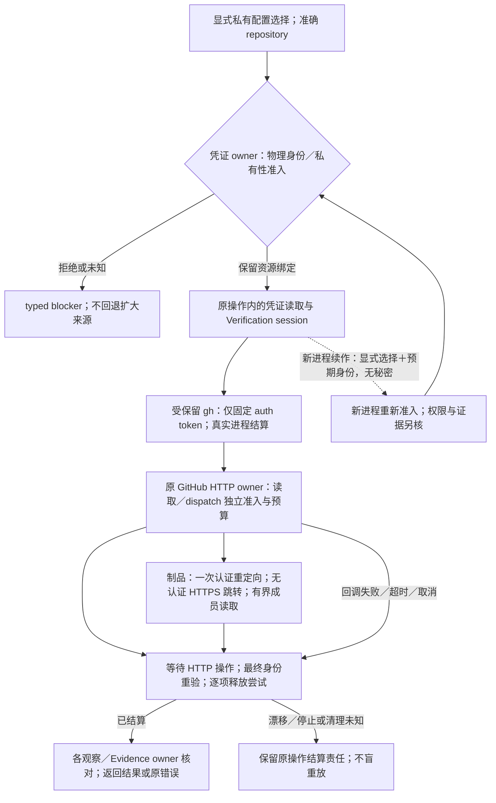

# 仓库凭证与传输边界

## GitHub 凭证与异步传输：采用、拒绝与平台边界

仓库状态、开发 runner 与受信 closeout 入口可通过 `--github-credential-store <绝对目录>` 显式选择当前操作工作树之外的 GitHub CLI 私有配置资源；未选择时保持标准凭证来源。选择只绑定资源，不扩大 GitHub 权限或替代工作准入。

### 显式资源绑定与私有性准入

凭证 owner 不从 ambient `GH_CONFIG_DIR`、HOME、XDG 或普通 token 变量取得该绑定；Linux 标准位置从有效 OS 账户查询，显式位置以 no-follow 目录身份、当前用户所有权和私有访问检查接入。显式后端当前要求 Linux 目录模式 `0700`，已有 `config.yml`、`hosts.yml` 为同用户、单链接的普通 `0600` 文件；不读取配置内容来签发目录资格。

### 调用身份、最小凭证与传输接合

固定 token 读取仍只准入 repository-maintenance 的既有 Actions 身份；Verification session 传输另准入准确的 compiler-pr-validation／repository_dispatch 与 merge-gate／workflow_run 身份，核对 github.com、仓库、main ref、workflow SHA、run 与 attempt，且只作凭证来源准入，不代替原 CI owner 的 live run、actor 与 Effect 授权核验。

固定 token 读取与同一操作内的 Verification session HTTP 传输共同消费该资源绑定；只有固定 `gh auth token` 凭证子进程取得该保留目录，HTTP 请求通过原类型化 GitHub API session 消费最小凭证，仓库身份与凭证资源身份分别绑定，读取前后重新核验；fresh-process handoff 必须重新准入同一物理身份，不能仅重用路径或继承环境。

回调失败保持原错误与结算责任，作用开始后的资源漂移属于 settlement 未决，不能标成可安全重放的前置拒绝。

### 平台边界与凭证生命周期

当前 Windows 显式私有配置后端返回 `unsupported-platform`，标准 Windows 认证不受影响；具有私有读取权限证明的后端才能扩展同一合同，写者可信不能代签凭证保密。

凭证的保存、撤销和退役仍由已授权的原生 GitHub CLI 及用户拥有，秘密不进入工作树、普通缓存、日志或交付制品。

这里的共同绑定只复用[凭证生命周期](../../50-执行运行与观测/权限与资源/工具秘密身份与披露.md#密钥秘密凭证与身份会话生命周期)与[执行准入／结算](../../50-执行运行与观测/权限与资源/授权与执行准入.md#准入分配执行与结算的正向协议)，不创建新的权限签发者。Verification session 的远端读取、证据制品下载和 hosted wake-up dispatch 保持不同的实际作用类别，分别绑定准确 repository、固定 GitHub endpoint、所需操作授权及输入／输出／期限预算；能取得凭证不表示可以派发验证，也不表示制品已可信。返回数据仍由各观察与 Evidence owner 核对来源、对象和完整性。无显式选择时保留标准来源合同；显式选择失败不能回退到 ambient token、其他配置目录或更宽 Provider。

### 异步操作、释放与失败结算

调用方必须等待所有仍使用该绑定的异步操作及[进程资源结算](../../50-执行运行与观测/运行生命周期/资源登记物化与回收.md#进程树端口浏览器容器与数据库资源)，再释放所拥有的目录和可执行资源；请求返回、Promise 拒绝或直接子进程退出均不代签整项资源已结算。回调错误不能跳过最终身份／私有性重验或释放尝试，多个独立失败各保留其责任，公开诊断不泄露秘密。fresh-process 恢复携带显式选择及预期物理身份，在新进程重新准入；该交接不携带秘密，不产生外部维护者资格，也不将旧 Work／验证结论自动提升为新代次 authority。

### 为什么采用这一凭证方案

本项是仓库接合层对[REQ021](../../00-系统与原则/产品/产品要求与工作约束.md#req021)、[REQ028](../../00-系统与原则/产品/产品要求与工作约束.md#req028)及[组合保证](../../90-治理与参考/决策/设计理由-验证约束与风险.md#d63-组合保证显式检查边界而非叠加绿色)的采用：保持准确主体、最小披露、异步进展和资源结算，不由凭证取得改变作用权限。

| 状态 | 方案与理由 | 复核位置与重开条件 |
|---|---|---|
| 采用 | 固定 token 获取保留异步、受保留的 `gh auth token` 进程；Verification session 观察与 dispatch 扩展原类型化 GitHub HTTP operation owner，使用封闭 query／REST 操作、准确repository、独立read／dispatch作用与预算，避免第二网络执行器 | HTTP验证测试、operation session测试与凭证测试；新增操作、消费者或取消路径时重核闭包 |
| 拒绝作为网络后端 | 将全部 Verification 网络请求迁入精简环境的 retained gh 子进程。凭证命令可运行不证明相同隔离环境中的API网络可达；继承全部环境或代理秘密来弥补不满足最小披露。保留合格的固定token获取，网络复用原HTTP owner | 网络环境差异是可检验反例；能读取viewer或某个PR只证明相应请求，不代表完整closeout、dispatch或正式Gate已成立 |
| 采用 | 制品先在认证API取得唯一允许重定向，再通过准入的HTTPS无认证请求读取；重验id／name／run／size／hash，使用锁定yauzl的lazy exact-member读取，不写盘解压 | 制品与重定向反例覆盖来源、字节预算和成员边界；拒绝跟随任意多跳、转发Authorization或另写ZIP解析器。锁定版本与依赖许可由包输入承担 |
| 拒绝 | 另建同步 spawn 路径或用 Atomics 阻塞等待 Promise；前者产生不同生命周期／凭证规则，后者阻塞同一事件循环所需的异步进展。把整个调用链改为可等待，而非伪造同步完成 | 相交调用者必须等待观察、分页、制品与 dispatch 结果；不以类型断言或未等待的 Promise 数组代签结算 |
| 采用 | Linux 标准 home 从有效 OS 账户原生查询取得；环境中的 HOME／USER／LOGNAME 不拥有账户事实 | 启动前污染与原生查询失败测试覆盖 Bun 环境值影响及缺记录、非法指针／编码等拒绝分支；宿主 ABI 或运行时改变时重新验证 |
| 拒绝 | 直接信任 ambient HOME、GH_CONFIG_DIR、XDG 或普通 token；显式配置选择失败后切换来源 | 环境值不是资源绑定或授权；私有配置测试核身份、私有性、交接及失败结算 |
| 有界采用／平台未满足 | Linux 显式私有目录只在上述身份与读取私有性条件成立时使用；Windows 显式后端仍拒绝 | 不能用 writer ACL 证明秘密不可被其他主体读取；只有具备 reader 私有性证明及同等恢复测试后才能采用 Windows 后端，标准 Windows 认证不因此撤销 |

这里的“采用”指机制决定，链接指相交验证入口，不表示某个候选已通过全部测试、合入或发布；验证结论仍绑定其准确树与平台。
