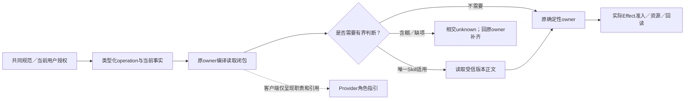
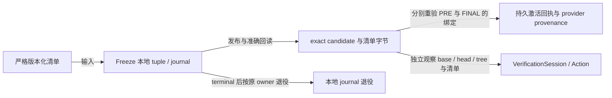
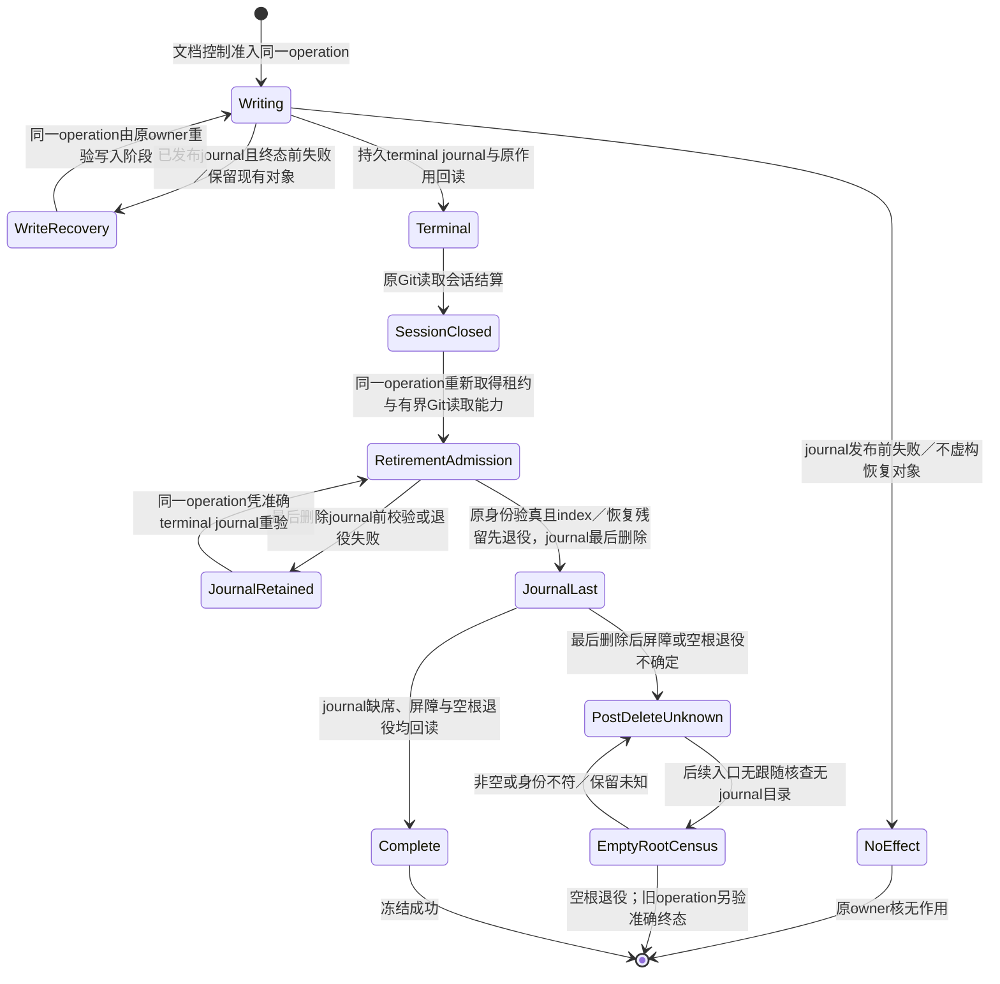
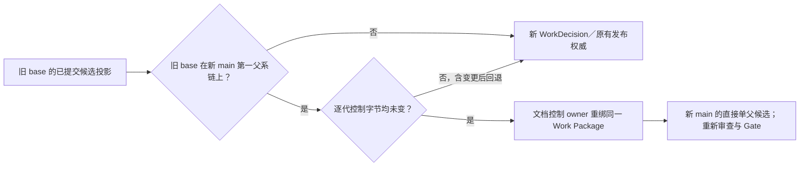

# Gift自身仓库开发的行为准入、工作身份与恢复

本节只规定 **Gift 自身仓库实施与自举** 怎样把本章的通用任务约束接到现有机器控制面；它不是所有使用 Gift 的目标工程都必须拥有的第二套 Work 系统，也不改变产品、作者、编译、验证和执行各自的规范拥有者。仓库现有 `WorkDecision`、`TaskCapsule`、`OperationReadPlan`、Skill applicability、Operation envelope 等名字只有真实代码消费者仍存在时才作为 self-hosting profile 的实现载体保留；迁移完成后可以换表示；旧载体不因存在就决定目标设计，候选包也不因编号取得正式权威。规范采用与代码切换按[设计采用边界](../../90-治理与参考/维护/设计任务规则.md#design-adoption-and-code-cutover)分别处理。

本节链接到 包外冻结历史证据 的代码、Skill、测试和配置，只证明冻结提交 `8a07bdb35805e7539f9d06eaff318fb4ece82ac0` 在本设计包中的准确快照及其当时形状；它们**不证明当前远端 `main` 仍有同一实现、资格或运行状态，也不拥有现行设计合同**。本节出现“现有/原/继续适用”等实现措辞时，其证据范围仅限该冻结快照，除非另有活动仓库读回。真正执行 Gift 仓库实施、迁移、合并或恢复时，必须先读取当时准确 `main`、活动配置、CI/Review 与真实消费者，再把现行设计映射到实际实现；冻结源码不能代签当前实现事实。

<a id="engineering-behavior-routing"></a>
## 工程行为：共同规则、操作、Skill 与客户端指引

仓库实施覆盖设计读取、任务领用、重构、检查、审查、提交、集成、故障恢复和退出；这些**是行为类别，不是必须对应同数 Skill**。共同政策由产品要求及 `AGENTS.md` 导航，具体操作通过 typed operation/envelope 到各权威 Owner；只有通用规则无法判定的局部步骤才载入相交 Skill。客户端角色指引不提升为权限或第二套政策。

| 行为与触发 | 读取／判断入口 | 实际结果与执行 owner |
|---|---|---|
| 新任务、恢复、范围或规则变化 | `AGENTS.md`与本章相交装载；已有同版完整读取可复用 | `dev:status`按下述源码检查点／正式工作分流取得所需观察与continuation；读取本身不产生active Work或Effect权 |
| 确有全仓审计要求或跨域缺陷 | repository-audit | `audit`及Source Program的准确tree census；普通局部读取不冒称全仓覆盖 |
| 公共合同、所有权或生命周期需重算 | architecture-evolution；系统性行为偏航交heuristic-governance | 原规范／类型／状态owner裁决，按文档写入准入保留或修正文；不为纯实现变更制造新规范 |
| 已冻结scope内实现、修复、重构 | worker-development | Task Capsule／Operation Envelope限定纵切片；原producer/consumer及资源owner承担实现，不因Skill存在扩大写集 |
| Claim需要新case或oracle判断 | test-design | requirement／assurance与CasePlan拥有测试语义；仅执行或重跑已有测试不重新设计oracle |
| 引入／替换外部能力、通用机制 | external-capability-governance | 原能力台账与Provider owner分别承担采用、物化、凭证和实际作用；跨owner不自动扩大权限或新造work |
| 验证和证据复用 | 原selector与VerificationSession；需设计测试才进入test-design | `check`／`test`／`typecheck:verified`执行RequiredClosure；`typecheck`仅编辑反馈；已有PASS／确定性FAIL／in-flight按准确ActionKey复用／停止／join |
| 独立审查冻结候选 | exact-head-review | ReviewSubject绑定head/tree及required revisions；Role配置、报告标题与绿色测试不代签独立性或Gate |
| 分工及角色交回 | task-delegation | 主线程保留集成与原任务责任；角色交回不等于用户任务完成，保留单写者和更窄scope |
| 提交、推送、合并、发布 | 原明确授权终态与当前准入；无需为每个命令新增Skill | `dev commit`／`commit:recover`拥有提交；远端传输、integration与`gift:closeout`各消费本身准入／读回；不得从Skill推导push／merge／release权 |
| 失败、取消、恢复及资源退出 | failure-recovery定位根因与恢复owner | 原operation、branch/worktree、generated-state及资源owner结算；`dev:continue`只是续作投影，不能签发新权限；未结算制品不能被通用清理删除 |



**采用与拒绝。** 采用共同规范→typed operation/envelope→零或一个相交Skill→客户端指引的责任方向，减少相互冲突的规则副本。拒绝一份“全行为万能Skill”、仅凭角色名加载全部Skill、把审查/提交/清理另建授权系统，及从candidate指引签发自己的采纳资格。新事实改变scope或根假设时，重新选择相交判断；不以加载顺序或更长提示词替代裁决。

**当前接合与未完成范围。** 现有纯Skill evaluator只消费role、operation kind、候选及准确修订；目录覆盖只是候选提示。合法的`a0/design`在多个候选未收窄时保持ambiguous，零候选可为none-required，不造兜底Skill。生产hosted activation当前只接`worker/implement`；其他角色的元数据登记不证明同等生产准入已接通。`.codex/agents/*.toml`是当前客户端指引，未有生成器与实际装载证据时不称其为已生成、已验证的通用政策投影。适用性选择回执不证明正文已读取、理解或被Provider强制；不能补造ReadReceipt。

**候选隔离与复核。** 修改Skill、其操作owner或Provider指引时，候选内容仅是被审查对象，沿既有quarantine使用受信修订。路径分类无法证明`.codex/`文件永不包含指令：`config.toml`可直接携带developer instructions，也可引用角色配置；即使当前只有普通设置，仍保守纳入该命名空间的启发式路由与候选隔离。这不将配置提升为Skill authority，也不修改其实际sandbox设置。命名空间分类不证明已取得配置引用的完整闭包；指向域外文件的配置引用必须由原读取／装载owner绑定受信来源后才能消费，未知引用不能按普通文件默认取得指令资格。当前没有生产装载闭包证明时如实保留该缺口，不为本次分类添加第二配置解析器。对应有限检查位于Skill合同测试、适用性测试与agent runtime入口测试；它们分别检验路由、选择和真实入口，不证明所有工程行为都已自动执行。主分支前进后撤销旧代作用资格，已有Review/Evidence保持原绑定并由原owner判断失效和复用，不全部销毁也不自动升为新代授权。

## 事实、决定、计划、授权和完成必须分层

Gift 自身开发的一次机器任务按下列信息组合，不允许任何一层替代另一层：

| 输入或载体 | 可以决定 | 不能决定 |
|---|---|---|
| 用户目标、non-goal 与明确授权 | 本任务要达到什么、作用上限 | 当前仓库事实、实现已经正确 |
| live Git／工作区／Provider 观察 | 当前 base/head/tree、dirty、能力与外部状态 | 产品目标、设计采用、完成 |
| `WorkDecision` | 当前 ordinary work 的合法选择与优先级 | 设计真值、Effect 权限、PASS |
| `TaskCapsule` | 纯任务规划内容和需携带的稳定引用 | Scope、写权、实现完成 |
| `OperationReadPlan` | 本次行动所需的最小完整读取闭包 | 修改许可、事实 owner 的含义 |
| Skill applicability | 零或一个当前仍不可机器化的有界判断程序 | 事实、决定、权限、Evidence |
| Operation envelope | actor、role、operation、subject、预算与禁止作用的上界 | 新增父任务没有的能力 |
| Effect／Provider 准入 | 某次真实作用是否可以开始 | 产品要求和设计本身 |
| settlement／readback／独立检查 | 实际发生了什么、相应 Claim 是否成立 | 反向改写原目标 |

因此仓库行为准入可以表示为同一批现行 owner 的交集，而不是一个新总控对象：

```text
AllowedRepositoryAction =
  accepted task authorization
  ∩ current live facts
  ∩ applicable formally adopted design constraints
  ∩ selected work identity when selection is required
  ∩ operation envelope
  ∩ effect/capability admission when an Effect is required
  ∩ current resource and safety bounds
```

任一相交项为 unknown、stale、conflicted 或明确禁止时，只阻断依赖它的动作。Issue、PR、branch、聊天、rolling projection、测试绿色、commit 或 Agent 自述都不能补足缺失交集。当前实现若以 `MainHealth = ordinary | repair | locked` 之类的机器状态先行约束工作选择，该状态只负责它已有的控制面消费者；稳定规范不保存某一时刻的 current main，也不把该枚举推广成所有项目的产品状态模型。

已明确授权的仓库终态形成持续到 settlement 与 readback 的作用义务，不能在本地验证、commit 或某条传输路径失败后退回等待用户重复下令。若 Provider 以保护规则拒绝直接更新默认分支，而同一内容可经任务分支与 PR 到达原授权终态，则创建最小任务分支、推送、创建 PR、等待必需检查并按既有合并合同收口，属于该已授权作用的传输闭包；路径切换不得扩大内容、受众、权限或发布范围。只有新路径需要 force、修改保护规则、额外发布或其他超出原作用上限的效果时，才阻断该新增效果并请求相应授权。

独立源码检查点与正式采用分流由[源码检查点与正式采用分流](源码检查点与正式采用分流.md)拥有；它是受限源码保全／审查／运输旁路，不取得正式 Work、Gate、adoption 或 merge 资格。

仓库凭证选择、秘密最小披露、异步 GitHub 传输与资源结算由[仓库凭证与传输边界](仓库凭证与传输边界.md)拥有；工作控制面只消费已准入的凭证／传输能力，不从凭证存在推导仓库作用权。

验证运行位置、测试进程生命周期、观察与受信原生检查复用由[仓库验证与运行观测](仓库验证与运行观测.md)拥有；工作身份与提交恢复只消费其结果，不复制验证控制面。

## 仓库动作闭包：一个候选、各自的唯一 owner

仓库脚本、Hook、CI 和人工入口只投影已有的单一动作合同；每次阶段交接传递 exact subject、需求、依据与已结算结果，不用“上一步通过”的口头状态。一个 logical run 同时只对应一个可变候选；冻结后发生内容变化必须生成新 head 并触发相交资格失效，不能在旧证据上补跑局部测试当作新 head 已通过。

| 动作 | 唯一事实／决定 owner 与输入 | 产物和可继续条件 |
|---|---|---|
| 定向 | Git 与文档控制面读取 live main、candidate、dirty 归属、Work Package 和未结算 operation | 准确 continuation route；unknown 只阻断依赖它的作用 |
| 编辑反馈 | Git changed-path owner 决定是否需要 affected；原生 TS7 只给本机快速类型反馈 | 可供编辑的诊断，不产生候选 Gate；空集和纯文档闭包不构造 Source Program |
| 冻结验证 | VerificationSession 编译 `RequiredClosure ∩ MissingOrStale`，按[显式运行位置](仓库验证与运行观测.md#repository-local-verification-placement)由测试责任目录、依赖代际与各 Action owner 生产结果 | quick 需可靠影响选择；full 直接覆盖完整 fast/slow 清单，不再为选全量扫描 affected；同一 ActionKey 的 fresh PASS 或 authenticated in-flight 复用／join |
| 独立审查与合并 | 审查 owner 绑定 frozen exact head；集成 owner 消费 Gate、Review、Scope/Effect 与当前 main | expected-head/tree merge 及 main readback；提交、PR 或绿色检查均不是合并终态 |
| 发布 | 发布 owner 从已合入的 source revision 构造、安装、验真并提升 artifact | 发布构建不由普通合并隐式启动；测试 fixture 的构建只属于相应测试证据 |
| 退役 | 原 dependency/generated-state、branch 与 worktree lifecycle owner 按各自 receipt 结算 | 无活跃竞争 writer、未结算 effect 或物理残留；unknown 以 typed blocker 留存 |

每个实际命令与子动作共享可核对的父子阶段：开始、等待／复用／join、物理执行、结算、回读和终态均报告墙钟时间；静默长阶段定期报告仍在运行及已耗时，失败也输出最后已知阶段和总时长。阶段并行时墙钟总时长取父动作起止观察，不求子阶段之和。进度只做展示和诊断，不得写回 ActionKey、工作授权或受信 PASS；没有可关联的原始观测就报告 unknown。依赖准备、typecheck、测试和发布若处在不同 subject 或环境，不能为减少日志中的次数而跨边界借用结果。

入口收敛按消费者迁移而非别名堆叠：已被 full inventory 覆盖且无独立 Claim 的 affected Gate 退出 full；缩小的 affected 路径继续保留它的精确选择与 fail-closed。脚本级串联只投影同一动作图，不得重新决定要求或强制 cold materialization。旧 Hook、workflow、手动命令和恢复路径逐一核实际消费者，确认 terminal receipt 与回读后才退役重复动作；不删除仍证明不同 Claim 的 Gate，也不以跳过受信验证换速度。

受信根自身迁移时，候选不能签发自己的采纳资格。Gift 自举允许已有明确授权的外部维护者消费旧受信检查器的实际结果、未能证明的范围、真实候选执行证据和独立精确版本审查，执行有界迁移。该动作绑定 base/head/tree 与受信根变更闭包，由已认证的维护者身份按预期 head 比较后合并；不可变合并提交保存处置及证据边界，其父提交必须等于冻结 base、树必须等于已验证候选，随后回读提交、身份与默认分支。候选范围清单只约束归属和测试选择，不产生 active Work 身份、健康、自动集成授权或通过结果。旧检查器要求人工迁移或仍有未决时必须如实保留；不能将它改写成绿色 CI、降低普通验证要求或修改保护设置。迁移后的新 main 仍由当前正常拥有者生成新的健康证据。

外部维护者迁移所需的候选提案由现有文档控制面的显式 `proposal-only` 路径编译。当前指针所指清单须与准确默认分支中的内容逐字节相同，活动解析为 `none / matching-default-blob`；目标是不同身份且 `tracking:none` 的后继清单，按[清单版本与候选绑定](#repository-work-package-format-and-binding)核对本次准确默认分支：V1 的清单 `base` 必须相等，V3 则由本次 Freeze 的原 tuple 绑定准确 base/tree。指针、滚动计划、旧指针清单退休、索引发布与回读仍由同一编译器和事务拥有者完成。机器投影绑定准确 main/tree 与目标清单身份，明确标记 `authority:none`；结果及恢复日志保持 `PROPOSED`，摘要只保护表示完整性。

<a id="repository-work-package-format-and-binding"></a>

**协作记录。（消费条件）：** PR评论、工具日志与Skill文本都不能单独改写代码写权、CI准入和仓库策略；真实仓库操作按现行权限及目标前像执行。 合同归属：[外部内容注入、候选来源与有权决定的不可传递性](../AI协作/委派安全与持续交接.md#gift-ai-prompt-to-authority)。

### Work Package 清单格式与候选绑定

**现行设计合同由本段与下表拥有。** 冻结提交中的Work Package 解码器只校准 `8a07bdb` 快照曾采用的实现形状，不能证明当前 `main` 已实现本段。清单按显式 `schema` 读取；共同必需字段为 `schema`、`id`、`tracking`、`manifestState:frozen`、`requiredProfile:quick|full`、`ciRevision`、`tasks`、`forbiddenPaths`、`acceptance`、`tests`；`authorityRefs` 是可选的规范文档 UUID 列表，激活入口仍要求它存在并向受信身份表核对。任务归属、路径互斥、测试路径、字符串、YAML 与当前 CI revision 的严格检查属于本设计要求；实际仓库消费者是否已满足，须由活动实现读回确认。

| 清单版本 | `base` 与兼容合同 |
|---|---|
| `codex-development-work-package-v1` | 必须保存小写 40 位 Git SHA 的 `base`；消费者将它与独立观察到的本次准确 base 比较，漂移即拒绝 |
| `codex-development-work-package-v3` | 禁止 `base` 字段；稳定计划与本次运行的 base 分开，由各动作的原 owner 独立绑定准确 base/tree 与候选 |
| 已退役的 `codex-development-work-package-v2` 或未知版本 | 拒绝；不能复用旧 V2 的 `evidenceComposition` 含义，也不从缺少 `base` 推断为 V3 |

两个可读版本都拒绝未知字段及混合形状。清单路径设计为 `config/repository/work-packages/<id>.md`；`manifestDigest` 对**整份原始字节**计算 SHA-256，含 frontmatter、正文、验收文字和换行。V3 只消除稳定计划内的重复 base，不创建归一化摘要、第二份绑定表或授权记录；相同清单字节可以参与不同候选，但它不能证明候选的基线、准入或证据相同。pointer、唯一当前清单及后继原子替换／旧清单退役的现行合同由本节拥有；冻结控制面快照只用于核对 `8a07bdb` 的既有实现接缝。同路径同字节清单已在 default 时仍是 `none/matching-default-blob`；活动仓库是否沿用该路径和接缝仍须读取准确 `main`。

运行绑定保持三个独立生命周期。Freeze 的本地 tuple/journal 保存准确 base/tree、PRE index、candidate tree、清单与控制字节，通过原 CAS、终态回读及退役完成一次本地事务；它不等待未来 VerificationSession，也不作为常驻激活数据库。激活 PRE/FINAL 的原持久回执另外保存并验证受信 base/tree、候选 head/tree、清单与控制摘要、scope、WorkDecision 和 provider provenance；FINAL 重读 PRE 所指对象及当前事实，基线、控制或范围漂移不能沿旧 PRE 继续。VerificationSession 则由其受信入口独立观察准确候选、清单、依赖、权限、Review 和 MainHealth，生成本次 Session/Action 的绑定；这里没有从激活回执直接读入 Session 的新接口。清单字节未变不使旧 head/base 的 Review、Gate 或 Session 成为当前通过；只按各原证据 owner 的实际输入和资格复用仍有效部分。

下图只表示准确对象的生产／观察与 Freeze 的局部结束；边标签不签发权限，也不要求激活与 Session 按图的位置顺序运行。各入口的失败、恢复和退休条件继续由其原 owner 承担。



格式迁移先部署兼容读者：读者变更自身仍使用 V1 Work Package，经原准入、审查与集成后，回读实际 trusted main 的 commit/tree 与受信运行闭包。只有该读者闭包已采用，原 Work Package owner 才能为另一后继工作生成 V3 清单并重新准入；不原地改写已冻结的 V1 清单，不让候选内的新解析器授权自己的 V3。旧读者遇到 V3 仍拒绝，保留原候选与有效证据，先补齐受信读者采用再恢复。该迁移不改变唯一活动包、作用前 CAS、主干漂移检查或后继退役，不据此宣称多活动工作的分配与互斥已实现。

<a id="repository-freeze-native-index-decision"></a>
**文档冻结的原生 Git 方案。** 采用既有 Git scratch owner 持有的可写私有 index，通过原生 `update-index`／`write-tree` 形成候选树，真实 repository PRE 仍为受保留只读输入，最终发布仍由原文档控制 owner 的 journal、CAS 与读回承担。私有 index 的锁与替换归受保留父目录；不能把受限只读文件句柄直接当可替换输出，也不能让原生工具改变真实 PRE。严格输入／NEXT 编解码、对象类型与存在性、准确路径、环境隔离及原预算继续保留。

不采用被其替代的手工逐目录树重建、子树结果缓存、符号 delta 续接与专门扩额冻结框架作为并行生产路线：原生 Git 已承担树构造，额外模型会重复承担树语义、观测和恢复成本。这个理由支持删除重复机制，不证明所有平台已通过，也不从进程数减少推出完整提交或发布更快。现有平台、非合作外部 writer／ABA、资源及终态未知边界仍适用。只有真实原生接口缺口、不能保持的观察合同或同等保证下的完整成本证据推翻当前选择时才重开；须由同一 owner 给出最小差额与退出，不因历史候选已写成而重新启用。

文档控制的独立生产冻结入口只在持久 `terminal` journal 已回读后结束其有界 Git 读取会话；终端验证与 index／恢复残留退役是同一 operation 的独立有界续接。续接重新取得工作区租约与 Git 读取能力，核对原 journal、manifest、候选树和物理路径后才退役，且仅在两段均结算后报告冻结成功。journal 发布前失败不虚构恢复对象；发布后到最后删除 journal 之前的失败保留已存在的 journal 与未退役残留供同一 operation 恢复。最后删除 journal 后的屏障或空目录退役失败属于终态未知：后续入口仅能按无跟随物理目录核查退役空根，旧 operation 的完成须另由准确投影与作用回读证明，不能凭 journal 缺席补签。新会话不能刷新写入阶段的预算、跳过终端回读或重复发布作用。



文档冻结的 Git index 在发布前按准确 PRE/NEXT 字节与恢复制品判定作用切点；日志已到 `index-published` 或更后阶段时，原生 Git 可能只刷新 index 的 stat/cache 字节，恢复改以无 `index.lock` 且外部 scratch `write-tree` 等于日志绑定的候选树证明已发布状态，不重放 index CAS。日志、指针、滚动计划和恢复制品仍各按原始字节及身份验真；树漂移、锁或异物保留为未结算，不能凭相同文件名继续作用。

并发工作使 main 前进时，已提交且来源可核验的候选只有在旧 base 位于新 main 的第一父系链上，且该链每一代的 current-state、活动指针、滚动计划、指针所指清单与工作选择源相对旧 base 均保持相同 Git 字节，才能沿原文档控制 owner 重绑同一 Work Package。新候选必须是新 main 的直接单父提交；旧滚动投影须绑定旧 base 与可核验的候选源提交、树、清单和控制字节，目标 package、tracking 与清单路径保持同一身份。任一代控制字节变化（包括后来回退）仍须取得新 WorkDecision 或已发布投影的原有权威，不能把旧候选投影冒充 main 发布事实。重绑只重新签发准确 main 与候选的控制投影，不延用旧 head 的审查或 Gate 结果。



提案不接收或产生 WorkDecision、MainHealth repair、激活回执或集成授权；普通激活仍消费真实工作选择，选择失败不能隐式降级为提案。重试与恢复拒绝跨提案／激活路径消费日志，已有激活日志继续按原合同恢复。提案合入默认分支后，指针清单与默认分支内容相同仍只表示没有活动任务，不会因文件已发布而自动获得执行权限。

## 当前仓库载体的保留与退出

`WorkDecision`、Task Capsule、Read Plan 等当前结构已存在真实 TypeScript producer/consumer 时，文档收敛不能先删语义再留下孤立代码，也不能因代码存在就恢复旧文档为 authority。实现融合遵循：

```text
formally adopted owner meaning + explicitly scoped candidate delta
→ census current producer / parser / consumer / test
→ classify each existing carrier as preserve | adapt | replace | retire
→ shadow / migrate consumers when representation changes
→ remove the old writer/parser only after consumer-zero and readback
```

载体若只是把已有规范关系投影给当前控制面，应保持派生身份；若它拥有规范尚未正确表达且确有消费者的独立语义，先保全并在原owner核对采用与反证，再决定修正规范、适配实现或退役，不能由候选包先验否定它。路径、schema 名、版本号和测试数量都不能成为保留理由。

## 继续、失败与新 main

恢复任务只从持久、可重新取得或 live 的事实重建：当前适用的正式规则及本任务明确选择的候选范围、仍有效的用户目标/授权、exact base/candidate 身份、未结算 operation 引用，及该边界要求重新读取的 Provider 状态。聊天摘要、checkpoint prose 和“刚才已通过”只能定位这些对象，不能恢复权限或完成状态。

同一输入和同一根因的确定性失败默认复用失败，不靠抬 timeout、换 shell 或新 requestId 重试；Provider handle 丢失、外部响应丢失或部分 Effect 先按原 operation 身份 readback／join／recover。只有相关输入、事实或重试准入真的改变，才产生新尝试。发布到新 main 或 trust epoch 变化会使旧的 Effect grant、Review/Integration 授权和依赖旧 head 的结果失效；若用户的长期目标和授权仍成立，系统从新 main 自动重新定向，不要求用户重复说“继续”。
远端维护、exact ref 退役、maintenance carrier 与评论运输垃圾的独立生命周期由[仓库远端维护与退役](仓库远端维护与退役.md)拥有；本页只保留普通仓库开发的工作身份、提交／传输与恢复准入。
