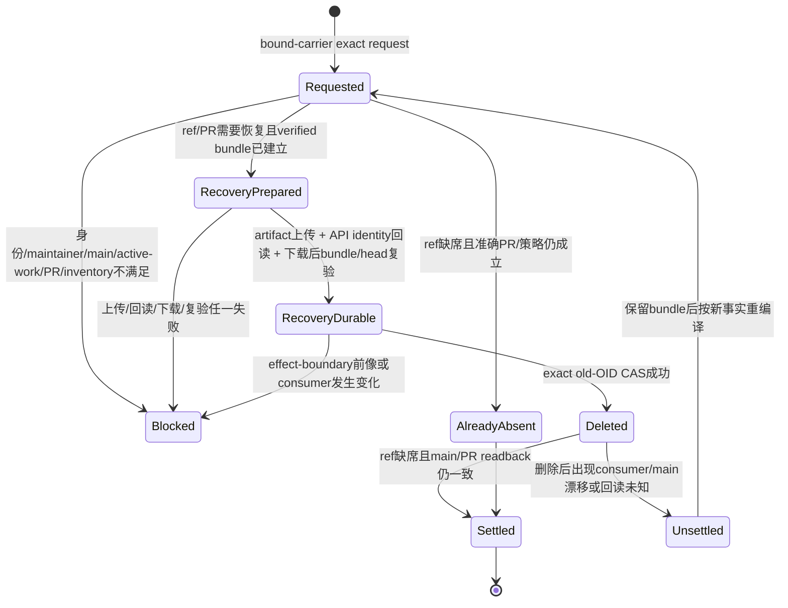
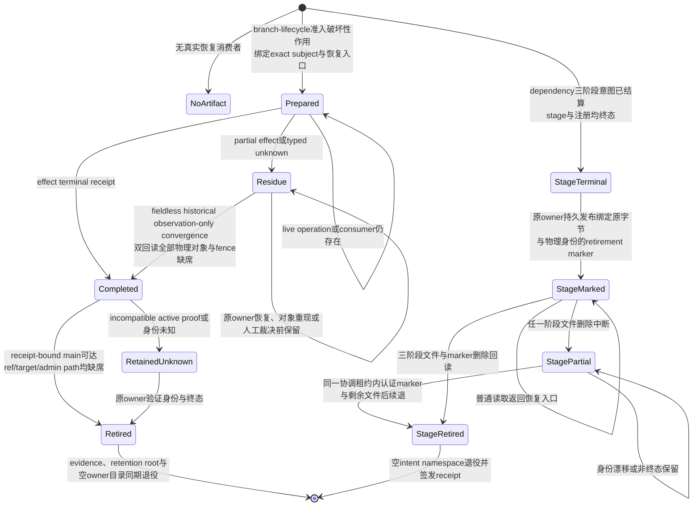

# 仓库远端维护与退役

## Hosted maintenance 与远端 ref 退役

仓库远端维护不把 PR/Issue 评论本身当 Effect owner。默认分支上的 `repository-maintenance` workflow 只是受限 hosted transport：当前只接收 `gift-repository-maintenance-request-v1` 的 `exact-ref-retirement`，或位于**已解析的版本化 MaintenanceCarrierBinding** 上的 `exact-comment-retirement`；请求必须绑定仓库与准确 `expectedMainSha`。

### 维护载体、版本绑定与在途请求

维护协议不嵌入固定 Issue 号：`MaintenanceCarrierBinding = exact { bindingRef, repositoryRef, provider: "github-issue-comment", issueIdentity, revision }` 由当前仓库治理/配置 owner 选择。

每个 `bindingRef + revision` 解析到**不可变绑定记录**；治理配置只推进独立的 current-binding pointer，不能原地改写旧 revision。

新请求只捕获当时 current binding；已进入 in-flight 的请求固定其 `bindingRef + revision + issueIdentity` 直到 terminal/readback。迁移载体时旧 binding 只为这些既存请求和其恢复/readback 保留；current pointer 推进不能把旧 comment 静默重绑到新 Issue，也不能让新请求回退到旧 binding。

binding 缺失、revision 内容漂移/已不可解析、current pointer 与新请求捕获不一致或 repository/issue 不匹配一律 fail closed。旧 binding 的解析记录只有在引用它的 in-flight/recovery consumer 归零后才可退役。

### 单引用请求及其准入分类

**ref lane 永远保持一条请求一个 operation、一个 exact ref**：transport 只允许单个 `transport/*` ref；正式代码 ref通常必须绑定一个准确的 closed PR、原 head branch 与原 head SHA。

#### 与主线内容树完全相同的孤立引用

另有一个严格 orphan 例外 `main-tree-identical`：仅当 target exact commit tree 与当前 live main exact commit tree 完全相同、该 ref 没有任何 open PR head/base consumer，且 tree equality 在 destructive effect 前再次从 GitHub commit object 读回时仍成立，才允许沿同一 verified recovery + exact-old-OID CAS + readback 路径退役。tree 不同、commit/tree observation 未知或 main 漂移都 fail closed；该分类不能证明“语义相似”“后继实现更完整”或 squash 后结果吸收。

#### 已审定取代关系的引用与独立恢复源

对 tree 不同且没有准确 closed-PR head 绑定的历史 ref，`reviewed-superseded` 仅作为**已签发语义处置的运输入口**：请求只引用同一 captured MaintenanceCarrierBinding 上一条独立 maintainer supersession review 的 `commentId`，review v3 必须绑定 exact repository、carrier issue identity、branch、head commit/tree、current main commit/tree、`git merge-base(head,currentMain)` 的 exact commit/tree，及完整 `merge-base → head` source-delta path-set digest、`approved` verdict 与空 unknowns；branch-lifecycle owner 每次 prepare、effect-boundary 和终态 readback 都重新解析 captured binding、读取原评论、重新读取评论作者的 `maintain|admin` 权限，并用 native Git 重验 head/main/merge-base 三端 tree、实际 merge-base 关系与完整 stale-source 独有路径集。current main 自 merge-base 之后新增的无关路径不进入 semantic supersession review scope。review 评论是持久语义证据，不随 maintenance trigger 退役；评论改写、binding/repository/issue/main/head/ref 漂移、open PR consumer、路径集不完整或权限下降都 fail closed。maintenance transport 不得自行推断 semantic supersession。

`reviewed-superseded` 只在 recovery preparation 时目标 exact ref 仍 present 时签发；它没有 closed-PR `refs/pull/*` 的独立重建源。若 CAS 已发生但终态回读中断，原 attempt 保留已上传 recovery carrier 并进入显式 reconciliation，后续运行不得仅凭 ref absent 自动重签 settled；只有原 owner 能从持久 carrier/终态证据恢复并重新裁决。

### 评论批次边界与禁止的操作

comment lane 只用于回收已 terminal 的 repository-maintenance trigger；为收敛历史失败 transport，可在一条请求中串行承载 **1..64 个同一 captured binding 下、互不重复的 exact comments**，每项仍独立绑定 `carrierBindingRef + commentId + issueIdentity + raw body SHA-256`。不同 binding 不混批。

任何 PR Conversation comment、混合 ref/comment 批处理、多个 ref、重复 comment identity、无上限 comment 批量、任意 ref/path/comment、force push、raw REST/GraphQL delete、分支名前缀 GC、按年龄删除及把“closed PR/旧评论”本身解释为内容已无价值，都不属于这条 hosted DELETE 合同。

### 请求派发、身份回读与权限重验

Hosted maintenance 不再订阅全仓 `issue_comment.created`。只有当前或为 in-flight 恢复仍保留的 MaintenanceCarrierBinding 上、由 maintainer 写入的 comment 才可作为 durable request carrier；本地 `repository-maintenance/dispatch.ts` 先解析准确 binding revision，再回读 exact comment、request 与 live main，随后发送唯一 `gift-repository-maintenance-v2` `repository_dispatch`。payload 仅含 `carrierBindingRef + commentId + issueIdentity + raw body SHA-256`，不复制 request authority。

Hosted workflow 先由配置 owner 解析同一 captured binding revision，再用 GitHub API 读取同一 repository/issue/comment；binding 无法解析、已不再允许既存请求结算、issue identity 不一致或 payload 指向别处时直接拒绝，不回退到“当前默认 Issue”。

随后核 dispatcher 与 comment author 同一、真实 User、当前有效仓库 `maintain|admin`、非 App 代发、body digest 和 exact main；准入资格由同一明确权限谓词消费规范化的当前 GitHub permission 响应，组织成员与外部协作者按相同权限门槛处理。

`author_association` 仅作有界关系诊断，不是组织成员证明或授权输入，也不经环境载体进入凭据准入；未知关系标签既不授予权限也不否决已验证的权限。低权限、缺失、未知或矛盾角色仍 fail closed。

进入 runtime 后 GitHub API owner **再次**解析 captured binding 并读取同一 comment/body/author/issue 与权限，在能力准入时重新验证维护者权限；先前读取或诊断不能覆盖 binding/权限下降。

因此 dispatch 只是 bounded wake-up，删除或 ref Effect authority仍只来自原 request、branch-lifecycle 合同、recovery/CAS/readback。普通 Issue/PR comment 不产生 repository-maintenance run。

#### 凭证范围、CodeQL来源与运行准备

Actions token 只可由这一个 workflow 身份用于 `read`、`branch-closeout-write` 与 `issue-comment-write`；后者仍被 GitHub API owner 限定为该 exact carrier binding 的 comment observation/create/update/delete surface，不能取得 merge/status/ref/runner 权限。

CodeQL findings 直接消费 GitHub Code Scanning 的原生 check/alert 权威；仓库不再维护第二条 CodeQL projection workflow，也不为相同安全结果签发独立 Actions credential/comment transport。

Hosted runner 在进入维护 runtime 前必须按锁文件执行 `bun install --frozen-lockfile --ignore-scripts`，不得依赖预存 `node_modules` 或 lifecycle script。

## 评论运输垃圾退役

评论卫生分成两个不同 authority lane，禁止再把 GitHub Actions installation token 当成通用 Conversation 管理员。

### 运输评论的物理删除

**Hosted physical DELETE lane** 只处理由 `repository-maintenance` 产生、且其 captured `MaintenanceCarrierBinding` 仍可解析的 transport trigger。`exact-comment-retirement` parser 不接受固定 Issue 常量；它要求 `carrierBindingRef`，解析准确 binding revision，并拒绝 repository/issue/comment identity 与该 binding 不一致的输入。

runtime 再次读取 exact comment，核 `carrierBindingRef + commentId + issueIdentity + raw body SHA-256`，重新解析其中的 maintenance request，且只有当旧请求全部 operation 已 terminal 时才允许 DELETE。ref target 必须 absent；comment target 必须 absent。

DELETE 后必须读取 404 才算 settlement。

历史失败 trigger 可以在同一 captured binding 下以 1..64 条成批重放，但每项仍逐条 exact preimage / effect / readback，任一失败时 trigger 保留；载体迁移期间不同 binding 分批结算，旧 binding 在最后一个既存请求 terminal/readback 前不得删除其解析记录。

### PR讨论区的独立卫生管理

**PR Conversation hygiene lane** 不走 repository-maintenance DELETE。真实运行已证明：`github-actions[bot]` 对普通 PR Conversation 评论（包括维护者自己的 `@codex review` 及其他 GitHub App 的 Codex summary/setup/quota 消息）会收到 GitHub `403 Resource not accessible by integration`。因此当前 adopted 动作是：由已连接的 maintainer identity 对明确的运输噪声执行正文退役，将其替换成不可见 HTML tombstone；评论对象本身仍存在，不能报告为物理删除。已观测的 disposable prose 仅包括精确 review-trigger 命令、Codex review summary、environment setup hint 与 quota/upsell transport；扩展该集合必须重新核作者、用途和 consumer，不能按年龄或 bot 身份泛删。

CodeQL projection、真实 review submission、inline finding/thread、人工裁决、事故/失败复盘及仍被 current owner 引用的 evidence 不属于运输噪声，不做 tombstone。对被平台权限阻塞的物理删除，保留最短 blocker receipt（HTTP status、owner、run/artifact）即可；不得留下整批原始 JSON 继续污染 durable maintenance carrier，也不得把 tombstone 表述成 delete。

## 引用退役的执行顺序与未知完成

每次 exact ref 退役按下面的可重放状态推进：

```text
maintenance request
→ exact hosted identity + live maintainer permission
→ live main == expectedMainSha
→ active Work Package observation resolved
→ target 不是 default branch，也不是 active Work Package branch
→ 完整 open-PR census（最多 2×100；超过 200 个 open PR 直接 fail closed）：同仓 head 与任意 base 均不得消费 target
→ closed-pr lane 独立读取准确 PR 身份；即使 ref 已缺席也能验证原 head
→ ref lane 先 prepare exact recovery；present ref 或 closed-PR 恢复需要时创建并验证 Git bundle
→ 将 exact preparation 与固定名 `recovery.bundle` / `recovery.bundle.sha256` staging 到 Linux hosted 私有根 `/tmp/gift-repository-maintenance-carrier/upload` 并 upload-artifact
→ GitHub API 读回 artifact id/name/run/attempt/size，再下载同一 artifact
→ branch-lifecycle 对下载 bytes 重算 SHA-256、checksum、git bundle verify，并确认 expected head 出现在 bundle heads
→ effect boundary 再读 live main / open PR / exact ref old OID；任一漂移都 fail closed
→ GitHub updateRefs exact old-OID CAS
→ ref absence + 完整 open-PR census + live main readback
→ terminal result
```

`invalid|unresolved` 的 active Work Package、关键 repository/default/remote/worktree inventory 未知、main 漂移、PR/review 身份或 consumer 漂移、ref SHA 漂移、reviewed-superseded 的 evidence comment/maintainer/path-set/tree 任一复验失败、pre-effect artifact identity/readback 不完整，或下载后的 recovery 无法重新验真都 fail closed。

**DELETE 前必须已存在可由 GitHub artifact API 读回并重新下载验证的 recovery carrier；`if: always()` 的事后上传不再承担这一前置保证。** CAS 已成功而客户端响应或终态回读丢失时，下一次相同请求先独立读取 closed PR 与 ref：ref 已缺席时不重放删除；原 run 的 pre-effect artifact 已提供持久恢复入口，closed-PR lane 仍可从准确 `refs/pull/<n>/head` 重建同一 head 的 bundle 作为额外恢复路径，再以 `already-absent` 结算。

若删除后才观察到新开/重开的 PR 消费者或 main 已变化，物理删除不能冒充完整成功；该 attempt 进入 unsettled，保留已发布 recovery 与结果证据，由原 owner 依据新事实恢复或重新裁决。



### 恢复载体的准备、上传、验真与使用

`repository-maintenance` 不取得 branch-lifecycle 的内容处置权，也不生成“所有 closed branch 都可删”的推断；它只运输已由维护者明确分类并绑定 exact identity 的请求。branch-lifecycle 继续拥有 recovery、ref 前像、CAS、竞争检查和终态回读。

Recovery root 只能来自 owner 的显式参数或由 repository root 推导的固定 sibling root；branch-lifecycle 不从环境变量取得路径 authority，bundle leaf 也不包含用户提供的 branch/ref 字段。

ref operation 现在分成两个物理阶段：`prepare-recovery` 只观察/生成恢复载体，不执行 ref Effect；workflow 只在硬绑定 `ubuntu-24.04` 的 hosted lane 使用固定私有根 `/tmp/gift-repository-maintenance-carrier`：该 root 必须在本 invocation 前物理缺席且不能是 symlink，随后独占创建；exact preparation 与固定名 bundle/checksum 放入 `upload/`，上传后用 artifact API 回读本 run/attempt 的 immutable identity，再按 artifact ID 下载到固定 `readback/`。

runtime 不接受 preparation/readback/bundle path 环境变量，也不从下载 JSON 中取得物理路径 authority。

真正执行 maintenance 时，branch-lifecycle 必须对下载 bundle 重算摘要、核 checksum、运行 `git bundle verify` 并确认 expected head，且重新读取 live main/open-PR/ref 前像后才签发 exact-old-OID CAS。

terminal result 使用 `gift-repository-maintenance-result-v2`，只绑定 recovery carrier 的 `artifactId + artifactName + artifactDigest + runId + runAttempt` 与实际 branch-lifecycle 结果，不再复制第二份 recovery bundle；Action artifact 是恢复运输与持久 carrier，不成为内容处置 authority 或第二 branch truth。

## 工作树、依赖与恢复资产的退役

辅助工作树退役先由 generated-state 与 compiler-dependency owner 结算受管 `node_modules` locator，再由 `worktree-physical-closeout` 删除 Git 登记和物理目录；不得直接以 `git worktree remove` 作为完整清理。Windows 上受管 locator 是 Junction，原生 Git 可能先注销 worktree 再因该 reparse point 返回 `Invalid argument`，形成未登记的物理残留；这种残留不能被第二次 Git 命令证明已清理，也不能未经目标与 link target 回读就递归删除。

### 依赖代际、链接与共享缓存

编译依赖的可复用物化身份消费有效的安装配置，不因 `bunfig.toml` 只含非安装配置或文件缺席而拆成两代；同一运行中的输入栅栏仍检查该文件存在性与准确内容，防止观察后替换。linked worktree 的 locator 与物理 generation 分属 consumer 和 source owner：恢复只以记录的 owner root、当前 canonical generation、准确绑定和物理身份重建源资格。故障若发生在新 locator 已发布、生命周期登记尚未完成，原 transition owner 在这些条件复核后补完登记，不把“缺少登记”解释成外来对象并永久阻断清理。源 owner 换代后旧 generation 缺席而 consumer locator 悬空时，locator 生命周期 owner 仍以未跟随的准确链接身份、目标路径和缺席事实签发退役，再从当前源 owner 取得新代；共享 consumer census 只允许各 root 回收自己的 canonical generation，其他 root 的记录只参与对应 owner 的使用人数判断。

工程依赖的项目链接和隔离副本直接消费编译器已认证的 runtime materialization，不再生产 `.shared-deps` 投影。Bun 安装缓存位于 Runtime Cache 的 `bun-install`，可由多个工作树同时使用；清理它须由同一 owner 协调安装与清理，并在物理回读后报告完成。在该共同准入和结算能力建立前，`deps clean --bun-cache` 与 `deps clean --all` 于任何删除前返回 `IMPORT-AUTHORITY-004`，不能把旧 `.shared-deps/.bun-cache` 当成当前缓存或报告空操作成功。`deps clean --shared` 只退役已登记的旧共享目录；未知或未登记目录保持保护。

### 终态回收与必须保留的责任

分支/工作树 closeout 的 recovery 只保护尚未结算的破坏性作用，不是默认永久归档。bundle、checksum、authorization、receipt、worktree operation generation 与 retained proof 由 branch-lifecycle owner 按同一终态释放：本地分支删除已有 durable receipt、对应 merge commit 可从 receipt 绑定的准确 main 到达且当前 ref 仍缺席后，释放该 operation 的 bundle family，并按 branch 与内容摘要回收没有 pending preparation、journal、receipt 或其他 lifecycle evidence 的裸重复 bundle；一旦存在 lifecycle evidence，必须由对应 branch receipt 或全部 operation journal 各自绑定的 `completed` receipt 证明整个 family 终态，缺少 preparation 不能降级成可回收；默认 recovery 根为空时一并退役。

worktree evidence 只有在 receipt chain 为 `completed`、目标目录和 Git admin 都物理缺席、且本地分支 authority 已消失时才回收；同一 authorization 绑定的 generated-state retention root 也在验证原 receipt 与物理身份后同期退役，空的 worktree evidence owner 不继续残留。

编译依赖的 stage intent 由 dependency owner 在工作树物理退役准入前核实终态、stage 与注册关系、准确字节和物理身份后退役；active、partial、异物或漂移保持原位。generated-state 在搬迁 `.tmp` 前完成依赖域退役，避免失去已绑定 generation 的原始路径。

`residue`、`prepared`、活分支、仍有 active recovery proof 的不兼容旧代际和未知内容保持。

### 历史无字段载体的受限结算与格式演进

当前 field-bearing／fieldless 恢复使用已采用的 authorization schema，不为这次历史终态兼容另造竞争 writer、宽松 parser 或新的授权入口。这是当前恢复路径的具体选择，不是永久禁止格式演进。

新增必填含义是否进入原载体的新版本，或由独立 owner artifact/receipt 承担，按[授权与证据载体的版本解释](../../70-工程系统与演进/演进与实施/兼容迁移/迁移切换与退役.md#authority-bearing-format-migration)核其签发责任、生命周期、原子关系及真实消费者；未完成该迁移前，现行字节格式、验真算法和下述历史恢复边界不变。

当前 field-bearing writer 与历史 fieldless bytes 均由同一 canonical parser按各自原始字节和 operation 算法验真，但只有原始记录确实缺少 generated-state 字段的历史对象，才可在已有同 authorization 的 unregister 成功与 durable retirement phase 后，于同一 workspace write lease 内经过初始与 effect-boundary 两次回读，确认 target、Git admin、tombstone、retained proof 和 retirement fence 全部缺席，无删除作用地补签 `completed`；显式 `null` 不能冒充 fieldless 历史事实，任一对象重现即 typed blocker。

历史 authorization 除该终态收敛与退役自身 evidence 外，不取得删除其他对象的 authority。

不得把未知 `.tmp`、依赖状态或普通目录手工搬入 recovery 根来绕过 closeout；它们必须先由原 generated-state/dependency owner 分类并结算，不能结算时返回 typed blocker。

编译依赖阶段意图的退休在首个文件删除前持久发布绑定三阶段原字节与物理身份的标记；任一删除切点中断后，原 dependency owner 在相同协调租约内认证标记并续退。普通读取遇到该标记必须返回明确恢复入口，不把缺少阶段文件误判为外来残片。

本地 `refs/heads/*` 删除由唯一 Git 物理 owner 执行：branch-lifecycle 与托管验证的消费者先取得准确内容与恢复准入，并在作用前持久化 bundle、authorization 或对应 journal；作用时持有共享 Git common-dir 的协调租约，复查工作树绑定与准确旧 OID，再用原生 `update-ref` 旧 OID 比对事务删除，独立回读 ref 与工作树后签发结果。消费者的进程、输入和输出预算必须由该物理 owner 的实际事务上限与准确输入测量签发；同时需要 repository-root 租约时，先取得 common-dir，再取得 repository-root，并把同一个 common-dir token 传给物理删除，避免相反锁顺序。已被工作树绑定、前像漂移、租约失效或回读不确定时保留 ref 与恢复责任，不能把远端删除或进程退出解释为本地结算。协调租约排除参加该协议的 Gift writer；Git 的 ref 事务不能把任意外部原生 Git 的 worktree 绑定纳入同一原子操作，外部竞态若使终态不明则保留证据并报告 outcome unknown，不签发完成。

已合并分支的 closeout inventory 另绑定本次 operation 的准确 PR 编号、head branch、head SHA 与 base branch。普通发现仍按物理分支及 open PR 选择相关对象；作用前、作用后及恢复回读由原 inventory owner 按编号重新向 Provider 读取这个目标，即使本地与远端 ref 都已缺席，也保留终态所需的准确 merged 见证。列表与准确回读重复或矛盾、仓库／head／状态漂移、观察不可用或原有列表额度耗尽均阻断完成；选择器仅限定观察对象，不签发删除或完成权限，也不允许复用旧 PR JSON 代替新回读。

merged/retained residue closeout 在同一 common-dir 与 repository-root 租约内、ref CAS 前，由 `development.commit` owner 分类并退役目标 ref 的全部提交 journal；ref 已缺席的续跑也执行同一前置检查。任一 journal 的 applied 回读、准确字节/物理身份退休或能力不可证实时，保留 ref 与 recovery 并返回 typed blocker，不能先删 ref 再借已消失的 reflog 补判提交结果。

关闭但未合并的准确 PR head，只有在 head 是当前 main 的原生祖先或其树与可达 main 的准确锚点相同时，才可用 main-absorption proof 结算；证明绑定 commit/tree 和持久摘要，作用前重验 live Git 关系。不能由这些原生关系证明的差异仍需覆盖完整路径集的维护者采纳审查，不能把 PR 关闭或旧分支名当作内容吸收。proof 已按终态退役后，重启从已认证终端 receipt 与当前 Git 关系回读，不能凭文件缺席自行重签完成。没有准确 PR head 的本地 ref 只在调用者明确选定分支及旧 OID 后进入 retained closeout；内容等价是删除资格而不是选择授权，未选 ref 保持，已落盘授权按原目标集合续跑。



任务只有在本任务适用合同对应 owner 已能观察到目标结果、候选与所需 Claim 闭合、真实 Effect 已结算和读回、旧竞争 writer/route/临时状态按要求退役或留下明确 blocker 后，才能报告该范围完成。绿色测试、commit、push、PR、merge response、Issue close 或 clean worktree 中任意一个都只是相应层事实。
