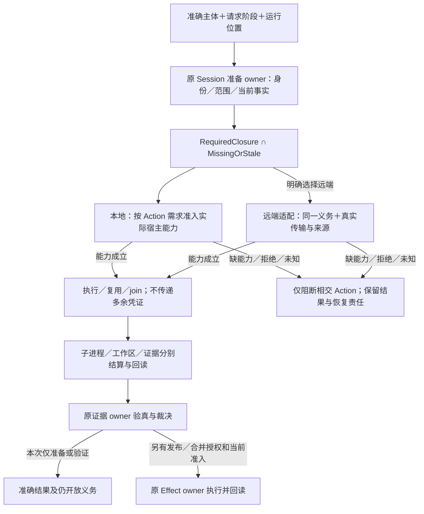
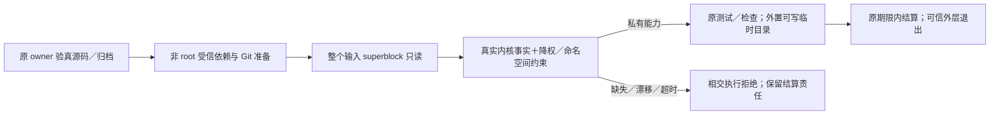

# 仓库验证与运行观测

## 验证责任与运行位置分离：本地优先及旧拓扑退出

仓库验证默认使用本次选择的本地执行环境；“本地”是本次调用相对的位置，不预设用户桌面、OS 或硬件。`VerificationSession`、Action 和[运行位置与阶段合同](../../60-保证与证据/验收/会话集成与结果复用.md#验证义务运行位置和作用阶段)保持验收及证据权威。准备、执行、发布和合并分属不同授权阶段；本地准备不隐式选择 GitHub Actions，也不因此授予合并或推送权限。

**采用的最小部署是一个本地协调入口，加上按所选 Action 实际需要创建和结算的临时执行边界。** 控制作用、独立验收和候选执行是权限及证据责任，不是三台常驻机器、三个注册 runner 或三个必建服务。同一计算机可以按顺序承担这些步骤；共享物理宿主不允许候选取得协调者的凭证、写权限或结果签发能力，也不消除方法真正需要的独立来源。是否必须新进程、只读快照、隔离命名空间或独立宿主，按实际威胁、方法和可强制能力决定，不按角色名推定。

| 原拥有者 | 本地入口必须消费的义务 | 不能从运行位置推得的结论 |
|---|---|---|
| Git、工作范围与 Session | 准确 base/head/tree、前像、有效 scope、当前工作及所选 Action；准备只产生准确准备结果 | 当前目录、分支名或本机权限不授予采用和合并权 |
| 工具链与物理执行 | 实际可执行映像、依赖代际、显式环境、资源与时间预算、取消和全部子进程终态 | 已安装某命令不证明它是受信版本或可安全复用旧结果 |
| 仓库输入保护 | 在需要严格零写的阶段保持覆盖完整的连续物理观察，或由真实内核强制的不可写输入边界排除写入；两种方法分别结算并保留实际 provider binding | Linux/Windows 字样、事件零计数、只读路径声明和前后 hash 相同均不签发严格保证 |
| 源码分析与候选执行隔离 | 按方法固定读取域、禁止修改域、凭证不可达、网络及资源限制，并读取真实执行边界和清理结果 | 普通 `spawn`、私有路径或 chmod 不能冒充不可绕过的隔离 |
| 保证、审查与集成 | 原生产者的准确 Evidence、必要独立审查、MainHealth 及预期主体作用前重验 | 本地测试绿色或远端 workflow 绿色均不能独自代签完整 Gate |

正常顺序为：选择运行位置与准确主体；由原准备 owner 读取事实并编译缺失/陈旧的 Action；为每项实际需求解析并准入宿主能力；复用、执行或 join；由各资源 owner 结算并回读；最后只进入当前授权的发布或集成阶段。准备命令不得为取得“可执行”状态而运行候选、启动沙箱、发布状态或合并。编辑反馈维持其原有限范围，不因为从正式本地入口旁边启动就取得受信资格。

### 准备请求与本地只读续接

仓库 `verification-session prepare --pr <n> --request-output <path>` 缺省选择本地，显式 `--execution local` 同义；原准备 owner 固定准确候选并生成准备请求，仅写调用者指定的输出，不执行验证或合并。`--execution hosted` 才选择已实现的远端准备路径。既有 hosted `status`／`resume` 必须明确选择 `--execution hosted`。

本地 `status`／`resume` 只投影保存请求和原 owner 已有的持久验证记录，不创建运行状态、不访问远端或启动验证；记录不存在只能表示未观察到，已保存记录只说明绑定对象的历史计算结果，不能证明当前候选、活的资格或集成许可。`resume` 返回下一步准确入口，明确本次尚未执行，不能把本地请求交给 hosted reader。

#### 本地准备信封与待绑定身份

本地准备输出使用独立 `gift-verification-session-local-preparation-v2` envelope，固定 `executionPlacement: local`、`authorityStage: preparation-only` 与 `healthBinding: pending-main-health`。它只固定准确候选、清单、Scope proposal、Action plan、Review policy 和 Session proposal 的身份；不含已绑定 Session revision、dispatch operation 或 MainHealth ledger，不观察托管健康、不执行健康检查，也不签发 Scope 或 Work 权限。

本地与 hosted 的 Session proposal 分别绑定其真实 MainHealth 来源政策，不把本地证明冒充 GitHub workflow 产物。

#### 旧版兼容与错误入口拒绝

旧 `gift-verification-session-local-preparation-v1` envelope 继续按全部原字段验收，包含其已冻结的 Session 与 operation 身份；政策或环境变化使原身份失效时明确要求重新准备，可解析不等于旧证据仍合格；不能以少字段、修改 placement 或隐式转换为新协议来绕过不一致。未知版本、额外字段及错配 discriminant 明确拒绝。

hosted reader 在取得运行状态、Git、凭据或远端 Provider 前拒绝两种本地 envelope，显式 hosted 参数不能覆盖已保存的本地放置。

缺 placement 字段的旧准确 hosted schema 只在显式 hosted 入口保持原恢复语义，不由缺字段推导远端选择；本地输出不得使用该旧外层 schema。

请求输出的 `preparation-only` 与 `not-run` 范围必须保留。未绑定 Session 的 `status`／`resume` 只报告保存计划与 `pending-main-health`，不猜测 Session、读取臆造目录或将请求摘要当健康证明。

### 本地验证的准入、健康绑定与结果结算

已获准的本地验证从原 `gift:closeout --verification-only --request <path>` 进入；该入口只接受本地准备 envelope。原准备 owner 先重读准确候选、清单归属、作者决定、依赖、当前身份与 Review，并重建同一纯计划；能在健康执行前判断的保存身份漂移或 Review 等待先拒绝／返回，不先支付全量健康检查。

之后由 MainHealth 原 owner 取得当前 exact-main 的真实合格健康，缺失、过期、失败或不可认证时停在对应边界，不回退托管 runner，不接受任意 JSON 自述。

健康生成租约在其自身结算后释放，不跨越长时间候选验证；私有证明保持原物理身份与新鲜度核验，操作期限到达或原作用域退出即失效。

跨进程的旧 JSON 只保留历史记录，不能恢复活资格；需要跨进程认证复用时须先补齐原证据 owner 的真实来源、期限和当前主体合同，不能以摘要或目录可信替代。

Session 原 owner 才把真实健康绑定为 Session，再逐项比较保存计划的全部身份；V1 另外必须重验其已冻结的 Session 与 operation。全部成立后才调用原 SourceTransition，执行结果返回实际 Session 身份；准备输入自身始终不成为执行权或验证证据。

验证沿用原租约、当前主体重读、尝试／计算／采纳日志与资源结算，在持久 artifact 回读后结束，不签发集成许可、不发布远端状态或合并；缺少实际能力保留准确失败及已完成记录。

需要作者决定时以同一入口显式提供准确 `--test-author-comment` 并重新核验，保存请求不能代替当前决定。

完整集成仍由原 `gift:closeout --pr <n>` 单独选择，保留原恢复与作用准入；`--request` 不得与完整 closeout 混用，不能从准备、只读续接或验证选择推得完整 closeout 授权。

### 能力缺失与旧执行拓扑的退出

本地能力缺失返回准确的 `unsupported`、`unavailable` 或未决，不检查远端 runner 是否在线来代替本地事实，不隐式 dispatch、轮询或切换机器。远端是显式选择的执行后端；所需 GitHub API 读取、源码/制品运输和最终仓库作用分别按实际请求准入，不要求先注册远端执行器才能做独立本地分析。此前已开始的远端操作按其原主体、来源和回执继续恢复；不能将本地请求误交给 hosted resume，也不能因新默认值不同而丢失旧操作。

固定 `control/trusted/sut` 三实例新建拓扑退出支持范围。旧 `start` 仅保留无作用的明确退役响应，不再申请 registration token、创建容器或发布初始生命周期；既有 `status` 保持只读，`recover` 与 `stop` 保持原准确 ID、租约、当前权限和终态回读，不能以退役为名删除未知或忙碌资源。已提交的 routing intent 可以由原恢复 owner 结算，未提交的 provisioning 继续按其原退出规则处理；这不重新开放新建。旧镜像、依赖和制品只在真实消费者与恢复责任清零且取得相应授权后退役。

选择这一结构是为了去掉无必要的常驻拓扑和远程前置，同时保留原方法需要的保证。拒绝把三角色合并为一个持有所有凭证并直接运行候选的普通进程，也拒绝删掉 hosted provider revision 中的角色字样来伪称旧证据已适用于新边界。旧 Action、Session、镜像和恢复状态保留原身份解释；新的执行边界必须有自己的真实 provider 身份，不能靠重命名复用资格。本地受信镜像与工具链的最终供给应只含实际所需组件，不以 Actions runner 注册、监听器或三实例生命周期为依赖；已采用固定镜像的字节在新供给真实物化、验真并迁移前保持原身份，不编造替代 digest。

## 仓库观察与测试进程：采用边界、反例与待验证方案

本项消费[观察覆盖 D65](../../90-治理与参考/决策/设计理由-验证约束与风险.md#d65-观察切面按一致性和覆盖使用)和[物理假设 D66](../../90-治理与参考/决策/设计理由-验证约束与风险.md#d66-保证依赖模型工具与物理假设)。严格零写要求区分“未观察到事件”“当前内容相同”和“期间没有写入”；执行器则必须同时保持准确程序映像、每文件隔离、资源预算及真实停止，不因宿主限制降低原保证。平台中立的输入保护 owner 只选择和保留真实后端，所有消费方使用该后端签发的 requirement、contract、Effect 集与 provider identity；Windows 连续观察的有效身份不因接口解耦重签。合格的内核防写方法返回独立的 `immutable-input` 结算，不伪造 `zero-events`；缺少合格观察或防写边界的平台没有默认降级后端。

| 状态 | 方案与裁决理由 | 仍需证明的边界 |
|---|---|---|
| 拒绝作为严格零写证明 | 单凭 Linux inotify 零事件或前后内容相同签发通过。目录外 hard-link 写入后恢复的 ABA 可绕过所选目录事件；共享 mmap 写入也可能不产生对应事件，甚至留下持久内容变化 | 更多递归 watch、轮询或延迟等待不自动补足全部写通路；反例要求回到实际覆盖，而非调整“零事件”的名称 |
| 采用／条件准入 | Linux x86-64 专用运行入口的原受信执行 owner 先完成依赖与 Git 准备，再把独占 tmpfs 输入的整个 superblock 设为只读，并在候选前建立不可绕过的命名空间约束；实际物理事实满足下述前提时，期间零写由禁止写入成立 | 普通只读 bind 只限制一个挂载点，同 UID chmod 与事后 mode/ctime 复核不排除既有 writer。源代码、配置或一次读取不等于真实内核准入与终态结算 |
| 未满足／待验证 | 普通共享可写 Linux 仓库的严格连续观察后端。没有覆盖并发、别名、映射写入及启动／退出缺口的真实机制和证据时，保持 typed capability／unsupported 拒绝 | 不得借有条件的 immutable 输入方案为任意现有 Linux 工作树签发资格；较弱观察可准确报告，但不能替代严格合同 |
| 采用的身份要求 | 受保留执行器跨父、子、孙进程交接时，验证实际 bytes、同一 sealed image 与原来源关系；仅复制路径、fd 数字或环境字段不构成 provenance | 进程资源测试与物理 retained-file 测试负责映像、漂移、失效句柄和多跳交接；环境只传递候选定位，真实 descriptor 才参与验证 |
| 拒绝 | 为避开 Bun 并行 isolate 内部 posix_spawn 的失效路径而关闭隔离、合并全局状态，或回退到未保留的磁盘可执行路径 | 单次启动成功不证明后继 isolate 仍能找到并执行同一映像；测试全局状态、PID、资源和清理边界不能因此丢失 |
| 候选方案／待验证 | 由 Gift 现有 retained process owner 为每个测试文件启动独立进程，仍消费现有选择、wave 与并发上限 | 测试 runner 策略测试及真实并发 retained-process 场景应共同证明选择完整、隔离、波次／预算和后继进程身份；局部测试不签发整体受信 Gate |

不可写输入的正常顺序固定为：原执行 owner 验真精确源码与运输输入；由受信代码以非 root 身份调用原依赖 owner，完成准确 generation、工作区桥、Git 引用及后续只读消费所需的登记；输入 owner 冻结实际测试读取的源码与 Git metadata 所在整个 tmpfs superblock；原执行入口降为独立非 root 身份并清空有效、许可、继承、ambient 和 bounding capabilities，保持 `no-new-privileges`；物理 owner 在原操作期限内重新读取真实 descriptor、filesystem、mount 与进程事实，完成内核防逃逸限制后才签发本进程私有能力；原测试选择、每文件隔离、预算与断言照常执行，最后分别结算命令、输入能力和外层执行边界。依赖运输数据只能被原依赖 owner 重新准入，不能复制 authority 或用已有文件代签准备成功。

该资格必须同时满足：

- 从受保留目录 descriptor 取得实际 filesystem 与 mount 身份，既验证只读挂载标志，也验证内核报告的 superblock 只读状态；只读 bind、路径名、环境变量、政策允许或 caller JSON 不能替代。输入及其 Git common directory 的完整范围内没有可写覆盖挂载，别名仍受同一个只读 superblock 约束；既有可写 FD／共享写映射使准入失败，不能忽略后继续。
- 源根及其祖先不能由候选替换。准入由受信入口在加载候选前完成；所有现存线程的 UID/GID、capability、`no-new-privileges` 与 mount/user namespace 均须实际核验。进程级 syscall 约束必须覆盖全部线程及后继进程，兼容 ABI、namespace 创建／进入与新旧 mount API 均不能逃逸；同步失败、线程集合变化或缺观察保持 unavailable。永久收窄仅作用于专用工作负载进程，不把该进程拿回作特权 setup。
- fixture、测试工作区、运行状态、缓存与输出位于输入之外的独立可写资源，不能遮蔽或通过别名回到输入。正常测试确实需要的写入必须在冻结前由对应 owner 完成，或进入这些可写资源；不能通过删断言、改为裸测试入口、跳过依赖准入或把失败算通过来“适配”只读输入。
- 可信宿主 kernel、管理员与受信 setup/terminal owner 属于明确 TCB；该前提不免除对候选 capability、FD、namespace、源码来源和生命周期的机械限制。setup 持有的最小权限不传给验证进程；冻结后不得用其他进程替候选执行被拒绝的命名空间操作。命令失败与输入／资源结算失败都保留，原期限耗尽不续租；外层仍由原 owner 终止并读取准确资源终态。

MainHealth 保留原五项检查及 setup、execute、cleanup 结算。其输入冻结与私有输出 tmpfs 分开，实际每次验证入口必须在降权后读取真实只读 superblock、namespace、capability 与继承 FD，并在原期限内建立内核约束后执行原命令。只有原认证 job／integration 执行上下文持有的活 bootstrap 能选择此 setup；profile 名称、容器配置或历史 receipt 都不能恢复它。新增的宿主／容器安全设置仍需该动作实际授权，设计或源码检查不代替授权与真实平台验证。Windows 连续观察和其他原有可用路径保持原身份；新的有条件路径未取得对应物理与正常执行证据时，只报告其准确未验证范围。

本节保存长期裁决、反例与重开条件，不保存现场日志或某次测试数量。具体实现候选未满足上述义务时，保留其未验证状态；禁止以文档采用词或局部成功覆盖未满足的正常执行路径。

## 编辑期反馈、受信验证与性能欠账

本仓库 `bun run check -- --affected` 的编辑反馈先由 Git authority 签发准确 `HEAD`、index、worktree、Provider 与 changed-path 观察，再决定是否需要 Source Program。

changed-path 集为空时，`bun run check -- --affected` 形成 `not-applicable` 计划，保留 Git identity 并把 source observation identity 明确记为不存在；它不为了证明空集而构造 TypeScript Program、测试投影或第二套空模型，后续真实 Effect 仍须按原边界重读 Git。

全部 changed-path 均属文档验证且不属于 Source Program/tool 输入时，同样只签发 Git-bound `docs:doctor` 计划，不构建 ProjectInput、Source Program 或测试投影；文档作者源、显式 Contract Unit 与其实际派生/包完整性输入仍走文档语义路线。

其他非空变更必须将同一进程内签发的 Git selection 与原 session、base 和 transition 绑定后才能进入完整 Source Program；普通对象、路径摘要或调用方声称的文档列表不能触发快速路径。

### 原生编辑反馈和受信检查的不同资格

昂贵验证只对准确对象生产一次。相同 source tree、tsconfig、依赖 generation、compiler/provider 与环境的受信 typecheck PASS 按既有 ActionKey 回读；任一输入变化才重新执行 compiler。

当前用户授权的临时编辑期命令 `bun run typecheck` 直接运行仓库锁定的 `@typescript/native` TypeScript 7 原生编译器，而不是 `typescript` 6 的 JS `tsc`；它复用仓库外、按 checkout 与原生版本分离的 build-info，并打印进度与编译器耗时。

本地 `bun run check -- --affected` 所选的 typecheck 步骤调用同一原生入口，不再暗中执行旧受信 checker；源码影响选择仍须独立完成准确证据。该命令只报告该次编辑反馈，不签发 VerificationAction、Git/依赖 authority 或最终 Gate。

`bun run typecheck:verified` 保留原受信 owner，`bun run check -- --scope full` 明确消费该入口；原生缓存文件不进入候选或交付。

### 历史库存与本次变更阻断

Repository Audit 同时保留当前绝对库存和 transition enforcement：unknown、candidate、dominance、test finding 与 architecture violation 的绝对集合供迁移和审查，不得在 exact self-comparison 中再次冒充本候选新增失败；阻断只消费准确 before/after 的 finding delta、reconciliation、architecture evolution、test retirement 与 supersession receipt。比较缺失、不可比、观察退化或 receipt 未决仍 fail closed，不能借“历史存量”规则把真实新增回归放行。

### 剩余分析成本与重开条件

当前性能欠账须由既有 affected selector 与 Source Program owner 消除：除准确空集和纯文档闭包外，`bun run check -- --affected --plan` 仍会取得全工作树快照并构建完整 TypeScript Program；执行模式先在零写入围栏内取得 Git-only 选择，结束该围栏后才按选择准入依赖；准确空集跳过依赖，纯文档闭包仍取得所需运行时依赖但跳过 Source Program，其他语义路径继续编译。

可能写入的 materialization 不能移进零写入围栏。

受信 typecheck 为求 ActionKey 又先解析模块，cache miss 后重新构造 Program。

阶段日志分别记录 Git selection、依赖代际、快照、ProjectInput、Source Program、fact identity 和 checker 的耗时。

受信 typecheck 的快键若改用保守输入上界，必须覆盖新增、删除、改名、负依赖解析、嵌套 package/tsconfig 与依赖 generation，并在 miss 时以真实 Program 反核；不能以已知 import 列表、路径后缀或裸 `tsc` 创造第二权威。

已完成的依赖顺序修复和纯文档 Source Program 跳过，不消除其余语义路径的完整分析与重复解析欠账；临时原生编辑反馈不替代最终受信验证。

### 受信原生检查复用：暂缓独立前置协议，先审既有产物接合

当前保留原候选验证与合并后 MainHealth 的各自检查；**暂缓**为省一次检查而新增 pre-Session 启动、独立私有工作区、完整复制、原生专用调度与恢复桥的整套方案。该方案增加了真实准备、解析域核验、资源保留与退役工作，却没有同一终局操作的净收益依据；调用方切换 Runtime State 根还可能隐藏原根中的 pending attempt，当前根的物理身份验证不能证明另一根没有未结算工作。解析域完整性、真实隔离平台及跨 reader 资格同样不能由编辑期类型诊断或局部 custody 测试代签。这是未具备采用资格，不是原生检查不可复用的证明，也不授权为优化先建设通用 enrollment／根迁移框架。

优先调查的较小方案是：由**既有候选 gate／container 的原产物 owner**在退役前导出真实原生子 Action 的结果、准确输入、诊断、原始产出时间与来源，再由 MainHealth 的实际读者独立核对当前输入、方法和信任资格。外层 gate PASS 不能充当子 Action terminal，候选 JSON 和摘要不能签发生产者权威；不存在或不可认证的已引用产物应拒绝复用，不能因此隐式新开前置任务。该接合仍是待资格方案，不因已有 artifact reader 或设计描述而视为已运行。

重开实施须先证明这个既有 owner 接合能保持原 Action 身份、导出先于销毁、当前输入／策略资格、全部真实读者及失败结算，并比较所省检查与新增捕获、验证、复制、持有和恢复的完整成本。若不能在这个边界内取得资格和净收益，就继续原检查；独立成立的源码分析优化不以采用该整套方案为前置。

## Native Candidate Check 的产物复用准入

原生检查记录只有在其真正 producer 的 `NativeCheckResult{repoCommit,worktreeDigest,dirtyInputs,checkKind,commandIdentity,toolchain,environment,artifacts,coverage,exitStatus,evidenceRef}` 完整时才可提供给 MainHealth 复用。复用器必须核当前检查的主体、输入闭包、目标工具版本、允许跳过的工作及完整输出是否等值；构建进程退出零、缓存命中和受检 Claim PASS 是不同的资格。

若 MainHealth 原本需要覆盖额外文件、完整 native build 或供应链/安全检查，就不能用某个局部候选检查抵消缺少的义务。错误日志、超时和取消后只得到一段输出的情况可显示供诊断，但不是健康证明。若 producer 不提供可复用的确定环境/摘要或收益远小于错复用风险，直接保留已有独立检查，不新建 pre-Session、移走 Runtime Root 或复制整个工作区。

接口仍由原 Native Check owner 发行，MainHealth 是只读消费者；只有实际仓库案例证明复用减少重复检查而不漏掉新失败时，才将这个候选升级为合格优化。候选不存在不应阻塞原本独立的 Git 工作流。
