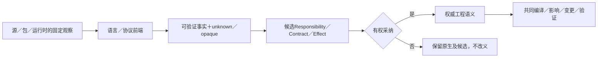

# 存量工程重建与采纳

## 观察、提升与作者权转移

存量源码的结构、调用、类型、配置与资产可以被直接读取和可靠修改，不要求先恢复原作者心理过程，也不要求先迁成中立源码。由行为猜出的需求或组件边界属于候选解释；通过实际声明、类型与构建输入取得的事实保留来源。三种动作分别处理：观察、按规则提升、转移作者拥有权。任何一种都不自动授权后两种。

<a id="fig-brownfield"></a>

### 图解：导入事实不会直接成为业务真相

观察和采纳分开；未知边界跟随当前解释继续存在。



### Attach、Lift、Reconcile、Adopt、Govern 与 Normalize 生命周期投影

为了接合已有 Brownfield 实现与消费者，本章已有“工作区观测→语言前端/源码程序→候选解释→有权采纳→受管写回/提升”的责任投影为：

```text
Attach → Lift → Reconcile → Adopt → Govern → Normalize
```

这些名称只定位本章已有阶段，不新增第二个导入状态 owner。每一步都允许 `partial`/`unknown`，导入成功不等于语义采纳成功。

**Attach。** `WorkspaceAttachment` 固定 `workspaceRef`、`repositoryRefs`、`rootCapabilities`、`vcsRefs`、`languageAndBuildHints`、`observationBudgets`、`allowedEffects` 与 `retentionAndDetachPolicy`。Attach 只建立观察能力，不取得业务 authority，也不默认获得写权限。

**Lift。** 语言、协议、配置和 artifact frontend 取得 declarations/modules/symbols、types/signatures/visibility、imports/exports/aliases、calls/reads/writes/throws/awaits、resource/effect/external-binding candidates 与 unknown/dynamic/opaque boundaries。原始字节/结构源仍由其真实 author/external owner 持有；`SourceProgramIR` 是基于该 source snapshot 派生的稳定分析表示，可作为后续消费者的事实基础但**不取得原源写权或业务 authority**。Lift 不另造第二作者源或第二语义世界。

**Reconcile。** 将 observed candidates 与现有 canonical semantics 区分为 `ObservedOnly | CanonicalOnly | Matched | Conflict | Unknown`。同名、同路径和同包不能自动 Match；映射需要 Evidence 与有权 Adopt，无法唯一判断时保持 Ambiguous。

**Adopt。** 有权决定只在明确 scope 接受事实、责任、合同、source bindings、Claim definitions、test obligations、evidence requirements、unknown frontier、verification obligations 与 migration plan。它不能接受实际测试结果、Evidence、适用性裁决或 Verdict；这些只能由 verification owner 针对精确对象、方法与环境产生。Adopt 也不能把不完整观察接受为完整事实，或把外部 package writer 的自述提升为独立 truth。

**Govern。** Adopt 后，原生工程进入共同的 Delta/Impact、safe Mutation、Verification、Agent/Workbench、Release 与 Migration/Retirement。新的 source delta 触发重新 observation 和 reconcile，原生区域不能永久绕过治理。

**Normalize。** 稳定原生模式可以按实际差额提升为 reference implementation、Adapter、Block、Language Provider、deterministic generator 或 canonical module。只有可重建性、conformance、round-trip、consumer migration 和旧 writer 退役全部闭合，才完成 normalization；失败时回到 governed native，不能用 TODO 或空 Adapter 冒充完成。

该生命周期至少验证 monorepo 多语言/多 lockfile、generated 与 handwritten 混合、dynamic import、reflection/plugin loading、symlink/case/Unicode、dirty working tree、submodule/LFS、local patch 与 upstream diverge、不完整构建环境、vendor/opaque binary、source/docs 冲突、attach 后权限变化及 normalization 失败恢复。

<a id="reverse-support-scope"></a>
### 强逆向按对象和操作成立，不按语言数量成立

| 对象与目标 | 当前能设计并检验的承诺 | 不得代签 |
|---|---|---|
| 有源码的原生TS/JS工程 | 原字节保全、实际绑定/类型、局部重构、源与配置/资源关系；不改范围原样留下 | 任意运行时动态属性的全静态知识、原作者最初需求 |
| 有完整来源的Gift生成TS | 对声明支持的编辑类别进行回源、合并、再生成，再次编辑仍走同一链 | source map自动提供所有逆变换、任何有损优化都可逆 |
| 没有来源的外部目标源码 | 作为真实原生作者源接入；支持域可提出中立提升候选 | 将推测的高层模型当成原作者定义，自动接管未知区域 |
| 只有声明或二进制 | 获取准确导出、ABI、可观察行为及其条件，按权利保全/调用 | 恢复全部私有源码、注释、命名和历史意图 |

选择更多目标可以提供生成或生态调用价值，但只有通过相应读改闭环才声明“工程支持”。当前先闭合[TS范围](../../70-工程系统与演进/演进与实施/实施/主线前沿-作者主线与实现责任.md#language-roadmap)，不是以某些任意逆变换难以成立为由把全部读取和可靠编辑留成未来工作。

### TS原生工程读取与修改的TSREAD0—TSREAD6

**TSREAD0固定实际输入。** 固定工作树/编辑器叠加层、tsconfig及继承链、包与声明、模块解析条件、路径和权限范围。JS/TS、script/module、JSX、编译选项是输入，不由文件名独自决定。配置脚本/插件须独立准入，读取不能暗中执行它们。

**TSREAD1取得原源与语义索引。** 用已绑定的TypeScript语言服务/Compiler API取得语法、符号、类型和诊断；保留原字节、词法片段、注释及UTF-8/UTF-16映射。按任务调用所需分析；不让服务隐式读另一个cwd或未捕获文件。成熟SourceFile树不是完整原文保全方案，未改片段直接取原切片。

**TSREAD2分类当前操作。** 名字变化按符号和公开消费者；字面量/表达式按具体语法区域；导入和路径按实际解析关系；配置/资源使用所属格式适配；行为改动核原要求。动态字符串键、eval、Proxy、反射和缺失类型标出相交未知，不将它们当普通静态引用。

**TSREAD3构造候选。** 先定位全部编辑及其重叠，保留作用域、求值和资源；同一批次同时修改定义与调用。原生合法的新算法正常留在原生源中，不因Gift中立模型不支持就拒绝保存。语义尚错的草稿保存而不伪报通过。

**TSREAD4复读核查。** 在同一工具族和固定输入下重解析、重新绑定，并取得本次声明需要的检查。重命名的无捕获与绑定对应不是“没有报类型错”可以替代；文本零变化必须返回原字节。语言服务已有重构可以复用，但仍核其范围、公开合同及Gift未改区域。

**TSREAD5生成或运行。** 保持原语言语义的本地路线无需先提升为Gift；明确要求跨目标时才对支持的闭合区域作带前提的提升。返回按模块和按根的覆盖，不把部分观察称为全工程语义完成。

**TSREAD6保存与后续。** 按实际缓冲/磁盘前像采用。外部变化进入三方合并，旧快照仍只读；新一轮沿原源码、规则与映射继续，不用最后合法AST覆盖当前草稿。

TypeScript语言服务的Host、ScriptSnapshot与按需分析提供可复用机制：[官方API说明](https://github.com/microsoft/TypeScript-wiki/blob/main/Using-the-Language-Service-API.md)。它不完成Gift的来源拥有、任务要求、全资产或目标逆向协议。

### 原生与生成物的编辑入口不同，维护体验一致

原生作者文件使用现有`base/edits`或`files`。受管生成物使用[generated-edit](../工具协议/六工具与请求-工具边界-任务与作者输入.md#generated-edit-request)，先保留准确目标草稿，再按[写回合同](../../40-目标与制品/表示/编辑与受管回源.md#managed-edit-roundtrip)形成作者候选。图或AI任务视图只给当前必要信息，不能丢弃未显示文件。

只读查看、可编辑、可重构、可提升、可生成和可恢复分别声明。对于当前已选择的普通修改范围，必须有正向完成算法；全部返回“不支持”不满足强编辑交付。范围之外保全与诊断是失败责任，而不是完成证据。

## 工程导入与按模块提升

### 接入不是破坏性转换

首次导入只读。清单记录可访问文件、二进制、子模块、锁文件、构建脚本、资源和配置；权限错误、缺失外部资源、软链接和特殊文件分别记录。无权限对象不能承诺保全。原始字节与原构建入口保留，不能只留下生成的摘要。

每个模块由语言前端或已接受的合同导入器产生并更新[唯一 `ImportedModuleView` 合同](../../70-工程系统与演进/实现与装配/源绑定与解释映像.md#数据所有者与不可伪造的完成范围)。导入步骤先固定来源与可观察边界，再按该 owner 的字段记录公开结构、类型、合同、依赖、映射、round-trip、coverage 与 unknown；后续提升只消费其中已有来源且仍有效的能力投影。缺项保持 unknown，能力不足时保全原生内容并限制相交操作；重新观察使相交字段和能力范围失效后，必须先重建视图再继续。这里不复制字段全集或阶梯定义，也不要求首次导入完成全仓语义化。

### 导入算法

1. 识别显式入口和构建画像，不执行未知脚本。
2. 观察受控资产与目录成员，记录读取期间变化；必要时重试或返回不一致。
3. 由语言前端解析 CST/AST、符号、类型、模块解析和可得依赖。
4. 为每个声明保留原生语义，寻找具有正确性合同的公共提升规则。
5. 先提升闭合函数/模块；外部调用保留明确接口与来源，不猜实现。
6. 提升需要改变编辑权时产生采纳计划；采纳前不删除原权威源。
7. 生成区域能力报告和原生构建验证方案；失败不影响无关可用区域。

### 可保全却不可提升的内容

动态 eval、反射、宏、运行时代码生成、手写内存操作、FFI、框架约定和二进制扩展可以保留，但不自动进入可移植公共层。未来可新增前端、语义规则、运行时仿真或替代实现。使用桥接时明确依赖原语言，不能把桥接当纯目标移植。

### 目标支持矩阵

每个区域分别报告解析覆盖、分析覆盖、提升覆盖、可编辑操作和每目标降低状态。项目级“可构建”与“完全迁移”是不同指标。选定入口跨越未知动态调用时，阻止纯目标承诺；仍可输出已支持模块及明确诊断。

### 理由与权衡

竞争方案是强制一次性翻译整个项目。这会在首个不支持节点处全局失败，并鼓励工具忽略难点。选择渐进提升能保留信息和原运行能力，但会带来阶段性的混合工程与映射维护成本。成本由旧依赖清零、区域迁移和回归验证管理，不永久双写。

反证为注释/资源/构建脚本丢失；未分析字节被删除；解析成功被宣传成移植成功；已有人工逻辑被模板重写；观察错误变成文件不存在。

## 意图规范化、歧义与安全前沿

### 创作解释与确定规范化是两段不同工作

自然语言请求可能需要AI结合上下文提出具体解释；这一步允许有多个候选，不承诺同一未结构化句子在任何模型/历史/环境中得到同一个语义对象。原文字、可见上下文、候选解释及实际采用关系保留来源。明确的作者源按固定文法和绑定解释；这时才有可实施的确定规范化。

固定构建直接消费已选作者内容和解释，不重复调用AI重猜。运行状态、库缺省和用户决定改变时，形成新输入或新的接受关系；不能沿用旧身份却替换其意义。

正向关系为 `ObservedBehavior → CandidateIntent → Evidence + competing hypotheses → explicit adoption → Canonical Intent`。函数名 `validateUser` 不能自动升级为业务规则，当前行为也不能自动成为正确要求；推断必须保留来源、置信、反例和可撤回性，不能为了“导入完成率”任意选择解释。

### 正向处理与输出

先保全请求和当前任务目的，再按明确选择、标识符、工程上下文、已接受的关系解析范围。模型启发式只能形成带依据的候选，不压过显式对象。相同短语指向多个会改变结果的对象时，输出这些差别及受影响输出。

已写出的源走词法/结构、引用/作用域、类型与角色解析。把接受要求、候选定义、观察、缺省和建议分别交给[完成与缺省算法](../../20-语义与组合/组合/跨软件需求合同.md#意图进入同一作者源的完成与缺省算法)。该算法拥有硬约束合并、委派与不足分型；本节不另维护一套可以独立修改的规则表。

输出包括保全的作者候选、当前可解释范围、真正的歧义或冲突、注入假设、选择依据和下一步。没有完整语义解释的文本可以保存为要求，不能当成已可证明的程序；有精确合同但算法未固定，可由合格绑定继续，并非必须作者手写算法体。

### 假设与默认的可见性

没有来源的值不能作为现实事实。用于继续设计的假设至少说明内容、依据、适用范围、影响和反转条件；没有数据就不制造概率。已接受的缺省在范围内可以被确定使用；新的业务假设作为候选，由实际委派决定是否接受。这样不把所有省略都升级成永久澄清，也不自动授权不可逆效果。

### 冲突、开放要求与可继续范围

相互矛盾的固定约束可以形成可复核冲突：保留全部公开接口且要求删除其中一个，或明确必须离线却指定只能在线使用的唯一实现。先区分真实冲突与当前目录不完整；没有查到替代不证明所有实现都不存在。返回当前实际依据和可以修改的条件，不无条件声称最小UnsatIntentCore。

精确同一行为的多个实现不属于对象歧义；公开行为存在未委派差别才是待决。没有决定部署目标，不阻断源设计；某个必需端口没有合格实现，则限制包含该作用的生成，不自动删除端口。可继续集合按已选择路线、阶段和真实依赖计算，调用[适用性规范](../../70-工程系统与演进/演进与实施/适用性与能力协商.md#从请求根计算实际义务与激活集合)，不使用“全世界任务集合减去全部未知”的虚构完备集合。

### 规范化的准确保持关系

对已解析的同一种规范对象M及固定解释环境E，正常化函数N应满足N_E(N_E(M))=N_E(M)，并保持公开含义、否定、例外、数值单位、时间锚点和来源对应。这里的输入输出都属于定义的规范域；它不是对任意自然语言和AI推理的幂等承诺。

每个派生项能追到实际源、已接受缺省或明确规则。格式与名称归一不自动证明全程序行为等价；摘要只对已定义的等价关系使用。来源不同但结果同值时仍更新真实依赖，再由消费者决定能否复用。

### 澄清与进展

先取得已有且有权的工程事实，随后在被委派的范围使用明确缺省或提出条件方案；只有真正未定的公开行为、价值取舍或外部权利，才返回需要相应主体决定的事项。返回对象、选择、后果、推荐依据、可继续的工作和要求来源。无权、不支持、暂缺信息和预算耗尽分开，不让同一句“无法确定”阻塞整个工程。

### 验收轨迹

完整已绑定源重复规范化得到同一规范结果；AI对原句提出不同解释时保持候选分离；显式选择胜过邻近文本；删除或否定条款不丢失；新库不隐式重解释旧源；有条件设计在该任务范围可交付；受相交缺口影响的运行保证保持未决。检查“全部拒绝”“永远澄清”不能通过合法成功路径，检查“随便填缺省”不能通过冲突路径。此处是设计，不是模型确定性或产品测试结果。

<a id="design-b31"></a>
## 渐进采纳与可退出的原生工程

存量项目入口先read-only捕获项目配置、包锁、公开导出和受管边界；不要求把所有原生文件转成Gift。reader不认识的语法或构建系统保持原样，报告读取coverage，不将未读取区域当无依赖。已有包管理/原生构建继续由其锁和宿主责任管理，不在纯编译中自动安装或升级。

采纳按AuthorRegion逐块：解析与源码映射、保留真实行为合同、比较原生和新目标的相交观察，再由拥有者将该区切为Gift源或继续原生。遇到当前source与导入时快照不同先冲突，不覆盖用户继续工作。生成代码中引用的原生库按A03保持真实签名/ABI/效果和许可。

退出Gift必须交付当前明确选定的可构建源码、公开依赖锁、必要运行库及构建说明；停用Gift不应让纯生成函数需要后台服务才能运行。需要动态Gift服务的应用必须明确列为运行依赖，不可承诺无依赖退出。原生采用后的文件有新写权，旧生成器不得继续覆盖；历史SourceMap可读但不再授予逆写。

**验证与反例**：部分语法不认识、原生并行编辑、只采纳一个函数、动态runtime依赖披露、停用Gift后的干净构建和生成器误覆盖。

**实际能力边界**：真实存量工程迁入/迁出构建没有执行。

相交合同：[原生实现选择的单源绑定](../../10-作者与输入/作者源/工程源/工程清单模块与绑定锁协议.md#design-a03)；[目标成员集合、依赖和再生成](../../40-目标与制品/目标/成员布局-完整装配与布局.md#design-b19)；[多段源码映射与回写授权](../../40-目标与制品/编译内核/降低与源码映射.md#design-b20)；[从新意图到第二次修改的作者旅程](../客户端/开发者全旅程UX与交互验收.md#design-b30)。
