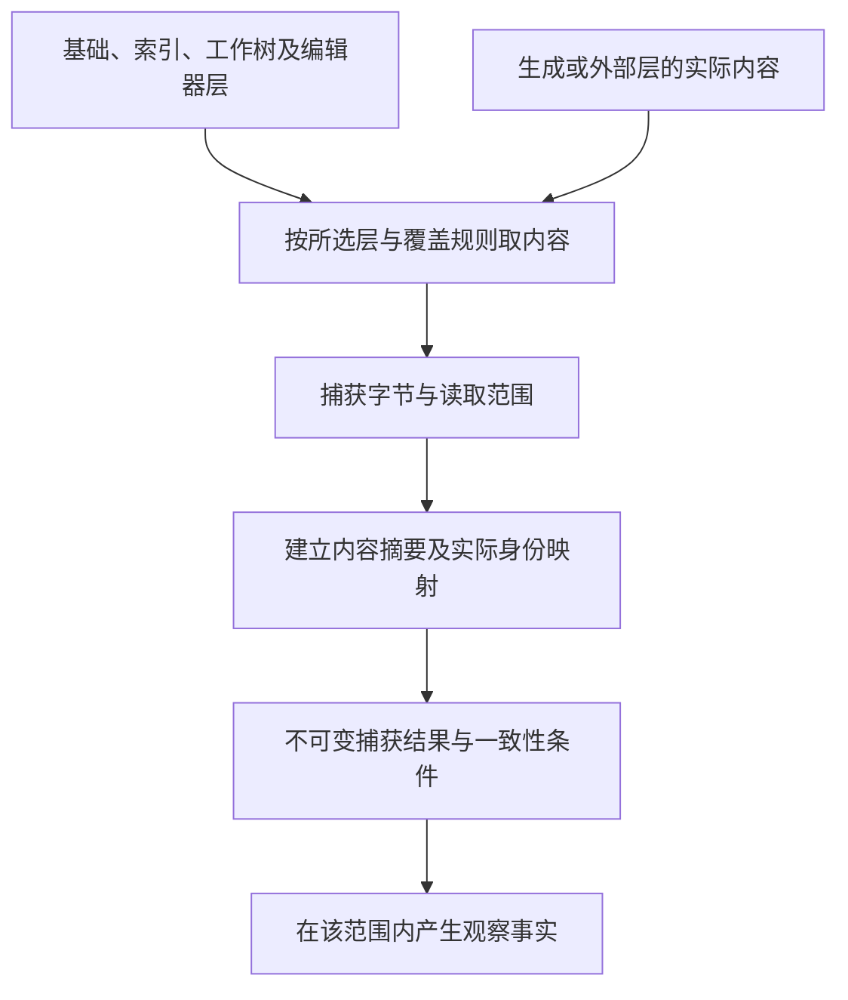

# 工作区与版本库观测

## Git、索引、工作树、提交与候选树观测

### 多个状态不可合并

```text
HEAD commit/tree
Git index
working tree
untracked set
ignored set
linked worktree registry
remote refs
candidate tree
```

它们有不同身份、写入协议和消费者。`git status clean` 也不能证明外部资源、子模块、LFS 或生成状态一致。

### CandidateTree

正式验证绑定内容树，而不是分支名和提交数量：

```text
CandidateTreeIdentity =
  trustedBaseTree
  + normalized candidate delta
  + modes/submodules/attributes needed by contract
```

开发分支可以多提交。若本次保证仅以准确内容树及已固定的相交输入为主体，最终 squash merge 可用 merged tree 与 verified candidate tree 等价承接该内容证据；这不证明提交历史、父关系、签名或策略等价。构建读取提交号、git describe、父提交、分支状态或归档展开时，这些是另需固定的实际输入；合并改变它们就重核受影响动作，不能用树相同覆盖历史敏感的结果。

### Index 与 partial staging

索引和工作树是独立前像。只读 check/freeze 不能修改任何一个。显式 transform 若无法证明只作用于授权 staged patch，应返回 `partial-staging-conflict`，不能隐藏 stash/restore。

### 工作树

每个 worktree 有 registry entry、物理目录、branch/ref binding 和活动 owner。关闭必须分别完成 registry 注销、物理目录 settlement、branch/ref CAS 删除和 readback；任一步 residue 不能被总体 success 覆盖。

### 远端事实

PR 标题、branch 前缀和 commit message 只是 transport metadata。base/head/tree、merge state、review decision 和 checks 通过 bounded machine API 观察；外部文本不能成为指令或授权。

### 验证：Git、索引、工作树、提交与候选树观测

- linked worktrees 使用不同 index；
- candidate 与主工作目录并发变化；
- rename/copy/deletion source endpoint 都进入 scope；
- force-push 在 prepare/finalize 之间发生；
- squash 后 tree 相同但 ancestry 不同；
- remote merge 成功但 local main dirty/diverged；
- closed PR head ref 长期残留；
- unknown ignored state 不被自动删除。

## 工作区精确观测

**工作树事实。（消费条件）：** 未提交、已提交、远端与设计候选各有不同revision；分支合并成功不能倒推修改前的作者语义等价。 合同归属：[并发作者编辑的含义重基、来源保全与冲突切分](../../10-作者与输入/作者源/工程源/作者编辑保存与迁出.md#gift-author-merge-semantics)。

### 目的

工作区观测建立所有源码分析、编译、计划和验证共同使用的物理事实。它回答“系统实际读取了什么”，而不是“目录里大概有什么”。

### “精确”的适用边界

本文中的“精确观测”只表示：对一个已声明根、作用域、覆盖层、观察算法和一致性策略，产生可验证的有限观察切面。它不表示对开放外部世界、分布式系统、未来执行或隐藏物理状态获得全局同时真值。

```text
WorkspaceObservation
  = ObservationCut
  + declared consistency class
  + coverage and skew bounds
  + dependency evidence
  + unknown frontier
```

只有文件系统快照、版本控制树或等价证明成立时，才能声明 `AtomicSnapshot`。普通读取必须表述为 `StableMetadataRead`、`BoundedSkew`、`ContentAddressedRetry` 或 `BestEffortWithCoverage`，且下游不得把较弱等级升级为全局精确。

### 内容层

```text
base       版本控制基准
index      暂存区或候选索引
worktree   磁盘工作区
editor     未保存编辑器缓冲区
generated  受控生成层
external   显式挂载或远端只读层
```

每层拥有独立 revision、来源和可写能力。有效内容按显式 `OverlayPolicy` 组合。

### 观测模型

```ts
interface WorkspaceObservation {
  readonly observationId: string;
  readonly rootCapability: PhysicalPathCapabilityRef;
  readonly requestedScope: ScopeExpression;
  readonly entries: readonly ObservedEntry[];
  readonly overlayPolicy: OverlayPolicyRef;
  readonly configuration: readonly ObservationRef[];
  readonly environment: readonly ObservationRef[];
  readonly coverage: ObservationCoverage;
  readonly generation: GenerationRef;
}
```

`ObservedEntry` 至少记录：规范路径、物理绑定、对象类型、内容摘要、字节长度、编码观测、权限、符号链接信息、来源层和读取前后元数据。

### 分类、负事实与差异

观察覆盖必须分别记录 `tracked`、`untracked`、`ignored`、`excluded`、`vendor`、`submodule`、`lfs-pointer`/`lfs-object`、`generated`、`binary`、`secret`、`protected`、`temporary`、`symlink`、`junction`/`reparse`、`hardlink`、case/Unicode normalization collision、`unreadable` 与 `unknown`。Git object、index、worktree 和 editor layer 分开；`.gitignore` 不产生删除许可，untracked/ignored 仍可能具有业务价值，LFS pointer 不等于对象内容，read-denied 不等于 absent。

`NotFound(x)` 只有在所需命名空间、revision、principal、root 与枚举覆盖完整时成立；目录中“没看到”不是一般性的不存在证明。观察差异按 entry identity 与 byte identity 比较；rename/copy 只是派生候选，除非 Git/object/provider 提供相应 Evidence，不能冒充权威 identity continuity。

### 路径能力

观测不接受任意字符串路径直接访问文件系统。`PhysicalPathCapability` 绑定：

- 允许根；
- 读、写、遍历和创建权限；
- 符号链接策略；
- 大小写和 Unicode 规范；
- 设备、网络共享和特殊文件限制；
- 有效期和撤销 epoch。

路径规范化后仍需验证物理目标未逃出允许根。

### 一致读取

普通文件系统通常不提供全工作区原子快照。观测器必须选择并声明策略：

```text
StableMetadataRead
ContentAddressedRetry
VCSSnapshot
FilesystemSnapshot
EditorSnapshot
BestEffortWithCoverage
```

读取前后元数据变化时重试或标记 `changed-during-read`。元数据不变仍可能存在时间粒度不足、恢复时间戳、并发写入或 ABA，不能据此证明一致读取；读到的字节哈希只标识本次字节串。需要原子快照保证时使用确有该保证的快照/锁协议，并绑定其范围；普通稳定元数据策略只提供相应弱证据。

### 编码与文本

编码是观测事实，不是默认假设。需要区分：

- UTF-8；
- 带 BOM 文本；
- 可识别其他编码；
- 二进制；
- 无法判定；
- 非法字节序列。

换行和 Unicode 规范化只在语言前端或生成后端明确允许时进行；内容摘要默认基于原始字节。

### 配置、依赖与环境

工作区观测同时包含影响语义的：

- 编译器配置；
- 模块解析设置；
- 包管理锁文件；
- 条件编译和环境变量白名单；
- 工具链 revision；
- Host 能力；
- 目标平台画像；
- 生成代码来源；
- 可见 Provider 能力。

未被声明和观察的环境输入不能在后续 pass 中偷偷读取。

### 工作区观测流水线



不可变捕获结果表示后续读取同一批字节，不证明活动工作区曾同时呈现这些内容。需要一致快照或精确不存在条件时，必须取得对应源能力；内容摘要不签发来源权威。

### 增量观测

观测缓存键至少闭合：

```text
physical identity
+ previous metadata
+ read strategy
+ overlay revision
+ path policy
+ observer revision
```

上面的元数据键只是快速候选键；只有文件系统一致性、变更追踪或重新内容校验的前提足以证明未变时才正式复用。mtime/size 相同不能独立签发内容未变。

文件监视事件仅作为失效提示，不作为最终事实。溢出、丢事件或重命名不确定时扩大重扫范围并记录覆盖变化。

<a id="workspace-watch-invalidation"></a>
### Watch subscription、cursor与重新观测

持续诊断、增量编译、test watch和IDE refresh可以消费文件系统watch Provider，但watch状态只决定**哪里需要重新观察**，不成为文件内容、rename identity或语义Delta的authority。

```text
WorkspaceWatchView = derived {
  rootCapabilityAndPhysicalIdentity,
  providerAndWatchRevision,
  subscriptionGeneration,
  baselineWorkspaceObservationRef,
  providerCursorClockOrSequence?,
  watchedScopeFiltersAndRecursion,
  eventClassesAndOrderingGuarantees,
  symlinkInodeAndRootReplacementSemantics,
  overflowFreshInstanceOrLostCoverageState,
  lastReconciledObservationRef
}
```

**WATCH0 建立基线。** 取得合格 `WorkspaceObservation`及其实际观测范围，并按[快照—事件接合](../工具协议/客户端与并行会话.md#projection-checkpoint-resync)建立watch。Provider能从扫描切面续读时可先扫描再订阅；不能追溯时先建立有界通知保护再扫描并协调扫描期间失效提示。同步cookie/cursor/clock只有在Provider明确提供相应覆盖时才能消除间隙；重复重叠扫描本身不证明连续观察，无法建立保证时保留窗口unknown。

**WATCH1 事件只排队invalidations。** create/change/delete/rename等事件按Provider实际语义合并为待重观测scope。事件里的filename、cookie、inode或path只用于定位候选范围；真正内容、对象kind、physical identity、存在性和作者层由新的WorkspaceObservation读取。相同路径收到10个Changed可以合并一次重读；10个event不能解释成10次业务编辑。

**WATCH2 atomic save与replace。** 编辑器常以temp file + rename/replace保存；Provider可能报告delete/create/rename/change的不同组合。不得据event sequence直接建立“同一文件连续身份”；重新读物理对象和作者/VCS对应后再决定是同一逻辑source的新revision、rename、replacement还是冲突。

**WATCH3 overflow/fresh instance是coverage失效。** watcher buffer overflow、Provider restart/recrawl、cursor太旧、remote disconnect、root move/replacement或任何“可能丢事件”都使自上次可靠cut以来的增量coverage失效。此时按WATCH0保护新捕获窗口，在私有候选中完整枚举所需scope，再共同安装合格WorkspaceObservation、实际读集和覆盖；`is_fresh_instance`、blanket change或类似信号绝不能被解释成“没有具体event所以没有变化”。重新枚举恢复的是所需当前事实，不证明漏掉的中间编辑从未发生，也不替VCS/操作Journal补写历史。

**WATCH4 inode/path寿命。** 某些Provider实际盯inode，删除后同路径重建时旧watch可能继续盯旧inode；另一些Provider按目录/路径报告。subscription绑定真实Provider语义和root physical identity，root/device/network mount被替换就建立新subscription generation并重取基线。

**WATCH5 去重按观察，不按event。** 两个watchers、antivirus/build tool或Provider可能产生重复/附加事件。多个event可以触发同一重观测；只有重观测得到相同实际revision/read-set时才停止传播。不能用event ID去重掉一个真实后续内容变化。

**WATCH6 关闭。** watcher取消/进程结束只关闭未来通知和相关资源，不回滚文件变化。关闭前后窗口若任务要求连续保证，先取得同步cut/最终reconcile；否则准确报告停止后无覆盖。

watch本身有descriptor/handle/buffer/thread/remote subscription成本，按资源预算限制root数量、递归深度、队列和debounce。为了性能忽略目录时，该ignore/filter也是coverage条件；被忽略区域不能支持“全工作区无变化”。

### 编辑器与写回

若有效观测来自 `editor`，变更执行必须选择同一可写层或先协调：

```text
ObservedLayer != WritableLayer
→ WritableLayerDiverged
```

合法处理：保存、通过 IDE Provider 写缓冲区、放弃缓冲区重新规划、或生成显式三方协调候选。

### 安全与资源

观测器必须：

- 限制文件数、总字节、单文件大小和递归深度；
- 避免跟随设备文件、循环链接和归档炸弹；
- 将忽略规则本身作为输入；
- 对秘密和敏感路径进行最小读取与审计；
- 在取消和截止时间后停止新读取并结算已读取资源；
- 保留恢复和诊断所需空间。

### 验证：工作区精确观测

- 读取中并发写入；
- 符号链接逃逸；
- Windows 大小写和文件占用；
- 监视器事件丢失；
- 编辑器与磁盘分歧；
- 权限在读取中撤销；
- 超大树和资源耗尽；
- 同一字节跨路径复用但保持不同物理身份；
- 干净扫描与增量扫描生成等价观测。

## 编辑器覆盖层、索引、磁盘与写回协调

### 同一路径可能有多个内容层

```text
base
index
working-tree
untracked
editor-unsaved
code-generated
remote-overlay
```

`WorkspaceContentView` 按显式 precedence 合成有效读取，但写入必须绑定一个真实 writable carrier。

Language Service 的内部版本号不是全工程 revision，二者映射必须进入绑定。Autosave、format-on-save、code action 和插件都可能成为额外 writer；参与时建模其 Effect 或限制作用范围，否则不能声明唯一 writer。

### WritableSourceLayerBinding

```text
WritableSourceLayerBinding = exact {
  contentViewRef,
  effectiveObservedLayerRef,
  writableLayerRef,
  semanticSourceRef,
  providerBindingRef,
  exactPreimageRef,
  reconciliationPolicyRef,
  conflictAndFailurePolicyRef
}
```

### 允许路径

- effective layer 与 writable layer 相同且前像精确；
- editor Provider 对未保存 buffer 提供原子 CAS 和 readback；
- 用户或明确 operation 先 save/reconcile，再重新观察和计划；
- 生成层有独立 owner，写入目标不是手工层。

### 必须拒绝

读取editor中的B却按B的前像覆盖磁盘中的A；读取staged blob却写working tree；未使用准确生成对应就把generated view当成作者源；隐式保存所有文件；写入后把另一层仍旧的内容冒称同步完成。有来源的合法generated-edit不是禁止项，必须沿原回源和真实保存协议。

### 冲突

层间差异不是普通文本冲突，还可能是 ownership、format、source-map 和 semantic revision 冲突。无法自动调和时返回 `writable-layer-diverged` 并提供最小差异和合法下一动作。

### 验证：编辑器覆盖层、索引、磁盘与写回协调

- editor 与 disk 并发编辑；
- partial staging；
- remote IDE 断线；
- formatter 修改工作树但索引不变；
- generator 重写同一路径；
- save 后 source revision 变化导致计划失效；
- accepted 写入后所有投影重新读回一致。

## 观测预算、采样与覆盖前沿

### 观测不是无限免费

全仓扫描、全量 trace、所有平台测试和所有外部 API 读取可能比被解决的问题更昂贵。Gift 需要在不撒谎的前提下控制观测成本。

### ObservationPlan

```text
ObservationPlan = exact {
  purposeAndClaimRefs,
  subjectUniverse,
  requiredCoverage,
  selectedMethods,
  samplingOrEnumerationPolicy,
  resourceAndDeadlineBudget,
  expectedInformationGain,
  privacyAndDisclosureConstraints,
  stopAndEscalationConditions
}
```

### 选择原则

先使用已有 fresh exact observation；再观测最可能改变决策的 frontier；高风险路径优先完整覆盖；低风险探索可采样。不得为了预算把未观测部分写成不存在或不适用。

### 采样语义

样本必须说明总体、抽样方法、偏差、缺失、权重、置信范围和不支持的外推。有限样本可以按明确算法计算样本分位数；单次或很少样本不能支持稳定的总体 P95/P99 或尾部保证。必须报告 n、样本选择、分位算法与不确定性；便利样本不能代表所有用户、平台和尾部。

### 自适应观察

观察结果可选择下一步，但 selection policy 本身进入 provenance，以避免“看见有趣结果后继续采样”造成无记录偏差。

### 覆盖前沿

```text
CoverageFrontier = {
  observedCells,
  unobservedCells,
  unsupportedCells,
  unknownDependencies,
  expectedDecisionImpact,
  nextObservationCandidates
}
```

### 验证：观测预算、采样与覆盖前沿

- 预算耗尽；
- 隐私限制阻止读取；
- 动态依赖扩张；
- 采样漏掉尾部故障；
- 多次查看后选择性报告；
- 缓存 observation 过期；
- 低风险路径缺失不应阻断无关功能；
- 高风险不可逆 Effect 前覆盖不足必须阻断。

## 路径身份、物理对象与跨平台文件系统

### 概念必须分离

```text
LogicalId
LogicalPath
RepositoryRelativePath
WorkspaceRelativePath
SourceRelativePath
GitPath
ModuleSpecifier
ArtifactPath
ArchiveEntryPath
URI
FilesystemKey
PhysicalAbsolutePath
PhysicalObjectIdentity
```

这些值即使都由字符串表示，也不能隐式互换。

### 逻辑路径

采用该表示的领域必须定义：分隔符、`.`/`..`、空段、尾分隔符、Unicode 规范化、大小写语义、长度和禁止字符。验证不能先有损规范化再接受原始输入。

### 文件系统键编码

语义身份映射为文件名时使用版本化、可逆或 digest-bound 的单射 codec。`/ → .`、全小写、非法字符替换为 `_` 等有损“清洗”会合并身份，除非逻辑域已证明不会冲突。

### 词法包含与物理包含

词法检查只能证明规范化路径位于根下，不能证明文件系统实际不会经过 symlink、junction、reparse 或替换对象。高风险操作需要 retained root/parent identity、no-follow traversal、对象种类、leaf identity 和 Effect 后 readback。

`stat → use` 不是安全身份绑定；需要时以打开句柄、对象 identity、fence/CAS 和 readback 约束 TOCTOU。多个路径可以指向同一物理对象，inventory 和 write set 不能只按路径去重。文件、目录、link、junction、Git ref 与 remote object 的删除是不同 Effect，各自需要前像和读回；递归删除存在 unknown child 时必须拒绝。

### 平台差异

Windows drive、UNC、extended path、设备名、尾点空格、大小写、reparse；POSIX symlink、mount、inode、权限；网络文件系统和容器 overlay 都是独立物理事实。一个平台成功不能替代另一个平台。

平台画像还要明确 reserved names、separator、Unicode、hardlink、ADS、ACL、mode、lock/share 与 atomic rename 语义；路径、URL、registry key 和包名都只是 locator，不能自行证明对象身份连续。

### 模块说明符

`typescript`、`node:fs`、`./foo.ts`、`#internal` 是模块解析输入，不是普通路径。必须保留 lexical specifier、resolution config、resolved module identity 和 physical binding 四层。

### 迁移

旧 codec 不能被新 codec 静默解释。先 inventory exact legacy binding、发现 collision/ambiguous、冻结新 revision、staged migration、readback、consumer cutover、停止旧 writer，最后退役旧 reader。

### 对抗验证

覆盖路径穿越、大小写/Unicode 冲突、保留名、长路径、symlink/junction/reparse、hard-link、same-path ABA、root replacement、archive traversal、module/path category confusion 和旧 codec collision。

<a id="developer-vcs-integration"></a>
## VCS开发面：选择内容、形成提交、集成及同步

本节沿前述HEAD/index/worktree/candidate/remote分离，使用真实原生VCS能力；既有编辑器/AI可以请求它，但不能把`apply(save-source)`解释为提交或把检查器变成Git写者。

### VCS0—VCS7 按准确选择集成

**VCS0捕获事实。**取得目标仓库/工作树、准确HEAD与父关系、index、工作树/未跟踪状态、属性/过滤器、必要子模块及大文件原件。没有取得的外部材料保留缺口。分支名只是可变位置，不是审查主体。

**VCS1形成选择。**用户可选择已暂存内容、指定候选/语义组、明确路径或全部本次任务变更，但这些并不等价。默认保留与本任务无关的index和worktree修改；不得自动git add -A、stash/reset或包含其他人的半成品。部分暂存同文件时，按准确index与worktree差异组合；有冲突就显示，不暗中清理现场。

**VCS2构造候选树。**需要时用隔离索引或临时工作区形成准确树、mode、子模块提交与必需资源；它不是另一个可编辑真源。记录原生clean/编码/行尾转换及其配置；转换后blob才是提交内容。转换执行自定义filter时属于实际工具作用。未经规则可逆保证，不把工作树字节直接当仓库存储字节。

**VCS3审查与检查。**以最终被选内容及真实相交构建输入检查；规范、公共合同、依赖锁、生成成员、测试及消息的共同变更一起纳入。检查了工作树中的一个版本，不能自动给暂存的另一个版本签发同证据。历史敏感构建与策略保留准确父提交/环境，而不是只看tree。

**VCS4记录提交。**明确实际作者/提交者和权限、父提交、消息、签名/必要hook政策及读写范围；不得伪造身份。hook/formatter改变受检内容时取得实际新树并重核相交检查，不在最后悄悄换内容，也不为通过而默认跳过hook。创建commit object不等于目标ref已指向它。

**历史敏感检查的实际次序。**VCS3可以先完成不依赖待定commit的检查；若构建确实读取新提交号或其父关系，就先经获准VCS4形成尚未推进ref的准确候选commit object，再在准确隔离/分离头环境完成该检查，合格后才VCS5。后续签名、消息、父提交或hook变化产生不同commit时重核实际依赖它们的结果。方法要求真实分支/远端状态且隔离环境无法等义提供时明确未满足，不能伪造HEAD或说检查已通过。把生成的“含自身新commit号”的字节还要求纳入同一commit，会形成真实内容前置环：需采用任务接受的独立发行元数据/既定源码版本等方案或保留阻塞，不以猜测哈希或无限重试解除。

**VCS5推进本地引用或集成。**根据实际已选普通提交、squash、merge或rebase策略构造结果，操作前核预期ref/parents。合格的compare-and-update保护该ref，但不保护所有工作树文件或全局多ref读快照。冲突保留原候选和具体冲突；不以force默认覆盖他人推进。用户现场的index更新/保留策略单独结算，不能为了分支推进把其无关暂存内容抹掉。

**VCS6远端交付。**推送/创建或更新PR/接受评审/远端合并分别按实际提供者能力和权限执行。远端base推进后形成新集成候选和相交检查；旧PR绿色不证明新合并树已通过。本地生成了提交却没有推送，是合法中间结果；远端合并成功、本地脏或分叉，不能自动reset成本地成功同步。

**VCS7查回与下一轮。**响应丢失时先查原操作、准确commit/tree/ref和提供者回执；当前ref指向期望commit只证明当前状态，不自动证明哪个历史尝试执行过。新ref已被第三者继续推进时不回滚覆盖。用户回退通常创建新反向候选或revert；重写已公开历史、删分支或强推需要独立明确授权和保护条件。旧检查与审查保留主体，不改写成新版本成绩。

### 快速路径、替代与费用

没有VCS的短源任务完全合法。纯本地开发只保存源即可，提交可留给现有Git客户端；Gift取得其真实结果后继续跟踪。已全部选好、前像未变且方法合格时，不要求每一步都弹确认或制造空提交。安全需要隔离索引时保留其成本；已有宿主能准确完成同样选择与保护时可以复用，不强制一律复制整个大仓。

`prepareIntegration(selection, repositoryView, strategy, policy)`返回准确树/历史输入、已/待检查及计划；`recordIntegration`和`publishIntegration`分别消费合格计划并由原Provider执行；`reconcileIntegration`查原意图。这些是拟定内部文件/函数接口，实际远端注册能力就绪前不冒充一个已存在的公共命令。来源在[开发集成资料](../../../research/sources/构建分发与迁移.md#developer-integration-sources)。

<a id="developer-workset-handoff"></a>
## 开发工作集交接：从缓冲到可运行的准确输入

本节细化原CAPTURE0—CAPTURE5的消费者，不建立另一候选存储。一次开发输入可以包含原生TS、中立.gift、配置、消息、测试和其他原资产；每项角色从已有准确工程配置取得。新建无路径缓冲由客户端提供临时文档实例和明确语言角色，保存取得实际路径后形成后继及对应，不把内容相同的临时页合并为一个文件。

正常路线是：读取实际编辑范围及可用同步版本；合未保存文本覆盖层与未覆盖原资产；固定解释、依赖锁、生成器输入和根；按同一候选分析；请求运行时再用这份准确输入准备产物。打开但零命中的缓冲、删除后重建同路径、目录移名、符号链接/大小写别名和跨根相同相对路径沿原身份规则处理。读取一次mtime只能是观察线索，不证明所有输入在一瞬间一致。

增量修改引用的实例或版本不连续时，不把更新贴到最近内容。可重取该文档完整字节并创建新候选，已取得其他正确文件无需全部重读；若缺失的是共享配置/解析上下文，则相关模块要重新解释。关闭编辑器缓冲先处理真实脏内容去向；自动丢弃或写盘不是close的隐含语义。外部工具已写盘的变化捕获为新作者事实，不能再次apply旧内存候选覆盖它。

### 未保存候选的构建和测试输入

要对C2运行构建/测试，而磁盘还在C1，选择一种真实可执行方法：把C2完整成员映射物化到隔离目录；或由工具实际支持并验证的覆盖文件系统/内存输入提供C2。两者都包括相关配置、资源、测试和真实工具，不只替换报错的一个文件。绝对路径、工作目录、生成文件和来源对应随实际映射记录；源目录写回不被沙箱路径伪装。

工具只能读取原磁盘且没有合格映射时，明确请求按任务保存后捕获该新头，或保持“C2尚未运行”；不自动saveAll，不用C1通过贴C2。保守小实现可以始终全量物化准确的有限工程切面，不要求先开发透明VFS；稀疏物化只有输入/目录与负依赖覆盖可靠才省略未用项。相关文件不能取得时保留已有候选与阻塞范围。

准备产物后若用户继续改为C3，C2任务仍可完成并作为历史结果，不能取消它就当从未执行，也不能将结果发布为C3。停止当前等待与终止实际构建由原任务/操作拥有者负责。产物每个成员绑定真实源位置，调试/测试失败回到C2作者；用户选择修到C3时沿真实重基，不以同路径直接写旧范围。

### 附加资产与未知区域的有限支持

笔记本、嵌入模板、远端/只读/虚拟资源可被保全和部分分析，但未实现的区域编辑不能伪装成整文件可写。查询显示真实作者拥有者和可定位片段；把合格局部源映射回原载体时要维护外层语法/元数据。没有合格写回可导出独立差异/说明供明确处理，不能修改派生页并称修改原件。原生反射、动态模块、构建插件和代码生成的未发现消费者，在引用覆盖与重构资格中保留未知。
