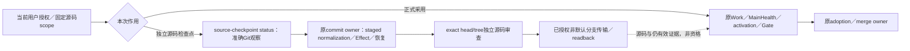
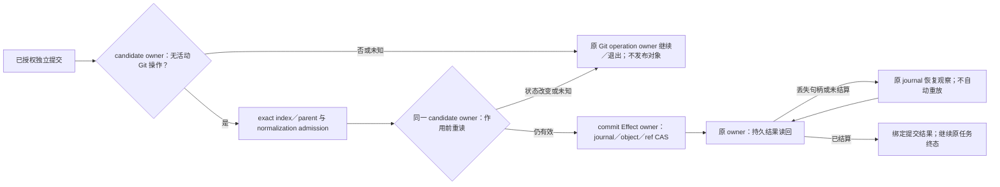

# 独立源码检查点与正式采用分流

独立源码检查点保存已明确授权、可审查的准确源码，不声明正式工作激活、验证通过或产品采用。其授权与作用边界是固定仓库、base／必要前像、唯一writer、完整owned paths及准确非默认分支；提交与推送分别消费当前用户授权及原Effect owner的准入。**正式工作选择、active Work Package／operation、MainHealth、完整Gate及共享控制投影不是这条源码发布路径的前置。**缺失这些结果不阻断独立源码检查点，也不因此补签或伪造它们。反之，本地Git、提交规范化、所用传输Provider或真实凭证／保护拒绝仍只由原owner处理，不能借分流绕过。

`dev:status -- --source-checkpoint --base <exact-sha> --expected-head <exact-sha> --owned-path <exact-path>`是现有状态入口的独立只读模式，可重复给出准确owned path；它不读取formal Work或MainHealth，也不调用GitHub观察来决定本地源码是否可以进入下一owner。它读取固定base的仓库／默认分支身份与Git源码事实，核base ancestry、expected HEAD、非默认本地ref，及提交差异、index、工作树和untracked的完整路径集（rename/copy包含两端），并重复观察以暴露漂移。参数是待核scope，输出是观察而非授权；路径匹配也不能证明dirty字节属于调用者。唯一writer、完整前像及dirty归属必须在原任务与实际写入边界核实。输入不完整、对象未知、非祖先base、HEAD漂移、未归属路径、默认分支或共享active／rolling／Work Package投影变更均返回阻断或观察失败，不以未观测当通过。

源码稳定后，由既有`development.commit` owner冻结并复验准确parent、ref、index/tree，消费canonical normalization与提交Effect；未完成原生Git操作、未知提交／推送结果和未结journal仍由原owner恢复，不由status提前判为已结算。取得exact head/tree独立源码审查后，在已授权的准确分支进行正常传输并读回远端ref及内容。默认分支更新、保护修改、force、额外发布、凭证设置都不属于源码检查点。会触发hosted检查的发布仍遵守已有证据预算；push成功只证明源码入库，保留未验证项。

正式activation、Work Package freeze、Gate、adoption与merge继续走原正式`dev:status`、工作选择、Scope/Effect和受信证据入口；检查点的status、commit、Review或远端存在不成为正式资格。集成owner在实际base与窗口就绪后生成共享投影，核当前main delta相交闭包，并复用仍有效的源码与focused证据；旧审查和Gate不得冒充新组合树的通过。

选择这条分流是因为源码保全／审查运输与正式采用具有不同结果及前置；强制先恢复完整控制面会让已授权修复被它正在修复的依赖锁住。保留原提交和传输owner比新增发布授权registry更小，也避免第二writer。独立性无法成立、scope变更或正式作用被请求时，返回相交原owner重算，不扩大检查点资格。这条status模式只实现观察与路由，不声称用户授权、语义审查或所有宿主API已由机器统一强制。

本仓库 `development.commit` 只拥有独立单父提交，不拥有 Git merge、cherry-pick、revert 或 rebase 的续跑与结算。本仓库 candidate owner 在冻结 index 前及 journal/object/ref 作用前，以 worktree-specific Git directory 的原生 no-follow 观察拒绝未完成操作状态；两次观察消费同一个判定，不用 index 未变代理操作已结束。原生 Git 操作必须由其原入口完成或明确退出；文件树相同不能证明 ancestry 已合入，不能把 staged merge tree 包装成单父提交后宣称合并完成。历史消息文件和 `ORIG_HEAD` 不单独构成活动操作。

开发提交 journal 退役必须同时比较准确字节和物理 FileId，并在原生删除作用前重新核验；进程内 mutation lease 不能代替这个比较。

Windows 的保留只读句柄以 `share-read` 排除写入与删除，因此不能在该句柄仍存活时另开删除句柄：journal owner 先释放观察句柄，物理删除 owner 再用同一受保留父目录约束的可读删除句柄完成字节与 FileId 栅栏和删除回读；该 CAS 路径不得为取得删除权先投影文件 ACL。删除作用前的分享冲突或内容/身份漂移保留 journal；作用后的缺席回读或父目录 flush 失败属于未知结算，必须按原 operation 重新观察，不能宣称 journal 必然仍在或重新执行删除。不把盲目重试、裸路径删除或放宽分享模式作为恢复。Linux 的 `unlinkat` 只删除名字，现有能力不能在非合作并发换名/写入下签发准确字节 CAS，因此当前退役返回 typed capability-unavailable 并保留 journal，直至原生命名空间与写入排他合同具备；这不是跨平台完成。此接合仅说明当前自举 journal 的安全边界；更大范围的恢复与状态所有权演进仍由相交唯一 owner 重算，不从该实现反推产品通用事务规则。

该 Linux 缺口是未完成的迁移义务，不是可长期保留的正常降级：每个 ref 的 journal 有有限尝试上限，无法退役会确定性耗尽写入能力。目标协议由 `development.commit` 独占 journal 语义，以每个 attempt 一个私有 Git ref 指向不可变 canonical blob；Git Provider 在原 operation 授权下提供精确旧 OID 的创建、更新、删除和持久读回，不能把仅检查后的 `unlinkat`、进程锁或加大上限当作替代。旧文件 journal 先只读发现与逐 attempt 分类；迁移必须绑定原字节、物理身份、目标 blob/ref 和恢复切点，未结算或无法准确退役的旧文件保留并报告 typed blocker，不让它成为第二个活动 writer。新协议未通过受信 Provider、Linux 故障切点及旧代际迁移验证前，现行文件协议和 capability-unavailable 结果不变。

默认分支身份、仓库质量证据和本机执行能力必须分别按所证明的对象消费。默认分支的准确 SHA/tree 不表示检查通过；注册的仓库检查结果不表示本机容器可用；本机容器的运行回执也不能替代仓库检查。未被某动作要求的本机能力不能因观察失败而否决该动作。需要容器、宿主文件或服务的操作仍须取得对应能力并验证物理身份，不能借文档操作获准而跳过这些条件。

必要证据缺失时，恢复入口负责请求或加入同一准确对象的证据生产，并回读实际结果；请求本身不签发健康状态。修复准入机制自身的工作不得要求该机制先恢复正常，应保留受明确授权、有界修改、独立审查和结果回读约束的恢复路径。该路径只覆盖已证实的失效依赖，不能将未完成的产品交付连带判为通过。
