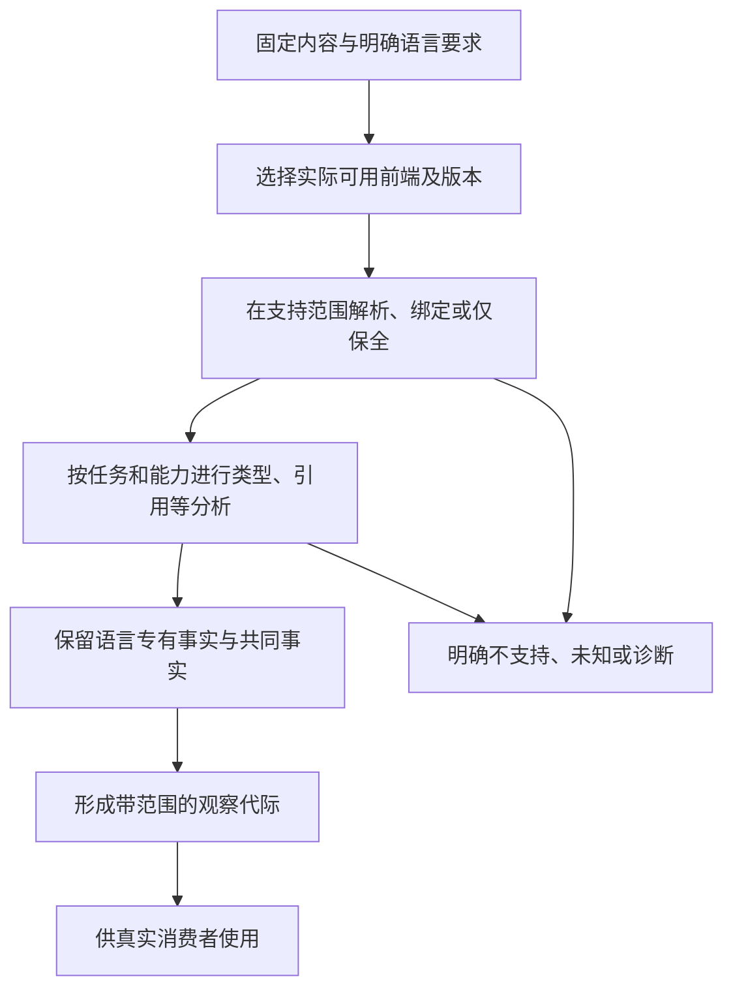

# 语言前端与直接编辑

<a id="text-workspace-capture"></a>
## 直接编辑与成组捕获：文本是正常作者入口

原生编辑器、获准脚本和 AI 可以直接修改有权作者文本，普通击键/变量修改无需先逐项创建 `propose.draft`。无 GUI 的首个可用工作流直接复用现有文件/缓冲接口，已选择的 Code-OSS/VS Code 扩展以后按同一 Candidate/Operation 合同接入。Gift 只在分析、生成或正式写回时固定受管候选，不让 JSON 操作仪式代替日常源码编辑。

**同一路径只选择一个本次有效层。** 未保存缓冲优先只在该请求明确绑定它时成立；磁盘、索引、远端覆盖各有自己的真实基础。来自不同客户端的两个未保存版本不能按最后到达者自动覆盖。保全未知字段和未保存内容，不替用户隐式保存或回滚。

### 文本改动进入同一内核的算法

**CAPTURE0 选工作集。** application取得明确工程、输出/分析范围、有效内容层、角色、基础与读取许可，并区分用户已有 dirty、当前任务新增和并发外部变化。未触及文件不默认进入写集，其公共消费者可以进入读取依赖。旧候选只是基础，不能使执行者自动获得写权限。

**CAPTURE1 捕获版本。** 固定实际接收的缓冲批次、版本向量和字节，同时记录语言、配置、依赖锁与相交资产。跨文件接口变化先形成联合候选，不发布半成品。具有受信文件系统快照、版本树或合作式屏障时记录真实原子范围；单纯两遍读取或 mtime 相同不能证明非合作并发写者下所有文件曾同时处于该状态。

**CAPTURE2 取得完整批次。** 收齐明确的改动、删除和保留成员，再按实际语言/格式取得角色与依赖；同一候选允许中立 `.gift`、原生 TS、JSON 配置、图片和说明并存，未实现语义适配仍保全字节与来源。活动磁盘只能得到逐文件观察集时，准确返回该覆盖与稳定性，或要求在已支持的合作边界取得一致捕获；不能把混合时刻内容冒称原子工作区。当前捕获的字节自身固定，不等于原工作区的原子快照。

**CAPTURE3 建立候选。** 复用同一个候选构造器、SourceBlob和声明映射；`files + base`、`edits + base` 与内部 `WorkspaceChange` 只是完整文件、前像差异和版本化编辑器变更的不同输入。文件增删与改名使用真实身份规则。语法和类型错误可以留在草稿，路径越界或非法编码则不得被静默吸收。源码本来由外部编辑器改过时，错误诊断不能触发恢复旧文件。

**CAPTURE4 按请求分析。** 查询只取得相应语法、类型或关系；TypeScript 使用仓库锁定的 Compiler API/Language Service，正则只定位候选，不签发符号或类型事实。预览固定候选后生成所需根。自动诊断或watch策略必须明确启用，按版本合并连续改动；同一批多文件变化可以共享一次相交检查，不为每个文件重复 full check，也不为每次击键发布持久操作、编译所有目标、运行程序或写盘。新版本出现后旧任务可取消或作为旧结果保留，不得贴到新版本。

**CAPTURE5 保存与再次修改。** 已由原编辑器保存的作者内容无须重复执行 `apply(save-source)`；工具内新候选被正式采用时，必须按当前目标权限和 CAS 前像写回。候选逻辑原子不等于跨文件物理原子，半提交走恢复合同。文本 undo、丢弃候选、Git revert 与逆向业务 Effect 具有不同责任，后续操作始终以实际内容层为新基础。

### 受管生成文件也能直接改，但有不同的回写责任

用户可直接在目标文本中完成许多修改。此时先将完整变化保留为目标草稿，依据G0/C0/M0与当前C1做一次联合回源；不要求每行手填generated-edit。已有工具适配器可以从完整字节派生有序差异，随后复用相同协议。生成器在未解决的目标草稿存在时不能覆盖相交文件。

支持的变化回到原源或稀疏控制；未知变化保留，不丢弃后声称全部映射。当前generated-edit的对应验证会重新生成相交目标，这是逆向正确性检查，不是自动构建、运行或全工程编译。失去映射的巨大改动仍可逐区域判定；需要真正转移作者权时明确接受，不能自动把全部文件降为不透明区。

构建或测试未保存内容时，宿主可以将整批候选物化到受控临时根，或使用工具提供的内存/overlay 输入；必须绑定 candidate、来源映射、根和资源，不能悄悄运行旧磁盘内容并把结果归给新候选。工具不支持该输入时明确要求先保存；是否自动保存只由已有政策决定。

### 大批修改与资源边界

小改动使用现有差异，整文件或多文件重写使用现有`files`，本地大工作集使用固定内容引用，不反复传输未改字节。同批中的相互引用和暂时错误在最终快照上判断；有序edits仍按每步前像匹配，不偷换为无序补丁。rename、删除与新建不因内容相似自动继承身份。预算不足时保留已接收草稿与准确覆盖，不将截断输入按完整程序编译。

同一合作式写入批次可以产生一个候选，后续解析和检查可按依赖增量进行；外部多个写者没有共同屏障时，不凭一次watch通知认定批次完整。取消只结束当前计算或等待，已保存作者字节不因取消消失，正在使用的输入仍按资源协议保持。

## 语言前端与源码程序

### 目标

语言前端把某种编程语言、配置语言、构建语言或模式语言的**准确 source snapshot**转换为语言中立的 `SourceProgramIR`，同时保留无法统一的语言特有语义和明确未知。SourceProgramIR 是 frontend 派生的正式表示，不是作者源的替代 writer；修改它只能形成候选/受管回源请求，不能直接改写原字节或把源码观察采纳为 L1 语义。普通源码捕获可以直接形成该表示，不要求为了层级整齐先物化一份 `ObservationIR`。

### 前端能力合同

```ts
interface LanguageFrontend {
  readonly frontendId: string;
  readonly languageId: string;
  readonly revision: string;
  readonly capabilities: FrontendCapabilityProfile;
  parse(input: FrontendInput): FrontendResult;
  update?(previous: SourceFactShard, delta: ContentDelta): FrontendResult;
}
```

能力画像分别声明：

- 词法和语法覆盖；
- 名称绑定；
- 类型信息；
- 模块解析；
- 宏、反射和生成代码；
- 控制流和数据流；
- 效果推断；
- 源码映射；
- 增量更新；
- 写回和格式化；
- 诊断稳定性。

### 源码程序

```text
SourceProgramIR = {
  files,
  modules,
  declarations,
  symbols,
  references,
  types,
  controlFlow,
  dataFlow,
  calls,
  effects,
  configuration,
  buildRelations,
  sourceLocations,
  opaqueRegions,
  unknowns
}
```

所有前端映射到共同对象，但可以附带命名空间化扩展：

```text
LanguageExtension(languageId, schemaRevision, payload)
```

扩展不能改变公共字段含义；消费扩展的 pass 必须显式声明能力要求。

### 共享事实分片

```text
SourceFactShardKey = digest(
  exact content subset,
  frontend revision,
  parse/config inputs,
  dependency summaries,
  fact kind
)
```

语法、绑定、类型、控制流和跨文件摘要可以使用不同分片。每项事实至少追到 file content identity、source span、`SourceProgramIR` revision 与 frontend/provider revision；推断的调用或 Effect 仍是候选。修改函数体不应使无关文件身份重建；修改导出签名应失效反向绑定者。

同一 exact source snapshot 的语言事实供 typecheck、Impact、审计、测试影响和 AI 读取复用；消费者可以读取不同投影，不能各自建立竞争的 AST、符号或调用事实源。Language Service、watch 和 shard 只优化计算；clean 与 incremental 对同输入必须等价，缓存损坏回到 clean recompute。dynamic load、reflection、shell、生成源和原生扩展无法闭合时保留 unknown/opaque，不用 regex 或目录名补图。

分片发行与字节解析都必须取得独立的、深层不可变的数据快照；只冻结根对象或数组，不足以保护内部事实、span、来源参数及入口列表。模型组装只复用本进程已签发的不可变分片；外来对象先经过现有规范解析与摘要校验，不能把浅冻结、相同摘要字符串或类型断言当成资格。provider 描述同样由模型持有独立快照，生产者或消费者保留的引用不得在不产生新摘要的情况下改变模型内容。这种数据所有权不签发审查、来源可信度或集成授权；合法输入的原有规范字节及摘要保持不变。

### 模块解析

模块解析是语言前端和依赖系统的交界：

- 前端定义语言解析语义；
- 工作区提供文件和配置事实；
- 依赖物化提供精确包 generation；
- Host 提供路径和文件能力；
- 结果记录每次候选、选择和未解析原因。

不能只记录最终路径而丢失解析条件和替代候选。

### 动态和不透明语义

动态 `eval`、反射、运行时加载、宏、原生扩展和外部生成可能无法静态闭合。前端必须生成：

```text
OpaqueSourceRegion = {
  sourceRange,
  declaredBoundary,
  possibleEffects,
  runtimeDependencies,
  requiredVerification,
  unknownRelations
}
```

不透明区域可以被治理和验证，不能被静默当作无行为。

### 诊断与修复

前端诊断使用稳定错误码、源码位置、相关位置、解析轨迹和可能修复。自动修复只是 `RepairCandidate`，后续进入变更编译。

### 前端成熟度

| 当前维度 | 按实际范围记录什么 |
|---|---|
| 读取与保全 | 哪些内容可原样取得，哪些范围未读或不支持 |
| 语法与绑定 | 支持的构造、引用和公开边界及其诊断 |
| 类型与语义分析 | 哪些事实能可靠取得，哪些必须保持未知或原生 |
| 生成与修改 | 所选输出、实际源映射及能保持的编辑范围 |
| 往返与采用 | 对具体任务的方法、证据、环境与当前资格 |

这些维度不是依次晋级的阶梯。语法覆盖较广但类型部分的前端仍可保全；不能写回不自动阻止合法只读分析或目标生成。

### 语言前端到统一源码事实



解析、类型、效果、生成与往返分别有支持范围，不是一个能力高低总分。局部能力不足只限制相交声明；共同分片不删除语言专有事实，也不能把只保全称为理解。

### 符合性

前端验证包括：

- 语言规范黄金样例；
- 与权威编译器 API 差分；
- 语法错误和恢复；
- 模块解析矩阵；
- 增量/干净等价；
- 源码位置和重命名稳定；
- 动态边界保守性；
- 大工程性能和内存；
- 语言版本升级；
- 不支持构造产生明确状态。

### 新语言局部接入

新增语言只应增加：

- `LanguageFrontend`；
- 语言扩展 Schema；
- 目标类型映射；
- 诊断和源码映射；
- 符合性套件。

若必须修改语义内核，需证明新语义无法由现有公共构造和受控扩展表达，并作为内核迁移处理。

## 原生观察不能替代中立值构造

源码解析取得的是相应语言的结构与类型事实；运行对象通过边界进入中立值时，还需该边界的表示和生命周期合同。TS readonly、Java final、Python注解与冻结某一层对象，都不自动证明整个对象图是没有访问器和可变别名的值。静态工具不得为了检查这些事实执行用户模块。

实际无法读取、无法解码和业务值为空分别记录。导入中的unknown不产生一个默认None、空数组或空函数；需要时保留原字节、语言标记与未解决范围。符号在外部编辑后无法无歧义对应时，转入[作者身份映射](../../10-作者与输入/作者源/工程源/作者编辑保存与迁出.md#文本没有手填id时如何维持身份)，不让每个语言适配器按不同名字算法重新发行公共身份。

## 解码不是用目标对象伪造中立值

原生观察可以保留循环、可变引用、句柄与不完整编码；把它提升为中立有限值则需匹配[公开类型与有限值](../../20-语义与组合/基础语义/计算基础/文法类型与求值.md#公开类型闭包与有限值)。转换按实际读取权限和效果合同发生，不能在默认纯预览中触发getter/迭代器或任意序列化钩子。现成类型断言、JSON往返和浅冻结不是这项证明。

实现应分别限制物理输入节点、深度、字符串/数值大小及逻辑展开量。共享无环子结构可记忆化，不要求指数级深复制；发现循环时按当前值画像拒绝或保全为显式图/原生对象，不把“已访问”直接当成null。读取期间可能被并发修改时，使用真实快照/版本/独占或声明较弱观察；一边遍历一边哈希不能自动得到原子值。

提升后的名义类型、函数契约、资源与公开归属都保留。公开API不能因为遇到私有类型就泄露全部布局；原生高级合同暂无法表达时保全原生路径，而非标记为完全中立。当前规则只定义转换责任，未验证任意语言适配器。

## 从输入范围取得可用快照的正向协议

本协议的输出是可重复消费的字节切面及其解释条件，不要求所有输入同时存在于一个文件系统事务。输入采用现有WorkspaceObservation的根能力、范围表达式、OverlayPolicy、一致性要求、当前预算和解释版本。观察器只改变自己的读取占用与临时记录，原工作树、编辑器缓冲、索引和远端对象保持原状。

### 捕获数据与来源

每个最终条目保留：逻辑路径、来源层与该层修订、物理对象或内容引用、实际字节及摘要、大小、编码判定和观测结果。结果可以是取得内容、已确认不存在、无读取权、不能解释、读取失败或在预算内未完成；这些值不能共用空字符串。存在性、内容和新鲜度是不同观察，不相互替代。

有效层顺序由OverlayPolicy指定。例如明确选择编辑器覆盖工作树时，已取得编辑器版本的文件使用该版本字节；没有该缓冲的文件才沿下层解析。缓冲关闭与删除磁盘文件不是同一动作。若两个层对同一角色存在无法按政策决定的写权冲突，返回冲突而不使用文件修改时间挑赢家。

### 捕获算法

**O1 确定读取宇宙。** 验证根能力，展开当前范围所允许的文件/对象枚举，记录包含、排除和无法遍历的区域。只读一个指定文件时不必扫描全仓；需要判断“所有匹配模块都已读”时，匹配规则和枚举结果进入依赖。符号链接、挂载、大小写与规范化按宿主合同解析，真实目标不在权限内时记录不可读取。

**O2 取得版本或读取凭据。** Git不可变树、实际文件系统快照或编辑器固定版本可以直接提供其范围的稳定读取。普通工作树使用明确的弱一致读取：取得前元数据、打开文件、在预算内把实际读到的字节复制进捕获缓冲、取得后元数据。元数据变化允许有限重捕获；相同元数据只支持本次字节身份，不自动证明未发生ABA或跨文件一致。

**O3 固定一次捕获的字节。** 摘要、解析、清单和后续制品都使用这一次已捕获的内容，不在每个阶段再次从活动路径读取。重复读取同一固定来源且版本未变时可以共享缓存；无法证明来源仍相同时重新捕获并形成新的观察，不修改旧观察内容。

**O4 检查请求的一致性等级。** 若请求接受“人为冻结的各文件字节集合”，该集合可被确定编译，但报告它不是原工作区同一时刻的原子图像。若需要原子源快照，必须取得具备该范围保证的提供者；否则返回一致性缺项，不能给弱读取加AtomicSnapshot标签。已有无关文件读取失败，不使明确闭合的小根必然失效；属于根所需依赖时则保留阻断前沿。

**O5 解释和发布。** 编码检查、文本解析和配置解析以固定字节执行，非法文本仍保全原字节。解析失败附原位置与字节身份；二进制资产保持二进制，不作有损文本转换。完成后一次发布条目集合、范围结果、层选择和一致性声明；未完成的枚举不能以已读条目数量冒充完整覆盖。

### 精确缺失与弱否定证据

指定键或路径的“不存在”，来自该提供者在明确版本、权限范围和成功读取下的否定回答。范围扫描中没看到某项，只有枚举已闭合且没有排除/失败覆盖那个项时，才支持对应集合的不存在结论。统计抽样未看到事件可以支持带覆盖和置信条件的风险判断，但不能直接支持create-if-absent、去重未发生或取消授权等强前提。

即使读取时确认不存在，真正创建或提交时仍需在该目标的原子比较、唯一约束或等价协议中重新确认；不能拿较早文件列表代替提交前提。负观察随相关键、目录、过滤规则或提供者修订变化而失效。

### 两条轨迹与替代

合法轨迹：观察到工作树版本W1和缓冲E3；政策明确E3覆盖同一路径；捕获内容C后磁盘变化到W2；本次仍用C解析和生成，并记录来源E3。后来写回时比较实际目标前像，而不是把观察成功视为允许覆盖W2。

失败轨迹：目录列举到一半遇权限错误；文件x未在已读条目中；结果是该子树未覆盖，不能生成x不存在的事实。另一个已闭合文件y仍可独立分析。若重试取得不同字节，形成新观察，旧结果只按其旧来源保留。

更强快照提供较清楚的一致性，却可能要求宿主支持或额外复制；弱捕获更易取得，允许的结论较少。默认选择足以支持当前目的的较小机制，完整性要求提高时扩大机制而非扩大措辞。

## 语言读取与全资产读取的分工

语言前端的声明、类型和行为分析只负责它真实支持的范围；工作区读取器覆盖源、配置、资源、文档、外部引用和必要元数据。后缀未知时首先提供字节保全、成员和安全范围，不将未知文本执行，也不删除。格式编辑器、代码前端和数据库读取器分别输出自己的观察与能力。

语言迁入须调查关键词及其关联规则、运算符、类型、模块、初始化、错误、资源和元数据。每项写明可解析、可保全、可语义化、可生成、可修改的不同状态。对象模型、宏或装饰器没有映射时保持原义或报告具体缺项，不能只做字符串替换。

完整文件、Git变换、配置与二进制的处理由[全工程资产](../../10-作者与输入/作者源/工程源/资产与非源码.md)拥有，精细能力映射由[最小控制](../../20-语义与组合/作者语义/README.md)拥有。前端不替后端选轮子，也不把原实现观察回写为独立用户要求；生成器需要实际内容时按允许范围获取，不让AI逐个重复名字解析。

## 混合作者与已有实现的直接接合

<a id="mixed-author-supply"></a>

本节在已有`sourceScopes/editSource`、Definition、MethodSpec、UseBinding与检查记录内接合结构要求和原生实现，不新增`sourceMode`总开关、公共工具或同义作者文件。新产品不必先逆向；已有原生工程也不必先补结构需求再允许编辑。

**NATIVE0 固定本次目的和拥有者。** 单纯维护原生文件时，其原文就是作者源；确有独立产品要求时，以准确结构/其他接受来源为依据。分别识别当前希望修改的是接受要求、行为实现、目标接口还是交付环境。文件路径、同函数名、先前生成标志均不独自证明拥有权。

**NATIVE1 捕获相交原生输入。** 保留真实源、模块模式、锁、工具/目标版本、生成输入与必要环境；未保存缓冲与磁盘分开。选择不透明调用时明示读取覆盖与执行能力，不把一次工具成功称为完整语义理解。读取和调用按各自现有准入处理。

**NATIVE2 取得可消费合同。** 以实际导出、参数、结果、编码、错误、效果、初始化、并发、资源、生命周期及许可范围建立合格适配。仅类型同形不够：`bigint`与Number的精度，Unicode标量与UTF-16坐标，返回`Result`与抛异常，稳定排序与任意平局，均可能改变要求。可经有保持依据的适配修复差额；没有对应证据时保留未知，不能把包声明当证明。

**NATIVE3 在原使用点选择供给。** `resolveUse`绑定准确原生内容、需求实例、画像、适配和证据范围。已有代码直接满足公开边界就重用或重导出，不为形式统一再实现一份`.gift`。需要解释源、代码获取或执行时分别形成准确缺项，不能以未知降为“不要求”。提供者可以用原生实现给出中立合同，但支持多个目标须分别有合格映射。

**NATIVE4 生成与检查实际差额。** `lowerBoundUse`只生成确有必要的协议、编码、生命周期或公开门面适配；`composeTarget`闭合所选消费范围的成员和依赖。新CLI的进程依赖不回流到纯库；包含源码不等于分发许可成立。检查对象是实际被采用的源与目标组合，不是一个同名演示函数。

**NATIVE5 再次修改。** 需求保持而实现更新时，重核行为保持及真实依赖；需求变化而实现仍满足时可继续采用，不为“有新需求版本”强生一份新代码。没有对应保持依据时重新求证或选择。更新实现不能自动修改独立验收条件，修文档导航也不使未消费该文档的目标全部重编译。

**NATIVE6 处理生成代码被手改。** 修改先保存为目标草稿；可唯一回源时提出作者变化，不将任意目标差异强行塞成JSON属性。不能回源而明确决定接管时，先在同一候选中解除该区域的生成拥有者、确立原生拥有者、更新其他消费者与重建声明，再按原前像/许可协议应用。只保存草稿不自动接管；失败不得留下两个可独立写同一规则的拥有者。接管后仍保留独立要求和证据义务，不能以“现在是原生”免除它们。

基线例是现有TS精确整数区间库已满足范本的Canonical合同。本工程直接绑定它，再为CLI生成输入输出差额，无需先造中立算法副本；若该库只能处理安全整数Number，则不能借接口外包一层`bigint`标注冒充合格。扩大任务为另一个没有映射的目标时，保留TS库的完成结果并指出另一根缺项，不把既有作者源重新分类为失败。这是设计中的接合与反例，不是已取得该原生包或已运行转换。

## 实现供给不等于源到源重写

原生内容经NATIVE0—NATIVE6取得和绑定后，可以保留源/包、预构建二进制、Wasm、进程或设备方法。选择、ABI、代价、切换和失败回退统一按[供给合同](../../30-实现解析/供给与替换.md)的SUP0—SUP8执行；高性能方法不必逐目标再手写同一意图，也不证明所有目标已支持。

### 外部类库的 typed invocation 只证明调用形状

外部包存在精确 source/version/integrity 与公开符号时，可以从成熟语言工具得到只读调用视图：package/export、call/construct/method、generic/overload、参数和返回类型、module/Target resolution，及仍未知的 Effect/Permission/resource/runtime behavior。该 `TypedInvocation` 只证明在这个 exact `SourceProgramIR` 输入下怎样类型正确地调用；它不证明业务合同、幂等、重试、timeout、取消、安全、真实副作用或运行支持。

用户或领域定义补充 Contract/Effect/Permission/error/resource，Provider/Adapter 提供相应 Evidence，经采纳和供给资格后才能成为可选实现；最终实现仍由编译/供给 owner 选择。类型定义、文档、测试、示例、trace 与 AI 都可以增加候选和证据，不能凭多个来源一致把 observed/inferred 事实升级成 authority。

<a id="gift95-cross-contract-34"></a>
## 原生实现被Rule观察时的真实覆盖边界

TS/Rust适配器必须分别报告读取了哪些公开签名、实现片段、effect行为与源位置；只取得AST或typecheck不代表理解线程、IO、动态插件、进程或整个函数输出域。结构作者Rule以准确公开符号引用这些能力时，签名解析可给出有限事实，语义保持和目标交付仍须其它方法/证据。

原生函数的Unicode偏移、整型范围、错误传播、异常与资源所有权各可能与目标语言不同。自动变更需核业务可观察条件、原生编译上下文、源码前像与实际消费者，不能通过“看起来等价”的函数名或语法替换回写旧源码。
