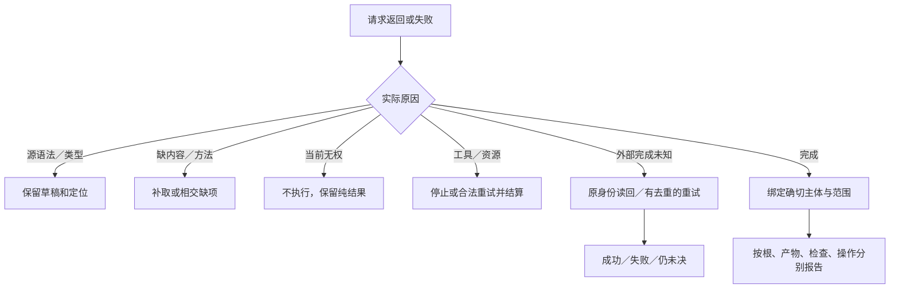

# 会话、请求、结果与选择；处理器、执行与安全验收

六工具仍为唯一对外控制主面；多客户端路由、Rust工作进程帧、取消和响应结算的实际部署设计见[六工具与Worker施工](../../70-工程系统与演进/工程构造手册/08-六工具Worker与客户端.md)。

## 会话、请求、结果与选择

**结果映射。（消费条件）：** 不同工具共用编码但保留作用/保存/验收各自的阶段与状态；网络超时不能由工具处理器翻译成业务拒绝或已取消。 合同归属：[失败返回的阶段、可继续性与非对称状态](../../20-语义与组合/共同语义/规范元模型与结果语义.md#gift-failure-state-no-bool)。

### 候选引用的含义与固定开发会话

六工具中的candidateRef统一指**用户作者内容快照**。它与本产品作者语法是否已选、搜索器是否比较多个后端没有同一生命周期。一次preview内联source可以只有一个候选；修改产生新引用不是要求生成多个功能版本来挑选。

当前接口字段按本章v2为实施基线；字段尚未编码不表示实现者可以另选默认语言、将save-source当部署或让类型检查自动修改候选。真实实现与行为验证分开于这次规范决定。基础语言范围、可用库、工具和目标的精确版本由上下文/发行包绑定，模式号相同但内容不同的未发布草案不能混用。

前端对相同snapshot和相同有效输入执行同义操作。明确接受一个目标变更时，修改对应要求关系；只改算法时保留原要求。无需另一次人工批准的政策不得被界面强制审批，实际缺少决定的情况也不能仅靠生成成功补成接受。

固定的完整开发会话是工具与MVP共同验收对象。实际测试只能在获准实现后运行；在此之前，范本用于检查字段、源语法、版本和结果角色是否有空白。成功、非法、缺库、陈旧基础、取消与保存草稿都要沿同一协议返回，不能只演示顺利生成。

### 同一任务在六工具间的接受关系

本节不增加第七个工具，也不新增每次必填字段。现有context/base/candidateRef和受信会话保存任务要求的精确引用；候选、目标产物和作用仍各有自己的身份。没有可解析任务关系时，接口只能声明其实际检查的层级，不能推断所有用户目的已满足。

| 入口 | 接合行为 | 实际退出与保持 |
|---|---|---|
| query | 返回当前任务在该对象上的接受依据和实际边界，按权限展开展示 | 只读，不将查询到的候选规格自动采纳为目标 |
| propose | 原子形成候选并分类源/合同/要求/案例差异；不要求AI另填分类表 | 原接受关系和旧候选保持；需求变更成为明确候选 |
| preview | 按所选目标组合输入域、实现及布局；内联源走同一路径 | 可返回生成源码和条件，不把生成阶段标为任务满足 |
| check | 固定被问的声明和实际主体；若存在独立要求，区分候选自身检查与要求检查 | 原案例与要求不随失败改写；未请求行为/环境检查明确不扩大结论 |
| apply | 将指定候选或产物作用于目标，复核本次目的、有效前像与所需资格 | 保存作者文件不等于接受新要求；应用代码不等于目标业务运行 |
| operation | 原控制分支查询/取消/恢复；已协商的计算扩展另可启动具体构建、产物运行或候选即时求值 | 新作用须事前准入；重试保留原意图，预览和源码应用不自动运行 |

直接`check(types)`仍只负责其原类型层级，不默加无法实现的万能需求求解器。需要任务级结论时，由既有Claim和验证计划对实际要求分别执行所选方法，并返回明确覆盖。显示内容是实际关系的投影；新增字段和结果分支按公开协议版本协商，不能靠兼容解码器忽略必需语义。

分组接受时，按被保留的修改重新求组合闭包。共享接口的一半修改可能单独生成但不再满足原任务，因此界面允许保存该草稿，却不能直接认定原功能完成。真正独立的输出根可以完成并取得自己的结论；总任务的未完成范围同时保留，不用全局失败抹掉成果。

### 结果按独立维度表达

结果区分请求是否被理解和接受、产物是否存在、检查结果是否符合当前声明、外部作用是否发生、是否仍需恢复。没有操作被请求与操作失败不同；旧通过、当前失效、无法观察也不同。

适合的公共结果包含对象与候选引用、实际输出、诊断、未知和覆盖、相关检查、效果与恢复状态及允许继续的动作建议。大对象按引用传输。建议动作不携带永久授权，也不保证列表在状态变化后仍完整；调用时必须重查。受限结果只能给出有权披露的解释。

草稿结果可以是部分可用；选择多个输出时逐项报告。不能用一个成功成员掩盖其他必需成员失败，也不能让一个无关输出失败阻止所有已完成的独立结果。

### 版本、请求与幂等

跨会话持久候选和序列化交换从出现时就需要明确格式与语义版本，不能等第二个外部消费者出现才发现无法解释旧数据。内部瞬时结构可以按编译单元演进；公开协议和持久语义不等同。

普通可显示的未知扩展字段可以按版本政策保全。影响安全、效果、类型或状态的未知枚举与必需字段不能一律透传后视为支持；需要明确协商、降级或拒绝。读取旧内容与执行旧规则分开。

重试同一效果须使用原操作身份和相同作用域、规范载荷、目标与幂等条件。载荷变了就是新意图。计算缓存可以跨等价输入复用，不代表两个独立请求拥有同一 OperationRef，也不复用许可。

基础 `operation(operationRef,action)` 的取消/恢复/回滚消费[稳定控制意图](../../50-执行运行与观测/持久化与恢复/事务提交-恢复状态机与发布顺序.md#stable-operation-control-recovery)：同一 `(operationRef,action)` 只接纳一次固定控制意图，后续调用读回或join其既有续接/补偿，不因当前又暂停而重新使用旧resume。周期性暂停/恢复需要已协商的控制身份与预期状态代，或原Owner签发的新合法恢复引用；基础两字段请求不能区分时明确返回能力缺项，不猜测“最新暂停”。状态读取按当前披露资格，实际控制另核现行授权；持久关联与派发顺序仍由原执行Owner承担，不在客户端维护第二份操作日志。

### 待决选择与错误合同

待决请求保存对象、问题、可选范围、推荐、后果和有权角色；恢复时核对候选没有变化。无法取得必要决定时保存待决状态并继续独立范围，不强迫全部任务停止。审批不由请求里的 approved 字段签发。

错误使用稳定原因码、实际对象、已知事实、未知、是否产生作用及安全下一步。类型非法、能力不支持、前像陈旧、权限拒绝、预算不足、操作失败和不确定完成分别表达。原始堆栈只作受限调试材料，不能承担状态机或泄露完整工程。

## 处理器、执行与安全验收

**工具准入。（消费条件）：** 六工具接入返回的Grant引用不能来自模型自由输入；真正提交保存、运行或远端动作时在实际owner再次判定。 合同归属：[委派能力收窄、重定向与执行时再检查](../../50-执行运行与观测/权限与资源/授权与执行准入.md#gift-delegation-attenuation)。

**工具结果隔离。（消费条件）：** 第三方返回消息只能进入非权威source域；客户端或模型生成的`grantRef`字段由后端解析资格，不从文本提取“默认同意”。 合同归属：[外部内容注入、候选来源与有权决定的不可传递性](../AI协作/委派安全与持续交接.md#gift-ai-prompt-to-authority)。

### 安全与可逆选择

数据上传先进入获准的内容范围，不自动解压、安装或执行；路径、资源 URI、命令参数、下载和剪贴板都需要相应边界。跨项目或租户的结果复用不仅比较内容，还检查可见性。工具声称安全不替代受信宿主判断。

接口保持最小必要信息。一次本地查询无需完整长期日志；一次真实外部写入则不能省掉其恢复身份。默认采用最小合同，出现真实持久、跨主体或跨环境需求后补相应机制，不凭“统一”强制全用户负担。

### 六个工具的处理器步骤与返回责任

#### 图解：失败类别与合法继续位置

该决策图用于处理结果，不将不同主体合成一个全局成功状态。纯草稿可以保留，缺权限不改成不支持。

字段表规定能传什么，本节规定实现收到请求之后实际怎样处理。所有工具先执行协议检验和当前内容访问判断，再使用共同候选/绑定服务；不是六套各自判断真值的引擎。处理过程中取得的内容被占用至结果返回或显式转交，引用到期不使正在处理的字节突然被替换。

| 工具 | 正常步骤 | 结束时提供 | 保持不变 |
|---|---|---|---|
| query | 固定at和过滤→取得当前可披露范围→按view读实际内容→按limit分片并绑定cursor | 内容、覆盖和继续位置；空结果也记录实际过滤与范围 | 作者、目标和已完成操作 |
| propose | 规范化一条输入分支→固定base或新建范围→隔离应用整批→解析角色/声明→形成新候选及诊断 | candidateRef、请求的摘要/差异/源码、必要身份对应 | 旧候选及真实文件；无基础的候选不抢占现有路径 |
| preview | 复用propose或已有候选→按输出根解析目标→完成纯编译；确需外部生成/工具计算时使用已有宿主准入，否则返回该处缺项→形成Artifact→需要时与compareTo比较 | 精确artifactRef、代码/差异与分阶段诊断 | 作者候选、工作树、部署；已生成的其他目标产物 |
| check | 固定候选、可选产物和案例→核对相交来源→选择实际方法→外部方法经宿主准入→记录Verdict | 每方法结论、覆盖、实际环境与需继续事项 | 被检主体和独立案例期望 |
| apply | 解析mode→固定内容/目标/base/请求身份→授权后查原操作→必要时建立持久意图→条件应用→读回 | operationRef、实际结算和残余 | 未在写集内的内容；旧操作历史 |
| operation | 按当前披露权读实际意图→验证action是否支持→status读回或进行准入后的cancel/resume/rollback→结算 | 当前真实状态与下一合法动作 | 原请求含义和已发生事实，不因换action制造新成功 |

query跨提供者的页值、确定前缀、未显示预取项和终结算法由[Provider页组合](../../70-工程系统与演进/信息与生命周期/接入检索与派生.md#provider-page-composition)承担，外部仍只使用本章limit/cursor及原结果覆盖。没有各源下界时可返回带范围的局部结果，不把它改标为全局首屏；cursor不可恢复时给准确失效结果，不悄悄从当前latest续上。

#### 批次、草稿和错误的顺序

参数类型、互斥分支、字节预算或路径结构非法时，在创建候选之前拒绝。访问不允许时，不通过差异或错误泄露不可见对象。合法文本但语法或类型不完整，可以形成draft；诊断与原始字节共同保存。生成需要的某一输出闭包不合法时，该输出不完成，独立闭合输出按各自状态返回。

差异对同一不可变base按顺序应用；每一步在当时的候选文本里核对old唯一性。第k步失败时整批不发布为新有效候选，前k−1步只在临时区存在；可以提供失败定位和可恢复编辑内容，但不伪称部分请求已应用。请求本身明确独立组时，才按共同增量合同分别完成。

目标差异的compareTo必须属于可披露的实际旧产物，并与被比较的目标/布局关系相容。没有合法目标产物基础时返回NO_ARTIFACT_BASE，与本章目标差异合同一致；作者源差异缺基础才使用NO_DIFF_BASE。调用者可请求code，服务不暗中构建一个历史产物凑基础。返回空diff意味着两个被比较对象在该差异语义下相同，不表示内容和所有证据都永久有效。

#### 错误怎样推动下一步

IMPORT_UNRESOLVED返回缺少的显式导入和所查范围，作者可补定义或绑定；TYPE_MISMATCH返回源位置、期望与实际类型，修改相交内容；TARGET_UNSUPPORTED返回缺哪项目标映射，可换获准目标或继续源设计；SOURCE_STALE返回当前可披露前像与原基础差异，可重基；PROVIDER_FAILED保留候选与工具原因，处理环境而非删业务；AUTHORITY_DENIED说明被拒的作用范围，纯读取或设计是否仍可继续按当前权限判断。

这些是既有诊断类别的职责说明，具体错误码沿对应版本合同，不通过新增任意字符串动作绕过六工具。每个错误在规范拥有者处有原因、可用结果和下一步。重复同一失败且输入未变时直接使用原观察；新内容、新方法或真实恢复前提变化后才重新尝试。

#### 进展和状态裁决

每个已准入内部阶段消耗预算并完成一个有限步骤。需要外部决定时，返回等待条件和可继续引用，而不是把线程、锁或模型轮次无限占住。调用失败可以重试传输，但只有原逻辑请求身份和目标合同允许时重试作用。取消在作用之前阻止启动，作用之后记录实际已发生内容并交给结算/恢复。

整体success由本次工具及目的定义，不由所有可能阶段共同定义。propose的成功可以是保全了带诊断草稿；preview的generated-unchecked只证明形成源码；check通过只覆盖实际方法；apply完成才有相应目标读回。调用者可以请求更完整的结果投影，规范正文可以详尽，日常响应不必重复全部内部状态。

### 六工具在最终模块中的单一执行路径

entry只做版本协商、载荷解码与有限呈现；application固定本次目的和上下文。query从workspace/compiler/assurance读相交视图；propose先由semantics或格式方法产生真实AuthorDelta，再由workspace封存；preview调用固定编译服务并在获准时补输入；check先取得义务与方法计划，真实工具交execution；apply取得精确SavePlan或ArtifactSet并调用execution；operation查询/取消/恢复已有实际操作。

上述路径使用[最终模块合同](../../70-工程系统与演进/实现与装配/模块与运行实例-最终逻辑模块与公开接口.md#最终逻辑模块与公开接口)，不新增公开工具字段。公共结果中的源、生成、检查和实际作用是相应对象的投影，不是一个可由entry自行修改的总状态。compiler不会因为preview请求希望显示checks就伪造已运行；检查记录后到可以更新其查询视图，不改ArtifactSet身份。

NeedInput只让application取得指定范围的内容或工具结果；不会把模型返回的一串命令提升成执行动作。补输入发生冲突、image已不适用或当前无权时，保留真实缺项与独立结果。短editRef仍只修改精确基础；需要更新工作区头时另用真实apply前像，不通过“同一会话”跳过比较。

### 验收设计

等价规范输入在各入口产生等价语义，不要求独立调用拥有相同时间、身份或回执。需要检查无副作用查询、陈旧基础、未知字段策略、重复请求、超时后读回、事件缺口、撤权、部分批量、同文件不同区域、跨文件共同约束、权限隐藏及设计目的提前完成。未完成的产品实验不能由协议字段完整性替代。

#### 组合编辑不增加一组竞争工具

需求解析、任务分解和候选创作由开发AI／应用层承担；`source`仍然是准确语言源码，不接收任意自然语言并直接执行。现行六工具消费精确作者内容与实际引用。没有新增“执行意图”“选块”“自动完美”的隐式入口。

参数用已有edits或editRef；结构连接用已定义的semantic-change；新算法用source/files；目标覆盖用control-change。相应读取器仍核基础、绑定、作用域和权限。组合视图可以提供有效编辑，不能由图形布局决定求值或将“显示了一个block”当作已授予调用能力。

未来成品对自然语言可提供一个上层客户端，但它只在相同任务与委派内调用这些工具；不形成第二个宽松内核。当前协议字段及错误继续以本章现行表为准。

## 六工具表达独立完成状态和Rule闭环不足

`query`应显示准确source/Rule/Method/Target的已取得事实与残余；`propose`创建可审查源候选；`preview`仅在真实Target被绑定时生成代码，没绑定时返回目标Need而不产生虚假artifact；`check`将Typecheck、Rule谓词证据、整体Claim分别记结果；`apply`由执行层判断保存及作用资格；`operation`只查询/恢复已存在的实际操作。无第七个超级工具。

公共请求不能让客户端填 `"verified":true` 跳过规则绑定，也不能把candidateRef和target ArtifactRef视为同一个对象。只读设计蓝图读取沿已设计的query能力协商，不应重新解释 `preview` 为无目标也可编译源码。

## 只读结构资格、未完成和真实完成的产品可见区别

对开发者展示某工程的 Rule/Method/Target 分析，应同时展示已检查源版本、覆盖范围、各阶段完成等级和当前具体 Need。基于结构 Fixture 的 `NOT_READY_FOR_TARGET` 不可映射为 `COMPLETE`，也不允许把 `artifacts.generated=0` 显示为“已成功构建”。用户可以继续编辑不依赖该 Need 的作者事实；一旦 basis 中任何准确输入字节或绑定 revision 变动，旧结果只作历史记录、当前结果重算。`gift.qualification-envelope-proposal/1` 是验收用提案；公开协议由现行六工具 Owner 另行采纳、协商和验证。

**关联规范：**[六工具第二版的线协议与结算分离](客户端与并行会话.md#design-a06)。
