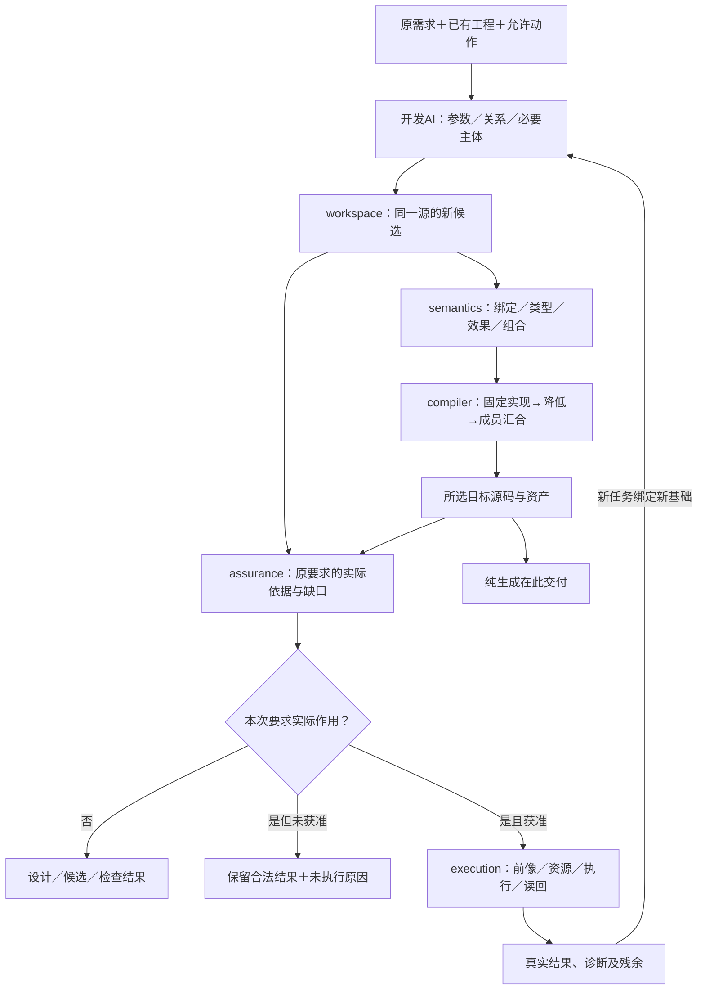
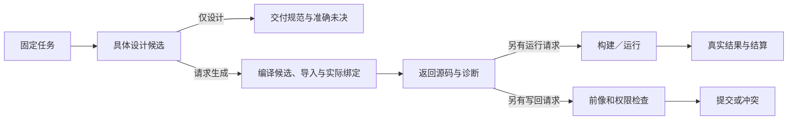

# 需求到交付主链


### 现在已确定且不应再制造并行方案

唯一JSON作者写源；Project/Module/Definition/Use/Instance/Root相分离；不重复DefinitionId/name；内建Kind不强迫dialects；标准Writer无历史双写；组件成员的专业关系而非万能members；静态业务值独立计算常量；UI动作指向Meaning、ActivationRoute指WorkflowUse；OperationUse必须指定端口内的精确操作；输入只接受明确的来源类别；Method、Target、Grant和Settlement资格各归其Owner；多根共享需要确证身份和联合；历史研究不成为现行协议；当前不写任何实现、测试/CI/检查器。


### 对开发面“完备”的准确裁决

**作为自由保存任何文字的JSON**，自然什么都可写，但这没有独立可解释意义。**作为已定义专业语义的意图语言**，本设计覆盖可复用业务领域、非计算要求、状态/事件、流程、UI/API和产品组合所需的主要关系类型，且允许按受资格的Meaning/Method继续开放扩展。**作为任意意图自动编译为高质量真实源码的工具**，目前尚不具备：既没有所有外部领域的Meaning，也没有任意新算法的计算表达/方法供应或可工作的Target实现。不能为满足“完备”这个词，把未知的业务规则、计算算法或物理结果悄悄变成字符串魔法。

当前保持**普通业务作者无需直接书写通用计算表达式**的简洁入口，同时已在同一 Definition/Type/ValueSource 体系中纳入可选的通用计算接口设计，详见[值、类型与计算](../20-语义与组合/基础语义/计算基础/文法类型与求值.md)。已固定的纯std基底、递归/词法/结果与效果设计继续有效；域外标准库、开放推断、具体内存/并发能力及TS/Rust实际降低仍按各自支持域与资格判断，不能把“加入计算构造”冒充它们已经闭合。


### 尚需继续设计的真实界面（均已有统一责任位置）

**Meaning/数据模式的成熟度**：开放领域必须声明谓词的精确定义、观察方式、来源权威和随数据版本变化的行为；面向金融清算、诊断、科学仿真等高风险用途没有通用可代签的解释器。当前形式能表达引用和失败，但具体行业库与语义签名尚未逐域订立。Owner：领域Meaning/扩展。

**工作流与运行资格**：[Workflow唯一Owner](../20-语义与组合/交付语义/工作流执行关系与激活.md)已定义准确激活令牌、result/step-outcome来源、完整terminal值、显式subflowUse角色、有限parallel及all-join。真实调度器、跨进程恢复、Provider取消/结算与TS/Rust降低仍须实现和取证；无限循环进展需实际合同，未选race/any/quorum不得从图形推断。Owner：Workflow、State、Concurrency。

**数据变化与查询**：关系模型和查询符号结构可表达，但类型级/实例级约束、跨数据源快照、隐私行级权限、分页完整性、事务冲突、索引/增量维护和迁移仍依赖具体数据引擎与Method适用合同。Owner：Data/Query；不由UI绑定字段代签。

**资源、长期时间和联合求解**：规范上已区分时间域、容量、原子性、硬软要求和未知；完整的非线性/开放变量、持续再规划、跨根共享资源与现实约束的可决定条件无法由固定句法给出。Owner：Requirement+Resource+Method；尚无通用有界搜索/最优性完整实现。

**规范生效与政策例外**：已有Permit/Oblige/Grant分界，但不同法域、主体及例外的权威语义仍需实际Policy Provider；不能把未知法律和用户未接受的默认视为自动授予。Owner：Norm+Policy+Host。

**业务编程内的剩余计算**：用户希望从意图完全创建此前无人实现的算法、复杂数据结构或自定义计算过程时，只有已有Method或独立计算表达可满足。已将`core:constant`/`core:function`作为可选计算设计纳入唯一作者语言；递归、词法绑定、值/效果区分已作设计裁决，但尚须进一步定义基础算子全集的开放标准、数据结构操作、错误/数值/资源语义和原生/Target实现约束。本阶段仍不实施求值器。Owner：Type/Compute/Method/Target。

**Target源码工程的工业级合成**：目标目录、真实函数体、UI、数据持久化、并发、ABI、库选择、稳定SourceMap及二次编辑规则已有责任设计，但不同Target生态的所有操作尚无完整构造级细化或代码生成器。Owner：TS/Rust Target，当前仅完成责任和技术合同的设计，不能宣称能直接生成可运行IDE。

**实时外部运行和数据恢复**：Effect授权、Provider、Operation/Attempt/Settlement/Readback的职责明确，但实际实现和外部权威证据必然依赖宿主/真实用户，不属于静态作者语言可无限精化解决的问题。Owner：Runtime/Provider/Assurance。

**版本和迁移支持范围**：当前设计形状未正式发布；历史读取不是对所有旧格式永久兼容的承诺。将来发布时必须根据用户实际生态选择兼容窗口、变更范围与迁移/退役策略。Owner：Source/Release，而非业务Definition。


### 何种变化会真正改变上述裁决

统一作者语言已保留自写算法的计算表达；扩大到新的算子、数值/资源或Target保证时，应回原Compute/Type/Method Owner补准确支持域及资格，不能用静态业务定义或一个call冒充未知能力。若限定为**领域Meaning和Method已有供应、要求明确且目标可实现的业务子域**，则可通过统一非计算作者协议正确表达及组合该子域的语义要求，但仍需要真实Reader/Method/Target实施。若宿主运行安全、离线状态、分布式共享、硬实时或法律权威改变，相关Operation/Time/Norm资格可能完全翻转，而普通JSON外壳不应因此更换。


### 成为完整产品的必要数据路径

作者源码与接受来源 → 模块/类型/使用点解析 → 有权领域Meaning与角色实参 → 状态/事件/流程/计算/规范的组合 → 对选中Root全部硬义务和软目标的联合约束 → 合格Method、资源/授权/目标适用性 → 普通目标源码/配置/资产 → 在实际运行时另行取得Grant、Observation和Settlement。

每一步的身份与信息必须可回溯到原作者决定；没有能力时不允许通过删除要求、代写伪意义或“自动成功”走向下一步。该路径是**设计中的接口和逻辑**，不是已存在的生产实现。

当前量词和时间逻辑已在 `schema/semantics/intent-body-1.schema.json` 采用有作用域的递归公式**设计形状**，避免把“所有、至少一个、直到、始终、最终”当作普通字符串；域列举/完整性、时钟解释及公开Meaning仍需有权消费者供应。详见[意图公式、量词与时间](../20-语义与组合/作者语义/通用意图语言-意图源与语义组合.md)。


### 仍有语法、专业定义或供给的具体缺口

**在唯一作者Schema中的缺口**：基础`intent:goal`已增有作用域量词/时间公式，但高阶数值目标的特定误差模型、结构化物理领域语义、无限流的统计推导、持续时间约束和跨多根的全局求解模型不能仅凭新增两个`op`被实现。纯函数Expr有抽象语法但基础运算/标准库、泛型推导、可变状态、无限数值和内存效果的确切规范不完备；所有上述场景不能硬说“现在可编译”。

**在专业消费者中的缺口**：开放领域Meaning的有权解析、真实单位/时间/空间/法规、伦理利益约束、计算方法选择、Target TS/Rust具体映射及真实Provider都需要由具体供应者签发。即使所有对象都在JSON里有名字，没有这些供应时必须得到明确的Needs，而不是一个随意的默认世界模型。

**在自动合成上的根本限制**：目标可能是矛盾的；某些性质在一般程序上不可判定；没有用户指定或现成Method时，单凭结果性要求并不能推导出唯一、正确、高质量实现。对可实际供应的子域，应给出范围限定的生成和保持合同；对不具备资格的域，允许记录、解释到可知边界、继续人工补给，而非强迫作者回退到一堆无类型自由文本。

<a id="stable-intent-developer-actions"></a>
## 采用设计：通用意图产品作者的最短有效操作（R12）

<a id="one-author-source-to-complete-software-workflow"></a>
### 一个开发者工程的唯一输入、控制面和持续修改

默认作者先在获准的工程中用JSON AuthorModule指定：业务对象和领域Meaning引用、希望达成/持续/禁止的结果、明确的时间/资源/规范范围、必须亲自控制的硬选择以及允许系统优化的软偏好。必要的外部事实由明确来源/权限供应，Method供应者提供专业实现，Target工具链和Provider由受信环境及工程配置选择；普通业务作者**不必**复制所有60项概念或手写第二份Intent IR。没有合格Meaning/Method时系统要精确指出缺哪个合同及谁有权补它，而不是产生可构建但不履约的假源码。

操作链：①冻结作者源和来源/方法/目标选择；②获得类型化Meaning与JointRequirement及所有Need；③只从有资格Method中形成实现计划；④生成完整源码、依赖、配置、迁移、错误与SourceMap并交目标工具链；⑤对所声称行为独立验收；⑥仅按授权执行或部署、记录Operation和读回；⑦再次编辑通过原Owner/CAS保存、计算精确影响、重建并按必要范围迁移。每步输出包含当前进展和失败前沿，不用一次自然语言对话替代真实工程状态，也不把UI预览当作原作者同意。

作者可明确Pin/拒绝方案、约束资源或审阅候选；系统自动选择只能发生在被授权的选择空间内。AI可以提出Meaning/JSON修订、比较方案和准备计划，但不能越过有权采纳、仓库写权、运行Grant、独立证据。长JSON的阅读和编辑可由分模块与局部结构视图辅助，但**唯一保存表示**仍由已选SourceProfile管理；不因界面把它渲染为图形便形成第二可写配置表。第二次修改至少应证明旧未修改区域不受污染、差异正确回源、无效资格撤回、已派发Operation不重放。


普通业务作者只需提交本次不可由已有Definition推导的决定：采用或创建`intent:goal`，绑定实际Meaning及主体身份，指定结果、保持条件、禁令和必要规范差异；复用Pattern时提供所需`semantic:pattern-use/2`角色/变化绑定，再选交付用途与Target Profile。`check/propose/preview/apply/query/operation`按本次任务调用，不要求作者理解60项内部职责。只有Meaning、Method、Target及真实权限分别取得适用资格，系统才能宣称对应自动交付已完成；否则显示来源明确的Needs。

| 实际作者动作 | 权威写入 | 自动系统可决定的内容 | 必须停下交由谁决定 |
|---|---|---|---|
| 接受业务目标、硬规则和主体 | 新业务唯一候选`gift.author-module/2`的Definition/Requirement；旧`/1`只读 | 依锁复用Pattern、推派生义务及查询候选 | 无法唯一决定业务含义、权益/价值取舍→有权业务作者 |
| 指定领域Meaning/事实解释 | 锁定领域Definition+其真实观察端口 | 类型/单位/基数检查及可证明条件 | 无权或无外部事实→领域/观察权威 |
| 固定方法/目标偏好 | `gift.control-file/1`的稀疏ControlRecord与原有绑定选择 | 满足全部硬约束下自动搜索/比较 | 多个不可比且无委派→作者/授权决策者 |
| 生成可维护源码 | 原有ArtifactSet与受管目标区域 | 真实Method/Target编译、依赖、配置、SourceMap | 缺合格Method、Target或独立证据→实现供应/编译器 |
| 真实操作或部署 | Operation/Grant/Provider自身的记录 | 准入范围内派发、读回及恢复建议 | 真实权限未授、不可逆决策→有权执行主体 |
| 第二轮编辑或升级 | 只修改原作者owner/Native owner | 更新ReadSet、失效相交绑定、重新生成差额 | 兼容/数据迁移/历史运行无法保证→维护者/运营权威 |

结构化JSON、受控界面及获权AI可编辑同一作者语义的候选，但只有有权采纳才写入一个SourceProfile真源。生成区依SourceMap受管，原生维护区保留真实所有权。大型JSON以Definition复用、分片、索引、精准编辑和惰性读取控制编辑成本，不另换语义格式。`check`失败应报告DefinitionId、字段路径、依据、缺失资格、负责Owner及可继续的独立工作，不能只返回泛化`unsupported`。

新系统的源码交付须满足与声明用途相交的D0–D5资格；运行和真实业务效果分别由D6/D7的实际执行与读回补充。单一有限场景、Schema通过或目标printer成功，不能证明通用产品可用。正式Rust Reader和完整TS装配器未实现前，界面与状态报告不得宣称已经具备“通用意图自动生成完整系统”的生产能力。

从零做出用户真正可以连续操作的产品（工程文件、六工具、候选、预览、保存、错误回源和第二次修改）的实施路径见[开发者主面设计](../70-工程系统与演进/工程构造手册/10-开发者工作台与AI交接.md)与[真实项目全链验收设计](../70-工程系统与演进/工程构造手册/14-完整工程交付与故障验收.md)。

**用户真实作者工程入口**：[统一源码工程与多表示协议](../10-作者与输入/作者源/工程源/统一源码工程与多表示作者协议.md)。开发者直接保留已有 Rust/TS、结构化 JSON 或已采用的 `.gift`；本条任务链只操作真实 owner 的候选/绑定/产物与独立效果，不额外要求先用一种新语言改写工程。

<a id="意图优先开发的实际闭环"></a>
<a id="intent-to-product"></a>
## 从需求到可持续工程的确定交接

本节是产品操作的唯一主链，复用[INTASK0—INT8的补全与委派](../20-语义与组合/组合/跨软件需求合同.md#意图进入同一作者源的完成与缺省算法)、[库的编译路径](../20-语义与组合/组合/模块封装-功能复用与作者责任.md#普通库与编译型定义的共同路径)和原P阶段，不另造并行状态机。用户并无需提交这里的内部数据表。

**真实结束。（消费条件）：** 交付局部成功、缺输入、作用未知和验证失败是不同后继工作；不能全部归成一条“重试任务”。 合同归属：[失败返回的阶段、可继续性与非对称状态](../20-语义与组合/共同语义/规范元模型与结果语义.md#gift-failure-state-no-bool)。

### 当前请求和程序不是一个状态对象

| 已有对象／拥有者 | 本次消费的实际字段含义 | 写入时点与保持项 |
|---|---|---|
| Task／application | 目的、请求源、输入基础、输出根、允许选择与动作、预算 | 只接收真实任务与委派变化；子计划不自授权限 |
| Requirement／semantics与assurance | 输入域、正常与失败结果、保持关系、硬限制及接受来源 | 仅保留独立约束；候选代码不能改其接受关系 |
| Candidate／workspace | 精确文本／结构／资产内容、解释、父基础及源映射 | 成组修改产生新候选；失败不覆盖旧源 |
| Binding／compiler | 定义、库、语义方法、目标、布局与真实依赖的精确选择 | 新选择单独固定；普通重建沿用合格选择 |
| ArtifactSet／compiler | 所需成员、字节、来源和生成输入 | 完整成员才发布该根；不包含伪造检查绿色 |
| CheckRecord／assurance | 对象、方法、前提、实际结果与覆盖 | 不修改被检查的字节，不替换原任务期望 |
| Operation／execution | 事前身份、当前准入、目标前后像、尝试与残余 | 真实作用时存在；纯创作不逐表达式持久记录 |

字段来自各自现行合同；本表只规定交接。Task不是新的需求文件，Requirement不是所有函数都必须复制的规格，Binding不是作者需要重填的AST。

### 一次任务的执行责任与合法返回

**预览、保存源、写目标、运行和部署不能合并完成信号。** 输入一个纯函数并要求“查看生成 TypeScript”时，合格预览可产生带来源的冻结 Target 候选而不写磁盘；用户随后只选择保存作者源，不因此获得写目标、执行、安装或联网权限。`write-output` 须绑定具体 Artifact、实际目标路径、当前前像和独立 Grant；运行又是另一个可选、有资源与作用边界的任务。只要用户请求的交付集合允许，“设计完成”不需要人为等待数据库迁移或服务器部署；但既存且未结算的外部 Effect 不能因当前请求关闭而消失。

**第二次修改有准确继承关系。** 在预览后的当前作者基线已被另一个编辑者改变时，原候选先进入冲突/重基，不因其对应的 TS 仍能显示就强行写回；源修订、冻结候选、生成工件与运行尝试必须保留各自身份。重启客户端按真实头部和发生点恢复，不把上次预览工件当成最新事实。

| 步骤 | 承担者与正向动作 | 必须交给下一步的结果 | 不能继续时的具体结果 |
|---|---|---|---|
| 1 固定要求 | application取得原请求、已知工程及权限；INT0—INT3区分要求、提醒和采用 | 已有Task/Requirement引用与准确基础 | 保留原目标；未取得历史不伪称全知 |
| 2 制作候选 | 开发AI按操作选择修改参数、组合或主体，使用`propose` | 精确Candidate与源差异；独立假设显式标识 | 允许错误草稿；无权或协议错不污染原源 |
| 3 检查含义 | semantics检查绑定、类型、效果、资源与组合；assurance核原要求 | 每个相交要求的满足依据或开放义务 | 不把类型通过、样例通过或自述升为全任务满足 |
| 4 固定实现 | compiler沿合格Binding，缺少时进行有界选择 | 合格普通主体或语义方法及其前提 | 未找到不是无解；硬限制不足不选非法回退 |
| 5 生成成员 | compiler按实际目标降低和汇合代码、配置及资源 | 按根ArtifactSet、来源及未完成范围 | 独立目标可返回；共同发行不能缺必需成员 |
| 6 取得所需检查 | assurance复用已有合格依据，必要时经execution运行检查 | 精确CheckRecord | 方法、环境或预算缺失只限制相交声明 |
| 7 保存或使用 | 用户任务确实要求时才执行apply/operation | 原源保存或目标的实际结果及读回 | 冲突保留现场；取消不等于资源已释放 |
| 8 再次修改 | 新任务绑定当前真实基础，继承未变要求 | 新Candidate或新的运行输入；旧结果仍可解释 | 不通过旧函数名、旧票据或旧摘要更新新实例 |

合法零修改返回无变化；只设计到具体规范与候选说明结束；纯生成到所请求完整源码／资产结束；运行有其单独输入和结束条件。应用、库和片段都按[交付目的](../40-目标与制品/目标/成员布局-完整装配与布局.md#delivery-purpose-completeness)判定，不因名称为“应用”强加部署。候选预览不要求先保存、合入或正式采用，但仍受原独立要求约束。可以批量完成获准步骤，不要求八次调用或八次人工确认。

### 行为改变与实现选择不能互相偷换

以下不是新的字段列表，而是I2/I5在实际任务中的分类：

- 输入值改变但程序不变：进入运行参数，不重写程序；某值原本是作者常量时，修改常量才形成新候选。
- 已接受的行为改变：修改唯一作者含义，并核独立要求的接受关系；不能因为改动只有一个词就称无行为变化。
- 普通实现替换：保持已接受可观察结果、错误、顺序和效果；对齐真实资源与目标控制后固定新Binding。
- 表示或视图改变：不增加另一份可写源；仅改排版不改变语义，结构作者迁移另按合同。
- 外部文件、权限、设备或操作改变：取得当前事实和准入；不能从编译模型中“推导”现实已发生。

### 需求不完整时也要产出有用成果

已接受默认直接继承；可机械推导的由工具计算；任务已委派的设计取舍由开发AI作出一个有依据的选择并保存，不逐项询问。尚未委派且会改变公开行为的差异，形成带具体结果差别的候选建议，相关强声明保持未定；独立设计继续。不能用沉默、变量同名或“要完美”补出权限。

语义层可以确定的转换直接执行；AI合成或启发式搜索得到的是候选，不能当成程序等价证明。对无法一般判定的性质，保留运行检查、明确输入域或对应未知，而不要求所有任务先证明一切程序性质。

### 端到端图：创作与确定生成分开

<a id="fig-intent-delivery"></a>

实线表示候选与结果交接；检查是所需声明的义务而非全部任务的必经测试。自然语言进入开发AI，只有固定作者内容进入编译器；图没有自动扩大作用权限的边。非法源、缺目标、预算结束及失败按上表从其实际拥有者返回；此图不将这些不同对象合成一个总生命周期。



### 状态不回填成绿色

语法草稿、语义合格、已生成、经过某项检查、已写回、已运行、满足任务分别可定位。只返回本次相关状态，不按最大成功阶段覆盖整个工程。旧检查仍指向旧对象；新源码失败不会被旧产物“补成成功”。完整示例见离线区间工具。

## 从任务目标到一次可完成开发工作的操作协议

一个工作开始时，应用层从用户请求、当前任务和已接受工程设置建立四项明确内容：当前要交付的对象、保持条件、允许作用、完成判据。它们可以内存保存并引用已有内容，不要求AI重新填写任务卡。相互冲突的要求以具体对象和冲突点返回；能够在不变条件下并行继续的部分仍然继续。

**第一步，取得当前材料。** 已有候选按其精确基础读取，新建工作直接收取作者文本。工具先解析可机械取得的名称、类型和依赖，不要求AI先搜索每个已知能力。当前任务之外的敏感内容不为“全局最优”扩大读取。

**第二步，划定真正的变化。** 将相关信息分为已决定、可确定推导、已委派选择和未决含义。已决定项引用来源；可推导项交给工具；已委派项按当前政策选择并记录；未决项由AI形成明确候选或提交有权选择。没有变化也是一种合法结果，但必须说明检查了哪一请求目标，而不直接等同所有问题已解决。

**第三步，形成可审查候选。** 设计任务直接修改定义、合同、算法与理由；实现候选修改所选作者程序；需要重新组织文件时连同受影响导入和公开引用作一个批次。先保持原始文字和精确基础，再建立有效语义视图。语法不完整不覆盖成旧AST，独立非法路径不进入候选。

**第四步，进行目的相关的复核。** 设计复核检查对象、成功路径、并发和失败分支、反例与取舍；不自动创建参考软件。预览复核目标闭包与产物；检查动作复核实际方法与主体。检查失败由诊断定位到候选内容、规则/生成器或环境，分别修相应拥有者，而不是反复让AI重写正确需求。

**第五步，结束或应用。** 只设计，到设计文件和准确状态交付为止；只预览，到内存源码为止。实际保存或应用再比较目标前像与当前许可。成功、冲突、部分作用、取消和需要恢复分别返回。后续工作以新候选和真实结果继续，而不是依赖模型记忆中的“刚才大概成功”。

完整工作用一条成功轨迹和最有杀伤力的失败轨迹检查：纯设计不得需要运行目标才能结束；合格纯生成不能因没有部署证据永久pending；同一已有工作区出现外部修改时，旧候选不能直接覆盖；响应丢失后不能把原写入再当全新请求。具体转换由[应用模型](需求到交付主链.md#一次请求的正向执行模型)和各工具处理器承担。

<a id="developer-task-cycle"></a>
## 完整开发任务的正向操作：准备、创作、验证、交付和再进入

本节采用[完整开发动作面](客户端/开发面与智能投影.md#developer-surface-contract)，细化既有主链，不另立一套候选、产物或操作状态。作者可以停在草稿、可用源、生成物、已运行结果或实际发行中的任一被请求出口；未请求出口不变成强制流程。

**交付未知作用。（消费条件）：** 外部动作已派发但回执不明，开发主链可以交付已完成的源与制品，但运行效果不得被归并为done或通过重新启动一次任务来“修复”。 合同归属：[外部未知效果、资金/资源结算与去重窗口](../50-执行运行与观测/持久化与恢复/事务提交-外部效果与幂等交付.md#gift-external-outcome-ledger)。

**任务取消。（消费条件）：** 界面停止等待不代表底层已停，交付结果要把可重新安排的纯计算与必须保留责任的在途外部动作分开。 合同归属：[取消后的孤儿资源、额度归属与优先级反转](../50-执行运行与观测/权限与资源/资源核算调度与交接.md#gift-resource-orphan)。

**离线开发的结果。（消费条件）：** 本地候选可以继续设计，但没有拿到真实保存/发布回执就只能交付候选及缺口，不可因重连自动标作done。 合同归属：[离线客户端、分页视图与操作前像的同步](客户端/工作台布局与交互.md#gift-client-view-consistency)。

**任务完成。（消费条件）：** 允许交付已产生的准确子根，未生成/未部署目标显示阻断原因；不能自动把用户要求的多目标任务缩成单目标。 合同归属：[ArtifactSet、发行引用与现场运行的三个不同完成条件](../40-目标与制品/目标/交付消费合同与发射.md#gift-artifact-qualified-release)。

**开发完成条件。（消费条件）：** 新候选通过静态检查不自动使旧运行验证符合，任务状态展示未覆盖的Claim及阻断原因。 合同归属：[跨版本证据重用的有效性与被遮蔽失败](../60-保证与证据/保证/解释与证据接纳.md#gift-evidence-time-reuse)。

### TASK0 选择入口，保留最小工程

**空白片段。**给完整模块即可；没有目标后端时仍能保存草稿和检查已支持源语义。有目标才生成；需要重复开发或落盘时，宿主才把真实上下文、模块名与必要项目控制保存成可复用工程，不提前创建所有十模块目录。

**新项目。**先确定期望交付（库、CLI、服务或多个根）及必须约束，再选实际模板/供给及准确修订；只展开它真实提供且被需要的成员。静态模板替换可以纯生成；模板需要执行脚本、联网、生成密钥或探测系统时先形成实际作用计划。已有目录先捕获，碰撞进入差异，不默删内容。生成的许可证、帮助、配置和资源与源码一起有实际拥有者，不能用空文件凑成“全工程”。

**已有项目/多根/远程项目。**保留原语言、目录、构建与VCS；先看获准根、未保存缓冲、忽略范围和项目控制，再按任务取得实际消费者。源码可读不等于工具链就绪；部分原生语义无法取得时，仍可文本深维护和调用准确原工具，但结果覆盖明确。只为本次需要初始化适配，工作区打开不加载并运行任意插件/构建配置。远程连接失败不销毁已保留草稿。

### TASK1 形成够用的任务基础，不替用户作不可推导的决定

宿主从实际内容形成原projectView/context，保存被选输出根、作用范围和当前预算。记录“要什么”和“不得改什么”，及哪些取舍已委派；由真实项目默认可推导的参数不再问一遍。存在会改变含义的竞争解释时，返回最少缺项和每个方案影响，并继续独立可做部分。只改变实现成本、且已有可用偏好规则的选择可以自动完成。

任务中的目标、约束、作者内容、当前选择和已执行操作分别引用已有对象；不要求一个新的强制任务数据库。短CLI可以只在内存中持有，退出时返回应保存的源及未决操作引用；团队暖服务才按实际恢复需要持久化。本次输出要反映已完成、保留的独立草稿、准确阻塞及能继续的路径，不返回一份忽略用户目标的“内部阶段全绿”。

### TASK2 按真实责任创作和比较实现

能复用成熟库就直接取得其真实合同/版本并绑定；有独特差额才写函数、结构、状态、关系或其他领域内容。需求可由不同实现满足时，先排除不符合硬约束者，再对实际代价、能力、依赖和保持范围作选择。可生成候选不代表该供给已安装或可执行；不存在的函数体/适配不能靠短名字代替。

修改分为源语义变化、供给绑定变化、目标组织变化和运行参数变化。例如调大一次程序运行输入，不修改常量；改变公开算法要求才修改作者；改变TS导出位置不默改其他目标和领域语义。局部控制覆盖共同默认时展示准确作用域与继承来源；撤销覆盖回到仍存在的上级值，而不是把null当作通用“恢复默认”。跨使用点的规则改变先展示全部相交消费者，单次出现的改变不扩成定义全局改变。

直接原文编辑与结构/参数编辑都进入原批次。解析失败保留原文，局部已解释部分可导航；语义编辑只有在定位/保持条件成立时可用。普通编辑保存不要求先通过生产发布门禁，权限和前像保护却不因此取消。

### TASK3 把候选审查变成可继续的选择

源差异、语义差异、生成物差异分别显示相同基础和同一候选；缺对应时不假造一致。审查最少展示改变的行为/资产、与任务有关的保持条件、真实相交消费者和仍未知范围，精确文本可展开。未知不是必然拒绝，可在明确接受的有限范围继续；不能让简短摘要隐去无法满足的必需条件。

部分选择按原semantic-change的依赖组重新物化。改接口和同步调用者通常是同一逻辑组；只接受其中一半时重新检查，并允许保留一个明确非法草稿，但不得称为可运行已通过变更。相互独立的文档改动不因另一个根失败而丢弃。多人/多AI候选分别保留基础；集成时以当前读写集重基，不因不同文件就宣称语义独立，也不因无关文件变化就全量驳回。

已批准候选C1不等于批准后来的C2。完整输入/策略未变且证据满足时可复用原审查；变化后只复核受影响部分，但需要覆盖新的真实结果。审查者能直接看完整源和前提，不被强制只读AI摘要。

### TASK4 检查和修复构成有进展的循环

先做本次需要且成本合适的方法：源类型、目标工具、选定案例、性质或性能；方法并非固定全部执行。定位到诊断的真实作者后生成修复候选，再重跑受影响检查。冻结测试期望与被测实现分开；要求确实变化时，代码和期望可以在同一有说明的变更中共同修改，不能偷偷改期望、删案例或弱化规则来制造通过。

重复修复采用准确的源/诊断原因/策略组合判断进展，而不是只看错误条数。两个修复轮流撤销对方、同一前提反复缺失、或资源预算用尽时，保留最佳已得候选和具体冲突，不无限调用。可以保留多种解释和候选做有限比较，不把第一种绿色结果当全任务合格。

### TASK5 生成、运行、调试和数据采样

生成只做要求的根；输入已在现有编辑器保存就不再次apply。构建取准确生成物和工具，运行取实际入口和参数。测试/运行参数可以是显式值、文件或获准秘密引用，由宿主规范化为原argumentsRef；不让开发者手算引用。交互CLI与服务按[运行输入与连续开发](../50-执行运行与观测/运行生命周期/资源登记物化与回收.md#developer-runtime-cycle)结算。

调试/日志/覆盖/基准按实际制品定位原源；插桩版本不与无插桩版本混成性能基线。旧运行可以继续使用旧制品，新的源不会自动改旧运行。只有被选热更新方法真实支持其状态/资源变化时才采用；否则提供重启或并行新实例的准确方案，仍需处理现有端口、数据和资源责任。

### TASK6 保存、集成与交付各自结束

草稿保存、源写回、受管生成物写回、VCS提交、评审采纳、合并、推送、制品发布和部署分别使用已有合同。用户只要修改源，就不自动stage或commit；只要commit，就不顺带push。交付的实际范围是选定源/产物/报告，而不是把整个临时工作目录压进去。

已有未提交工作先保全。独立临时索引/隔离工作区可用于验证精确选择，但它不能因此覆盖用户真实index；最后发布ref仍需真实前提。源码树、提交历史与构建输入的关系见[集成操作](原生维护/工作区与版本库观测.md#developer-vcs-integration)。

### TASK7 中断、恢复、交接及下一次开发

客户端断线后先恢复真实工作集、准确候选和已有operationRef，再判断哪些计算可重做、哪些操作必须查回；不把聊天中的“已成功”当回执。不自动重复运行测试发现、安装、Git hook、进程输入或发布等可能有作用的过程。原操作存在未决时，显示待结算的目标和当前可做的独立工作，而不是锁死整个开发面。

交接至少保留任务目标/已委派取舍、当前真实源/候选、未接纳的独立差异、仍有效证据、正在运行/未决的操作和必要下一步；不复制整段私聊、不把工具输出变成新指令。继任者以当前权限重新取得引用，需要的内容未保留就报告缺项；摘要不能重建丢失的源。

撤销必须选层：编辑器缓冲undo；候选放弃/恢复旧草稿；已保存源上的新反向候选；版本控制revert/另行授权历史改写；目标程序中的领域补偿。旧回执与历史不会被删除来伪造“从未发生”。新一轮任务沿同一作者文件增量继续，不重搭一套展示工程。

<a id="developer-surface-coverage"></a>
## 全开发面的实际入口、产物与完成边界

本节把开发面限定为**开发者表达、理解、改变、检查、使用和交付软件时直接消费的行为**，不把它缩成图形界面，也不把其内部所有领域算法再展开一遍。以下范围覆盖当前已识别的开发用例；高级语言构造是否能保持、某个真实宿主是否可接入，仍按对应领域规范与[当前实施闭包](../90-治理与参考/状态/实施闭包.md)分别判断设计支持、代码与证据。操作面有明确路线不等于所有语言都已实现该路线。

同一开发任务可以用已知源码一次成批完成；辅助查询只在实际缺少定位/语义时调用。表中“入口”是目的到原六工具或直接源码路径的映射，不是需要依次执行的新菜单和审批链。

<a id="developer-six-surface-coverage"></a>
### 六个开发任务面对当前用例的覆盖

六面不是互斥菜单；一个完整任务可同时触及多个面。下表按当前开发用例给出主归属/次归属；用例成员由本表及其canonical身份决定，行数不是架构常量，也不得为了“数字漂亮”漏掉真实工作：

| # | 当前用例 | 相交开发面 |
|---:|---|---|
| 1 | 冷启动、小片段与无工程探索 | **Understand**；开始新内容时进入Author |
| 2 | 打开/导入已有工程 | **Understand** |
| 3 | 新建模块、调用成熟供给 | **Author**；需要固定实现时Change |
| 4 | 字符级编辑、未完成草稿 | **Change** |
| 5 | 补全、签名、悬停、缺省解释 | **Understand**；接受建议后进入Author/Change |
| 6 | 定义、引用、实现及跨源导航 | **Understand** |
| 7 | 诊断、修复与再次检查 | **Verify + Change** |
| 8 | 格式化、导入整理、名字与接口重构 | **Change**；保持性检查进入Verify |
| 9 | 控制流、状态、关系、流和数值创作 | **Author** |
| 10 | 改公开契约、迁移消费者 | **Change + Verify**；正式迁移/采用进入Deliver |
| 11 | 文件/目录/二进制/链接/配置联合修改 | **Change** |
| 12 | 依赖升级、工具链与环境排错 | **Understand + Change**；资格检查进入Verify |
| 13 | 原生/中立混合与受管目标修改 | **Change**；回源/保持检查进入Verify |
| 14 | 选择目标、预览差异与按根生成 | **Change + Verify + Operate**：选择属于Change，预览属于Verify，生成属于Operate |
| 15 | 类型检查、案例发现、运行测试及覆盖 | **Verify**；测试执行使用Operate能力但目的仍为Verify |
| 16 | 构建、普通运行、交互进程 | **Operate** |
| 17 | 调试、剖析、失败最小化 | **Operate + Understand/Verify** |
| 18 | 局部采纳、撤销、变更审查 | **Verify + Change**；实际写回时进入Deliver |
| 19 | 暂存、分支、并行AI与合并 | **Deliver**；候选重基/冲突可能回Change/Verify |
| 20 | CI、发行、安装与验收交接 | **Deliver + Verify**；部署后的现实动作使用Operate/Operation但交付目的归Deliver |
| 21 | 文档、消息、多语言与可用性 | 新内容为**Author**，已有内容为**Change**，可用性验证为Verify |
| 22 | 会话继续、离线、断线与退出 | **Lifecycle / Recovery横切六面**，不新增第七开发面 |

因此六面的完备性不是“22行每行只能放一个桶”，而是每个用户目的均能由六面及横切Lifecycle准确组合，且不会把副作用边界合并。新增用例若只能靠新增第七面才能表达，应先证明它既不是六面的组合，也不是Recovery/Needs/Assistant/representation等横切机制。

六面也不等于TASK0—TASK7阶段：TASK0—TASK7描述一次任务的可能推进顺序，六面描述开发者目的；例如Understand可在调试后再次出现，Verify可在Deliver前后多次发生。

| 开发用例 | 开发者提供什么、实际得到什么 | 负责规范与不应隐藏的分支 |
|---|---|---|
| 冷启动、小片段与无工程探索 | 一段合法源或明确语言；取得候选、相交诊断或内联目标；不先建工程服务 | [客户端入口](客户端/运行交互与工作台.md#developer-entry-contract)；未给生成目标时不猜，纯阅读不索要目标 |
| 打开/导入已有工程 | 真实根和读取范围；取得内容角色、可见覆盖、语言/构建绑定及未解释资产 | [原生捕获](原生维护/工作区与版本库观测.md#developer-workset-handoff)；未知保全，不用“全部导入”掩盖未取得范围 |
| 新建模块、调用成熟供给 | 直接作者源码/原生导入及真实独特规则；现成绑定足够就不生成包装 | [作者路线](用途与任务范围.md#authoring-route)；库缺少、合同不匹配和下载未获准是三种问题 |
| 字符级编辑、未完成草稿 | 当前缓冲或files/edits，形成一个完整候选；语法破损仍能保存和继续 | [编辑协作](客户端/运行交互与工作台.md#developer-edit-interaction)；旧语义只能标旧，不能覆盖当前不完整文本 |
| 补全、签名、悬停说明、缺省解释 | 当前源位置；取得可用名字、所需类型/效果、缺省来源和必要导入 | [作者辅助](工具协议/作者辅助接口.md#authoring-assist-contract)；建议不是采用，更不是执行命令 |
| 定义、引用、实现及跨源导航 | 当前符号或位置；准确源位置和查找覆盖；生成源可追到作者 | 同一作者辅助及[往返](../40-目标与制品/表示/编辑与受管回源.md#managed-edit-roundtrip)；动态调用不伪造静态全集 |
| 诊断、修复与再次检查 | 当前候选/制品；根因、约束、相交位置和可实行修复 | [诊断投影](客户端/运行交互与工作台.md#developer-diagnostics)；空结果不能清除其他范围或生产者的错误 |
| 格式化、导入整理、名字与接口重构 | 明确编辑范围和保持/改义目标；整批作者变化与影响 | [重构边界](../20-语义与组合/组合/结构编辑/编辑重构与确定回写.md#developer-refactor-completion)；格式化和删导入也不能偷删注释、改变初始化顺序 |
| 控制流、状态、关系、流和数值创作 | 普通源、组合与相交库；推导结构/类型/效果，不强迫写内部计划 | 原语言与领域规范；不支持的具体构造给局部缺口，其余源与结果保留 |
| 改公开契约、迁移消费者 | 实际接受的新要求/签名与变更组；同时更新调用、测试依据和兼容说明 | [改签名算法](../20-语义与组合/组合/结构编辑/编辑重构与确定回写.md#developer-refactor-completion)；修改源码权不等于放宽原要求权 |
| 文件/目录/二进制/链接/配置联合修改 | 原asset-change及实际内容；同一候选、来源和资源消费者 | [全工程资产](../10-作者与输入/作者源/工程源/资产与非源码.md#developer-asset-route)；移动保身份需真实对应，空目录持久性另核 |
| 依赖升级、工具链与环境排错 | 既有清单、锁、配置和明确变化；有效绑定、来源及相交重建 | [环境路线](编辑检查与失败继续.md#developer-environment-and-choices)；不复制第二锁、不暗中安装、不把缺工具归咎作者逻辑 |
| 原生/中立混合与受管目标修改 | 改该区域唯一真源；目标变更走generated-edit回源 | [来源捕获](原生维护/工作区与版本库观测.md#developer-workset-handoff)；不要求全工程迁成.gift，也不覆盖未回源目标草稿 |
| 选择目标、预览差异与按根生成 | 候选及实际目标键，得到精确源码/资产成员和来源 | [预览消费](../40-目标与制品/目标/成员布局-变化回源与保证.md#developer-artifact-consumption)；未选根不删除，共享成员需共同协调 |
| 类型检查、案例发现、运行测试及覆盖 | 当前候选、选择和真实方法；得到绑定制品、环境及覆盖的分项结果 | [开发检查](测试发现与执行.md#developer-check-loop)；动态发现需要执行资格，未保存源不能假测磁盘旧版 |
| 构建、普通运行、交互进程 | 当前产物、入口、固定参数与作用许可；真实输出和操作状态 | 原compute-run/process-session；编译成功不等于安装/运行，stdin关闭与目标退出分开 |
| 调试、剖析、失败最小化 | 当前运行/暂停或测量目标；源定位、实际值、成本及重建建议 | [运行开发衔接](../50-执行运行与观测/运行生命周期/运行实例-开发循环与结果结算.md#developer-run-trace)；旧栈不指新源，profile不是无观察运行成本 |
| 局部采纳、撤销、变更审查 | 真实改动组与接受范围；新候选、差异和重新检查结论 | [协作审查](客户端/编辑审查协作与大型视图.md#developer-review-integration)；删一半可保存错误草稿但不称完整重构 |
| 暂存、分支、并行AI与合并 | 各自准确基础与写集；新组合候选及冲突，不替人做破坏性reset | 同上与[AI回路](AI协作/委派安全与持续交接.md#developer-agent-loop)；工作树通过不证明暂存/合并内容通过 |
| CI、发行、安装与验收交接 | 精确合并源、构建及交付根；检查、发布、目标采用分别结算 | [交付路线](../70-工程系统与演进/演进与实施/开源协作与支持.md#developer-delivery-route)；生成代码不是部署，签名/许可失败不伪装整体成功 |
| 文档、消息、多语言与可用性 | 相交API/行为的说明与资源修改；同候选保全用户可观察行为 | [资产路线](../10-作者与输入/作者源/工程源/资产与非源码.md#developer-asset-route)；说明是设计还是已可运行必须分清，不能自动捏造译文正确性 |
| 会话继续、离线、断线与退出 | 保留精确源/作用引用或可重建输入；可查回状态和可导出作者内容 | [寿命合同](客户端/运行交互与工作台.md#developer-entry-contract)；失效内存引用不变latest，退出不杀不属于本会话的进程 |

### 最少输入与渐进展开不是删掉能力

普通纯函数仅输入源即可成候选；已知工程直接修改现有文件，目标、解释和库从准确上下文取得。只有真正可反转行为的未知选择才需问：例如整数溢出语义、原生资源所有权、运行许可或不同库的顺序合同。可由实际文件/方法推得的信息主动读取，不逐项问开发者；不可推得的私有授权不编造。

默认输出首先回答“现在得到哪个源/产物/结果、哪些要求还未满足、接下来可以改变哪里”。小源直接内联，大结果按真实范围展开；高级类型/效果/布局只在发生关联或用户要求时给出。折叠不删除真实内容，未读也不变已审计。显示全部能力不意味着默认把所有能力都启动。

支持面逐项区分：有明确作者/工具合同；对应实现存在；在确切语言/目标/宿主范围验证；实际采用和净收益。表中保留高级领域的开发入口，不把“其语言机制仍开放”变成整条普通作者链不能实施，也不把“六工具可接”称作所有领域已支持。

## Authoring Delta、实际 Delta 与 Impact 的交接

一次开发变化不能把“用户想改什么”“canonical 含义实际变了什么”“实现绑定变了什么”“哪些消费者受影响”“最后运行结果怎样”压成一个 diff。开发主链至少保持这些对象独立：

| 对象 | 本层交付的含义 | 不等于 |
|---|---|---|
| Authoring Delta | 作者源、Contract、Policy、配置或原生源输入变化 | 已采用的 semantic Fact 变化 |
| Fact / semantic Delta | 两个独立验证语义端点之间的实体/事实/断言变化 | changed files |
| Implementation Binding Delta | exact Provider/package/config/dependency/Target closure 的变化 | semver 文本变化 |
| Artifact / repository Delta | 源、配置、包、资源等物理结果变化 | 产品意图或兼容裁决 |
| Runtime observation Delta | 某 exact environment 的实际观察变化 | 全局行为事实 |
| Verification Result | 某 Claim 在 exact subject/environment 上的判定 | Delta 或 Compatibility |
| Compatibility / Migration decision | 有权演进 owner 对旧/新消费者的裁决 | comparator 或测试自动推断 |

canonical Delta 只能比较 independently validated 的 `from → to` 端点；端点 scope、lineage、解释版本或映射无法证明时返回 unsupported/unresolved，不能生成“空变化”。同名、同路径、相同 semver、API 看起来相似或文本 diff 很小都不能替代 stable identity 比较。

预览阶段产生 predicted Delta/Impact，用于解释和选择检查；真实 apply 后必须从重新读取、重新解释的 actual endpoints 重算 actual Delta。required change 缺失、forbidden change 出现、额外 semantic/Binding 变化无明确 allowance、mapping stale 等都阻断相应发布；不能用测试绿色把 unexplained actual change 降成 warning。

Impact 是沿现行关系和规则对 Delta seed 做保守闭包，不是兼容性、风险评分或运行结果。每项影响保留 `definite | possible | unknown`、可核 witness 和 frontier；缺规则、缺引用、覆盖不全、Provider freshness 不足、冲突或预算耗尽都扩大 unknown，不返回假 complete。cycle 采用有限身份与单调 fixpoint；增量和 clean 计算对同一输入应得到等价结果。

开发面只消费该闭包来决定需要重新读取、重新生成、检查或迁移什么；具体增量算法与缓存归[查询增量与性能](../30-实现解析/增量与性能/README.md)，兼容与迁移归[兼容迁移与退役](../70-工程系统与演进/演进与实施/兼容迁移/README.md)，Evidence 与执行归运行保证 owner。工具、AI、Review 或测试选择器可以提交 expectation 和消费 canonical Delta，不能自行提交 actual Delta 或兼容结论。

## 两个交付根和一个跨域读回的组合见证

一个真实任务同时要求生成命令行程序A和内部服务B：A只需离线静态源码，B需要访问两个独立外部Provider的联合库存观察、部署和运行保证。作者源里的共享类型、Requirement及候选保存只有一套有权采用的语义基础；A与B在不同Target/环境下形成不同资格与Artifact，并不因共享源而共享部署权限。

正确交接首先固定本任务的请求出口：A的目标源码完整，B的目标制品、联合读切面、实现选择、运行授权和读回完整。若Provider P1给出库存快照@5、P2给出价格@3，但P1@5所引用的P2@2已无法取得，允许独立返回A的已封存源码；B只可返回现有候选和准确的联合依赖缺项，不可拿P2@3冒充同一切面后部署。后来管理员撤销B对P2的读取时，旧A编译分析仍可复用，B的联合读与披露需重新判资格，不经由新的Task摘要覆盖过去已公开的内容。

若B的上一次部署超时并可能已完成，下一次作者编辑生成了B@new也不创建一个新身份重发旧业务效果。先经原Operation/Provider查询并结算旧Effect，之后以当前作者前像、Binding、Target、Grant和迁移选择评价B@new是否允许发布。整个任务可以报告“A已完成、B生成已完成、B联合观察和部署未决”，而不是等所有根强行得到同一布尔值；要原子联合发行则必须是作者要求的另一个整体交付条件。

本例复用已有[跨Provider选择](../70-工程系统与演进/信息与生命周期/对象关系与配置基线.md#共同观察切面跨提供者的完整性与因果限制)、[多根封存](../40-目标与制品/目标/交付消费合同与发射.md#多根联合交付只建立实际关系)和[外部Effect](../50-执行运行与观测/持久化与恢复/事务提交-外部效果与幂等交付.md)的权威规则，不产生第三套规范。此处的库存与价格是可检验的设计用例，不是已运行产品数据。

<a id="task-two-revisions-witness"></a>

跨域组合若出现来源不完整、部署未知或费用未结算，应维持原任务目标并分别交付真实子根、Operation与证据覆盖，不以一项编译PASS代替全部状态；参见[联合状态反例](../../witnesses/counterexamples/跨责任状态与不完整观测反例.md)。

## 一次请求、第二次修改与不确定作用的完整见证

下面是**设计符合性场景而非已运行产品记录**。用“给现有命令行工具新增`--limit`并交付所选目标源码”校准连续开发；例子中的 `S@r1`、`C@r2`、`B@r1`、`A@r1`、`O@r1` 只表示精确引用与彼此不同的修订，不规定必须采用这些持久ID或新schema。该功能具体含义、默认值、异常行为和目标格式必须从真实要求/源码取得，未给定时保持Need，不以例子的名字推断。

| 交接 | 已取得后允许的变化 | 未取得时的准确后继 |
|---|---|---|
| 输入与任务 | 冻结已授权工程源`S@r1`、本次输出根、`--limit`的值域/默认/出错语义和保持旧调用者行为的义务；`Task`只指向它们 | 缺值域或与既有规则冲突，只产生可审查候选与Need，旧定义维持原貌 |
| 作者候选与采纳 | 作者/AI在原base上形成`C@r2`；编译预览可以读取未采纳候选；用户或已授权策略保存后由AuthorSource/Definition owner产生新正式revision | 预览合法不意味着有权覆盖文件；外部修改前像时CAS拒绝，仅保留候选和差异，不把C静默写回原作者源
| 实现资格与绑定 | 需求保留原义，Resolver排除不能满足错误/顺序/资源/Target前提的Candidate，采用准确`B@r1`；每个use occurrence只派生当前基础的UseBinding | 供给不存在与资格未知分别返回；不把普通目标后端、UI或UseBinding升级为另一个实现选择者 |
| 源码/制品 | 在冻结Target、工具链、有效Binding及所选根下生成完整的目标源码、配置和依赖`A@r1`，保留SourceMap及未解决公开进口 | 单文件已生成不证明整个根闭合；缺必需成员的根不封存；源代码预览未请求构建可在此结束 |
| 目的相关证据 | 要求“目标类型可检查”才在获准环境执行准确工具检查；产生针对`A@r1`及工具版本/环境的记录，Assurance按Claim/覆盖判定 | 未运行只报告未核实，`exit=0`不证明业务行为；独立设计或纯预览不因缺部署证据阻塞 |
| 现实保存与作用 | 如果任务要求写回，经当前权限/前像创建Operation、一个或多个Attempt、回执与必要读回；源码保存和执行目标程序是不同Operation | 请求取消只取消可停止的工作；写入超时结果不明时沿原Operation查最终性，不能更换ID重复覆盖 |
| 第二次修改 | 新基础`S@r2`和原候选/结果的精确谱系用于再修改，未变子结果可在真实依赖与资格下复用；新增`--limit`规则形成`C@r3`与需要的新Binding/Artifact | 相同输出字节不足以转贴涉及源版本的检查；旧运行仍可指向`A@r1`且未被自动更新 |

**两个必须分开的失败结局。** 其一，另一编辑者在准备后修改同一公开参数，旧`S@r1`的apply遭遇前像冲突：比较双方语义使用点和原约束，重基候选并重新检查受影响绑定与检查；可以保留对其他模块的独立合格结果，但不把旧候选的“曾通过”变为新Revision资格。其二，真实发布调用已提交但回包丢失：不新建一个同名发布尝试来碰碰运气，而是保留旧Operation/Attempt并沿Provider幂等/读回协议确认`confirmed-applied`、`confirmed-not-applied`、`partial`或`completion-unknown`；只有明确允许且满足当前前像的后继动作才继续。补偿是另一个有权新作用，不是擦除原历史。

本例的**判断边界**：Task只汇总被请求出口的结果；Requirement改变由作者有权源承担，合格实现变更由Resolver/Decision/Binding承担，现实作用由Execution承担，可信程度由Assurance承担。任何一层真实缺口不应被全流程一个`done`覆盖。依据分别是[作者源采纳](../10-作者与输入/作者源/工程源/身份断言与采纳.md)、[实现选择](../30-实现解析/实现选择/实现解析与候选资格.md)、[目标交付](../40-目标与制品/目标/交付消费合同与发射.md)、[不确定作用](../50-执行运行与观测/持久化与恢复/事务提交-外部效果与幂等交付.md)与[证据接纳](../60-保证与证据/保证/解释与证据接纳.md)。它不宣称这些产品接口已在正式仓库部署。

成品详解位于`20-语义与组合/交付语义`，作者源格式位于`10-作者与输入`，开发工具交互位于`80-开发者与接口/客户端`；字段、目标边界和供给接合分别有准确拥有者。原意图JSON不复制为实现源码；类型声明仅说明选定目标的消费合同，不作为已执行程序。文档范围是当前设计，不在正文维护本轮统计或旧址历史。

## 开发任务何时消费工程设计候选

通常的修复、局部功能、已封闭实现绑定和原生代码维护，直接沿有权作者源、当前计划与编译结果工作，不强制构造工程设计候选。只有请求本身需要探索多个设计结构、改变责任分配或重新采纳根设计事实时，才进入[设计候选的结构、资格、搜索及冻结](../30-实现解析/实现选择/设计空间搜索与求解.md#设计候选结构判定冻结与采纳)。该机制拥有候选字段、修订基础、搜索与候选采纳的合同；本主链消费候选当前资格、冲突和未决前沿，决定继续作者编辑、返回受影响范围或以明确授权请求提交正式设计事实。选中候选不是新的 Requirement、实际构建、Effect 或运行证据。

## 应用请求、补取与实际修改的交接

<a id="一次请求的正向执行模型"></a>
### 一次请求的正向执行模型

内部解析请求包含目的、作者基础、要求引用、输出根、目标、布局和预算；已知内容由上下文取得，不让AI重填。当前访问与执行许可属于外部准入事实，不由这个记录签发。

**A1 接收并固定。** 检查公开分支互斥和有限载荷；定位准确候选或一次接管原文；验证当前读取范围。内联新源没有项目壳也可以形成候选。旧引用失效就返回准确缺项，不改用latest。

**A2 形成唯一候选。** source、files、text edits、结构操作、control-change和asset-change都降低为同一个作者增量。workspace先在暂态builder构造完整批次，再封存新候选；协议错误整批拒绝，合法位置的程序错误可以成为草稿。没有真实作用时外部工作区保持原状。

**A3 固定解释及输出问题。** 绑定EngineImage、相交要求、输出根和布局基础。通过INT0—INT8合并显式、继承、推导、缺省和委派；运行参数不是缺决定。原任务要求不随候选前置条件或测试答案自动改变。

**A4 求值并补所需输入。** compiler消费固定值，返回实际结果或类型化的缺输入。application负责取得合法读取或工具结果，形成新的准备输入。内容不得在原快照里原地变化；新增事实影响哪个根，就重开哪个计算。具体续接见下一节。

**A5 组合和生成。** semantics提供真实边界；compiler闭合输入域、效果、寿命、资源和公开关系，选择或复用完整路线。合法独立根可以先产生，AND组仍保留全部共同义务。高层结构按其语义合同降低，不能一律压成函数或事务。

**A6 选择性检查和作用。** assurance从当前任务确定实际义务及可继承依据，需运行的方法变成明确动作。execution重新核当前许可、前像和资源后执行；纯类型结果不获得写权限。preview不因想得到更多证据就部署目标。

**A7 返回和移交。** application按每根的源分析、生成、检查、保存/运行分别汇总；输出短视图但不隐去影响请求的缺口。结果引用取得必要存活关系，其余暂态释放；还在工作的worker和未结算作用交给明确拥有者，不能因请求已返回就销毁其输入。

所有步骤既有成功路线又有有限结束：推进一个新节点、得到一份新输入、满足一个返回条件或给出准确失败。没有事实变化的同一NeedInput不反复重跑；等待AI决定时不持有目标写锁。任意源递归不要求先证明终止；目标运行检查需要相应隔离与预算。

<a id="输入对象产出与不变部分"></a>
<a id="从输入到输出的编译责任"></a>

### 动态补输入、工具调用与快照闭合

`compileFrozen`的纯性不能通过把任意网络/文件操作藏进只读回调取得。`NeedInput`区分**缺内容**与**缺外部分析/生成结果**：前者定位内容或解析请求，后者引用有明确类型的工具合同及其固定输入。二者都是描述数据，不能携带任意命令让协调者照抄执行。

application用已装配的获准解析器处理：已锁的内容读取精确版本；未选依赖可在允许集合解析一次并固化选择；外部工具执行经execution，结果带真实输入、方法和覆盖。普通纯生成不因此允许联网、安装或运行作者模块。

补入过程使用已有PreparedJob及其输入修订的后继，不另建一套快照模型：

1. 固定本次作者基础、解释与需求；未捕获项明确保留为未捕获。
2. 将请求按准确定位与作用角色去重，关联所有真正消费者。
3. 执行允许的取得方法；得到精确内容、该范围准确不存在、拒绝、暂不可得或工具失败。
4. 只增加此前未固定的内容。已经固定的同一来源出现不同版本时，返回捕获冲突；需要新基础就显式重建，不覆盖旧值。
5. 若输入集合产生了新身份，后续结果绑定新输入；真正未变的子查询可以复用。全局图谱不存在时，不为每次补读重建无关语义区域。
6. 一个目标需要同一时刻的一致快照时，使用有能力的快照提供者；普通工作区的逐次读取只能声明真实的合成捕获范围。

严格同一快照的缺失读与稍后变化不可混用。第一次确认不存在、后来发现同一名对象出现，说明范围或版本改变；不能在同一动作键下同时声称二者真实。Bazel把环境隔离和源身份共同用于封闭构建，支持这里不能只固定源码、仍从任意宿主读取工具和库的判断；具体设计并不要求Gift使用Bazel。见[Hermeticity](https://bazel.build/basics/hermeticity)。

<a id="关闭工单的完整作用合同"></a>

### 作者、工作区与目标运行的三个更新边界

**内存作者变化。** workspace封存C2，只增加新的候选和映射，不原地改变C1。分析错误可以保留在C2；派生C1的A1仍然属于C1。

**作者保存或产物应用。** workspace/compiler给出精确写集与保持范围，execution取得当前目标前像、权限和实际提交能力。小型已有目录可以使用可恢复多文件协议；具备版本目录/指针的提供者可以原子切换。普通目录的原始读者可能观察中间态，不能把逻辑候选原子性扩大成全部磁盘物理原子。

**目标程序运行。** 生成的软件有自己的状态、输入、权限与寿命；开发工具的apply(write-output)不会调用里面的业务函数。需要构建、部署或业务调用时，分别使用该实际动作和目标协议。执行成功不证明业务正确，契约失败也不撤回已发出的外部作用。

同一个作用域的可变头由一个提交协议拥有，不允许workspace、compiler和UI分别写同一个head。物理上可以合并在一个数据库事务里，但逻辑角色和前提不混淆。多来源观察与独立版本可以共存，不用全局revision将C2、A1、检查E1和部署D0压成一个状态。

### 一项变化贯穿全系统的具体轨迹

<a id="fig-system-phases"></a>

#### 图解：同一任务的四个合法结束点

图只分离交付目的；结束设计、返回源码、运行完成与实际采用都不是彼此的自动授权。



本节使用字节指纹完整范本核对整体变化；该冻结范本保留固定实例的详细API与目标源码作为验收载荷，不取得本节或相交当前 owner 的规则写权。

| 前态与刺激 | 经过的责任 | 后态与保持范围 |
|---|---|---|
| 请求已有SHA-256字节能力，输出Node/Java，只预览 | application固定要求；workspace形成根/目标/导入候选C1；不造同义算法源 | C1包含准确选择；现有README和图标不变 |
| 读取公共合同与实际导出 | 导入适配产生ImportedModuleView；semantics链接类型/效果/寿命 | 导出签名与已接受合同分别可追踪，无假body |
| 两目标解析实现 | resolveUse选择各自真实调用序列；生成者提供导入/工厂/格式/依赖 | 每次运行的hash状态不在编译期创建或全局共享 |
| 所有必要成员已得 | composeTarget分别形成A-node、A-java | 各目标源码和依赖独立完整；缺某目标不代签共同任务 |
| 只改Java公开名 | 通过现有target.public-name形成C2，复用算法供给，更新Java门面/消费者 | Node产物和未改资产保留；对外旧名兼容按实际要求处理 |
| 只改运行输入 | operation固定对应制品和新输入，execution实际运行 | 代码可复用；只有运行结果变化，旧结果不更新新头 |
| 新增自定义报告政策 | workspace加入真实项目主体，调用已有导入；共链分析生成 | 只维护新政策，不移植成熟算法 |
| 用户要求写入某目标，工作区已被他人改动 | planSave后execution复核当前前像 | 冲突保留现场；不因产物合格自动覆盖 |

需求、候选、语义、具体绑定、字节产物、检查和运行各有关系，不能由“摘要函数名相同”合成一个身份。独特控制/图分析/反馈算法继续见原范本，它们通过同一接口工作，不因成熟复用路径增加而被排除。

### 即时执行与低层控制如何使用同一架构

作者的函数、普通控制和需求封装保持同一来源；局部var是目标计算状态，不是workspace当前头。常量的模块可见性、对象的运行寿命、设备的停止责任由各自合同决定，不用“变量都在统一模型里”混同。

发行请求生成所需源码与制品集合；明确compute-eval请求只准备所选入口的必要闭包，然后进入相同Runner。检查器、数值/错误规则、资源准入和真实操作身份仍相同。直接运行的轻量路径来自缩小实际输出和复用阶段，不来自绕过检查、执行原作者文件或关闭安全规则。

本地模块和库不要求公开包注册；新多模块工程默认src并保留旧路径。显式项目声明与机器解析锁分别承担要求和结果，普通编辑不同时维护另一份“意图配置”。目录、执行方式和存储策略都不改变全工程资产的唯一作者归属。

## Request、PreparedJob、Evaluation、ActionPlan、Operation 与 RuntimeTask 分属不同工作生命周期

“任务”不是 Gift 的统一实体类型。工程请求、纯求值、远程/本地动作准备、现实作用和目标程序内部的结构化并发拥有不同 writer、取消、重试与完成条件，不能合成 `UniversalTask` 或用一个全局 stage/current 字段驱动。

| 角色 | 所属生命周期 | 关键边界 |
|---|---|---|
| application request / self-hosting `TaskCapsule` | 用户/AI/客户端本次工程意图、scope、稳定引用和期望结果的编排输入 | 不是 canonical author fact、不是 Operation、也不因“任务完成”代签各子结果完成 |
| `PreparedJob` | application 在准确 request 下固定作者源、project view、EngineImage、target/profile/binding 与已取得内容后的**不可变准备代际** | Needs 只产生后继 PreparedJob；已固定引用不原地切 latest；它不是作者源或全工程 snapshot |
| `EvaluationRequest` / QueryNode | owner-specific pure evaluator 在固定 basis 上的一次可缓存求值请求 | cancellation 只影响本次消费/计算；不能执行外部 Effect 或签发 Grant/Verdict |
| `ActionPlan` | 对已固定输入、工具/方法、平台、预期输出和资源边界形成的**待执行动作描述**，可用于 build/check/remote action 等 | `ActionPlan` 本身没有执行权；真正外部作用仍需 execution 准入并产生 Operation/Attempt/Receipt |
| `Operation` / `Attempt` | L4 已获准的现实作用根及其物理尝试 | 具有独立幂等/finality/recovery 身份；不能由 request/query/action-plan ID 替代 |
| target-program `TaskHandle` / task scope | 被生成产品自己的 structured-concurrency 运行对象 | 属于目标程序语义，不是 Gift compiler/application 工作项；其取消/所有权服从目标运行合同 |
| external protocol task ID（如 BSP `TaskId`） | 外部协议的关联/进度树标识 | 只能映射或引用相交 Gift request/operation；不能替代 Gift identity/authority/finality |

因此 Application 可以把一个工程请求组合为多个 pure evaluation、ActionPlan、Assurance 请求和必要 Operation，但它只拥有**组合关系和请求完成投影**，不吸收这些对象的状态机。一个 request 的 UI 状态“完成”必须由所请求输出根的真实组合条件派生；一个 RuntimeTask 成功也不能把工程 request 染成成功，反方向工程 request 取消也不能假装已撤销逃逸到 L4 的 Attempt。

## 从需求到完整工作产物的真实闭环表

一个任务是否成功须按其**声明的最终交付目标**判断，不因调用了六工具中的若干接口就自动完成。选择 `design-only / source-change / build-check / run-and-observe / release` 之一或明确组合；所有路径从唯一作者源和当前有权变更基础出发，并允许正确停止在用户实际要求的阶段。

| 阶段 | 输入固定与真实交接 | 完成时足以交付的事实 | 未成立时应保留 |
|---|---|---|---|
| 解释与设计 | 原需求、约束、现有 Definition/Library、尚缺知识 | 已有设计或经有权采纳的候选与未决差额 | 不完整原始要求、竞争候选、禁止猜测的事实 |
| 作者编辑 | 精确 SourceProfile/SourceMap/revision/写集 | 被存储确认的新 AuthorSource 修订 | 未保存 draft、并发冲突、新的读前像 |
| 生成与构建 | 选定 Binding、Target、实际工具链/宿主 | 完整 ArtifactSet 和所覆盖检查的真实结果 | 部分根、未解析库、未验证运行/ABI |
| 执行与观察 | 当前 Grant、Effect/OperationId、Resource Budget | 有出处的现实执行与实际结果/未决状态 | 回执缺失、费用/资源、旧 Attempt 恢复 |
| 交付与发行 | 授权目的、包含成员、证据范围、目标环境 | 真正写入/发布/部署的独立回执 | 仅本地制品、待审查、未发布或需恢复部分 |

完成判定为 `requirementsSatisfied ∧ requestedStageQualified ∧ mandatoryGuardsSatisfied`；其中任何未知条件都返回**具名未完成理由**，不得把 `unknown` 强制映射成 false 或 pass。用户只想获得完整设计文件时，不必安装 TS 或创建外部 Effect；用户要求真实运行时，不能拿规范文本替代运行证据。一次简单修改也必须能进行第二次修改，维护源码为主而不是把第一次生成物变成新的作者主线。

<a id="gift-request-acceptance-closure"></a>
## 从一次自然语言需求到第二次修改的闭环判定

应用首先固定 `RequestGoal{requestedDeliverables,acceptedRequirementRefs,subjectScope,allowedEffects,requiredAssurance,deadlineOrBudget}`。与源事实冲突的自然语言新描述先形成待采纳解释，不能直接覆写现有法律/安全/作者要求；未指明需要发布时，合法终点可以是仅回答或设计候选。然后明确选择 Project/SourceProfile/Target/Provider/Policy Basis；未能解析的必要引用产生精准 `Need`，独立分支继续计算。

若请求是“实现两个模块、运行一个服务、再修改其中一个函数”，按同一实际 owner 链执行：读取并冻结两个模块的作者源 → 解析/选择/编译形成二根 `ArtifactSet` → 类型与实际目标消费者验证 → 有权写入并读回工作区 → 如获准才产生 Runtime Operation → 保存真实进程/外部Effect观测 → 第二次修改通过 SourceMap 找到原作者区域而非编辑生成镜像 → 增量失效受影响根 → 新产物与旧运行事实保持不同版本。某一根生成失败时回报根级 `failed/unpublished`，另根已合格结果可保留；新运行尚未接受请求时仍可关闭只要求设计的前段。

请求完成是一个可复核的谓词而不是 `success=true`：`Satisfied(requestedDeliverables) ∧ Satisfied(requiredAssurance) ∧ Settled(allRequiredEffects) ∧ QualifiedPublication(if requested)`。未请求的阶段无需运行，尚未发生/不支持的条件不伪填已完成；发生未知外部作用时结果必须保留 `needs-reconciliation`。同一候选不能因为 AI 用了多轮文本就获得额外作者采纳/授权。交付包含准确依赖、产物、所剩未知与下一次可重入 Basis，供人或下一个 Agent 继续，而不要求恢复全部聊天历史。

<a id="developer-implementation-ready-operating-contract"></a>
## 开发者可照着执行的同一条真实操作路线（实施基线）

本节只拥有**开发者目的、调用编排、阶段退出和操作手感**；文件字段依作者工程合同、六工具精确schema依工具协议、权限/运行由Execution、目标字节由Target、Evidence由Assurance拥有。这里的命令/调用为**待实施的产品协议示范**，不是本设计知识库工具，也不表示已存在`gift`可执行文件。实施不得把这里的简明路线变成第二个有权修改源的通道。

### 使用者只需理解的五个对象和三条分界

- **工程/源**：我实际在维护的程序、要求、资产和已接受实现控制。界面默认展示产品含义、公开接口和正在修改的来源；展开时才能看到真实文件、模块身份、锁和所有有效值。
- **候选**：一次修改提议与其准确基础。形成候选≠磁盘写入；允许有不完整语法并返回诊断；下一次修改基于明确候选，不默认取last。
- **制品**：一个确定Source/Binding/Target/工具链输入上的完整目标根及其成员。预览生成≠外部构建、≠目标运行、≠保存、≠发布。
- **检查依据**：实际方法对实际候选/制品/环境/要求的有限结论；绿灯不按名字传播到新修订或另一输出根。
- **现实操作**：保存、写出、构建、启动、部署及需要读回的实际作用分别有授权、前像、Operation/Attempt和残余义务。退出窗口、超时、取消、断联不使作用凭空完成或撤销。

第一条分界是**自然语言创作→候选作者事实**，第二条是**候选→固定编译产物**，第三条是**纯结果→获准现实作用**。首条可有人、AI、模板/配方；后两条必须服从确定的解释、当前准入及实际结果。不存在“保存意图后把一次模型回答当作编译器”的通道。

### 最常见七种启动方法，少输入但不省前提

| 开始情形与用户动作 | 系统立即应做 | 何时可结束；何时必须拒绝或补取 |
|---|---|---|
| 临时函数：输入一段已知 `.gift` 或原生源并选择TS | 建立**内存候选**、取得会话固定解释、按选中Target预览 | 可以直接交付源码；不建项目、Git、DB、额外作者JSON；缺真实语言/目标绑定时保留候选并返回Need |
| 空目录新工程：“创建处理订单的CLI” | 作者/AI/向导提出用途、输入输出、错误与独立要求；优先复用已有库/配方，形成可审查作者模块及目标候选 | 预览可以结束；要求真实落盘才应用前像检查；未给订单金额精度/状态规则时不能凭产品名称猜业务政策 |
| 既有TS/Rust仓库：“解释、修一个函数” | 只读捕获相关原生源码、配置、导入与Git状态；在原文件上构造文本/语义候选 | 无需生成 `.gift` 镜像；无法解析完整语义时可保真文本编辑与原生工具检查，限制Claim范围 |
| 结构化业务模块：通过表单或Graph添加关系/要求 | 从已有dialect/Definition/Profile/IntentFacet解析当前动作；降低到原AuthorDelta | 无已实现语义体/库/Provider时保留需求与缺项，不能只造节点名就称可运行 |
| 只改运行参数或秘密 | 引用当前制品与实际Runtime Input，验证当前作用权限 | 不改源码、锁和实现Binding；需要真正运行时才建立Operation |
| 同一工程第二次修改或恢复会话 | 先取得原candidate、当前文件前像、锁、真实Operation状态、仍有效Evidence；计算变更影响闭包 | 旧目标/旧运行结果保持旧basis；不能跨版本自动迁移“刚才成功” |
| 双目标、远端、多开发者 | 每根保留独立Target/Artifact/Check状态，按共享不变量联合校验，并分别读取真实适配能力 | 一根成功不等于全部完成；跨源一致快照无能力时准确降级或拒绝强声明 |

### 一次真实开发的正向交互：生成TS函数并连续修改

这个最小例子刻意采用已存在的 `gift.ai-tools/2` **裸source分支**，不将它宣传成普通产品唯一作者表示；示例返回ID是方便阅读的**假定符号**，真实身份由服务返回并绑定精确租户、会话、内容、基础和能力。业务例子：中立`Int`乘法，先实现两倍，再变成三倍。前提是已在当前准确EngineImage和目标绑定中具备该语法、`Int`和TypeScript生成能力；否则合法结果是`NEEDS_INPUT/UNSUPPORTED`，而不是偷偷转到TS源解释。

```text
步骤 A｜开发者选择“预览生成 TypeScript”，明确不写盘、不运行
 gift.preview({source: "export fn twice(n: Int) -> Int = n * 2;", target: "typescript"})
 → candidateRef=C1, artifactRef=A1, stage=generated-unchecked, code/diagnostics
步骤 B｜只在需要类型保证时对明确对象检查
 gift.check({candidateRef:C1, artifactRef:A1, methods:["types"]})
 → 按真实方法得到该A1/工具链/输入的结论；不自动通过业务行为
步骤 C｜用户修改先前候选，原C1/A1都不变
 gift.propose({base:C1, edits:[{path:"snippet.gift", old:"n * 2", new:"n * 3"}]})
 → candidateRef=C2, authorDelta, diagnostics
 gift.preview({candidateRef:C2, target:"typescript", return:"diff", compareTo:A1})
 → artifactRef=A2, A1→A2的准确目标差异；A1检查不迁移给A2
步骤 D｜只有用户真的要求落盘才写
 gift.apply({candidateRef:C2, mode:"save-source", targetRef:W, base:B, requestId:R})
 → Operation、真实保存回执/冲突/未知；W/B/R取自受信工作区上下文
```

保存短片段为长期工程时，必须把源内容、作者模块位置、真实解释/目标绑定和实际锁提交为具有一致前像的保存批次；`C1`不是可在另一会话随意猜的ID。`gift.apply(mode=write-output)`需要选中明确`artifactRef`；仅保存源不自动写生成物，生成物应用不等于发布。在上面的步骤C不要求重新运行步骤B中没有变化的独立要求，但对A2的目标性质必须取得A2可适用的Evidence。步骤D若工作区当前不等于B，返回`SOURCE_STALE`并保留C2，不做文件覆盖。

### 不是函数示例的业务意图：业务能力由谁真正提供

“我要一个订单服务，收款前保留库存、超时释放、失败不超售”不是可直接执行的通用语法。其当前交付必须把**订单/库存的身份与含义、金额和计量、幂等与支付边界、并发一致性和失败结果、API和持久化要求、目标运行环境、不得泄露的内容**分别取得：

1. **已有业务定义/库足以表达时**，作者选择并实例化准确版本的Order/Stock/Payment库/配方，填写与默认不同的规则，生成普通Definition、Requirement、Control及已锁定的真实供给引用。Gift Core不自己发明订单业务。
2. **没有业务库但有明确算法/规则时**，在结构作者模块、可选计算文本或原生作者区域定义独特行为；已有库完成的部分通过实际公开接口复用，不创建同一函数的隐藏镜像。每个新的公共要求绑定接受来源。
3. **只有自然语言而缺少关键语义时**，AI/IntentCatalog提出不同后果的候选及准确Needs，例如“库存保留时间从何时起算、支付回调如何去重、失败是否重试”。未被决定的规则不由Target或Provider替作者采纳。可先保存无风险设计子域，不能标整个交易产品已完成。
4. **设计已接受后**，编译器只消费准确模块/Requirement/Binding/Target/资源约束；没有必要的实现方法时返回缺项，不能把“reserveStock”这个名字替换为一个空函数。源可生成、构建可运行、支付真实结算三项结果必须独立取得。

因此无LLM时的完整路径是：**显式结构/原生/文本作者源或精确配方参数 → 确定规则展开 → 语义检查 → 合格实现绑定 → 目标降低/组合 → 制品**；无LLM不能从任意口语自动推断未规定的业务事实。AI只是一个可省略的作者客户端，不是编译内核的依赖。

### 普通工作台每个用户动作的结果

- 用户点击**新建/添加**：先出现真实作者候选和预览差异，区分“可保存草稿”和“可生成目标”；不是新建一个派生IR文件。
- 用户点击**编辑/重构**：在真实SourceProfile确定的源区域编辑；若是原生TS/Rust继续使用原编辑器和适配；结构/Graph映射为同一Candidate，动态未知引用不能被UI布局忽略。
- 用户点击**解释这个值**：展示Declared/Effective/Planned/Applied/Observed和各自owner、版本/覆盖，能跳到真正可写源；没有对应观察时明确无，不用绿色或空白代替。
- 用户点击**预览**：本地或合格worker纯生成所选根，显示代码、来源、差异、缺项；不得安装包、运行项目或写磁盘。
- 用户点击**检查**：选择类型/案例/性质/性能等真实方法；需要执行测试时明确走Execution，测试发现本身可能执行代码时亦不能伪装只读。
- 用户点击**保存**：展示源及锁/资产写集和前像，执行已允许的CAS/联合提交；不隐含Git stage/commit/push。
- 用户点击**生成并写出**：目标根完整后，明确write-output前像与授权，不能从单文件输出就宣称可发行包齐备。
- 用户点击**运行/部署**：显式目标入口、参数、环境、所需能力与Effect范围，显示启动、就绪、完成、撤销/未知效果及恢复入口；新作者源不会自动替换旧进程。
- 用户点击**再修改**：回原作者源而非生成镜像，通过SourceMap解释相交目标变更，保留其他合法成果。

### 六类开发任务和六个工具的路由，不是每次都走六步

| 用户任务 | 最少公共入口 | 需要真实作用时的交接 |
|---|---|---|
| Understand：查看、查询、追踪 | `query` | 当前有权披露，通常没有实际写入 |
| Author：定义业务与独特内容 | `propose`或显式内联`preview` | 若要保存再`apply(save-source)` |
| Change：文本/结构/Control/原生修改 | `propose`，需要差异时`preview` | 修改已保存源走`apply`；生成镜像回源需要既有`generated-edit` |
| Verify：诊断、案例、证据 | `query/preview/check`按对象选择 | 需真实工具/脚本时经Execution，不改原验收要求 |
| Operate：生成、构建、运行、调试 | `preview`用于纯生成；有相应协商能力时`operation`负责现实计算/调试 | 当前Grant、预算、工具/平台身份与真正readback |
| Deliver：保存、源码应用、Git、发行、部署 | `apply`仅限save-source/write-output；其他由已登记能力的`operation`/宿主动作接合 | push、release、deploy并非`apply`的隐藏mode，分别结算 |

### 开发者结果应在一眼内告诉他的内容

短回答默认按用户目的给出：本次作用到**哪个精确候选或制品**、**完成到了哪里**、**现有源码是否被修改**、**所请求检查是否有真实依据**、**是否产生可能未结算的现实作用**、**缺什么及能做什么**。可展开Source/Binding/目标文件/检查环境/Operation/贡献与证据，而不是在短回答里倾倒整个IR；也不能为了简短省略会反转结论的未完成根、陈旧或权限失败。长结果通过有覆盖的分页和严格当前披露读取，不能静默截断后报告完整。

### 主链永远不应出现的六种退化

1. 为了让AI方便，偷偷新增 `intent.json`、每函数`properties.json`或可直接写入的图/IR作为第二个真源。
2. 为了让源码短，把未经锁定的行业行为、数值语义、目标方法或外部权限交给模型“自己理解”。
3. 为了提高绿色比例，允许`preview`写盘、`check`改期望或`apply`自动push/deploy。
4. 因为用户只改一个函数，默认触发全库搜索、整仓编译、插件安装、所有Provider探测或启动持久数据库。
5. 把新的candidate、旧artifact、旧运行与旧check用同名符号合并成当前成功。
6. 以“复杂场景以后再说”为由让公开通用协议无法表达UNKNOWN、受限支持、部分根、恢复、共同约束与错误拒绝。当前只实现有限子集可以；违反公共区别不可以。

<a id="developer-all-intent-facets-to-real-sources"></a>
## 软件开发的完整作者入口：业务意图、特殊实现、系统能力与环境条件逐项接合

Gift可以**组织**不同业务，不等于Gift Core应该预先**提供**所有业务。完整开发者入口要让用户表达当前实际需要的任一软件事实，而不是只有`fn`计算或一段“需求Prompt”。下表是决定**作者写权和执行职责**的路由，不是要求用户依次填写所有分区，也不是枚举世界所有意图类型。每项只在当前任务真实相关时显现；系统从代码/库/已绑定规则能准确推得的不问用户。

| 用户实际上想表达/改变 | 开发者可见的编辑对象 | 内部最小合法责任及外部依赖 | 什么时候不能说已完成 |
|---|---|---|---|
| 功能目标、用户角色、公开接口 | Goal/Requirement/Interface或原生入口代码 | 被接受的Requirement/Definition、可见性、输入输出/错误约束 | 名称/空方法存在但行为没有真正供给 |
| 类型、数据结构、身份、单位/货币 | 具体字段、Type、ID、Quantity规则 | 真实Type Definition与codec、布局/ABI/持久Schema的相交绑定 | JSON字段相似却金额精度、顺序、标识或语义不同 |
| 领域业务规则、权责、策略 | 操作规则、Predicate、约束、政策的合法源位置 | 已选业务库/Definition/Requirement与当前决策权人 | Gift自己用行业常识补写未被用户采纳的财务/法律/库存规则 |
| 时序、事务、工作流、失败补偿 | State/Transition/Operation/Retry/Timeout | 标准状态/事务语义与相应真实Runtime/Provider | 只有图节点却没有状态持久化、并发幂等或外部Effect结算 |
| 算法、复杂度、数值准确性 | 结构计算Definition、可选`.gift`文本、原生TS/Rust代码 | 语义检查、精确标准库/Method绑定、目标数值/资源合同 | 纯TypeScript“能跑”但溢出、异步、精度/资源规则与要求不符 |
| 数据存储、查询、事件、流 | Data/Relation/Stream作者事实及相关公开schema | 数据/流标准语义、目标后端与真实存储/事件Provider | SQL或topic名字生成但一致性、顺序、保留期、权限未有资格 |
| HTTP/API、UI、设备、文件、网络 | Port/Interaction/Effect声明及配置 | 已采用Target/Adapter/Provider的真实方法与宿主边界 | 只有接口声明，没有客户端或真实端点/设备使用资格 |
| 构建、测试、版本、发布、部署 | Build/Verify/Deliver的明确选择 | 目标Artifact、真实工具版本/环境、`check` Evidence、Execution Operation | 源码存在不等于构建、部署、实例采用、业务保证 |
| 安全、隐私、许可与审计 | 主体、数据类别、授权策略、保留要求、Claim | 作者的Requirement/Policy、当前Grant、独立安全Evidence与审计Owner | 权限只在设计时检查，运行时撤销、隔离或readback未经实测 |
| 性能、成本、资源、可靠性 | 预算、目标、失败容忍度、观察指标 | 真实Target/Runtime资源Profile、测量方法、Evidence资格 | 无指定负载/设备/分位数就声称可扩展或性能合格 |
| 已有系统导入、迁移、兼容 | 原生仓库、旧Schema/ABI、迁移约束与差异 | SourceProfile捕获真实原文及其外部所有者；兼容/迁移专门Need | 只通过了编译而破坏外部持久格式、旧客户端或运行中数据 |
| 长期设计演进、库/Provider扩展 | 受控设计候选、绑定替换、标准模块/Adapter发布 | 原Decision/Realization/Binding及兼容/采用协议 | 工具发现一个新的方法就默认当前工程已经采用/获授权 |

上述入口的关键是**区分作者能够做的选择与仅作为运行事实的观察**。例如“启动服务后每个请求耗时”是Runtime Observation，不是作者可直接修改的`performance=good`真值；“订单支付成功”需要真实支付回执，不从需求文字推断。用户要求的各类软件都能用已有语义、定义、算法、资产、绑定和外部Provider**组合表达**，但若某一标准语义或Target还没实现，只能限制当前支持范围，不以“通用模型已设计”冒充实际产品能力。

### 一句话/一个动作之后，系统最多再问什么

原则是**一次只补真正会改变结果的独立决定**。若已知是一个纯函数，只需输入参数、计算关系和选择实际支持的Target；若用户写“保存订单、失败不重复扣款”，系统先从已选库和现有工程取得明确事实，剩余歧义按会改变业务结论的最小分支提问，例如资金单位、库存扣减边界、幂等键来源、支付接口、补偿失败的处理。未选择目标时可以先保存完整需求；无真实实现Method时可以先交付可用设计和缺口清单；任何一环不完整只阻止**相交的更强Claim**，不阻止独立已完成子结果。

用户同时指定目标、支持的平台、安全政策和验收时，系统不应在每次按“预览”时再次问一遍：正式采纳的事实被CurrentHead/Lock固定，新的请求只需重新核对变化与当前权限。模型可以协助识别冲突、提出选择与解释后果，但任何候选都需要真正owner接受，编译器不允许把“模型有把握”当成真实事实或授权。

<a id="design-only-professional-project-journey"></a>
## 完整专业工程的设计专用操作链与转换条件

### 这次任务是设计，不是运行另一套样例项目

开发者要“设计一个达到 VS Code 级的专业 IDE”，本次请求终点是一个有准确输入、可审阅、可继续修改的**目标工程蓝图**。AI可以提出候选和指出缺项，作者可选择性采纳；不要求用目标 TypeScript 代码做 `tsc` 或构建另一款库存应用，更不能把那个无关工程的测试绿灯当作 Gift 产品能力。未来明确请求“生成源码/构建/部署”是另一组真实任务，不改变这次终点。

| 用户动作 | Gift 已设计的公共路径 | 向用户提供的最小可用结果 | 何时必须停止并请求真实输入 |
|---|---|---|---|
| 打开已有多语言工程 | 工作区/原生源观察；`gift.query(view=contract/source/origin)`；必要时本地受控读取 | 已观察的源、身份、范围、语言与未知，不自动改文件 | 无权读取、外部源不可得、原生语义未支持 |
| 创建专业工程设计 | 选工程目标和目标环境；`gift.propose` 形成单个候选 | 目标/公开要求/局部新定义的候选与决定缺口 | 作者专属需求缺失、需求自相矛盾 |
| 画模块和接口 | 在Workbench打开 `Project/Graph/Inspector`；query读取合同，编辑回 `propose` | 对应作者源的模块/协议/状态/资源视图 | 语义不能解析或图编辑当前不可用时切回文本/表单 |
| 决定库和Target | `All Decisions`展示合法解、约束和已采纳Binding | 哪些已有固定供给，哪些只能设计其接口 | 供给不存在、版本/许可/环境不可确定或有硬冲突 |
| 查看最终工程蓝图 | 对选中产品根做已固定Basis的只读 `contract/origin/impact` 查询与 Target/Layout 的派生投影 | 专业项目文件角色、服务/构建/运行拓扑、接口映射、Needs及设计资格 | 当前工具未实现此查询时明确 `UNSUPPORTED`，不能凭工具名假装有运行能力 |
| 修改设计并比较 | `gift.propose(base,edits)` 后 query影响/来源；宿主原生Diff | 旧/新Requirement、接口、部署/资源/依赖变化及未决 | 基础陈旧、同一责任冲突、下游不可重新解释 |
| 保存作者定义 | 只有确实要求保存时才 `gift.apply(mode=save-source)` | 对准确文件/前像的真实结果，失败可恢复 | 权限未给、并发源有新修改、无法原子保存共同约束 |
| 生成/检查/运行/交付 | **仅设计型任务不调用**；实施型任务按相应preview/check/operation与真实准入执行 | 仅设计型交付列明未执行义务及准入条件，不虚构运行结果 | 任一实施、宿主工具或真实证据缺失不得标已做 |

设计用现有 `gift.query` v2 `view=contract/source/origin/impact/state` 和当前已采纳扩展返回准确范围，不新增 `gift.plan`、`view=blueprint`、`gift.design` 或 CLI 的伪造公开接口。**必须区别**：Target 布局规划是 compiler/target 的内部纯方法及 Workspace 视图；现有 `gift.preview` 才是真正产生代码的公共路径。GUI可以标为“工程蓝图”，但未真实实现该 projection 时不得将示意窗口报告为可用产品。设计视图没有实现时，用户仍可以阅读固定作者源和设计文档；工具资格保持未取得。

### 窗口里实际要完成的八件事

一次大型项目工作台仍复用 VS Code/Code-OSS 的 Explorer、源码编辑、Search、SCM、Terminal、Problems 和调试器，Gift 自己只增加 Project、Needs、Decisions、Review、Operations 和 Inspector。人类按自己当前目的前进，无需学会 L0—L6 层号才能创建业务对象；每次下钻清楚回答：“是什么 / 依据哪一份作者事实 / 为什么如此 / 尚缺什么 / 会影响什么 / 真正保存会写哪里”。

用户选择“只完成设计”，默认禁止调起生成源码、目标 typecheck、运行、网络安装、发布或库探测时执行不受信脚本。设计内的**形式一致性审阅**（名称、合同链接、输入要求、接口相容、布局无矛盾、Needs覆盖）不是实际目标 typecheck。若用户仅要求一个函数，工作台不创建大型工程蓝图、Graph、控制数据库或后台Runtime；大型专业工程则按真实使用的边界渐进展开。

### 设计中的完整项目变更：ExtensionHost 迁移

输入：本地 ExtensionHost 已有公开 extension API、RPC、生命周期和沙箱约束；新要求为扩展实际运行在远程工作区。正确变更至少影响连接与权限中的远端身份、URI/路径转换、插件安装位置、传输错误/消息顺序、断线重连、缓存/工作区隔离、观察/日志位置、调试 attach 和发行形态；原文本编辑模型不因“远程”名字就重写。结果不能仅为“移动 `extensionHost.ts` 到 `server/`”；这既不能证明运行语义，也可能破坏不变的接口。若某远端 Provider/平台能力未选定，允许交付明确未决的设计而不能标 `ImplementationReady`。

### 用户可得到的四种有意义结果

**纯描述**：目前只知道目标与一些已观察来源，附缺项；**已采纳设计**：拥有准确作者修订，但未必足够实现；**目标蓝图完整**：对于请求的范围，文件/模块/接口/运行/发布的设计义务均有处理；**实现输入就绪**：独特算法或合格外部实现路径、所有必要接口/环境/目标条件已固定。真正 `Generated`/`Built`/`Verified`/`Deployed` 只有相应后续现实结果才能出现。旧设计版本仍可查看但不默认冒充当前有效版本。

## 人类开发者的连续交互与退出条件

本篇拥有请求与作者事实、候选、检查、外部作用之间的责任主链；首屏、任务出口、设计蓝图页、审查状态、人类恢复动作与键盘可达性由[开发者全旅程UX与交互验收](客户端/开发者全旅程UX与交互验收.md)拥有。UI 不得对本篇的“设计/源保存/目标生成/外部运行”各自终点做单一绿色合并。

## 一项新需求的精确源码到成品闭环

用户说“修改已有原生编辑器：任何成功改动使revision增长且不能影响另一个文档”，application应先识别两个独立产品要求：前者可由call-boundRule表达，后者需要frame/状态保持语义。两个Requirements及真实原生算法分别归已有owner；当前SourceSnapshot固定二者，再提交精确候选，不要求用户手写第二份TS算法JSON。

Design-only：能完成可证明范围的需求图/目标蓝图，未解释的frame/progress/Method/Target留Need；Generate：只有实际目标画像、Method、工具链、成员等闭合后才允许称生成真实完整成品；Apply/Publish：还须当前Grant、Operation和读回。连续第二次修改从真实旧Revision重评相关使用者，不重新解释一个旧的AI自然语言响应作为新项目权威。

## 一次专业开发请求的精确文件与结果路径

开发者输入“维护这个 TS 文档编辑器，成功更新后 revision 必须增加至少 1；目标交付 TypeScript ESM”。合理默认工作流不是让开发者填写全部 IR/Method/Proof 字段：作者首先编辑 `design/rules.module.json` 的规则、`design/product.module.json` 中 `require` 的 1、现有 `src/document.ts` 算法；当需要避免同名符号歧义时显式选择 `design/native.binding.json`；项目清单选择 `targets.ts`，仅在当前ControlFile中用一条稀疏ControlRecord固定ESM，由解析器形成有效Control贡献。系统应在作者未显式决定实现的维度保持候选选择空间，不能因“全设计”就把默认值机械序列化成几千项控制。

一次 `inspect/design/preview` 返回的字段必须能区分：解析到了哪些作者文件与内容 revision；Requirement 的引用、Rule Profile 和实参是否成立；ESM 硬控制及其来源；实际候选供应和覆盖的条件；TS 符号仅声明、已 Typecheck 还是已对实际行为取证；还欠哪些 Effect/Frame/Progress/Target/Toolchain/Grant/Assurance。遇到 `RULE_TARGET_PROFILE_NOT_ACCEPTED` 提示规则 Profile 与目标接受列表的准确两值；遇到冲突展示 Control Key、目标与有权修复对象。用户可以从可读业务概念钻取这些细节，不必先了解内部的 DEC 枚举。

只请求设计时可在带 Need 的合格设计蓝图停下；只请求静态查询时无需编译和执行；实际交付则继续真实 ArtifactSet、工具链 build/check、受权发布与读回。`--emit` 的 Native passthrough 演示只是在包外写一份独立 TypeScript 工程，并不更改用户当前 Workspace、不发布、不解除其他根的 Need。第二次修改任何与该计划有关的源/Toolchain/Control，都必须获得新 Basis 并重新匹配，旧 preview 不能继续显示为当前已验证。
<a id="gift98-small-author-to-source"></a>
## 有限意图输入与目标源码的保留合同

历史Gift98有限试验的独立设计价值是：作者输入只决定模块身份、对通用VersionedRecord的字段/键差异、对通用FiniteTransition的状态/边差异，及两者的链接。此处的`use`即“使用已定义能力”，并非业务名称特化的核心关键字。该有限合同要求合格生成器读取整份固定输入，输出`Task.ts`、`TaskFlow.ts`、`TaskActions.ts`及有真实方法体的方法库；开发者无需指定`Map`、`BigInt`、错误联合、收据实现或每个`.ts`文件的骨架。

保留的操作语义分为只读计划与受权产物写入：历史`--out`只允许全新目标目录；省略它仅计算成员、哈希和绑定计划，不写项目目录。当前设计验收应分别确认准确Artifact成员/内容/绑定、真实目标工具链构建与相应行为证据；本包不提供该历史compile.py命令，也不由这些旧开关签发完整六工具、Workbench、在线Source CAS、运行或部署资格。

该合同中开发者**应当自主决定**对象身份/字段类型及约束、状态/合法事件、公开组合、精确目标及存储/模块硬要求；其余本域的算法、类型生成、验证、错误与同一进程StateStore可按Method自动取得。对业务语义原本未确定的部分不会依“看起来最合理”猜出。更高级的业务如分布式事务、持久用户权限或独特计算算法，只能在相应Definition/Method已具资格时沿同一方法消费；不能把示例的单进程内存能力当无条件默认。

历史`.intent`中的`record Task`字段、`flow TaskFlow`事件和`compose TaskActions`引用展示一种有限编辑投影；现行作者真源仍由已选SourceProfile决定。其后续修改义务继续保留：`--update`代表只对准确受管前像作CAS式更新，只重写实际依赖变化成员，用户已修改成员须拒绝覆盖；`--recover`代表按原操作日志、前后像和真实读回恢复，不盲重放生成或删除目录。完整TS方法体、目标构建和行为验证必须由真正已接入的Method/Target与工具链提供，历史开关不证明当前已可执行或具跨主机资格。

<a id="direct-intent-source-authorship-real-limit"></a>
## 实际开发面输入而非强制 Gift DSL

日常开发者可以从已有产品结构/原生源码直接编辑实际Meaning、Requirement或关系；也可以在受支持领域使用极简`.intent`编辑投影，或在工具的表单/对话里构造精确候选Patch。**投影显示不应成为新作者权威；最终唯一作者owner仍按已选结构模块、原生源和独立Control落盘。** 历史参考输入采用`.intent`与等价`*.intent.json`互斥写源；现行工程仍须按manifest的SourceProfile确定唯一Writer，并保留原有计算`.gift`语言的单独角色。它不等于可把任意自然语言段落直接视为已澄清、无歧义的程序。

复用参考定义库以外的原生方法时，必须保留准确语义引用、函数身份、签名及内容哈希的绑定。历史`methods/library.json`及`bind TagCanonical = demo.text/NormalizeAsciiTag@1`是这项独立合同的有限表达例；当前绑定写入现行Method/Source Owner，不要求作者复制函数源码或在本包运行已缺失的历史脚本。这里的`bind`表达**使用已有真实实现**，不是替代Definition意义的纯度/正确性保证。编辑未满足资格的强要求时应返回准确Needs；已知输入只修改实际依赖目标成员，未知或被人改写的文件不自动覆盖；日志缺失的保留目录不自动清空。

<a id="actual-bounded-intent-code-workflow"></a>
## 有限计算投影与局部重建的设计验收

历史有限子集用以下写法检验作者输入边界：`shape CartLine {price:SafeInt[..]; quantity:SafeInt[..]}`与`derive Subtotal(lines:List[CartLine;128])->SafeInt = sum(lines,price*quantity)`；这只是可选`.intent`编辑方式，不要求先学一门新的必选Gift语言或先构造所有IR节点。现行设计若接纳这类输入，修改公式、域约束或完整有限决策表后，应形成准确的受检纯计算模型；TS Target须提供`computeSubtotal`等真实函数与Runtime值域检查，再由真实工具链及行为消费者取得证据。界面不能从“生成器成功返回”直接显示“业务目标已证明”。

新建产物只接受获权的全新目录；更新既有产物须证明受管身份及准确前像，人手已修改成员则拒绝覆盖。恢复依赖日志、操作身份和实际读回，日志缺失时保全未确认目录。正常编辑阶段仅检查相交计算，不要求执行全知识包发布/文档性能测试。复杂软件的非纯效果、未见过的算法与后端，应以具体Need继续发现与绑定，不要求用户重复粘贴已确定的事实，也不偷偷生成占位函数。

### 从未登记业务模式到完整系统的一条可审查主链

作者可以从目标、领域定义或已有业务能力任一位置进入；通用模式通过原 Definition/Requirement 引用并保留差异槽，不要求依次新建六份文件。随后联合检查共享主体、资源和约束，选择合格 Method/Target，交付完整代码和实际需要的运行能力，最后按 Claim/Observation 评价。角色和异常状态的完整实施函数见[第28施工章](../70-工程系统与演进/工程构造手册/28-抽象到业务系统-统一实施闭包.md)。

## 适用前提、限制与反例

以下按原版本保留相关定义、反例、判断和实测范围。版本名称仅表明形成来源；条款是否现行有效仍由本文件的当前合同、被引责任文件及实际消费者决定。

### 实际作者源码工程与新文本 Profile 的定位

实际工程的结构化 JSON、原生源码、SDK 草稿和可选 `.gift` 之间的作者权、持久文件与操作选择，首先见[统一源码工程与多表示作者协议](../10-作者与输入/作者源/工程源/统一源码工程与多表示作者协议.md)。本篇只规定请求、作者决定、源码修改与交付的操作交接；文本Profile是否可用及由谁持久化仍按所引作者源合同判定。

<a id="gift95-cross-contract-31"></a>
