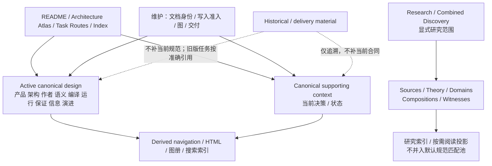

# 本设计包的文档架构


### 文档知识的专业组织

- **规范**：每个概念只有一个当前Owner，书写实体合同、作用域、前后条件、失败与可使用的字段；别处引用，不复制同一规范。
- **设计理由**：保留与最终方案的真实取舍有关的竞争方案及反例；不保留每一轮聊天/测试流水账。
- **外部来源**：仅保留实际支撑命题的出处/精确适用性与许可证条件；引用本身不是新规范。
- **历史材料**：仅为真实迁移、兼容、审计或追溯时保留；从旧设计提炼入当前Owner之后，旧副本可从默认分发移除。
- **生成物与过程垃圾**：缓存、临时脚本、检查器、自测JSON、CI结果、Git状态快照、重复索引不进入本阶段设计包；真正未来有运行证明义务时再由独立实施项目维护。

分类的依据是独立信息价值、Owner和法律/工作需要，不是“文件原来存在，所以有必须保存的原始证据”。如有第三方许可证/专利披露/版权，遵守其适用义务但不把它们混在业务语法里。


### 工作边界

本包只交付设计：不开发测试/检查器、不执行构建、不声称测试通过、不生成临时假应用。设计过程中可以依据已知机制修订矛盾字段和责任，而不是制造单独的测试工作来延迟归属和语义设计。将来用户明确授权实施时才会启动具体代码生成与运行验证工作。

量化、时间和外部观察的能力边界见[意图公式](../../20-语义与组合/作者语义/通用意图语言-意图源与语义组合.md)：量化域完备性、无限时域、跨时钟映射、连续时间和外部事件证据不能由 JSON 形状或文档结构检查代签。当前工作范围仍遵守[根入口](../../../README.md)规定的计算研究与产品实施暂停边界；整理不撤销已有可选计算合同。

<a id="current-vs-archive-collection-scope"></a>
## 现行权威、旧源兼容与派生集合的单一归属

作者模块的当前候选形状、旧版读取与各 Definition 的解释由[结构化源码](../../10-作者与输入/作者源/结构化源码.md)及其领域 owner 维护；本篇不再复制 Kind 集合或历史增量。旧版独立含义、锁定消费者和来源继续按其准确协议版本保留，不因目录改版宣称机器迁移完成。

文档维护区分结构可写枚举、公共语义责任、架构/资格视图与覆盖样本。它们分别由 Schema、语义正文、视图来源与研究/见证负责，数量相同或名称相近不建立等价关系。变更时同步真正消费该条款的结构、规范与样例，核身份前像、条件/否定、权限、时间、来源与失败；结构检查只签发形状范围，Reader、Meaning、Method 和 Target 资格各自取证。

<a id="gift138-taxonomy-authority-management"></a>
## 分类、数量与版本的单一管理规则

归属必须先记**种类层级**：`source-schema-family/revision`、`definition-kind`、`nested-author-construct`、`public-semantic-role(K)`、`abstraction-view(V)`、`coverage-facet(45/135)`、`compiler-result(IR)`、`execution/evidence`、`implementation-stage`、`documentation/history`。它们不能因数字相似、字段同名或物理路径相近自动合并。每个需单独消费/改写的真实规范条款仍由本来所属的Owner维护；分类索引、统计表和图是按准确字节/版本生成或审核的**只读投影**，不创建第二份可编辑语义词典。

协议修订（如 `/1`、`/2`）不是因果层级；Kind、嵌套作者构造、语义责任、覆盖坐标和实施阶段也不是同一个集合。[源码分层与构造归属](../../00-系统与原则/开发者源码分层与构造归属图.md#gift-author-source-layer-taxonomy)提供当前定位。需要集合核对时，从选定 SourceProfile/revision 的真实 owner 提取成员和数量；统计记录只证明该范围，不在本篇手工维护第二份易漂移的数字。

新增 Kind、兼容适配器或字段先由相交 owner 说明现有构造不能保持的区别、失败条件、跨版本读取与迁移、真实消费者和反例。行业案例、覆盖坐标或便利措辞本身不足以扩大 Kernel；实际扩展准入消费[抽象与开放定义](../../20-语义与组合/组合/抽象与开放定义.md)的规则。

完整工程设计应能定位实施入口、模块和数据Owner、机器接口、跨层调用、算法与资源/并发模型、失败恢复、Target制品和验收方法；仅有原则声明不满足该标准。[工程构造手册](../../70-工程系统与演进/工程构造手册/README.md)提供施工路线，领域Owner保留公共语义与长期不变量。施工章引用现行规范并写本地适配，不复制出另一份可竞争的语义定义。

本篇拥有当前Gift设计包的信息组织与维护接合。它不修改Gift的产品目标、六工具、十职责或作者表示选择；它也不代表产品的联邦知识库、存储服务或权限系统已实现。产品的信息机制仍由[信息主题](../../70-工程系统与演进/信息与生命周期/README.md)拥有。

本包的具体句子与主张级合并门槛见[规范表述与无损收敛](规格写作与完整性.md#semantic-claim-editing-contract)；本文件仅维护资料架构、主责分区与引用关系。

## 责任、入口与内容关系

<a id="当前包为什么需要重新组织"></a>

### 系统概览与机制正文如何分层

系统入口明确产品目标、外部环境、主要Owner和跨层关系；子系统入口组织其内部概念、依赖和消费者；具体规范保留完整字段、算法、状态与反例。导航可帮助定位但不承担缺失架构的推导责任，且不能用作者表示、编译管线或恢复协议中的任一局部主题代替Gift的整体产品定义。

文档物理归属按**唯一语义 Owner 和实际消费关系**决定：[架构与装配](../../00-系统与原则/README.md#system-architecture-navigation)与编译算法分别维护，作者当前表示与可选计算方法分离，基线采用在知识库自身维护而不冒充产品实现。拆分仅在机制、权限、失败或消费者确实独立时发生，不按平均字数切段；状态、算法与恢复紧密相依的长章可以保留。编辑过程和逐版统计归复核材料，不嵌入现行合同。

### 包的三层入口

根 README 指向产品与系统入口，docs/README 再路由到分层 Owner；主题 README 只列实际拥有/不拥有的职责、首选入口和必要阅读顺序，不手工维护所有成员枚举。源码文件树是唯一规范容器；Contract Unit、研究关联、章节目录和导航可按当前 SourceProfile 派生到包外审计产物。稳定身份与当前采用信息保留在源中，临时逐版旧地址索引不再并列维护。

这不是三层审批，也不是要求读者先读三页才允许打开文件。已知文件、协议或引用时直接进入准确位置。逐层展开服务于不知道位置的读者；准确名称检索服务于已知问题的读者。两种入口指向同一正文。

### 物理位置与内容责任

当前物理文档以 **权威责任 / 主责任族** 为唯一主分区轴；L0—L6 与 ASMRVE 只作为正交定位和阅读投影。这样同一稳定机制可以跨相邻因果层而不被迫复制，也不会再出现 `cross-layer` 杂物桶。

| 位置 | 维护内容 |
|---|---|
| `docs/00-系统与原则` | 产品边界、统一模型、设计方法、信息架构、导航 |
| `docs/10-作者与输入` | 作者源、工程源、来源与接受输入 |
| `docs/20-语义与组合` | 跨业务公共语义、作者语义、Requirement 与组合 |
| `docs/30-实现解析` | Candidate/Eligibility/Binding、搜索、增量解析 |
| `docs/40-目标与制品` | compiler/lowering、目标源码/配置/依赖/Artifact 规格 |
| `docs/50-执行运行与观测` | effect/runtime/recovery/readback/observation |
| `docs/60-保证与证据` | Claim/Evidence/Coverage/qualification |
| `docs/70-工程系统与演进` | 信息/装配/协作/迁移/自举/长期演进 |
| `docs/80-开发者与接口` | Workbench/CLI/AI/工具协议/原生维护 |
| `docs/90-治理与参考` | 决策、状态、来源维护与文档维护规则 |
| `research/`、`fixtures/`、`witnesses/` | 完整资料的唯一编辑源；结构记录按需生成包外阅读投影，分域查询，不取得规范写权 |

<a id="gift-source-package-role-contract"></a>

### 整个源包的物理分工与保留条件

**材料角色的退出判据。** 对每份文件记录主类型（规范、结构Schema、复验输入、独立反例、研究、工具、许可、派生导航或混合）、相应 Owner、锁定消费者、不可重建的信息和退役路径。`mixed` 需按句段或表格行继续分离权威，不能强制整份文件只拥有一个证据地位。`fixtures/` 的“测试固定输入”和“有限参考实现”分别判定：删除一份同字节副本之前必须检查该路径是否是独立工程的输入、比较变量、构建根或历史复验锚；如是，文件重复仍具结构性价值。`witnesses/` 的文本反例应区分“可复现说明”和“已经被真实运行”，不得由标题升级测试证据。`LICENSES/` 及锁定旧版要按再分发和迁移义务保护。

删除属于不可逆资料变更，仅当可重建视图可从固定源恢复，或所有真实消费已迁移且独立来源/差异/许可/审计价值均被保留，才允许原Owner退役。`contains`、`links` 只能证明材料位置，不构成 `consumes`、`retainsFor` 或运行依赖；未知消费者需通过实际代码、配置或发行清单复核，不能以检索未出现作为不存在的证据。


以下是**材料角色及可移除性规则**，不是另一份业务语言或编译器协议。目录内的具体文件是否仍必要，以其消费者、独立证据、来源/锁定关系和替代能力判断，不能仅凭目录名、旧 Gift 编号或文本重复率判断。

| 路径 | 本包中的对象和实际用途 | 保留、迁出或删除的依据 | 禁止的误判 |
|---|---|---|---|
| 根 `README.md` / `ARCHITECTURE.md` / `AGENTS.md` | 当前导航、系统关系、已取得与未取得的资格、维护约束 | 精简为唯一入口和准确链接，不能把它们写成多份各自定义类型的规格 | 根总览或状态表有一项，就当作其实现已完成 |
| `docs/00` 至 `docs/90` | 现行产品规范、具体算法、跨责任合同、实施状态和维护决策；十个目录是**文档责任族**，不等于十个运行服务 | 不同责任维护不同语义；契约改变只编辑真正主责，其余消费文档记录相交差额 | 按文件名、L层或阶段号拆/并独立义务 |
| `schema/` | 当次选用 Profile 的机器结构、版本和范围；其中仍有 design-shape 或未发布提案 | 有真实读者或可重放结构案例才保留相应版本；废止须检查被锁定的消费链与迁移 | schema通过即Meaning、Method或Target合格 |
| `fixtures/author-workspace` | 结构与原生工程、控制存储与编辑的历史案例说明；声明式源另按 examples 的准确版本使用 | 证明替代表达、源归属、往返与并发条件的独立对照价值 | 内容哈希相同就将两份独立项目混成一份作者真源 |
| `fixtures/contract-closure` | Rule/Method/Target 接合、有限TS生成与失败边界的历史 Markdown 说明，不含复现程序 | 对应接口改变时同步更新示例，旧限定版本按锁与独立见证保留 | 把限域结构检查或生成案例当作生产编译器 |
| `fixtures/semantic-universe` / `fixtures/prebootstrap` | 纯计算、结构定义、类型、编译与自举边界的受限参考 | 只有被真实消费的算法与区别见证可迁入当前实现；旧版本说明可作为研究依据；本包不提供其运行材料 | 参考的Python计算解释器等于Rust生产Kernel |
| `fixtures/semantic-abstraction` / `fixtures/intent-language` | Pattern与意图的实例化、联立、重规划、有限Method/目标资格反例 | 保持每个版本各自实际支持的输入与测试范围；同一事实勿复制成权威规范 | 全部案例通过即任意领域自动源码合成 |
| `fixtures/compositions` | IDE、事务产品、Studio等跨机制的完整研究组合（research范围） | 有独立组合/反例价值时保留；由已采用机制取代的可迁为索引或历史证据 | 产品样例名称成为Kernel内置业务模板 |
| `witnesses/` | 构造使某个旧假设失败的负例、挑战与复验条件 | 有独立反例、失败机制、必要边界或历史证明价值即保留 | 反例文字存在就代表已运行测试或正式证明 |
| `research/` | 一手来源线索、理论推导、比较、领域与历史候选 | 来源/时间/不确定性与可追溯性需保留；采用结论须另写入当前语义owner | 研究中的建议或旧结论自动有当前规范权威 |
| 包外制作工具与交付核对 | 按需核对成员、字节、引用及制品；不属于本包的可执行成员 | 独立来源、迁移前像和法律责任仍按其真实用途保全 | 假定本包有工具、manifest 或 `_meta`，或把机械通过冒充产品资格 |
| `LICENSES/`、`LICENSE`、`NOTICE`、`REUSE.toml` | 分材料许可证、第三方权利和再分发义务 | 按真实许可及分发规则维护，不能以字符串重复作为删除依据 | 文档或生成的用户工程自动继承本工具源码的许可 |
| `knowledge.toml` | 本**文档库**现行SourceProfile、canonical/research范围与阅读设置 | 属配置源；修改必须检查来源划分、旧索引失效和交叉泄露 | 文件夹自动决定所有项目的AuthorSource权威 |

文件保留标准按顺序判断：①独有且不可重建的规范、事实、来源、许可或恢复输入；②真实下游仍引用或锁定的版本；③可复验参考中与其它版本**不同的必要前提、目标、负例或证据**；④可完全重建的缓存/目录/统计。前三项不能因为正文相似就移除。第四项默认只输出至包外，不增加一个可写的`catalog`主数据源。精确重复仅是审查线索；精简同字节副本前核对真实路径消费、隔离/复验作用与许可。当前纯设计整理以实际引用和内容对照核对；只有另获实现验证授权且确有可执行消费者时，才修改并运行相交试验。


物理位置只是owner的维护地址，不是运行层级。根以责任家族分区，不要求每个子层都使用同一分类：主题内可按对象、完整机制或任务入口细分，只要同级分区依据清楚、没有竞争写源且原关系仍可定位。拆文件不能代替拆事务/权限/进程。

<a id="semantic-owner-crosswalk"></a>
### 易混概念的唯一语义维护入口

下表是**修改位置的路由**，不是另一份类型定义。相同英文词在不同主体上未必指向同一个对象；需要先对齐 subject、scope、revision 和消费角色。只有被指向的主 owner 可以更改该语义，其余文章只能保留特定场景的输入、输出、映射、前置、失效或拒绝条件。系统综述中的角色对照是阅读投影，不得对下列 owner 的合同另行修订。

| 语义项/限定范围 | 定义和修改归属 | 相交处只能补充的独有责任 |
|---|---|---|
| 产品工程的 `AuthorSource`、身份与采用 | [作者源/模型采纳](../../10-作者与输入/作者源/工程源/身份断言与采纳.md) | [文档 AuthorSource](知识记录与分域检索.md)是本设计库的另一画像，不能反向决定产品语言；解析、SourceMap和AI只是消费者 |
| `Definition` 与复用接口 | [可复用定义与接口](../../20-语义与组合/组合/定义与接口.md)和[结构化作者源](../../10-作者与输入/作者源/结构化源码.md)的对应拥有部分 | `RequirementDefinition`的字段/实例化由其专项 owner 负责，不让选择器、UI或供给者更改 Meaning |
| `Requirement` 实例、主体和实现义务 | [需求定义与供给合同](../../20-语义与组合/作者语义/需求规则与供给合同.md#requirement-definition-contract) | 实现解析报告满足/缺口；Assurance评价具体Claim；二者都不回写 Requirement |
| `Claim` / `Invariant` 的具体评价命题 | [要求、主体与声明范围](../../60-保证与证据/保证/要求证据-要求主体与声明范围.md) | 原要求拥有不变量意义，Claim只固定本次评价对象、范围、量词、假设与变化前沿 |
| `Evidence` 的适用性、独立性与接纳 | [解释与证据接纳](../../60-保证与证据/保证/解释与证据接纳.md) | 来源、运行回执或研究只提供有范围的材料，不以存储位置给出Verdict |
| `Provider`、`Supply`、`MethodSpec` | [实现供给与替换](../../30-实现解析/供给与替换.md#open-supply-method-contract) | Target/Execution分别拥有具体ABI或作用许可，供给目录不能生成资格/Grant |
| 实现选择 `RealizationBinding` / `UseBinding` | [实现要求与正常绑定](../../30-实现解析/实现选择/实现要求与正常绑定.md) | 授权选择封存Binding；UseBinding只是具体使用点只读投影，运行实例不是Binding |
| `Operation` / `Attempt` /现实 `Effect` | [外部效果与幂等交付](../../50-执行运行与观测/持久化与恢复/事务提交-外部效果与幂等交付.md)与[准入](../../50-执行运行与观测/权限与资源/授权与执行准入.md) | 目标程序中声明的效果语义不是Effect已发生；Observation/Assurance各自观察和裁决 |
| `Revision` / generation / 作者接受 | [身份、修订与代际](../../10-作者与输入/作者源/工程源/身份断言与采纳.md#identity-revision-generation-contract) | 当前用途选中与配置基线由信息owner投影；新revision不倒写旧运行 |
| `Snapshot`、选择和当前用途资格 | [对象关系与配置基线](../../70-工程系统与演进/信息与生命周期/对象关系与配置基线.md#selection-and-current-validity) | 各源负责原子性、时序与覆盖，跨Provider聚合不能自己签发全局强快照 |
| 目标 `Artifact` / `ArtifactSet` | [目标交付与发射](../../40-目标与制品/目标/交付消费合同与发射.md) | 发行、部署和读回属于后继不同主体；本设计ZIP也是Artifact但不是产品运行成功 |
| `Projection` / `Index` / `Cache` | [接入、检索与派生](../../70-工程系统与演进/信息与生命周期/接入检索与派生.md) | 开发客户端有其UI投影；文档库的KnowledgeIR/SourceMap由[知识记录](知识记录与分域检索.md)定义特殊画像 |

| `Goal`、自然语言 `Intent`、`Need` 与正式采用边界 | [跨软件需求的意图接受](../../20-语义与组合/组合/跨软件需求合同.md)与[作者决策](../../20-语义与组合/作者语义/开发者决策模型与设定面.md) | 解释/AI候选不代签有权采纳；Need不等于Requirement不成立 |
| `SourceProfile`、受管 SourceMap、作者修订 CAS | [作者编辑保存与迁出](../../10-作者与输入/作者源/工程源/作者编辑保存与迁出.md)与[作者表示选择](../../10-作者与输入/作者源/可替换表示与适用范围.md) | 本文档库的Markdown SourceProfile另由[知识记录](知识记录与分域检索.md)特化，不倒写产品作者语义 |
| `Configuration` / `InformationSelection` / 当前用途有效性 | [选择向量与精确引用](../../70-工程系统与演进/信息与生命周期/对象关系与配置基线.md#baseline-selection) | PreparedJob只固定一次任务所需的子选择，不重新发行全工程版本 |
| 正式 `IR` / 临时 `Plan` / `Projection` 的资格 | [表示族与跨层保持](../../40-目标与制品/表示/表示族与跨层保持.md) | 每个IR消费准确源但不反向获得它的作者写权；仅可重算不足以证明能随时丢弃 |
| `EvaluationRequest` / `MethodOutcome` 与共同失败变体 | [局部结果语义](../../20-语义与组合/共同语义/规范元模型与结果语义.md)与[纯求值依赖](../../30-实现解析/增量与性能/查询固定点与缓存.md) | evaluation的取消不负责外部Operation，owner-local unknown不能互相代换 |
| 实际 read-set、负依赖、cache generation 与失效 | [依赖与失效模型](../../30-实现解析/增量与性能/依赖与失效模型.md) | 查询生产者记录准确读集；应用与UI的缓存只保留本用途结果，不能让缺失依赖变成永久否定 |
| `PreparedJob`、`TaskCapsule` 和跨生命周期任务组合 | [协作与状态边界](../../70-工程系统与演进/协作与状态边界.md) | Application组装请求、结果和Need，但不改变Requirement、Operation或Evidence自己的终态 |
| `Grant`、资源份额、作用准入和撤销 | [授权与执行准入](../../50-执行运行与观测/权限与资源/授权与执行准入.md)及[资源核算调度](../../50-执行运行与观测/权限与资源/资源核算调度与交接.md) | 找到Provider或编译成功不构成执行许可；释放旧代际不自动释放新代际 |
| `Observation`、`ObservationIR` 与现实覆盖 | [观测与读回](../../50-执行运行与观测/观测与读回/README.md#观测与读回总则) | 工具返回、event/log和完整现实读回分别核；Assurance依据Claim评定可信度 |
| `ReleaseSnapshot` / Promotion / Deployment / Runtime generation | [目标交付与发射](../../40-目标与制品/目标/交付消费合同与发射.md)与[运行/发行生命周期](../../50-执行运行与观测/运行生命周期/制品发布与工作区生命周期.md) | Artifact存在、快照完整、已发行、已部署、健康、合格支持是不同状态 |
| 兼容映射、迁移、旧消费者保护和退役 | [迁移切换与退役](../../70-工程系统与演进/演进与实施/兼容迁移/迁移切换与退役.md) | 停止新接入不等于能删除旧reader/Recovery根；同名也不继承旧权限 |
| 项目级开发任务/原生工作区与Git状态 | [开发任务主链](../../80-开发者与接口/需求到交付主链.md)与[真实工作区观测](../../80-开发者与接口/原生维护/工作区与版本库观测.md) | 合并/push/CI是现实状态，不能从文档或缓存推断已发生 |
| 当前理由、真实状态、来源/研究的不同 authority | [决策目录](../决策/README.md)、[实施闭包](../状态/实施闭包.md)、[研究准入](知识记录与分域检索.md) | D说明为什么；闭包说明未实现/未核验；来源只支持其实际范围，均不得发布竞争规范 |

同一行若含两个并列 owner，它们各拥有行内**明确限定的不同语义面**，不是两个共同改写同一字段的编辑者。遇到新例子若无法分辨到底是语义意义、绑定决策还是作用结果，先固定其实际主体、来源、前后态、消费者及各 owner 会否独立变化；边界未决时保留原材料并定位竞争责任，不能依本表强制迁文。跨 owner 的 typed relation 与交接失败由[跨层交接矩阵](../../70-工程系统与演进/信息与生命周期/对象关系与配置基线.md#typed-handoff-contract)明确，不把这份路由表变成第二套产品协议。

### 统一多层模型与文档物理目录的关系

文档以真实对象、责任与消费者建立概念联系。[统一多层工程模型](../../00-系统与原则/统一多层工程模型.md)的L0—L6辅助区分因果角色，ASMRVE辅助检查相交设计问题；两者不先验决定文件归属。Entity / Statement / Configuration / Transition / Evidence / Projection是已有角色的共同解释，不是要求所有正文先转成一种万能节点；authority/context/revision/time按实际合同限定。

文档的**物理目录**不强行做成7×6网格。一个canonical owner可以拥有同一concern的多列设计，也可以通过相交合同覆盖多个因果角色。矩阵表示读取问题，不是42类必须创建的文件或独立owner。因此：

```text
概念定位：准确对象/范围与Concern；Layer/ASMRVE按需辅助
事实身份：canonical owner / stable ref
物理存放：按主责任聚合的一份正文
阅读组合：Atlas / task route / generated matrix projection
```

任何规范都须明确自己拥有的事实、适用范围及相交消费者；Layer/ASMRVE只在能帮助解释时使用，不是必填元数据。对有实际义务而未知的机制保留缺口，对不适用的职责不造填格内容。全系统阅读可用架构、任务、领域、因果角色等视图组合；同一完整合同仍只维护在其canonical owner。

### 成品文档的结构：责任主分区，多种关系显式

本节说明上表各责任分区之间的阅读关系，不再复制一棵相同文件树。统一模型中的因果角色和 ASMRVE 可以跨分区组合；一个 resolver 的架构、语义、算法、实现、验收和演进由相交 owner 共同覆盖，不建立 `L2/A`、`L2/S` 等填格目录。实际物理分工见[责任表](#物理位置与内容责任)。

候选、配置选中、正式采用、对本次用途仍有效、历史及可删除性，按[选择与当前效力](../../70-工程系统与演进/信息与生命周期/对象关系与配置基线.md#selection-and-current-validity)分开判断；不能只凭revision较新或Configuration选中宣布current。当前规范可以引用仍有效的固定旧来源，不强制建三棵重复正文树。纯制作历史退出默认阅读入口；仍被准确旧锁、兼容解释或恢复任务消费的材料按其保留目的可定位，不因归档标签失去资格或被删除。导航、Atlas、矩阵和机器catalog只重建表示，不拥有正文中的规范事实。

#### 图解：当前设计、辅助上下文和历史材料的边界



读者理解当前产品时从Entry进入Active；理由和未决按需展开Support；来源、候选与反证从显式Discovery进入Research，不由文字相关度混入规范命中。历史材料没有指向Active的规范写权；当前合同的必要内容必须在当前owner明确，而用于固定旧版本重建、独立证据或兼容解释的原件仍可按本次用途成为真实输入，不能把“阅读当前规范不靠旧聊天”扩大为“旧材料永不成为依赖”。

#### 一个新信息到底放哪里

先问“谁有资格定义它、谁会因它改变而重算”，再决定目录：

- 改变产品可观察含义/Requirement → 作者/领域/产品相应 owner；
- 改变实现选择算法/编译语义 → 编译；
- 改变 Gift 自身模块/代码职责 → 架构/装配；
- 改变生成业务工程的源码/依赖/构建/目标运行闭包 → 编译/目标，运行部分链接运行 owner；
- 改变真实 Effect、资源或恢复 → 运行；
- 改变 Claim/Evidence 判定 → assurance/验收 owner；
- 改变信息身份/版本/保留/组合规则 → 信息；
- 只是解释为何采用而不改变合同 → 决策；
- 只是未完成状态 → 状态；
- 只是来源、理论、领域场景、组合或反例材料 → 按[知识记录与分域检索](知识记录与分域检索.md)归类，不进入规范默认检索；
- 只是本文档如何维护 → 维护。

一个主题跨多个 owner 时，不建“综合大文档”复制全部机制；由最主要责任拥有其核心合同，其他事实以准确链接组成阅读闭包。全工程组合由 Architecture Atlas 和任务入口提供。

<a id="documentation-primary-placement"></a>
#### 具体归属的判定：主体、事实职责、完整机制，然后才是路径

“正确位置”指本设计库采用的责任划分下有一个明确主维护处，且真实消费者能够找到它，不是对一切未来内容存在一条永久最优的世界目录。归属判断可以被新的责任分解、读者用途或反例修正；不能用目录优雅推翻原合同。

先判断正在说明哪个系统主体：Gift平台本身、被编译的目标产品、开发者客户端、外部供给，还是本设计库的制作与维护。同名“模块”“工作台”“配置”“身份”不是同一主体。再判断该段是定义合同、解释机制、接口编码、采用理由、未决状态、独立证据或来源材料；最后按完整状态/算法及其消费者确定原owner。路径和标题只在这之后分配。

| 容易混放的内容 | 主维护位置 | 相邻页面只保留什么 |
|---|---|---|
| Studio/IDE 等具体产品的文件树、编辑、任务等可观察行为 | 同包 `fixtures/compositions/` 的完整研究唯一源；按需阅读投影生成到包外，若某个区别被采用则写回其准确 canonical owner | Core/客户端规范只保留跨产品机制；研究材料不得取得产品或 Assurance authority |
| Gift开发工具的Project/Decisions/Inspector及Extension布局 | `80/客户端/工作台布局与交互.md` | 交付语义给主体区别和准确入口，不保留第二份客户端布局 |
| 树形节点出现、分页、筛选、选择、定位和焦点 | `80/客户端/树形导航与结构投影.md` | 共同组织拥有分组/成员/关系保持；工具协议拥有通用cursor/权限，不重复字段 |
| 文档内容应如何归属、拆分和接入导航 | 本篇及[重组协议](文档身份与重组协议.md) | `00/文档信息架构.md`只给总览；不把实际文档整理当产品信息服务实现 |
| 文件、文档、包和导航共用的组织不变量 | `70/信息与生命周期/多维组织与树形落位.md` | 各画像说明自己的输入、实现差额和失败，不再造总控平台 |
| 数据和方法本身是什么意思 | `20`相应领域/组合/作者语义owner | `30`引用其保持义务，不以当前供给反向定义语义 |
| 如何选择供给并处理生态解析反馈 | `30/实现选择` | `40`拥有目标消费/布局，真实获取的Effect归`50` |
| Rust目标生成、Cargo构建用途与ABI | `40/目标/Rust目标画像与降低.md` | 自身内核迁移的取舍/阶段归`70/演进与实施`，自举比较归其确定性机制正文 |
| 相交合同怎样测试与裁决 | `60/保证`和`60/验收` | 写作说明可以链接验收设计；真实测试日志、环境和结果留对应制品，不塞进规范冒充已通过 |
| “为什么选A而不选B” | `90/决策`及owner内维持理解所需的理由 | 不在D条目复制完整字段/算法；改变决定同时修正相交owner |
| “还有什么没实现/没验证” | `90/状态`的当前实施闭包及准确机制 owner | 状态摘要只导航；不由状态标签发布新规范或自动关闭能力 |
| 论文、标准、外部API及其核查边界 | `research/sources/` 的命题记录；完整理论、场景、比较和反例按各自角色同包保存；准确原件依许可与用途保留 | 正文引用支持的具体命题，不能把上游样例当Gift运行证明 |
| 文件、标题、章节范围和文字链接清单 | 从当前作者源按需派生到包外 reader/audit 视图；source package 不运输可重建索引 | 只提供位置和覆盖；不发行stable Entity ID或暗授writer |

表中的短路径以现有责任族为定位说明，不是另一个机器路由规则。正文按完整机制留在主owner；引用该机制的消费者仍保存自己的输入要求、特例与失败。协议字段既有机器Schema时，结构约束由该Schema负责，语义/兼容解释由原规范负责；资料冲突要查真实采用与实现，不按“JSON比Markdown更权威”自动裁决。

若一篇文章只是提及多个系统，不因关键词跨界就拆；若其中一块具有另一主体、独立更新理由和独立消费者，迁移完整块并重算相对引用。紧密耦合的正常过程、失败、恢复、反例和必要上下文不能按表列拆散。临时无法判定归属时保全原文，记录具体竞争owner及判断依据；不放进永久“综合/其他”桶并把它算作已定位。

<a id="documentation-tree-presentation"></a>
#### 三种入口各负其责，不重复维护三份全库树

[规范入口](../../README.md)由当前规范作者源生成，同时显式呈现两层：目录/文件是**物理容器树**，正文已有`gift-unit-*`时在所属容器下显示**Contract Unit语义节点**。目录自有README时目录行直接链接它，不额外制造同义README叶；文件名和正文标题不同则同时显示。普通章节仍由outline/Section catalog按需展开，不自动铸成Unit。这样物理重排不会要求逻辑树丢节点，也不会为了多一个树节点多建一个文件。

[方案与责任入口](../../00-系统与原则/导航/主题导航.md)回答工程问题与当前取舍，[任务路线](../../00-系统与原则/导航/任务路线.md)回答实际使用过程，二者只引用所需owner。因果角色/ASMRVE索引按问题连接跨目录正文，不由首级文件夹自动给每篇文章一个唯一L编号，也不再抄一份和文件目录相同的全量表。

章节层级只从围栏感知的标题取得。遇到同级或更高标题关闭前一范围，父节包含自己的子节；跨级标题保留原文并按最近较高父级定位，不凭空造缺失标题。明确存在无正文且紧邻同级标题的空节，应检查内容是否错挂；组织性父节可以只容纳子节，不被机械删掉。代码里的`#`、示例标题、表内竖线和引用式链接均按实际Markdown语法处理。

每个生成投影的成员集合与输入来源可重算；计数是当前包范围内的文档数，不是能力数或最优完成率。重型分析投影没有独有事实时不得仅为“完整”常驻canonical包；需要审查时从同一冻结作者源生成，并与该次审查制品绑定。附属来源、许可及范围配置由根角色说明和实际成员承接；需要精确字节核对时使用包外清单，不藏在正文树外后宣称它们不存在。目录移位或新页出现时，更新受影响入口、标题、片段入链和派生目录，不用历史旧址代理补当前断链。

### 同一信息怎样服务多个问题

以“替换不覆盖用户后来的输入”为例，产品接受条件、作者结构、生成方法、最终写入边界、失败案例和研究依据各有真正不同的信息，不能融合成一条万能规则，也不应各自复制完整合同。

读者从当前[结构化作者源](../../10-作者与输入/作者源/结构化源码.md)进入具体要求；需要完整实例时再打开冻结的结构化工作台范本作校准。需实现时沿[编译主线](../../30-实现解析/README.md#gift-unit-compiler-overview)找到方法；需恢复时读[持久化协议](../../50-执行运行与观测/持久化与恢复/README.md)；当前缺项仍见[未决](../状态/README.md)。这些是实际导航关系，不自动证明方法满足要求，也不是另造一份手填需求追踪表。

按读者任务、组件、协议、版本、信息角色形成的视图可以并存。规范主张在同一修订/范围下只有一个写者；多入口引用该写源，不能复制出独立可改义的版本。机器索引负责定位，不凭相关性裁决事实、授权或采用状态。

对按任务裁剪的阅读组合，采用以下消费规则：

| 输入与选择 | 阅读结果必须保持 | 不满足时的处理 |
|---|---|---|
| 同一规范被不同任务路线使用 | 同一 owner/revision，及本任务需要的前提、正常/失败和恢复上下文 | 更新准确链接或补齐相交上下文，不在路线页另写一份算法 |
| 只展示某个 Profile/目标/读者的部分内容 | 明确选择条件；仍约束所选任务的限制、拒绝和未决不得因筛选消失 | 无法判定适用性时给出未决及完整正文入口，不把缺项显示成“不适用” |
| 关联研究、旧证据或其他工程的同一材料 | 保存其来源角色、固定版本、许可/访问边界和独立用途 | 不能只凭相同链接视作当前规范或重复证据；无权披露的原件不得随阅读组合复制 |
| 源或解释版本变化 | 重新取得受影响的范围和定位；旧阅读物标明原修订 | 无法重建时保留准确旧视图与缺口，不宣称已同步当前源 |

该设计吸收了[DITA 的主题/组合映射区分](../../../research/sources/工程信息组织依据.md#info-source-06)、[EDMS 的同对象多关联](../../../research/sources/工程信息组织依据.md#info-source-03)与[按阅读目的组织入口](../../../research/sources/工程信息组织依据.md#info-source-05)的独立意义。它是本库选择的阅读合同，不声称外部资料证明了 Gift 的筛选、权限或往返实现；具体解析、披露与代际由[知识记录协议](知识记录与分域检索.md)承担。

#### 文档候选与历史不是第二套信息组织

同一设计对象沿准确身份和修订关系保持连续性，谱系可以分叉、合并，不能强制压成单链。active Markdown表示本交付配置选中的规范revision；设计包的active不等于仓库main已采用。候选及历史按其准确配置与保留目的区分；独立复制或拆合是否延续身份由原映射裁决，不凭同名合并。目录/archive只是组织策略，不授予权威、写权或删除资格。

仍有效且属于本交付范围的独立内容必须在当前规范或准确适用的支持材料中可理解；竞争提案未经采用不能机械合并为一个规则。只解释过去的内容留在revision/provenance链。当前正文不能靠读者自行拼接冲突版本才能理解。

### 入口与图的抽象层次

系统级图先区分Gift、作者工程、实际供给、目标产物与运行环境；子系统图展开状态拥有者和接口；机制图再给出精确字段、时序、分支和恢复。图中采用相同名称不意味着同一实体：作者定义、Gift实现模块和目标运行实例须在图例或相邻正文说明。一个目录层次不是强制的运行层次。总览不删除细图，细图不取代总览。

本库当前实例见[总体设计](../../00-系统与原则/总体架构.md)的系统边界与协作图。实例调用图、静态依赖图、源到目标关系图和部署图可以并存，但各有边角色；不要把它们并成无含义的“全局图”。完整图文维护与核验在[图表与阅读派生](图表与阅读派生.md)。

## 语义单元、物理容器与定位

<a id="contract-unit-and-physical-container"></a>
### 稳定 Contract Unit 与物理容器：不再按文件数反复拆合

**规范单元识别和裁决接口（本包的维护合同，不发行产品Wire类型）。** 现行单元优先使用已存在的显式 `gift-unit-*` 稳定锚点；没有稳定Unit时，使用准确路径、标题/行范围及当前 SourceRevision 作为**临时定位**，不得将内容哈希、标题序号或 `S3` 之类局部步骤号冒充永久身份。正式跨文件引用需要稳定单位时，由该Unit唯一Owner先签发稳定身份，检查同一 SourceProfile 内无冲突后再改变消费端。文本字节哈希用于复核修订，不等于身份，也不赋予采用权。

| 单元处置 | 必要动作 | 不可省略的检查 |
|---|---|---|
| 仅修辞等价 | Owner保持稳定身份，更新文本/修订；其他页只有引用与本地消费差异 | 主体、量词、否定、时点、权限、默认、异常、结果、证据和原反例均不变 |
| 语义增强但兼容 | Owner发布带适用范围的后继修订；记录旧使用点是否仍满足合同 | 新条件不能让旧环境的已锁定输入静默改义；旧证据是否仍可用 |
| 不兼容的改变 | 新版本及迁移/废止关系，固定破坏点与适配义务 | 旧作者源、锁、目标、运行和恢复仍可复现；不能原地覆盖旧承诺 |
| 拆分/合并Unit | 所有原身份继续有可解析去向，按实际语义建立一对多或多对一映射；不得用路径重命名冒充等价 | 不可独立恢复的信息、各子命题Owner、版本及消费者均被保留 |
| 冲突或证据不足 | 保留多个竞争主张及各自来源，标记未裁决；禁止选“最新”或最长段落当赢家 | 引用的是同主体/同条件还是同名异义；实际可观察反例与影响 |

一项合并必须输出“每个旧主张 → 新Owner/Unit/具体句段/保留的例外和证据”的映射；未确认的候选仍留在审计工作集，**不得**因机器搜索相似就执行删除。历史结论保留当时主体和时间，但不能继续冒充当前规范。该规则直接约束当前SourceProfile选中的全部Markdown的整理，不能由扫描出多少段落推断逐句等价审核已完成。


文档组织的稳定语义单位是 **Contract Unit**，不是 Markdown 文件。Unit 表示一个能够独立修改、验证、引用和判断失效的规范闭包；物理文件只是把一个或多个高内聚 Unit 放在一起编辑的容器。逻辑树、任务入口、领域视图和 ASMRVE 可以分别显示同一个 Unit，树节点数量不决定文件数量。

稳定引用遵循[文档身份协议](文档身份与重组协议.md)：需要跨物理重组保持的规范闭包统一使用全局唯一显式 `gift-unit-*` Contract Unit；整篇文档若需要稳定身份，同样声明页面级 Unit，而不是另发文件 ID。只有 Unit 的真实语义责任发生合并、拆分或退役时才改变其身份关系；**仅为阅读局部性进行物理合并/拆分时，原 Unit 身份保持。** 按需`UNIT_CATALOG.json`只定位作者已声明的Unit，path/heading/line都是当前source或相应投影的locator。Unit 不是 Gift 产品实体、权限、采用或完成证明。

物理容器划分按以下**有序约束**决定，不使用行数、文件数或目录整齐度作为目标：

1. 先保持事实唯一写源、独立 authority/revision/consumer、失败恢复和验收语义；任何会改变这些边界的合并都属于设计变化，不是排版优化。
2. 在语义保持前提下，优先把共享 writer、状态/生命周期、修改触发、验证闭包和主要消费者的 Unit 放在同一容器，减少一次正确修改必须跨文件同步的边。
3. 独立发布、独立安全/许可边界、不同来源权威、显著不同生命周期或可以单独替换而无需重审相邻单元时，保持不同容器，即使正文很短。
4. 一个容器内部按 Unit → 子合同 → 细节展开；一个 Unit 的前提、正常路径、失败、恢复、反例和必要验收不因页面长度被拆散。长而内聚允许保持长文，短而独立允许保持短文。
5. README 只保留真实责任边界、选择理由和必要路线；可从成员和标题确定的完整清单由包外 reader/audit profile 生成，不得为了少一个文件删除人工唯一信息，也不得为了导航再复制规则正文。

可把当前 Unit 看成带约束的关系图：强耦合边来自共同写者、共同状态转换、共同采用/回滚和必须联合验证；禁止合并边来自独立 authority、生命周期、发布/权限或替换边界。物理容器是在禁止边约束下减少高耦合跨容器边的分区。这个模型只指导组织，不发明数值权重或“最佳文件数”。若两种分区没有可验证差异，保持当前布局，避免无收益 churn。

因此“把十八个文件压成六个”本身不是成功条件；成功条件是：每个原独立 Unit 仍可准确定位和单独引用，同义写源减少，修改闭包更局部，逻辑树仍能恢复全部节点，且新解压包的当前链接、显式 Unit 和实际成员一致；若生成包外 catalog/manifest，再核其与冻结源一致。反过来，为减少文件数造成一个跨 authority 的巨卷，就是失败。

### 内容级唯一化的实际判断单位与消费链

**表格、总结、集合和局部编号的归位决策。** 表格中规定字段语义、推导规则、有限集合成员、状态迁移、必要阈值、失败或兼容边界的行是规范内容；它的权威来自实际Owner而不是“表格”这种Markdown形式。只列对象链接和统计的表可按指定SourceSnapshot派生；引用外部实验、旧方案或失败样本的表应保持证据和版本限定。混合表允许逐行区分三类角色，未分类部分保持 `REVIEW_REQUIRED`，不得整表以自动规则降为“仅导航”。

列表要进一步区分可枚举的封闭语法成员（如六模态、八RequirementTerm）、开放世界的领域候选（如36条件领域）、审查坐标（如45家族/135侧面）、历史追踪（75/102）和普通排版条目。只有相应Owner可以证明某枚举对**声明的Profile**穷尽；不能从“编号到60”推出世界语义一共有60种。局部步骤由 `Owner + 系列语义 + 本地编号 + 定义修订` 限定，旧的裸 `S0` 或 `INT3` 只能在来源可唯一解析时作为显示别名；跨资料定位不唯一则要求显式限定，绝不能猜测归属。

综合、目录与导航保留信息价值，但只作精确主张的只读视图；读者看到“已完成”必须同时取得主体、资格层级、环境、版本和证据，不能由源文本中的阶段性标题得出当下状态。


主张的拆分、等价判断、成功/失败保全及前后对应统一按[规范表述合同](规格写作与完整性.md#semantic-claim-editing-contract)执行。本页增加的组织条件是：原条款的真实消费者仍能取得其完整上下文；总论只留跨主题因果与本地消费限制；未有新 owner 承接的独有条款不得因路径已连通而删除。

可检验的冲突类型至少区分：同一对象两份当前定义、同名异义、同义异名、生命周期终态不一致、作者写权与观察权限混同、实现选择被UseBinding/Target重新作出、源摘要与现实证据互签、不同量词/时间/环境的资格混用，及已批准但不可执行的迁移。记录冲突应指向真实前后句和消费失败场景；只有工具搜到关键词而无可观察矛盾时，保留审查候选，不制造“已解决”的虚假问题数。

### 主题页怎样完整，又怎样避免巨卷

一个可独立修改和消费的机制可以成页；其对象定义、前提、正常过程、状态后继、失败、恢复和反例不得被切成没有上下文的卡片。完整表格、代码围栏、图源与其邻接解释保持整体。一个领域的例外不能因为当前不影响主结论就删去。细机制的名字在其规范内保留；更高层用系统目标、输入输出、责任和状态说明关系，不全局替换技术名词。

被拆开的原章仍有共同上下文入口和分题路径。新增页不复制原章全部规则；需要的前置通过准确链接取得。当前同义重述可保留为总览或危险动作旁的提醒，但完整字段表和状态机只有原拥有者维护。相似词句先核对象、条件、时序和消费者；只有确实同义的段落才合并到一个位置，其他页保留准确引用。

展示用的章节序号与协议步骤、状态码、要求编号和证据坐标分别处理。章节标题按具体主题表达层级，重排后用具名链接同步正文引用；真正承担协议或稳定引用含义的编号保留，不为数字连续性改写其语义。新增内容回到相应主题、责任与生命周期，不持续在文件末尾追加按编辑批次命名的补充段落，也不以单纯去编号代替内容组织。

#### 同一命题的详细正文与短入口怎样同步

短入口消费[逐命题改写](规格写作与完整性.md#semantic-claim-editing-contract)的结果，不重新维护详细定义。共享算法在原 owner 合并；平台适配、失败组合、权限时点和恢复后果留在各自消费者。不同候选需要当前决定或明确条件分支，不能用“统一”把相反算法拼成默认任选。

正文变更后，主题导航只更新入口，D理由更新受影响的取舍，[当前实施闭包](../状态/实施闭包.md)更新仍缺的代码、接入或现实证据，外部依据保留其原版本和支持范围。正文只有一个规则拥有者，导航/状态不复制字段表。仅标题、链接或归档变化不能算算法优化；最终内容差异必须从实际打包字节与父包比较，未持久化的草稿不进入“已修改”结论。

### 稳定身份、片段和当前基线

Contract Unit 语义身份与文件路径分开，移动只更新当前位置；新增或合并内容直接同步本版入链。当前包不维护文件 ID 注册表或旧文档路径查询。旧稿内容的保全靠语义与实际字节比较，不靠一张指向新页的地址表。

明确锚点与自动标题发生冲突时，区分同位置重复与不同位置歧义，修正当前标题、片段和入链。无当前消费者的旧别名不构成永久支持承诺；来源论文或产品公开接口的版本引用有其独立目的，不能机械删除。

真实仓库基线由其固定提交中的正式文档机制产生；离线包由根入口说明范围、实际文件树承载内容，需要精确核对时在包外固定成员与摘要，并区分 main、分支和本地修订。不能假设离线包含有`.documentation/`或把包摘要当采用证明。文档变化更新当前定位与派生索引；只有真正采用新规范的活跃范本才重绑相交资料锁，固定旧版引用不改hash。父输入差异及制作审查另行保留，不递归积累进当前阅读源。

### 文档组织采用的共同规划与保持合同

本页是[多维组织与树形落位](../../70-工程系统与演进/信息与生命周期/多维组织与树形落位.md)的文档画像。唯一规则是**同一语义事实与版本/范围下的修改责任无竞争**，不是“一份实体只能有一个文件”，也不是“文件树不能改变分类轴”。一个规范可以有多个有明确来源的表示；正文、翻译、API派生和图各保留自己的编辑/生成协议。无可靠逆向的摘要不能反写规范。

章节重组的单位是完整可理解义务，而非H2/H3或关键词命中。重组清单须记录被保留、移位、合并、修正、撤回的具体差额及理由；保留同义段落外的适用条件、否定、机制、数值、例子、失败、恢复、来源强度和未决。机械路径、摘要与地址覆盖是必要但不充分的检查。

迁移前固定正文和受影响的链接/身份消费者。旧版锁或证据引用旧字节时保留其准确目标；当前文档更新不能通过改hash让旧范本假装采用新语义。交付不含某依赖时给准确缺项；能取得的范本与合同按所需闭包提供。ZIP需独立核路径编码/成员完整性，不能只查CRC。当前规范不需历史制作记录即可理解；仍影响判断的理由与限制继续属于当前设计内容。

<a id="local-stage-labels"></a>
### 阶段标识必须携带协议命名空间

阶段编号是协议内的阅读与引用坐标，不是全库对象ID，但**不得在活跃设计中用同一个裸前缀表达多个协议**。短标识必须由canonical owner分配可辨认的协议前缀，例如`DEC0—DEC9`（Developer Decision）、`DEV0—DEV5`（开发面实施）、`DP0—DP2`（设计工作优先档）、`FIX0—FIX5`（诊断修复）、`RQ0—RQ6`（关系增量）、`DBG0—DBG5`（调试会话）、`DEP1—DEP5`（发布）和`ARG0—ARG5`（闭合参数默认求值）。已有`K*`、`P*`、`W*`等前缀只有在单一canonical协议拥有时继续使用。

跨文档引用必须同时定位canonical owner（Markdown链接或ContractUnitRef）与该owner中的阶段/稳定锚点；阶段前缀只消除阅读歧义，不替代Contract Unit identity，也不能从标题文字、序号或文件路径合成机器身份。不得只写裸`D3`让读者猜流程。图表内部一次性节点ID不属于公开阶段协议，但不得在正文中冒充可跨页引用的阶段名。新增协议先复用已有语义阶段；确需新生命周期时分配新的语义前缀。局部协议若只是主生命周期的子协议，owner必须明确嵌套/映射关系，不能让两个编号体系看起来像竞争流水线。

## 资料角色、规模、修改与依据

<a id="active-design-history-decoupling"></a>

**资料去重准入。（消费条件）：** 删除研究正文前须证明被移除命题、原始依据、时间口径与反例已被唯一合法位置保留；有争议资料不能按字面相似度合并。 合同归属：[研究事实、规范决定和新证据的冲突归属](知识记录与分域检索.md#gift-knowledge-evidence-owner)。

**结构检查限制。（消费条件）：** 文档哈希/链接/术语扫描只核所声明的形式性质；必须另用真实对照、反例和人工语义审查判断合同是否成立。 合同归属：[全体系门禁如何防止自证循环与无关大检查](../../60-保证与证据/保证/系统不变量与组合.md#gift-guardrail-integrity)。

### Active 成品设计与历史记录彻底解耦

**阅读当前采用设计时，无需历史聊天、旧 PR、旧分支、旧包、逐轮 changelog 或“当时为什么这么改”的制作记录。** 现行 canonical 正文必须足以独立回答当前对象的定义、责任、字段/算法、正常与失败路径、恢复、适用边界和必要理由。若删掉历史材料后当前设计无法理解或实现，说明有效信息尚未融合回 owner，当前文档不合格。

文档信息按职责分为四类，而不是按新旧混写在同一正文：

| 类别 | 默认阅读地位 | 可以包含什么 | 禁止承担什么 |
|---|---|---|---|
| **Active canonical design** | 当前设计的唯一规范入口 | 当前采用的对象、合同、算法、边界、失败/恢复、稳定理由 | “上一版/本轮/某 PR 才知道”的隐含前提 |
| **Current decision / frontier / evidence context** | 按需阅读 | 仍影响当前取舍的 D、当前实施闭包、准确外部依据/验证边界 | 复制完整接口或让状态页成为第二规范 |
| **Derived navigation / reading projection** | 已有完整源与生成规则的部分可重建 | 自动文件/章节索引、按需阅读呈现、图册、搜索索引 | 新增独有规则或写回产品事实；不能仅按README/Atlas文件名认定可删 |
| **Historical / delivery material** | 默认不读 | 旧方案、旧包、审查记录、聊天导出、逐轮统计、当时 evidence snapshot | 当前合同的唯一来源、当前路径兼容服务 |

人工维护的README、Architecture Atlas和任务路线可能包含唯一的范围说明、消费边界或选择理由，它们在该部分就是需要保留的作者内容。只有明确生成区块及其完整输入/生成规则可得时，才可以删后重建。混合文件以区块职责判断；重组前先将独有规范归回owner并保留导航所需说明，不能因名字叫README就整页当缓存。

#### 当前正文的时间去耦规则

稳定机制正文避免使用“本轮新增、之前遗漏、上一版已、这次改成、PR #xxx、commit abc”来定义当前语义。需要比较替代方案时直接说明**当前采用 / 未采用 / 反转条件**；需要兼容真实已发布旧协议时用明确协议版本和迁移合同，而不是制作过程叙事。

`docs/90-治理与参考/状态`可以描述当前未实现/未验证事实，`docs/90-治理与参考/决策`可以保留仍影响当前选择的理由，但实现者理解一个已采用机制时不应被迫先读它们。历史为何出现某决定可以从版本库或独立档案追溯；当前正文保留足以判断该决定仍合理的稳定理由和反转条件。

#### 历史材料怎样保留而不污染 active 设计

确有审计、法律、实验复现或设计演进研究价值的旧材料放在独立 archive / historical artifact / 版本库历史中，并绑定准确对象与时间。它们不进入默认导航，不被当前索引当成同名 active authority，也不为了保留旧地址留下空壳代理页。

本包的独立 provenance/manifest 按需保存在包外，用于证明所记录的来源与字节；active Markdown 不依赖该文件才能解释当前机制。其他发行格式是否内置清单由其明确封装合同决定。交付说明、hash和制作记录是包级证据，不是 Gift 产品架构的一部分。

### 当前作者、派生材料和原始证据

工作台model的JSON、完整后继源和gift.project.json不因文档整理改义。活跃范本的contracts字段目录由其实际选定规则派生，采用新规则时重建相交来源和检查；本包包外历史证据中的固定版本范本则逐字节保留原正文、目录与锁。旧locator陈旧时提供另行可核的准确内容映射，不篡改锁中长度或摘要。任何路径整理都不添加不存在的后端、宿主或目标运行记录。

当前采用的结论、理由和未决必须已在现行正文。历史报告和父谱系只在确有追溯用途时作为包外材料，不列为交付依赖；派生索引也不递归随版积累。本包不附核验器；包外机械核对只验证实际成员和所声明结构，不提供文档历史服务或未来模型永久记忆。

HTML、SVG、译文、全量章节表按明确用途从固定源生成。没有实际请求时不重复维护，不让旧HTML假装反映新的规范。图的字段含义、顺序和省略由正文解释，图能显示不等于产品已运行。

#### 公开阅读与本地化

当前主题正文与范本直接承担公开阅读源，不另维护一棵可独立改义的公共教程库。入口按首次访问、学习、使用、原生接入、扩展、构建迁移排障、贡献、架构及研究任务组织，可以组合多个规范的解释，但完整合同仍回到唯一拥有者。删除一个按需生成的阅读站、搜索索引或本地化视图，不改变产品语义、编译结果、运行支持或验证事实；站点框架只是发布工具。

首个完整阅读语言为简体中文。后续译文绑定对应 Contract Unit（存在时）、源 revision/内容前像、读者和语言；没有 Unit 的普通片段绑定固定 revision 内 locator。API、Schema、ID及错误码保留精确机器标识。公开引用核对当前文档位置及真实片段；源变化使相交译文和摘录失效，不能用旧译文覆盖新规范。由机器合同能确定生成的参数、配置与错误参考不长期手抄，稳定教程也不写死当前SHA、PR、运行、Work Package或包版本。

示例按教学、可执行、参考工程、负例或迁移用途说明；教学范本不冒充已运行成果，可执行声明绑定实际命令和结果合同。读者需要的失败、unknown、unsupported、stale、权限、恢复与迁移边界由相交规范与案例共同给出，详细程度服从[规格写作](规格写作与完整性.md)，不要求每篇页面复制同一长模板。Agent执行权限仍来自实际授权与控制机制，不来自公开教程。

### 容量增长时哪些信息放在哪里

文档规模、目录深度和文件数量不是设计质量目标；本库也不采用“所有文档都必须派生”或“图天然是唯一真源”之类载体绝对化规则。是否作者维护、可重建或外置，取决于该信息的真实 owner、独立语义、消费者、来源与恢复条件。

设计规范可以详细，但没有预设万行、文件数或目录深度目标。图纸、媒体、数据集、模型、运行日志、制品、备份和历史版本依各自真实存储、权限和保留需求管理；不会因其达到TB级就将人工正文扩成TB，也不将它们全部base64写进Markdown。当前包只创建已有材料所需目录。

未来真实产品源码与测试依原工程布局；API文档由对应结构生成；运行回执和不可重放操作记录由实际执行系统保管；大对象由实际提供者及可验证引用取得；秘密不进入一般文档索引。完整信息家族仍见[信息类别路由](../../70-工程系统与演进/信息与生命周期/信息类别与生命周期路由.md)，本页不重新建立第二套分类表。

### 修改及验证怎样运行

先确认准确父输入和任务，**先做[规范文档写入准入](规格写作与完整性-方案名称与实际控制的同步.md#documentation-write-admission)，再决定本次是否应当有docs写集。**实现、测试、重构、性能或目录变化没有改变稳定公共合同、架构责任、长期保证、理由或未决时，直接保持规范文档不变；不因为“代码变了”建立同步义务。准入成立后才沿主题入口找到唯一拥有者，内容修订同步真实消费者、相交 D 理由与实施闭包；移动或拆分则迁移完整区间、局部引用、身份与派生目录。最后分别检查成员、链接与锚点、代码与图源、要求/决定/未决、来源锁和独立解压。只有发现确切矛盾或稳定语义差额才改变设计，不为获得“新问题数”或提交对称性改动旧正确内容。

本文不声称文档读取能够由哈希强制，更不声称静态检查证明所有语义正确。查找路径测试只证明所选入口确实可到达目标；人类理解、全量语义依赖和运行符合性需要各自证据。

### 采用的成熟材料与边界

[Diátaxis](https://diataxis.fr/)的读者用途区分用于分离解释、参考和任务入口，不强建四套重复正文；[arc42构件视图](https://docs.arc42.org/section-5/)的层次展开和接口责任用于导航与实现视图，不采用删掉用户要求保留的独立细节；[CERN EDMS功能说明](https://edms-service.web.cern.ch/faq/EDMS/pages/features.html)的多项目关联与版本/权限分工用于一份内容多入口，不照搬每文档审批流程或全局单一发布状态。实际核查日期、版本和采用边界由[工程信息组织依据](../../../research/sources/工程信息组织依据.md)维护。

先前大型资料实例及全部来源采用边界继续在[工程信息组织依据](../../../research/sources/工程信息组织依据.md)。这些材料支持各自的机制，不证明这棵目录是世界唯一最优或全部未知信息已穷尽。

具体资料载体、三个检索范围、场景父上下文、包外按需阅读投影及准确来源字段由[知识记录与分域检索](知识记录与分域检索.md)唯一维护。本篇仍拥有规范责任、物理闭包和阅读关系，不把每项研究记录升级为 Contract Unit。

## 准确合同与旧入口的归属

### 规范归属与旧入口

本篇只拥有设计库的文档组织关系；Gift 产品总架构仍由[总体架构](../../00-系统与原则/总体架构.md)拥有。物理模块与接口、编译算法、语言/语义模块、作者业务、操作、执行、来源及问题分别拥有细则。历史代码观察留在来源章；具体迁移材料移至实施章的条件附录，不进入成品的定义。

章节锚点只提供定位，不承载独立架构定义。

## 大规模知识源改版的语义保持验收

逐版本优化不以文件数量增加/减少或字节缩短作为默认收益。改版须对可访问的前版全员建 `memberPath, sha256, authorRole, stableContractUnits, localLinkTargets` 清单；每项现行规范先选真实 owner，再以精确段落变更解决原因。移动/合并前明确谁读取其身份、来源/失效条件、是否保留现有正式采用权；若同内容在研究和规范各出现一次，研究只承担原资料的出处与边界，不是可直接删除的同义重复。

交付需要分别说明：原内容逐字节保留的成员、经编辑且保留原核心合同的成员、主动删除/退役的内容及理由、新增反例/设计、修复的实际工具缺陷、尚无真实产品证据的声明。所有原本有效的本地链接、显式稳定锚点和合格的外部来源引用应保持可读；内容索引、QueryIndex、导出 JSON 和发布比较表应置于包外，不能因为分析方便而又运输第二份知识真源。

核对按对象分层：本次文档编辑核实际成员、UTF-8、当前链接/锚点、显式 Contract Unit、围栏和相交命题的前后保持；封装核独立解压后的路径、成员与字节。只有实际生成阅读/查询投影时，才核对应 SourceProfile、索引和声明的确定性范围。clean/incremental 等价、decoder conformance、产品反例执行与签名验证，仅在其实现/制品真实存在且任务已授权时适用，不是纯设计编辑的隐式前置。未取得或未执行项如实报告，不补造 PASS。

真实无法逐句审定的范围须保留为限制；程序扫描全量字节不等于每句已经人工或形式语义审查。

<a id="design-b35"></a>
## 当前规范、研究与登记的唯一权威

当前规范的采用与改写由其 canonical owner 负责，逐命题去重、冲突裁决和保留要求统一消费[规范表述与无损收敛](规格写作与完整性.md#semantic-claim-editing-contract)。研究/历史 fixture 保留独立机制、反例、来源和候选价值；Schema 只承担其结构角色，任务登记只导航状态，均不能另立同一合同的写者。

Skill 约束设计与写作过程，不拥有 Gift Kind、Schema、Compiler 或 Runtime 规范。本阶段不引入设计检查器、测试程序、CI 或验收工程；必要的语义一致性审查是文档编修，Schema 的存在也不等于解析器已实现。

判断一次收敛是否成立，以准确父输入、相交原条款及其实际消费者为范围；被纠正的旧候选同步修改采用状态和兼容方向，固定历史样本保持当时解释。报告区分结构核对、已精读的语义范围与未处理原文，不以历史工作条目数或旧文档总量设定当前完成率。

相交合同：[Rule、Method、Target 的唯一机器结构来源](../../70-工程系统与演进/实现与装配/源码分区与机器合同.md#design-a04)；[逻辑职责与部署/物理目录一致](../../00-系统与原则/总体架构.md#design-b33)；[协议字节、标准与迁移方向](../../40-目标与制品/编译内核/确定性与自举.md#design-b38)。

<a id="gift-semantic-integration-document-policy"></a>
## 跨专业知识融合与任务读取

业务视图、抽象操作及跨能力接口按各自责任定位；根架构只显示关系。作者源、Pattern、Meaning、Requirement、Method、Target、Operation/观察与 Evidence 的字段、算法和失败仍归原专业正文；工程构造手册提供实际接口和顺序，不获得第二份语义权威。

新增来源先拆出可采纳命题、前提和反例，修改相交 Owner 与有类型交接；其余研究保留自身论证与未决。`docs/` 保存规范，`research/` 保存依据与竞争解释，`fixtures/` 保存组合案例和历史有限实验的 Markdown 说明，`witnesses/` 保存反例；当前包不包含这些历史实验的程序或运行证据。

按[任务读取](文档分层-按任务读取与完整保留.md)直接选择同包原文，不复制第二工作集。文档核对只检验实际成员、结构及相交语义；产品程序、模型测试或运行资格须由另行授权的实施取得。不能把索引命中、工具绿色或总章新增当成逐句融合证明。

<a id="gift119-traceability-only"></a>
## 层级盘点与来源核对的边界

V0—V5、L0—L6、覆盖家族/侧面和历史工作编号属于不同视图；不把它们拼成待办总量或平行规范。必要盘点从准确源取得路径、修订和内容范围，保留为包外审查材料；改变设计仍须写回真正 Owner。未取得的原文不在完整性结论之内，字节/链接正确不证明语义一致。

Pattern 的抽象类型、差异/精化与复用由[抽象与开放定义](../../20-语义与组合/组合/抽象与开放定义.md#pattern-use-multiplicity-refinement-contract)拥有；PatternUse 的文件形状、版本和 SourceProfile 由[结构化源码](../../10-作者与输入/作者源/结构化源码.md#pattern-use-versioned-encoding)拥有；规范/时间仍归 Requirement；Method/Target/运行/证据分别归相应专业。具体实例化接口和错误由[施工设计](../../70-工程系统与演进/工程构造手册/28-抽象到业务系统-统一实施闭包.md#pattern-elaboration-implementation)接合，历史模式说明只提供研究输入，未取得生产资格由[实施闭包](../状态/实施闭包.md)记录。
