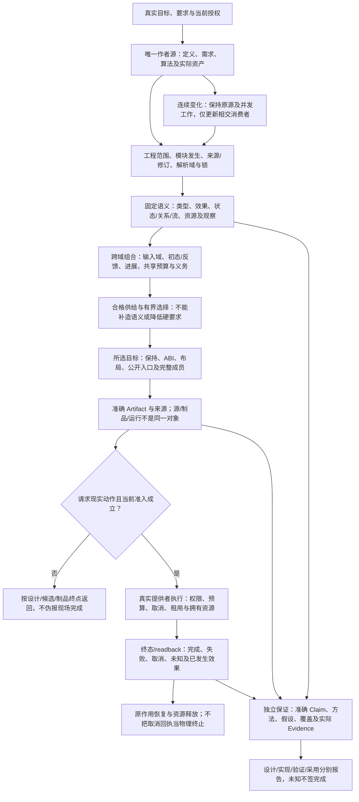

# 全体系能力与边界

> **阅读范围**：采用范围内的设计规范；实现状态另查未决。

**全工程主线：** 从[全部产品要求](产品要求与工作约束.md)、[成品总架构](../架构/协作与状态边界.md#whole-system-assembly)、[真实装配与作用域](../架构/装配/模块与运行实例.md#runtime-assembly-scopes)、[工程解析与编译闭包](../编译/内核/领域方法与整体根.md#whole-project-compilation)进入；[连续开发](../开发/用途与任务范围.md#whole-project-development)说明开发者实际改什么，源、目标、运行和恢复分别在哪里结束。按当前任务读取相交拥有者，不把一个范本当成全产品范围。

[Code-OSS 跨文件搜索、替换预览与应用](../../examples/原生维护/Code-OSS搜索替换.md)保留为大型原生 TS 工程校准：它具体检验源编辑、目标服务、模型/磁盘、取消及分项保存；其[专有接入前沿](../../examples/原生维护/Code-OSS搜索替换.md#implementation-frontier)不能代替全工程尚未闭合的设计、实现与采用义务。

Gift面向AI／脚本，提供语言无关的工程语义开发：小工具、文本与格式、文件媒体、业务规则、交互、自动化与复杂算法都在范围内。当前优先完整工具开发；中间件内部细节暂缓，已选接口和已经产生的责任保留。

通用能力的责任分开：核心拥有所有扩展共同服从的身份、引用、合同、权威、实现与目标接合、受控变更及恢复不变量；标准语义模块拥有按需使用的计算、对象、状态、关系、流、时间、数值等可独立复用含义；作者工程和库拥有具体业务对象、政策、流程、算法、资产与产品组合；Implementation、Provider和Target提供真实实现及其环境与资格；保证层按准确主体、方法、目标和用途评价Claim与Evidence。这些是已有责任的范围说明，不是新增五个运行阶段或必须安装的服务。

新业务默认先由普通作者定义与可复用库承接；只有现有构造不能保持真实区别时，才讨论专业语义扩展；只有系统级共同不变量确实缺失时，才修改核心。行业数量、常见程度、代码量和商业价值都不能跳过这个判定。研究和组合样本负责发现、反证与解释，不因随包保留就产生默认行业模型、Method、运行权限或支持资格；未使用的语义模块也不进入该作者工程的运行、目标或供给闭包。

源边界由[设计基线](../../.documentation/baseline.json)声明，准确字节身份从真实成员计算；交付包中的源清单按[身份域合同](../维护/文档身份与重组协议.md#documentation-identity-domains)生成与核验，不是作者额外维护的输入。边界与摘要都不签发规范采用或产品完成。本页维护完整能力范围，版本号和本轮修改经过不在能力正文重复维护。

## 成品从哪里读

[成品总体架构](../架构/协作与状态边界.md#supply-product-shape)先区分作者工程、成熟实现、Gift自身和目标产物；[物理接口与数据](../架构/装配/源绑定与解释映像.md#supply-physical-layout)给出实际文件职责、联合类型、调用与状态所有者；[编译主链](../编译/内核/编译值服务.md#supply-aware-compile)把它们接成可实施步骤。

当前采用一套作者/导入链接和多目标生成路径：产品以意图/Block定义、参数、管脚和要求表达，结构化JSON可直接编译；普通使用不展开已封装实现。所选计算文本、原生源和供给保留，缺新算法不强制创建镜像库或全局Host容器。自然语言用于创作并形成准确候选，固定构建不重新猜；图形画布可不实现，类型化连接的含义仍保留。

六工具和既定十个逻辑模块保持。普通本地任务不先建设数据库、消息、独立VM、人类编辑器或公共包市场；中间件细节暂缓不删除已有作用的恢复责任。当前有限语言与成熟工具怎样选择的完整理由见[D02](../决策/设计理由-目标与核心.md#d02-中立语义与可替换作者表示)。

## 产品主线与独立维护路径

新产品主线是准确表达工程目标和独特选择、组合可复用定义、取得合格实现并生成完整产物；见[跨软件需求关系及开发修改](../作者/组合/跨软件需求合同.md#cross-software-intent-contract)。[简洁计算写法与补全](../领域/计算基础/紧凑表示与程序范式.md#compact-author-contract)、TS/JS原文维护及生成后的受管回源是独立有效路径，不是新产品必须先完成的前置；该路径仍应保持简短来源和准确行为。用户目标语言与Gift自身实现语言分开裁决：[REQ002](产品要求与工作约束.md#req002)已采用 TS 与 Rust 目标计划，TS 端到端路径先行，具体后端支持按真实实现与符合性证据声明；C/C++可作为按需原生供给或互操作边界，Java暂缓。[目标语言路线](../演进/实施/主线前沿与准入.md#language-roadmap)决定用户成品能力，不改变公共语义。Gift自身compiler kernel的物理实现由[实现语言与机制演进](../架构/实现语言与机制演进.md#compiler-kernel-rust-substrate)独立拥有，不能从目标语言名单推断其实现语言。

[完整开发范本](../../examples/实现校准/简洁计算与TS往返.md#ts-roundtrip-product-example)展示直接源编辑、完整文件批次和受管目标回源；[操作协议](../开发/工具协议/六工具与请求.md#proposedraft与普通文本编辑的准确分工)是机器交接，不要求每次手填draft。[写回机制](../编译/表示/编辑与受管回源.md#managed-edit-roundtrip)定义数据和算法；[工具入口](../开发/工具协议/六工具与请求.md#generated-edit-request)定义准确输入与返回。Java条件例和已有源资料保留，但不代表当前必须交付Java。

各主题的规范正文与图源维护其声明的含义；正式机器合同和结构化作者源分别承担已声明的结构及作者责任，不因文件格式被降为插图。浏览器图册只在确有阅读用途时按[同源规则](../维护/图表与阅读派生.md#derived-reading-view)生成，可以是节选。没有新HTML不影响本包完整性，旧版HTML不随本包自动升级。

[跨软件完整范本](../../examples/连续开发/全工程连续开发.md#cross-software-author-example)覆盖名称映射、当前结果发布和逆关系维护，给出共同结构、领域算法与再次修改；[短源范本](../../examples/实现校准/简洁计算与TS往返.md#compact-author-example)单独检验类型和表示补全；[签名与阶段算法](../编译/内核/编译值服务.md#concise-author-elaboration)说明未写的信息怎样真实取得。已有函数值和普通fn共用编译器，不再要求作者手写推导类型、满注解转发和同义配置。

## 当前实现接合：需求关系、简洁作者与完整结果

[需求到具体计划](../编译/实现选择与设计搜索.md#executable-intent-plan)给出真实作者差异、方法前提和供给；[整批物化与重基](../作者/组合/结构编辑与身份保持.md#whole-change-materialization)保留并发的无关工作；[类型与效果封存](../编译/内核/编译值服务.md#callable-effect-closure)使省略签名的作者源获得正确调用资格；[按根义务](../运行/保证/要求证据与裁决.md#intent-root-obligation-closure)防止局部成功冒充完整需求。

[整体范本](../../examples/连续开发/全工程连续开发.md#integrated-graph-editor-example)把正反关系、当前结果发布、源码/资产修改和运行版本放在同一个工具内。原短源、函数值、精确编辑、成熟供给和TS回源继续成立，不要求新增文本语言、全图画布或需求数据库；已选 Rust 目标的实现责任独立保留，不成为本范本 TS 路径的前置。

## 分层图解与具体能力

### 全体系的对象、控制与完成边界

下图是机制入口图，箭头表示责任交接，不自动创建运行顺序或权限。每个节点的详细对象、算法、失败与资源路径由所链接正文的细图展开；规范已有图不表示实现已经取得。

作者与完整成品的独立细图从[结构化源的有限组合](../作者/结构化源码.md#有限组合与固定含义的细图)、[共享关系的闭合算法](../作者/共同语义关系.md#composition-obligation-flow)、[成品合同](../作者/成品/完整性合同.md#完整性判断与缺项返回)及[工作台动作](../作者/成品/工作台交互与共同状态.md#工作台对象与动作的分层控制)进入。运行、编译、装配、信息和维护的细图仍位于下述真正机制拥有者处，不能用本图替代其分支。

图解直接放在机制拥有者处：先看[系统边界与模块](../架构/协作与状态边界.md#fig-product-context)，再看[静态依赖与装配](../架构/装配/源绑定与解释映像.md#fig-package-dependencies)、[编译阶段](../编译/内核/输入与阶段总览.md#fig-compiler-data)、[作者与管脚](../作者/组合/结构编辑与身份保持.md#fig-pins-detail)、[完整计算与连续修改](../领域/计算基础/计算结构与算法.md#fig-computation-types)。各图给出目的、边和省略范围，不只画一个总览。

[对象构造与分派](../领域/对象与控制/对象构造与分派.md)、[本地流与事件时间](../领域/状态关系与流/背压与事件时间.md)、[自动微分与数值线性化](../领域/数值/自动微分与线性化.md)拥有对应有限完整设计。它们与已有状态、关系共享成品模块，不产生另一套开发平台。

## 开始一项任务

首次进入或恢复时，读取[AGENTS](../维护/设计任务规则.md)，实际取得[全部已知要求](产品要求与工作约束.md)及[根原则](原则总纲与归属.md)，按[装载与动作检查](../开发/AI协作/规则装载与任务恢复.md#任务启动的原则装载与动作检查)筛查范围。随后读取本任务的机制拥有者、接口与消费者；不是逐章顺序读完整包，也不是只读短入口就假设全部规则已经加载。

当前采用与未采用方案由[作者基线](../作者/可替换表示与适用范围.md#当前作者面实施基线与决策状态)及[D02](../决策/设计理由-目标与核心.md#d02-中立语义与可替换作者表示)唯一维护。用户目标不因技术提醒而改变；当前选择有新反例才重新裁决，不在每次编译重选整个产品方向。

## 按实际工作进入

| 本次要完成什么 | 从哪里取得完整规则 |
|---|---|
| 核查范围、约束冲突或恢复任务 | [要求正文](产品要求与工作约束.md) → [冲突裁决](原则总纲与归属.md#约束冲突的裁决顺序) → [装载协议](../开发/AI协作/规则装载与任务恢复.md#任务启动的原则装载与动作检查) |
| 理解成品怎样工作 | [总架构](../架构/协作与状态边界.md) → [模块与装配](../架构/装配/模块与运行实例.md) |
| 写定义、库与局部变化 | [语言](../作者/可替换表示与适用范围.md) → [结构编辑](../作者/组合/结构编辑与身份保持.md) → [封装与库](../作者/组合/模块封装与复用库.md) |
| 变量、循环、资源与局部运行 | [控制与寿命](../领域/对象与控制/控制流与存储寿命.md) → [即时运行](../开发/工具协议/构建运行接口.md#从候选直接运行的有限扩展) → [最小工程](../作者/工程源/清单模块与绑定锁.md#实际工作区及其默认所有权) |
| 设计完整的小工具或计算应用 | [计算工程](../领域/计算基础/计算结构与算法.md) → [开发操作](../开发/用途与任务范围.md) → [连续示例](../../examples/README.md#工程案例与分题正文) |
| 编译、选择目标及稳定输出 | [编译实现](../编译/内核/输入与阶段总览.md) → [目标组织](../编译/目标/成员布局与完整产物.md) → [公共接口](../开发/工具协议/六工具与请求.md) |
| 查询诊断、构建运行或写入 | [工具合同](../开发/工具协议/六工具与请求.md) → [实际准入](../运行/权限与资源管理.md) → [恢复](../运行/持久化提交与恢复.md) |
| 查当前欠账与下一份交付 | [问题主登记](../状态/前沿与登记规则.md#当前已定基线与实际支持边界) → [优先前沿](../演进/实施/主线前沿与准入.md#问题优先级与当前可推进前沿) |
| 修改规范并交付 | [文档规则](../维护/规格写作与完整性.md) → [交付检查](../维护/组织修改与来源保全.md#交付前的约束与正文检查) |

箭头是阅读的责任接合，不是自动执行链。选择预览不授权运行，写出计划不表示已实施。按实际输入补读其他相关章节；无关能力不变成全局前置。

## 完整责任目录

以下是保留的功能责任地图，拆分父入口仍指向各完整分题；当前全部物理文件和新信息规范见[全库导航](../内容索引.md)。下表说明各原责任的工作，避免仅看相近标题猜归属。REQ拥有用户要求，原则拥有跨域约束，领域拥有机制，D拥有理由，U拥有剩余；来源和报告不能反向定义另一套接口。

全部当前正文及内容责任见[内容索引](../内容索引.md)。REQ拥有实际用户要求，原则拥有跨域约束，领域正文拥有机制，D拥有选择理由，U拥有真实剩余；来源和报告不反向定义接口。

## 支持与未完成状态

正文中的当前设计、接口、语法和算法具有确定的范围；实现、运行符合性、实际采用与收益须有相应依据。有限对象、流和AD已有具体设计；更广动态对象、分布式时间、硬实时目标及其他微分数学的剩余由U主登记维护，当前不采用的SDK不变成待清零的实施任务。

规则已经写入不等于所有客户端自动读取；读取完成不等于所有语义已经证明；检查结果只支持实际对象与方法。设计任务能够直接改文档与复核，不能以“要验证”为由自行扩成产品实现。需要真实执行的任务另按授权处理。

## 全体系信息的责任入口

[总体结构](../信息/全体系信息结构.md)区分作者真源、身份选择、查询投影与目的性保留；[类别路由](../信息/信息类别与生命周期路由.md)承接源码、规范、来源、决定、证据、数据、运行、协作与退出。[对象/配置](../信息/对象关系与配置基线.md)、[接入/检索](../信息/接入检索与派生.md)、[保留/恢复](../信息/存储保留与恢复.md)分别拥有具体协议；[文档重组](../维护/文档身份与重组协议.md)负责实际可核移动。这些规范不替换本篇已保留的产品路线、核心模块或领域设计。
