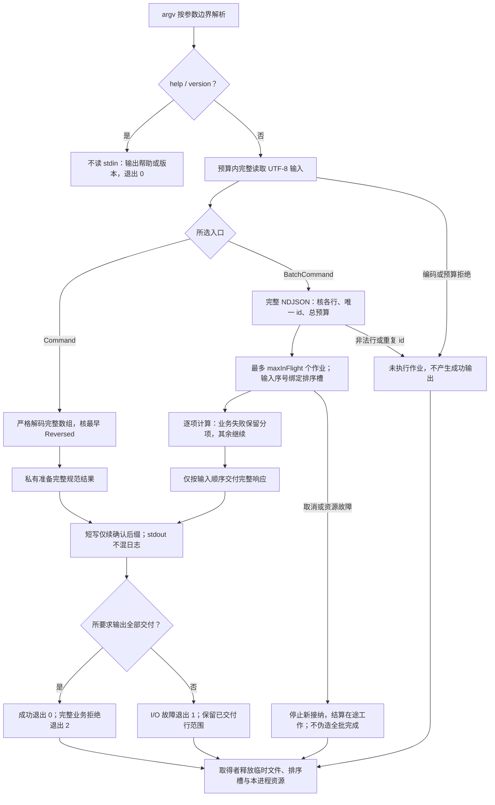

# 命令与批处理程序

Command是一次完整stdin变换；BatchCommand是多个具身份的独立作业。两者不能用同一退出0概括不同的完成范围。原单命令合同与编码见[Command](../../../examples/成品形态/规则合同.md#32-command)。

## Command：一个输入，一个完整结果

作者无需写stdio实现。根采用原Canonical/MergeTouching和原Command：UTF-8单一数组，Dec端点，完整解码后检查最早Reversed，成功stdout一个完整规范数组加LF。错误时成功输出为空，输入/业务错误退出2，I/O/资源故障退出1；取消按实际宿主映射非零取消，不编造跨平台相同信号码。

帮助`--help`和版本`--version`不读取stdin、不执行算法，输出对应文本并退出0；其他未知参数退出2。运行无参数读取stdin，不暗读cwd文件。无TTY也不提示等待确认。stdout用于机器结果，stderr用于有界错误或明确选择的进度；不向stdout混入彩色日志。没有新增配置文件或daemon。

先把完整结果准备到私有结果范围，再发送；流/文件短写只续已确认后缀。管道断开为传输未完成，不能因计算成功仍退出0；临时文件使用获准位置与最小权限，清理由取得者负责。输出到用户文件必须经过所选发布原子性，不把stdout合同当磁盘事务。

产物为可启动入口、实际共同算法、编码器和必要依赖、平台入口及帮助。只交脚本名不算完成。新增shell包装须保持argv边界，文件名中的分号和空格不是命令；宿主解释固定在目标画像中。

## BatchCommand：确定作业顺序与分项结果

原意图是一次处理NDJSON作业，每行一个`{id:Text,items:WireIntervals}`。作者`maxInFlight`默认4且>0；输出顺序固定为**输入作业顺序**，并发度不是修改结果顺序的权利。行号从1开始；文件末尾可以没有LF，空行非法，CRLF按行终止解释不进入JSON内容。

本例采取有限批次：先完整读取与校验所有行、唯一id和资源预算，再执行任何作业。任一语法/重复id错误，返回退出2且无作业输出；这不是无限输入流。结构有效后，某作业Reversed写`{id,ok:false,error}`，其他作业继续；成功写`{id,ok:true,value}`。只要出现业务错误，全部响应交付后退出2；全部成功退出0。

运算或传输故障为退出1；取消按宿主返回取消。可能已有响应写出时，保留准确已交付行范围，不输出一个伪造“全批已完成”尾行。内部排序槽保存未发布结果，预算包含输入、在途工作、乱序槽和输出；过大批在开始前拒绝或采用已声明有界spool，不能无限缓存。

幂等ID仅关联本次进程，不授权复用另一次运行的结果。失败后重跑默认由调用者选择未完成job集合；若将来作业变成收费或写入，原pure重算依据消失，必须增加实际操作去重与查回，不能延用本合同。

## 正常、失败与再次变化

范本输入两行a、b，b先完成仍先写a；a业务失败则输出a错误后输出b结果；a运算不终止在预算截止后准确结束，不能跳过a却沿用有序完整标签。所有分支共享Canonical但每job具有独立输入与结果身份。

把输出改成到达顺序属于公开协议变化，需换确定定义并检查消费者；仅maxInFlight从4到8不改变输出。把批次改成无限流属于[持续流](查询批数据与持续流.md)的不同作用域，不由更大的stdin预算解决。保留输入文件、断连、全负端点、重复id、长行、取消和有界乱序测试设计，不能以几个命令成功退出代签整个协议。

## 输入、排序槽与输出终点

两种入口的完成边界都包含实际传输，不能只看算法返回。

## 本页规则字段与源码对应

| Rule | 其他必需字段／类型 | 完整作者根 |
|---|---|---|
| Command | operation:Operation（与Canonical相同主体） | [Command](../../../examples/开发成品/model/applications.json) |
| BatchCommand | operation:Operation（与Canonical相同主体）；maxInFlight:Int | [BatchCommand](../../../examples/开发成品/model/applications.json) |
