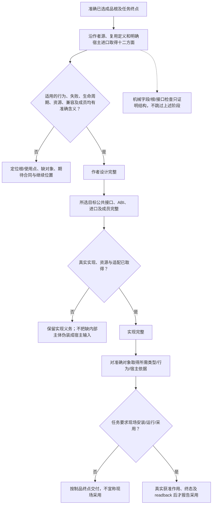

# 成品设计完整性合同

本篇定义本目录中一个**已选成品形态何时已经设计完整**。它不是要求产品作者填写的清单，也不是第三份作者源；作者仍只维护实际意图、参数和独特差额。这里约束的是语义解释、供给、目标生成和验收：任何成品若缺少其适用的公开边界、状态、失败、资源或成员，就只能保存为准确的未完成设计，不能因为已有名称、JSON根或接口草图而标成完整。

## 1. 完整设计必须闭合的十二个方面

对一个具体成品，以下方面必须由当前作者源、复用定义、目标合同或明确宿主进口共同确定；不适用可以明确为“不适用”，不能用省略表示“随便”：

1. **意图与主体**：它要完成什么，约束哪个准确主体，哪些选择已固定、继承或仍委派。
2. **公共消费边界**：消费者通过什么入口、消息、文件、值或安装动作取得结果；同步/异步、一次性/持续必须明确。
3. **输入与表示**：类型、单位、编码、顺序、重数、身份、快照及不可信输入的解码边界。
4. **正常行为与进展**：合法输入产生什么结果，何时必须完成，何时允许等待、分批或持续运行。
5. **实例与生命周期**：创建、就绪、活动、关闭、卸载、重启以及运行实例与定义的身份关系。
6. **失败、取消与恢复**：业务拒绝、协议错误、资源故障、取消、未知效果和可重试条件分别怎样表示。
7. **并发、顺序与一致性**：可并行范围、顺序保证、共享主体、竞态、幂等、背压或事务边界。
8. **资源与权限**：所有权、借用、释放、预算、秘密、文件/网络/设备能力和真实授权位置。
9. **宿主进口与隔离**：哪些依赖由成品内部闭合，哪些由消费环境提供；不可信代码需要什么物理隔离。
10. **目标成员与公开符号**：最小完整产物包含哪些代码、类型、资源、清单、配置及公开入口；不能以空目录或声明文件代替实现。
11. **兼容、升级与再次修改**：参数、公开接口、实现、数据和运行实例变化时哪些消费者失效，是否需要迁移或新实例。
12. **验收与证据**：什么可以静态判断，什么必须运行、测量、形式检查或在真实宿主验证；设计稿不能自签运行成绩。

这些方面可以由一个小文件共同承担，也可以跨定义、宿主和目标规范分担。完整性要求的是**信息闭合**，不是固定文件数或固定模板。

## 完整性判断与缺项返回

## 2. 四种完成状态不能合并

- **作者设计完整**：上述适用方面已经有准确含义，没有需要实现者猜业务决定的空洞。
- **目标合同完整**：所选目标语言/平台的公开接口、进口、成员和生命周期可以据以实现。
- **实现完整**：真实代码、库、资源和适配已经取得，所有必需根可以形成制品。
- **验证/采用成立**：针对准确实现和环境取得相应证据，实际安装/运行/采用另有真实事实。

因此，规格包可以作者设计完整而没有运行实现；CLI只有`.d.ts`不能称实现完整；已经构建的固件没有真实板卡和时限依据不能称目标采用成立。

## 3. 成品的准确入口与公开边界

各形态的作者根与详细合同由[成品入口](README.md)定位。作者根位于`examples/开发成品/`，按`example:deliverable:applications`模块及同名公开导出取得；模块内部定义保留独立主体作用域。公共消费接口见[目标接口](../../../examples/开发成品/公开边界.d.ts)，它不构成作者必须填写的第二份源码，也不证明相应实现已取得。

## 4. 目标接口的失败表示统一原则

目标接口应使调用者能够区分“合法空结果”和“没有取得结果”。可预期的业务拒绝、协议拒绝、取消、资源或宿主故障使用明确的结果联合；不能仅以空数组、空diagnostics或Promise完成代替。真正违反宿主编程合同的不可恢复异常仍可由目标语言的异常机制处理，但不能成为普通运行失败的唯一通路。

异步接口的Promise只表示**结果将在以后取得**，不意味着其解析时所有外部效果、保存、排空或设备工作都已完成；具体终点由各形态合同定义。操作型接口使用稳定操作身份和可查回状态，不用重复调用产生副作用来“查询”结果。

## 5. 成品结构的机械门槛

对本篇已选的36个成品范本，当前文档核验器必须拒绝以下结构缺口：

- `definitions.json`导出了一个成品定义，却没有工程清单已登记模块中的对应公开作者根；
- 作者根的公开出口不能解析到实际复合定义，或没有通过真实导入绑定`use`同名完整定义；
- `contracts/spec.json`缺少该成品规则，或规则正文来源/标题已经过期；
- `公开边界.d.ts`缺少同名公共命名空间；
- 工程清单没有登记作者模块；
- 运行型成品只有类型名称而没有任何消费入口；
- 规则目录中的字段集合与复合定义实际给出的字段集合不一致。

这些检查只能防止“有名字、没合同”的结构缺口，不能证明行为实现正确。公开主体及角色路径解析、字段类型与值的相容性、效果、目标、运行和证据仍由对应Gift语义与实现检查完成；字段名称集合相等不签发这些资格。

这些文件名、同名命名空间和固定根只约束本例的准确设计源，不是任意用户工程的产品分类或作者入口。其他合法交付按自身公开定义、目标成员、声明进口、真实依赖及所求证据闭合，不为满足本例机械检查另造 `model/applications.json`、同名TypeScript命名空间或全部36个根。库、交互、设备和迁移可以在同一交付中组合；名称本身不能隐式激活运行时、网络、数据库或发布服务。相交合同已经合法且可消费时不强加模板，不撤销本例真实消费者所需的结构校验。
