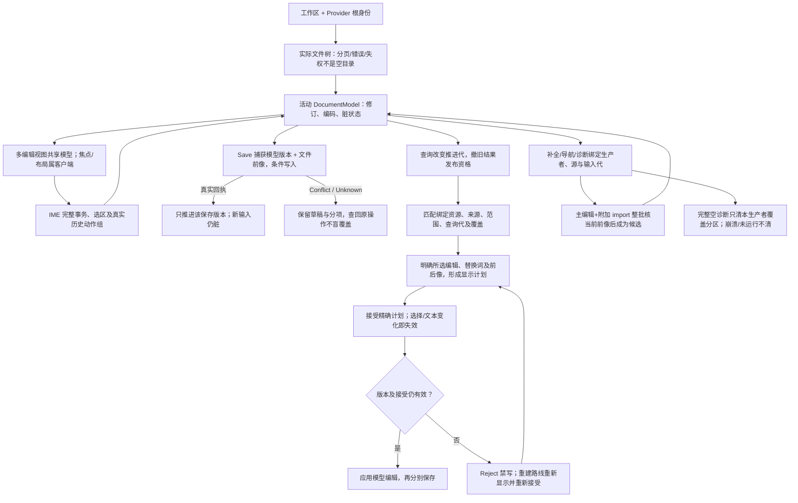
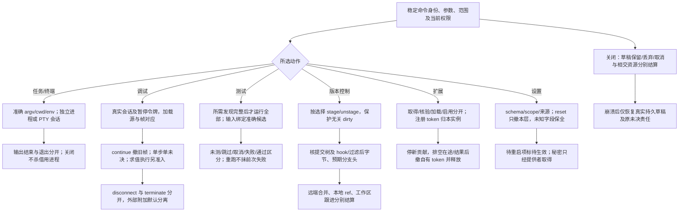

# 工作台的界面、动作与共同状态

本篇分别说明两个工作台主体的交互合同：Gift人类开发客户端，以及被Gift描述和生成的Studio示例成品。两者可以复用成熟宿主能力，但不是同一个产品或运行实例。[最终Gift Workbench布局](#final-workbench-layout)至Local/WSL/SSH/Container/Web放置规定Gift客户端；[启动、布局与对象身份](#启动布局与对象身份)及其后各节细化Studio的experience.Layout、experience.Commands、状态与功能联动。Studio作者继续维护[现有Studio JSON](../../../examples/结构化工作台/model/studio.json)及其复用模块；客户端采用扩展不自动证明Studio已具备独立桌面成品能力。有限面板也不代表完整IDE，Gift的脚本/AI入口不以GUI为前置。

<a id="final-workbench-layout"></a>
## 最终 Gift Workbench 的具体信息架构与界面布局

Gift开发客户端的人类主面采用[Code-OSS / VS Code Extension-first 客户端](../../开发/编辑审查与客户端.md#human-workbench-product-selection)。下面固定的是Gift独有信息如何落到宿主；Explorer、文本Editor、Problems、Terminal、Testing、Run/Debug、SCM等成熟能力直接复用宿主，不再平行重画。

<a id="six-development-surfaces"></a>
### 六个开发任务面与现有视图的归属

Workbench中的view很多，但开发任务只按六类组织：**Understand / Author / Change / Verify / Operate / Deliver**。这是[完整开发者心智模型](../需求关系与能力边界.md#developer-mental-model)的任务轴；具体view可以跨面复用，不增加新的Engineering authority。

| 现有UI/能力 | 主归属开发面 |
|---|---|
| Project、Search、Graph、Inspect、Explain、Impact、Provenance、Needs定位 | **Understand** |
| 结构表单/作者Graph、Definition/Profile、Requirement、原生作者源/资产编辑入口 | **Author** |
| Text/structured edit、Refactor、All Decisions、Implementation、Control/Target/Native/Config修改 | **Change** |
| Plan/Review、Diff、Diagnostics、Tests、Coverage、Evidence、Compatibility检查 | **Verify** |
| Generate/Build/Run/Debug/Profile、Terminal/REPL/Console、运行参数和readback | **Operate** |
| Save/Apply、SCM、CI handoff、Package/Release/Publish/Deploy/Migrate/Retire | **Deliver** |

Primary Side Bar固定使用`Project / Needs / Decisions / Review / Operations`五个Gift语义视图，不为了六面机械做六个图标。`Project`同时服务Understand/Author；`Decisions`承载Change中的All Decisions与实现选择；`Review`承载Verify并按需展开Impact/Evidence；`Operations`承载Operate以及发布/部署等Deliver效果的真实状态。Deliver中的Git工作树/暂存/提交/分支继续复用宿主SCM，不再造第二个Gift版本控制面。任务分类与导航布局是两件事。

Recovery/Resume横跨六面；Assistant横跨六面；Graph/Text/Table/Artifact只是表示；Explorer/Search/SCM/Terminal/Testing是宿主工具。用户切换这些组件不会切换工程authority或产生新的作者源。

### 一屏的稳定区域

```text
┌ Activity Bar ┬ Primary Side Bar ┬──────── Editor Groups ────────┬ Secondary Side Bar ┐
│ Explorer     │ Gift Project       │ source / diff / plan          │ Inspector          │
│ Search       │ Needs             │ graph / table / artifact      │ Context / Controls │
│ SCM          │ Decisions         │ review / evidence details     │ Source / Evidence  │
│ Run/Debug    │ Review            │                                │                    │
│ Gift          │ Operations        │                                │                    │
├──────────────┴────────────────────┴────────────────────────────────┴────────────────────┤
│ Panel: Problems | Tests | Terminal | Output | Gift Evidence | Gift Operations          │
├────────────────────────────────────────────────────────────────────────────────────────┤
│ Status Bar: workspace/candidate · target · needs · checks · operation/recovery         │
└────────────────────────────────────────────────────────────────────────────────────────┘
```

Gift不替换宿主Explorer/Search/SCM/Run视图；Activity Bar中的`Gift`容器只放工程语义视图。用户可以移动/隐藏这些view，布局变化不改变任何Engineering revision。

### Gift Primary Side Bar：五个视图

| View | 默认内容 | 正常动作 |
|---|---|---|
| **Project** | output roots、Definition/Block、公开Port、状态/关系/领域结构、Target；按真实hierarchy和bounded slice懒展开 | reveal source、open inspector、open graph、create/retire等仅在已有Operation支持时出现 |
| **Needs** | missing input、ambiguous、unsupported、conflict、stale、permission/resource blocker；按是否阻断当前requested出口分组 | 回到真实owner填写最小输入、选择候选、打开诊断；不能“一键全部默认” |
| **Decisions** | All Decisions高频切片：当前Meaning/Requirement/Control、UseBinding/Supply、Auto/Pin状态、备选及被排除原因、Target/Native/Build/Runtime policy | Edit owner、Require/Prefer/Pin/Forbid/Auto/Reset、compare；派生Binding只读 |
| **Review** | 当前Candidate的Plan、source/semantic/Binding/Artifact Delta、Impact、required Verification、Evidence与compatibility | accept/reject/partial accept、跳consumer、展开witness、选择检查；unknown不能显示成0 |
| **Operations** | build/run/apply/publish/debug等Operation的accepted/running/paused/unsettled/recovery-required/terminal | status/cancel/resume/recover/open receipt；不以关闭view取消Operation |

树节点至少带稳定显示标签、类型/角色、可披露状态和canonical ref/revision的内部绑定。UI id、树顺序和显示名不是canonical identity；重命名后selection通过真实identity继续定位。

### Secondary Side Bar：Inspector 是所有对象的统一下钻，不是万能属性表

Inspector固定按以下组渐进显示；无相交内容的组不渲染空卡片：

1. **Summary**：显示名、对象角色、stable identity/revision、owner、当前source/projection freshness、主要diagnostic。
2. **Contract**：输入/输出、类型、效果、资源/生命周期、公开Requirement与可观察失败；只展示当前对象实际拥有的维度。
3. **Controls**：每个相交控制用 `Requested → Effective → Planned → Applied → Observed` 五列或折叠轨迹显示，并附source、scope、phase、strength、override/conflict和Evidence。
4. **Implementation**：选中Supply/Method、版本、Target资格、依赖/许可/成本事实、为什么入选；自动选择显示`Auto`但仍能展开真实决定。
5. **Targets**：各被请求输出根的mapping、artifact/source members、unsupported/unknown、生成/构建/运行状态；不把一根成功染绿全部。
6. **Evidence**：Claim、Verification、coverage、环境、fresh/stale/unknown；绿色只对应该Claim与scope。
7. **Provenance / History**：author source、binding、generator、artifact、operation与actual readback链；历史只是过去事实，不变当前有效值。

Inspector编辑控件只在一个真实owner可唯一定位且当前Operation/author edit已定义时启用。点击一个值的“edit”首先显示它将修改哪份Requirement/Control/原生配置/作者源；派生值、Observed值和无唯一回源的生成值只读。Reset含义固定为撤销**本层覆盖**并立即预览新的Effective来源，不写`null`冒充通用默认。

控制值的来源用文本+图标双编码：`Explicit`、`Inherited`、`Derived`、`Selected`、`Target-required`、`Default(owner)`、`Unknown`。颜色只辅助，不作为唯一信息。鼠标悬停/键盘聚焦均能看到来源和作用域。

<a id="workbench-all-decisions"></a>
### All Decisions：完整开发设定浏览器，而不是另一个settings.json

用户要求“把这个项目所有可控制的东西给我看出来”时，打开 **All Decisions**。它消费[完整开发设定面](../需求关系与能力边界.md#developer-decision-surface)，把不同真实owner投影成一个可搜索表格/树；它没有独立保存权。

All Decisions采用**faceted view**：按真实决定维度、主体及owner取得完整列表，导航facet可选，筛选器分别对应四轴和状态。

以下六组提供一种默认导航聚类，客户端可按实际用途选择；无facet的Decision仍可完整发现：

```text
Product Semantics
Reliability & Rights
Realization
Runtime & Operations
Assurance & Evolution
Automation & Presentation
```

这份有限浏览目录把34项参考主题映到六组：

| 导航聚类 | family（当前） | 数量 |
|---|---|---:|
| **Product Semantics** | 工程身份与组织；数据形状与身份；信息来源/质量/谱系；数值与单位；文本/字节/名称；集合/关系/查询；行为与合同；状态/事件/工作流；时间/随机/自适应；公开接口与协议；产品交互/无障碍/本地化 | 11 |
| **Reliability & Rights** | 持久化与一致性；任务/异步/流/并发；资源/所有权/寿命；故障/重试/韧性；Safety/危害/风险；安全/权限/隐私/地域；治理/许可/合规 | 7 |
| **Realization** | 实现供给与算法；目标语言与平台；物理表示/布局/ABI；构建与工具链；依赖与供应链；打包/签名/发布/分发；配置/资产/环境 | 7 |
| **Runtime & Operations** | 运行与部署；分布式放置与协调；性能/容量/成本；可观测性与运维 | 4 |
| **Assurance & Evolution** | Verification/Assurance；演进/兼容/退役；开发维护政策 | 3 |
| **Automation & Presentation** | AI与自动化治理；Workbench个人/团队展示 | 2 |
| **总计** | 此视图每个参考主题列一次；Decision可带0..N个facet且按A/B/C/D轴交叉筛选 | **34** |

这些分组消费[可选浏览目录](../需求关系与能力边界.md#decision-family-and-domain-facet)，没有中央family注册前置，也不改变Decision的语义身份、owner或写权。侧边/顶部筛选分别是：

- **Decision class (A轴)**：Meaning / Requirement / Realization Control / Runtime Input / Presentation Preference；
- **Authority (B轴)**：Author / External / Compiler-Resolver / Runtime-Execution / Assurance / Client；
- **Phase (C轴)**：Declared-Requested / Effective / Planned-Resolved / Applied / Observed；
- **Setting scope (D轴)**：Author-Compile / Runtime / Client及其精确节点；外部authority/Evidence coverage按自己的范围显示，不伪装成D轴继承；
- **Source/representation**：structured author / native source-config / derived / external / runtime / client；
- **State**：current / unknown / unsupported / conflict / stale / forbidden；
- **Domain/Mechanism facet**：空间几何、传感校准、媒体、学习系统等由领域owner派生的专业标签；
- **Target/Product/owner revision**等普通查询条件。

`Native-owned`是authority/source过滤结果；`Unknown`是state；Verification的判据回真实Assurance责任。导航聚类不合并性能要求与证明义务，不改变这些正交含义。

每一行显示相交列：`Decision · Facets? · Subject · Scope · Authority · Declared/Requested · Effective · Source · Planned/Binding · Applied location · Observed · Evidence/Claim · Impact · Actions`。列在该decision不适用时为空，不伪造`N/A`值参与比较。

**默认不是把几千项全展开。** 首页只显示Explicit/Needs/Conflict/Stale和影响当前选中Product的高层Meaning；`Show inherited`、`Show physical`、`Show native`、`Show all applicable`逐层展开。搜索`overflow`、`allocator`、`encoding`、`transaction isolation`、`panic`、`region`等应直接定位真实语义/Control/native config，即使它不在默认卡片里。

对一行允许的动作由owner决定：Meaning进入作者编辑；Requirement提供Require/修改；Control提供Require/Prefer/Pin/Forbid/Auto/Reset中descriptor允许的子集；Native-owned跳原文件/字段；Runtime要求进入运行配置或Secret provider；Presentation只改客户端。Resolved/Observed值默认只读，并提供`Why`和`Change owner`导航。

`Pin`、`Forbid`和`Auto`严格沿[控制UX语义](../组合/稀疏控制与目标限定.md#developer-control-ux)降低，不能由前端直接修改Binding lock。批量修改必须先形成一个candidate/Plan，并显示共享hard requirement、scope expansion、target差异和会失效的Evidence；“Apply all defaults”不是合法快捷键。

### Progressive disclosure 在界面中的四档，不是四份配置

| 档位 | 默认面向 | 显示内容 | 仍可下钻 |
|---|---|---|---|
| **Essential** | 普通业务作者 | 独特Meaning、Needs、公开接口、显式Requirement/Profile | 所有隐藏决定都有来源；不自动固定实现 |
| **Engineering** | 需要精确行为/状态/资源的作者 | 数值、文本、集合、状态、时间、资源、事务、安全、接口等相交工程语义 | 目标/ABI/build仍可Auto |
| **Implementation** | 架构/性能/目标工程 | Supply、provider/algorithm、target、dependencies、storage/runtime策略、成本/资格 | 可继续到Physical |
| **Physical** | FFI/嵌入式/极致性能/原生互操作 | representation、ABI/layout、compiler/build flags、allocator、memory order、native config、runtime topology | 原生无法中立表达的内容仍可Go to native owner |

切换档位只改变可见性，不改变有效值。某个工程可以一直停在Essential并得到确定产物；另一个工程可以只对一个FFI边界展开Physical，而不是全项目切到“专家模式”。

**四档不是34个设定家族的固定分区。** 同一家族可以出现不同深度：`numeric.exact/range/unit`通常是Engineering，`runtime representation/bit width/vector ISA`是Implementation/Physical；`security.data-locality`可能是Essential/Engineering Requirement，某sandbox provider或OS capability则是Implementation/Physical。客户端按Decision本身的Meaning/Requirement/Control/owner和当前任务计算默认深度，不因family名字把重要硬Requirement藏进Advanced。

默认深度判据为：

- **Essential**：当前Product对外含义、公开边界、作者显式Requirement/Profile、Needs，以及如果隐藏就会让用户误解“软件是什么/能否交付”的决定；
- **Engineering**：仍与具体实现方法无关、但影响正确性/状态/资源/时间/安全/一致性/兼容/验收的工程合同；
- **Implementation**：满足前两层后，对Supply/Provider/algorithm/target/runtime/dependency/deployment strategy等实现自由的决定；
- **Physical**：目标语言/ABI/layout/toolchain/ISA/allocator/memory-order/native-config等物理实现细节。

一个Decision只显示在其最低必要深度及更深视图；硬冲突/Need无论原深度如何都提升到当前任务可见位置。`Show physical`不会自动Pin任何物理值，`Hide physical`也不会删除已存在的Pin。

### Editor Group 中 Gift 只增加四种专用Editor

| Editor | 用途 | 写入能力 |
|---|---|---|
| **Plan / Review** | semantic delta、source diff、Binding delta、Impact、required Verification在同一candidate基础上联审 | accept/partial accept只生成已有candidate/Operation；不直接写文件 |
| **Graph** | bounded Definition/Block/Port、state/relationship、dependency/Impact/Explain图 | [逐kind资格](#graph-mutation-readiness)满足前只读；满足后只开放已覆盖的registered typed Operation |
| **Structured Form/Table** | 对有限结构、Requirement、Control或领域表提供更高密度编辑 | 每项编辑必须回真实owner并产生同一Plan |
| **Artifact / Explain** | generated source、artifact members、source map、decision/provenance explanation | 默认只读；需要修改时Go to owner或走generated-edit合同 |

普通源码永远优先打开宿主text editor；源码diff使用原生diff editor，不在Webview复制文本编辑器。任何专用Editor删除/崩溃后都能从canonical state重建。

<a id="workbench-plan-review"></a>
### Plan / Review：一次变化必须在一个屏幕里回答五件事

顶部固定显示candidate/base和当前requested出口。主体按真实变化动态出现：

```text
What changed?        Authoring / Semantic / Binding / Artifact Delta
Why?                 Requirement + source + selected decision
Who is affected?     Impact definite / possible / unknown + witnesses
What must pass?      Required Verification + current Evidence
What can happen?     Apply/Build/Run/Publish effects + authorization state
```

文本diff仍由原生diff editor打开；Plan视图负责把多个物理diff归为semantic change group。部分接受只对真实独立change group启用；共享不变量或相交write set必须一起接受。`Accept`表示接受候选语义变化，不等于Apply/Save/Commit/Publish；具有外部效果的按钮使用具体动词，如`Apply to workspace`、`Build`、`Run`、`Publish`，禁止一个万能“Continue”。

未知/阻塞不统一染成error：Needs Input、Unsupported、Forbidden、Stale、Conflict、Evidence Missing、Operation Unsettled分别显示，并给一个最窄合法NextAction。不可自动恢复时不出现“Retry”按钮。

<a id="workbench-ai-assistant"></a>
### Gift Assistant：AI 是同一工程面的自然语言客户端

由于Code-OSS源码发行不应依赖Microsoft专有聊天产品，Gift提供自己的可选 **Assistant view**。它可以使用WebviewView承载对话，但消息模型仍只是客户端：

- 输入默认绑定当前workspace、selection和用户明确附加的context；不自动读取全部工程、秘密、终端历史或其他窗口；
- 每次回答区分Explanation、Proposal、Needs Input、Operation Request；普通文本不能成为作用授权；
- Proposal卡片必须链接到真实candidate/planRef并能打开Plan/Review；“应用”仍走同一Operation/author edit，不从LLM返回的diff直接写盘；
- 模型建议的库/配置/数字只作为candidate，未被Requirement/Control接受前不进入稳定作者源；
- provider/model、联网/数据披露范围、当前context摘要和token/预算状态可见；secret从不进入transcript；
- transcript默认属于客户端历史，不是canonical工程源；用户明确提炼出的Requirement/decision才写回真实owner；
- 固定重建、正常编译、实现选择与Verification不依赖再次调用LLM。

Assistant view在没有AI Provider时完全可缺席；CLI、结构源和Workbench其他能力仍完整。AI断线不使已接受的candidate/Operation丢失。

<a id="workbench-graph-ux"></a>
### Graph：视觉连接是 typed proposal，不是画线即成功

图默认围绕当前对象生成bounded slice，顶部可切换 `Structure / State / Dependency / Impact / Evidence` projection。默认不提供“全工程一次画完”；用户可按N-hop、root、scenario、relation kind扩大，未加载frontier始终可见。

节点显示stable label + role +最少关键状态；Port同时显示方向、type/contract和multiplicity/生命周期等相交区别。连接状态采用形状+文字而非只靠颜色：

- solid/direct：现有直接兼容binding；
- adapter：需要已知adapter candidate；
- dashed/unresolved：未知或缺实现；
- blocked：明确不兼容/禁止。

拖线只形成 `ConnectPorts` proposal。松开时先做Port/Contract compatibility：direct则产生Plan；需要adapter则展示候选及新增依赖/代价，用户接受后由Implementation Resolution选择；ambiguous/unknown保持Needs；incompatible零写入。Canvas不得静默插入转换代码。

<a id="graph-mutation-readiness"></a>
#### 图形修改按Operation kind取得资格

GraphMutationReadiness是原capability/Assurance owner求出的可撤销派生资格，不绑定历史问题号、客户端偏好或全局解锁。每个kind在同一实现修订和实际Provider组合上分别核验：投影具有可安全回源的准确身份/修订；手势只降低为原owner注册的typed Operation及前像/写集/失败；同一basis在Graph与headless路径产生同义候选；Apply沿原Plan/权限/CAS/事务恢复和readback；来源、Binding/descriptor、Operation注册及相交能力变化能使旧提案失效；真实Evidence覆盖该kind的成功、非法/陈旧拒绝、readback/恢复、owner写回边界与客户端同义且无旁路。

资格键绑定kind、implementationRevision及providerSet。providerSet是实际修改路径消费的无序规范集合，每个成员固定稳定Provider身份与资格相关修订；UI排序、无关Provider或纯展示扩展变化不产生新键，相交能力变化则重新核验。Workbench只能查询并缓存带前像的投影，不能保存一个永久已解锁标记。任一条件Unknown/failed只撤销相交修改；Explain/Impact等合格只读投影仍可用。Connect/Disconnect是首批可申请的kind，也须逐项取得资格；Create/Retire及其他kind需其自身义务与端到端证据，设计存在不代表真实可写。

Disconnect必须固定准确关系identity与source/projection revision；仅有两端点、显示线或同名关系不够。关系不存在、多重关系无法唯一定位、来源陈旧或owner缺失时零写入并保留Needs/Conflict。断开只移除该关系，潜在孤儿adapter、库、共享Definition、生成成员或资源进入Impact/cleanup候选；只有各自Retire/Remove Operation另获资格及消费者归零依据才可退役，不能由拖线扩成隐式级联删除。重连/崩溃按原operationRef查回，不重放鼠标手势。

图的webview参考实现采用React视图；node/port交互优先 `@xyflow/react`，自动layout优先 `elkjs`。两者只负责显示、交互和建议位置：node id由canonical ref投影，layout结果进入presentation state，不进入Engineering semantic hash；删除全部layout必须能重新生成相同语义图。具体依赖版本在实施时锁定并通过许可/安全/包供应链准入。

<a id="workbench-client-state"></a>
### 客户端状态、共享布局与恢复

默认本地持久项只有：窗口/view布局、最近选择、过滤器、graph viewport/layout、折叠状态、最近查询；它们由Extension workspace-local state保存，删除不会丢工程含义。团队需要共享某个diagram布局时，必须显式导出为**presentation artifact**，与canonical author source分开；它可以引用stable IDs但不能拥有它们，也不进入正常编译/Verification输入。

未保存文本仍由宿主document model/backup承担；Gift candidate、Operation、Evidence和恢复责任按各自owner持久化。重启后先恢复宿主文件/缓冲，再用当前source revisions重新建立projection；旧Inspector/Graph cache只可显示stale，不能在latest上继续写。

<a id="workbench-scale-and-accessibility"></a>
### 大工程、响应性与无障碍

所有Tree/Graph/Table默认懒加载、分页或虚拟化；列表不得为显示数量而预先解析全仓。UI线程不运行编译、测试、图全局布局或大Impact闭包；长工作进入Runtime/worker并返回进度与取消语义。100k+对象的workspace也只渲染当前bounded slice，搜索结果显示coverage与截断。

键盘和Command Palette拥有每个核心动作的稳定命令身份；Gift不默认抢占大量全局快捷键。首版只给少量无冲突的宿主惯例入口，其余由用户keybinding映射。所有自定义view必须支持键盘导航、ARIA/屏幕阅读、200%缩放、非颜色状态、焦点恢复和reduced-motion；graph的每个可写动作同时提供列表/命令等价入口，不能要求鼠标拖线才能开发。

<a id="workbench-first-use"></a>
### 首次打开、空状态与Brownfield入口

安装Extension后**不自动改工程、不创建`.gift`/JSON、不安装依赖、不启动项目脚本**。打开窗口时Gift状态只有客户端是否可用；第一次点Gift Activity Bar或执行Gift命令才懒连接Runtime并做安全捕获。根据当前workspace得到三个明确入口：

| 当前事实 | 默认界面 | 用户可做什么 |
|---|---|---|
| 空窗口/无根 | Start Center | `Open Folder/Workspace`、创建纯内存新产品草稿；未选择物理根前不写磁盘 |
| Brownfield已有工程但无Gift作者根 | `Existing project · not adopted` | 只读捕获/Explain/Impact；`Create authoring root`是单独Proposal，预览将新增哪些文件后才Apply |
| 已有结构作者/绑定 | Project + 当前Needs/Target摘要 | 直接编辑真实owner、生成/检查/运行；不再显示“初始化向导”挡住正常工作 |

若workspace处于Restricted Mode，Start Center明确显示“可浏览/可静态分析”和“因trust受阻的执行能力”；不能用一个红色错误把工程伪装成无法打开。若上次有unsettled Operation，只在Operations中显示Recovery Required，并保持正常独立编辑可用；恢复不弹不可关闭的全屏modal。

创建新产品时只问当前无法推导的最小信息：产品/Definition名、当前requested output root/target，以及真正的硬Requirement。语言/库/目录细节若已有默认或可以自动选择不在wizard中强迫填写。创建动作先形成结构候选和Plan/Review；用户看到将生成的作者文件/目标计划后才选择保存。

<a id="workbench-command-surface"></a>
### Command Palette 与稳定客户端命令

核心人类动作有稳定的客户端command identity，键盘、菜单、Tree按钮和Assistant卡片复用同一入口；这些是客户端命令，不是第七套Gift公共工具。首版固定以下命令族，未具能力时显示准确Disabled/Needs而不是注册一个会失败的假动作：

| Command id | 人类语义 | 最终降低 |
|---|---|---|
| `gift.openProject` | 打开Gift Project视图并捕获当前安全workspace | query/capture，不产生Effect |
| `gift.showNeeds` | 显示当前requested出口相交Needs | DeveloperView/query |
| `gift.inspect` | 检查当前source/Definition/Port/Binding/Artifact/Operation | query source/contract/origin/state |
| `gift.explain` | 解释当前值/Binding/诊断/生成结果为什么成立 | Explain/provenance query |
| `gift.openImpact` | 打开Review并聚焦当前对象或candidate的Impact切片 | impact query；Impact不是独立顶层view |
| `gift.reviewCandidate` | 打开Review并聚焦当前Candidate的Plan/Diff/Impact/Evidence | preview + existing candidate refs |
| `gift.openGraph` | 打开bounded Graph projection | graph/query；默认只读 |
| `gift.openEvidence` | 查看当前Claim/Verification及覆盖 | assurance/query |
| `gift.openDecisions` | 打开当前scope/selection的All Decisions完整设定浏览器 | derived decision projection；没有独立writer |
| `gift.applyToWorkspace` | 将明确candidate作用到当前workspace | 原apply；重新核前像/权限 |
| `gift.build` | 构建明确candidate/target | compute-build Operation |
| `gift.run` | 运行明确artifact/entry | compute-run Operation |
| `gift.recoverOperation` | 对选中的unsettled/recovery-required Operation读回/继续 | 原operation recovery path |
| `gift.ask` | 打开可选Assistant并附加当前明确selection | 只创建对话上下文；不自动Effect |

不存在通用`gift.continue`、`gift.doIt`或`gift.fixEverything`按钮来隐藏不同Effect。发布、部署、迁移、Git merge等只在具体Provider/任务已注册且可准确命名时出现专用动作；不能借一个万能命令扩大权限。

### 状态栏只显示当前决策需要的四类信号

默认不把内部哈希/ID塞满Status Bar。最多显示：`Gift: Ready/Restricted/Needs/Unsettled`、当前Target、当前候选是否有未应用变化、当前关键Verification摘要。点击分别打开Project/Needs/Plan/Evidence。没有candidate或未请求目标时不显示空占位；后台Operation只在需要注意时显示进行/恢复状态，完整列表在Operations。

<a id="workbench-remote-placement"></a>
### Local / WSL / SSH / Container / Web 的Extension放置

Gift Runtime应与**真实workspace和执行工具所在一侧**同置，而不是永远跟UI进程同机。Code-OSS/VS Code存在local/web/remote Extension Host时，workspace侧adapter负责捕获文件、语言/构建工具和启动Runtime；本地UI只拿已披露projection。WSL、SSH、dev container等场景不能把远程绝对路径当成本机路径，也不能为了UI方便把整个作者源复制到本地缓存后冒充当前workspace。

```text
Desktop local workspace:  local Extension Host → local Gift Runtime
Remote/WSL/container:      workspace/remote Extension Host → colocated Gift Runtime
Web-only client:           web Extension → explicit remote Gift Provider，或降级为无进程的只读/plan-only能力
```

Extension声明和实际运行位置必须与其能力一致：需要spawn、filesystem或native tool的功能不能在web Extension Host里假装可用。连接跨机器时transport/authentication/disclosure成为真实Provider边界，不能沿用“同进程可信”假设。UI和workspace host断线后，旧projection标stale；恢复先重取workspace/runtime generation，再允许mutating action。

## 启动、布局与对象身份

以下转入Studio目标成品合同。是否采用同一宿主或其他成熟总成由合格供给决定；必须保持Studio的独立输出、正常功能与生命周期，不能凭Gift客户端已经存在就判定该成品完整。

空工作区可打开，显示可操作的打开根、新建文档与恢复草稿入口。正常布局为左侧活动选择与侧栏，中间编辑器标签/分组，下方可开关面板，底部状态区域。窗口不足以同时展示时折叠侧栏/面板为可切换区域，不裁掉当前编辑器和关闭入口。各区域有键盘可达标题及可辨焦点；首次焦点在欢迎动作或恢复的活动编辑器，不自动执行任务。

当前工作区、资源、文档模型、编辑视图、后台请求、运行实例和持久草稿分别有身份。相同文件可以有两个视图，但正常编辑共享同一活动模型；不同提供者的同名路径不混合。关闭视图不自动卸载仍被其他视图或在途写入占用的模型。窗口布局属于可选本地用户状态，不写回产品意图JSON；没有已授予持久存储时只保持本次会话。

## 文件树、编辑与历史

文件树每个条目显示名称、种类、当前可用操作和加载状态。展开通过实际提供者枚举，错误/分页/权限缺失是明确条目状态，不画成空目录。创建/重命名先校验名字、目标冲突和根归属，再形成候选；跨卷移动不得显示成已成功原子rename。删除相交未保存文档要明确保留/丢弃/取消，不能静默丢草稿。

编辑器显示真实文本、选区、语言模式、行列与脏状态。位置沿已协商编码转换；行列显示不能代替写入范围。IME输入按完整组合事务提交，撤销/重做以真实编辑动作组为单位，不把每个底层模型事件都拆成用户一步。格式化与批量修复展示全部相交文件差异，修改中间出错不会覆盖成最后合法AST。

Save捕获本次模型版本并对实际目标条件写入。保存期间继续编辑时，回执仅推进已保存基线，当前新文本仍脏。Save All按准确选择集合逐项显示成功/冲突/失败，不能一项成功使所有标签变净。关闭工作区先处理草稿、在途操作和借用资源，不把取消窗口视为外部写入撤销。

## 搜索、预览与替换

搜索面板包括查询文本、区分大小写/整词/正则等**所选规则实际支持的选项**、根范围与包括排除条件、结果计数/覆盖和运行状态。没有对应方法的选项应明确不可用及原因；若该功能是当前产品硬要求，则该运行不满足完整产品，不能通过隐藏按钮取得完成。

查询修改推进代并撤旧发布资格。每结果绑定资源、模型/磁盘来源、匹配范围和查询代；计数仅对应实际覆盖，不把已发现数叫全工作区总量。点击先解析原位置与当前修订，变化时重新定位或提示失效，不跳到同文件名另一对象。

替换栏、选择勾选、前后像diff、已接受计划和应用结果相互绑定。显示一个文件预览不默选未显示的所有文件；选择改变或替换词改变使接受失效。Reject策略保持旧预览并禁用应用直到重建；RebuildThenConfirm生成新计划后必须再次确认。批应用完成后区别模型已改、保存完成、冲突与未知；撤销不能重放保存副作用。

## 语言服务与诊断

补全列表只展示实际符号/候选，附带导入和替换必须作为整批变化，选中时再核原基础。hover/definition/references绑定当前输入和来源；多个合法定义保留选择，不按名字排序默选。改签名需要保留实参的求值、公开消费者和兼容选项，不靠文本搜索替代语义引用。

诊断面板按生产者/文件/输入代更新，完整空结果只清对应分区。任务没运行、取消、工具崩溃和真正无错误分别显示。点击修复取得候选而不直接写盘；“修复全部”展示范围，不通过删除测试或放宽独立要求取得绿色。未知原生片段仍保留其原字节。

## 任务、终端、调试、测试和版本控制

任务选择来自真实声明的入口，选择运行前展示命令/参数/目录/环境和相交权限；不用shell字符串拼接用户参数。运行实例有实际开始、运行、退出/失败/未知及所用制品。终端标签持有自己的会话；输入、关闭stdin、resize和signal用原process-session合同，关闭一个标签不杀借来的进程，退出码与收到最后输出分开。

调试侧栏显示会话、线程、栈、变量与断点；只有实际暂停令牌有效时才允许单步和读活变量。求值可能执行代码时有独立准入，不藏在展开变量里。继续后旧帧不能读实时数据；旧源码/优化映射不精确时标明来源范围，不按最新文件画出假停点。disconnect与terminate分别作用，附加外部程序默认分离。

测试树区分尚未发现、完整发现、排除、跳过、运行中、通过和失败。运行全部先完成所需发现；依赖执行的发现通过真实准入。测试消费未保存C2需要完整物化/覆盖输入，否则明确未测，不能将磁盘C1绿色贴上。失败重跑保留前次失败，快照更新是接受条件变化而不是自动修复。

版本控制显示工作树、暂存与提交差异。stage/unstage针对所选范围，不能自动暂存无关文件；提交前检查实际被提交树，hook与过滤可能改变字节。冲突编辑是准确三方合并，自动合并失败保留各方内容。远端合并、本地引用更新与工作区跟进分开，不能强reset来制造同步成功。

## 扩展、设置、公开命令与辅助访问

扩展页区分可见、已取得、核验、加载、启用、失败、停用；安装与执行独立，卸载先停止新贡献并结算在途责任。注册命令及UI贡献必须拥有准确token和租户/工作区上下文，插件不能以名称覆盖核心命令。默认不把第三方输出当作AI新指令。

设置有真实schema、范围和来源；显示有效值、用户覆盖与继承来源，reset仅撤本层覆盖。未知字段原样保留并提示，不删除；秘密采用秘密提供者，不明文进入配置、日志或全文搜索。需要重启才生效的项明确显示待生效版本，不假装立刻影响旧运行。

所有公开动作同时有稳定命令身份、参数/前提、结果和错误说明，供键盘/命令面板/脚本/AI共享；UI禁用只是呈现，最终接口重新检查前提。没有通过绘制按钮增加产品权限。默认快捷键冲突通过用户可查配置解决，不能靠最后注册者抢占。屏幕阅读、非颜色状态、缩放、焦点恢复与取消均是成品接受条件，不由截图代替。

## 工作台对象与动作的分层控制

以下是 Studio 目标成品的机制图，不把 Gift 开发客户端的面板算作该成品已实现。编辑动作先形成候选；现实写入、进程与插件作用在最终接口重新检查。





## 完整性的验证与退出

选定Studio要求覆盖的动作必须有真实方法；只有“存在对应页签”不算支持。验证从空工作区开始，完成创建/编辑/保存冲突/搜索替换/诊断修复/运行/调试/测试/暂存提交/扩展加载和有草稿退出，并检查同一文档与制品身份连续。每动作都要有正常输入实际可完成，不能以到处返回Unavailable满足安全限制。

窗口关闭或崩溃后，最后已持久草稿可恢复；没有持久依据的任务不能伪造已完成。配置、打开文档、进程、插件及外部操作各按其实际拥有者结束；保留原待决和原需求，不以一次成功演示代签全部平台可用。此页完成选定产品的界面与动作细节，实际桌面宿主、语言服务、调试器及运行符合性仍需实施。
