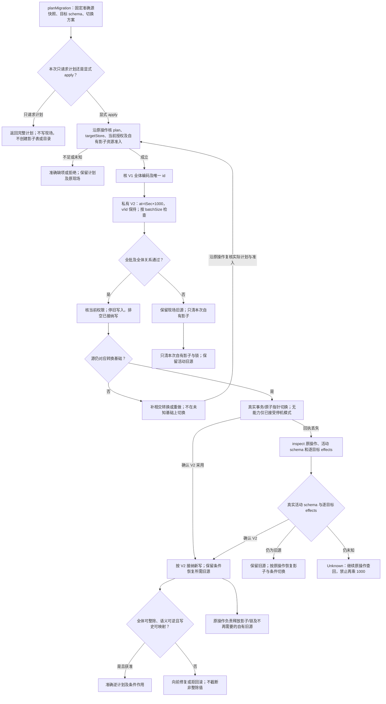

# 数据与配置迁移

Migration根固定一个真实变换，而不把“可以迁移”当完整能力：将存储中SampleV1的秒时间变为毫秒时间，并保留精确测量值。配置迁移使用相同的准确解码、转换、后像、条件采用逻辑，但不得继承数据库的并发和事务保证。

## 作者意图、输入与后像

V1恰含`{id:Text,tSec:Dec,valueMilliVolt:Dec}`；V2恰含`{id:Text,at:Dec,v:Dec}`。后像at=tSec×1000，v=valueMilliVolt，id不变。输入集合要求id唯一；重复id是明确业务拒绝，不随意保留首个。作者`batchSize`默认256且>0，只影响准备与检查分组，不改变结果和最终采用。

入口为`planMigration(sourceSnapshot,targetSchema) -> Promise<Result<MigrationPlan,Fault>>`及获准的`applyMigration(plan,targetStore,authorization)`；无法取得源、schema或规划资源时返回明确Fault，不生成半Plan。Plan包含真实源/目标版本、成员范围、确定变换与检查、实际目标能力和不再接受旧写的条件；不是执行器自报approved。纯plan不写现场。

## 已选实施路线：影子准备，受围栏的切换

默认采用短维护切面，而不是未经证明的在线双写。计划只固定准确源快照与方案；创建影子表/目录属于显式apply的执行阶段，先核准确计划、实际目标、当前权限及本次自有影子资源准入，再构造私有V2表/目录。每批核id唯一、条数和值关系，保留确定进度及实际写入所需准入。所有批次和全体检查结束后，再核切换权限，关闭原写入准入并等待/终结已接纳旧写。再核源仍对应被转换状态；发生变化就补相交转换或重做，不在未知基础上切换。纯内存transform仍是原值变换，不因本现场路线增加外部作用前置。

目标有事务性元数据切换时在真实事务内更新活动schema和数据引用；文件提供者用其真实原子目录/指针能力，不能混称跨系统事务。没有切换能力则使用已接受的停机复制模式并给明确不可用窗口，不能把“写完新文件”称原子迁移。

源数据暂时保留供恢复，但不是永久历史包。创建影子失败只清理本次取得对象；不得drop未知同名表。切换响应丢失，查询实际活动schema/操作记录；不能再执行一轮乘1000。已按V2接纳写入后，回退旧代码不等于安全回退数据。

## 逆变换不是无条件存在

只有每个at能被1000整除、V2没有不可逆新字段/新语义、写入历史可被已接受映射覆盖，才可构造V2→V1。否则必须保留向前修复或停止回滚，并准确指出不整除记录。不能用整数截断强行“成功”。环境中的索引、外键、触发器、权限、复制与旧客户端同样属于迁移前提，不因行格式正确而忽略。

schema改变与实际旧行处理不同；[PostgreSQL18的ALTER说明](https://www.postgresql.org/docs/18/ddl-alter.html)明确区分例如改默认与更新已有行，并要求新约束能够被现有数据满足。本例不要求PostgreSQL，也不把其能力推广到文件和远端对象。

## 成品与验收

交付是完整迁移方案、实际可执行变换/驱动或准确工具依赖、验证查询、恢复选择和必需部署前提。尚未获准运行仍可以是完整迁移制品；声称“现场已迁移”必须有真实效果证据。只有前后两个schema不够。

具体检查：tSec=-1得at=-1000；整数超过2^53保持；重复id拒绝且现场无改动；准备中源被写入不直接切换；切换前崩溃不改变活动源；切换后回执丢失可查回；at=1501不能逆向回到整数秒；资源满/撤权不清理别人对象。批大小升级只影响成本，值关系和切换合同不变。

## 迁移器的可调用边界

transform用于内存精确变换；planMigration固定输入和切换方案；applyMigration(plan,targetStore,authorization)调用已有执行器与实际Store适配，核同一源/目标后返回真实操作状态；inspect查同一操作而非再次apply。reverse先对全体V2解码、唯一性和整除验证，任何错误返回最早原位置且不产生部分V1。

授权引用不是权限本身，targetStore必须解析到实际提供者与计划中的同一目标。返回accepted/running表示操作可查而非现场已迁移；`OperationState.effects`逐目标记录pending/applied/verified/rolled-back/unknown，`result`只在有准确迁移后状态可引用时给出。failed/cancelled/unknown按原操作责任说明哪些效果可能已发生，不能因顶层失败把已经写入的分项抹掉。消费方要求等待完成时，必须等待明确终态或准确未完成返回，不能把Promise解析等同所有切换和清理完成。

## 影子准备、切换与查回

图中的计划、接受和已迁移是不同事实；回执丢失通过原操作查询，不再次乘 1000。

## 本页规则字段与源码对应

| Rule | 其他必需字段／类型 | 完整作者根 |
|---|---|---|
| Migration | batchSize:Int | [Migration](../../../examples/开发成品/model/applications.json) |
