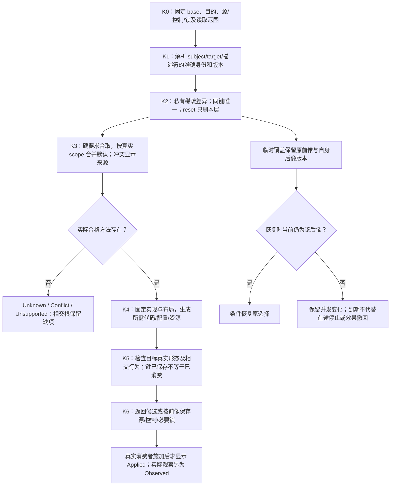

# 稀疏控制与目标限定

> **阅读范围**：采用范围内的设计规范；实现状态另查未决 · [共同上下文](../需求关系与能力边界.md)。


## 5. 最小必要信息：四种来源与一种明确的差异

工具先读取已接受行为及真实上下文，计算可推导结果，再使用已经委派的实现策略。作者只补三类当前无法合法省略的信息：真正独特的行为、不可推导的硬要求、主动固定或改变的选择。

一项控制保存以下语义，不要求作者逐字段输入：对象/范围，控制的精确定义与版本，适用目标，require或prefer，明确值，来自哪个作者决定。系统提供派生值、来源、失效与所选实现。没有写某项控制表示沿定义或已接受默认，不表示false、空值或无限权限。

控制来源分层而不互相覆盖：不可补偿的安全/合法性约束；已接受任务；库公开合同；项目与目标的已采纳默认；对象局部require/prefer；后端可推导选择。所有硬要求共同满足，冲突必须显示来源。局部设置不能以“更具体”为理由撤销上层硬要求。可覆盖的软默认由发布的合并规则解释；值相同的重复要求可以合并，同字段矛盾不采用最后写入者获胜。

reset删除当前对象自己的覆盖，恢复当前明确基础上的继承；它不删除父级要求或当前锁。预览显示新有效值及其来源，采用后再更新相交绑定。即使局部值与默认恰好相同，显式固定也可保留，因为作者可能要求未来默认变化时仍不变；只有确认不承担这种冻结语义时才可省略。

<a id="decision-contribution-provenance"></a>
### 有效决定的贡献与来源

同一有效决定可有多个独立贡献。每项保留真实生产者与修订、authority及其拥有者、决定类别、源表示和实际适用范围；Profile展开、scope传播、严格推导及目标限定分别保留对应关系，不压进互斥的“显式/继承/默认/外部/运行”来源枚举。它们是原决定的解释与依赖，纯派生解释不再成为可写配置。选中实现由RealizationBinding保存，不能伪装成作者输入贡献。

值相同可合并求值工作或简化显示，但不能合并掉独立来源的身份、撤回与失效关系。某项失效时按描述符的真实合取、默认或偏好规则重算；只有剩余贡献仍支持该结果时才继续使用。冲突保留相交来源、条件及合法下一步，数组次序、客户端facet和显示层级不形成优先级。[客户端决定视图](../../开发/编辑审查与客户端.md#developer-decision-view)只投影这些结果，不另立贡献写者或公开线格式。


### 不同控制的事实归属

| 控制对象 | 典型内容 | 保持责任 |
|---|---|---|
| 计算与业务含义 | 算法、数值、身份、错误及事务结果 | 作者定义与语义，不由后端优化改写 |
| 实现选择 | 库、索引、求解和生成方法 | 编译与供给owner，满足完整前置、结果、失败及资源合同 |
| 目标表示与互操作 | ABI、公开名、布局、文件和初始化 | 目标规则及真实外部消费者，不按关键字近似 |
| 资源与调度政策 | 内存、并行、限流、公平性 | 请求与资源owner，检查共享额度、进展及取消 |
| 运行调节 | 批量、缓存及在线控制器 | 实例与执行owner，固定政策、真实观察、接管和结算 |
| 系统解释与治理 | 描述符含义、方法资格、权限及根接口 | 有权演进和恢复，候选不能批准自己的合法性 |

表中是现有责任的视图，不是六个新服务，也不是一种通用持久记录。操作授权、自动化预算、遥测与运行轨迹不写进`gift.controls/1`；普通程序体仍在作者源。取消用户等待、阻止新任务、请求停止、确认终止、撤销未提交改动及补偿既有效果也不能合并为一个布尔值。

<a id="mixed-explicit-and-delegated-control"></a>
### 显式控制与自动选择的共同空间

控制粒度由本次对象和要求决定，不设置全工程的“手动／自动”二选一模式。作者可以固定一个使用点的方法与参数，同时仅约束另一处的资源上限，把其余合格选择委派给系统；也可以直接提供自定义算法、类型或原生实现，而不被限制在预置候选菜单中。普通定义足够时走原语言与库接口，真正缺少可观察区别时才按[扩展判据](语义扩展与领域接合.md#extension-distinction-witness)扩展语义。

精确绑定、允许集合、禁止项与资源上下界均由相应类型化值及require表达；软偏好只在共同硬条件成立的集合中解释，不新增一组会与require/prefer/reset竞争的通用强度枚举。不同目标不能擅自改变共同源语义；某使用点的定制也不能直接修改共享实例而隐瞒其他消费者。无法分离时，预览说明共同影响、允许的专门化或冲突，而不是给出实际上未局部生效的成功。

“全部自动”只表示在已接受目的、硬条件和有效委派内补足未指定决定，不表示无限搜索、无限费用、自动安装、不受约束的目标修改或永久写权。自动选择的范围、探索成本和需要再采纳的变化由原政策／操作合同承担；作者控制表不保存实时Grant、观测流或当前线程数。用户能够从解释结果追到实际候选、排除条件和依据，并以新约束或显式绑定重新求解；不要求先阅读所有控制项。

某个细节尚无公共开关时，系统仍应提供其真实owner、影响与受权的扩展／源码修改路径，不能把“没有配置项”说成没有控制能力。反之，不影响已接受观察、约束或外部合同的局部实现细节可保持封装；把每个局部变量公开为稳定API会扩大兼容和组合义务，并不增加有用自由。

## 6. 控制描述符与实际使用过程

控制描述符包括qualifiedId与版本、subjectKinds、typedValue、量纲/单位、scope、phase、语义强度、合法值与缺省、继承/合并/冲突规则、能力前提、目标映射、影响的行为/ABI/资源/排版，以及应用后的检查、证据与失效消费者。`typedValue`只验证值的结构和值域，不把全部工程控制降成类型系统。源行为、实现选择、目标形式与当前权限不是一个可任意键值写入的字典；同一值在不同阶段、主体或强度下也不能仅因JSON相等就合并。已有正式描述符或被明确拥有的原生配置才能成为有效控制；未知名字保全并报告，不按拼写猜测。

<a id="effective-control-projection"></a>
### 有效控制投影：请求、有效、计划、施加与观察

REQ014要求作者既能保持自动委派，也能在需要时看到完整的决定链。客户端按需把现有事实投影成以下五个切面；它们不是五份配置、更不是新的状态机：

| 切面 | 回答的问题 | 不可混同 |
|---|---|---|
| 请求 Requested | 作者、独立要求或上层政策明确要求/禁止/偏好了什么 | 没写不等于false，也不等于宿主默认 |
| 有效 Effective | 经过作用域、继承、合取、禁止、默认和冲突检查后，当前真正成立的约束是什么 | 有效要求不等于已经找到实现 |
| 计划 Planned | 当前冻结候选准备采用哪个Supply/方法/目标/配置去履行这些要求 | 候选计划不等于已经写入、安装或运行 |
| 施加 Applied | 哪些决定已经实际进入生成源码、原生配置、构建输入、制品或运行环境 | 文件里出现一个键不证明Provider实际消费 |
| 观察 Observed | 编译、读取、运行或独立证据实际观察到什么 | 观察到结果不反向修改原请求或自动证明全部要求 |

每个显示值同时给出真实来源和覆盖范围。来源可以是显式控制、上层有效要求、严格推导、合格选择、目标/ABI强制或有owner的默认；这是解释投影，不要求把这些类别手填进作者源。`Auto`只表示作者把**仍然合法的实现自由**委派给解析器，不表示相关语义未知，也不授权解析器补造尚未定义的行为。若一个结果相关维度在Effective阶段仍未知，后续依赖它的计划保持Needs/Unknown，而不是将当前机器偶然默认固化成产品含义。

普通视图只显示任务相交的差异和少量理由；高级视图可以展开全部相交描述符、来源、被排除候选、当前Binding、原生配置位置、目标后置和Evidence。两种视图消费同一作者源、Binding与观察，不建立一份“effective config”可独立写回的竞争真源。作者要改变结果时修改真正拥有该决定的Requirement、Control或原生配置；派生投影只提供定位和受权编辑入口。

<a id="developer-control-ux"></a>
### 开发者控制操作：Auto、Require、Prefer、Pin、Forbid、Reset 的唯一含义

Workbench/CLI可以使用更符合开发习惯的动词，但持久控制语义仍只有既有`require / prefer / reset`及真实作者/原生编辑。各客户端必须按下表降低，不能产生第二套priority或override规则：

| UX动作 | 持久/真实语义 | 禁止的错误实现 |
|---|---|---|
| **Auto / Delegate** | 删除本层对该维度的显式覆盖，或根本不创建记录；重新消费当前有效Requirement、默认和解析器自由 | 写`auto=true`压过父级要求；把Unknown当Auto；每次build重新随机选 |
| **Require** | 写当前subject/scope的硬Control或真实Requirement | 用本地require撤销父级hard requirement；把Preference升级成Requirement而不显示 |
| **Prefer** | 写软偏好，只比较已满足全部硬条件的候选 | 用score补偿硬冲突；没有候选资格仍“偏好成功” |
| **Pin** | 对支持精确引用的descriptor写精确`require`，例如ProviderRef/AlgorithmRef/target/toolchain revision | 发明新的`mode=pin`；直接改Binding lock而不改作者要求 |
| **Forbid** | 仅当descriptor定义Bool/allowed-set/denied-set等可判定语义时，降低为相应`require` | 建全局字符串黑名单；用“不显示候选”代替实际约束 |
| **Reset** | 删除当前layer自己的记录并按同一base重求Effective | 写`null/default`；删除父级Requirement或机器lock；撤回已经发生的Effect |
| **Choose Profile** | 增加对版本化Definition/Requirement bundle的use/引用；其中Control仍按各descriptor进入有效集合 | Profile成为不可展开魔法标签；与显式Require冲突时后写获胜 |
| **Edit native** | 走该native owner的精确源码/配置编辑 | 把任意原生键复制进`gift.controls/1`；忽略未知字段/脚本/注释 |

客户端显示`Pinned`只是“当前存在一个精确硬绑定要求”的视觉状态；`Auto`只是“本层没有固定实现选择且解析器拥有相交自由”的视觉状态。二者都可由当前事实重新计算，不作为独立author data。

#### A轴Decision与允许动作矩阵

六个控制动作只属于Requirement/Realization Control的相交编辑，不是整个All Decisions的统一按钮栏：

| A轴decision semantics | 默认作者动作 | 六控制动作中可能合法的子集 | 说明 |
|---|---|---|---|
| **Meaning** | Edit Meaning、Use/Replace Profile、Go to native owner | 通常无；只有Meaning内部明确暴露为Requirement/Control的维度才转到对应行 | 改业务规则、类型、状态或公开行为不是Pin实现 |
| **Requirement** | Add/Edit/Remove Requirement、Use/Replace Profile | Require、Prefer、Reset；Forbid只在Requirement本身有明确否定/allowed-set语义时 | Auto表示本层不再额外要求，不等于放宽上层hard；Pin通常不是产品性质动作 |
| **Realization Control** | Edit precise Control | Auto、Require、Prefer、Pin、Forbid、Reset，具体可用项由descriptor声明 | 这是六动作的主要适用域；Pin/Forbid都只是有合同的降低 |
| **Runtime Input** | Provide / Replace / Clear local runtime value，或Bind Provider/SecretRef | 不直接使用六控制动作；若要把稳定运行政策固定为Requirement/Control，显式提升到对应A轴类 | 清掉本次输入不删除产品默认/Requirement |
| **Presentation Preference** | Set / Reset client preference | 不使用工程Control六动作 | 只影响client authority；团队共享presentation artifact仍不是Engineering Control |

External authority拥有的Requirement即使A轴分类是Requirement，也可以全部只读；`allowedActions`必须同时满足decision semantics、B轴authority、当前Grant和descriptor能力。A轴分类不自动意味着用户可编辑。

`Choose Profile`、`Edit Meaning`、`Provide Runtime Value`和`Set Client Preference`是owner-specific编辑动作，不加入“六控制动作”计数。

### 三套作用域图不能混为一棵覆盖树

**作者/编译作用域**通常沿`Project → Product/OutputRoot → Module → Definition → Use/Occurrence`逐渐收窄，`target`作为正交限定；只有descriptor声明允许的scope可以出现。所有hard requirements合取，局部层不能放宽父级hard；软default/preference按descriptor merge rule确定。

**运行作用域**沿`Deployment → Instance/Session → Operation/Attempt`，保存的是现实运行策略/输入/Grant相关决定；它不从Definition occurrence继承一个同名JSON键。**客户端作用域**沿`User → Workspace → Window/View`，只影响显示和开发偏好。跨三张图发生联系必须经过明确Binding，例如Project requirement限制Deployment region；不能靠“同名字段更近”自动覆盖。

### 当前持久控制编码的scope边界

当前`gift.controls/1`记录的稳定定位只有`moduleId`、可选`definitionId`、可选`occurrenceId`和可选target，因此它**不能**被拿来假装已经支持所有Project/Product/Deployment/Session scope。更高层政策继续由现有project/product/Requirement/target配置owner承担；runtime/session/operation决定继续由execution/runtime owner承担；客户端偏好留Workbench。

未来若真实消费者要求在同一Control存储合同中增加Project/Product等scope，必须发布可迁移的新编码或有明确向后兼容的扩展，并同时更新descriptor适用性、合并、锁、读取器和旧客户端拒绝规则。不能把`moduleId="*"`、虚构definition、特殊target字符串或路径前缀当通配scope。

这不限制统一UX：All Decisions可以同时显示来自不同scope/owner的行；统一的是解释和编辑入口，不是强迫它们共用一个JSON数组。

<a id="current-output-root-scope-limit"></a>
### 相同公开出口的多个根不能借现行控制编码假装可区分

现行 `gift.controls/1` 的 `subjectRef` 只能定位 Module、Definition 或该 Definition 的稳定 Occurrence，再用可选 `target` 限定；它没有 ProductRoot/RootOccurrence 这一持久作用域。与此相对，[工程清单](../工程源/清单模块与绑定锁.md#output-root-occurrence-identity)的 `outputRoots[]` 只是选择器，不能当作唯一的根发生身份。如果一个目标两次选择同一个公开出口，它们可以携带不同的产品上下文；在没有额外有效身份合同前，把针对其中一根的 Control 发送到两根、选择数组第一项、用某个字符串通配 Module 或当成已施加的根级设置，均不合法。

本格式可表达的 Module/Definition/Occurrence 控制仍按已声明描述符作用于其真实消费者；Project/Target 级硬要求仍从原 Requirement 与工程目标拥有者取得。它们的共同作用、冲突及实际共享资源仍须按真实关系合取，不因缺 ProductRoot Control 就自动撤销硬要求。若用户明确要求对两个同出口根施加不同的持久控制，工具应保全编辑意图与当前源，返回范围歧义或未支持的控制作用域；不能将其降成一条作用于共享 Definition 的写入。

候选后继可定义以 `(target,rootId,controlRef)` 唯一寻址的 ProductRoot 控制，但须先建立真正稳定的输出根发生身份，并独立确认描述符适用域、上下文、来源、权威和 Reader；不能把现行 `gift.project/1.extensions["gift.controls/1"]` 偷改义为独立文件或声称后继编码已获正式采用。迁移时旧 `subjectRef` 只可按其原 Module/Definition/Occurrence 含义转换；旧版本无根级记录时不能凭同名推导出新 ProductRoot 决定。若旧/新持久来源并存，必须在切换前处理竞争写权和同键冲突，重试与恢复继续依[原迁移合同](../../演进/兼容迁移与退役.md#读写组合与迁移准入)，不得以两值恰好相同代替唯一来源证明。


### 控制描述符的最小专业合同

新descriptor只有同时定义以下内容才允许出现在开发设置面：

1. stable qualified identity与revision；
2. semantic definition：它究竟改变哪个可观察区别，而不只是UI名称；
3. applicable subject kinds、allowed scopes、optional target qualifier；
4. value schema、单位/量纲、canonical comparison与normalization；
5. strength support：是否允许require/prefer，是否存在可定义的negative/allowed-set；
6. inheritance/merge/conflict/reset规则；
7. activation phase：author/resolve/lower/build/deploy/run/instance/operation中的实际阶段；
8. consumers与actuation：哪个resolver/backend/config adapter/runtime真正消费；
9. support/qualification：哪些target/provider支持，缺能力时返回什么；
10. verification/observation：如何证明它已经Applied/Observed；
11. invalidation/impact：改变后哪些Binding/artifact/evidence/runtime失效；
12. migration/recovery：旧值、在途工作和不可逆点怎样处理。

只有`typedValue`、默认值和一个后端if分支不算完整descriptor。反过来，某个生态专有设置只在原生配置里有稳定owner且没有跨目标公共价值时，不必为了进入“All Decisions”强造descriptor；adapter可以把它作为Native-owned decision投影出来。

<a id="control-actuation-contract"></a>
### 描述、施加与观察分别闭合

描述符由所属定义包维护，沿既有锁解析；通用内核只识别类型化接口，不理解所有未来参数的业务意义。已列描述符信息还须能解析出以下相交合同。能从现有方法、目标画像和资源定义得到的应引用，不强迫复制字段或升级`gift.controls/1`的持久编码。

| 合同面 | 必须可判断的信息 | 实际消费者与失败 |
|---|---|---|
| 值与范围 | 单位、精度、合法集合、适用主体、目标及范围是固定集合还是持续查询 | 语义解释器校验；同为数字不代表同单位，未知范围不按全部对象执行 |
| 生效阶段 | 设计选择、构建、会话启动、实例切换或运行调节；原子组与前置依赖 | 原编译／执行owner安排生效；保存新值不代表旧实例已经切换 |
| 执行能力 | 具体方法能观测、软调节、硬限制还是完全不支持；实际限制覆盖到哪一层 | 适配器给真实能力，assurance核要求；监测到超限不证明事前阻止超限 |
| 观察合同 | 观察方法、时间域、采样窗口、误差／缺测、覆盖对象及读权限 | 结果按其测量定义评价；平均值不能代替峰值，不可观测状态不能被猜成满足 |
| 耦合与失效 | 共享实例、资源、初始化、效果、顺序、负依赖及证据消费者 | 选择器处理真实共同条件，增量owner维护读集；不能分别选完后才发现共同不可行 |
| 变更与恢复 | 可重配置条件、在途工作、临时覆盖前像、旧读者、不可逆点 | 原迁移／恢复owner结算；撤销配置不推导历史作用被撤销 |

控制的完成链是“已表达—已解释—已选择—实际施加—取得观察—按要求裁决”，不是六个可以互相代替的布尔值。纯源码形态控制可在编译产物上观察，不要求启动运行控制器；运行预算若只能软调节，应保留可接受的软界及风险，或者返回当前硬保证缺少执行能力。用户有权放宽要求时产生明确的新要求，不能在实现中暗自降级。

**观测不足也是控制边界。** 两个真实状态在所准许的观察中不可区分，却分别需要相反动作时，自动方法不能保证同时正确。应取得有权的新观察、选择对两者都安全的动作，或保留相交未知；不能靠提高采样频率假装补齐根本不存在的信息。强实时、保密和概率要求按各自观察与量词另检，不由返回值相等代签。

控制的解释预览同时展示作者要求、继承来源、解析后的有效约束、待采用绑定，以及已有实际观察；不把“计划采用”标成“已生效”。UI、文本、CLI和AI消费同一候选与诊断，专用编辑器仅是投影。没有专用组件时保留类型化通用编辑或原文，不删未知内容；不可披露的候选和诊断按原读取权限裁剪，解释不能泄露他人私有数据。

### 请求：一次只改变明确对象的指定属性

下面使用已有propose.draft设计变体。c1、路径和java在此是范本中已存在的候选、定义及目标键，真实使用必须来自当前项目；这些调用未作为产品执行。

```text
gift.propose({
  draft: {
    kind: "control-change",
    base: "c1",
    subject: "src/select.gift::Item",
    target: "java",
    require: {
      "java.declaration.form": "class",
      "target.public-name": "SelectedItem"
    }
  }
})
```

字段恰为kind、base、subject、可选target，以及require/prefer/reset中的一个。require/prefer是非空、无重复键的控制名到值的映射；reset是非空、无重复项的控制名数组。所有项在一个候选中共同改变，不部分发布。source/files、edits、editRef与draft继续按公共协议互斥。

`target`在这里是当前工程`targets`中的逻辑键，或临时上下文已经绑定的同类目标键；不是磁盘目录、语言字符串的任意猜测或物理写入地址。目标相关描述符必须给出这个键，不能因当前只有一个目标就暗设为全部目标。与目标无关的描述符按其scope省略target；禁止无意义地给一个源行为属性附加目标，从而让不同后端解释同一源为不同需求。

subject先在base中解析为一个实际模块、声明或受支持区域，再绑定稳定身份。查询结果可以直接提供可用定位。后续重试不按当前路径重新寻找同名声明，也不因手工知道私有ID而绕过来源的访问范围。只有目标容器要求时，Item仍具有其原来的值语义；生成class不是声明可变对象身份。

### 稀疏控制的持久编码

本节完成控制记录的具体编码，复用现有`gift.project/1.extensions`。对当前文本和结构作者工程，**独立的生成/实现覆盖都保存于`extensions["gift.controls/1"]`，不再同时放在未定义的源码注解中。**源码里的函数体、实参和require/ensure仍留在源码，不复制进控制表。临时无工程候选使用同一逻辑记录于其内容上下文，只有正式保存才需要已有的工程清单与锁。

该扩展值为一个仅含`records`的对象，records是有限记录数组。没有独立控制时不创建该扩展。示例只显示已有工程清单中的扩展片段，不是完整项目清单：

```json
{
  "extensions": {
    "gift.controls/1": {
      "records": [
        {
          "subjectRef": {"moduleId": "mSelection", "definitionId": "dItem"},
          "target": "java",
          "controlRef": "java.declaration.form",
          "mode": "require",
          "value": "class"
        },
        {
          "subjectRef": {"moduleId": "mSelection", "definitionId": "dItem"},
          "target": "java",
          "controlRef": "target.public-name",
          "mode": "require",
          "value": "SelectedItem"
        }
      ]
    }
  }
}
```

| 字段 | 当前确切合同 | 读取与保存责任 |
|---|---|---|
| subjectRef | moduleId必需；definitionId可选；occurrenceId只有definitionId存在时可选；除此无字段 | 只有moduleId指模块，追加definitionId指该定义，再追加occurrenceId指其中可稳定定位的出现；位置与种类必须满足描述符 |
| target | 可选非空Text，按描述符scope决定是否必需 | 解析本次目标键，不采用apply中的物理targetRef；缺目标时返回CONTROL_TARGET_REQUIRED |
| controlRef | 必需非空的描述符qualifiedId | 经本发生位置的锁/上下文解析到精确描述符修订，不把名字当内容摘要 |
| mode | 必需，require或prefer | require加入该来源的硬条件；prefer只参与合法集合内的选择；均不撤销独立任务或父合同 |
| value | 必需，按描述符typedValue读取 | 字符串不执行，缺省不写成null；精确数值和引用使用既有值编码及真实绑定 |

这里的subjectRef是控制元数据的定位引用，不是允许程序代码按私有ID跨模块调用的后门。定义ID和出现ID由已有作者映射提供；只有承担长期引用时才持久化必要映射，不为每个表达式分配全局身份。当前适配器没有稳定区域映射时，不能保存一个会漂移的字节偏移或数组序号冒充occurrenceId；可保留临时候选、明确扩大为有身份的私有定义，或报告该细粒度控制无法长期保存。普通源码与声明级控制仍可继续。出现级控制仅约束该使用点，不能直接改写共享定义供所有调用采用；需要派生时按既有库精化规则处理，共享类型/资源无法分离则报告真实影响或冲突。

一条记录的本地键为subjectRef、可选target与controlRef的组合；同一来源同键只存一份当前覆盖，重复键、重复记录或矛盾值须在索引化之前诊断，不能以数组后项获胜。数组次序不决定优先级；规范化输出可以按这些定位字段的确定顺序排列。mode改变也是同键内容变化，不产生一份长期历史记录。

reset不保存为记录：它删除当前候选自己拥有的相应记录，重新计算继承和默认。尚有其他控制就保留扩展，最后一条删除后移除本扩展；不删除别的未知扩展、父要求、锁节点的历史含义或已经开始的操作。同值显式覆盖可以保持，用于固定未来默认改变时的选择。更新本地require需要其作者权限；原任务的独立要求仍然限制最后能否接受和生成。

描述符修订、ProviderRef和AlgorithmRef等实际选择沿既有锁的发生位置绑定；本扩展只保存作者选择，不能复制完整规则表、全部默认或目标AST。只改业务常量通常不改这个扩展。控制变更改变相应解析输入时，由工具产生新锁候选；保存源、控制和必要锁更新是同一次保存计划中的完整成员，真正写入仍另检前像与权限。

重命名或移动声明时沿原身份映射更新定位，不因文件名改变丢控制。删除受控声明时同时处理所拥有的控制或保留明确悬空诊断，不能按后来新建的同名声明自动复活。跨项目复制创建新身份并重新绑定本地控制，不复制原授权。多个分支修改同键时按共同候选合并规则比较；选择后写入者不是语义合并。

没有支持这个扩展的读取器时，保留原文件并报告支持缺项，不能忽略覆盖后报告生成满足。将来若采用属性或其他紧凑文本语法，必须明确转换并转移同一属性的唯一作者位置；当前不设计也不暗用那套额外词法。`gift.controls/1`是一项有限的存储合同责任，不是新语言、控制服务或每个程序的必需文件。

<a id="successor-control-file"></a>
### 后继控制的发生范围与有型文件

采用[后继 Project](../工程源/清单模块与绑定锁.md#successor-author-project-contract)后，逻辑 `gift.controls/2` 由唯一 `gift.control-file/1` 承载；它是完整后继设计，旧工程在真实迁移完成前仍按上述 `gift.controls/1` 内联合同解释。迁出用于明确 Project/根发生点、分片、编辑与生命周期，不能声称 `/1` 原来禁止 extensions。模块中的 Meaning、Requirement、函数体与实参仍由原 Owner 保存；Runtime input、Grant、Evidence、客户端展示偏好和自动 Binding 都不复制进控制文件。

[文件 Schema](../../../schema/controls/control-file-1.schema.json)严格要求 `schema:"gift.control-file/1"/projectId/fileId/records`，无其他根字段；文件由同一 Project 的 `sourceScopes(kind:design)` 或具资格的 Control Source Profile 捕获。`fileId` 在工程内唯一，只标记编辑载体，不参与控制优先级。没有独立控制就不必建文件；已明确保留的文件允许 `records:[]`，但空文件不证明旧硬要求已合法撤销。新记录写入目标必须由有权作者在合法范围内确定；多个可能载体时不选排序第一份，不新建 `files/defaultFileId` 注册表。

每条记录严格包含 `scopeRef/controlRef/mode/value`，可选 `target`。`mode` 仅 `require/prefer`；value 按精确 Descriptor 的类型、单位、值域与引用解释，不因 JSON 可容 null 就把它当 Reset。`scopeRef` 是以下五种互斥对象：

| kind | 除 kind 外的准确字段 | 定位责任 |
|---|---|---|
| `project` | 无 | 工程由文件头及冻结 Project 固定 |
| `product-root` | `rootRef:{rootId}` | 记录必须有 `target`，在该 Target 中绑定唯一根发生点 |
| `module` | `moduleId` | 固定解析域中的实际模块 |
| `definition` | `moduleId/definitionId` | 该模块的稳定定义 |
| `occurrence` | `moduleId/definitionId/occurrenceId` | 该定义中有稳定作者映射的使用点 |

后继 Definition ID 与公开名采用同一 Identifier 词法，合法性不证明对象存在；旧 `/1` 宽名按显式迁移处理。根引用不能退化为 `moduleId/export` 选择器、数组序号、摘要或显示名；同模板在不同根的上下文和实例分别绑定。共享 Module 的控制沿它的真实相交消费者生效，根控制只沿该 BoundRoot 传播；物理目录树不是控制继承图。Descriptor 必须明确适用 scope 与主体基数，单符号 `target.public-name` 不广播给多个公开出口。

整个工程所有已接受 ControlFile 的逻辑键为 `(scopeRef,target?,controlRef)`；product-root 的准确键为 `(target,rootId,controlRef)`。重复键即冲突，即使值相同也不由文件名、数组顺序或最后写入者去重。require 与独立硬要求合取，prefer 只在所有硬条件满足的候选间比较，未知成本不为零。Reset 只删除本 Owner 的相应键，再计算继承与有版本默认；同值显式覆盖仍保留其独立来源。删除、移动与重新分片使用原源编辑事务，不改变生效强度、Grant 或外部责任。

### 完整捕获、跨文件提交与迁移

SourceOwner 固定工程、SourceScopes、所有被选文件、Descriptor 来源和已接受成员要求，逐项捕获真实源对象。路径逃逸/别名、重复 JSON 键、错误项目身份、重复 fileId、源替换、非法值或未知覆盖分别报告；两次枚举相等不能自证物理原子快照。覆盖未知时不能以“没有控制”生成，已有接受记录要求旧文件/逻辑键继续存在时必须核其明确撤销，不能把扫描遗漏解释成合法删除。新工程在完整范围内确无控制可以零文件；组织不可撤销要求仍由外部 authority/Requirement 拥有，不靠可删除本地文件维持。

处理分为固定前像与授权、捕获完整成员、全局逻辑键/范围/类型校验、求 Effective 与 Impact、准备联合后像并提交、完整读回六段。读取合法不代表 Applied，Applied 不代表真实观察已符合。真实宿主仅在有凭据的快照切换或可恢复 Journal/CAS 下发布；缺跨文件保存资格时返回准确缺项并保留候选，不逐文件覆盖后宣告成功。中断/未知结果按原 Operation 追查，不由末尾文件存在判完成。跨文件移动必须同时移除旧键与建立新键；Git 文本合并无冲突仍须重新核实际逻辑键与联合要求。

旧 `gift.controls/1.subjectRef` 只可映射 module/definition/occurrence 三类，不凭空合成 project/product-root，更不能用 `moduleId:"*"` 扩权。历史未采纳的内联 `/2` 或 `gift.control-files/1` 试验要先固定其准确合同内容与登记全集；短标签相同不能相互解码。旧根选择器在固定 Target 中匹配零个发生点为失效/Needs，唯一匹配也仅形成待审映射，多个匹配须由有权作者选择，绝不向所有根广播。未给 Target 不猜当前默认。旧/新同键保留来源冲突，不能以值相同择胜。

迁移核每项原作用域、显式与继承来源、Descriptor 修订、目标限制、类型/单位、默认、接受与恢复条件，形成 Project、ControlFile、必要锁的同一候选。取得合法提交和新读取集、Root/Method/Target 消费者及旧 Writer 退出的读回后才完成切换。旧 Reader 可只读回放旧源；没有新消费者时保全旧源并报告该范围不支持，不能忽略旧控制后采用默认值生成。

JSON Pointer 只定位当次前像；Patch 中的数组下标不是跨修订身份，重排后按逻辑键重新定位并复证。Merge Patch 的 null 删除语义不代替有类型合法 null 或 Reset。非法草稿、CST 文本差额、未知扩展、并发及恢复继续由各自源与作用 Owner 处理；存储格式不另建授权入口。

<a id="successor-control-scope-edit"></a>
后继`gift.control-scope-edit/1`请求能力可在原control-change中以scopeRef替代subject，两者恰选其一；require/prefer是非空无重复解码键映射，reset是非空无重复控制名数组，整批共同检查。base必须唯一绑定控制存储工程，多个工程歧义时不得改全部工程或当前目录碰巧对应的工程。product-root的target/rootId须在该base唯一解析，Scope、Descriptor适用性、Reader、Writer和实际后端消费分别协商，能存文件不表示实现该短请求。

reset可以删除准确可定位、本人有权修改的孤立旧记录，不要求被删除对象先可生成，也不能据此重建对象或重定向同名新对象；无法无损定位未知扩展时保原载体并返回缺能力。旧客户端保留原subject能力或使用完整有资格的源编辑，不忽略scopeRef、不用通配模块模拟project。严格重放只在真实请求分支已有changeId和保留窗口适配时成立，不能借其他变更类型的重放协议签发；真正保存仍消费原apply/前像与恢复合同。

### 临时覆盖、持续范围与返回基础

普通reset仍按上文删除本层记录。需要“临时覆盖后恢复先前选择”时，操作拥有者另外保留准确前像、覆盖产生的版本和期限：只有当前记录仍是该覆盖的后像，才可条件恢复；用户或另一个任务已续写时保留冲突，不能无条件写回旧值。过期只能使新使用失去该临时选择资格，不能假装已经停止在途操作或撤回外部效果。

默认控制作用于本候选中已解析的主体。要求未来新增对象也匹配时，应明确选择器的解释、成员变化、观察覆盖与授权范围；记录查询及其成员依赖，而不是把当前成员列表冒充未来完整范围。新增成员重新取得适用性和执行资格；旧授权不因选择器仍同名而扩大。删除再创建的同路径对象不是原实例。

跨对象和跨维度的批次在候选中共同预览、选择和检查，实际保存按原写入计划处理其原子能力。已接纳的共同约束不能被逐项reset或并行客户端更新绕开；没有共同事务的外部控制逐项报告生效与残余，不对整个批次签发虚假的原子成功。

### K0至K6：控制从提出到实际结果

| 步骤 | 正常处理 | 相交失败和保持范围 |
|---|---|---|
| K0 固定 | 取得base、当前目的、源/控制/锁及读取范围 | 过期或串项目引用不换成latest；只设计/预览不写文件 |
| K1 定位 | 解析subject、target与描述符，将短名绑定实际对象 | 歧义、未知控制、无权限或不适用分别返回；不靠同名近似实现 |
| K2 修改 | 在私有候选中形成唯一来源的稀疏差异 | reset只删本层；批次冲突不先应用半份 |
| K3 求有效值 | 合并仍有效的任务、公开合同、硬控制、软默认与推导 | 有冲突指明生产者与消费者，候选合法不表示原任务已满足 |
| K4 生成 | 固定合格实现/布局，产生代码及必要配置、资源 | 无合格后端则该根受阻；其他独立根按原任务条件返回 |
| K5 核结果 | 检查真实声明形态、公开名、表示及相交行为 | 只存字段或打印成功不能称履行控制；检查未做要准确标明 |
| K6 保存或结束 | 按请求返回候选/产物，或经现行save-source/write-output保存 | 保存源不写目标，写目标不接管源；旧操作仍依原可信意图结算 |

已知默认路径可以跳过无用选型，不需要每次调用query。所有有效值均可通过现有contract/origin/impact局部取得；返回结果不强制携带全目录或内部证明图。


### 控制求值、保存与实际履行



## 7. class：先判断开发者要求的是哪种事

**仅需要容器。**开发者要求某个接口生成Java公共类、类名和构造入口，没有要求可变身份、继承或反射。控制声明外形、公开名、可见性和构造API；编译器从现有值语义生成私有最终字段与明确构造。隐藏表示的类型不能因选class就开放全部字段。

**需要对象行为。**开发者需要独立实例、共享可变状态、动态覆盖、父调用或运行反射。这不是布局开关。使用点需要下面的语义描述，才能完成作者能力和后端映射。当前基础函数/opaque不能冒称已实现它。

**保留既有原生类。**前端保留准确来源语义、语法与不支持区域。能够提升的部分进入中立模型；未知细节有字节/AST保全。要求同语言精确改写时按原语义处理，不用“中立层不观察”删除原有反射或初始化行为。

### 7.1 对象语义的有限核心设计

完整的当前对象机制由[对象构造与动态分派](../../领域/对象与控制/对象构造与分派.md)拥有：实例身份、字段、初始化与this逸出、方法槽、覆盖合同、多接口与单实现父链、结构体和目标保持。这里不再维护第二份对象字段/构造算法。

任务只要求目标采用class容器时，继续使用本章目标结构控制；要求真实可变对象、身份和分派时，采用对象画像；已有原生类的反射或特有初始化按实际源语义保留。三个要求不互相代签。当前有限画像不包含全部语言的多继承、元类、动态修改和析构机制；需要时是具体语义扩展，不允许只用一个class控制字段假装支持。

### 7.2 目标能力的逐项对应

| 作者要求 | Java示例目标 | Go/Rust等没有同一class语法的目标 |
|---|---|---|
| 仅隐藏值表示 | 私有字段＋公共操作/工厂；类是目标容器 | 模块内表示＋公开操作，不必发明class |
| 独立实例状态 | 实例字段＋正确同步/生命周期 | 明确状态对象、句柄和接收者，保持别名与寿命 |
| 动态分派 | 虚方法/接口的真实分派 | 合格接口表/trait对象/显式派发；承诺的观察要同等成立 |
| 必须继承某个Java基类 | 真实extends、构造链和方法义务 | 目标专有硬要求；没有合法桥接则该目标不满足 |
| 必须反射为指定Java类 | 类型加载、可见名、成员和注解合同 | 不以一个同名记录冒充；保留Java实现边界或准确拒绝对应目标 |
| C兼容布局/字段偏移 | 合格ABI或外部桥接 | 实际布局和对齐合同，不由记录字段顺序猜测 |

Java、Python、Rust等的class/对象/布局不能按名称直接等同。Java类规范同时规定初始化、继承、覆盖与构造；Python类还有其数据模型和描述器机制；Rust的repr控制另有布局条件。目标没有同名关键词不意味着无法实现行为；没有相应保持关系也不能因为能拼出源码就称支持。

### 7.3 一条有限作者控制与产物轨迹

作者定义一个不透明的Range及make/includes。未规定外形时后端选满足公共合同的普通布局；指定Java class与稳定公开名后，生成对应类候选并验证构造/成员/私有字段。再要求它继承外部BaseRange时，工具取得BaseRange真实版本和构造/覆盖合同，重新检查；失败定位到新增要求而不是悄悄忽略extends。换成Go目标时，有合格后端的原纯Range行为可以生成；仅限定Java输出的形态要求不适用于Go产物。若接受任务本身仍要求Java继承/互操作，Go输出不能替代该任务，必须保留未满足项。不能悄悄给Go签发Java互操作保证。

此轨迹的控制合同和所选有限对象作者语法已有规范；读取器、目标实现和更广语言映射仍分别核验。它不要求Range使用者改写为class，也不以原生出口替代真正缺项；独立值路径可以继续。


## 10. 首批控制描述符的精确角色

这是一组当前已设计的控制，不宣称完成所有目标能力。后续控制复用同一描述符协议；新增语义仍需实际规则，不因能存一个名称就视为支持。

| 控制名 | 值与适用对象 | 当前默认/前提 | 对应动作和失败 |
|---|---|---|---|
| java.declaration.form | class / interface / record；Java类型输出 | 未写时由语义与现有接口决定 | 选择合法声明形态并检查成员、继承与构造；record要求与行为不合时拒绝 |
| target.public-name | 非空Text；公开输出符号 | 现有公开名优先，新符号由稳定命名规则产生 | 按目标词法、命名空间、导出及反射要求检查，冲突不随机加后缀改公共API |
| java.superclass | 精确SymbolRef；对象类型或已合格类输出 | 未声明时不从名称推测父类 | 解析实际基类/构造/继承/覆盖要求，循环、final、不可访问或不满足时返回具体错误 |
| target.visibility | public / package / private；支持该可见性层级的声明 | 沿作者可见性与目标门面推导 | 只能在允许范围控制目标可见性，不通过设置public泄露中立私有表示 |
| implementation.provider | 精确ProviderRef；有可替换实现槽的定义/端口/输出 | 优先现有合格Binding，否则自动解析 | 校验接口、行为、版本、资产、许可与目标；未知实现不当已安装 |
| implementation.algorithm | 精确AlgorithmRef；具有声明等价/可选实现的计算 | 按定义或授权策略选择 | 作者固定算法时其可观察步骤和资源限制进入合同，不当纯偏好忽略 |
| dependency.allow-third-party | Bool；选定目标或子模块发生位置 | 沿项目接受策略；新纯函数默认不新增第三方依赖 | false排除新增第三方路线；已接受任务必需的现有依赖形成冲突，不暗删功能 |
| generation.structure-policy | preserve / canonical / reorganize；目标布局范围 | 有明确合格旧布局则preserve，新工程canonical | 按显式布局基础生成并检查保持；compareTo不改变布局，缺基础或硬冲突精确诊断 |

SymbolRef/ProviderRef/AlgorithmRef可以由已知导入或上下文短名在当前base中解析，内部转成精确内容及接口引用；普通作者不必手填哈希。每个控制在候选中明确require或prefer；不适用对象返回CONTROL_NOT_APPLICABLE，未知描述符返回CONTROL_UNKNOWN，硬要求冲突返回CONTROL_CONFLICT，已理解但目标没有实现返回CONTROL_UNSUPPORTED。名称是当前诊断设计，不是运行事实。

操作返回新候选以及有效值、选中来源、相交差异和未决。普通默认结果可摘要，只有请求解释时展开选型轨迹；不得将所有描述符或候选集复制给模型。控制已接受而打印器没有履行时属于生成器缺陷，不允许把结构校验结果当成目标满足。


## 目标结构稳定的控制消费

在既有描述符机制中增加`generation.structure-policy`：值为`preserve/canonical/reorganize`，适用于模块、输出根或目标布局范围，解释阶段为布局，行为要求仍来自原源合同。默认由实际上下文确定：有已选合格布局基础则保留，没有历史的新工程采用当前规范布局。`require`固定指定政策，`prefer`只在硬要求内参与选择，`reset`只移除本层覆盖。

[完整算法与失败分支](../../编译/目标/结构稳定与作者回源.md#跨次生成的结构稳定合同)由目标源码章拥有。本描述符不存第二份函数体；布局基础及相关映射进入Binding和生成键。基础缺失、公共约束冲突和后端不消费分别给准确诊断。公共名称、继承、ABI等已存在控制仍然是硬条件时，结构政策不得覆盖它们。

管脚、文本与JSON是不同操作/表示方式，不为每个方式复制控制描述符。结构端改同一控制记录，文本端有对应写法时也映射到同一记录；作者权保持一处。当前新描述符与结构编辑均是设计合同，未因出现表项就取得运行实现。


## 控制的装配版本与后端履行

控制描述符在本次EngineImage中固定。propose解析真实对象和值后形成作者控制变化；compiler根据描述符的目标、作用范围和硬/软含义进行选择；实际lower/emit方法消费有效控制；assurance检查所要求的产物性质。没有消费者的方法只能登记缺项，不能因为控制可以写入extensions就宣称能力完成。

规则升级产生新解释和显式差异，不原地更改旧控制意义。reset只在它固定的基础上删除本层覆盖；同名新版控制不能借旧句柄生效。方法依赖包含实际消费的描述符版本，不将其他目标未使用的描述符加载成每个任务输入。公共精细控制的实现合同与存储均复用现有记录，不新增配置总线。
