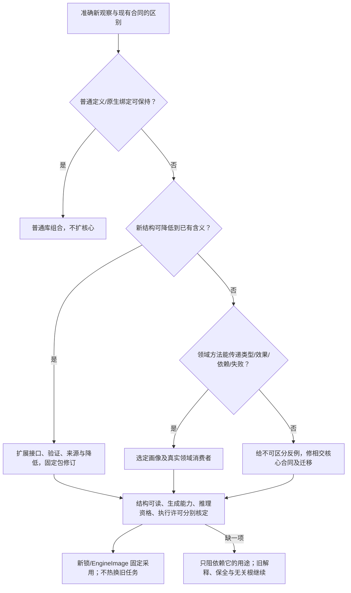

# 语义扩展与领域接合

条件性的[访问投影](访问投影与不完整类型.md)与[参数包/类型级值](参数包与类型级值.md)复用本页扩展协议。它们不要求新定义都改核心，亦不把一个万能 Term/JSON 当成已经解释了全部领域。

<a id="extension-consumer-closure"></a>
## 新语义从声明到真实消费者的闭合

已有有限枚举可以是一个固定画像的正确实现；将其改成 string 既不增加语义，也不自动解决扩展。先给出在当前画像中确需但无法表达/保持的具体使用点，再沿普通定义、合格原生供给、领域接口和必要核心修订裁决。七个标签可以辅助提问，不是已证明最小的本体或必须采用的目录。

| 交接 | 需要实际保留什么 | 失败与后继 |
|---|---|---|
| 定义/画像 → 解码与绑定 | 精确解释版本、名义身份、参数种类、作用域和未知载荷 | 可保全的未知不能被强语义 pass 当已理解；必需解释缺失返回缺项 |
| 签名/谓词 → 合法性与查询 | 实参/形参关系、效果和性质模型、真实读集及负依赖 | 不认识的谓词不能被当 false、真或无效果；完整声明与支持方法按同版接入 |
| 分析/转换 → 生成与证据 | 每个实际出口、组合条件、保持方向、来源与目标能力 | 消费者没有该接口则保留原区域或拒绝相交变换；不允许默认分支吞掉节点 |
| 编辑/序列化 → 持久及再次读取 | 原始字节、未知字段策略、绑定映射、原签名和当前迁移关系 | 旧读者不能改写后丢字段；新读取按原解释验真，再走合法迁移 |
| 引用/发布 → 运行及退役 | 真正调用者、旧实例及释放代码的寿命，实际 adopted revision | 新定义不热改旧实例；新增分支不抹掉旧恢复责任 |

schema、decoder、validator、签名解释、规则分派、变更请求、锁读取、目标生成和编辑消费者必须沿实际调用闭包核对；表是角色而非虚构当前文件均已迁移。只改一个校验集合、只加一个注册表或只放宽 JSON，不能宣称扩展已接入。数据入口仍严格解码，未知内容可以有独立保全路线；公开反射要有解释和权限，生成变换保持绑定卫生。

闭包按本次真实使用的七类边取得：身份与解释、语义与合同、实现方法、目标制品、效果与权限、观察与证据、演进与退出。纯扩展没有现实作用时不创造Operation，没有强保证请求时不制造无用证书；相交边被使用时也不能用loaded或注册成功代签。禁止的是同一canonical主体、作用域和语义面的竞争writer，不是禁止领域原生ID、数据库、会话、仿真或当前状态。跨边界固定issuer、namespace、对象种类、revision与解释；观察另带覆盖和新鲜度。本地memo若读取隐藏可变输入，就记录其真实依赖或失去纯性资格，不能改变已固定Binding。

纯声明发现与可执行Provider发现分别准入。安全解析描述符可取得静态签名和依赖；列方法若需要执行脚本、getter、初始化或读取环境，它本身就是实际执行，不能藏在补全、目录查询或预览中。候选自报proof/provenance不取得事实或推理资格。原生opaque可以在准确有限边界内合法使用，不因此给Core全权领域协议。

纯小表达式只使用所需的内部值与规则，不持久化每个局部实体、事件和证书。新的语言分支有真实跨阶段合同才进入对应 owner；符号同名、源摘要一致或模型能运行，不创造逻辑健全性和现实权限。相交反例与限定结果见[系统组合挑战](../../运行/验收/系统组合挑战与反例.md)。

> **阅读范围**：采用范围内的设计规范；实现状态另查未决 · [共同上下文](抽象与开放定义.md)。


<a id="heterogeneous-boundary-projections"></a>
## 按真实消费者取得局部语义投影

共同Engineering IR通过准确主体、解释与责任接合，不把控制流、关系查询、连续方程、事件协议和制造模型合并成一个万能Node。按用途取得公开值/结构、效果/资源/寿命、依赖/失效、来源/编辑、目标贡献/保持资格五类已有边界投影；它们引用原定义，不形成第二份可写真源或所有标量必填对象。

跨域转换必须保持其真正区别：数组到数据库需核顺序、重数、空值、数制和事务切面；连续信号到消息流需核采样、时间域、保持/插值与缺样；几何到制造清单需核身份、单位、数量、变型与容差。桥接可以复用成熟库或普通程序，但新增效果、误差和前提回原领域摘要检查。不同求解器交接准确命题、见证与前提，不交换自由文本PASS作为组合证明；不能交换可靠证明时保留独立证据和范围。

## 语义扩展、领域方言与通用接口

### 1. 目标

Gift 必须支持未来出现的 Web、数据、分布式、安全、硬件、工作流和未知领域，而不把所有名词预编码进 Core。

```text
小型核心
+ 版本化领域方言
+ 通用语义接口
+ 显式跨域绑定
```

### 2. Core 保留内容

“核心”分三个责任，不能在不同章节用同名排出互相矛盾的内容。语义基础拥有身份、引用、修订、作用域、来源、知识角色与公共值关系；编译核心拥有声明链接、通用检查接口、固定输入求值、用户定义与降低协议、诊断和真实依赖；应用/执行层组合请求、实际权限、工具与恢复，不进入每个纯表达式。

三者是依赖边界，不是三个必建包或服务。普通表达式可用紧凑值，不强制附完整Assertion/审计对象；需要的知识角色在独立工程边界引用。领域方言拥有自己的具体类型、行为、不变量和解释，通用编译器经接口访问，不枚举全球行业名词。

### 3. DomainDialect

```text
DomainDialect = exact {
  namespace,
  schemaRevision,
  semanticRevision,
  typeDefinitions,
  predicateSignatures,
  valueSchemas,
  invariantAndLegalityRules,
  interfaceImplementations,
  normalizationRules,
  migrationCompatibilityRetirement,
  ownerAndProvenance,
  conformanceClaims
}
```

扩展注册只说明在显式选定的新画像中可识别相应语法和含义，不授予任何Assertion authority。普通函数库沿已有有限语法和构造表达，不为每个新包注册新方言；未经协商的方言不能改变当前作者或目标画像。

### 4. 通用接口

通用 pass 不写 `if web`、`if database`、`if hardware`，而消费版本化接口：

```text
Ownable
Containable
Callable
Stateful
Effectful
Permissioned
ResourceBound
Observable
Verifiable
Lowerable
LifecycleManaged
Translatable
```

接口只声明跨域可观察合同；领域内部规则仍由领域拥有。

### 5. 跨域关系

现实流程可能跨 HTTP、授权、数据库、消息、部署和遥测。连接必须使用稳定 identity 和 typed relation，不能用路径、显示名和自由字符串。普通库组合先在固定画像内处理。确需新增语义时，以下是显式设计演进的选择顺序，不是每次构建的搜索或插件加载流程：

```text
现有通用 relation/interface
→ 现有领域 relation
→ 新跨域 relation
→ 新 Core primitive（最高门槛）
```

### 6. 扩展生命周期

```text
proposed
→ experimental
→ corpus-validated
→ active
→ deprecated
→ retired
```

语义重解释、拆分、合并和替换产生新解释；旧 snapshot 继续绑定原修订。需要采用新解释时，先形成迁移候选并保全对应，经检查与采纳后切换；不需要升级的旧对象可在原支持范围内继续使用。不能加载新插件后静默改变旧字节含义。

### 7. 反特化验收

- 至少两个无关方言被同一 generic pass 消费；
- 新增方言不修改 Core 业务 switch；
- 加载顺序不改变 canonical bytes；
- 未注册/冲突/歧义语义 fail closed；
- 方言不能授权自己产生的 Fact；
- 升级不改变旧 snapshot 的解释；卸载停止新绑定并结算在途消费者，原解释能力实际不可取得时才返回 unsupported/migration-required；
- 六个异质领域攻击不产生第二 Engineering IR。


## 领域模块与系统定义编译

### 合同用途与存在理由

领域模块让新语义在不修改所有通用算法的条件下进入 Gift。它不是自动获得宿主权限的任意代码插件，也不是把业务名词收集到一个Core枚举。用户可以提供一般程序体、新类型、新算子和过程型编译扩展；声明可表达、编译期可执行和宿主有权限是三个独立合同。只有具有实际类型、规则、接口、降低或验证消费者的语义集合才需要独立模块；内部小型类型不必为了形式一致而发布插件包。

### 身份与版本

一个模块由命名空间、稳定模块ID、schema版本、语义revision、内容摘要和兼容说明定位。公开符号由模块身份、局部符号ID及语义revision引用；显示名和文件位置不参与稳定符号身份。导入使用冻结解析后的精确revision；版本范围只参与解析，不能直接进入可重建构建。

模块升级不默认重新解释旧模型。兼容关系针对输入模型、公开符号、规则行为与目标能力分别判断，不能只比较版本字符串。改名通过显式别名/迁移维持身份；别名有消费者和退役条件。

### 领域目录的逻辑字段

领域目录保存模块身份、精确导入、类型、关系、接口、规则、降低、迁移及所需能力。每类声明在自己的命名空间中解析，字段允许的引用种类由下文检查；缺失实现保持为明确义务，不生成成功占位。

这组逻辑字段用于领域定义与链接，不是一份可直接宣称已发布的JSON协议。作者模块采用[既定外壳与版本规则](../%E5%B7%A5%E7%A8%8B%E6%BA%90/%E6%B8%85%E5%8D%95%E6%A8%A1%E5%9D%97%E4%B8%8E%E7%BB%91%E5%AE%9A%E9%94%81.md#语义模块-giftauthor-module1)；需要独立交换领域目录时，按现行方法合同定义实际编码与版本。来源可信、结构有效、模块启用、事实权威与效果许可分别检查，任一字段都不签发读取、写入或发布权。

### 公开类型与行为边界

类型包含值域、空值、相等、排序、编码、溢出、集合和引用语义。引用递归允许通过明确的名义类型出现；无限立即展开的值定义、无法终止的规范化规则和含糊联合分支被拒绝。任何使用方必须知道一种语义是完整支持、保守近似、原生保留还是不支持。

关系声明端点类型、方向、基数、上下文和是否规范/描述/派生。禁止用自由字符串推导关系含义。基数约束用于确定错误和依赖范围，不能把缺少观测自动解释成零条关系。

规范检查可引用声明式规则、受信解释器或受预算控制的过程实现。对规则的编译执行施加预算，不等于只允许有界目标程序；一般函数、递归与循环可作为用户程序语义保留到目标运行。模块注册不立即执行其安装脚本、宏、验证器或原生代码。需要过程能力的规则通过隔离执行产生不可变回执；其结果必须通过结构和语义边界校验。

### 链接算法

1. 读取请求中明确选择的模块及精确导入闭包，检测丢失、重复身份和内容不一致。
2. 在不执行扩展代码的前提下解析schema，拒绝未知规范字段、重复键和超限对象；扩展诊断字段必须显式命名且不得影响规范含义。
3. 建立每模块符号表并解析公开引用。局部同名符号错误；不同模块同名只在显式导入别名后进入作用域。
4. 构建类型、规则、接口与降低依赖图，分别检查环。递归类型不等于加载循环；声明链接可分两步，模块初始化的隐式效果不允许形成循环。
5. 检查接口方法的输入、输出、效果、失败与能力要求。结构签名相同不能证明语义等价；需绑定接口符合性声明和证据等级。
6. 固定同一阶段的规则选择。存在多个可用降低时按完整合同、目标、规则优先序和已委派稳定策略选择；同优先级但已存在合法平局规则时可以确定，不一律报歧义。真实行为或选择权未决才记录相交义务，不能依赖注册顺序。
7. 为每个请求输出生成所需模块视图与验证义务。未被任何请求使用的缺失可选能力不阻断无关输出。
8. 生成链接结果、符号来源、依赖边、诊断和摘要。原始模块不被链接器原地修改。

### 依赖方向与隔离

模型核心依赖模块接口定义，不静态导入所有语言、框架、AI和宿主适配器。扩展实现依赖核心接口；组合根按配置连接。通用Pass通过接口访问领域能力，不写`if domain == orders`。一种新领域若需要真正新的跨域区别，应提出元模型演进而非向未类型化字段塞数据。

### 并发、失效和缓存

一次链接只使用冻结的模块内容，注册表变动不会热改当前实例。新增候选模块本身不必使既有绑定失效；只有选择策略或输入闭包明确观察候选全集时才触发重解析。移除正在被引用的模块revision先进入停止新绑定、保留旧解释器的排空阶段，不能销毁仍需读取的模型。

缓存键包括链接器revision、请求的符号/输出根、实际模块内容及策略。全局目录序号可作为保守失效提示，不应永久替代精确闭包。依赖证据不足时回退更宽计算，不能假命中。

### 错误与迁移

错误分为输入模式错误、未解析引用、身份冲突、规则歧义、非法递归、能力不支持、迁移缺失和证据不足。解析或规则超时属于预算结果，不是已证明无解。旧revision迁移产出新候选模型和保全对应；经重新校验与采纳后切换，旧读者按支持窗口保留。

### 验证与最强攻击

两个异质模块复用同一链接器；交换加载顺序不改结果；重复导出被拒绝；未登记引用不进入链接结果；注册模块不能取得Grant；缺失非必需目标能力不阻断别的目标；篡改相同revision字节被检测；递归类型与规则循环分开；恶意验证器不能在链接中获得宿主I/O。

更简单的静态内置模块在早期可行。本协议的成本是链接、版本和扩展符合性；其收益必须由真实第二领域或独立扩展证明，不能仅用模块数证明必要性。

### 引用域、内容绑定与依据

目录适配器把字段类型、关系端点、接口输入输出及降低输入解析为类型引用，把降低规则解析为规则引用。容器类型按所选画像递归解析；即使两个符号位于同一张表，也须核其种类，不使用同名通用字符串代替。

在选择该符号引用编码的目录中，未限定名称指向当前模块；`alias::Name`通过显式导入别名解析；`module#Name`跨模块同样要求直接导入。传递导入不自动暴露。采用有限全公开目录适配时，登记声明为可导出声明；私有或嵌套成员必须使用具有对应可见性规则的实际编码，不能默默压平为全公开。上述编码不改变基础文本的导入语法。

现有`SemanticContract formatVersion="1"`是有限目录画像，其机器身份组件采用同一明确文法：非空、无首尾空白，不含冒号或NUL；以点号分隔实体与字段的目标编码还要求实体ID、字段ID不含点号。合同、命名空间、导入别名、局部符号、生成器及步骤的组成分量在各自真实入口检查；完整限定引用与IR身份由原owner组合和解码，不能把完整身份再次当局部分量。显示label、业务状态值和完整产物路径属于各自值域，不套用这套机器组件文法。业务值形成复合去重键时保留准确元组边界，不用分隔符拼接推断身份。

上述限制消除该有限画像的歧义，不要求未来领域沿用字符串身份编码。已有合格组件的引用和IR字节保持；过去仅因“非空”而被误放行的歧义组件不取得兼容承诺。旧歧义持久输入必须明确拒绝并从保全的原作者源重新形成合法候选，不能按同内容合并、猜拆分或替换显示名恢复身份。编码或解释变化仍绑定实际编译器、源与方法修订，旧缓存不能冒充新规则已检查的输入。

调用者可以通过冻结目录传入 `(moduleId, semanticRevision) → contentDigest`，检测同标签不同内容。没有传入该证据时，链接只证明本次观察内的结构与引用，不签发跨时间目录真实性。规则解释器、语义合同、效果、保持声明和目标画像仍属于外部义务，不因字符串可解析就通过验证。

没有终点的纯别名展开环被拒绝；通过名义记录的递归先完成结构链接。是否有有限可构造值、能否序列化以及目标怎样保持含义，由相应类型与目标规则分别判断，不能由链接成功代签。

### 有限目录的链接检查

有限目录适配器分别建立类型、关系、接口、规则与lowering符号域，不把同名不同种类当作通用引用。单个导入上下文对同一 moduleId 只绑定一个精确 revision；需要并行不同版本时，采用显式版本化身份或扩展后的解析合同，不能让 module#Name 含糊。

本地类型和字段重复、未知局部引用、种类错误、无声明直接导入、接口重复参数、纯别名展开环均可由有限检查裁决。名义记录递归保留，后续目标仍要验证布局与可构造性。外部模块内容、解释器、效果、规则语义与保持声明在没有上下文时报告 `context-required`；不把本地通过称为完整链接或认证通过。

如果两个同优先级 lowering 的实际适用性不能在当前有限模型判断，记录歧义检查义务，不能直接猜一种，也不能把所有条件可能互斥的规则都判为冲突。

### 异质语义的接入与保全

模块提供解析、类型/关系检查、接口语义、降低、验证、迁移和来源对应中的明确支持子集；未提供的维度保持缺项，不能以通用JSON容器冒充理解。连续/概率/人类活动语义可以有自己的IR和验证方法，通过公共边界交换声明和制品，不必先伪装成离散状态机。

接口需要声明数值、时间、单位、错误、效果、状态、并发、观察和版本保持条件；无法证明保持的转换不自动执行。新增模块至少以一项正向、一项非法输入、一项边界组合和一项旧输出不变反例测试准入。具体情境协议见[工程情境组合与能力协商](../../演进/适用性与能力协商.md#工程情境组合与能力协商)；设计实例见[跨领域机制场景与实例化合同](../../演进/领域组合与扩展条件.md#跨领域机制场景与实例化合同)。

交换格式只约束其实际字段和消费者，不替代完整的领域行为合同。真正新语义无法由现有扩展点保留时，提出核心接口修订并重新核对受影响消费者；不能为了维持既有内核不变而丢失含义。

### 一般定义包与模块实现

用户可通过数据、API、图形或可选语言前端定义类型、函数、操作及其程序体。能够由现有构造定义的语义先作为普通用户模块编译，不要求系统管理员修改内核、发布新内置领域或为每项需求写生成器。只有不能由已有语义保持表达的新领域，才需要新方言接口/降低；已有外部库仍可通过原生表示或明确签名接入，不能先要求一个业务Adapter。

链接的详细可执行路径见[开放编译器内核](../../编译/内核/编译值服务.md#开放编译器内核设计)，扩展作者的完整合同见[用户定义语言语义与编译扩展](#用户定义语言语义与编译扩展)。递归模块先登记名字与显式/待推导签名，按有限补全核主体与效果；真正的递归类型缺口要求注解；模块之间只引用身份与精确revision，整个选定闭包另用锁表绑定内容摘要，避免互相把对方摘要嵌进自身而形成无法求解的哈希循环。摘要固定本次内容，不自行证明发布者权威。


## 用户定义语言、语义与编译扩展

### 作者不依赖官方场景清单

用户可以在自己的工程或包中定义新类型、函数、领域操作、关系、约束、分析、降低、目标输出和编辑投影。内置库与用户库经过相同语义接口；默认不要求Gift上游审核新行业、新算法或新命名空间。托管环境可以对其服务执行设安全政策，这不改变用户在自有环境使用合法自定义定义的能力。

开放不是无规则的万能object。平台保留版本化的解释和组合协议；具体含义由所选定义包拥有。未安装的定义可以原样保全，但不能被通用Pass擅自解释。无法理解一个定义，不意味着用户无权定义它。

### 统一定义包与编译期分阶段

一个定义包固定：身份/命名空间/revision、精确依赖、所定义符号、公开接口、表示/编码合同、解释器或实现引用、验证与降低入口、目标支持范围、资源/权限需求、迁移、符合性样本与停用方式。这些信息沿用DomainModule、Provider、Pass和TargetProfile，不增设另一套权威注册表。

第一阶段仅解码声明并收集签名；第二阶段绑定定义与参数，检查引用、种类、类型/约束及组合；第三阶段才在需要时执行已准入的编译期过程；第四阶段校验返回的IR/事实/制品和来源，再交给目标合法化。安装/解析数据不能暗自运行package脚本、任意宏或原生代码。

用户在定义包中提供类型、函数、操作、外部接口和程序体；同一检查与降低规则将新操作处理成普通可调用语义，而不是按官方业务名称分发。任意过程型校验器或降低程序属于更强扩展，需要相应宿主隔离与资源协议；声明数据可加载不等于任意程序可以安全执行。

### 各种自由度与边界

| 用户要定义什么 | 可用机制与消费者 | 不能静默省略的条件 |
|---|---|---|
| 参数、配置和情境 | 有类型记录与约束，Profile组合 | 硬约束冲突不能后加载覆盖；配置不是一般程序替代品 |
| 算法与业务行为 | 函数、表达式、控制流、数据结构或原生实现 | 非预装算法可表达；实际输入输出、失败与效果要保留 |
| 新类型、操作与领域语法 | 类型/操作定义、受检body、独立Dialect或原生接口 | 形状不等于含义；显式版本与类型兼容 |
| 关系、规则和派生事实 | 类型化端点、约束/查询/规则接口 | 区分规范事实与观察/派生；未知不能当false |
| 编译策略与优化 | 自定义Pass、匹配/重写、策略和目标合法性接口 | 决定性、收敛/预算、效果顺序和保持合同 |
| 校验方法与测试 | Validator/Oracle/Claim接口，输入和结果格式 | 用户可写规则，但不能靠实现改写既有验收来自证 |
| 新目标与多制品 | Backend/Artifact接口、依赖/路径/分组合同 | 源码生成、构建、部署和效果状态分别判定 |
| 外部库、工具和Host | 类型化结构调用、原语言模块解析、FFI/进程/服务端口 | 未知效果、ABI、序列化、资源/权限、版本和许可分别记录 |
| 编辑器与作者语法 | Builder API、结构编辑、parser/printer与来源映射 | 未知节点至少可保全与通用结构查看；编辑能力不能假称完整 |
| 组织与运行政策 | 用户有权范围内的Policy/AuthorityRoot配置 | 不能伪造他人授予的权限、平台强制限制或历史证据 |
| 迁移、打包与退出 | 独立定义包、精确锁、版本化迁移、运行库声明 | 新定义不热改旧模型；生成产物不无条件依赖Gift在线 |

“可自定义”不代表“消费者自动支持”：用户要新增语义且希望某输出运行，需要同时提供一个可用实现路径，可能是由已有核心组合得到，也可能是其自写后端/原生库；不能要求Gift从无含义的名字自动猜出实现。此义务由接口决定，不由官方场景数量决定。

### 三条实际接入路径

**组合定义。** 新功能能由已有类型和一般程序构成时，定义body、参数、返回、效果和测试。链接器与类型检查器不需要新增行业分支；参考中的平方和、用户名义类型、递归和通用纸带模拟器都走这条路径。库可以共享高层操作，调用者不必展开其低层语句。

**新语义插件。** 新模型具有独立类型、操作或观察规则时，提供Dialect定义、checker、接口实现与lowering。某些操作可以先保留在高层IR中，经过目标特定分析后才降低；全转换只接受目标支持的操作，部分转换明确剩余区域。通用Pass只使用它理解的接口，不对陌生操作猜效果或删除“无用”节点。

**原生保全与直接绑定。** 库或语言已经能实现需求时，使用其成熟解析器、类型系统、模块解析与目标构建。无专用业务Adapter不禁止使用库；至少保留源码/包身份、可取得签名与类型化调用，保留效果/失败/线程/生命周期的未知。需要更强自动优化或安全保证时再补语义Adapter，而不是把所有库重写成Gift原生。

三条路径可同一工程混用。原生区域不是对第一条缺口的永久借口：已承诺通用算法创作时，必须有真正的一般程序表达，不能让每个新算法都退回“先写自定义生成器”。

<a id="independent-specification-translation"></a>
### 从独立关系规格构造真实定义与解释

这里给出前述接入路径中的定义与解释内容怎样构造，不以“先有一个准确Meaning”为前提。固定独立给定的有限多类签名`Σ=(S,F,R)`及有限关系规格：类声明给实际载体、相等或身份和表示；函数/关系给真实定义体或准确语义模型；公式给连接、binder、域及所需观察。有限描述可以涉及无限载体、递归或轨迹，不能据源有限推得这些域可以枚举。公理集合只约束模型类时，保留全部相应模型，不私选一个实例当作唯一含义。此记法用于说明翻译，不发布新DSL、IR或作者必填表。

**T1 取得并区分叶内容。**已由准确定义库或顶层要求固定的内容直接复用；可展开定义按下面的结构翻译生成真实body。独立语义模型须取得它的构造、绑定及解释规则；仅有解释器名字还没有完成这一步。真实外部事实仍经原观察/Operation取得，进入固定后继输入，不从模型编造值、权限或对象存在。未给且未委派的公开含义差异先按原必要问答澄清；缺算法或解释方法由受委派系统创作并核资格，不要求应用作者建立整套语义库。

**T2 生成类型与程序内容。**对有准确操作语义的基础值、乘积/和/列表、名义包装、变量、函数应用、分支及递归定义，递归产生共同Type/Expr及普通函数体。基础操作须有真实保持对应；精确整数不改成宿主舍入数，不同名义类不合并。声明组先收签名和引用，再检查body；变量沿词法环境映射，函数实参按源语义的顺序和次数求值。递归只生成引用及有限body，不在翻译时展开或运行递归；运行的失败、发散及效果仍按原合同保留。线性资源、SubjectTerm和编译句柄不经此步骤转成可复制普通值。

经典关系`R(x1,…,xn):=b`在声明域上确有纯、总定义且正常终止的Bool body时，生成真实普通函数`p_R`，其body就是上述翻译。无即时效果不能代证总定义或终止。其参数项也须在公式量化的完整域上有定义；偏函数或有失败/效果的项应保留准确前提、出口和所选偏逻辑，不能将异常当作false后套经典公式证明。对于`R(t1,…,tn)`，现有Goal角色绑定不必增加嵌套表达式：系统可生成普通派生函数`p_atom(freeVars)`，在其body中依源语义计算各项并调用`p_R`。freeVars由准确词法绑定派生；涉及逻辑主体的部分仍经受限主体绑定和真实观察投影接合，不把SubjectTerm塞进这个函数的数据参数。同一已解释定义可被多处引用，不因每次调用复制一份含义。

**T3 接合实际Rule与Meaning。**需要Requirement入口时，按自由参数的准确类型生成原Rule字段，将值和主体角色分别绑定；固定解释方法实际解析字段、检查域及阶段、建立输入/观察映射，并通过原[固定解释接口](../结构化源码.md#rule-interpretation-binding)形成RuleContract、BoundaryView、Claim、残余及逐字段消费关系。固定模型的已给值可以由真实关系体求值；运行关系只能形成绑定到真实定义、输入与出口观察的命题，不能在解释阶段偷跑产品。需要Goal调用时使用原`domain:meaning`的真实签名及解释绑定；两种入口共享已构造的含义，但不强迫所有普通Definition先包装成Rule。引用字符串、空body或返回Done均不替代这些内容及其消费者。

**T4 保持组合、binder与域。**已解释关系的合取/备选沿原All/Any或Goal公式组合，保留共同主体、独立来源和完整连接含义，不赋予执行顺序。完整有限设计域的全称/存在沿原`forEach/exists`展开：进入binder前确定其域，body只在相应扩展环境内翻译，嵌套次序与共同见证依赖不变。域不是完整有限设计集合时，继续原Goal量词或准确领域模型，不能为了枚举而截断。否定/蕴含使用准确公式语义，不能对任意规范Requirement做布尔取反；空合取/空析取可用准确常真/常假关系表达，不放宽已有非空items结构。真实证据的未知/冲突继续原四态解释，未取得观察不是经典false。

**T5 对更广模型构造解释内容。**输入已经准确给出逻辑的形成及解释规则时，可按其有限签名生成普通名义模型类型与项/公式构造，先收头，再递归检查实参类型、自由变量和binder；采用卫生改名或绑定索引作代换，保留到原来源的映射。固定领域方法按真实规则逐构造消费模型，保留载体、环境、观察和前提，形成原Claim中的完整义务。经典一阶量词解释为其完整载体上的量化；高阶函数域、时间/轨迹域、概率耦合及递归的μ/ν语义须实际给定，不能互相替换或降成有限布尔循环。多个轨迹变量保留所属的同一程序/环境、各自binder和联合观察，不将单轨迹成立合并成跨轨迹证明。

T5的有限结构翻译、类型检查与义务构造不等于对所有模型计算真值。若基础规则或所选真实模型接口无法承接某个构造，该部分仍未完成，不能用AST、modelRef或“以后有解释器”签通过；当前也不因此声称已有一份覆盖所有逻辑的生产库。方法和目标实现继续原供给路径，普通模型未超出现有接口时不新增Core标签。

**直接展开的保持证明。**对T2中准确对应的基础类固定表示映射`e_s`；乘积、和、列表按子映射构造，名义身份及主体关系分别保留。项归纳说明：相容环境下的变量、常量、构造和投影对应；应用由子项及真实函数body对应得到；递归依原小步模拟或适用递归论证保留终止值、失败及发散，不循环假定待证函数正确。对经典公式使用上述总定义前提；量化的译后域必须恰为原域的表示像，不能扩大成全部恰好同型的宿主值。

再按公式结构归纳：原子由项对应和实际关系体得到同一真值，连接词在同一环境中保持；每个有限量词的成员与见证双向对应，扩展环境保留相同binder次序，因此`I,ρ ⊨ φ`当且仅当`τ(I),e(ρ) ⊨ τ(φ)`。这里只有真实内容的翻译，没有预设一个准确Gift原子。翻译遍历有限源，递归声明只生成引用，因此翻译本身终止，不要求源程序终止。T5在每个实际基础解释及模型接口保持成立时可采用相同的结构证明；它不从公式语法存在推出这些前提，也不证明真值决定、满足程序综合、任意后端正确或全部私人含义自动识别。

新增内容由系统完成准确版本、来源、依赖和固定解释装配；应用作者只维护已接受的顶层要求与真正独立的选择。解释内容、绑定、观察或模型域变化沿原读集重开相交证明和方法；未变定义不被新内容静默重解释。本构造给出独立规格进入现有语义的实际路径，其准确基础之外的全域承接与作者成本最优仍需各自证明。

<a id="set-model-uniform-translation"></a>
### 任意集合大小多类模型的统一承接与反向恢复

T1/T5可用同一构造承接任意集合大小的有限多类经典模型，不必按每种载体的基数或形成方式另选编码。固定有限签名Σ：sort集合S、有限元总函数`f:s₁×…×sₖ→t`和关系`r:s₁×…×sₖ`。独立模型M实际给出集合Aₛ、函数fᴹ及关系rᴹ；源允许空sort时保持该约定。这里先证明总函数经典逻辑的全部有限公式保持；其他逻辑、偏函数及完整高阶域仍保留它们的真实解释条件。

**载体和内容的实际形成。**取一个新的辅助成员d，构造`B={d}⊔⨆ₛAₛ`、`ιₛ(a)=tag(s,a)`及`Pₛ=ιₛ[Aₛ]`。标签使用解析后的准确sort身份；ιₛ是直接构造的双射。再取完整集合像：

```text
G_f = {(ιₛ₁(a₁),…,ιₛₖ(aₖ),ιₜ(fᴹ(a₁,…,aₖ))) : (a₁,…,aₖ)∈∏ᵢAₛᵢ}
Q_r = {(ιₛ₁(a₁),…,ιₛₖ(aₖ)) : (a₁,…,aₖ)∈rᴹ}
```

G_f的图保留参数次序和重复出现，Q_r保留原关系的全部成员；它们由实际函数/关系形成，不从抽样或未解释引用推得完整性。可展开定义生成真实图成员定义，准确集合模型按该集合形成式解释；不执行全部实参或产生任意关系的真值判定器。零元函数c的图是一元单元素集合，零元关系是`B⁰={()}`的子集。d使采用非空单域约定的目标逻辑可以承接全部空sort，但d不属于任何Pₛ。

**结构条件与反向构造。**有限签名派生有限条件AΣ：Pₛ两两不交、均不含d，且`B={d}∪⋃ₛPₛ`；每个G_f严格有型，并为每个准确输入元组提供恰好一个输出；每个Q_r严格落在原类型积中。原sort要求非空时才加入其非空条件。对任何满足AΣ的关系模型K，取`Aₛᴰ=Pₛᴷ`，按G_f的唯一输出恢复函数，按Q_r恢复关系，得到DΣ(K)。输出已由唯一性固定，不需任选代表。

令EΣ(M)为上述编码模型。`DΣ(EΣ(M))`与M由各ιₛ同构；`EΣ(DΣ(K))`到K的映射将新d送到旧d、将`tag(s,b)`送到b，分区和覆盖使它也同构。因而编码没有额外源对象或遗漏的函数结果。输入积为空的正元函数可有空图；零元总函数则要求结果sort非空，不用默认值掩盖源冲突。

**有限项与公式的具体译法。**对有型项t构造结果关系`Val_t(y)`；变量取`y=x`，函数应用取`∃z₁…zₖ(∧ᵢVal_tᵢ(zᵢ)∧G_f(z₁,…,zₖ,y))`。所有辅助binder卫生新鲜，原环境已约束变量所属Pₛ。关系原子先以这些Val绑定准确实参，再应用Q_r；同sort等号以两个Val结果的相等表达。连接词与否定按原经典逻辑翻译，量词取：

```text
τ(∀x:s φ) = ∀x(Pₛ(x) → τ(φ))
τ(∃x:s φ) = ∃x(Pₛ(x) ∧ τ(φ))
```

零元情形直接取G_c(y)或Q_r()，数学空合取的单位按原常真含义表达，不生成违反既有结构的空items。图总性与唯一性给项归纳：在`ρ′(x)=ιₛ(ρ(x))`下，Val_t(y)成立当且仅当y是源项值的准确像。原子由完整关系像与单射保持，连接词沿同一环境保持，Pₛ覆盖全部源域使全称/存在见证双向对应。因此`M,ρ⊨φ ⇔ EΣ(M),ρ′⊨τ(φ)`；共同变量、嵌套顺序和空sort全部保留。这是有限公式形成，不安排隐含的运行调用。

**模型类与身份。**有限理论T只约束模型类时，保留整个类：`M⊨T ⇔ EΣ(M)⊨AΣ∪τ(T)`，右侧每个模型也能反向恢复源模型。对句子φ遂有`T⊨φ ⇔ AΣ∪τ(T)⊨τ(φ)`。原模型类若还有标准载体、全函数域或幂集完整性等条件C，须在两侧保留C及其编码；一阶有型图条件不能自动提供这些完整性条件。不同名义sort不因底层值相同而合并；同一sort的真实别名先解析为同一身份。跨sort共享对象由原Same关系或共同身份映射按同一集合像承接，不能用B中标签相等代替。标签不创造物理对象副本、资源、可复制Own或权限，真实主体和作用继续原合同。

**偏函数及公开出口。**数学偏函数以有型且至多单值的真实图承接，`Defined_f(x̄) ⇔ ∃y G_f(x̄,y)`保留其定义域。严格项求值可据Val保留正常结果，但在源尚未固定偏项逻辑时，不能把含未定义项的原子判false，再把它的否定判true。系统消费已给的Defined前提、实际偏项逻辑或outcome规则；正常、错误、Fault、Cancel、未知和发散有公开区别时分别保留原关系与轨迹解释。总函数的经典公式证明不直接代签这些其他语义。

**原接口与覆盖范围。**系统读取有限签名、真实叶内容及原解释，派生P/G/Q、结构条件和有限译后公式；无限总性或语义条件进入原Claim，不因有限结构检查结束而自动成立。沿[固定Rule解释](../结构化源码.md#rule-interpretation-binding)，载体进入准确域/守卫，函数和关系进入完整图与原始解释映射，共享身份进入原主体关系，公式进入原Claim；返回同一application的RuleContract、BoundaryView、残余及真实读集。普通名义结构只保存有限说明，不成为全部数学成员的codec，也不新增Core、Schema、IR或作者必填表。

该统一构造对每个实际集合大小模型及全部有限公式成立，没有固定基数或秩上界；每个模型取得自己的B，不形成“所有集合的集合”。独立模型有准确有限呈示时，系统可从它形成有限图说明；任意数学关系集合并不因存在便已有有限名称、存储或合法来源。外部事实仍由原观察取得，作者继续只维护顶层含义及必要独立选择。全体独立公开含义是否都有这样的基础呈示，以及实际生成与成本最优，不能由此模型变换代签。

<a id="higher-order-interaction-construction"></a>
### 高阶关系、完整轨迹、固定点与交互选择的实际构造

T5可以按以下独立数学模型取得真实解释内容。其有限类型说明由`Bool`、精确`Int`、有准确观察的名义代数类型，以及乘积、和、完整轨迹、谓词域和全函数域递归形成；每份说明只有有限阶，未加入“包含自己在内的所有类型”。谓词域解释为载体的**全部子集**，全函数域解释为载体间的**全部数学函数**，不偷换成可枚举或可计算成员。有限说明可指称不可数域；这是规格的解释，不声称每个成员都能序列化成有限普通值或生成程序。概率、物理连续量与真实权限仍需要各自准确基础，不能从下述集合构造自动取得。

**基础与提升。**精确整数用原Int字面量及目标精确整数表示承接，不能转成宿主浮点数；例如`-9007199254740993`的符号和十进制值保持不变。普通名义和类型`Flag(Bool) | Mark(Int)`沿原variant、字段和名义身份生成构造/拆解。令其真实编码与解码互逆，得到载体之间的双射`e:A→A′`；相交错误、终止和观察标签也需准确对应。对有限或无限完整轨迹逐位置应用`e`，保留长度、终止方式与观察次序，不以有限前缀替换完整轨迹。

由双射直接定义`E(X)={e(x) | x∈X}`。像与逆像互逆，故`E:P(A)→P(A′)`保持任意并、交、相对完整载体的补集及成员关系。再取`E₂(H)={E(X) | X∈H}`，得到`X∈H ⇔ E(X)∈E₂(H)`：这给出全部轨迹集合性质的保持，不只逐条轨迹性质。函数域用共轭`E_fun(f)=e_B∘f∘e_A⁻¹`，逆映射同样直接构造；乘积、和、谓词与函数继续递归提升。因此每个有限阶的完整域、相等、应用、成员和全称/存在量词都有双向对应，公式结构归纳得到同一真值。全函数域中的成员是否可有效求值另行判断，不能把本证明当成可执行性证明。

**最小与最大固定点。**在完整格`L=P(A)`上，若实际算子`F:L→L`单调，定义`F′=E∘F∘E⁻¹`。前固定点族`{X | F(X)⊆X}`与后固定点族`{X | X⊆F(X)}`分别双向对应；`E`保持任意交、并，于是

`E(μF)=μF′`，其中`μF=⋂{X | F(X)⊆X}`；

`E(νF)=νF′`，其中`νF=⋃{X | X⊆F(X)}`。

这使用完整格和单调性，不依赖有限次迭代终止。实际有限公式可以用正出现规则取得充分的单调性证明，也可消费其他合格证明；不因该充分规则未通过便把所有其他语义禁用。变换若只保留较弱观察，须另证相应性质保持；将不同`t₀,t₁`映成同一观察后，性质`H={{t₀}}`便可区分源集合而无法区分目标像，故任意多对一映射不能继承上述全部性质定理。

**选择权不能从轨迹并集恢复。**一个一步模型由系统选择输出`0`或`1`，另一个由环境作同样选择；两者完整轨迹集合相同。命题“存在系统策略，使所有环境选择下都输出`0`”只在前者成立。因此交互含义还要保留谁能在何种信息下选择，而非只保存最终轨迹。

对应的普通名义模型包含节点、初始状态、选择方、合法动作及后继、终止与观察关系；有限图可有环，不把交互限制成固定次数。策略解释为合法历史到动作的函数；不完全信息下，对该参与者不可区分的历史必须作相同选择。源目标的节点/动作双射同时保持合法性、选择方、观察和历史不可区分关系时，历史映射给出策略的共轭双射，逐步归纳与无限轨迹对应给出`Outcome(G,σ,ε)`的对应。因此包含策略量词的命题

`∃σ ∀ε：Outcome(G,σ,ε)∈W`

在相应映射后保持，量词顺序、行动者与可用信息均不改变。一般关系策略、随机策略需其准确扩展模型；上述确定策略构造不代签概率语义。数学策略的存在也不证明存在可生成的有效策略；实现选择仍须取得满足原义务的真实方法，不得改写原量词求通过。

**系统生成解释的有限算法。**该模型使用原普通名义record/variant表达有限的类型/公式说明、绑定和基础解释表，不新增Core构造、IR或作者协议：

1. 从已接受要求和真实定义收集有限头部、基础载体及其解释；缺内容由受委派系统创作并核资格，未决定的公开含义仍走原必要问答。
2. 对有限说明检查类型、自由变量、binder卫生、实际相等/观察和固定点前提；递归引用只收有限节点，不展开无限域。
3. 产生上述基础映射、像/逆像、函数与策略共轭及适用的结构证明。每个映射都指向真实内容，不生成无解释的modelRef占位。
4. 经原Rule字段和值codec绑定模型说明；值参数与SubjectTerm继续分槽，由固定解释方法构造准确RuleContract、Claim、BoundaryView及逐字段消费关系。
5. 分别输出形成/翻译保持的依据、待满足的原命题及真实未决。解释“对全部策略成立”不运行所有策略；有限检查不冒充该命题已证明。
6. 原方法选择、变换接纳与回执只消费实际取得的性质保持依据，按[性质消费者](../../编译/性质保持与开放环境.md#higher-order-control-consumption)核对全域、固定点与选择权；实际目标代码仍走原降低责任链。

这给出了独立说明进入原接口的正向内容与保持证明。开发者继续只维护顶层含义和独立选择，系统承担模型、定义、绑定、证明与生成工作。该构造覆盖上述完整解释域的所有成员与合法有限公式；从任意原话取得准确解释、所有额外基础都已供给、所有要求可满足及所有任务成本最优仍是不同命题。数学依据与采用范围见[原始来源](../../依据/来源/语言编译与目标工具.md#property-preservation-sources)。

<a id="rank-indexed-model-construction"></a>
### 一份有限说明承接无固定有限阶上界的完整域

每份固定有限阶说明的保持，不自动给出一个同时量化所有有限阶对象的域。以下从独立集合解释形成这样的域，不把它预设为已有Gift原子。固定准确Nat载体，按数学上的Nat递归定义`A₀=Nat`、`Aₙ₊₁=P(Aₙ)`；P取全部子集。再取带标签并`S=⋃_{n∈Nat}({n}×Aₙ)`。Nat递归、完整幂集及该集合族的带标签并是这份模型的明确形成依据；只有有限说明，不要求在检查时展开或枚举所有阶与成员。它沿T1/T5作为准确领域模型内容，不新增Core类型构造、DSL、IR或作者必填表。

**实际关系与操作。**成员写作`(n,x)`，x确属Aₙ。`rank(n,x)=n`；同域相等保留秩及相应载体的相等。定义`Member((n,x),(m,y)) ⇔ m=n+1且x∈y`，不同相邻阶条件不成立时为false。`next(n,x)=(n+1,{x})`是明确的总数学操作，因`{x}⊆Aₙ`而良定义；它给出`∀z∈S ∃w∈S：Member(z,w)`的具体见证。这里的全函数与关系是领域模型语义，不凭其存在声称所有S成员都能成为普通有限运行值、取得codec或有效枚举。

**统一对应与保持。**令Nat′为原精确Int的非负子域，`e₀:Nat→Nat′`为保持零与后继的准确值双射。定义`A′₀=Nat′`、`A′ₙ₊₁=P(A′ₙ)`，对每个n递归取`eₙ₊₁(X)={eₙ(x):x∈X}`；其逆由eₙ的逆像形成，故各eₙ均为双射。译后域为`S′={(e₀(n),x′):n∈Nat且x′∈A′ₙ}`，定义`E:S→S′`为`E(n,x)=(e₀(n),eₙ(x))`。逆先以e₀⁻¹取得秩n，再取eₙ⁻¹(x′)。不同秩的标签使E良定义且双射；`rank′(E(z))=e₀(rank(z))`，相等、邻阶Member和next也分别保持，译后相邻阶条件使用Nat′的准确后继。对全部S上的有限公式按原连接与binder规则归纳：量化域使用E的完整像，任意源见证与目标见证双向对应，因此在相容环境中真值保持。`∀n∈Nat ∀x∈Aₙ`可按带标签并与`∀z∈S`对应；不能因此交换其他存在/全称的次序、拆开共同见证，或将任意n固定为一个全局上界。

**有限形成与原接口消费。**系统以普通名义record/variant承载上述有限模型说明、准确引用与有限公式，数学域S及其全部成员不藏入一个Any载荷。先收基础、域及rank/Member/next的签名和相互引用，再检查Nat索引、递归规则、词法binder、成员的所属域及所用公式；数学索引递归不是共同Type的自包含方程`S=Nat+P(S)`，也不令编译期递归展开所有层。仅当实际域Profile已支持这个完整逻辑sort时，已有Goal的`quantify`才用准确`domainRef`绑定S，原`domain:meaning`调用绑定这些真实关系；未取得这种支持时，沿T5的普通领域模型及原Rule路径保留完整公式，不把Schema接受引用当成已经取得域语义。固定解释方法逐字段读取有限说明和公式，沿原[Rule固定解释接口](../结构化源码.md#rule-interpretation-binding)形成RuleContract、Claim、BoundaryView及消费关系。解释方法构造完整域命题与上述保持义务，不执行对S的全遍历或未知Member的通用真值决定器。来源、值参数与SubjectTerm仍分槽，模型、基础、公式或解释修订进入真实读集；缺少实际解释方法仍是相交未完成，不能以本构造的文档或methodRef冒领已运行实现。

形成依赖只遍历有限说明和公式，递归引用只收头，因此该结构形成过程可结束；它没有把模型解释的集合递归当作产品运行算法。具体值、普通函数或生成目标若需要可执行表示，另取得适用的表示、算法及原降低保持依据。作者继续只表达顶层关系与必要独立条件，系统承担这份模型内容、绑定和证明；不要求作者枚举阶、逐层编写定义或提供底层源码。

**固定阶分离的准确范围。**若某个候选载体C已知能注入某个固定Aₖ，则它不能与S有保持全部可区分成员的单射对应：S含有完整Aₖ₊₁=P(Aₖ)这一带标签分量，若S能注入C便得到单射`j:P(Aₖ)→Aₖ`。将每个j(X)映回X、其余成员映为∅便构成满射`f:Aₖ→P(Aₖ)`；但`D={a∈Aₖ:a∉f(a)}`若等于f(d)，就有`d∈D⇔d∉D`，矛盾。这个结论只排除已给固定阶承载上界的替换；它不否定上述开放模型路径，也不否定只保持特定较弱观察的有据抽象。语法代码、可计算成员集合或某个有限秩截断均不能继承完整S的保持结论。此新增构造跨过一个具体基底边界，仍不证明所有独立公开含义都有当前已供给的解释，也不改变统一总实现的既有反证。

<a id="finite-semantic-presentation-construction"></a>
### 独立有限语义材料的形成与保守扩展

新概念的构造不以“已经有一个准确Gift Meaning”为起点。固定独立给定的有类型签名Σ、背景约束T及要求的公开观察O；它们来自原话、真实引用和已接受公共解释，不由现有业务目录反推。系统从材料形成有限呈示d：实际依赖、新符号/参数、定义等式或关系公理、类型形成及公开观察。d是对这些内容的数学记法，不新增作者DSL、IR或必填表。上节的完整函数、谓词及轨迹域可作其解释域，不要求域有限。

一份材料m足以固定目标b，指同一合法背景K下，`Consistent(K,m)`非空且全部落入b要求的公开观察等价类。`∃有限m`与“当前材料已有这样的m”、`∀b∃有限m`及“存在统一有效取得过程”是不同量词。完整数学域的全部成员不必都有有限名称；反过来，有限可定义的候选也不保证能从当前渠道识别。不能借名称数量把原要求改成逐个命名所有数学对象，也不能以保全原话代替形成准确解释。

**逐项形成算法。**先收集有限头部和真实依赖，按定义依赖形成内容；合法递归使用其已给固定点/计算合同，任意有环别名不自动成为定义。对每个待保留旧模型`I⊨T`，构造如下新解释，同时保留全部旧载体和旧符号：

| 新内容 | 实际形成 | 原作者与生成能力承担 |
|---|---|---|
| 关系`R(x):=φ(x)` | `R^I={a:I⊨φ(a)}` | 准确签名和真实body；可运行纯总谓词走普通函数，其余由准确关系模型及固定Rule方法解释 |
| 函数`f(x):=t(x)` | 在声明域取得t的准确值；偏定义保留域条件/出口 | 普通参数、Expr/ExecBody和效果；无效果不推终止，异常不改成false |
| 名义包装N(A) | 带新类型身份的A副本及互逆wrap/unwrap | 原名义类型及构造/拆解；类型形成不创造现实对象身份 |
| 子域`A_P` | `{a∈A:P(a)}` | 原精化/名义或准确领域模型；只有取得合格判定才生成运行检查，集合形成不创造P的决定器 |
| 乘积与和 | `A×B`及带标签的不相交并 | 原record/variant、投影、构造及match |
| 商域`A/∼` | ∼的全部等价类 | 准确模型及名义封装；有真实代表算法才生成可执行代表，不能凭商的存在伪造codec |

形成前提须覆盖每个待保留旧模型：函数在其总定义域有值，商关系自反/对称/传递，商上的公开操作与等价关系相容，例如`a∼a′⇒f(a)=f(a′)`。子域的空性沿原模型逻辑；若新sort必须非空，就需对应存在依据，不能偷偷允许空域获得保守性。若前提本身限制旧模型，明确它是实际新增要求。商操作不相容时，不私选某个代表、存在代表或所有代表的不同语义；生成保留真实公开区别的候选。

**保守性证明。**每项合法定义按上表对任意`I⊨T`形成扩张I⁺，满足新定义T⁺且`I⁺↾Σ=I`。旧公式ψ只读旧Σ，所以`I⁺⊨ψ⇔I⊨ψ`。由每个旧模型都有扩张，以及每个扩张的旧reduct仍满足T，得到`T⁺⊨ψ⇔T⊨ψ`。有限次扩展依次复合仍保持该性质。显式关系/函数定义有唯一解释；新sort按明确载体构造，在固定旧模型上保持规范同构即可，不把承载ID相同当作现实身份相同。

这证明了新定义进入环境时如何保持旧含义。fresh名字、一个扩张存在或扩张集合非空均不足以代替“每个旧模型都有扩张”。非定义性公理A则准确保留所有满足`T∪A`的扩张；可能有多个、无模型或尚未证明有模型，分别处理，不能私选一个解释。比如旧Bool常量b不受约束，新要求b=true会排除旧b=false模型，不能称为保守定义；它仍可以是作者真实的新要求，按语义变化及原接受/迁移处理。固定旧snapshot继续绑定旧解释，不因新要求限制模型就追改历史含义。

**实际表示与函数体的构造。**独立给出`A=Int×Int`及交换等价：`(a,b)∼(c,d)`当且仅当两对相同或互换。两次交换的复合仍是恒等或交换，故这是等价关系。商Q是无序二元重集，成员相等时仍保留重数2。系统可以选择下列普通表示及真实函数体：

```text
QImpl：新名义类型；内部值record {lo:Int,hi:Int}满足lo≤hi
make(a,b) = if a≤b then wrap({lo:a,hi:b}) else wrap({lo:b,hi:a})
sum(q) = q.lo + q.hi
count(q,k) = (if q.lo=k then 1 else 0) + (if q.hi=k then 1 else 0)
```

精确Int保持加法及比较含义；封装/构造合同保证外部不能制造lo>hi。定义`e_Q([(a,b)])=make(a,b)`：交换不改min/max，故良定义；规范有序对相同当且仅当原对相同或交换，故单射；任意合法record由`make(lo,hi)`取得，故满射。sum与count均对交换不变，可以下降到Q，沿e_Q保持其公开结果；`count([(0,0)],0)=2`，没有将二元重集偷换为普通set。

开发者若表达“先后无关，重复仍分别计入”，系统承担商定义、表示、body及保持依据；若原意要求先后，本商就丢失公开区别，应保留有序表示。这里的内部表示选择不限制其他类型的存在性、可写性或开放字段能力。一般商域可能没有可计算规范代表，仍保留准确语义并继续取得实际方法，不能由这个正例外推任意商均可执行。

**接回完整责任链。**系统先复用真实引用和完整定义，再形成新类型/关系/body；生成域、相容性、旧reduct及观察对应的原Claim，经原Rule字段、固定解释、BoundaryView和Goal采用同一含义。解释形成、旧义保持、代码取得和现实满足分别返回。公开含义已经确定时，创作中间定义、绑定和证明是系统工作；只有尚未决定且确实影响公开结果的独立区别交回作者，不要求作者建立一套语义库。合法关系公理刻意容许多模型时，整个模型类就是要求；系统不能强行把允许的选择变成待问歧义。

<a id="finite-definition-information-separation"></a>
### 有限可定义与当前信息可识别的分离

以下准确反证只针对一个信息渠道和识别子任务，不限制开放表达。候选都是纯总函数的有限定义：`p∞(n)=1`与`p_k(n)=(n=k ? 0 : 1)`，其中n、k取Nat。子任务要求识别p∞或准确k，形成不再依赖黑箱点查询的闭合定义；过程确定，或要求对每个合法内部选择均正确。唯一信息渠道只允许有限次、自适应逐点询问真实p(n)，没有完整源、隐藏k或合格全域结论。

若一个过程对全族都正确且有限结束，让实际函数为p∞，这次只询问有限集合Q并得到全1。选k不在Q中；换成p_k后所有已见答案、后续自适应选择和终止结果相同，但要求保留的k处行为不同，同一闭合识别输出不可能同时正确，矛盾。所有候选明明都有限可定义，逐点枚举却只能最终发现某个具体例外，不能在p∞上凭有限点确认不存在例外。统计猜测或把全部候选列成析取不满足本任务的全域准确识别。

正常后继是取得更强的真实渠道：已有完整定义、准确引用、已接受的全域语义声明或合格全域依据。原话已说“任意n均为1”时，可直接生成常量定义并保留接受来源，不要求再逐点验证作者是否真的这么想。系统先取现成来源，仅对缺失的公开含义区别提出必要澄清，不能无限取同类样本后假完成。

还须删除不必要的识别任务：若原要求只是采用某个准确绑定的实际函数，可保持引用及其对应关系，沿签名、效果和供给生成，无须先识别它是p∞还是哪一个p_k。仍依赖真实绑定的引用不是本反证要求的闭合识别输出；不能用该反证禁止引用或强迫作者展开库。只有优化或更强保证确实需要额外内部含义时，才取得相应解释与证据。该分离不否定原话、定义和引用等更强渠道，也不把私人含义尚未识别当作通用表达不可能。

### 一个新操作从作者到目标的完整过程

作者在`user.math`定义sumSquares(n:Int):Int，主体用当前前端明确支持的构造表达累加；基础中立文本可用递归，支持循环的其他来源可保留相应循环。`user.units`定义Score名义类型；`user.app`直接导入这两个revision，调用该操作、显式包装/解包。外层锁绑定三个模块的字节。

编译器按声明收集签名，验证调用种类与参数，确认循环体变量范围和返回类型，给用户操作分配独立内部函数，生成目标AST。目标代码由所选后端形成普通函数、循环或合法递归及精确整数表示，不在运行时查Gift的领域注册表，也不访问AI。输入10的期望为385；不同作者入口在对应范围形成同义模型。

随后用户可新增另一个操作或修改body，重新冻结，按目的选择是否正式采纳；不需要官方业务注册。工作区作者正文变化更新快照，不因每次改body重写依赖锁；外部锁定内容字节不匹配时拒绝该绑定。解释规则或依赖要求改变时才重解析相交锁，不依赖该定义的输出继续使用自己的闭包。与他人合作时，身份/摘要/权限/许可仍各自成立，不能以“自由”取消真实冲突。

### 扩展代码的信任分级

纯数据声明默认不执行宿主代码；核心组合body在目标运行，不因加载定义而运行。受信编译期库可以同进程运行以减少成本，但真实加入了该工作负载的可信计算基，应按revision和内容跟踪。未受信过程需要具备实际限制文件、网络、秘密、进程、内存、时间和输出能力的沙箱，失败回执隔离到依赖它的输出。

WASM/Wasmtime可作为候选执行机制，但只选择WASM格式不足以证明安全：宿主导入决定可做哪些I/O，资源/终止控制需要真实配置，宿主回调和引擎漏洞仍有边界。不能把子进程或类型签名当完整沙箱；对应依据见[一手来源](../../依据/来源/语言编译与目标工具.md#语言编译与目标工具)。

第三方定义可提供自定义效果标签和政策规则；其映射不得静默小于真实Host作用范围。核心关于身份解释、证据归属和外部授予权限的合同不能被普通插件覆盖，但经有权主体显式选择新核心版本可演进这些协议。不是“核心永远不可改”，也不是任意插件可以给自己颁发管理员权。

### 编辑、迁移、复用与退出

所有可执行定义都有机器可读结构和诊断位置。图形前端没有专用组件时，回退到通用结构编辑、引用导航和原始表示，不能删除未知节点；无法满足保证的修改只影响该范围。结构作者可直接进入共同语义而不中转文本；新建算法的当前文本选择由作者基线决定。扩展接口不表示未采用的宿主作者SDK已进入交付。

定义包的消费ABI与载荷Schema分开版本化；旧实例绑定旧解释，不把最新实现热替换。迁移应给旧到新映射、保全条件、不可自动迁移的歧义和回退条件。已生成源码可独立运行；有明确目标运行库的包可以依赖该库，但不能藏入强制回连Gift服务。

卸载扩展先停止新绑定，再处理仍引用旧版本的模型；保全旧源码与输出。未知定义不再执行其专有分析，但仍可导出原始资产。复用自定义库与模板一样需要真实许可和来源，不替权利人决定。

### 普适性检验与扩核标准

回归不只增加行业数量：必须检验首次出现的命名空间、从未预装的一般算法、作者自定义类型、没有领域Adapter的库使用、加载顺序置换、符号冲突、版本错配、递归、编译期预算、未知节点保全和独立运行。普通算法每次要求修改核心即为架构缺陷；真正需要新语义区别却只允许塞入opaque字段，同样是缺陷。

跨领域场景保留为组合与边界验收种子，不再担当通用性的主要论据。一般程序给计算自由；定义包给语义自由；接口和目标合法化给组合条件；证据给可声明的保证。任何一项都不能由其他三项替代。

### 原生直连的有限画像

[原生模块直接绑定与闭合构建](../../编译/内核/原生与跨语言编译.md#原生模块直接绑定与闭合构建)定义一个可选本地TypeScript同步Int/Bool画像；用户函数是原生符号而非Gift内置业务；支持范围以实际前端、签名和目标合同判断。

更多类型、泛型、类、异步和跨语言资源的绑定按[原生调用保持合同](../../编译/内核/原生与跨语言编译.md#原生调用的表示生命周期与失败合同)设计。不支持某个直接绑定只限制该路线，保全原生与独立可用输出；不能自动擦成Any，也不将同步标量画像提升为通用语言上限。


## 扩展由普通定义到核心演进的实际分层

新增需求先定位缺少什么，再决定改变哪一层。以下分层是开发动作，不是五组必建服务。

| 缺项 | 当前动作 | 需要改变的绑定或实现 |
|---|---|---|
| 参数或已有行为的组合不同 | 改实例、普通函数、类型或连接 | 作者候选与相交产物；不改Gift核心 |
| 多个工程需要相同复合能力 | 建立Gift模块/库，公开有限管脚和合同 | 库及使用方的明确版本；不增加每项业务的关键词 |
| 新操作可降低到现有含义，但希望保留结构供分析 | 定义语言扩展、接口、验证和降低 | 扩展包与选定画像；可使用现有通用协议 |
| 新写法、类型/效果/时间等含义超出现有画像 | 先给精确定义和迁移，选择适配器或新画像 | 前端、检查、优化接口及所选后端，缺一项标对应支持不足 |
| 核心引用、组合或执行模型无法保留该含义 | 构造最强反例并修相交核心合同 | 有范围的核心版本与迁移；不能承诺所有未来需求都零核心修改 |

第三层可以只增加受信数据定义和既有降低；过程扩展则仍经过宿主的实际执行条件。能注册名称不代表具备语义，能校验结构不代表能生成，能生成不代表已经有运行权限。使用扩展时按当前任务固定其版本，不因安装普通库偷偷改变parser。

普通作者新算法不需要向Gift官方申请“语义注册”。维护库与维护Gift自身是不同权限/发布对象；同一个开发者可以承担两者，但不能将一项普通库变更暗中更新整个语言画像。动态方言能让一些系统免于重编核心而扩展，MLIR的动态类型/操作支持是具体参照，并不证明任意新语义都可无成本接入。[扩展机制依据](https://mlir.llvm.org/docs/DefiningDialects/)。


## 扩展代码的执行许可与解释资格

新域的结构读取器、生成器和分析器继续沿原接口扩展，普通新函数不需要核心新增kind。不可信工具通过执行隔离，只说明其作用范围受约束；它产生的规则、观察映射或证明不能因此直接进入可信推理基础。定义扩展保留实际解释，任意公理和未验证规则按[证据接纳](../../运行/保证/解释与证据接纳.md)成为准确假设或缺项，不靠`trusted`字段自签。

新性质由自身合同明确所需观察、量词、概率和环境，匹配[相应保持方法](../../编译/性质保持与开放环境.md)，不以每次输出合法代替所有性质。合格现有语义、直接原生实现和已知证明可继续复用；只有相交强保证缺证据时受限，不把开放扩展变成所有世界理论必须先审核完的全局前置。

<a id="extension-distinction-witness"></a>
## 用可观察区别决定扩展哪一层

原五层扩展分类的具体判据是是否保留本次要求的可观察区别，而不是领域名字或注册接口是否足够长。先取得要表达的新对象/行为、允许上下文、已接受观察和所需保证，再检查已有定义组合、原生直接绑定及现有领域方法。

能够给出由现有构造组成的准确实现与保持依据，就采用普通定义/库；需要保留新的结构供优化但可降低到旧含义时，采用扩展及其摘要/降低；需要新领域解释而通用协议能传递其类型、效果、依赖与失败时，增加选定画像的方法。所有路线都保留独特算法创作能力，不把每个新业务变成写编译器。

认为必须扩核时，给出一对在现有接口中无法区分、但被新要求明确区分的情况，并定位丢失处。例如仅传“纯结果值”的接口无法区分两个返回同值而资源移交责任不同的调用；若已有效果/寿命接口能保留区别，应接入它而不是立即新增核心。真正的共同引用、作用或组合模型缺少这一区别时，才形成有范围的核心修订、旧含义保持与迁移方案。不能宣称已证明所有可能编码均不存在；有限反例证明的是当前合同不足。

提升到Core还须共同满足：真实区别见证；普通定义不能封装该区别；至少两个独立平台消费者必须共同理解；两个无关领域存在同构需求或它属于不可回避的基础语义；合同已稳定；无关任务不支付实例成本；没有更窄且成熟的方案。按需Standard Semantic Module与所有扩展共同遵守的Core Kernel分开，行业复杂或一个框架流行都不单独触发提升。

没有出现在已有覆盖样本内不是产品拒绝理由；缺Target或Provider也不自动是语义缺口。若opaqueScript只能隐藏行为，无法保留所需接口、权限、资源或变化分析，先修作者抽象或原生公开合同，不能以图灵完备宣称已合理表达。可编码与合理作者成本分别判断，不要求小改手造数千ID或重写全仓；相交实现缺项仍由真实实现/源码能力owner承担。

新摘要/传递规则按[领域摘要](../../编译/组合前提与进展闭合.md#domain-summary-contract)说明覆盖和方向，注册成功不获得推理资格。新增代码可在允许的隔离环境作为候选验证；缺少其保持依据只限制依赖该保证的使用，不阻止普通定义、保全导出和无关根。规范/解释升级由实际有权采用关系固定，动态发现新插件不热改旧字节。

<a id="extension-conservative-admission"></a>
## 不相交扩展与解释域变化分别验收

在固定旧输入/画像上加入不相交扩展，应保持旧名字解析、默认、方法选择与规定产物；若新增重载、通配导出候选或默认规则会被旧输入读取，则不是不相交变化，必须按原真实依赖重新判断并取得所需采用。只追加API而不删除名字，不能据此签发行为兼容。

准入同时检查旧输入在新映像上的保持，以及新输入到旧读者的保全/拒绝。未知字段不得默默丢弃；首次导入可只保全或有限调用，不以默认值补成managed。解码/生成器的初始化、错误、日志、缓存与析构也在其真实执行/披露边界内；权限元数据不能自授宿主权。所需消费者和推理资格仍沿本篇现有表与证据接纳，不增加第二个扩展登记系统。

<a id="extension-interpretation-activation"></a>
### 扩展分层与解释资格



## 未知内容的保全、解释与激活

未知定义的原始内容、来源和所在解释上下文应按其实际保留合同保存；当前不能理解不表示没有含义，也不表示可以执行。保全、结构读取、新含义识别、接受该含义和取得实际作用权限是独立步骤。升级后终于认识一个旧字段，不能把旧保存时间当成作者已经接受了新效果。

**U0 固定旧基础。** 捕获原字节、已接受的解释映像与可用声明；没有旧解释资格时，保留未知，不伪造“与旧版等价”。解析器执行本身仍按信任和资源边界处理；读取不可信内容不执行其构建脚本、导入初始化或迁移代码。

**U1 有界解释比较。** 新映像在私有候选上解释相同内容，列出新识别的值、作用域、默认、类型、效果、资源与公开行为。结构Schema没有改变也可能改变这些含义，故格式修订不能代替语义修订。原始字节身份与规范化语义身份分开；签名过的原件不经格式化后继续冒充原字节。

**U2 判断采用。** 已有明确迁移政策与相交保持依据允许自动采用时，在该范围内形成新候选；新增作用、扩大对象集合、提高权限需求或改变硬保证时，保留准确差异并取得要求的采纳。这里不把人工批准设成所有升级前置，也不允许新解释器为自己补授权。

**U3 连接真实消费者。** 核结构读取、语义验证、方法选择、降低、编辑保全、诊断、保证、目标与恢复工具的实际能力。某个方法尚不支持时只阻塞依赖它的用途；通用查看、原件导出、无关修改和合格旧解释仍可继续。未知节点不得被优化器当无效果而删除。

**U4 在原作用点准入。** 被接受的新解释进入相应新锁／映像，不热换旧任务。实际写入、加载或执行再次核当前权限、目标前像与范围；旧客户端、离线保存和新规则识别均不能越过此点。候选失败时旧字节与已有效果分别保留，不能用回滚二进制抹掉新状态。

完整往返验证包括读取、局部编辑、格式化、导出、保存、签名和再次读取。仅证明某decoder保存未知字段不够；经JSON转换或逐字段重建可能失去原格式的信息。协议实例如[未知字段来源](../../依据/来源/语言编译与目标工具.md#open-control-evolution-sources)，不是要求所有工程采用Protobuf。

未知值也有发生位置、次序和重数：源`[0,2,1,2]`重编码成`[0,1,2,2]`虽然值均保留，仍改变序列。getter因未知enum返回默认不证明原源显式选择默认。缺字段、显式默认、未知variant、已知值分别保持；按实际requiredFidelity保留发生信息、原字节或有证等价。decoder不能保持时，保留受保护原载体并只做有前像的局部编辑，或拒绝相交重写；查看、导出和无关合法区域继续。

模块发布新revision只增加可选闭包，不热换EngineImage、Binding或旧Snapshot。新采用检查错误、效果、布局与保证；只有真实持久消费者改变才迁移，不批改全部历史件。弃用可拒新准入，危险动作可撤执行权，同时保留安全只读、迁移、导出与恢复材料；旧函数表、闭包、回调、格式和外部分配器的寿命须实际结算，卸载不能以active/retired标签代替consumer清点及读回。

<a id="mechanism-evolution-classes"></a>
## 把隐含选择提升为受控变化

前述扩展层次处理语义表达，下面按实际兼容损失选择演进动作；不是新建七种平台对象，也不是把所有变化都叫Binding变化。

| 变化 | 允许局部完成的条件 | 必须检查的额外边界 |
|---|---|---|
| 同机制参数 | 参数仍在已接受域内，观察与保证保持 | 生效阶段、相交缓存、资源、旧实例与临时恢复 |
| 同合同供给 | 值、错误、时序、取消、资源、隐私、生命周期及公开ABI均保持所需范围 | 实际旧消费者与反例，不以同名接口判等 |
| 普通新程序 | 既有语言和库足以表达 | 普通类型／行为检查、来源和所请求保证，无须扩核 |
| 局部新语义 | 新区别由领域接口完整传递 | 定义包、真实分析／降低、未知保全及旧含义迁移 |
| 新跨域关系 | 各局部合同已有，但共同条件尚未表达 | 共同资源、初始化、进展、效果与证据的关系owner |
| 新运行责任 | 引入远程I/O、驱逐、故障隔离或异步生命周期 | 接口可能必须升级；不把不可保持的同步借用伪装成透明替换 |
| 根规则变化 | 原引用、授权、组合或证据语义不足 | 由当前有权规则批准后继，独立恢复路径及不可逆状态处理 |

提升一个硬编码选择时，先取得当前有效行为和真正消费者，区分应保持的合同与已有缺陷；不把缺陷永久登记为兼容要求。再在原owner中定义其类型、范围、默认、解释与实际控制方法；当前合格实现成为一种供给而不是特权旁路。接通编译、执行和保证后，原直接调用改走同一选择结果；尚未改完的消费者明确留作缺项，不允许配置界面先宣称全域生效。最后检验未配置时的合法行为、显式同值固定、局部覆盖、失败和恢复，并删除确已无人消费的旧选择入口。

新增维度不得默认使所有查询、程序和客户端重新配置；影响来自真实读取和共享约束。若新的观察或失败语义确实穿过多个owner，应修改这些合同而不是用opaque载荷藏起来。[机制演进](../../架构/实现语言与机制演进.md)给出身份、内存、边界和语言选择的具体判据，[控制案例](../../运行/验收/控制与演进案例.md)检查局部扩展与必须改共同合同两种正常路径。


解释器、求解策略、证据方法和授权规则本身也允许有权演进。一次任务固定实际解释映像与授权根；新规则不能先解释自己有权，方法不能通过无限请求上一级方法来逃避当前未决。改变根解释沿现有升级或独立恢复路径处理，不把它叫作永恒不可改的常量，也不作为普通配置热切换。历史解释可读与当前执行许可分别维护，具体版本迁移由[兼容与退役](../../演进/兼容迁移与退役.md#authority-bearing-format-migration)拥有。
