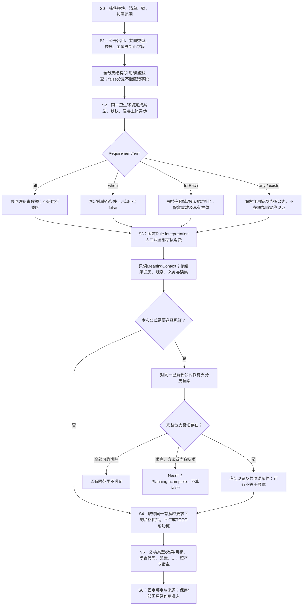

# 结构化作者源码

<a id="结构化意图与block源码"></a>

> **阅读范围**：采用范围内的设计规范；实现状态另查未决。


本章拥有新产品结构作者面的**Requirement/意图组合dialect**：它把已有Definition、RequirementTerm、主体关系、类型化参数与组合放入共享`gift.author-module/1`外壳。**它不拥有整个模块内所有Definition body**；计算、对象、状态/关系/流等按[多dialect作者模块](工程源/清单模块与绑定锁.md#author-module-dialect-composition)由各自真实body合同承担。JSON是本dialect的承载格式；Block是封装角色；意图是被接受的含义，三者不同。已有`.gift`计算规则、`gift.semantic-body/1`结构计算体和原生作者区域保留各自明确角色，不成为Requirement入口的依赖。

这里的`gift.requirement-structure/1`是**尚未发布的Requirement dialect结构体编码设计草案**，必须绑定本份准确内容，尚未由生产读取器实现。使用一个新格式名称不免除字段、语义、迁移和符合性责任。正文给出完整有限读取合同，其他领域的主体/关系必须有实际定义后才可接入；未知格式只保全，不执行。

<a id="successor-unified-author-definitions"></a>
## 统一后继模块与有类型发生点

本章原 `gift.requirement-structure/1`、开放 `gift.author-module/1` dialect 和已保存作者区域仍按原合同解释；`/1` 不是只能容纳四类意图的固定枚举。后继 `gift.author-module/2` 将业务、计算、意图、Pattern、Requirement 与产品组合放入同一严格容器，其[Schema](../../schema/author/universal-author-module-2.schema.json)是设计载体，不是 Reader、领域解释器或目标已经实现的证据。真实消费者未完成资格和迁移时，旧源仍保全，不以新模块版本名自动切换当前产品。

### 单一模块、开放专业解释与旧源映射

Requirement Body 的[机器字段](../../schema/requirements/requirement-structure-1.schema.json)完整接合本章共同 TypeTerm、typeParams/typeArguments、definition/expression 值、动态 design-use 及闭合默认构造；旧离线有限投影的 `ref/list/builtin` 仅是准确短写，不是新语言的类型上限。三种短写不能与共同构造混写。该草案仍未发布，精确 Schema 内容变更要协商 Reader，不以相同 `/1` 标签自称旧读取器兼容。意图六模态及量化/时态的[Body Schema](../../schema/semantics/intent-body-1.schema.json)也仅提供结构，合格领域、集合覆盖、时钟与证据另由各专业解释。

后继同时保留独立的 `{typed:{type:TypeTerm,value:Json}}` 数据写法：value 只有经该准确名义类型已绑定的 canonical codec 在预算内完整解码后才是有类型设计值，JSON 载荷本身不获任意业务解释。用作 default 时 codec 必须封闭纯、输入固定，不能读取环境/时钟/网络、调用 Provider、捕获主体/Grant/资源或执行用户程序。缺 codec、类型/单位解释、精度保证或预算时返回准确 Need/Incomplete；不能把解码不支持变成空值，也不能替换 main 既有 definition/expression 与闭合构造能力。数值 codec 仍遵守其专业精确编码，不能先经宿主浮点丢失词法。

`/2` 必需 `schema/moduleId/definitions`；可选 `namespace/imports/exports/dialects/annotations`。`definitions` 通常至少一项；仅当公开出口全部是显式导入的公开符号转导时才允许空映射，且此时 `exports` 不得为空；不为一个纯转导门面制造假的本地 Definition。局部定义映射键给出 Definition ID，每项必需 `kind/body`，仅允许该 Kind 声明的可选 `qualifiers`，不重复 `name`。局部定义、import alias、公开 export 名采用 ASCII 字母/下划线起始、后续字母数字下划线的同一 Identifier；模块身份另有不透明域，不套用局部词法。`local/std` 是保留引用前缀，不能由用户 import 重绑；`std` 只提供固定、确定、无外部效果的最小计算签名，不能按名字扩成任意隐式库。公开出口恰选 `{definitionId}`（本模块真实 Definition）或 `{import,export}`（已声明 import 别名与其真实公开出口），禁止同时携带两组字段、隐式 `export *`、私有转导与按注册次序覆盖。未导出成员仍私有，Ref 仅在 Schema 指定的位置解析；公开别名不制造新的底层定义身份、执行效果或 Grant。显示名、路径、修订与身份各有责任。

记录字段与 variant case 的成员名另用 MemberName：ASCII 字母/下划线起始，后续允许字母、数字、下划线及连字符。类型声明、记录构造与字段访问、variant 构造与匹配必须消费同一名字域，例如合法声明的 `a-b` 也能被准确访问或匹配；这不扩大 Definition、import、export 或 binder 的 Identifier。

内建 Kind 不要求空 dialects；真正新语义由准确 Dialect/Body Schema、类型/效果、组合、解释与目标消费者及迁移合同承担，缺资格保留 Needs。后继候选有 27 种 Definition 初始分派，19 种 Type、17 种计算 Expr 是其内部不同层级的语法，八个 RequirementTerm 也不混入 Kind 数量。开放业务名词优先用已有类型、Meaning、Pattern 和组合，不逐行业增加 Kind；`extension:definition.payload` 仅保全未知载荷，不能绕过专业 Schema 与权限执行。

**只转导、不制造主体的作者模块。** 下例仅定义公共门面；当前工作区中 `module:limit` 的 `Limit` 必须是真实已公开且可绑定的定义，`MaxItems` 才可被后继消费者引用。它不自动引入其他出口，也不需要再写同义函数体：

```json
{
  "schema": "gift.author-module/2",
  "moduleId": "module:public-api",
  "imports": {"core": {"mode": "workspace", "moduleId": "module:limit"}},
  "definitions": {},
  "exports": {"MaxItems": {"import": "core", "export": "Limit"}}
}
```

读取时按固定 SourceSnapshot、ModuleUse 和真实绑定锁依次解析导入别名、被引模块的公开出口及原 Definition；保留每一跳的公开名、名义类型、签名、效果、初始化要求、来源与失效读集。私有、缺失或不兼容的导入不能被导出绕过；原生初始化和外部作用由真实目标/运行合同裁决，重导出语法不执行原定义、不产生 HostGrant。纯转导环没有最终公开定义则拒绝为不可解析；合法类型/定义递归由自身 SCC 规则处理。目标根选择 `MaxItems` 时使用原真实 Definition 并保留此门面的公开接口与准确目标成员，不因本地 definitions 为空就生成空成功。被引公开性、导入锁、源修订或本门面出口改变时重查实际消费者；历史发布仍按原修订结算。结构 Schema 仅核两种出口分支及空体必要的非空导出，无法仅据格式证明全部绑定有效。

后继计算 Expr 的 int/uint 字面量同样统一为规范十进制字符串，不因数值当前落在宿主安全整数范围就允许另一种 JSON number 写法；Int 拒绝前导正号、前导零、指数及负零，uint 另拒绝负值。位宽、溢出与值域仍由类型/值消费者核验。旧候选中的安全 number 须先按准确旧 Profile 无损解码后显式迁移，不能经浮点舍入后声称保真。[固定纯std基底](../领域/计算基础/文法类型与求值.md#successor-structured-std-int-add)拥有准确符号、签名、字段省略和Fault含义；目标降低及数值资格仍由计算Owner提供。

**数值控制字段的另一条交换边界。** 计算 `Expr.literal` 中的任意精度 Int/UInt 用十进制字符串；与此不同，直接在 JSON 中以 `integer` 存储的七个结构参数（Type 的 `bits/scale`、QueryTerm 的 `count`、QualityTerm/PolicyRule/WorkflowBranch 的 `priority` 及 DeploymentNode 的 `replicas`）必须是准确安全整数：非负计数/scale/priority及正位宽/replicas最高为 `9007199254740991`，允许负排序优先级的两个字段最低为 `-9007199254740991`。这仅是跨语言 JSON 交换的精度/大小边界，不承诺目标支持任何高位宽、海量副本或实际分配规模；目标资源与数值支持另核。Reader 先核原始数值词法及固定 Schema，在未发生宿主舍入时才转成安全整数；不能把 `9007199254740993` 读取成 `9007199254740992` 后参与排序、身份、查询计数或布局。真正需要更大准确值的专业 Profile 必须声明另一种无损编码和完整消费者，而不是悄悄放宽本 JSON number 画像。

| Definition 分派 | 实际消费责任 |
|---|---|
| `core:type/constant/function/interface` | 类型、纯求值、作用域/效果、可调用接口；声明与函数值不产生运行对象/Grant |
| `domain:meaning` | 有类型角色、谓词/关系/操作/测量/事件的专业意义、解释来源与有效域 |
| `state:machine/event:stream/workflow:plan` | 状态与时间、事件顺序/重放/水位线、流程控制/数据就绪/恢复；成员存在不等于已激活 |
| `api:protocol/data:model/data:query/ui:view` | 服务方向与传输、数据一致性/迁移、查询代数与覆盖、输入/呈现与可访问性 |
| `resource:model/concurrency:contract/security:policy/effect:port` | 容量与租约、并发原子域、规范及授权、明确操作与效果结算；政策许可不等于 Grant |
| `observation:contract/quality:contract` | 观察来源/覆盖/时钟/冲突、单位与样本域/硬软测量 |
| `product:component/system/deployment` | 模板及实际实例、内部连接/外部需供/公开边界、实例放置与真实部署 |
| `native:implementation/extension:definition` | 原生单源及接口/效果、受控新语义供给；不凭任意 payload 取得资格 |
| `intent:goal/semantic:pattern/semantic:pattern-use/req:composite` | 目标六模态、抽象与角色精化、发生点绑定、八 Term 联立；原 Body 合同继续为相应专业依赖 |

**静态容量与运行期容量的不同作者入口。** `resource:model` 不再强迫每个真实资源都填写事先未知的 `capacityLiteral`。作者至少提供 `capacityLiteral`（已接受的静态声明上限）或 `capacityMeaningRef`（已绑定的 `domain:meaning(category:"measurement")`，返回当前资源的有类型、非负容量），也可两者都提供；这只扩展本 Kind 的容量来源，不增加全局关键字或新 Runtime。选定 Meaning 必须核实返回类型确为容量而非空闲额度/剩余预算、名义资源身份、单位与换算/取整、主体和作用域、真实观察/解释方法、时钟与新鲜度。其 `observationRef` 指向可被该用途采纳的 Observation 时，仍需核真实来源和覆盖；仅有引用不证明当前现实容量。静态上限也不是对 Host 实际剩余能力的认证。

若两种来源同时出现，它们是对同一资源、同一阶段上限的两个硬约束；只有已证明单位、量纲、作用域和容量含义相容时才可取共同上限，数值可以按合格比较得到较小者，不能把另一种资源或不同租户的量直接相减。没有容量观测，模型/源可以合法保存与分析，但依赖该值的绑定/目标生成/运行准入须保留 `NeedsCapacityObservation` 或实际 Target/Method 缺项；不填 `0`、最大整数或 `Infinity` 取得假静态合格。运行侧读取的是该次需要的可用且足够新鲜的容量依据，扣除同作用域现有占用、预留与未终结租约，再按真正原子/协调能力准入；先读到容量不等于拥有预留权。容量缩小时停止不合格的新准入，并按旧授权和原实例结算在途资源，不靠修改设计值撤销已发生作用。随容量变化，实际依赖和有效限额按所选运行控制/失效合同重核，不将观测数据写回持久作者 Definition。纯计算或完全不需要资源约束的根不因此创建资源监控服务。

**质量条件与比较策略的真实数据。** `quality:contract.terms` 将硬阈值与软比较分开：hard 仍必须有 `relation + thresholdLiteral`，是所有候选先满足的可行性约束；soft 可以保留旧 `relation + thresholdLiteral`（偏好满足某界），或使用 `objective:minimize|maximize` 直接指定真实测量方向，不再为了“延迟越小越好”捏造一个阈值。每项完整绑定 `metricRef`、被观察主体/工作负载、`sampleScopeRef/horizonRef`、单位与证据质量。纯方向性软目标不等于可无限求最优，缺可比较方法返回准确 `NeedsQualityOrder`。

`comparisonPolicy:weighted-explicit` 至少包含一条soft，且每条soft都必须提供稳定 `termId`、严格正的规范十进制 `weightDecimal` 和 `scoreRef`；后者须有资格地将本项指标及其实际阈值/方向、适用样本与时间域映射为**有限、无量纲、越小越好**的损失。先核该转换的类型、正反单调方向、定义域/取整/误差及独立来源，再按已选数值方法加权合并，不能直接相加毫秒、金额、风险或样本次数。缺任一得分或权重，不重分配其权重，也不填零；非合格映射只有未决方案，没有加权最优结论。hard项禁止score/weight/priority参与抵消。权重改变是真正的作者偏好变更，会使比较与选择绑定失效，不修改测量事实。

`comparisonPolicy:lexicographic` 至少包含一条soft，且每条soft须有稳定 `termId` 与显式非负整数 `priority`（小者先），相同合同内priority与termId分别唯一；不能靠数组顺序或重复的同名指标暗造优先级。较高优先级的比较已证相等才进入下一项；折中、缺测和交叉误差保持未知或未支配，不以较低优先级补偿。需要专业序/损失转换时可用合格 `scoreRef`，否则依已解释指标的比较规则，不用字符串或显示顺序排序。pareto无自动权重/优先级，仅按共同方向的真实支配决定；feasibility-only只裁硬可行性，不声称软条件被满足或比较过。跨多个Quality/Goal/Requirement层，仍遵守已接受的主体、独立层级与 R5 偏序，不因单个 `quality:contract` 有加权政策就吞掉上层硬要求。

例如 `{"termId":"latency","metricRef":"local:Latency","strength":"soft","objective":"minimize","weightDecimal":"2","scoreRef":"local:NormalizedLatencyLoss"}` 是一个可编码的加权候选条目，不因名字存在就证明损失归一化合格。真实比较要核 `quality:contract.measurementAuthorityRef`、精确解释和目标方法；数组重排不改变termId或实际优先关系。同一指标重复发生但主体/样本不同不能按名字去重；完全相同的同一termId则是结构冲突，不因多写一次增加权重。

旧 `/1` 迁移必须读其全部合法字段、扩展、已绑定 dialect 与 Body，不能只迁四类意图而丢计算、对象、状态等 Definition。旧宽名、转导、默认、公开性、显示差额和角色基数均须明确对应；新容器不支持的表达可以保全为具名扩展或留在旧 Reader，但须有真实消费者与作者决定，不能改标签后宣称等价。缺信息时返回准确迁移 Need。

旧结构样例的shape-only边界也须保持：一个实际仅有`Text→Text`签名且主体直接返回输入的`NormalizeUri`，不能仅因引用可解析就充当set/map相等、filter/refinement谓词、join条件或单调性证明，也不能凭名称宣称完成URI规范化。分别核相应签名、含义与证据，缺项留在原拥有者。旧目标若写`avoid(save-no-silent-overwrite)`，须先取得准确Meaning再核禁止对象；若该Meaning实际表示“无静默覆盖”的安全性质，该条款会禁止安全本身，须由有权作者修正为保持安全或禁止真实坏事件，不能由编译器按名称暗中取反。只列谓词字符串且明确`qualified:false`的供给仍是未合格提案，不签发解释、实现或观察资格。

### Definition、Use、实例与根发生点分别绑定

固定 Definition 内容是 `(moduleId,definitionId,source revision)`；一次根选择另含工程修订、Target、rootId 和公开出口绑定；组件实例为 `(root occurrence,components[].instance)`；局部成员使用再带所在字段、useId/稳定发生映射、实际角色绑定。现实对象还须有合格 issuer/scope/time/provenance。相同 Ref、相同模板、同名实例或同值上下文均不自动合并运行状态、缓存、Grant 或资源余额。

`DefinitionUse` 的字段为 `ref` 与可选 `useId/bindings/scopeRef`；省略 bindings 等于空映射，目标有必需角色就产生缺绑定，绝不补默认对象。useId 仅在包含它的组件/系统内命名被寻址的发生点，显式值不能重名，不是新的全局 Definition ID。形式角色的类型在定义所属模块解析，实际角色在实参发生位置解析；相同 alias 字符串不证明名义类型相同。`BusinessRoleActual` 的四种来源为 definition、context、带 objectRef/typeRef/issuerRef/scopeRef 的 object、带 collectionRef/cardinality 的 collection；集合完备性另有来源，set/bag/sequence 不相互隐换。根 contextBindings、组件 contextBindings、成员 bindings 三级接力，互不串用。

组件的 `stateParticipations(host/observe)`、`dataAccesses(owner/read/write)`、`eventParticipations(publish/subscribe)`、`protocolParticipations(client/server)`、`resourceParticipations(owner/provide/consume)`、`uiParticipations(render/control)`、`observationParticipations(produce/consume/audit)` 保留各自方向；`concurrencyUses/workflowUses/policyUses/qualityUses` 亦是明确类型化发生点，不汇成 members 或依赖万能列表。系统级 uses 与组件级同名 uses 不合并。组件 `requires/provides` 是静态能力方向，组件及系统 `requirements` 是各自独立义务；所有已接受硬义务在真实共享主体/时间/资源域内联合，不凭局部 PASS 推全局 PASS。

`components[].argumentBindings` 是静态模板实参，`contextBindings` 是业务对象实参。静态 mode=value 使用 `{source:"literal",typeRef,value}`，名义类型、单位、数值精度及基数由专业类型消费者核验；resource/capability/policy/observation 模式使用对应类型 Ref，不把动态对象、函数或句柄藏成 JSON 值。根未绑定角色、对象发行者未知或权限缺件分别保留 Needs，不凭字段齐全代签。

### 组合拓扑、公开接口与触发来源

`connections.source` 连接某实例真实 provides，target 连接某实例真实 requires；`publicEndpoints` 用 name、实例/端口 source 和 interfaceRef 明确公开由谁供应；`externalRequirements` 明确外部需供端口及可选 provider/scope/contract。未覆盖的必需端口是缺供应，同一 required port 不接受两个提供者或内外双供，除非有独立合格的聚合/仲裁组件。部署节点指实例而非模板；replicas 只是期望，不证明启动、状态复制或效果幂等。未知供应与共享容量仍须联合检查。

`activationRoutes` 以局部 id、单个 cause、workflowUseId 与可选 inputBindings 描述具体因果：ui-action 指有 control 角色的 UI use/node；stream-event 指 subscribe use；api-endpoint 指 server use/endpoint；state-event 指 host use/event；schedule 指具时间与有效域解释的调度合同。UI actionRef 只指合格业务 Meaning 的 operation/event，不直指底层 effect port。目标必须是本组件带 useId 的工作流使用，不能仅给共享 Definition。相同来源到相同发生点的重复路由拒绝；同源多播、重入与并发另需仲裁、去重及资源资格。

ValueSource 的 literal/input/context/state/result/resource/ui-input 仅共用带 tag 的编码辅助，每个消费者分别限制来源、类型和可见范围；JSON Pointer 不变成计算表达式。`OperationUse` 明确 portRef、operation 与有类型 inputs，缺 inputs 等于空映射而非自动补参数。前置步骤结果仅在实际成功且因果可达后可用，UI 输入仅对相应触发出现点可读；工作流 needs 是数据就绪条件，显式后继才给控制转移，数组顺序不是执行规则。返回失败/取消/超时/未决与外部效果结算分别解释；流程终止不证明业务 Goal 已达成。

流程的七种步骤、三类边、逐调用数据与恢复语义由[工作流执行与激活](../领域/状态关系与流/工作流执行与激活.md)唯一拥有，模块 Schema 只编码该合同，不增加第二执行流水线。状态机的转移优先与列表发现序继续由[状态语义](../领域/状态关系与流/层级状态与事件.md)及准确 Profile/Method 决定；新增事实谓词资格和仲裁引用不能静默推翻既有运行 Bool guard、祖先/后代与发现序算法，to/targets 的跨表示映射缺方法时保留 MethodNeed。

<a id="pattern-use-reading-and-migration"></a>
### 公共模式使用的读取与有向迁移

公共模式使用仍是模块中的`semantic:pattern-use` Definition。Kind选择`gift.semantic-pattern-use/2`严格Body，恰含patternRef、roleBindings、variationSelections、observationSelection，可选authorNotes，不容body.representation。patternRef沿准确DefinitionRef及import锁绑定；Use只保存实例角色、差异和观察选择，sharedClaims、签名与Meaning留在被引Pattern/Requirement，不复制覆盖。

Reader先严格核JSON重复键、字段、Profile并固定ModuleRevision及锁；解析Pattern，核角色键集，拒绝缺必需或多余角色，基数、名义类型、单位及身份精化消费[原模式合同](组合/抽象与开放定义.md#pattern-use-multiplicity-refinement-contract)。差异槽按required与可选性核，拒绝未声明槽、错类型和无权策略，selectionSourceRef不授Grant；再核观察的真实来源、时效、scope及World/Model与原观察边界相容性。PredicateClaim和RequirementUse各经合格解释器形成类型化义务，不能把规范义务压成Bool。只读实例视图及read-set保留NeedsFact/NeedsMeaning/NeedsBinding；选入Root后与同根Goal/Requirement联合闭合，Schema通过不产生Method、Grant或Artifact。字节、JSON Pointer及修订对应保留供诊断/编辑；错误草稿可保存，损坏实例不编为有效代码。

旧`gift.semantic-pattern-use/1`仅在全部角色multiplicity为one、真实定义/锁可验证且无不明条件义务时允许显式有向迁移：每项`{"objectRef":X}`变为`{"kind":"one","object":{"objectRef":X}}`，其余Pattern、差异及观察保持原义并重核。多基数、未知字段/版本、重复键或缺解释保原源和准确Need；旧Reader不猜读/2。同名、版本号不证明身份等价；转换经原[单写者迁移](../演进/兼容迁移与退役.md#author-profile-one-writer-migration)形成单候选并读回，不建立双Writer。Pattern/Meaning/观察改变使相交实例、Binding和Evidence失效，旧运行和持久状态仍按其原修订解释。

<a id="structural-author-primary"></a>
## 1. 作者成果和最小交互

产品作者操作公开的意图定义、外部管脚、实参、关系与必要约束。定义内部的循环、缓存、对象和恢复算法由复用定义或真实供给承担；需要新含义时定义新Block，需要新实现时交给相应实现责任，不要求每个应用作者抄一份。一个标签可以是准确能力的名字，不是无含义口号，也不意味着该能力已实现。

完整持久模块具有身份、导入和导出，但日常“门槛从3改5”“把过期政策改成重显再确认”可以只提交原有`editRef/value`或准确文本差异。工具解析标签、代管身份、保留共享关系并回写同一源。没有GUI也能操作管脚；读取层级与机器分析范围不同。不得把巨型JSON全量灌进每次提示，再声称使用者只改一个值。

使用者可不展开复用定义；维护者可打开一级或更深内部结构。增加一个普通业务定义不改核心枚举，也不强制建包、部署进程或独立长期节点。没有持久消费者的临时发生位置只用局部定位。层级封装可继续组合，没有固定层数；函数递归、静态需求展开和状态反馈分别解释。

<a id="structural-author-vocabulary"></a>
### 结构作者源的真实学习负担：组合操作符、定义形态和schema分开计量

“8个Term标签”只说明组合代数，不等于整个JSON作者格式只有8个关键词。直接手写`gift.requirement-structure/1`时按以下层次理解，Workbench/AI/CLI则可隐藏大部分机械字段：

| 类别 | 当前有限集合 | 普通应用作者是否常用 |
|---|---|---|
| **Definition形态** | `req:composite / req:rule / req:subject / req:value-type / req:enum-value` | 通常只新建/修改`req:composite`；后四类多由领域/定义库维护者提供 |
| **RequirementTerm组合操作符** | `use / require / prefer / all / any / when / forEach / exists` | `use/require/prefer`最常用；其余只在组合/有限条件与量化需要时出现 |
| **Type形态** | 共同TypeTerm；`ref / list / builtin`只是有限短写，不是完整类型联合 | 多由定义参数和字段表单生成 |
| **Value形态** | `parameter / subject / bound / enum / definition / expression / literal / list` | 普通作者多直接选参数/枚举/字面值/类型化值；subject/bound主要出现在组合和量化 |
| **Condition形态** | `value / equal / not / all / any` | 只有静态条件组合出现时使用 |
| **DefinitionRef定位** | 本模块`definitionId`，或跨模块`import + export` | 工具负责解析实际identity；显示名不代替ref |
| **参数role** | `subject / value` | 决定type解释和default资格；两者不能按同名互换 |
| **模块外壳** | 必需`schema/moduleId/namespace/dialects/definitions`；可选`imports/exports/annotations/extensions` | 工具通常维护；直接源码作者需要知道 |
| **Composite body** | `parameters / subjects / exposes / terms`以及各Term自己的`arguments/fields/...` | 工具通常按Definition合同生成/验证 |

这些schema键与判别标签都是当前未发布结构编码的**格式词汇**，不是一门新的文本语言保留字。业务名称、Definition/Profile/Rule名字、字段名和控制descriptor身份属于开放定义空间，不计作核心词表。

新的Money、Workflow、Simulation、Protocol、Storage等通常增加Definition/Profile/Rule/descriptor，不增加RequirementTerm操作符。只有现有`use/require/prefer/all/any/when/forEach/exists`无法表示一种新的独立组合语义，并且该区别不能由领域Definition承担时，才允许扩展Term联合。

因此词汇成本按角色报告：普通Workbench/AI作者可为0文本关键词；结构源高级作者承担上述schema；定义库维护者还承担Rule/Subject/Value catalog；它们不能混成一个“Gift有多少关键词”的单一数字。

<a id="author-surface-projection"></a>
### 最终作者面：一份真源的渐进展开，而不是要求人手写整棵JSON

`gift.author-module/1`及本章结构是持久作者合同，不等于最终使用者必须逐字段编辑的界面。人、AI、CLI或未来Workbench可以把同一修订按任务投影为“含义与公开边界、关系与要求、行为、实现选择、目标/配置、生成对应、证据与历史”等阅读组；这些组只组织已有Definition、Requirement、Control、Binding、资产和Evidence，不增加第二份可写模型。默认视图只显示本次独特决定和真实缺项，高级视图能够沿[信息完整性](需求关系与能力边界.md#author-information-completeness)和[有效控制投影](组合/稀疏控制与目标限定.md#effective-control-projection)下钻到所有相交细节及其来源。

因此普通产品作者不因编译器内部需要精确Int、Bool、Text、List、函数、控制流、所有权或目标表示，就被要求把这些机制逐项重写进产品模块。一个领域定义已经拥有这些细节时只引用Definition并写差异；原生源已经准确拥有独特算法时保留原生源；需要中立计算主体时才进入相应计算表示。反过来，隐藏低层字段不能丢掉控制能力：数值范围/舍入/溢出、编码、顺序、资源寿命、线程/时序、布局/ABI、构建和目标专有差异仍须由共同语义、稀疏控制、原生拥有者或明确Unknown承担，不能只因为默认界面没显示就被后端自由改义。

作者结构也不建立不断增长的“容器kind”或业务kind目录。Queue/Stack/Map之类只有在现有Definition或领域合同确实给出稳定可观察含义时才作为可复用封装；实际HashMap、VecDeque、SQL索引、消息队列等由供给与目标选择。公式、约束、决策规则、状态/关系/流、求解和仿真等已有领域表达能承担行为时优先复用；任务过程可用普通Definition/Rule、名义`Model<C,E,O>`和[强类型耐久活动等待](../领域/状态关系与流/层级状态与事件.md#durable-activity-await)，一般async采用原[任务降低合同](../领域/计算基础/通用计算与任务语义.md#durable-async-lowering)接到同一Model，不增加workflow kind、可写续体源或第二日志。类型/捕获/目标缺项须回实际owner，不能凭“工作流可组合”宣布所有目标已实现。“写一段自定义Rust/TS”不是结构作者面缺少控件时的默认补洞方式。只有真正独特算法或必须保留的原生专有观察才下钻到程序主体。

编辑器可以把紧凑投影、表格、图、属性面板或自然语言差异降低回本章已有结构编辑与原生资产编辑；接受后只修改真实owner。派生图、effective view和生成源码没有独立写权。无法唯一回写时显示多个真实owner或保持只读/待决，不按最近文本位置、字段同名或“看起来像这个Block”猜写。

<a id="author-decision-persistence"></a>
### 开发设定怎样持久化：按真实owner分流，不把全部东西塞进作者JSON

[完整开发设定面](需求关系与能力边界.md#developer-decision-surface)是统一**操作与查看**入口，不是统一**存储**格式。接受一次开发决定后，只有它的真实owner发生变化：

例如“至少保留512步可撤销历史”改变用户可观察功能，是Meaning/Requirement；同名的私有历史pool预分配只有不改变该保证时才是实现Control。偏好rope合法，但不能因所选Method较方便就减少撤销能力。“revision数学上至少增长1”和“输出ESM”也分别进入Requirement、真实原生实现/Target请求及必要Control，不让作者手写派生Binding；只有现有映射不足且已协商独立符号选择Profile时才新增选择文件。

表示选型按真实修改和消费责任：声明数据可用已选严格结构Profile；真实程序由其原生/计算源维护；高频随机事务数据由运行资源或数据库拥有；真实作者编辑瓶颈可促成明确可替换前端；传输压缩只改变派生产物。不能设一个JSON字节阈值就自动换语言、拆文件或迁移权威。换表示先核唯一源、往返、身份、未知保全和消费者迁移，未经资格的JSON5、压缩或新前端不能悄悄成为当前Writer。已委派创作实现时可自主补真实方法，只有未委派的业务、权利和不可补偿取舍保留有权决定缺项。

| 决定 | 正确持久位置 | 不应写入 |
|---|---|---|
| 业务/领域Meaning、主体、关系、Requirement、Profile使用 | 当前结构作者Definition/terms/parameters，或明确采用的原生作者源 | binding lock、Workbench settings、运行日志 |
| 实现/目标精细Control | `gift.controls/1`当前稀疏记录或未来同职责正式编码 | 结构Definition里复制一份同义实现字段；直接手改Binding lock |
| 自动选择的Provider/Algorithm/Method/版本 | machine binding lock / RealizationPlan及其来源 | 产品作者Definition；除非作者显式Pin形成Control |
| Cargo/tsconfig/CMake/platform manifest等原生专有配置 | 对应原生配置owner/managed region | 为“统一”抄进一个工程properties表 |
| env schema、SecretRef、部署policy | 相应配置/部署作者owner；secret真实值由Provider持有 | 普通作者JSON、binding lock、log、AI transcript |
| 每次run/deploy的参数、当前Grant、动态endpoint/credential | Runtime/Provider binding或Operation输入 | 产品Meaning；除非用户明确把一个稳定默认提升成作者决定 |
| Theme、keybinding、Graph layout、filter | Workbench/user/workspace presentation state | Engineering semantic source/hash |
| Applied/Observed/Evidence | Artifact/Operation/Evidence owner | 任何可写“effective config”副本 |

因此一个“All Decisions”表格可能同时显示`Money.scale`、`implementation.provider`、`Cargo target-feature`、`DATABASE_URL SecretRef`和`Graph layout`，但编辑它们会落到五个不同owner。**统一体验不意味着统一文件。**

### Profile、默认与显式差异的保存规则

语义Profile或工程Policy Profile是可版本化Definition/Requirement bundle的引用；使用点保存“使用哪个精确Profile + 自己的差异”，不把Profile所有展开字段机械复制进模块。Profile升级只有在该消费者接受新revision后影响它；显式固定值继续胜任自己的硬要求并可能与新版Profile冲突。

Definition内部公开default仍按[闭合默认](#closed-parameter-defaults)解释；实现侧默认由Control descriptor/target/native tool的真实owner解释。两类default不能互相借名。用户把某个当前默认值“固定”时，要保存来源改变这一事实，而不仅比较当前数值是否相等；否则未来升级会误把Pin当成继续继承。

### 决定的稳定身份

持久化决定引用真实`module/definition/use/occurrence/target`或原生文件区域身份；UI行号、JSON数组序号、TreeItem id、Graph node id都不是持久控制定位。没有稳定occurrence映射时，不允许为了保存一个局部设置发明“第7个调用”的长期身份；可以提升为私有Definition、保持候选临时控制，或返回该粒度当前不可长期固定。

## 2. 两个工程级JSON与真正源码的关系

`gift.project.json`继续使用`gift.project/1`，拥有身份、源范围、模块位置和输出要求；`gift.lock.json`继续使用`gift.binding-lock/1`，记录实际选择的解释、库和方法。它们不分别保存“意图全集”和“实现全集”，也不意味着整个工程只能有两个文件。

结构模块中的`definitions`保存真正作者内容。数据、图像、原生源、工具锁和秘密各按原资产角色处理，不强制全部转成JSON。清单不是授权，锁不是安装证明，也不保证未知宿主已经封闭。普通正文/参数变更不重写无关锁；解析要求、实际选择或契约变了才重核相交绑定。

[完整工作台范本](../../examples/结构化工作台/说明.md)包含10个当前作者模块、13个有限结构合同和工程清单。合同保存本例使用的字段、类型及正文来源，目前没有自动生成器；它们不随正文排版刷新摘要。清单`targets`为空，产品源仍要求TS及三平台；需要生成时必须取得真实画像与方法，不能编一个`profileRef`让示例假装可运行。根由公开`Studio`定义定位，不从文件名或“latest”猜取。

<a id="structural-envelope"></a>
## 3. 复用现有模块外壳

根对象使用已有必需项`schema/moduleId/namespace/dialects/definitions`，可选`imports/exports/annotations/extensions`。本文范本明确写出所有前五项；导入按工作区身份解析，公开导出按既有引用对象解释。重复JSON键、未知字段、非法字符串与超出读取预算分别诊断。对象键次序不是运行次序；需要顺序的结构使用数组并按各自语义说明。

`dialects.req`要求语言身份`gift.requirement-structure`和精确草案约束`1`；可重建快照还需锁定实际合同字节，不能仅凭`/1`标签区分两个同名草案。模块`kind`以`req:`前缀识别本合同。前缀不按业务名自增；新工作台、图工具或编译器通常只是新的`req:composite`定义。

### req:composite 的body

| 字段 | 必需性与精确含义 |
|---|---|
| `typeParams` | 可选有序SemanticParameter数组，省略为空；每项直接复用[共同参数联合](组合/参数包与类型级值.md#shared-semantic-binders)，普通Type参数仍可省kind写`{key,name}`；参数按kind和该词法作用域绑定，不另设参数语言 |
| `parameters` | 必需对象。键为定义内稳定参数ID；每项有`role`（`subject`或`value`）和`type`。value参数可显式声明`default`，规则见下节；subject参数没有默认。参数名变化需保持或明确迁移身份 |
| `subjects` | 可选对象，省略为空。每项有`type`；只声明本定义引入的逻辑主体，不分配运行对象 |
| `exposes` | 可选对象，省略为空。公开边界名映射到本定义subject或subject参数的准确引用及角色路径；只暴露逻辑主体，不复制运行接口或自动导出私有实现 |
| `terms` | 必需数组，可为空。存需求发生位置和来源顺序；合取不因数组顺序改变含义，运行顺序不能由它推导 |

`role:subject`的类型必须是已解析SubjectSchema；`role:value`为明确值类型。`Type`直接消费[共同TypeTerm](组合/结构编辑与身份保持.md#类型项)，包括core、decl及其实参、parameter、record、function和有类型定义引用；不复制第二套record/variant/generic语言。subject角色只接受解析为SubjectSchema的decl；value角色拒绝直接主体型。为保持有限量化域经复合定义转传的能力，设计参数的role:value槽可接收由List有限嵌套组成的逻辑主体引用列表，元素只沿已有subject/parameter/bound身份引用，列表不分配或复制主体、运行对象与资源。该列表只作设计绑定与有限量化域，不是普通计算数据，不得进入record、函数值、expression或默认；列表自身不能走subject角色path，只有量化后元素实际为主体的bound才能走path。List的元素类别由此实际使用槽检查，不把主体身份转为可复制数据。名义记录与变体由原`s:type`声明及构造器拥有，匿名记录不改变名义身份。

当前有限范本保留三种准确短写：`{"builtin":B}`唯一归一化为`{core:B}`（B限Bool/Int/Text）；`{"ref":R}`唯一归一化为`{decl:R}`；`{"list":T}`递归归一化为`{core:"List",arguments:[T]}`。短写对象恰含该一个键；禁止与共同构造字段混合。空列表从期望类型取得元素型，名义类型不按结构强转。共同decl的arguments直接使用SemanticArgument，Type实参仍为TypeTerm，实际参数数及kind由声明检查；Queue<Item>是普通SubjectSchema的泛型实例，不增加Queue核心kind。`DefinitionRef`仍为本地definitionId或跨模块import/export，沿准确ModuleRevision、导入绑定和公开出口解析；显示名、裸字符串和同名旧修订都不是引用。类型空洞可保全草稿，不能取得根完整性或生成资格。

全部外部参数已经显式绑定或按下节合法默认完成的导出定义可作为产品根。带参数的复合定义可作为库使用；选择为根仍有未绑定的必需参数时给出准确缺项，不自动用零/null。工作台根在`subjects.workbench`建立逻辑主体，把它传给LocalWorkbench；不把`Workbench`作为已构造运行类或必须调用的构造器。

<a id="closed-parameter-defaults"></a>
### 明确默认值：省机械重复，不改变硬要求

`parameters[id].default`是可选的Value，只允许闭合literal、已绑定enum、按[定义引用型](#typed-definition-values)检查的definition及其有限嵌套列表，以及本章[共同类型与闭合构造](#shared-typed-design-values)限定的`{expression:Expr}`构造子树；后者只包含literal、引用已绑定零载荷构造器或definition的reference、list、record及纯数据构造器call。一般call、field、lambda、parameter/bound/subject读取与用户函数执行不在默认范围内。它的类型必须与value参数相符；空列表由参数类型提供预期。定义默认只保存静态定义身份，不封装某次Subject、Grant或运行资源闭包；被引定义声明的静态依赖仍需解析。禁止引用parameter/subject/bound、一般调用或用户函数执行、读取环境、时间或未执行程序结果，也不允许为subject参数提供默认。这一有限选择避免字段次序、默认循环和两个未给主体意外变成同一实例；需要依赖别的参数计算的选择，可由现有复合定义和显式实参表达，不悄悄扩大本字段。

D0先收集参数并检查所有默认的结构、引用、类型与预期合同；D1在**定义自己的固定导入环境**解析闭合值，定义引用记录实际边界及被引修订依赖；D2核显式实参的已知键与类型；D3对仅缺少的有默认值参数填入原值；D4对剩余缺参返回准确Needs；D5保留显式/默认的来源并实例化所有硬条件。坏默认即使此调用显式传值也不是合法定义；未给null不能成为触发默认的另一种写法。被引定义的phase、观察、捕获与方法资格在实际使用点按原合同检查；缺方法保持Needs或未合格草稿，不阻止保全作者源，也不因默认类型合法就判要求满足。lists整体替换，不按位置拼接或隐式深合并。

默认是省略语义，不是候选优化偏好：默认与同域硬要求相冲突时报告冲突，不擅自改成另一个合格值；需要让编译器选择时显式使用已定义的exists/any。prefer仍只比较硬合格实现。定义升级后默认改变，只在真实接受新定义的使用点生效；锁定旧定义、显式固定旧值与继承新默认分别处理。

作者保存仍省略未写出的值；分析投影显示其解析值和来源，不把默认机械回填为长期作者文本。把省略改为显式同值，不能一律返回NoChange：此刻行为可等价，但以后默认升级的作者选择不同。结构、绑定、默认类型和值分别进入相交键，公开参数名或值域变化仍检查消费者。

<a id="logical-public-boundary"></a>
### 公开逻辑边界与目标入口

`body.exposes`可为空或省略；键为非空、无控制字符的公开边界名。值只允许当前定义的`subject`或role为subject的`parameter`及其已定义path；不能用bound、literal、enum，不能伸入另一个use的私有subjects。所有键准确匹配，不从显示name或对象枚举第一项选入口。

它回答“本定义哪一个逻辑对象是公开承诺”，不回答目标函数签名、服务端口或运行时权限。模块`exports`仍只导出DefinitionRef；目标画像再把公开主体与已有Callable/入口合同相接。两个导出槽指同一主体不创建两份状态；不同主体即使类型相同也不会自动连接。

`use`不自动向父边界转导子定义的全部exposes。父级要暴露一项能力，可在本级声明主体，作为subject参数传入子定义，再明确暴露本级引用；这只是同一逻辑对象，不生成中间转发层。无法外传的私有主体必须通过有定义的边界编辑变成参数，而不是读取私有ID绕过封装。

没有exposes的旧式有限源仍合法。供给/画像已有准确且唯一的根角色映射时可以继续消费；多个同型主体且无此映射时，返回具体边界缺项，不能挑第一个或把全部主体自动导出。缺少某个目标映射不阻止保存完整规格或分发可复用定义。

公开边界名变化影响它的真实消费者和目标选择，按原引用与映射处理；不维护文档历史别名服务。完整字段写法及同一行为多成品见[成品范本](../../examples/成品形态/README.md)。默认与exposes是当前未发布编码的有限补全，读入时仍需准确内容和支持协商；只认旧字段的实现必须拒绝未知能力，不按共同`/1`标签静默忽略。

### 条款形状与静态组合

| 条款 | 字段及含义 |
|---|---|
| 实例化 | 必需`use`和`arguments: {parameterId: Value}`，可选`typeArguments: [SemanticArgument,...]`。use为DefinitionRef或恰含`{design: Value}`的对象；前者引用实际复合定义，后者消费具有准确design定义引用型的值并取得其真实定义。typeArguments按被调定义的共同typeParams卫生代换，省略时仅允许共同规则能唯一推得的实参，否则保留缺项；不接受未知实参，全部无默认形参必须传入，有默认形参可省略；保持调用出现身份 |
| 硬要求 | 必需`require: DefinitionRef`和`fields: {fieldName: Value}`，可选共同`typeArguments:[SemanticArgument,...]`；定义必须是允许硬要求的已知Rule，先按其typeParams及kind绑定语义实参，再按已实例化的字段与跨字段条件检查 |
| 偏好 | 必需`prefer: DefinitionRef`和`fields: {fieldName: Value}`，可选共同`typeArguments:[SemanticArgument,...]`；定义必须是偏好Rule，同样先绑定其typeParams并检查已实例化字段，不经此入口改低硬要求 |
| 同时满足 | 恰含`all: [Term,...]`；在同一外层条件下合取全部子项，空数组为无附加义务 |
| 可选方案 | 恰含`any: [Term,...]`；至少有一个完整子项在其余共同约束下成立；空数组为不可满足，不是空产品 |
| 静态条件 | 恰含`when: {condition: Condition, then: [Term,...], else?: [Term,...]}`；else省略等于空合取，条件按下节固定输入解释 |
| 全体成员 | 恰含`forEach: {bind: id, in: Value, body: [Term,...], itemType?: Type}`；对准确有限列表的每个出现，在其词法作用域内合取body |
| 存在选择 | 恰含`exists: {bind: id, in: Value, body: [Term,...], itemType?: Type}`；在准确有限列表中至少有一个成员使完整body与外部共同要求成立 |

这些键是JSON判别标签，不是新文本关键字、公共工具或独立IR。同一条款只能出现一种形状；除各表声明的可选字段外不接受其他键。`use`只实例化需求，不启动活动或函数。terms、all、then、else和body中的数组均表示合取，不以顺序推导运行先后；来源次序继续保留。需要先后、激活或持续时间时，引用相应计算/事件/流领域的准确规则。

all/any/when/forEach/exists直接映射到原[RequirementTerm](组合/跨软件需求合同.md#cross-software-intent-contract)的All、Any、When、ForEach、Exists，不增设一种并行语义。表中的量化与条件只覆盖**有限、固定设计输入**，不会因为字段已可写就获得任意运行谓词、无限域或动态发现集合的支持。已有逻辑Rule可继续使用其准确合同；其边界不被有限编码偷偷改义。

### Value的有限精确联合

| 形式 | 含义 |
|---|---|
| `{"parameter":"id"}`，可带`path:[role,...]` | 引用本定义参数。只有主体参数可走角色路径；不能把值参数路径当作宿主属性读取 |
| `{"subject":"id"}`，可带`path:[role,...]` | 引用当前定义创建的逻辑主体及其角色；每段由准确SubjectSchema定义 |
| `{"bound":"id"}`，可带`path:[role,...]` | 引用词法上可见的forEach/exists绑定；只有其元素类型为主体时允许角色路径，不能越出其body |
| `{"enum":{"import":"a","export":"E"}}` | 解析名义枚举值；同名字符串不自动成为此值。本地枚举可用`definitionId`引用 |
| `{"definition": DefinitionRef}`，可带`typeArguments:[SemanticArgument,...]` | 引用一个真实本地或公开导入定义，按共同typeParams及kind绑定实际语义实参后匹配预期definition-reference的准确合同实例；省略只在可唯一推得时合法。不调用、不实例化需求、不取得运行句柄 |
| `{"expression": Expr}` | Expr是[共同有类型表达式](组合/结构编辑与身份保持.md#基础表达式的结构与执行区域)的完整合法节点，不是不透明JSON。仅在本次固定设计阶段求值得到所声明类型的值时才能参与静态组合；主体、Grant和运行资源不能由此构造或捕获 |
| `{"literal": value}` | 本有限编码用于规则明确接收的JSON布尔、标量文本及精确整数词元。整数须按十进制无损解码，不先转宿主浮点；底层读取预算限制词元长度，不改变原数值含义。中立Int的其他角色、精确小数或量纲值仍用相应已定义类型 |
| `[Value,...]` | 有限值列表。对应字段声明为集合时按其名义相等去重但保留来源；声明为序列时保持次序和重数 |

除path可省略为空之外没有按字段名推导的隐式值。`null`不是通用缺省。正整数priority是排序层次，不是性能分数或隐含32位数；值必须大于零，读取预算另行判断。显式path（包括空数组）只允许用于主体，不能把值参数带空path当成另一种合法写法。布尔与整数不得由宿主的`True == 1`之类行为混合；UTF-8解码、代理字符和深度/总量预算沿原输入规则。

<a id="finite-requirement-composition"></a>
### 条件、量化和选择的精确边界

本有限literal整数词元为`-?(0|[1-9][0-9]*)`；原`-0`解为数学0且保留原词法，`1.0`和`1e0`不因Schema将它们视为mathematical integer便进入此整数分支。Reader须在IEEE754转换前取得词元；计算体的规范十进制字符串与原JSON词元分别按其准确codec解释。

丰富作者值沿其准确Type Definition取得唯一、版本化的作者值编解码合同：固定接受形状、纯确定decode/encode、规范形式、语义值、是否提供纯总相等、尺寸与深度预算、错误位置、兼容迁移及可选编辑Schema。它不读环境、时钟、网络、权限或运行Provider；`decode(encode(v))`保持该Type的语义值，同一语义值具有唯一规范输出。允许读取非规范写法时保留原字节，仅明确请求格式化或规范化保存才改写；普通无操作保存保持原字节。同一Requirement解释修订中，一个准确Type最多选择一个canonical author-value codec，使用者不另选codec名字；多种字面形式由同一codec规范化，不同语义使用不同Type/Profile。

该合同只拥有作者值；HTTP/Protobuf/SQL/ABI/GPU序列化仍归原接口、持久化和Target，wire可用不代签作者codec。例如Money作者十进制结构与目标i128存储分别成立。没有作者codec时仍可引用Type或以它作为接口/主体类型，但需要具体作者值或closed default的位置返回准确Need，不能把未知payload当Text。历史`Value.typed={type,value}`仅沿原准确Profile解码：解析Type与固定codec、核预期类型和预算，再取得共同有类型值；迁入当前Expr/构造器保持同一值、来源及错误，不只替标签或丢旧输入。

Type具有纯总ValueOps见证且实际消费者支持该域时，Condition.equal才可比较相应丰富值；这不使下述基础有限Reader自动取得扩展支持。不能以canonical JSON字节相等代替领域相等，也不能用path穿入opaque payload。codec内容、规范形式或相等规则改变，使真实相交默认、条件、Binding与Evidence重审并按原版本迁移；未知Type、缺codec、版本不符、非法payload和预算耗尽分别保留。

**Condition的有限联合。** 恰一形态为`{"value":Value}`、`{"equal":[Value,Value]}`、`{"not":Condition}`、`{"all":[Condition,...]}`、`{"any":[Condition,...]}`。value必须为Bool；equal恰有两个同型、具有本合同纯总相等规则的值，仅支持Bool、精确Int、标量序列Text、同名义类型枚举及这些值的有限列表，不比较逻辑主体、函数、资源或宿主属性。不同名义类型、Bool与Int之间不强转。equal的列表递归比较次序和重数，文本不隐式规范化。Condition与Term按字段位置解码，不把condition里的any解释成实现选择。

静态条件读取本次已绑定的值参数、外层量化值、字面值，以及Value.expression经原阶段资格检查后从这些固定输入纯求值得到的Bool；其Expr仍沿共同绑定、类型、效果、固定依赖与预算检查。Condition.value可以直接接该expression；equal两侧也可先取得符合既有相等域的固定值，不因此扩大相等类型范围。它不能读未执行程序的输出、当前环境变量、在线权限或工作区扫描结果。需要外部事实时先按既有取得流程固定准确内容，再形成后继输入；没有数据不等于false。库参数未绑定时保存有条件结构；选择为生成根却仍缺少必需的外部设计实参时返回准确Needs。exists引入而尚未选定的有限见证不是外部缺参：先保留带作用域的符号条件，再由联合搜索逐个代入合法成员，不为进入求解而要求作者预填见证；确定分支以前也不跳过其义务。它不是允许作者声明“已授权=true”从而取得执行权。

条件为false只意味着不施加then中的额外要求，**不意味着禁止该功能或资源存在**。需要禁止联网、云同步或某种实现时，要有相应明确禁止规则。运行时每次输入都要判断的条件，应使用有定义的运行领域规则及实现，不把构建时取样代替运行守卫。Condition all/any的空数组分别为true/false；已知短路结果可用于纯静态判断，但仍先完成结构与类型检查，且输入依赖不能少记。

**域与绑定。** in必须是可准确取得的有限列表。元素类型先从已类型化的列表参数/引用取得；直接非空列表必须同型；直接空列表没有预期元素类型时必须给itemType。存在itemType时须与已知元素类型一致，不是覆盖或强转。有限列表可以装已有逻辑主体引用，元素不会因此成为运行期对象。未知或不完整枚举、运行流、未封存的Provider结果不参与本量化的穷尽结论；它们继续有自己的域、时间和覆盖合同。

bind是在该量化body中可见的非空局部标识，不对外导出；不得与仍活动的外层量化bind重名，兄弟作用域可复用。in在引入本bind前解释，所以不能自引用；普通参数与subject使用不同引用形式，不发生按同名捕获。嵌套量化可以使用外层bound的值。use取得已求出的准确实参后进入被引用定义自己的作用域，调用方局部ID不能越界进入被调定义。复制或改名由已有编辑映射维护，不为每个条款要求永久全局ID。

forEach空域为true，exists空域为false；非空exists的空body可由任一成员见证。两个情况都不凭空提供正常功能、合法输入或进展。一项任务确实允许空库时可以成功；要求正常工作的产品仍须有对应义务，不以空域和总失败消除它们。域的成员次序不规定程序调度，但出现次序和重数保留：forEach的两个相同值若各实例化一个带私有subject的use，会得到两个私有主体；显式传入的同一个主体仍共享。可以共享纯分析，不可按字节去重改实例数。

**检查未采用分支。** 所有分支都需有合法结构、局部作用域、类型、Rule身份及字段；false分支不能藏错字段。合格实现的取得只对当前有效义务及已选择路线进行，静态false分支缺目标方法不阻塞独立根。引用的定义含义本身缺失，与已知含义缺实现不同：前者保留语义缺项，不能用条件屏蔽后宣布该模块全部可解释。

**量词次序。** `forEach x … exists y …`允许每个外层设计成员选择自己的y；`exists y … forEach x …`要求一个共同y。它们不得交换。见证仅依赖其词法外层已经固定的设计值，选择冻结在原RealizationPlan/Binding及来源对应中，不新增人工锁表。求解分支的选择不是产品运行输入，不允许编译器每遇到未来输入就换一份不相容程序。

**偏好范围。** prefer可在根、use、all及固定输入决定的when/forEach中组合。但any/exists及其传递use的body在本有限编码中只允许硬条款，不允许prefer；检查器先计算传递的偏好出现，不让封装绕过限制。否则实现者可能选中“不带昂贵目标”的分支来删除自己的评价标准。把共同偏好放在选择之外，在同一主体上比较整套合格候选。确需不同候选采用不同评价对象时，须有明确、可比较的共同评价规则；本编码不以暗中跳过来实现。此限制不禁止作者明确选择的静态配置决定是否请求优化。

### 有界实例化、未决与正常输出

读取先检查外壳、形参、类型和全部局部引用；再按固定输入求Condition与有限域，将嵌套组合映射到原RequirementTerm和独立偏好。实例化使用有作用域的环境，缓存键包含根/定义、实际实参、默认来源、公开边界、共享主体身份、外层绑定与规则修订；同一结构在x=A和x=B下不是相同结果。私有主体按真实use出现和量化出现区分，来源合并不得把独立接受关系吞掉。

不先将公式展开为全量析取范式或所有候选的笛卡尔积。保留共享公式与作用域；all传播共同约束，any/exists只在有必要时枚举有限分支，预算记录真实展开、空间和方法成本。all中已证明矛盾的子项可解释整体冲突；any只有至少一个完整分支满足全部共同前提才有可行见证，只有全部有限分支均被可靠排除才可说该范围不满足。未读、无方法、未知、超预算分别保留，不算false；存在一个已验证可行分支也不代表它最优。

这些是具体实现算法的输入和出口约束，不是新增公共状态枚举。正常返回原约束、来源、偏好、读集及义务；错误用原局部诊断；不完整用原Needs/AnalysisIncomplete/PlanningIncomplete。取得外部证据或候选代码走原application/execution，不在探查分支时安装库、运行产品或产生外部写入。源合法、逻辑一致、有可实现策略、具备供给、产物完整及允许执行继续分开。

完整多实例范本见[产品族的条件与联合选择](../../examples/结构化工作台/说明.md#finite-family-example)。硬条件允许多个实现并不要求作者写循环；有限语法也不宣称能自动合成任意数学命题、非因果系统或无限动态世界。

## 4. 公开管脚、标签和连接

本定义的`parameters`就是已声明的公开需求管脚；真正计算函数的输入/输出来自其现有签名，事件、流与资源来自各自接口。工具可提供统一边界视图，但不让需求参数、计算返回值和进程句柄相互强转。管脚类型、调用次数、效果与生命周期一并取得，不另建必须人工同步的ports镜像。

逻辑主体的多个引用表达“约束同一个对象”。工作台的编辑、搜索和语言服务共同使用`workbench.documents`，方法不得各自复制一份互不一致文档模型。这个关系不要求同线程或同进程；实现可以是一对多或多个角色共享一组件，只要满足真实身份、作用与一致性要求。

运行中的数据连接表示消费某次计算结果，不自动再次调用生产者；事件连线不默认广播；资源扇出不复制拥有权。激活条件、顺序、时钟与终止来自相应领域。图上两端类型相同不证明跨边界适配无失败，图中一条线也不自动代表RPC。本文的结构模块不是把所有软件压成一个无类型有向图。

### 外延内部参数

增加外部管脚时，先确定内部变化的真实拥有者；新增相应类型形参，只替换被选使用点；所有未变消费者传回原值，原公共行为保持。对新消费者再改变实参。必须同时核别名、默认强度、共享定义与源映射；相同值显式固定和继承默认不是同一意图。只有一个使用点特殊时，参数或局部派生优先，不修改所有使用者的公共定义。

闭合复合定义可再次被引用，其外部边界仍是普通Definition。新增一个应用引用无须复制内部九份定义；跨包发布时才有独立版本/出口责任。实例身份与定义身份分开，相同参数的两次有状态实例不能按字节去重。需求合取的相同项可以复用分析，却须保留两处接受来源。

## 5. 字段目录和完整含义

字段目录采用同一模块外壳的四种定义；以下body精确字段不能由显示名补齐。Rule的body必需strength、fields、semantics、implementation，允许可选共同typeParams（省略为空），字段、语义及方法前提中的TypeTerm.parameter只绑定该作用域；其他三种定义采用下表。require/prefer与use共同消费同一typeParams/typeArguments代换算法，未给实参仅在共同类型规则唯一推得时接受；Change<T>的before/after均按同一T实例检查，不能每个字段各选不同类型。它们是结构读取所需的合同描述，不是运行时插件注册代码。

**`req:value-type`只拥有当前有限名义枚举目录，不是通用record/variant/quantity类型语言。** 更丰富类型沿共同TypeTerm引用其真实定义，值沿共同Expr构造，不为Money/Quantity/Coordinate新增Requirement Definition kind。

| kind | body精确结构及意义 |
|---|---|
| `req:subject` | 必需`roles`对象，可选共同`typeParams`数组（省略为空）。roles的键为本schema内稳定角色名，值恰含`type:TypeTerm`，且须为主体型；角色是已存在同一逻辑主体的关系投影，不构造运行对象。不设角色时显式空对象 |
| `req:value-type` | 恰含`enumMembers:[DefinitionRef,...]`；这是零载荷名义枚举的声明。每项必须解析到实际req:enum-value，重复成员身份拒绝。带载荷变体、记录、alias与泛型值类型统一由已有`s:type`定义，不扩充此kind |
| `req:enum-value` | body精确为空对象`{}`；成员身份只由原Definition身份拥有，不重复保存nominalIdentity。声明一个有限symbol不证明行为或运行实现，同名或同拼写不合并 |

Rule的subject字段保留既有槽名`subjectKinds`，但其元素统一为非空TypeTerm数组，每项必须是解析到真实SubjectSchema的decl及其准确arguments；槽名不发布核心业务kind。先替换Rule自己的类型参数，再按完整主体型实例匹配，Queue<Item>不能接Queue<Other>或裸Queue头；不得只核声明身份忽略实参。enum字段的精确形状为`{kind:"enum",allowed:[DefinitionRef,...],valueType?:TypeTerm}`；allowed非空且只能指真实req:enum-value。需要与参数或其他字段共享命名域时，valueType直接复用共同TypeTerm，必须解析到准确req:value-type声明，allowed必须是该声明真实enumMembers的非空子集；省略valueType时，预期名义域为该Rule准确修订的该字段声明。set.element递归消费同一enum形状，不把set改为list。普通kind:value的valueType引用该命名类型时同样保留它的准确域。一个symbol可列入多个明示有限域，但类型化的值同时保留准确预期域与成员身份，不因成员相同跨域强转；没有预期域且无法唯一推得时返回Needs，不猜唯一枚举类型。不能把主体类型名或枚举名称串当作声明。跨模块用准确import/export，本地用definitionId；循环类型先收头，再检查准确成员表、期望域与角色路径，不依赖文件排列次序。既有范本名字串只在一次明确的迁移中按原导入与声明环境解析；唯一解析失败则保持待决，不给生产读取器保留猜名fallback。

Rule.fields每项明确required、type及含义说明；本有限目录的type区分subject（允许的Subject种类）、enum（准确名义身份集合）、set（元素类型）、positive-integer，以及复用已有Type的value。Subject路径映射、名义类型与值不能从同样拼写混用。Rule正文的完整正常行为、失败、帧、进展、条件与方法责任仍由[供给合同](需求规则与供给合同.md)拥有；有限结构合同保存字段映射和来源章节，真实语义变化才同步相交消费者，不能只改目录放宽义务。真正生产语义实现须把这些规则编码为原Definition/Assurance/方法的实际消费者，不允许每次构建让AI重新解释说明。

工作台范本目录列这里明确的35种Rule和实际名义值，以及明确允许的过期政策变体；未知名义值不是用户无权提要求，而是当前未定义/未支持的范围。公开类型增加变体时更新相交解释、消费者和版本。该设计目录并不证明UI资源、正则方言、授权驱动或M01—M14已经存在。

<a id="rule-interpretation-binding"></a>
### Rule的固定含义接合与领域方法

`semantics`保留必需的`source/section/scope`来源字段，并允许唯一可选项`interpretation`，形状恰为`{methodRef:DefinitionRef}`。本草案不增加`req:interpretation`、第二份Rule签名或逐领域业务kind。methodRef必须解析到真实本地`s:function`、`s:port`或导入公开可调用入口；普通binding不作为公开出口。缺主体的function或未绑定port只有接口，不是已实现方法。准确Rule修订、其typeParams/fields及当前require/prefer发生位置共同确定方法输入，来源文字不由编译器每次重新解释。

此字段是既有MethodSpec的固定含义角色`validateMeaning`在Rule上的直接绑定，不是候选实现选择。该角色使用现有`phase:check`；由本草案的准确解释内容固定共同接口修订，唯一派生interfaceRef、inputContract与outputContract，不要求作者重复填写。methodRef解析的内容和实际入口签名、实现、效果、依赖、读取资格及适用域仍须核验；写一个方法引用、声明空effects或返回Done不能自签执行/解释/推理资格。缺固定解释只限制依赖其机器含义的用途，不能转而挑一个改变含义的候选解释器。matchRealization/planChange及生成方法沿原选择、绑定和资格合同另行采用。

共同接口为内部`BoundRuleApplication × MeaningContext → MethodOutcome<MeaningResult>`，不是普通产品函数新增的Subject参数语法。BoundRuleApplication由完成绑定的require/prefer派生，含准确Rule/实例/发生位置、typeArguments、按Rule.fields检查的字段值与来源、作用域及实际SubjectTerm关系；不由作者另写一张实参表。SubjectTerm只在此受限绑定环境中定位逻辑主体及角色路径，不能转为普通Expr数据、record字段、可复制资源或运行对象。入口使用的编译元数据类型是固定共同接口导出的名义内部类型；沿既有TypeTerm.decl和正常可调用签名引用，没有新的公开TypeTerm构造。普通目标画像不能据此构造或泄露编译器句柄。

MeaningContext只提供本次固定输入的受限读取、准确引用解析、按当前Rule字段类型取得值/主体投影、原领域检查与BoundaryView/Claim构建能力；不提供cwd、网络、秘密、任意插件加载或目标运行回调。字段读取按该Rule实例的准确字段ID检查，值使用同一TypeTerm/Expr及定义引用资格；逻辑主体只由typed binding访问。运行值或观察必须由真实投影/可调用定义的准确引用及其输入、输出、phase、效果、正常域和捕获合同取得。普通Bool谓词、模型数据、显示名称或同类型的主体不自动成为观察或运行实现。

MeaningResult只汇合现有内部合同：当前applicationRef、已检查RuleContract（准确含义引用、字段绑定、主体/观察关系及适用条件）、所需BoundaryView贡献、原Claim/残余义务和逐字段消费关系；不携带一个任意JSON行为解释器。每个非来源字段要能沿准确字段ID追到真实输入、观察、义务或摘要投影；未消费字段只能作为明确未解范围返回，不能获得完整含义。逐字段关系的consumer只能是本次实际存在的输入绑定、观察绑定、Claim或BoundaryView投影，来源位置不是语义消费证据。RuleContract及MeaningResult是内部方法结果，不新增作者持久文件、第二需求树或独立可写模型。原领域模型仍由普通s:type/Expr、实际领域定义或合格原生合同拥有；领域方法解释它们，通用组合器仅消费合格边界。

接合次序为：收Rule与方法头并解析公开引用→绑定共同typeArguments→检查全部实际字段/设计值及主体路径→核固定接口与真实入口签名、效果、实现和解释采用范围→在当前作用域构造只读BoundRuleApplication→按原M0—M4调用→检查结果归属、逐字段消费、观察合同、残余义务及实际读集→交原组合/选择/保证消费者。方法调用循环沿原查询递归和预算处理，不将Rule解释为其自身的无限需求展开。校验方法的Done只说明返回数据；运行性质、进展、联合分布、共享资源、保持及实际作用仍由原拥有者核验。

静态检查不执行产品运行表达式。设计阶段Value.expression仍只在其原合格静态子域求值；运行谓词/状态/反馈/随机过程作为受类型检查的引用或模型交给原运行方法，不通过本接口偷跑。真正外部输入先经原Operation取得获准的冻结结果，再成为PreparedJob后继输入。fixed-pure资格由真实入口与能力限制证明；需要外部工具的方法返回原ToolResultNeed，不由作者字段自报executionClass替代准入。两个使用点指向同一主体时保留同一SubjectTerm；两次私有实例不能因模型同值而合并。反馈、概率和共享资源继续消费其真实初态/调度/耦合/寿命与失败合同，不能由逻辑All或普通record自动推出。

实际读集包括Rule及实例化字段声明、被消费值/定义与构造器、准确主体角色路径、固定解释接口/方法及实现依赖、实际观察投影/合同、所用领域规则与摘要，以及真实查询的成员/负依赖；只在观察候选全集时登记其范围修订。改变模型、谓词或方法内容，改变字段到观察的投影，或改变同一主体的共享连接，使所有真实消费者失效；无关根复用自己的有效结果。显式同值固定与继承默认、方法内容同输出但不同读集、同主体与同类型主体分别保留来源和身份。

未知接口、私有出口、kind/签名不匹配、字段/观察型冲突或输出越权为实际定义/方法错误；准确内容或方法实现不可取得返回Needs，已知不支持或预算中止沿原Stopped。一般运行判定、完整求解或独立证据缺失保持相交未决，不伪报矛盾、false、零效果或成功。新方法产生定义、目标贡献或作者变化时继续原introducedContent/LoweringResult/AuthorDelta复核与实际作用准入。

未发布迁移保持现有catalog的source/section/scope和implementation:"unbound"。没有真实解释方法的Rule省略interpretation，明确处于只有字段/来源可读、机器含义未绑定的状态；不造空方法、名称fallback、always-success或新的示例模块。真实方法存在且已按固定接口取得资格后才添加其准确引用，并同步decoder、解释装配、实际字段消费者、诊断、生成与编辑闭包。当前生产读取器尚未实现此草案，规范补齐不证明可运行。

### 规则值字段沿同一类型检查

`{kind:"value",valueType:Type}`用于标题、精确整数、布尔、类型化定义引用及有限值列表；Type就是上面参数使用的同一联合，不建立另一套类型语法。只接收值类型，subject不允许藏在value字段。值从本次准确目录环境解释，enum成员仍必须对应实际名义类型；普通同名字符串不被转换为enum。valueType缺失、未知类型、重复字段和不支持构造均拒绝。

Rule.fields的required决定是否需要给出该字段，不提供运行默认；省略默认仍由复合定义parameters.default唯一拥有。`positive-integer`保持原精确Int且>0的语义，与value(Int)加该规则自己的同一前提等价；不因为新增value就放宽旧规则。set按真实元素类型解释及其名义相等去重，list则保持次序与重数，二者不互换。enum的valueType只固定期望名义域，不解除allowed子域约束；已类型化参数转传先核准确域，再核成员是否在本字段allowed中。不同域即使成员集合相同也拒绝隐式转换；valueType指向非枚举类型、allowed越出enumMembers或其修订失配均为字段定义错误，不通过读取值的拼写补齐。

校验顺序为：收集类型和公开引用→核目录字段定义→在复合定义检查全部默认→实例化实际值→按Rule字段检查类型与必需性→执行规则的定义域及跨字段条件。例如Sampler的两个Int字段仍须满足0<=a<=b且b>0；类型合法不是约束已满足。`weights`是`List<Int>`而不是类型名恰好叫`ListInt`的新内置类型。

相交的完整源见[开发成品](../../examples/开发成品/README.md)。它们使用已有use/require/exposes和本值字段，不新增Gift文本语言。当前合同仍是按准确内容绑定的未发布设计；只理解旧字段类型的实际读取器返回不支持，不能忽略后宣称所有源码有效。

<a id="typed-definition-values"></a>
### 自定义谓词、设计和选择器作为类型化值

定义引用型的形状为`{"definition-reference":{"role":"predicate"|"design"|"selector","contractRef":DefinitionRef,"typeArguments":[SemanticArgument,...]}}`，内部必需role和contractRef，typeArguments可省略为空；除此不接受其他字段。contractRef的共同typeParams由此按kind绑定为准确预期实例，未绑定泛型不能冒充任意实例；含外层参数时只在该参数按共同规则实例化后取得具体预期。它沿原`parameters.role:value`、`Rule.fields.kind:value/valueType`与递归`list`共同使用；不新增逐业务字段kind或第二套参数协议。Value的definition形式必需一个引用，可选共同typeArguments；先实例化实际定义的公开边界，再与上述预期合同实例检查，不按相同参数名猜配。预期类型来自参数/Rule字段，不能由载荷自行标记资格；裸字符串、枚举或Subject不能自动转成定义引用。

contractRef必须解析到实际可读的本地可见定义/边界，或导入的公开出口：predicate对应准确可调用输入及Bool结果，design对应需求定义的准确主体/参数边界，selector对应其所属领域的成员、顺序/重数、静态或动态范围合同。普通计算签名可复用无主体的`s:function`边界声明，实际谓词可为有主体的定义或具有资格的导入出口；其他领域沿其已定义边界读取。角色名不是新函数语法，也不使缺主体的签名声明成为可执行实现。没有可解释边界就保留语义缺项，不按同名或相同JSON结构猜契约。

观察域、phase、正常域、捕获约束及所需资格归引用它的原RequirementDefinition/Rule语义，与contractRef共同形成预期合同；不在每个使用点复制一套签名或可信布尔。运行谓词与编译期固定值不同：检查引用本身不会运行函数或读取外部状态。只有相应MethodSpec明确承担运行判定、构造或证明，且其前提成立，才可用于该目的。Bool返回类型不证明纯、总性、终止、完整观察或要求已满足；事后校验也不等于实现或预防。

读取顺序为收集实际定义与公开出口→检查预期contractRef及Rule语义→解析值引用→核角色、输入/输出与效果、作用域/捕获和本次资格→形成原RequirementTerm及方法义务。参数转传、use封装、有限列表与forEach沿同一类型检查；某个运行selector不因装在列表内就成为静态穷尽域。需求设计值通过`use:{design:Value}`被实际采用时，Value必须在本次设计阶段解析为准确已绑定的role=design定义引用；预期contractRef及其typeArguments从该Value已检查的声明/表达式类型及本次静态绑定取得，形参/量词沿原绑定；合格设计期Expr的准确公开返回类型也可提供预期。不得由载荷自报、名字、任意JSON或运行结果推测。没有可取得预期类型的裸definition直接使用原静态use形式，不能靠载荷自报contractRef补资格。核实际定义的准确公开形参/主体边界符合预期后，再按同一use算法作主体映射和卫生实例化；arguments按该准确已实例化边界检查。design值已绑定类型实参，采用时不再给use.typeArguments；需要改变类型实例就先取得另一合格design值，禁止二次绑定覆盖原实例。运行selector、未求得的计算结果与动态句柄不允许补静态target。单纯传递definition不创建私有主体或运行对象；每次use及量化出现保持自己发生身份，私有主体各自独立，显式传入同一subject继续共享。静态环仍按原有界展开规则拒绝或保留未完成，不借此解释为反馈/延迟。

definition可按[闭合默认](#closed-parameter-defaults)复用，不加入Condition.equal的相等域；引用相同不证明运行行为相等。递归定义、捕获资源和效果继续按原领域规则检查，不能通过引用绕开有界需求展开。引用、边界、Rule语义或方法资格改变时，仅重核实际消费它们的类型/实例化/供给闭包，保留原来源与使用发生。未知role、缺字段、私有出口和不支持类型拒绝或保全为未合格草稿；缺方法不伪装false或无要求。

这是当前未发布结构编码的显式扩展；只认识旧联合的读取器必须报告不支持，即使名称同为`/1`也不能静默忽略。真实读取、共同检查、编辑/迁移及目标方法仍是实施义务。本地/导入、公开参数与再次修改按[开放组合验收](../运行/验收/开发面案例.md#open-intent-composition-acceptance)检查。

<a id="shared-typed-design-values"></a>
### 共同类型、设计期值与第二次修改

TypeTerm与Expr的字段、引用、名义构造、泛型、顺序和类型/效果判断只由原共同语义拥有。复合定义、SubjectSchema、Rule、definition-reference及use/require/prefer/Value.definition的原typeParams/typeArguments统一消费[共同参数kind与卫生代换](组合/参数包与类型级值.md#shared-semantic-binders)；普通Type写法保持，非Type实参必须有tag。设计Value/默认仍受本章类别与阶段限制，新Scope/Region参数不制造真实资源或TaskHandle，fresh参数不能由配置实参提供。结构require没有第二套求值器；设计期计算复用[阶段求值](../编译/内核/阶段求值与反射生成.md)，其阶段资格、固定输入、可冻结结果及预算仍由原owner判断。不能把不合格runtime调用解释成“稍后再算”，也不能靠函数名或返回Bool自签纯度与终止。

expression中的本地binding只能引用当前准确value参数、当前可见量词的值绑定及Expr自身词法绑定；适配时通过绑定身份映射接入原环境，命名空间分开，不按相同字符串捕获。逻辑subject只能沿原subject/parameter/bound身份引用；不能把它塞进普通record复制。普通record、变体构造、泛型函数及其转传按原类型规则工作；类型正确而阶段不合格仍是未完成。默认和静态require值的求值不得发起Effect；确需外部取得时，由原Operation阶段先获准取得并封存为固定输入，后续纯求值只消费该输入。读取作者JSON不执行外部程序或作用。

默认继续保持[闭合默认](#closed-parameter-defaults)：一般expression不取得默认资格。`default.expression`仅接受共同literal/list/record和引用已绑定名义数据构造器的reference/call子树；call的callee只能是原`reference.ref.constructor`，arguments仍有序且只递归包含这些闭合构造，不得调用用户函数。静态已绑定definition引用仅用于有准确预期类型的定义值。parameter、bound、subject、field、lambda及任何环境读取拒绝；构造器仅是原名义数据构造，不运行初始化hook或外部代码。资源类型和不能冻结的值拒绝，坏默认即使未被本次采用也仍是坏定义。

读取按同一流程：先固定模块、语言与共同类型合同的准确修订→收集声明/typeParams/公开出口→归一化旧短写并解析TypeTerm及全部引用→检查目录成员、每个条款/分支与全部默认→绑定类型与值实参→只对所需固定值调用合格阶段求值→检查Value及use的准确预期边界并实例化原RequirementTerm→取得原方法/Assurance义务。未采用分支仍查结构/绑定/类型，不提前执行分支计算。明确类型/字段错误、缺解释、无阶段资格、超预算、缺方法和真实矛盾分别返回原诊断/Needs/AnalysisIncomplete；未知不得变成false、空列表或空需求。

例如普通`s:type QueueChange<T>`定义before/after/reason字段，req:subject Queue<T>只声明实际主体关系；`QueueChange<Item>`、它的record值、通用谓词引用和`use:{design:{parameter:"policy"}}`沿上述四个已有构造组合。新增一个普通类型、构造器、谓词或需求设计不修改核心业务枚举，仍需实际含义、合格阶段与目标方法；可表示不等于可判定或可执行矛盾要求。记录字段本身是data，不能仅因叫before/after就被解释成状态变化。

第二次修改沿原编辑与读集：类型实参、字段/变体、构造器、公开边界、定义值、捕获、phase或方法资格改变时，重核真实消费闭包；“所有成员”及否定查询依赖也保留。重排条款不能按数组位置猜跨修订身份，显式同值仍保留作者来源。未知共同节点保全草稿并报告不支持，不忽略后生成。旧/新草案只能通过准确合同与显式迁移区分，不能以同名/1宣布兼容；本设计不表示已交付读取器、求值器或目标实现。

## 6. 硬要求、默认与偏好

同域硬要求合取，不能按后写覆盖。父级硬要求不能被局部“reset”删掉；重置只删除本层可覆盖默认。改变一个参数前核它承担的是可选择策略还是已经独立接受的义务。某个参数恰好与父要求矛盾时必须返回冲突，不能因为格式通过就生成较弱实现。

逻辑矛盾、缺语义、缺实现、缺证据、无权和资源预算结束分别报告。分析未找到矛盾不等于已证明可满足；声明满足安全条件不允许通过永不工作来规避正常功能与进展。完整需求可以在实现未完成时保留，其完成状态是设计而非可运行。

偏好只在合格候选中比较，未知成本不能算零；同优先级的不同量纲不能随意加权。较高优先级未能确定相等或支配时，不跳过它用低优先级代选，具体算法见[分层偏好比较](../编译/实现选择与设计搜索.md#preference-partial-order)。保持已有合格绑定或采用已委派稳定顺序可以是明确选择，但不产生最优结论。普通重建不再搜索整个世界；改变需求、方法失效或明确要求重新优化时才打开相交搜索与创作。

## 有限组合与固定含义的细图

结构合法、组合可满足、实现可取得与作用获准是四条不同边界。



## 7. 直接编译步骤与真实责任

**S0捕获。** 固定模块字节、清单、真实锁/已知缺额与披露范围；严格解码、不运行脚本。身份和解析上下文由workspace提供。

**S1收头。** semantics先取得模块出口、共同类型声明与构造器、各定义的typeParams、复合定义参数、主体与Rule字段，再按同一TypeTerm/Expr规则检查。循环导入不递归计算互相包含的摘要；访问仅沿公开引用。缺定义可保全草稿，不能当空定义。

**S2实例化。** 先绑定共同类型实参，再按[默认规则](#closed-parameter-defaults)完成准确值与主体参数环境，解析[公开边界](#logical-public-boundary)；use的直接引用及合格design值沿同一公开合同检查。只对实际需要的设计值做合格阶段求值，再对所选根的use及有限逻辑组作卫生代换，按“根实例、定义引用、使用与量化出现路径”定位内部主体；外传subject仍是原主体。按[有限组合规则](#finite-requirement-composition)保留量词顺序、条件、绑定环境与真实来源，偏好独立于供给可选择分支。静态use环没有明确有界展开规则就报告环；不因此禁止运行函数递归或有合法反馈的状态模型。

这里的“使用出现路径”只在**该份冻结源及其解释**中定位发生位置，不是跨修订的永久实例ID。C1中第2项在C2插入一项后变成第3项，不能因数组下标变化把它认成全新主体，也不能把新的第2项认成旧实例。跨次保持依原身份与明确编辑/迁移映射取得；缺少唯一对应则保留待决，不按相同参数或结构哈希猜认。同一复合定义调用两次时，各自引入的内部主体保持不同；显式传入同一subject的两处引用仍共同约束该主体。合取分析可共享，不吞掉发生来源、接受范围及潜在运行实例的差异。此处不增加每个条款必填ID，也不让编译时实例化自动迁移正在运行的状态。

**S3检查组合。** 类型/字段/参数、主体同一性、硬约束/进展/帧与公开资源合同分别检查。无现成判定方法时保留义务，不把任意命题当普通布尔求值。

**S4解析供给。** compiler消费具有作用域的同一要求公式、目标与实际方法，而非丢失any/exists关系的扁平条目表。按[统一实现与选择范围](../编译/实现选择与设计搜索.md#scoped-realization)寻找同一套共同成立的实现；方法给出前提、覆盖、效果/依赖、残余与成员贡献。可以直接采用成熟总成或组合；缺实现按已有委派创作并检查，不把TODO桩作为产物成功。

**S5生成与复核。** 将方法产出的中立/目标片段送回原类型/效果/目标检查，组合必需源、配置、UI/消息/资源、宿主和说明。只输出接口而缺功能时根未完成。绑定不由类名或目录名字猜。

**S6固定与继续。** 原语义映射连接Requirement发生、方法选择、目标位置及独立证据。参数变化使相交义务/方法失效；源格式变换本身不扩大权限。预览与保存/部署分开，真实写入仍由execution承担。

以上进入原P0—P7与十职责：workspace捕获、semantics解码/实例化/检查、compiler方法与目标、assurance义务及证据、application组织、execution真实作用、entry呈现、adapters提供实际能力、contracts拥有字段、bootstrap装配。没有第二编译器、全局BlockManager或强制数据库。

## 8. 两次变化与保持范围

范本当前根将`Reject`传给复用LocalWorkbench的`stalePolicy`。后继根只将这个名义实参改为`RebuildThenConfirm`；34条硬要求中的替换条款改变，其他33条、两个偏好与主体共享关系保持。变化的语义是重建、重新显示并重新接受，旧接受仍不批准新计划。新源不影响已经运行的旧版本；方法和消息/UI的实际相交变化由编译器负责。

再增加一个产品根时，创建新的逻辑workbench主体，继续引用同一复用定义；同样的路径拼写不使两个产品共享状态。相反，同一产品内多个需求传入同一subject时必须联合解释。可观察实例创建数量属于有意义的选择，不能为了去重删去。

需要开放内部策略时，先完整迁移函数式边界/结构参数与全部真实使用点，再改所选调用。先用同值回填证明旧实例关系保持；若出现新的独立接受条件，保留其来源而非用“值相同”吞掉。完整算法主体不因此必须露在产品文件中。

## 9. 格式升级、草稿与退出

未知字段/种类可以逐字节保存为非合格草稿，但不能在执行前忽略；已有合法独立根可继续。读取器声明实际支持的结构构造及准确解释；只识别use/require/prefer的实现遇到有限组合时必须返回不支持，不因共同的草案/1名称假装兼容。正式冻结协议后，扩展按协议协商或新版本演进，不原地改变已发布字段。迁移按明确旧解释读取后构造新源，保存边界映射和待决；不靠同名`/1`套用新含义。直接JSON作者区域不再另外编辑相同含义的`.gift`；旧文本可作明确版本的对照或待迁移输入，一经转成结构真源就停止竞争写权。

导出/退出可取得结构模块、全部必要定义与准确绑定及原生资产；许可限制不能用虚假导出成功掩盖。可重建索引和视图不是必须长期保存的主体，真实在途恢复和保留责任仍按原协议继续。源码写入、采用、目标生成、运行与收益分别报告。

## 10. 已定义与未取得

当前明确的是上述字段、组合、引用、身份、默认、输入输出、固定解释绑定与方法责任。关系、流、事务、数值、模型、概率及资源接口由各自领域正文给出准确值类型、运行边界与保持条件，共同接合见[跨领域表达闭包](组合/跨软件需求合同.md#heterogeneous-intent-closure)。文档校验可以检查实际源、字段、引用和有限展开等性质；没有交付真实语义解释器、目标方法和桌面运行库。新增独立观察仍须由原领域明确其类型、含义、阶段与消费者，不能借一个`kind`字符串冒称已覆盖。已有相关领域成果继续有效，尚未完成的设计、实现与验证分别保存在原U，而不是都改称只差测试。
