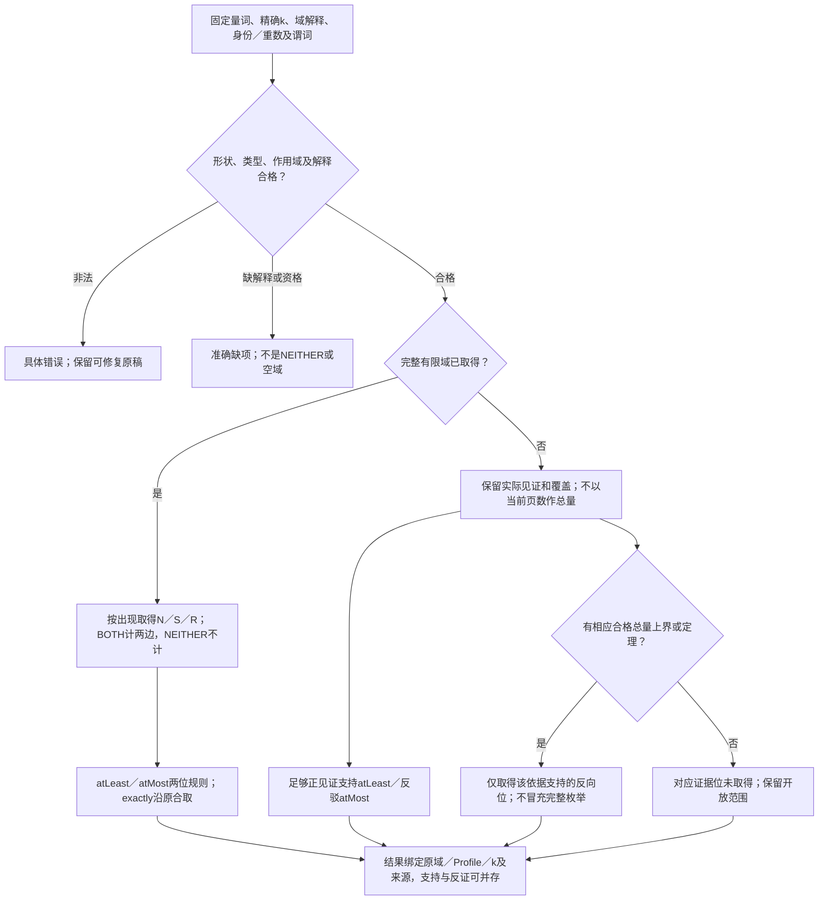
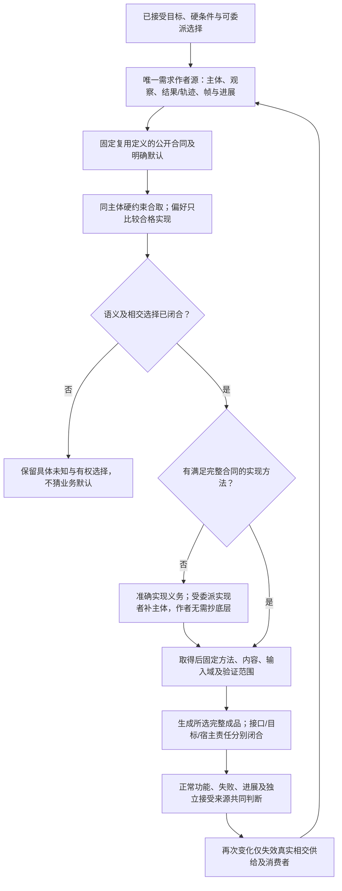
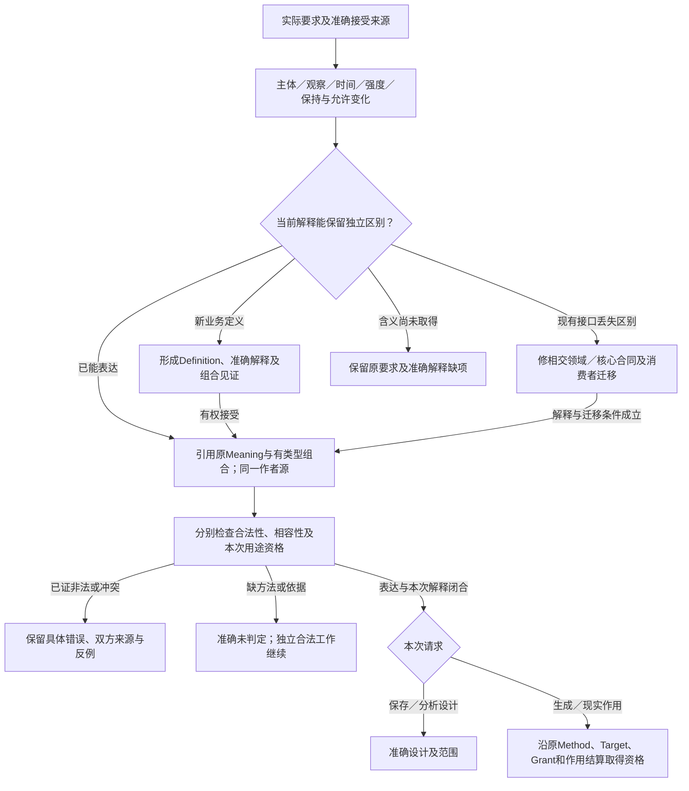

# 需求作者与实现精化

> **阅读范围**：采用范围内的设计规范；实现状态另查未决。


本章规定**产品作者最终维护的意图源码**。它不替代已有基础计算语义，不再用普通函数、已有源码逆向或开发流程证明需求抽象已经完成。新建产品的主面是：描述对象、可观察行为、保持条件与被允许的变化，引用可复用需求定义；编译器取得并固定相应实现。普通算法体、原生代码和目标适配位于实现供给一侧，只有作者明确创造/接管这些内容时才成为该作者的编辑面。

本章拥有需求含义，不拥有独立文本语法。当前新产品作者源直接采用[结构化意图与Block模块](结构化源码.md)；下文出现的`use/require/prefer`只是便于讨论的表示，精确持久源使用类型化结构。既有`design`文本设计保留为[可选表面](../../alternatives/文本意图/语法草案.md#intent-source-syntax)，不是必须实施项。产品没有第二IR、第二语言服务器、权限库或需要双写的“意图+实现”。

<a id="intent-inheritance-and-first-layer"></a>
### 第一层的具体表达、继承与原规范同源

[第一层语言](第一层语言.md#inherited-contract-author-delta)将本章的“只补独立含义”落实到调用方：完整意图包含选定定义的合同、独立接受要求及本次差异；引用或实例化本身就可以表达所求，不强制加同义Goal。所选能力的不变量、正常/失败及进展保证自动进入其适用范围，作者不重复填写；假设、保证、默认和履行证据仍各有角色，继承合同不等于取得无条件证明。新产品政策或主动算法控制沿原作者权威形成，未限定的合格实现选择由系统承担。

实际合同取得、条件激活、实例绑定、最小必要决定和后继失效由[第一层编译承接](../开发/第一层编译承接.md#inherited-contract-elaboration)接入原I0—I8、C0—C6和P0—P7。它们不是一套新作者阶段。语言层、决定坐标、扩展层级和词汇披露的区别由[责任对应](表达范围与专业接合.md#language-layer-responsibility-map)定位；不将同一内容重复保存为意图、语义和实现三份作者输入。

[紧凑结构](紧凑结构与同源编辑.md#vscode-sparse-author-source)与[专业表达接合](表达范围与专业接合.md)是明确修订的候选载体及有限专业合同，不静默改变下文旧画像的词法、闭合默认或四态含义；已有准确源和未迁移Reader继续按原修订解释。实际源码与[验收条件](../运行/验收/第一层开发面.md#inherited-contract-acceptance)用于检查本章规定的区别及其消费者，不将设计存在当成生产运行。

<a id="intent-primary-correction"></a>
## 1. 作者目标与实现分工

<a id="intent-goal-author-definition"></a>
### 一等意图Definition与原需求本义的接合

现有Definition、Requirement及设计主体已经拥有可接受行为、主体、条件、帧与进展；不另造目标本体或第二求解器。后继[统一作者模块](结构化源码.md#successor-unified-author-definitions)的`intent:goal`是这些作者承诺的一个版本化结构画像：公开可引用Definition持有可选抽象roles、必需clauses以及可选assumptions、observations和authorNotes；实际对象由Root/Use绑定，Meaning经模块import/export和真实锁取得，不重复内嵌meaningImports摘要或representation。其[严格Body形状](../../schema/semantics/intent-body-1.schema.json)不代替原Requirement解释。普通需求定义已能表达的承诺继续复用，不要求迁写或用一个Goal包装每条规则。`req:composite`的八Term仍拥有逻辑/词法组合，Pattern仍拥有公共角色和差异，Method仍拥有实际实现；Goal只是按其已接受条款派生带来源的义务，不拥有另一个可写Requirement数据库。

候选自然语言、Facet/Catalog和IntentIR服务发现与解释；已有有权采纳的意图可以长期直接编辑为这个Definition，不要求展开成计算体后丢掉原承诺。候选经当前委派及有权transition采纳后才写入真实owner；无论人、AI或脚本，均不因Actor种类自动取得或失去采纳权。固定重建只消费已接受源和精确解释，不再次猜自然语言。non-goal须区分本期不请求/不承诺与明确禁止；二者不能按一个否定词自动互换。

每次读取固定SourceSnapshot、ModuleUse与导入锁、Definition、Meaning、政策、时钟和观察范围。roles的名义类型、对象发行域、单位、基数及词法绑定逐项核验；同名角色不能跨Goal合并。call解析到真实有型Meaning签名并完整绑定实参，URI不提供语义或权威。派生的只读义务保留条款发生位置、模态、时间、主体、解释修订及准确Needs，不回写clauses。一个Definition存在或已导入，不等于本次Target消费它；由准确输出根及传递引用和独立已接受义务组成[联合范围](组合/跨软件需求合同.md#accepted-multiroot-obligation-closure)，不能按文件名扫描或只选择方便实现的模态。

| 模态 | 实际要求及取得判断所需的独立信息 | 不能据此推得 |
|---|---|---|
| achieve | 在声明的完成点/期限达到性质，并满足过程安全及已要求进展 | 中途曾真不自动是最终成功；零动作须证明目标已成且无残余 |
| maintain | 在指定历史/轨迹域内对相关状态和变化持续保持，包括Frame及干扰 | 一个快照不证明全部未来 |
| avoid | 在准确状态、事件或Effect域中禁止性质发生，否定须有相应完整性依据 | 未见违例不证明没发生，状态禁止不自动等于动作禁止 |
| oblige | 有权规则对责任主体在触发、生效域、明确期限或开放/持续履行体制及例外下形成履行义务 | 数据库修改、命令或许可不证明义务已履行 |
| permit | 按有权政策、主体/行动、时空域、优先与例外判断规范许可 | 不签发宿主Grant，不证明真实动作已发生 |
| prefer | 在全部硬合格候选间按同口径量纲、方向及偏序比较 | 未测、未知或不可比不产生唯一最优，不抵消硬要求 |

**规范禁止不是事实未发生。** “某行动按有权规则被禁止”和“目标程序不得发生该行动”可以同时成立，但不是一个模态：前者由有签发者、责任主体、行动、适用时空域、例外与规则优先关系的 Norm/Policy Meaning 定义并解释，后者由准确事件／Effect 观察域上的 `avoid` 保证。缺少一条 `permit` 规则不等于已有有效 `deny`，`not(permit)` 的证据否定也不自动生成禁止规范；长期禁止更不能未经期限与履行规则校验就改写为一个有终期的 `oblige(not(action))`。若产品要求“政策始终禁止A”，可在 `maintain` 中调用已合格的策略状态 Meaning；若要求“执行时绝不发生A”，则另加 `avoid` 与适用的运行/效果约束；二者都要求时共同保留。专业 Norm 解释与冲突合并复用[共享规范合同](共同语义关系.md#qualified-semantic-judgments)，当前六模态无须为此新增一个 `forbid` 标签；没有能保持该规范区别的合格 Definition/Profile 时返回原 `NeedsNormMeaning`，不得降成普通布尔或默许。

**有期限、开放待履行与持续义务分别成立。** 后继 `intent:goal` 的 `oblige` 必需 `id/modality/actorRole/trigger/fulfilment`，另恰选 `deadlineRef`（沿原有合格 Deadline/Clock/Horizon/Profile 给出有限到期或专业时限），或 `temporalMode:"open-ended"`（触发后形成尚无固定到期日的一次性待履行责任），或 `temporalMode:"ongoing"`（在该有权义务的活动范围内持续满足履行条件）；不可省掉两者让 Reader 猜期限，亦不可同时填写使两套时间解释竞争。可选 `scopeRef` 只缩窄有权作用域，不替代触发、issuer、例外、撤销或权限。未知到期日与**明确没有约定有限到期日**不同：前者仍是 `NeedsDeadlineMeaning`，不能自动转成open-ended。历史含 `deadlineRef` 的合法 `/1` 结构按原解释继续，不由新分支改变期限。

open-ended触发后保持 `outstanding`，直到有资格的履行或有权释放/撤销；仅时间过去、用户离线或一次缺观测不能自动证明违约，是否出现另有法律/合同定义的违约触发由原 Norm/Policy 解释。ongoing不是“履行一次即永久完成”，其评价绑定有效主体、观察时间/窗口、覆盖、时钟及约定进展与例外；缺持续观察或未来尚未结束时不能把短时无反例升级成永久履行保证。二者是规范关系，不与产品行为层的 `maintain` 合并，也不自动把政策禁止写成 `oblige(not(action))`；需要同时维护程序安全与角色义务时分别实例化并联合核验。若目标实现无法保持连续监控/履行/结算能力，返回相交 Method/Observation/Target Need，不以永不运行或空时域获得义务满足结论。

Goal的`prefer`只引用一个已解释质量维度及方向；clauses的列表顺序不是优先级，多个qualityRef不自动加权。比较沿[偏序与缺测合同](../编译/实现选择与设计搜索.md#preference-partial-order)，固定同一候选域、工作负载、单位、方向、误差与不确定性及已接受的比较关系；未规定优先序时保留Pareto偏序、未知与不可比较，已有明确优先合同不得被重置成等权。词典序、阈值后优化、条件偏好与公平分配引用原有类型化Requirement及质量定义；使用`req:prefer.priority`时保持其原层次，不向Goal短字段暗填另一个priority。短画像不能保留比较关系时，保留原Requirement组合并报告该映射缺项，不删关系后声称等价。硬阈值、软优化与明确同值固定分开；缺测不填零，普通可行实现仍可按已委派稳定政策继续，只有要求最优证明时才承担对应搜索和证据义务。

<a id="parameterized-quality-measurement"></a>
### 偏好采用的有型测量实参

候选Goal.prefer可增加`metricArguments`：外层键选中该qualityRef内唯一稳定termId，内层键选中该term的measurement形式参数；值复用Formula.call的`{binding:角色}`或`{value:Expr}`。它传实际输入，不允许调用方填一个声称已经测得的结果。metricRef的新有参路线直接解析到`domain:meaning(category:"measurement")`，其真实parameters/result/interpretationRef拥有签名与含义；孤立且没有作者挂载点的旧Metric Schema不因此成为第二可写定义。

实际参数在本次Goal采用的词法环境解释，measurement的签名/解释Ref在其声明ModuleUse中解释。每个有参term必须有唯一非空termId且全部形式参数准确覆盖；未知term/参数、缺参、越域绑定、类型/基数/Subject与普通值不符分别拒绝，不能按同名或同型捕获。一个Quality可以被不同Goal和多个发生复用，各自显式映射，不相互覆盖。参数表不存在的旧闭合无参使用保持；有参声明不能因省略表格转成隐式捕获。此路线使termId和测量形式签名成为调用者真正依赖的公开边界；它们的变更须迁移实际使用者，不能当成私有排版。

`binding`取得本次已经绑定的准确值/Subject，`value`仅用原有型纯Expr形成实参；二者不在编译时读取未来输入、不改变调用阶段、不新增执行预算。Quantity单位、数值范围、定义域、观察来源/覆盖、scope/horizon、误差及比较政策继续由原消费者共同核验。质量条款的硬阈值不变软，软目标也不变成新的成功前提；Goal.direction不能覆盖Quality已接受的方向或混合比较关系，不可由该单方向画像保义的比较仍走原Requirement合同。

比较两候选时固定同一背景资料、工作负载、测量口径与合法比较域，仅本任务允许选择的位置随候选变化。固定背景不同的值不能在不说明的情况下横向排名；两候选的决策值不同又恰是合法比较所需，不能要求全部actual字节相同。哪些位置开放沿该Goal的真实采用、专业任务及已接受选择取得，不新增given/derived角色标签。参数改变只使实际依赖它的测量/比较证据失效；alpha改名不改变已绑定关系。

候选quality:contract允许省略measurementAuthorityRef，但只限全部相关测量及其依赖闭包为定义完整、固定输入上的数学解释，不消费尚待来源资格的外部观察、工具报告、现实断言或隐含状态。effects为空、pure/total标签或顶层没有observationRef都不足以证明这一条件。真实数学定义及原Method/Assurance承担含义、计算/证明和采用资格，不要求再造一个actor或重复指自身。省略不证明输入资料符合现实；任务需要该事实时原输入/观察义务继续存在。外部测量仍须取得真实来源与measurement authority，不能因字段结构可省而免除；旧/2仍保留原必填合同。

有限排班中，固定用户安排只核硬可行性；尚未确定的候选可以按`Peak(dataset,content)`比较。两个同型资料角色可使相同两安排的峰值排序相反，故选哪个资料是不可由类型或函数名消去的信息。相反，新增Quality形参层和term到该层的第二次映射在本用途中没有独立消费者，不与当前metricArguments并建竞争入口；未来需要隐藏内部测量签名时再凭真实复用要求演进。

<a id="composed-relation-definition"></a>
### 关系定义直接复用同一Formula

候选`domain:meaning`在原解释分支之外增加关系定义分支：`category:"relation"`、原`parameters`及准确Bool result，主体为`formula`，与`interpretationRef`恰选其一。其他Meaning种类及旧解释引用保持原义；不添加新顶层kind、业务能力名或第二套表达式。准确结构由[同一codec参数图](../../schema/author/first-layer/codec-parameters.json)形成；旧Author /2拒绝新增字段。`domain:meaning`短外壳的formula槽消费原短Formula；完整kind/body仍保持完整编码边界。

```text
关系 InScoreRange(value:Int) = AtLeast(value,0) 且 AtLeast(9,value)
关系 CreateAccepted(raw:Raw,rows:Rows) = DecodeRows(raw,rows) 且 CapacityValid(rows)
```

这些关系可以继续出现在Goal.call、其他关系的all/any/not/quantify等原槽位中，不要求先各写一个Bool函数。Goal的achieve/maintain/avoid等仍是作用于关系的模态，不因关系可复用而被去掉；semantic:pattern维护共同承诺，req:composite维护Rule/Subject及强度，它们也不冒充返回关系的定义。

关系主体只在**定义自身的有型参数环境**中形成，其他自由角色拒绝；本地Ref按定义模块解析，不能在调用模块重绑同名引用。应用先沿原Meaning签名及基数核实参，在同一次应用中将其绑定为同一组值/符号值，再解释主体。卫生代换以真实绑定身份为准，内部量词binder新鲜化；量词domain先在外层环境解释，再让binder只进入predicate，不能捕获调用者同名变量。表达式实参不因参数出现两次而被复制成两次运行作用，定义展开也不在编译期读取未来输入。

本候选新增分支的Formula关系依赖必须为有限非递归DAG，沿已解析关系身份核闭包，不以文件顺序或文本名字判断。自调用、相互循环及解析未定分别拒绝或返回准确缺口；不默认最小/最大不动点。原普通计算函数的受约束递归及专业Profile另有原语义，不因本条被禁用。Formula的值槽只消费原来合格的有型、纯、定义域正确的Expr；`implies`不授予运行短路或部分投影的定义性，未知前提也不等于false。要避免无效输入上的投影，可使用有精确含义的0/1有型候选序列并量化其中的值，不能把Need或未完成搜索伪装成空序列。

新分支复用原Formula及其观察、时间与四态证据解释。result的Bool表示所定义关系的命题域，不把NEITHER/BOTH强转为运行布尔；缺观察、解释或方法不是false。时间Formula仍须原Clock/Horizon及定义域资格，关系名不能隐式捕获任意调用方的时钟或范围。需要运行时产生Bool、求得输出、执行效果或实现产品时，仍须对应构造性方法和保持依据，不能仅凭关系定义获得这些能力。

**定义展开的保持论证**可在上述DAG上按拓扑深度归纳：叶采用其原准确解释；每个新关系把同一实参环境代入原公式的形成分支，卫生改名保留绑定身份，各组合器继续其原含义，因此逐节点与显式展开一致。该结论覆盖关系解释和既有证据组合，不赋予求解完备、运行效率、进展或真实观察。旧关系不含新字段且身份/引用环境不变时，其解释不变。新分支消去的是重复的关系包装程序，不声称证明整语言全局最小。

实际源码见[共享资料工程的关系模块](../../examples/第一层作者/共享资料工程/README.md)。该模块把范围、原始资料对应、序列等值、筛选、容量和创建成功直接组合；字段名、数值和政策留在应用源，宿主表示叶由准确声明合同承担。声明与含义闭合、生产实现和运行资格分别验收。

基础调用公式是`call/all/any/not/implies`，其中all/any非空；`not`交换支持与反证，`implies(A,B)=any(not(A),B)`。支持真和支持假可独立存在，形成T/F/BOTH/NEITHER的证据状态；它们不是世界的四种真值，缺解释或不适用也不是这四态之一。未知不强转false后取反，连接词不表达因果、规范许可或跨轨迹非干扰。

有限证据代数记为`(支持位s,反证位r)`：否定交换两位，合取为`(s₁∧s₂,r₁∨r₂)`，析取为`(s₁∨s₂,r₁∧r₂)`。有限量词的内部枚举从forall的`(1,0)`累积合取、exists的`(0,1)`累积析取；域尚不完整且没有额外合格定理时，forall清其全称支持位、exists清其不存在反证位。因此不完整空域两者均未知，但已有见证仍可支持exists、已有反例仍可反驳forall。这个内部单位不放宽基础all/any的非空Body要求。材料蕴含只按上述否定与析取派生，不创造Norm许可；离线代数的德摩根/交换律不授权重排会失败或有作用的运行Predicate。

投影结果与产品接受继续分开。双向材料蕴含的两位结果不能直接签发语义等价或无冲突完成；实际方法须保留所用见证、共同前提和准确语境。[四态投影的接纳边界](../开发/第一层编译承接.md#evidence-projection-admission)给出NEITHER/BOTH反例、局部冲突检测与合法any分支的处理，保持本节代数不变；普通经典证明及运行观察仍各自取得资格。完整量词及CountRange的保守包络是不同专业解释，不能因同样返回判断结果而互换。

`quantify.count` 按精确非负数学整数处理，不是计算机数组索引；允许表达大于当前机器可枚举对象数的 k，但取得支持/反证仍要求有限覆盖、定理或专业方法。源读取先保存整数词法并无损解码，不容许宿主 IEEE754 舍入后把 k 改成另一个门槛；无合格方法返回本范围的 Incomplete/Need，而不伪装数学不可能或修改作者阈值。

本次绑定准确内容的后继Body还采用`quantify`和`temporal`结构扩充，旧有限同名`/1`Reader不自动支持。quantify明确binder/domainRef/predicate及可选scope/completeness，forall/exists禁止count，exactly/atLeast/atMost要求精确非负count；先按旧环境解析domain，再将binder仅引入predicate作用域，核绑定无捕获、元素名义类型和集合身份/重数。forall正支持和exists反证需要完整域或相应定理；计数上下界按有资格成员的支持/反证及覆盖判断，未知成员不能凑数。空forall真、空exists假仅在空域确已完整且合格时成立，量词次序不得交换。temporal明确clockRef和item，until/since必有boundary，always/eventually/next禁止boundary，rangeRef省略由外层horizon唯一解释；没有该解释就Need。always需全程覆盖，eventually需范围内真实见证或相应进展证据，until/since固定方向与边界是否含端的时间Profile，next须有真实后继步规则。开放未来尚未到期不能判false，尚在运行也不证明eventually；completenessRef只是待核声明，不自证覆盖。更广量化/时间语义由专业Profile及证据取得，不能以Schema允许结构代签可判定性。

时间horizon按锁定合同解释：model-steps仅评价所选模型路径，achieve在该画像按计划终态；until-event核事件身份、端点和取消超时；wall-clock核时钟、历法、时区和容差；unbounded须相应归纳/轨迹证据。省略horizon仅能采用版本固定的明确默认。规范义务的未触发、待履行、已履行、违反、豁免与争议分别需要触发覆盖、时限、履行/负证据或有权豁免，不另建公共持久Enum。缺Meaning、事实、角色Binding、权威、Method、Target、Grant及搜索预算分别保留；有限模型无计划只证明该模型范围，已生成源码与现实结果分别结算。

采用有限计数画像时，先固定合格完整有限出现域D、计数单位、身份及重数。N为域总重数，S为有正支持的出现重数，R为有反证的出现重数；BOTH同时计入S和R，NEITHER均不计。计数要求仍返回两位证据：`atLeast(k)=(S≥k,N−R<k)`，`atMost(k)=(N−R≤k,S>k)`；`exactly(k)`沿原两位合取组合两者。S与N−R是支持界，不把冲突材料裁成唯一世界计数，也不强行把相交或倒置的证据界修成一致区间。set按合格身份，bag按重数，sequence按出现计数；相同字节或相同显示名不自动合并计数单位。

域未读全或开放时，已取得见证可支持atLeast或反驳atMost；没有合格总量上界，不能用当前页的成员数代N排除后续成员。反向位须完整域或可替代的合格上界证明；去重、过滤及跨来源重合也须按该域身份判定。k为精确非负整数，k=0及k>N自然沿规则判断；负数或非整数是非法，缺解释是未取得资格，均不编码成NEITHER。完整域仅一项且谓词证据为BOTH时，exactly(1)仍为BOTH；完整空域exactly(0)为T，未读空页不能判恰零。这只补本有限Profile的解释，不放宽无限域、旧Reader或其他专业计数方法。



例如取消订阅的有限方法把`active`与`autoRenew`均设为false，只对当前模型的取消及停续费状态负责；触发后的通知仍须有合格Actor、履行观察和已解释期限，既有账款、真实支付及未来不得重新启用均不能由这两次赋值代签。作品已有`rendered`和`description`也不支持“具有审美价值”；该Meaning若指向专业评审观察者而未取得实际观察，仍为缺观察，不由本地Bool或编译器评分补造。

短`fn`、lambda、补全、逆向与连续开发分别服务于计算或维护任务；它们不能替代新产品的完整意图定义。缺少现成库时，需求仍由作者源保留，实际供给由实现责任补齐，不把全部底层主体自动退给产品作者。

现在分开四种内容：

| 内容 | 作者需要决定什么 | 由谁持续维护 |
|---|---|---|
| 自然语言任务与外部依据 | 接受目标、硬约束、可委派选择；允许保留尚未正式化部分 | 任务/需求拥有者；编译不每次重新猜原话 |
| 需求作者源 | 同一产品中的对象关系、行为、负约束、变化政策及复用 | 产品作者，日常主要修改这份内容 |
| 可复用需求定义 | 某项能力究竟约束哪些输入、输出、状态和观察 | 定义作者；可由数个已有定义组成，不必含算法 |
| 实现供给与派生产物 | 采用什么库、布局、调用、算法、资源和目标源码 | 供给作者/受委派生成器与编译器；不是要求每个应用抄一份 |

“源”是可重建工程的权威输入，不等于语句流、类成员或目标语法。需要五处同样不丢失草稿的功能，不写五次恢复算法；要求发布当前搜索结果，不写回调、队列和锁。相同公共关系可以合并，具有不同主体、资源身份、效果和观察的关系不能只因内容相同而合并。

新的大型范本是[完整工作台意图源](../../examples/结构化工作台/说明.md)，不是从 Code-OSS 文件逐个翻译来的模块镜像。它定义一个本地可扩展开发工作台的完整选定产品范围；原 Code-OSS 源码观察仅为可能的供给校准材料，不决定这个源要写多少类和服务。

## 2. 需求约束的是可接受产品，不直接规定内部步骤

一个绑定后的需求由：主体和观察域、允许输入及环境条件、可接受结果/轨迹、必须保持的外部状态、失败/进展义务，以及当前证据责任共同确定。它不必唯一决定一种实现。

例如“替换必须与用户看到的预览相同”至少包含：哪个模型和版本、哪批选中编辑、如何确定替换文本、哪个用户接受、何时失效、失败后什么不能重放。它并不要求作者决定使用双缓冲还是持久数据结构、类如何命名、锁放在哪个模块。可观察差异不能被塞进“实现细节”；不可观察且已委派的自由也不能逼作者逐项指定。

可作如下语义理解，**不是要求把全系统交给一个求解器**：一个需求包限定一族允许的实现。`use A(s)` 与 `use B(s)`要求同一主体同时满足二者；`require`增加硬条件，`prefer`只在合格实现间比较。一个实现只有在所有有效输入/允许环境下满足相应规定观察，输入接纳、正常返回、失败和进展义务成立，并保持原要求涉及的跨运行关系、概率和上下文条件时，才是完整实现。仅把“从不执行/从不返回/总是报错”的空实现放进安全轨迹集合，不能满足一个要求正常功能可用的产品。

类型检查、静态证明、有限测试、运行监控和人工/外部接受各有范围。结构合法不是实现存在；监控发现禁止写已发生不是阻止了禁止写；检测到每次读值相同也不证明非干扰。未知条件保存为未知，不修改原需求让当前实现通过。

### 从目标到实现的精化与退出



## 3. 同一套抽象承载哪些不同需求

下列是已识别的**语义形状及组合入口**，不是声称世界只有固定数目的需求原子。新实例通常增加参数/定义；真正出现现有语义无法表达的观察时才增加相交域规则。

| 需求形状 | 作者固定的内容与例子 | 不能省去的差异、编译责任 |
|---|---|---|
| 对象、值域与数据结构 | 文档、区间、账户、图节点；键、单位、边界与相等 | 名义身份/值相等、有限值/循环对象不同；不从路径名猜身份 |
| 转换与结果关系 | 输出等于输入区间的同覆盖规范化、排序或聚合 | 相同输出集合不一定相同顺序/多重性；正向算法由合格方法取得 |
| 关系与查询 | 选择、连接、聚合、唯一、包含和闭包 | Bag/Set/序列、空值、负查询覆盖、递归条件分别进入领域方法 |
| 状态与守恒 | 已确认计划不可变，余额守恒，关闭状态不能写 | 初态、合法转换、帧和错误都需定义；不是一个布尔字段就得到状态机 |
| 输入输出与协议 | 消息类型、版本、协商、错误和交互会话 | 线协议、编码、信号顺序、端点身份与重入由接口供给保持 |
| 时序与进展 | 旧结果不可覆盖当前，正常请求最终完成 | 安全/活性、逻辑取消/物理停止、公平调度假设不能互相代签 |
| 事件与流 | 每个分区有序、窗口、水位和迟到政策 | 输入顺序、事件时间、处理时间及结束/丢失各有语义 |
| 作用与一致性 | 只改选中文档、分项保存、提交或补偿 | 原子范围、观察者、幂等寿命、重试与未决作用不能由一个transaction词包办 |
| 所有权与生命周期 | 草稿归模型、任务子资源归域、关闭时结算 | 共享值/独占资源、借用/移动和暂停/终结不同；物理资源在实现侧检查 |
| 访问、秘密与隐私 | 某范围可读，不得未经许可出网 | 声明不是实际授权；动态扩展必须有完整中介；非干扰可涉及多条运行 |
| 表现与交互 | 可编辑工作台布局、焦点、命令、主题和无障碍 | 不是后端API就算交付UI；像素/文案/设计token有真实资产和默认 |
| 结构与部署拓扑 | 单机/远程、隔离域、副本与共址约束 | 有连线不必RPC；共享语义主体不必同进程；部署不能取消约束 |
| 表示与数值 | 编码、精度、舍入、溢出、ABI与布局 | 数学整数、定宽、浮点、地址观察分别约束目标；不以语言名替代 |
| 资源与性能 | 容量界、工作负载、延迟/吞吐目标 | 有界不等于快；实际测量和误差进入证据，不捏造未测百分位 |
| 变体与配置 | 某条件启用能力、不同发行画像 | 编译期选择与运行状态分开；缺省来源可查，硬约束不能被后写覆盖 |
| 演进与兼容 | 接口、数据迁移、旧运行与退役 | 同schema不等于同语义；迁移可逆性及实际采用独立 |
| 随机、学习与自适应 | 分布、损失、采样、适应范围 | 一个样本不能代签总体误差；模型权重与数据是绑定的实现输入 |
| 选择与优化 | 硬合格后的内存/延迟偏好 | 多目标与未知代价保留；预算停止不声称全局最优 |
| 外部职责与证据 | 法律/组织/物理假设、人工接受、统计保证 | 编译器可编制证据/运行限制，不能凭代码生成使外部命题成真 |

使用这些形状不要求普通作者先挑十九种模板。已有“工作区搜索”定义直接暴露本任务关心的几个决定，其余公开语义继承。只有确实改变含义的点才下钻。研究面开放不意味着每个根必须装载全部语义库。

## 4. 组合不是流程，也不是任意继承覆盖

`use A(s)`把A的约束适用到当前s；不是先运行A，也不创建AService。声明顺序不决定目标执行顺序。需求之间真正的时序通过相应时序/状态定义表达。

硬约束同域合取。同一个替换主体既要求“过期计划拒绝”，又要求“无需再次确认立即按新文本应用”，应报告冲突，不按后写覆盖。把root变量绑定成同一主体才会共享；不同产品根、不同会话或不同有状态实例不能因源字节相同而合并。无状态需求幂等合取可以共享分析，但保留多处来源责任。

复合定义对外仍是普通Definition，形参与公开约束构成边界，可继续被use。没有固定层数，也不要求每个特性单独发包。公共边界不暴露所有私有参数；必要时再引入一个真正可控制的参数。复合证明依赖必须检查初态和保持，不能A只假定B、B只假定A就同时成立。

变体需要可核对的语义，而不是标签：既有RequirementTerm的All/Any/Conditional/ForEach仍为唯一组合语义。文本中`use`承担常见合取；其余通过带类型的需求定义，例如`logic.AnyOf {on: s, alternatives: [a.Design, b.Design]}`。这些构造的字段合同见[供给规格](需求规则与供给合同.md#generic-requirement-constructors)。运行选择必须有运行选择的方法；编译期Any不能未经说明变成运行期随机挑选。动态成员的ForEach不能被当前枚举到的几个成员替代。

### 作者约束不能重新变成实现指令

需求字段本身也要接受抽象检查。产品只要求“位置无歧义”，不应默认强迫作者固定内部UTF-16缓冲；“应用用户所见编辑”不应强迫作者设计快照类；“未知响应不导致重复单步”也不是要求作者分配一个未决槽。因此本范本使用UnambiguousSourcePositions、DisplayedEditsOnly和NoDuplicateUncertainCommand，具体坐标转换、冻结计划及控制序列在方法侧实现。只有外部接口、ABI或明确产品选择使某种表示本身可观察时，才把那个细节提升为硬要求。

## 5. 省略、缺省与委派不能偷换

作者可以不点名实现，不必不点名业务规则。已选定定义的合同在实际Use及其参数/主体绑定下固定错误、顺序、默认、资源和变体，这些内容无需逐项目复写；仅导入不激活全库要求。缺省只有在定义明确给出、版本固定且未违背硬约束时使用；字段被省略不自动表示null、0、无限、随便或false。

输入由四部分闭合：本源明确约束；被引用定义的固定公共合同；已接受工程/产品政策；编译器获得委派的实现自由。实际运行参数和当前权限另到运行边界取得。没有明确限时便不宣称毫秒SLA；并不因此要求作者现在填写所有未来性能参数。

在本范本中，默认文案、主题、工作台布局和按键配置由供给的固定公开资产承担。它们不是“编译器随便画一个UI”。作者要求自己的品牌/精确布局时，新增该实际资产/约束；不必改所有事件处理器。固定制品的生成不再触发AI改变文案或选择另一种政策。

## 6. 没有现成供给时，产品作者仍然不必改写全部算法

先区分缺什么：缺语义、缺证据、缺实现和缺目标能力不是同一种问题。

已有需求含义完整，但无适用方法时，保留完整需求作者源并给出**实现义务**。受委派的合成器/实现作者可以组合已有方法、使用领域求解、生成局部实现，或接合成熟组件。得到的主体绑定原需求与证据，保存在原实现定义/Binding/产物体系；不默认把它展开进产品作者文件。不能仅把函数名写出来就登记为已有供给，也不能在编译失败时自动生成`TODO`或返回成功空值。

新实现采用后固定其准确内容、方法、输入域、环境和验证范围。普通重建复用它；原需求变化时检查相交义务，只有相关供给失效才重新生成。合成失败只说明本次方法/预算未完成，不证明所有实现不存在。语义本身有未接受的选择时，按真实委派采用固定保守选择或提出具体决策，不能让搜索器悄悄缩小输入域。

**新需求也可以只写关系，不写算法。**例如“有限半开整数区间列表，忽略空区间，输出保持覆盖、升序、互不重叠，并把相接区间合并”足以定义规范化结果。排序扫描、平衡树和特定增量索引是实现备选，需求作者不必维护三种实现。数学Int的目标需要保持该范围，不能因TS方便而缩成Number安全整数。

相反，“推荐我最喜欢的结果”若未给偏好来源、候选域、评估和可接受误差，只是尚未闭合的需求。可以保存自然语言及证据义务，继续不依赖它的工作；不能生成一个排序函数就声称本义已确定。

### 行为复用与成品差异

相同精确行为可以作为定义包、纯库、CLI、工作器、请求处理器、插件或交互产品的一部分；公开I/O、激活、宿主与交付责任不同，不能只有一个shape字符串就宣称等价。作者维护行为与确实选择的消费边界，供给承担准确差额。共同设计见[作者成果与成品边界](成品形态与公共边界.md)，完整结构源见[多成品范本](../../examples/成品形态/README.md)。它们不取代工作台范本，也不要求每个项目复制多种输出。

## 7. 作者面完成度如何判断

本版不再用小函数生成成功衡量整个需求作者面。对一个明确产品范围，应该能直接取得：全份作者源及其进口含义；每个主体的实际观察与共享关系；正向行为和错误/进展/帧；允许变化与默认；可复用组合；到各目标的实现责任；缺项的准确类型。这个范围以外的真实设计义务继续保留。

源可以完整而实现未完成，正如一种已定义语言可以还没有编译器。反过来，生成出能运行的程序也不证明意图抽象完整。只有复杂要求必须由用户下沉去手写大量无独特价值的函数时，才说明产品作者面仍漏掉了应由复用定义/编译器承担的工作；不能用“图灵完备所以都能写”关闭这个缺口。

<a id="symbolic-value-arguments"></a>
### 通用合同：关系中的符号值实参与依赖域

本节补齐[第一层值与集合派生](第一层语言.md#intent-value-expressions)的作者接合，采用已有共同表达语义及类型/绑定规则，不建立第二套关系项AST。**以下字段属于`design-converged`完整候选文法及其纯展开设计规格；生产Reader、语义检查器和运行支持仍须独立实现与验证。** 原Goal `call.bindings`只有formal到role/binder名字；Requirement `Value.expression`只在其固定设计阶段求值，Value.path只指Subject角色路径。三者旧义保留，不能把`"input.score"`偷偷解析成字段，不能把未来输入当设计期常量，不能借主体path读取记录字段。

后继完整形状固定以下局部差额，由原intent-body/codec拥有准确版本与资格。其他Goal/Meaning/量词字段及证据含义不变；新旧完整形状沿准确版本分派，不失败后试读另一种语义。

| 原槽位 | 后继采用的准确形式 | 共同限制 |
| --- | --- | --- |
| Formula call | 原`bindings:{formal:绑定名}`保留；或`arguments:{formal:Argument}`，二者恰选一个 | Argument恰为`{binding:绑定名}`或`{value:Expr}`；无未知键，不按字符串内容猜类别；形参完整性由真实Meaning签名判断 |
| `Argument.binding` | 指向当前Goal role、Formula关系已绑定形参或活动量词binder | 保留真实Subject/对象/值的类别、发生及基数；不创建替代对象或新增权限 |
| `Argument.value` | 复用所选完整作者Expr，以当前逻辑环境中的普通值角色/binder作符号变量 | 期望类型与基数来自形参；Subject/capability及其嵌套载荷不能冒充普通值；字段沿Expr.field及真实可见性解释 |
| Formula quantify | `domainRef:Ref`、`domain:Expr`、`observedDomain:{binding:绑定名}`恰选一个 | 前两者保留原域解释；observedDomain消费本次采用已绑定的合格ObservationUse，在当前评价点取得一次域；三者均在引入新binder前解释，binder只进入predicate |
| Formula temporal | 原`rangeRef:Ref`保留；或`range:Expr`，不得同时给出；均省略仍沿原horizon | range产生所选Time解释接受的有型区间值，在进入该temporal的词法环境中固定；不是引用字符串、普通时间戳或新的可写时钟 |

名字字符串继续表示名字，绑定名仍沿原role/binder词法域，不套用模块Name的宽域。完整作者Expr准确使用`universal-author-module-2`参数化图中的`op:"var",name`、`op:"field",record,name`等节点；它与共同语义结构的`tag:"reference",ref:{binding:...}`是有版本的表示对应，不能混读。角色/binder的名字在准确环境解析到相同内部绑定身份；作者不维护另一份临时绑定表。新内部名须卫生新鲜化，源名字、绑定身份、目标名分别保持；同名遮蔽不能靠Schema判断。value/domain/range内部不猜短Formula、专业Value或另一种Expr编码。直接字段投影、嵌套纯应用及依赖量词域据此可作为同一源内容，不为每个子项生成一个公开Meaning或永久角色。

<a id="intent-observed-domain-binding"></a>
### 持续观察域通过角色组合

`quantify.observedDomain`是准确的`{binding:绑定名}`，结构复用原Argument.binding分支；不接受value、模块Ref、源码路径或自报元素型。绑定解析沿原Goal角色、Formula关系已绑定形参及活动binder词法域，结果必须是单一、合格的ObservationUse Subject。非递归Formula关系的形参通过原arguments.binding转交同一Subject，卫生代换不改变来源、切面或资格；没有另一份隐式会话环境。普通序列仍用domain，声明来源仍用domainRef；不能将`domainRef:"previewPrefix"`暗读为成员useId。完整op停止短展开的规则保持，显式短quantify只补原op并展开原predicate，不把observedDomain当表达式执行。

通用Goal只声明观察角色，不固定组件地址。真实RequirementLink.roleBindings可用原source:context转交该角色；实际组件/根的contextBindings或直接采用绑定通过[源发生选择](结构化源码.md#source-occurrence-role-binding)取得ObservationUse。所选Use自身的ref/bindings固定观察合同、事件来源及会话，量词不复制第二张绑定表。同合同同名成员的不同采用不自动共享；明确传同一Subject才是同一观察发生。抽取组件只迁移真实采用处的地址，通用Goal公式保持。

**形成与有型实例化。** ObservationUse是专业Subject类别，不是任意集合的类型证明。未绑定Goal为每个观察角色保留符号域签名`CollectionKind/Element/Clock/Scope`及本体约束；量词binder携带该Element符号，真实Meaning签名、值字段投影、时间范围和量词用途产生对应等型、可见性及覆盖义务。可判定的矛盾在定义时拒绝，未决义务留在同一Goal资格内，不置为Any，也不自称已完全有型。每次采用由实际observer的纯S→O签名及准确画像解出这些符号，再完整核整个predicate；同一角色在各处必须一致，不允许分别选择有利类型。全部相交义务闭合才形成该采用的合格要求；没有足够约束或实际签名时返回具体Need。此为有限的延迟资格，不开放运行时按数据布局猜类型或隐式重载。

**准确解释。** 在评价点τ先固定已绑定Use U，由原观察consumer取得同一会话/源运行在τ的合格cut S，纯observer投影不可变集合O，再以O的准确元素身份/顺序/重数解释本次量词。本次量词的域及已绑定元素不在predicate中途更换；嵌套Temporal可在新评价点τ₁进入内层观察量词并取得D_V(τ₁)，外层e仍来自τ的原域。这正是“针对既有编辑，之后寻找预览”，不要求两个先后发生同处一个cut。外层普通domain、普通值角色及已绑定事件仍是原快照。来源、Clock、覆盖和冲突资格由[事件观察切面合同](../领域/状态关系与流/背压与事件时间.md#intent-observed-domain)承担；缺事实不能当空集，观察标签不自证来源或完整性，形成要求不启动现场采集。

**保持与必要性。** 固定所有采用实参及合格域函数D_U，观察量词的解释就是在τ将D_U(τ)代入原量词；按Formula结构归纳保持原逻辑、计数、时间和四态责任。原domain/domainRef源没有新分支，解释不变。若删掉观察角色的采用绑定，同根同型的两会话可交换却无法指出应查哪个；若将它降成普通快照，未来编辑不进入域；若隐式刷新全部普通值，又改变旧快照含义。新分支只保留这个独立区别，不声称它是全局最小语法或任意观察都可计算。

<a id="dependent-temporal-range"></a>
### 每次发生的时间范围是同一有型值接合

“每个e后1秒内”需要保留各e自己的发生时刻。`rangeRef`仍解析声明来源，不将`"e.at"`解释为字段访问，也不让普通SourceRef暗取词法变量。后继候选的`temporal.range`直接消费原Expr：例如`ClosedAfter(e.at, ResponseDelay)`，其中函数和期限是普通可复用时间值定义；核心不增加`afterOneSecond`、`relativeRange`或固定业务能力。用一项专门时间Meaning也能描述窗口，但不能只为绕开缺失值槽而重复定义已有always/eventually及其覆盖解释。该值槽与原domain/arguments.value使用同一绑定规则。

准确形成顺序是：在进入本temporal的环境ρ中，对range进行有型、纯、定义域及本用途终止检查，取得同一符号区间值I；Time解释核其时钟身份、单位、端点/方向及允许范围；再让原temporal在I上解释item/boundary。I不因遍历到下一个观察点而重新锚定，不能把逾期不断滑动为“现在再等一秒”。外层量词逐个绑定e，因此不同e取得不同I；内层item中的同名binder不能捕获已经固定的range。普通角色值也不会因temporal进入而自动换成最新状态；状态/事件查询的观察点参数和真实producer仍由原观察合同显式承担。

区间表示由[时间owner](../领域/扩展语义与适配合同.md#temporal-range-values)决定，不把任意`{start,end}`记录或整数当作已经合格的Interval。负跨度、跨时钟、单位不一致、CalendarPeriod混用、失效来源、未定范围分别拒绝或保持准确Need，不转换为空区间以获得空真。range与rangeRef同时给出是结构错误；省略两者时，只有原horizon已唯一确定范围才可解释。候选完整op内部继续停止短展开；显式短temporal只在range值槽展开原短Expr，不遍历字面量payload。

这是表达与保持合同：固定ρ、Time解释及同一I，range值接合与该Time解释原来直接接受I时具有相同的观察域、端点、四态判断和进展义务。旧源没有range，继续走原rangeRef/horizon分支；按Formula结构归纳保持旧解释。它不证明任意时间方法可判定、监控可用固定空间、运行期限已满足或事件来源已接好。[事件期限源码与反例](../../examples/第一层作者/事件期限/README.md)给出实际构造和有限模型检验；连续互动的真实发生与观察绑定仍须独立闭合。

类别检查沿原类型、捕获、拥有及寿命递归覆盖记录、序列、变体、名义包装和闭包；把受限对象包起来不产生复制/借用/授权资格。binding也不因名字存在而取得Grant或延长寿命。普通不可变值的记录/序列构造及闭包捕获可以合法，目标内存分配不等于取得外部资源。匿名记录仅在唯一预期型及表示权限均成立时取得相应命名记录型，沿原[记录引入规则](../领域/计算基础/文法类型与求值.md)，不能把已有另一名义身份的同布局值静默转换。

**求值阶段由使用上下文决定。** 构建阶段只绑定、定型和解释未来关系，不执行未来input、threshold或output。关系在所声明模型或观察点下解释时，实参从该次固定的普通值/快照取得；读取前态、后态或返回值沿原callBinding的准确调用、实例和观察端点符号绑定。多处同名属性不能代替同一观察身份。需要运行观察而未取得时保留相交Need；不可把它改为静态常量、再读活对象或猜一个有利结果。

纯项不得包含外部作用、资源取得或未经声明的活读取；不得从`effects:[]`或`termination:total`标签自行签发证明。项须在原允许输入域内有定义并满足所需终止，或以明确变体表达无值/错误且由外层关系处理。不能为了某项有定义而静默删输入。符号推导尚未具体化、观察未知、缺字段、除零、越界、错误返回和NEITHER/BOTH各按原责任报告，不把它们统一变成false。只对已解释、无冲突的纯总片段采用经典公式展开。

依赖域的规则是先在外层环境η取得`D=⟦domain⟧η`，再在`η[x↦d]`解释predicate。新x不进入自身域；同一拼写若已准确绑定到外层x仍可以合法。集合、bag和序列沿原相等、出现及重数解释，计数量词不隐式去重。`对当前域每项：始终P`与`始终：对当时域每项P`不交换：前者先取该次域，后者在各观察点解释域。普通值binder保持快照，Subject binder保持主体身份且状态另按时点观察。后条件可符号约束返回/后态；调用前守卫不能凭尚未发生的观察取得作用资格。

采用例：读取关系中的输入a是本次来源快照，阈值t是该视图本次规定观察点的值，返回b是同次正常结果；`b=[a[i] | i属于位置(a)，a[i].评分≥t]`约束三者。若直接向相等Meaning应用派生序列，b可以用binding，右侧可以用value；不要求作者先写一组取字段/筛选/比较阶段。位置域依赖a时用后继domain表达，不谎称原domainRef已接受实参。普通容器定义与自身方法仍须有真实合同，查询派生不产生权限或外部事实。

消费者闭包为原Goal role/binder与观察→有型实参→同一Meaning应用→原联合要求/BoundaryView/实现选择→目标与后继编辑。形成时核类别、词法、阶段与类型，应用时核定义性、纯性及观察，修改时沿真实绑定使相交消费者失效；不新增独立运行协议。[完整候选文法](紧凑结构与同源编辑.md#final-first-layer-codec)在原intent-body节点上保留旧分支并接入两个新槽；旧底座Schema本身不变。结构可达不证明本段语义检查已实现。专业surface-convergence的有限`AmountAtLeast` arguments只证明其自身例子，不能签发本节通用能力。

**旧源保持命题。**固定原解释与上下文，旧call.bindings仍按原名字解析为同一Meaning应用的绑定实参，旧domainRef仍消费同一域身份、Provider/查询、出现与覆盖解释；不改成value或隐式零参调用。对旧Formula结构归纳：调用步保留Meaning及绑定；量词步保留域与词法扩展；逻辑/时态步保持原构造并应用归纳假设。故原四态结果、观察身份及未决责任不变，Goal模态与生命周期同样保留。此结论依赖所选版本保留全部旧合法分支及原语义，不是Schema单独证明；无操作保存不改旧源字节。对新value，仅当有型、纯、有定义且满足本用途终止资格时，以固定环境下的值应用原Meaning；该取参不会把四态证据改成Bool或签发运行事实。

<a id="open-intent-expression-closure"></a>
### 开放意图的表达闭合与各集合的准确域

开发面接纳任意实际提出的目标，不要求先命中动作、领域或范本目录。表达闭合有两个不同责任：原要求及来源始终可保留；在已接受的解释域内，每个已定义原子及合法组合都有准确含义，不能只因组合未在样例出现就拒绝。保全原文只完成前一个责任，遇到不能解释的独立区别仍须明确补齐其Meaning、观察与组合规则，不能把“已保存”宣称为语义完备。

这里的“通用意图抽象全集”按固定作者画像及解释修订中、对开放有类型定义环境形成的合法构造闭包理解。结构构造在该版本内固定，Definition／Meaning的内容可以增加；引用、应用、实参绑定、逻辑、量化、时间及专业组合各按自己的类型、作用域和解释规则构造。它不是预先列完业务名词，也不是封闭标签与任意定义的无条件笛卡尔积；有限作者结构可以指称无限论域、开放时间或按原规则引用的递归定义，不因此允许无限静态展开。结构合法的表达要取得准确含义，仍须其实际使用的定义、绑定及组合都有真实解释，不能以一个interpretationRef或Schema通过代替。

对本次要求逐项确定主体及值域、观察和所求关系、条件与量化／时间、模态／强度与接受来源、保持项及允许委派的自由。它们是保留含义的检查问题，不组成新的固定维度或作者必填表；已由引用定义固定的信息不重复填写。Frame、顺序、并行、跨运行和概率等继续由原关系与专业解释承担，逻辑合取不安排执行，类型相同不代签关系保持。已有Meaning直接引用；已有有类型组合能保留全部区别时组合；新业务原子沿普通Definition及准确解释候选创作，不先申请一个中央意图编号。只有现有组合、绑定或身份接口确实丢失独立可观察区别时，才修相交领域或核心合同及迁移。新定义必须给其签名、解释、作用域、与其他定义的组合保持及可区分反例，不能只有一个未解释名称或Any载荷。

闭包不承诺全部未来含义已经定义、任意性质可判定或所有表达都已有实现。内容能保留和表达、所选范围解释完整、满足合同的实现可取得分别判断；含义准确但冲突、缺方法或缺目标时保留原含义及准确原因。Goal模态、RequirementTerm及专业构造的有限联合各自维持其准确域，不据其数量推导意图总数或唯一最小公理组。生成怎样消费同一抽象，沿[确定性责任链](../编译/内核/输入与阶段总览.md#accepted-intent-to-program)及其[框架驱动算法](../编译/内核/输入与阶段总览.md#compiler-framework-driver)下钻，不把新的业务内容变成编译器中的业务名称分支。

从独立给定的准确关系规格取得真实内容，使用[定义与解释的构造性翻译](组合/语义扩展与领域接合.md#independent-specification-translation)：系统生成类型、body、项计算、绑定、固定解释和组合，并按其准确基础证明保持。这里不要求应用作者预先手建语义库；已知含义而缺内容时由受委派系统创作与核资格，仅未决定的独立公开差异交回作者。有限设计量化、任意模型域及跨轨迹关系分别保持，不以公式保全、通用计算能力或一个解释引用代签全部新含义已经理解。

[高阶与交互构造](组合/语义扩展与领域接合.md#higher-order-interaction-construction)进一步给出完整谓词/函数域、超性质、μ/ν与策略选择权的实际解释及保持证明。相同允许输出不代表相同可保证能力；系统须保留谁选择、何时取得信息和原量词次序，再寻找真实实现。有限源码指称完整数学域不要求作者枚举该域，也不把数学成员存在冒充有限程序可生成。

[秩索引的完整域构造](组合/语义扩展与领域接合.md#rank-indexed-model-construction)还可用一份有限说明承接带秩的所有有限阶完整幂集域，并保留对该统一域的量化、相等及邻阶成员关系。系统形成递归模型说明、真实解释与原绑定；作者无需给一个最大阶或逐阶填表。固定有限阶、有限语法码和可计算成员不能代替这个公开含义；实际代码表示及性质证据仍按其原义务取得，不从准确表达直接宣称全部成员可生成。

[统一集合模型翻译](组合/语义扩展与领域接合.md#set-model-uniform-translation)进一步由同一载体/函数图构造承接任意集合大小的有限多类经典模型，并保持全部有限公式和整个模型类。准确叶内容、名义与共享身份、空域及原逻辑继续由系统处理；作者无需把最高层要求改写成图表或关系码。数学模型可统一承接不等于任意关系已取得有限呈示、运行表示或真实外部事实，原来源与生成责任保持。

新概念由[独立有限语义材料的构造](组合/语义扩展与领域接合.md#finite-semantic-presentation-construction)继续承接：系统从已接受原话、定义和引用形成关系/函数、名义包装、子域与商域的真实内容，对每个旧模型给扩张及旧含义保持依据；非定义性新要求按其真实模型限制处理，不以fresh名字假称保守。开发者不填写这些中间结构。材料刻意保留多种合法解释时，保持其允许范围，不反复要求唯一化。

[有限定义的渠道分离](组合/语义扩展与领域接合.md#finite-definition-information-separation)说明有限可定义不等于能从当前有限观察识别。系统优先取得已有完整定义和准确引用，原要求仅需引用行为时直接保持绑定，不先强求恢复内部闭合公式；确需新解释时由系统创作、取得全域来源或只询问必要公开差别。该信息边界不能用于削减语言能力，也不能把所有模型、实现或证明工作推回最高层作者。

含义已经准确也不自动消除全部实现取得边界。[统一正常实现的反证](../依据/理论/表达证明与搜索边界.md#total-normal-realization-boundary)给出了每个实例都有正常正确程序、却无法由同一有效系统对整个规格族有限生成这些程序的情形，且不需要最优或形式证书前提。系统继续承担源形成、合格方法、实现创作和降低，保留原最高层表达；不能宣称“只要可满足就必定有限全自动交付”，也不能用拒绝表达、让作者提供底层答案或全返回unknown代替正向能力。

**完整性先固定承诺域，再检查结构闭包。**本次已接受能力来自真实产品要求、公共合同和作者接受关系，不能由当前Schema、现有后端或一张较窄的验收表反向决定。对每项能力应能沿原定义找到保留其区别的表达、合法绑定/组合规则、确定解释、生成责任和再次修改路径；这是原对象的可追溯关系，不要求作者维护新清单。某处只有载荷槽、解释器接口或“可以扩展”的说明时，该处覆盖仍未取得。明确未知和真实拒绝是必要的返回行为，但不足以完成已经要求的正向能力。

全局审查先按[有类型构造闭包](组合/抽象与开放定义.md#typed-abstraction-closure)核原子与构造族，再核共同边界上的交叉规则。可用符号化的值、主体、状态、时间、位置和义务构造反例，不以增加具体业务场景为取得覆盖的前置。发现缺口后回唯一责任层补差额；对已有完整规则直接核消费者，不逐场景重写同一规则。比如字段是否存在、字段是否可写、其余字段是否保留分别属于存在性、存储和行类型合同，不能把三者一起关闭来证明一般记录已完整。这个例子只定位规则缺口，不定义通用意图的全集。

封闭联合限制准确版本内的合法编码，开放定义承担新内容；两者并存。此处定位集合的用途，完整成员与字段仍由[结构化源码](结构化源码.md)、[原Requirement组合](组合/跨软件需求合同.md#10a-跨软件意图行为与开发动作的共同合同)及专业正文拥有：

| 集合或组合 | 成员的含义与本域边界 | 不能被同名构造代替的内容 |
|---|---|---|
| Goal模态与Formula | 模态区分达到、保持、禁止、规范义务、规范许可与偏好；公式组合已解释的命题、量化及时间关系 | 许可不是Grant；证据call不是目标函数调用；逻辑合取不安排并发 |
| 量词、时间与horizon | 绑定准确域、身份/重数、时钟、轨迹与覆盖的固定Profile | 有限枚举不是无限域解释；开放未来未到期不是假；缺解释不变成证据未知 |
| req Definition、Term、Value与Condition | 原Requirement dialect的定义形态、静态组合、各槽值及条件；各自联合在精确修订内封闭 | req的有限静态when/forEach不同于运行守卫或动态时间；req空all/any与Goal非空all/any保持原合法域 |
| 角色基数与专业Type | one/optional/set/bag/sequence区分缺席、成员身份、重复及次序；专业值域由真实Type解释 | optional缺席不是未知，set不是bag，序列顺序不是优先级或作用时间 |
| 开放Meaning、Definition、Rule与Profile | 增加有准确含义的业务内容和专业解释；按原模块、锁与消费者绑定 | 同名标签、URI、目录存在及导入成功均不能提供含义、方法或授权 |
| 决定坐标、任务facet与主题目录 | 实际Decision的部分投影及0..N可选发现标签；任务消费[开放表达及组合](需求关系与能力边界.md#open-developer-intent-surface) | 不与模态或公式相加成意图原子总数，不成为新定义或请求的接受白名单 |

缺含义、缺事实、未委派选择、缺方法或目标、证据不足及无权分别保留。已定义但不相容的要求保留双方及有范围的冲突依据；语法、类型或作用域非法保留可修复原稿和具体错误，不当成普通未知。不可实现或不可判定的目标仍可准确陈述；相容、可实现或不可能的结论只由适用方法及其依据取得。长期组合沿原接受关系；升级、撤回、时间域变化显式修订，分解、换表示、删除输出根或局部实现成功不丢独立旧义务。



**本例产品文件为 `studio.json`；`standard.json` 与八个结构模块完整给出可复用需求定义。它们使用一个现有模块外壳与本次明确的需求体编码；旧十份`.gift`只作未采用文本表面的历史对照，不是第二可编辑真源。**十份文件是本次把定义也展开交付的组织，不是每个应用要重写十份源，更不是十个服务。下一工程可以继续引用同一完整定义，仅改自己的独特条件。源行数没有预设上限或压缩率承诺；更重要的是每条作者声明表达独立需求，而不是实现过程或重复元数据。


<a id="intent-discriminating-meaning"></a>
## 8. 需求完整性由可区分行为检验，不由表示格式证明

<a id="open-specification-discriminating-contracts"></a>
### 开放规格的可检验区别与明确迁移

以下是普通Definition可拥有的合同见证，不建立业务Kind或自动选算法的名字表。每项标题、段落锚点和旧proposal URI都不是已发布DefinitionRef；强消费须把准确含义编码为真实Definition并绑定解释、Method、Target/Provider和独立证据。已有原生或领域方法足够时直接复用；缺解释、缺方法、缺授权分别保留，不把十项书面规格宣称为十个运行成果。

其中已有实际机器定义的[区间](../../examples/第一层作者/interval/README.md)、[资源预留](../../examples/第一层作者/reservations/README.md)、[观察包络](../../examples/第一层作者/observation-bounds/README.md)及[专业合同使用](../../examples/第一层作者/model-contracts/README.md)，按各自准确源、解释及限定范围消费；它们不因本段共用书面说明而退回未定义，也不因补齐一个例子的结构而为其他例子签发运行资格。后继表示与方法变化沿同一接受关系核对。

**半开整数区间。** 输入有限有序List的每项为精确Int端点`(s,e)`，`s≤e`；反向端点是DomainError，不自动交换，`s=e`为空。输出保同一整数覆盖，所有段非空、按起点升序，相邻前end严格小于后start，故相交和端点相接都合并，空输入/全空输入为[]。滤空、按`(s,e)`排序再扫描`next.s≤current.e`合并是一个见证，保持原输入及首个源错误归属；不能只返回包围区间或按长度减少自证最简。比较次数`O(n log n)`不吞掉大整数位成本，资源耗尽不是不存在规范结果。独立小域覆盖枚举及超大整数词法/算术证据分别取得。

**有限图可达。** 输入完整有限节点身份集及有向边，起终点和全部端点合法；域错误不同于无路。`Some([v0,…,vk])`须非空、起终点准确且每条相邻边存在；`None`当且仅当无有限路径。起终点相同时零条边的节点路径是`[from]`，不是[]；合同不自动要求最短。visited/parent加队列或栈可作见证，完整遍历穷尽才可给None，预算不足为Incomplete；未知是否穷尽的邻接流不属这个输入域。自环/多重边不令可达问题非法，清单拓扑拒环不移用于它。

**当前修订发布。** 纯PublicationPlan输入固定文档身份、SourceRevision、摘要、要求/Target锁、请求代和准确store cut；真实发布另需Provider、Grant及提交点CAS/writer epoch。每个成功Publish在真实提交点须仍对应被接受的当前基础，不能仅在任务开始时核版本。输入/目标/授权此后稳定、Method资源持续可用、必要计算终止且调度恢复公平时，最终发布当前结果；永不发布不能同时满足该进展。frame保持无关文档、原生区和未保存buffer，旧worker只结算历史结果。历史`worldEffects:[]`仅可描述纯计划/模拟，补真实publication Effect是明确接口迁移，源store无所需原子能力时保留缺项。

**窗口聚合。** 事件固定`eid/partition/key/eventTime/value`，WindowSpec、聚合和去重均为准确实参，不由名字猜。有限滑窗画像为`[o+k*s,o+k*s+w)`、`s,w>0`和同单位精确Int sum；其他聚合另有空值、结合律、顺序和错误合同。eventTime不同于处理时间；同epoch水位单调，分区合并/idle/迟到完整性由WatermarkPolicy拥有，水位不证明世界永无旧事件。同eid异payload冲突，去重保留期短于重放域不能承诺无限去重。输出含windowId、聚合revision、input cut、epoch与final依据；迟到明确选择计数丢弃、side-output或修订加回撤，不能默认无限纠正又绝对final。checkpoint联合offset/去重/窗口/水位/输出身份，真实交付仍由原效果owner结算。

**单账本。** 对JournalEntry的每个币种分别精确求和为0，币种不互抵；算术守恒不证明账户有效、资金存在或有权。提交观察须带journalId/payloadDigest、entries、before、真实commit及after，不能仅给两个无来源state字符串。Rejected保持禁止变化；Committed有真实receipt和指定journal唯一提交及余额索引一致；Indeterminate保留原操作读回，不能归Rejected。同ID同载重放原结算、异载冲突，派发点核issuer/Grant，frame仅所需账本及恢复元数据。真实事务域才提供该原子性，跨行服务另接[外部效果](../运行/持久化提交与恢复.md)，纯plan不制造Committed。

**数值积分。** 固定ODE初值`y'=f(t,y),y(a)=y0,a≤t≤b`，t同时间单位，y与y0同状态单位，f各分量单位为对应状态/时间；DAE/PDE另有定义。范数、absTol/relTol、误差域、模型及事件/不连续策略不可省略后靠容差字符串签界。若独立证据给出Lipschitz界L、残差δ及初值误差e0，可在其适用条件下核`e(t)≤exp(L(t-a))*e0+∫[a,t]exp(L(t-s))*δ(s)ds`；实际算术/插值证据和近零相对尺度分别承担。返回区分有条件认证近似、未认证近似、域错误、不收敛及Incomplete，不保证任意f有解或预算内达容差。自适应方法不越过未处理事件、不暗降硬容差，纯f不证明Lipschitz。

**陌生旋转约束。** tokens是有限List，step为正Int，forbidden是相关Token对上纯且终止的谓词。只搜索循环左旋step的轨道：n>0时偏移`(k*step) mod n`、`0≤k<n/gcd(n,step)`，n=0唯一候选[]且不求mod0；检查线性相邻对，不默认末首环邻接或任意排列。按k递增取首个合法项，保持重数。结果为`Found(values,offset)`、完整轨道穷尽的`NoSolution`或`Incomplete(checkedPrefix,bestKnown?)`；谓词故障另报。旧List返回不足区分合法空解/无解/预算，必须迁移消费者，不能以[]复用三义。Token不额外要求hash或显示名相等。

**远端命令。** OperationId、规范payload和请求域不同于连接ID；RemoteSession核真实peer、codec/Profile与认证授权。发送前协商实际wire和参数域；真实Provider派发点核调用者、受众资源动作、时效委派及撤销。结果区分确定未派发、证实远端未实施的Rejected、可核业务receipt/readback的Committed及Indeterminate；传输错误不直接证明业务拒绝。重连不更换业务OperationId，同ID异payload冲突；重试受Provider幂等范围和期限约束，超界读回、保Unknown或有权接受明确新风险，不能盲重放。

**泛型map/filter。** T/U是实际刚性TypeParam，items有限，f和predicate的纯性、相关域终止及Fault前提分别核验，predicate合格不外推f。令`u_i=f(items_i)`，输出按原i保留predicate为真的u_i和重数，不额外要求T/U相等/hash。画像规定实际调用次数/顺序；纯total且资源观察保持时可融合，若效果画像要求先完整map再filter，逐元素交错未必合法。List有限不证明闭包终止；append线性时使用合格builder或逆序累积/reverse等见证，不能虚报线性复杂度。

**界面与可访问性。** 模型固定业务revision/控件身份/逻辑状态，纯RenderPlan或模拟trace不同于真实renderer、输入设备和辅助技术观察。发布UI按其渲染cut对应模型，旧异步结果不覆盖新revision，加载/错误可辨；输入法组合和未提交输入不被后台重绘吞掉。可操作控件须在受支持键盘动作下可达并可激活，modal有完成/取消出口，角色名称状态和反馈可观察；有限焦点图路径证据不代替真实设备读屏实测。locale/资源版本、复数、格式、时区、布局及fallback明确，语言标签不自动合成正确翻译，也不改业务ID或金额存储；升级后按真实依赖重核。

同一结构可以拥有准确语法而漏掉独立的产品区别。例如仅写键升序，没有固定稳定性；生成与Oracle都沿这份结构工作时可以一致通过，却违反另有来源的“同键保持原顺序”。先用已取得的独立接受来源和正负情景确定这一区别，再补回唯一要求定义、方法和消费者；不能为了避免新字段而把未表达偏好猜成实现自由，也不能让产品作者维护排序算法。

当前完整定义可以直接复用；真实委派允许系统选择并固定结果，不要求所有微小行为都先询问作者。尚未取得的私人偏好保持未知；任务没有独立稳定性要求时，也不能凭空追加它。完备声明只覆盖实际取得并处理的需求及已发现区别，不从“有19类需求或若干JSON”推断所有新需求都已经可编译。

验证与保证的接合见[解释与证据](../运行/保证/解释与证据接纳.md#evidence-interpretation-boundary)。扩展收益按[分层任务比较](../运行/验收/覆盖与收益判据.md#adaptive-confirmation)检验：已用范本、未见组合、新语义和新供给分别统计，不以复用者的两行入口对比另一方从零实现全库。
