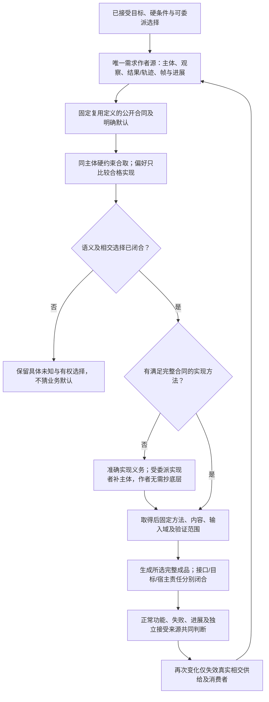

# 需求作者与实现精化

> **阅读范围**：采用范围内的设计规范；实现状态另查未决。

本页内容

- [1. 作者目标与实现分工](#1-作者目标与实现分工)
- [2. 需求约束的是可接受产品，不直接规定内部步骤](#2-需求约束的是可接受产品不直接规定内部步骤)
- [3. 同一套抽象承载哪些不同需求](#3-同一套抽象承载哪些不同需求)
- [4. 组合不是流程，也不是任意继承覆盖](#4-组合不是流程也不是任意继承覆盖)
- [5. 省略、缺省与委派不能偷换](#5-省略缺省与委派不能偷换)
- [6. 没有现成供给时，产品作者仍然不必改写全部算法](#6-没有现成供给时产品作者仍然不必改写全部算法)
- [7. 作者面完成度如何判断](#7-作者面完成度如何判断)
- [8. 需求完整性由可区分行为检验，不由表示格式证明](#8-需求完整性由可区分行为检验不由表示格式证明)

本章规定**产品作者最终维护的意图源码**。它不替代已有基础计算语义，不再用普通函数、已有源码逆向或开发流程证明需求抽象已经完成。新建产品的主面是：描述对象、可观察行为、保持条件与被允许的变化，引用可复用需求定义；编译器取得并固定相应实现。普通算法体、原生代码和目标适配位于实现供给一侧，只有作者明确创造/接管这些内容时才成为该作者的编辑面。

本章拥有需求含义，不拥有独立文本语法。当前新产品作者源直接采用[结构化意图与Block模块](结构化源码.md)；下文出现的`use/require/prefer`只是便于讨论的表示，精确持久源使用类型化结构。既有`design`文本设计保留为[可选表面](../../alternatives/文本意图/语法草案.md#intent-source-syntax)，不是必须实施项。产品没有第二IR、第二语言服务器、权限库或需要双写的“意图+实现”。

## 1. 作者目标与实现分工

### 一等意图Definition与原需求本义的接合

现有Definition、Requirement及设计主体已经拥有可接受行为、主体、条件、帧与进展；不另造目标本体或第二求解器。后继[统一作者模块](结构化源码.md#successor-unified-author-definitions)的`intent:goal`是这些作者承诺的一个版本化结构画像：公开可引用Definition持有可选抽象roles、必需clauses以及可选assumptions、observations和authorNotes；实际对象由Root/Use绑定，Meaning经模块import/export和真实锁取得，不重复内嵌meaningImports摘要或representation。其[严格Body形状](../../schema/semantics/intent-body-1.schema.json)不代替原Requirement解释。普通需求定义已能表达的承诺继续复用，不要求迁写或用一个Goal包装每条规则。`req:composite`的八Term仍拥有逻辑/词法组合，Pattern仍拥有公共角色和差异，Method仍拥有实际实现；Goal只是按其已接受条款派生带来源的义务，不拥有另一个可写Requirement数据库。

候选自然语言、Facet/Catalog和IntentIR服务发现与解释；已有有权采纳的意图可以长期直接编辑为这个Definition，不要求展开成计算体后丢掉原承诺。候选经当前委派及有权transition采纳后才写入真实owner；无论人、AI或脚本，均不因Actor种类自动取得或失去采纳权。固定重建只消费已接受源和精确解释，不再次猜自然语言。non-goal须区分本期不请求/不承诺与明确禁止；二者不能按一个否定词自动互换。

每次读取固定SourceSnapshot、ModuleUse与导入锁、Definition、Meaning、政策、时钟和观察范围。roles的名义类型、对象发行域、单位、基数及词法绑定逐项核验；同名角色不能跨Goal合并。call解析到真实有型Meaning签名并完整绑定实参，URI不提供语义或权威。派生的只读义务保留条款发生位置、模态、时间、主体、解释修订及准确Needs，不回写clauses。一个Definition存在或已导入，不等于本次Target消费它；由准确输出根及传递引用和独立已接受义务组成[联合范围](组合/跨软件需求合同.md#accepted-multiroot-obligation-closure)，不能按文件名扫描或只选择方便实现的模态。

| 模态 | 实际要求及取得判断所需的独立信息 | 不能据此推得 |
|---|---|---|
| achieve | 在声明的完成点/期限达到性质，并满足过程安全及已要求进展 | 中途曾真不自动是最终成功；零动作须证明目标已成且无残余 |
| maintain | 在指定历史/轨迹域内对相关状态和变化持续保持，包括Frame及干扰 | 一个快照不证明全部未来 |
| avoid | 在准确状态、事件或Effect域中禁止性质发生，否定须有相应完整性依据 | 未见违例不证明没发生，状态禁止不自动等于动作禁止 |
| oblige | 有权规则对责任主体在触发、生效域、期限及例外下形成履行义务 | 数据库修改、命令或许可不证明义务已履行 |
| permit | 按有权政策、主体/行动、时空域、优先与例外判断规范许可 | 不签发宿主Grant，不证明真实动作已发生 |
| prefer | 在全部硬合格候选间按同口径量纲、方向及偏序比较 | 未测、未知或不可比不产生唯一最优，不抵消硬要求 |

基础调用公式是`call/all/any/not/implies`，其中all/any非空；`not`交换支持与反证，`implies(A,B)=any(not(A),B)`。支持真和支持假可独立存在，形成T/F/BOTH/NEITHER的证据状态；它们不是世界的四种真值，缺解释或不适用也不是这四态之一。未知不强转false后取反，连接词不表达因果、规范许可或跨轨迹非干扰。

本次绑定准确内容的后继Body还采用`quantify`和`temporal`结构扩充，旧有限同名`/1`Reader不自动支持。quantify明确binder/domainRef/predicate及可选scope/completeness，forall/exists禁止count，exactly/atLeast/atMost要求精确非负count；先按旧环境解析domain，再将binder仅引入predicate作用域，核绑定无捕获、元素名义类型和集合身份/重数。forall正支持和exists反证需要完整域或相应定理；计数上下界按有资格成员的支持/反证及覆盖判断，未知成员不能凑数。空forall真、空exists假仅在空域确已完整且合格时成立，量词次序不得交换。temporal明确clockRef和item，until/since必有boundary，always/eventually/next禁止boundary，rangeRef省略由外层horizon唯一解释；没有该解释就Need。always需全程覆盖，eventually需范围内真实见证或相应进展证据，until/since固定方向与边界是否含端的时间Profile，next须有真实后继步规则。开放未来尚未到期不能判false，尚在运行也不证明eventually；completenessRef只是待核声明，不自证覆盖。更广量化/时间语义由专业Profile及证据取得，不能以Schema允许结构代签可判定性。

时间horizon按锁定合同解释：model-steps仅评价所选模型路径，achieve在该画像按计划终态；until-event核事件身份、端点和取消超时；wall-clock核时钟、历法、时区和容差；unbounded须相应归纳/轨迹证据。省略horizon仅能采用版本固定的明确默认。规范义务的未触发、待履行、已履行、违反、豁免与争议分别需要触发覆盖、时限、履行/负证据或有权豁免，不另建公共持久Enum。缺Meaning、事实、角色Binding、权威、Method、Target、Grant及搜索预算分别保留；有限模型无计划只证明该模型范围，已生成源码与现实结果分别结算。

短`fn`、lambda、补全、逆向与连续开发分别服务于计算或维护任务；它们不能替代新产品的完整意图定义。缺少现成库时，需求仍由作者源保留，实际供给由实现责任补齐，不把全部底层主体自动退给产品作者。

现在分开四种内容：

| 内容 | 作者需要决定什么 | 由谁持续维护 |
|---|---|---|
| 自然语言任务与外部依据 | 接受目标、硬约束、可委派选择；允许保留尚未正式化部分 | 任务/需求拥有者；编译不每次重新猜原话 |
| 需求作者源 | 同一产品中的对象关系、行为、负约束、变化政策及复用 | 产品作者，日常主要修改这份内容 |
| 可复用需求定义 | 某项能力究竟约束哪些输入、输出、状态和观察 | 定义作者；可由数个已有定义组成，不必含算法 |
| 实现供给与派生产物 | 采用什么库、布局、调用、算法、资源和目标源码 | 供给作者/受委派生成器与编译器；不是要求每个应用抄一份 |

“源”是可重建工程的权威输入，不等于语句流、类成员或目标语法。需要五处同样不丢失草稿的功能，不写五次恢复算法；要求发布当前搜索结果，不写回调、队列和锁。相同公共关系可以合并，具有不同主体、资源身份、效果和观察的关系不能只因内容相同而合并。

新的大型范本是[完整工作台意图源](../../examples/结构化工作台/说明.md)，不是从 Code-OSS 文件逐个翻译来的模块镜像。它定义一个本地可扩展开发工作台的完整选定产品范围；原 Code-OSS 源码观察仅为可能的供给校准材料，不决定这个源要写多少类和服务。

## 2. 需求约束的是可接受产品，不直接规定内部步骤

一个绑定后的需求由：主体和观察域、允许输入及环境条件、可接受结果/轨迹、必须保持的外部状态、失败/进展义务，以及当前证据责任共同确定。它不必唯一决定一种实现。

例如“替换必须与用户看到的预览相同”至少包含：哪个模型和版本、哪批选中编辑、如何确定替换文本、哪个用户接受、何时失效、失败后什么不能重放。它并不要求作者决定使用双缓冲还是持久数据结构、类如何命名、锁放在哪个模块。可观察差异不能被塞进“实现细节”；不可观察且已委派的自由也不能逼作者逐项指定。

可作如下语义理解，**不是要求把全系统交给一个求解器**：一个需求包限定一族允许的实现。`use A(s)` 与 `use B(s)`要求同一主体同时满足二者；`require`增加硬条件，`prefer`只在合格实现间比较。一个实现只有在所有有效输入/允许环境下满足相应规定观察，输入接纳、正常返回、失败和进展义务成立，并保持原要求涉及的跨运行关系、概率和上下文条件时，才是完整实现。仅把“从不执行/从不返回/总是报错”的空实现放进安全轨迹集合，不能满足一个要求正常功能可用的产品。

类型检查、静态证明、有限测试、运行监控和人工/外部接受各有范围。结构合法不是实现存在；监控发现禁止写已发生不是阻止了禁止写；检测到每次读值相同也不证明非干扰。未知条件保存为未知，不修改原需求让当前实现通过。

### 从目标到实现的精化与退出

## 3. 同一套抽象承载哪些不同需求

下列是已识别的**语义形状及组合入口**，不是声称世界只有固定数目的需求原子。新实例通常增加参数/定义；真正出现现有语义无法表达的观察时才增加相交域规则。

| 需求形状 | 作者固定的内容与例子 | 不能省去的差异、编译责任 |
|---|---|---|
| 对象、值域与数据结构 | 文档、区间、账户、图节点；键、单位、边界与相等 | 名义身份/值相等、有限值/循环对象不同；不从路径名猜身份 |
| 转换与结果关系 | 输出等于输入区间的同覆盖规范化、排序或聚合 | 相同输出集合不一定相同顺序/多重性；正向算法由合格方法取得 |
| 关系与查询 | 选择、连接、聚合、唯一、包含和闭包 | Bag/Set/序列、空值、负查询覆盖、递归条件分别进入领域方法 |
| 状态与守恒 | 已确认计划不可变，余额守恒，关闭状态不能写 | 初态、合法转换、帧和错误都需定义；不是一个布尔字段就得到状态机 |
| 输入输出与协议 | 消息类型、版本、协商、错误和交互会话 | 线协议、编码、信号顺序、端点身份与重入由接口供给保持 |
| 时序与进展 | 旧结果不可覆盖当前，正常请求最终完成 | 安全/活性、逻辑取消/物理停止、公平调度假设不能互相代签 |
| 事件与流 | 每个分区有序、窗口、水位和迟到政策 | 输入顺序、事件时间、处理时间及结束/丢失各有语义 |
| 作用与一致性 | 只改选中文档、分项保存、提交或补偿 | 原子范围、观察者、幂等寿命、重试与未决作用不能由一个transaction词包办 |
| 所有权与生命周期 | 草稿归模型、任务子资源归域、关闭时结算 | 共享值/独占资源、借用/移动和暂停/终结不同；物理资源在实现侧检查 |
| 访问、秘密与隐私 | 某范围可读，不得未经许可出网 | 声明不是实际授权；动态扩展必须有完整中介；非干扰可涉及多条运行 |
| 表现与交互 | 可编辑工作台布局、焦点、命令、主题和无障碍 | 不是后端API就算交付UI；像素/文案/设计token有真实资产和默认 |
| 结构与部署拓扑 | 单机/远程、隔离域、副本与共址约束 | 有连线不必RPC；共享语义主体不必同进程；部署不能取消约束 |
| 表示与数值 | 编码、精度、舍入、溢出、ABI与布局 | 数学整数、定宽、浮点、地址观察分别约束目标；不以语言名替代 |
| 资源与性能 | 容量界、工作负载、延迟/吞吐目标 | 有界不等于快；实际测量和误差进入证据，不捏造未测百分位 |
| 变体与配置 | 某条件启用能力、不同发行画像 | 编译期选择与运行状态分开；缺省来源可查，硬约束不能被后写覆盖 |
| 演进与兼容 | 接口、数据迁移、旧运行与退役 | 同schema不等于同语义；迁移可逆性及实际采用独立 |
| 随机、学习与自适应 | 分布、损失、采样、适应范围 | 一个样本不能代签总体误差；模型权重与数据是绑定的实现输入 |
| 选择与优化 | 硬合格后的内存/延迟偏好 | 多目标与未知代价保留；预算停止不声称全局最优 |
| 外部职责与证据 | 法律/组织/物理假设、人工接受、统计保证 | 编译器可编制证据/运行限制，不能凭代码生成使外部命题成真 |

使用这些形状不要求普通作者先挑十九种模板。已有“工作区搜索”定义直接暴露本任务关心的几个决定，其余公开语义继承。只有确实改变含义的点才下钻。研究面开放不意味着每个根必须装载全部语义库。

## 4. 组合不是流程，也不是任意继承覆盖

`use A(s)`把A的约束适用到当前s；不是先运行A，也不创建AService。声明顺序不决定目标执行顺序。需求之间真正的时序通过相应时序/状态定义表达。

硬约束同域合取。同一个替换主体既要求“过期计划拒绝”，又要求“无需再次确认立即按新文本应用”，应报告冲突，不按后写覆盖。把root变量绑定成同一主体才会共享；不同产品根、不同会话或不同有状态实例不能因源字节相同而合并。无状态需求幂等合取可以共享分析，但保留多处来源责任。

复合定义对外仍是普通Definition，形参与公开约束构成边界，可继续被use。没有固定层数，也不要求每个特性单独发包。公共边界不暴露所有私有参数；必要时再引入一个真正可控制的参数。复合证明依赖必须检查初态和保持，不能A只假定B、B只假定A就同时成立。

变体需要可核对的语义，而不是标签：既有RequirementTerm的All/Any/Conditional/ForEach仍为唯一组合语义。文本中`use`承担常见合取；其余通过带类型的需求定义，例如`logic.AnyOf {on: s, alternatives: [a.Design, b.Design]}`。这些构造的字段合同见[供给规格](需求规则与供给合同.md#generic-requirement-constructors)。运行选择必须有运行选择的方法；编译期Any不能未经说明变成运行期随机挑选。动态成员的ForEach不能被当前枚举到的几个成员替代。

### 作者约束不能重新变成实现指令

需求字段本身也要接受抽象检查。产品只要求“位置无歧义”，不应默认强迫作者固定内部UTF-16缓冲；“应用用户所见编辑”不应强迫作者设计快照类；“未知响应不导致重复单步”也不是要求作者分配一个未决槽。因此本范本使用UnambiguousSourcePositions、DisplayedEditsOnly和NoDuplicateUncertainCommand，具体坐标转换、冻结计划及控制序列在方法侧实现。只有外部接口、ABI或明确产品选择使某种表示本身可观察时，才把那个细节提升为硬要求。

## 5. 省略、缺省与委派不能偷换

作者可以不点名实现，不必不点名业务规则。已经导入的定义固定了错误、顺序、默认、资源和变体，这些内容无需逐项目复写。缺省只有在定义明确给出、版本固定且未违背硬约束时使用；字段被省略不自动表示null、0、无限、随便或false。

输入由四部分闭合：本源明确约束；被引用定义的固定公共合同；已接受工程/产品政策；编译器获得委派的实现自由。实际运行参数和当前权限另到运行边界取得。没有明确限时便不宣称毫秒SLA；并不因此要求作者现在填写所有未来性能参数。

在本范本中，默认文案、主题、工作台布局和按键配置由供给的固定公开资产承担。它们不是“编译器随便画一个UI”。作者要求自己的品牌/精确布局时，新增该实际资产/约束；不必改所有事件处理器。固定制品的生成不再触发AI改变文案或选择另一种政策。

## 6. 没有现成供给时，产品作者仍然不必改写全部算法

先区分缺什么：缺语义、缺证据、缺实现和缺目标能力不是同一种问题。

已有需求含义完整，但无适用方法时，保留完整需求作者源并给出**实现义务**。受委派的合成器/实现作者可以组合已有方法、使用领域求解、生成局部实现，或接合成熟组件。得到的主体绑定原需求与证据，保存在原实现定义/Binding/产物体系；不默认把它展开进产品作者文件。不能仅把函数名写出来就登记为已有供给，也不能在编译失败时自动生成`TODO`或返回成功空值。

新实现采用后固定其准确内容、方法、输入域、环境和验证范围。普通重建复用它；原需求变化时检查相交义务，只有相关供给失效才重新生成。合成失败只说明本次方法/预算未完成，不证明所有实现不存在。语义本身有未接受的选择时，按真实委派采用固定保守选择或提出具体决策，不能让搜索器悄悄缩小输入域。

**新需求也可以只写关系，不写算法。**例如“有限半开整数区间列表，忽略空区间，输出保持覆盖、升序、互不重叠，并把相接区间合并”足以定义规范化结果。排序扫描、平衡树和特定增量索引是实现备选，需求作者不必维护三种实现。数学Int的目标需要保持该范围，不能因TS方便而缩成Number安全整数。

相反，“推荐我最喜欢的结果”若未给偏好来源、候选域、评估和可接受误差，只是尚未闭合的需求。可以保存自然语言及证据义务，继续不依赖它的工作；不能生成一个排序函数就声称本义已确定。

### 行为复用与成品差异

相同精确行为可以作为定义包、纯库、CLI、工作器、请求处理器、插件或交互产品的一部分；公开I/O、激活、宿主与交付责任不同，不能只有一个shape字符串就宣称等价。作者维护行为与确实选择的消费边界，供给承担准确差额。共同设计见[作者成果与成品边界](成品形态与公共边界.md)，完整结构源见[多成品范本](../../examples/成品形态/README.md)。它们不取代工作台范本，也不要求每个项目复制多种输出。

## 7. 作者面完成度如何判断

本版不再用小函数生成成功衡量整个需求作者面。对一个明确产品范围，应该能直接取得：全份作者源及其进口含义；每个主体的实际观察与共享关系；正向行为和错误/进展/帧；允许变化与默认；可复用组合；到各目标的实现责任；缺项的准确类型。这个范围以外的真实设计义务继续保留。

源可以完整而实现未完成，正如一种已定义语言可以还没有编译器。反过来，生成出能运行的程序也不证明意图抽象完整。只有复杂要求必须由用户下沉去手写大量无独特价值的函数时，才说明产品作者面仍漏掉了应由复用定义/编译器承担的工作；不能用“图灵完备所以都能写”关闭这个缺口。

**本例产品文件为 `studio.json`；`standard.json` 与八个结构模块完整给出可复用需求定义。它们使用一个现有模块外壳与本次明确的需求体编码；旧十份`.gift`只作未采用文本表面的历史对照，不是第二可编辑真源。**十份文件是本次把定义也展开交付的组织，不是每个应用要重写十份源，更不是十个服务。下一工程可以继续引用同一完整定义，仅改自己的独特条件。源行数没有预设上限或压缩率承诺；更重要的是每条作者声明表达独立需求，而不是实现过程或重复元数据。

## 8. 需求完整性由可区分行为检验，不由表示格式证明

### 开放规格的可检验区别与明确迁移

以下是普通Definition可拥有的合同见证，不建立业务Kind或自动选算法的名字表。每项标题、段落锚点和旧proposal URI都不是已发布DefinitionRef；强消费须把准确含义编码为真实Definition并绑定解释、Method、Target/Provider和独立证据。已有原生或领域方法足够时直接复用；缺解释、缺方法、缺授权分别保留，不把十项书面规格宣称为十个运行成果。

**半开整数区间。** 输入有限有序List的每项为精确Int端点`(s,e)`，`s≤e`；反向端点是DomainError，不自动交换，`s=e`为空。输出保同一整数覆盖，所有段非空、按起点升序，相邻前end严格小于后start，故相交和端点相接都合并，空输入/全空输入为[]。滤空、按`(s,e)`排序再扫描`next.s≤current.e`合并是一个见证，保持原输入及首个源错误归属；不能只返回包围区间或按长度减少自证最简。比较次数`O(n log n)`不吞掉大整数位成本，资源耗尽不是不存在规范结果。独立小域覆盖枚举及超大整数词法/算术证据分别取得。

**有限图可达。** 输入完整有限节点身份集及有向边，起终点和全部端点合法；域错误不同于无路。`Some([v0,…,vk])`须非空、起终点准确且每条相邻边存在；`None`当且仅当无有限路径。起终点相同时零条边的节点路径是`[from]`，不是[]；合同不自动要求最短。visited/parent加队列或栈可作见证，完整遍历穷尽才可给None，预算不足为Incomplete；未知是否穷尽的邻接流不属这个输入域。自环/多重边不令可达问题非法，清单拓扑拒环不移用于它。

**当前修订发布。** 纯PublicationPlan输入固定文档身份、SourceRevision、摘要、要求/Target锁、请求代和准确store cut；真实发布另需Provider、Grant及提交点CAS/writer epoch。每个成功Publish在真实提交点须仍对应被接受的当前基础，不能仅在任务开始时核版本。输入/目标/授权此后稳定、Method资源持续可用、必要计算终止且调度恢复公平时，最终发布当前结果；永不发布不能同时满足该进展。frame保持无关文档、原生区和未保存buffer，旧worker只结算历史结果。历史`worldEffects:[]`仅可描述纯计划/模拟，补真实publication Effect是明确接口迁移，源store无所需原子能力时保留缺项。

**窗口聚合。** 事件固定`eid/partition/key/eventTime/value`，WindowSpec、聚合和去重均为准确实参，不由名字猜。有限滑窗画像为`[o+k*s,o+k*s+w)`、`s,w>0`和同单位精确Int sum；其他聚合另有空值、结合律、顺序和错误合同。eventTime不同于处理时间；同epoch水位单调，分区合并/idle/迟到完整性由WatermarkPolicy拥有，水位不证明世界永无旧事件。同eid异payload冲突，去重保留期短于重放域不能承诺无限去重。输出含windowId、聚合revision、input cut、epoch与final依据；迟到明确选择计数丢弃、side-output或修订加回撤，不能默认无限纠正又绝对final。checkpoint联合offset/去重/窗口/水位/输出身份，真实交付仍由原效果owner结算。

**单账本。** 对JournalEntry的每个币种分别精确求和为0，币种不互抵；算术守恒不证明账户有效、资金存在或有权。提交观察须带journalId/payloadDigest、entries、before、真实commit及after，不能仅给两个无来源state字符串。Rejected保持禁止变化；Committed有真实receipt和指定journal唯一提交及余额索引一致；Indeterminate保留原操作读回，不能归Rejected。同ID同载重放原结算、异载冲突，派发点核issuer/Grant，frame仅所需账本及恢复元数据。真实事务域才提供该原子性，跨行服务另接[外部效果](../运行/持久化提交与恢复.md)，纯plan不制造Committed。

**数值积分。** 固定ODE初值`y'=f(t,y),y(a)=y0,a≤t≤b`，t同时间单位，y与y0同状态单位，f各分量单位为对应状态/时间；DAE/PDE另有定义。范数、absTol/relTol、误差域、模型及事件/不连续策略不可省略后靠容差字符串签界。若独立证据给出Lipschitz界L、残差δ及初值误差e0，可在其适用条件下核`e(t)≤exp(L(t-a))*e0+∫[a,t]exp(L(t-s))*δ(s)ds`；实际算术/插值证据和近零相对尺度分别承担。返回区分有条件认证近似、未认证近似、域错误、不收敛及Incomplete，不保证任意f有解或预算内达容差。自适应方法不越过未处理事件、不暗降硬容差，纯f不证明Lipschitz。

**陌生旋转约束。** tokens是有限List，step为正Int，forbidden是相关Token对上纯且终止的谓词。只搜索循环左旋step的轨道：n>0时偏移`(k*step) mod n`、`0≤k<n/gcd(n,step)`，n=0唯一候选[]且不求mod0；检查线性相邻对，不默认末首环邻接或任意排列。按k递增取首个合法项，保持重数。结果为`Found(values,offset)`、完整轨道穷尽的`NoSolution`或`Incomplete(checkedPrefix,bestKnown?)`；谓词故障另报。旧List返回不足区分合法空解/无解/预算，必须迁移消费者，不能以[]复用三义。Token不额外要求hash或显示名相等。

**远端命令。** OperationId、规范payload和请求域不同于连接ID；RemoteSession核真实peer、codec/Profile与认证授权。发送前协商实际wire和参数域；真实Provider派发点核调用者、受众资源动作、时效委派及撤销。结果区分确定未派发、证实远端未实施的Rejected、可核业务receipt/readback的Committed及Indeterminate；传输错误不直接证明业务拒绝。重连不更换业务OperationId，同ID异payload冲突；重试受Provider幂等范围和期限约束，超界读回、保Unknown或有权接受明确新风险，不能盲重放。

**泛型map/filter。** T/U是实际刚性TypeParam，items有限，f和predicate的纯性、相关域终止及Fault前提分别核验，predicate合格不外推f。令`u_i=f(items_i)`，输出按原i保留predicate为真的u_i和重数，不额外要求T/U相等/hash。画像规定实际调用次数/顺序；纯total且资源观察保持时可融合，若效果画像要求先完整map再filter，逐元素交错未必合法。List有限不证明闭包终止；append线性时使用合格builder或逆序累积/reverse等见证，不能虚报线性复杂度。

**界面与可访问性。** 模型固定业务revision/控件身份/逻辑状态，纯RenderPlan或模拟trace不同于真实renderer、输入设备和辅助技术观察。发布UI按其渲染cut对应模型，旧异步结果不覆盖新revision，加载/错误可辨；输入法组合和未提交输入不被后台重绘吞掉。可操作控件须在受支持键盘动作下可达并可激活，modal有完成/取消出口，角色名称状态和反馈可观察；有限焦点图路径证据不代替真实设备读屏实测。locale/资源版本、复数、格式、时区、布局及fallback明确，语言标签不自动合成正确翻译，也不改业务ID或金额存储；升级后按真实依赖重核。

同一结构可以拥有准确语法而漏掉独立的产品区别。例如仅写键升序，没有固定稳定性；生成与Oracle都沿这份结构工作时可以一致通过，却违反另有来源的“同键保持原顺序”。先用已取得的独立接受来源和正负情景确定这一区别，再补回唯一要求定义、方法和消费者；不能为了避免新字段而把未表达偏好猜成实现自由，也不能让产品作者维护排序算法。

当前完整定义可以直接复用；真实委派允许系统选择并固定结果，不要求所有微小行为都先询问作者。尚未取得的私人偏好保持未知；任务没有独立稳定性要求时，也不能凭空追加它。完备声明只覆盖实际取得并处理的需求及已发现区别，不从“有19类需求或若干JSON”推断所有新需求都已经可编译。

验证与保证的接合见[解释与证据](../运行/保证/解释与证据接纳.md#evidence-interpretation-boundary)。扩展收益按[分层任务比较](../运行/验收/覆盖与收益判据.md#adaptive-confirmation)检验：已用范本、未见组合、新语义和新供给分别统计，不以复用者的两行入口对比另一方从零实现全库。
