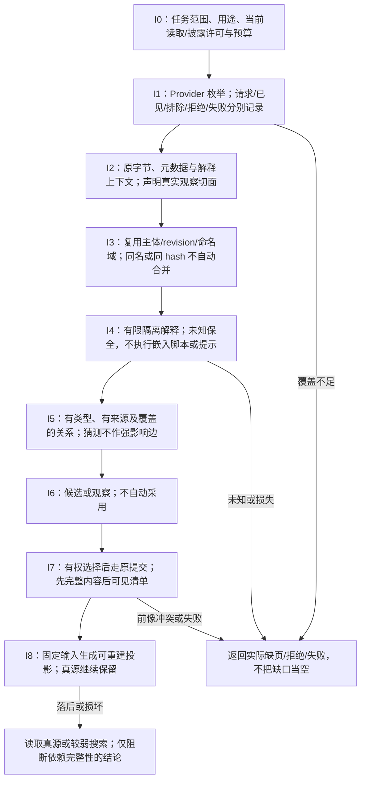
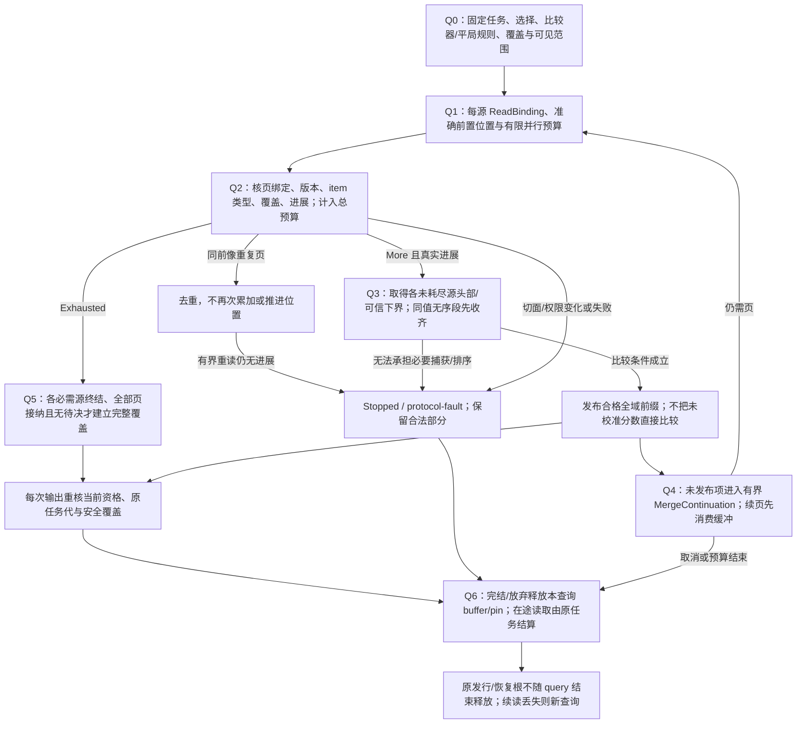
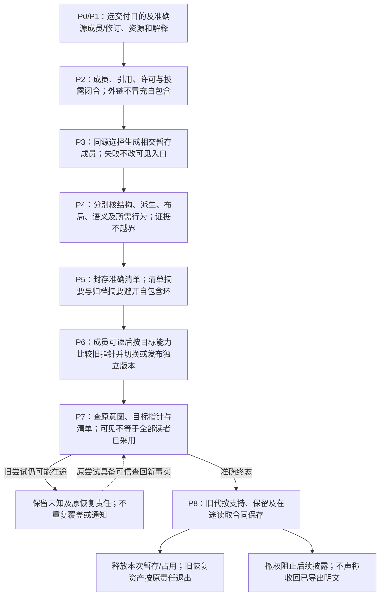

# 信息接入、检索与派生协议

> **阅读范围**：采用范围内的设计规范；实现状态另查未决。


本篇拥有跨文档、源码、制品、资料和运行Provider的信息读取与派生交接；原六工具的公共字段仍由[操作语义接口](../开发/工具协议/六工具与请求.md)拥有。以下名称是可合并实现的**内部合同**，不是新增公开工具、常驻微服务或作者必须填写的信封。真实源码分析、编译影响和效果仍分别交给原责任模块。

<a id="ingestion"></a>
## 1. 接入流程I0—I8

| 步骤 | 实际执行和拥有者 | 产出与停止条件 |
|---|---|---|
| I0 确定目的 | application从实际任务取得对象范围、用途、读取/披露许可与预算 | 可以只读现有源；目录中出现安装/运行命令不扩大任务 |
| I1 枚举来源 | workspace/adapters按Provider能力列出文件、版本或窗口 | requested/observed/excluded/denied/unsupported/failed分开；分页未完不称全量 |
| I2 捕获表示 | ContentStore或原文件快照取得字节、元数据与必要解释上下文 | 活数据库用其一致读取；设备/FIFO不当有限文件；大对象分片/范围读 |
| I3 登记身份 | 复用原主体/revision/区域身份，解析外部命名域 | 不以同名/同hash自动合并；模糊匹配只能产生候选对应 |
| I4 有限解释 | 格式/语义adapter读取所选能力，隔离不受信载荷 | 读值、保全编辑、执行是不同权限；未知可保全，不变空对象 |
| I5 提取关系 | 从真实清单、解析或分析形成有类型、有范围的关系 | 普通超链接只做导航；猜测关系保留猜测来源，不作为可靠影响边 |
| I6 形成候选 | 把解释、关系与来源绑定现有候选/观察对象 | 候选不自动进入当前规范、执行队列或证据采用 |
| I7 接受/发布 | 有权选择采用时走原propose/check/apply或相应元数据提交 | 先完整内容再可见清单；解析成功与接受/部署分开 |
| I8 索引/更新 | 索引者根据固定输入与真实变更形成新投影代 | 落后/失败/缺页可见；原字节仍在真源，索引不可成为唯一副本 |

源提供者不支持快照时，接入报告观察时段和受限一致性；可以两次检查受影响对象是否改变，但不能宣称两次都相同证明所有中间时刻无变化。秘密默认只接入权限内的引用及必要能力说明；不先读值再寄希望于事后脱敏。

压缩包、文档嵌入脚本、宏、外链、可执行过滤器和模型提示都是不受信输入。展开或转换在本次预算与隔离候选中执行；读取的文字不能给adapter授予新的工具权限。对有损提取保留原版与损失说明；OCR/解析失真不冒充原文，缺页不按空页处理。

本地可丢索引可用size/mtime/ctime筛变化候选，再对候选完整字节计算摘要并重解析；只有文件系统、写者协议和检测覆盖已取得资格时，才将其作为日常快速路径。无法排除元数据未变而正文变化、外来写者或遗漏源时，保留覆盖不足并转严格捕获，不能支持当前完备负查询。严格审计和冷重建对准确选定的全体作者源重算字节摘要，不用stat证明字节未变。

canonical与research先选范围再访问：可物理分离cache代或使用具同等隔离的Provider；默认canonical新鲜度检查不读取被排除的research正文，不能只在结果阶段过滤。失败不发布半代，旧代逐源取得当前披露资格，空选集可发布真实空代。cold build、warm/stat refresh、cache-only query、单文件更新与full strict audit分别在固定宿主/磁盘/缓存/并发负载和多轮观察下测量；未达原性能条件如实报告，不删安全检查或扩大阈值。该画像消费原源捕获、索引代和查询owner，不增加第二入口、固定数据库表或包内旧协议版本支持。

## 2. 查询从实际任务开始，不从一个巨型图开始

### 接入与采用的责任图



内部`readInformation(readSpec, selectedContext, readGrant, budget)`接受已选目标、明确/概念引用、目的、所需完整度和可披露范围。普通按路径读一份文件可以直接读取，无需先注册所有节点。多Provider查询按下列顺序：

1. 解析请求中的对象、当前/历史选择及实际问题。显式引用优先，未知位置才检索；对指定版本不偷换为最新。
2. 选择有权的Provider与最小必要范围。在能下推权限的索引/提供者处先下推，不能先把全体私有候选发送模型再过滤。
3. 词法、符号/字段、关系与语义相似检索并行或分段获取候选。embedding只负责相关候选，不证明定义、等价、真伪或完整性。
4. 读取候选的准确来源片段，连同适用的定义、例外、反例和版本；仅命中摘要不足时继续扩展真实范围。
5. 按请求类型检查覆盖。列出某配置的全部公开API需可枚举的相应全集；搜索“可能相关资料”允许top-k但明确非全量。没有同名标题不能推出没有该机制。
6. 在形成响应及每个受控继续输出边界复核当前披露资格与输入选择；来源撤销/ACL变化失效相交缓存。批内已披露字节不能靠下一次拒绝收回。
7. 返回准确结果、可见覆盖、来源/版本及下一游标或停止原因。未完成时保留已取得合法部分，不用一个总`complete=true`掩盖单域缺口。

结果的`coverage`继承现有ObservationCoverage，不另创造一个百分比。要求全体时，一个缺少枚举能力的Provider不能由向量检索多搜几轮变成完整；可以明确支持较弱查询或返回该能力缺项。`notFoundWithinCompleteScope`只在相应范围确有完备枚举/检索保证时成立，外部披露还需按隐私政策裁剪。

## 3. 版本、分页与查询缓存的具体合同

内部读结果携带：实际`selectionRef`或准确观察切面；`items`（主体/revision/片段、来源和所需解释）；`coverage`；可选`continuation`；投影版本及相关权限/删除资格的核对位置。标签仅显示当前被允许说明的状态；被拒绝对象的名称、数量或邻接关系不因metadata较短而自动可见。

游标绑定查询条件、已选配置、Provider切面、排序/去重规则和调用资格；客户端得到不可任意扩权的续读引用。没有稳定快照能力时，续页返回变更/可能重复和缺口；不能按offset跳页后宣称没有遗漏。游标到期可重启查询，不能拿旧页与新快照凑成同一完整结果。

语义候选缓存和最终披露缓存分开。可以在受信边界复用纯检索工作，但最终回答不能仅以查询文本或embedding为键；必须核配置、相关源版本、格式/模型版本、过滤条件与当前资格。多租户结果与命中计数隔离；共享底层缓存的命中时延可能泄露存在性时，选择隔离、固定接口信息或明确受限保证，不无依据承诺恒定时间。

当前权限没有改变字节，并不表示它不是结果的真实依赖。反过来，一份完全不相交权限变化不要求全系统内容重编译。计算缓存、语义失效与披露资格是三个不同的关系。


<a id="provider-page-composition"></a>
### 多Provider页面的有限值合同与实际合并

现有`readInformation`内部使用以下**有限逻辑值**。它们补齐source-reader/index-reader的交接，不直接增加`gift.query`的字段、view或全局检索功能；部署为独立进程的适配器必须给出精确版本编码并协商，旧消费者不理解时保持不支持，不能删除未知字段后声称已核完。

| 值/联合 | 必需内容 | 拥有者与含义 |
|---|---|---|
| `ReadBinding` | 确切Provider实例/命名域、源选择或观察切面、查询与排序方法及版本、可读取作用域、解释器 | workspace/application固定；位置变动不重选版本，资格仍逐输出检查 |
| `ProviderPage` | 原ReadBinding、此页请求/前置续读位置、准确items、既有ObservationCoverage、下列一个next分支 | adapter返回真实映射；empty items不是终结分支 |
| `next=More` | 有界opaque token或准确keyset位置、同切面资格/保留条件、真实进展位置 | 同一绑定下继续；令牌不是写权限也不是内容 |
| `next=Exhausted` | 对该查询和已披露范围的枚举/检索终结依据 | 只关闭这个Provider实际承诺的范围；top-k结束不建立全源完备性 |
| `next=Stopped` | `budget / snapshot-lost / permission-changed / unavailable / unsupported / protocol-fault`等准确原因、已取得范围和可恢复条件 | 有些可沿原切面继续，有些只能新查询；不能全部变为Exhausted |
| `MergeContinuation` | 固定查询/选择/比较与去重方法、每源已取得页边界、未发布缓冲及其保护、已发边界与任务归属 | application短会话拥有；可保存在受保护服务端位置，不必把全部内容塞入客户端token |

items至少保留原对象、修订、片段和来源解释。相同页面重传由页请求身份和前置续读位置识别；相同字节不推导为同一对象或同一次事件。面向文档的集合查询可以按准确对象/修订/片段/角色去重；面向事件/Bag的查询仍保留不同出现身份和重数。来自两份镜像的同一报告不是两次独立实验；经已采纳身份映射合并的是来源关联，不删除独立观察的分歧。

**Q0 固定与选择。** 从任务取得需要的是准确引用、非完备相关候选，还是固定范围枚举；选择实际可用的Provider路径。无需跨源时直接读，不先建聚合表。只有声称全域排序/全域完整时才承担下面的必要缓冲和等待。

**Q1 捕获与请求。** 各源固定其能力所能提供的版本/切面，先申请有限并行读取预算，按每源前置位置发送页请求。不能拿一个源的cursor传给另一个源。源不能稳定继续时可在实际可容纳的有限范围捕获一次后本地排序，或给出较弱结果；不假造它提供了快照。

**Q2 接纳与推进。** 核返回绑定、方法/格式版本、前置位置、可允许item类型和实际范围，计入读入及缓冲字节。重复页不再次累加，也不因重传推进位置。相同token、相同页前像和没有新范围的重复响应不是进展；有界重读仍无进展就返回protocol-fault/未完，而不是无限自动翻页。过滤后空页但More位置确实推进可以继续，不能误报没有更多。返回Exhausted与同时要求同切面More矛盾时拒绝该页合同。

**Q3 排序与发布。** 一个全域升序前缀的下一个item，必须不大于每个其他未耗尽源的最小可能后继。可用各源按同一比较合同给出的头部或可信下界执行k路合并；缺某源头部时先取它，不将其他源的当前最小值冒充全局下一个。若源只给任意顺序，则在完整有限捕获后排序，或明确选择“已取得结果的局部顺序/非完备候选”，不能维持原全域排序声明。词法/向量分数未按统一尺度校准时不可直接比大小当真实相关度；融合排序方法要命名、固定，仍只是候选排序。 同一排序值必须采用已固定的主体/出现身份作确定性平局规则，且所有提供者或归并层使用同一可比较表示；本次游标续页不能临时换locale、比较器版本或键规范化。同序号不同真实出现保留各自身份；排序总次序只是本查询的输出政策，不证明跨源实际发生时间。 如果Provider只按主键值排序、同值项内部无序，不能临时加身份平局键后就把其页头当完整比较器下界；须先在预算内收齐该同值段直到更大主键/真实末尾再排序，或取得提供者的完整比较器保证。无法界定或存下同值段时返回准确排序缺项/Stopped，不能漏过后来才出现的更小平局项。

**Q4 页界和预取。** 下游只要10项时可以预取更多，但已读取未发布项保留在MergeContinuation保护的有界缓冲；下一页先消费它们，不重新从源头扫过并漏掉原第11项。任一源失去快照/去重状态或必要缓冲丢失时使相交续读失效；重新开始的新查询不能接在旧页面后伪装一个完整结果。总字节/源内项/在途请求/控制元数据都有上限，必要时暂停无关预取，禁止按源分别分配后总和越过父预算。

**Q5 关闭覆盖。** 只有请求范围内各必需来源已提供所需Exhausted依据，所有必需页都已接纳、去重/解释无待决，才能建立相应完整结果；“读取完整”和“展示前10项”仍是不同计量。一个失败源不抹掉其他合法结果，但阻止依赖它的全域否定/完整结论。不可披露的源身份和计数不出现在公共错误中；无需向调用者透露隐藏内容就可以报告该声明当前不具资格。

**Q6 取消和保留。** 替代任务只撤销其发布槽，允许无效果、仍有许可的共享读取复用；实际进行中的读取、网络费用和缓冲由原任务域结算。所有控制边界按当前资格检查，固定页不永久授权。正常完结或准确放弃后释放本查询的buffer/pin；既有恢复或发行根不会因query结束被误释放。

**合并例。** A稳定升序返回[a,c]并More，B升序第一页超时。请求“所有对象按键排序”的第一页时，不先把[a,c]当全局前缀；B恢复返回[b,d]后可发[a,b]并把c/d留给续页。用户明确接受非完备浏览时可返回已取得a/c，但它是另一个准确标注的结果合同。若A过滤后返回空页且token前进，继续A；若一直返回同token空页，停为无进展而不是全域空。该例没有要求每个单文件读取启用多源聚合。

<a id="information-organization"></a>
### 多维组织、出现与大型工程布局

工程组成、依赖/调用、权限、初始化、部署、来源与迁移各有边类型，合法关系图不必是一棵树。目录只提供容器出现，语义对象可有多个只读导航出现；共同组织复用准确主体/配置、成员与关系、已接受约束、旧布局/前像、目标宿主政策和选定方法。实现选择决定组件、进程、共享状态与事务边界，SourceLayoutPlan 只决定合法成员位置，不能为少跨目录而改变调用、可见性、单例或需求。

组织先以不改现有合法布局为基线。兄弟划分有一致依据，不同层可按制品、领域或内部职责细分；只有真实独立不变量、writer、生命周期、消费者或替换边界才拆组件。路径虽非稳定身份，可能参与模块解析、资源寻址、包出口、URL 或授权，移动须核真实消费者，不以显示重排代签语义保持。角色索引与布局从原 owner 派生，不新增万能 TreeManager、全局 registry 或第二永久工程图。

布局返回成员位置、跨边保持、来源映射、排除/未知范围、冲突与必要后置检查。真实写入仍由 workspace/execution 产生精确计划并准入；图到树、分页与可视布局分别有预算，虚拟滚动不证明后端扫描有界。客户端的出现身份、祖先回边、多选和刷新消费[树形合同](../开发/编辑审查与客户端.md#tree-navigation-contract)，不发行新公共 Tree RPC。

preserve 将明确旧布局作为输入并保持仍合法位置；canonical 只依当前输入与规范政策，不承诺最小差异；reorganize 还需准确范围、优化目的和前像，不能成为每轮默认。同完整输入的 clean/incremental、串行/并行按所承诺语义/结构/字节比较，不同历史布局不冒称相同输入。联合预算、共享类型、事务或 manifest 必须按完整参与者检查，两两邻接只用于定位；三项各占四单位放十单位池，任意两两通过也不能签发全组通过。

真实重组保留源/目标前像、成员和引用映射；生成区按旧生成 B、现有 W、新候选 N 三方判断，用户变化不能被目录整齐吞掉。路径交换、大小写、链接/重解析和根外定位交真实宿主能力，字符串前缀不是安全边界。取消物化不删除唯一前像、用户内容或未结恢复根；回滚遇后来写入停止相交覆盖。无修改作者往返保原字节，目标生成按声明观察/接口保持，完整离线交付保实际内容闭包，不能以一种保持代替另一种。

固定用途、准确成员/真实关系及不可拆单元后，先传播公开路径/API/ABI、初始化、资源事务、权限、唯一写源、输出成员和平台名称硬约束。只有同一种边界的must-share才形成等价类；类内同边界must-separate返回带来源冲突，未知不当false。按实际依赖分解，共享类型、命名域、配置或容量耦合者联合求解；各根可行不证明并集合法。

候选包含旧合法布局、不新增及目标惯常形态；成本保留单位和未知，先过滤硬资格，再沿已接受层次/偏序选择，仅平局或已委派自由度用稳定规则。逻辑探索单元、分支及归并由固定策略决定，不按线程先返回或墙钟截止决定选解；超时只给准确已探索范围与未完成。允许采用当前合格候选时，采用另绑定候选、证据和搜索回执；此后生成消费固定选择，旧Binding普通重建不重新搜索。

## 4. 索引提交与失效

### 多源分页、排序与释放图

图中的完整结论需要每个必需来源自己的终结依据；top-k结束、空页和失败都不能替代Exhausted。单源直接读取无需建立多源归并状态。



索引维护在固定checkpoint下构造新分片；每个分片记录输入选择、解析/抽取器版本、实际覆盖和删除/权限过滤的处理位置。先写完整索引分片并读回，再将同代分片目录、相交实际依赖、覆盖、已完整应用的源批次边界及可恢复位置在同一真实提交边界条件安装；不能先推进应用位置再更新索引。可采用同域事务，或先封存不可变成员与依赖清单后条件切换唯一目录指针。读取者只混用经声明可组合的分片，失败分片不借其他成功分片冒充全库就绪；源端与本地不是共同事务时保留真实观察切面，不扩大原子保证。

变更重复按准确源对象/代际、完整批次身份及成员位置或实际事件身份处理；同一 revision 可以含多个不同成员，不能只用裸 revision 去重而漏掉第二项。分片未收齐时仅记录接收进度，不推进应用 checkpoint；乱序先比较真实前提。接收 cursor、progress/BOOKMARK 不单独证明相交变化已应用。批界、接收/应用/耐久及消费确认继续消费[投影检查点](../开发/工具协议/客户端与并行会话.md#projection-checkpoint-resync)，本节只拥有索引分片的发布，不另立订阅合同。空返回不能被推断成删除；删除由有权源的明确删除/完整成员比较确认。索引是否收录源、是否拥有可读内容、是否新鲜分别记录。

丢事件、游标超窗或缓冲溢出后，先撤旧接收代更新权并标相交覆盖失效，再依原重同步协议在私有 staging 捕获/重建完整所需状态及新依赖，读回合格后条件切换目录、分片与应用位置。新代未成立前保留仍合法的旧代及草稿；旧代只能在当前披露与允许陈旧的用途内读取，不能继续证明最新或完整否定。失败只清本候选确认可释放的资源，不删除最后合格旧代，也不把漏掉的历史事件伪造成已恢复。

索引不能阻止采用新的合法作者源；它落后时可直接读取真源，或返回较弱搜索。若任务依赖完整负查询而无法旁路，才阻止该项结论。索引损坏按保全真源重建，不自动恢复已撤销访问或删除的源。

<a id="index-two-stage-read-qualification"></a>
### 旧代连续读取与逐项当前披露

读取索引先核生产代与当前源、解释和选择的兼容范围，再对每个候选核当前内容/权限/删除前沿及所需覆盖。允许旧代继续读取不等于允许披露旧代中的已删除秘密。若A已删敏感词、B当前解析失败、C仍可见，旧索引中三者均命中时只可返回当前合格的C，并标明partial；不能为维持旧代完整性泄漏A，也不能把B的旧命中称为当前结果。没有安全旁路或逐项核验能力时停止相交搜索，独立合格结果仍可用。

重建的真实输入域为空时，完整捕获确认的 sourceCount=0 或 queryDocumentCount=0 应提交实际零成员/零文档代，按其真实统计口径报告0；空代不是构建失败，不能为避免空结果保留旧 hits 或旧文档成为当前代。权限/预算/捕获中断造成的未知覆盖不属于已确认空域。通知缺口引发重捕/重建当前状态，不补造未观察到的历史事件；索引可用、搜索完整与当前可披露分别返回。

### 持久索引的物理兼容、续读与有界检索方法

物理兼容核所选Reader真正消费的类型亲和、列序、非空、主键/唯一约束、隐藏/生成列及空值，不能只比列名。同名表缺单键唯一或改复合键时，不继续把其qid/路径/代际按旧合同解释。模式、解析器、排序器或SourceProfile变更使相交缓存重建；DDL、行与元数据在私有/事务候选中完成并读回后发布，不用CREATE IF NOT EXISTS掩盖不兼容，也不预先删最后合格代。活动旧Reader保持自己的完整快照。

generation仅在同一索引实例内有意义。删除重建后即使又是generation1，也因新物理incarnation拒绝旧cursor。游标绑定工作区、范围、规范化query、页大小、解析/排序/Profile修订、各相交实例/代及续读位置；在实际读取事务内再次核实例与代，避免新行贴旧证据。cache-only未刷新须明确未检查，安全旧代旁路仍标partial；二者不签当前完整负查询。精确locator没有当前合格源时返回缺项，不借旧搜索命中放行。游标散列只检意外变化，不能防持有者伪造；跨信任边界仍用原认证与句柄合同。

一个有限词法方法可仅对索引副本做NFC、大小写折叠和空白折叠，以字面子串命中；先排标题完全匹配，再标题包含，再正文命中，同组按首次位置、准确路径、源起始行稳定排序。片段定位使用同一规范化与来源映射，不能拿未规范化find位置切片。规范化不改作者字节、语义身份或源码坐标；排名是命名方法的候选政策，不证明含义等价，方法修订变化使相交cursor失效。

SourceProfile切换固定旧/新配置前像，分别枚举拥有成员，逐共同源比较分类和语义修订，新增源完整解析，删除成员显式列出，诊断未清不采用。只改配置不是源码语法迁移。采用时在原writer的协调屏障下重核配置CAS、冻结候选字节及完整读集，再按原发布与读回切换；非协作writer仍需真实独占或报告漂移，advisory锁不授予其控制能力。分类变更传播到实际消费者，不新增第二套可写索引或强制某个配置文件名。

<a id="code-intelligence-index-projection"></a>
## 4.1 代码智能与跨仓索引是信息投影

通用信息索引已经拥有checkpoint、分片、覆盖、新鲜度和权限；代码智能不得再建设第二套事实数据库。语言前端或外部索引器只把symbol、definition/reference/implementation、call/type relation等作为有来源的索引分片，真实源码、语义绑定和workspace revision仍是authority。

```text
CodeIntelligenceShard = exact {
  sourceSelectionAndRevision,
  languageAndSemanticProvider,
  indexingMethodRevision,
  symbolNamespaceAndIdentityMapping,
  relationKinds,
  sourceCoordinateContract,
  coverage,
  dependencyOrRepositoryBoundary,
  visibilityAndDisclosureScope
}
```

SCIP/LSIF等交换格式只是import/export表示；compiler-backed精确索引、启发式索引和文本索引保持不同资格。跨仓结果只有在依赖/仓库集合有可枚举边界时才能支持“全部引用/没有引用”等否定结论；开放代码搜索只报告已观察范围。

未保存buffer通常比持久索引新，但只覆盖其实际捕获文档和相交语义；不能据此删除其他文件关系。查询先固定buffer/candidate/workspace/index/dependency/historical各自revision，再由真实依赖决定旧分片能否复用。旧索引迟到完成不能覆盖新候选；值相同但读集/解释变化仍安装新的依赖事实。

<a id="scip-code-intelligence-mapping"></a>
## 4.2 SCIP导入的源码、Symbol与覆盖映射

SCIP是 `CodeIntelligenceShard` 的一种交换表示，不是新的symbol/revision数据库。导入先固定index bytes/content identity、metadata/indexer、project_root映射、实际workspace/source selection和权限，再逐Document建立有范围投影。

```text
ScipIndexMapping = derived {
  indexContentAndProducerRefs,
  metadataAndIndexerRevision,
  projectRootToWorkspaceMapping,
  sourceSelectionAndRevision,
  documentMappings,
  positionEncodingMappings,
  symbolNamespaceMappings,
  relationshipInterpretation,
  coverageAndPrecision,
  unsupportedOrUnresolvedExternalPackages
}
```

### Document path不签source identity

SCIP Document的`relative_path`只在其metadata.project_root下唯一定位regular file。index默认可以不携带text，因此consumer从文件系统重新读内容时，必须证明它读的是**生成该index所绑定的source revision**；当前工作树同路径文件、未保存buffer或后来commit不能直接与旧occurrence坐标拼接。若index携带text，也只绑定该index中的文档内容，不自动替换workspace作者源。

position encoding按Document声明转换；UTF-8/16/32单位不能猜。typed range优先于deprecated packed range时按SCIP协议读取，两种同时存在却不等价属于Provider/input不合格，不自行任选。

### SCIP symbol只在它自己的命名合同内成立

global SCIP symbol由scheme/package/version/descriptors编码；`local` symbol只在对应Document内部解释。导入时可映射到已知semantic entity，也可保持SCIP外部symbol relation；不能把symbol字符串直接cast成Gift DefinitionRef。包version、symbol descriptor相同仍不证明当前workspace采用同一个实现内容。

Occurrence的Definition/Import/ReadAccess/WriteAccess/Generated/Test等roles和Relationship的implementation/reference/type-definition等关系按真实字段映射到typed relation；它们不提升超出indexer能力的保证。compiler-backed、syntax-directed和heuristic indexer分别记录precision/coverage；`Find references` union relationship说明SCIP消费者应把相关symbols一起考虑，不等于Gift已经证明语言级substitutability。

### 空索引和外部symbol保持开放边界

SCIP可以把外部package symbol只留引用、或假定另一份index另行提供。因此“当前index没有definition”不能推成源工程没有definition；只有已固定workspace/package/index universe且相应indexer声明完整时，才支持有范围的absence。跨仓导航合并多个SCIP index时先固定package/version/producer与访问范围，冲突symbol不按先到先得覆盖。

SCIP diagnostics若导入，仍是该indexer运行的diagnostic observation，不成为assurance Verdict；代码导航只读场景也不因index文件可写而允许修改源码。

## 5. AI上下文包不成为第二份工程

application按实际问题产生最小足够的ContextBundle：任务/规则版本、准确引用、所需片段、相交约束、已知缺口和未披露边界。它引用现有候选和来源，不把未展示的文件从工程成员中删除。子任务只能在可委派读取范围内取更多资料；模型不能从“上下文没有这个约束”推导“约束不存在”。

抽取允许缩短重复解释，但完整接口、值域、关键否定、例外和失败条件必须按所需粒度保留或给可实际取得的定位。只给标题、向量摘要和模型自己生成的结论不足以支持精确修改。原有同版本规则可复用；范围、规则或任务变化触发相交重装载，不让每个纯函数运行都读完整工程规范。

上下文导出也受源的隐私、用途和版权约束。原输入是公开材料不等于组合推断必然无敏感性；新摘要含受限信息时按相应披露规则处理。工具返回和外部材料不得取得系统指令地位。保留用于审查的必要输入/输出及版本，不默认存储所有聊天或私密推理。

## 6. 派生文档、图、翻译与代码参考

规范和图源先在唯一拥有者修改。生成API参考从已接受公开合同/真实源码得到，生成物标明准确输入、生成器与覆盖；不能从签名反推出未写的设计理由。理由、反例和人工说明保留作者段落，采用显式区域归属，不用整页重印吞掉它们。

HTML、SVG、PDF和站点是可选输出；没有独有规范就不需每轮重建。生成完整阅读版必须以完整成员清单为准，不以搜索命中列表或AI上下文为全集。节选必须标明范围。图的语义源码保留在拥有者，图布局与语义分别检查；提取成功不代表图正确，图可显示不代表产品可运行。

翻译绑定原文单元与revision。原文修改使相交译文成为待复核，不自动删除其他稳定译文；术语、否定、量纲和例外不能因流畅而改义。读者可请求译文及原文对应，未翻译片段明确缺口而不是静默省略。

派生输出校验对象至少含源成员、版本与数量、文字/接口片段的承接、链接和图源、受限内容过滤以及所声明的显示测试。表格/CSV输出明确公式注入和编码策略；安全转义的展示不能反向改原始数据值。

## 7. 原十职责里的实际交接

| 原责任 | 内部函数/落点设计 | 必需输入与返回 | 不可下放的边界 |
|---|---|---|---|
| contracts | information-ref、relation-kind的共享值接口 | 精确引用与有版本关系语义；仅实际跨边界项编码 | 不导入图数据库行/搜索SDK对象 |
| workspace | `resolveInformationRef`、`captureSelection` | 原快照、Provider选择、范围→固定视图/缺项 | 不以目录命中替采用或授权 |
| semantics | `interpretInformationRelation` | 类型/两端/上下文→有限关系或不支持 | 普通文档链接不进入强依赖 |
| application | `readInformation`、`composeContext` | 任务、引用、当前读权、预算→结果/覆盖 | 只拼接合法切片，不定义另一套事实 |
| compiler | 消费原PreparedJob及所需规范/源映射 | 只有实际编译输入进语义/生成键 | 搜索排序或文档移动不改变程序语义 |
| assurance | `bindInformationEvidence` | 明确Claim、主体、方法、结果与覆盖 | 签名和SARIF格式不代替真值/符合性 |
| execution | 既有publish、export、delete、reconcile | 实际作用计划、前像、Grant与保留根 | 读材料不执行其中命令；索引清理不抹操作 |
| adapters | source-reader、index-reader、archive/export适配 | 原系统合同及准确映射、有限支持 | 不把未知provider能力填成成功 |
| entry | 原query/propose/preview/check/apply/operation | 已有请求解析、能力协商、来源标记 | 本篇不新增第七工具或无版本新公共字段 |
| bootstrap | 按实际需求装配上述函数 | 现有HostPorts/EngineImage和配置 | 小工程无数据库/守护服务前置 |

这些函数是原模块内的实现设计，可合并文件。所有需公开或持久的新分支须由其原公共合同给出版本并协商；本篇的内部表格不能被客户端直接当可调用API。

<a id="information-query-boundaries"></a>
## 任务读取的输入、结果归属与公开接口边界

请求应由现有CallerContext、工作区/Artifact/文档代际和任务目的共同固定：来源选择、准确或概念引用、必需范围、所需返回用途、当前披露资格以及读字节/CPU/网络/返回预算。系统可从已有对象推导这些条件，不增加作者填写清单。指定旧会话、旧运行或旧规范时，不可用相邻材料或同名最新对象替代；只有摘要取得时只报告摘要层支持。

`captureSelection`固定输入；`resolveInformationRef`解析对象；`readInformation`取得并组合真实单元；`composeContext`按用途组织已经有权取得的内容。继续使用原来的这些内部职责名称，不引入同义的第二套Selection/ReadUnit存储。对照文档、源码、证据或证明时，补取真实消费者和最强相交反例；没有入边只说明当前关系索引没有发现，不自动授权删除规则。

读结果应可恢复期望成员、已取得成员、实际输出成员、有权展示成员及各自范围。发现100项、读取20项、展示10项时不能只返回一个无口径count=10；隐藏集合的名称或计数也不得借覆盖报告泄露。对外只说明政策允许披露的范围，内部保留准确原因和责任。

最终响应和每个继续输出边界核对当前资格与任务代。旧任务被替代后，其计算仍可结束或供等价纯缓存复用，但不能覆盖新任务的当前视图；失去展示资格不等于底层进程已物理终止。固定内容快照与读取保护也不延长已撤销的访问权。

原六工具中的source/contract/origin/impact/state视图按其现行合同呈现已支持对象；这里没有增加公开view枚举。全局语义检索参数、文档生成器及具体Provider的公开编码，必须在原接口、能力协商和解码器中落实后才可调用；不能把本篇内部函数名直接拼进工具JSON。最小本地文档任务仍可只是编辑Markdown、重建目录和校验打包，不以实现整台Gift为前置。

<a id="information-publication"></a>
## 同一代文档、索引、图与译文的发布细化 P0—P8

**P0 选择产物目的。** 规范源包、全文阅读版、图册、API参考、译文、审计证据包和备份包是不同成员选择。缺省交付本次要求的那个，不把所有历史图册/日志递归放入现行源。全文阅读版包含所选完整正文；专题阅读版准确标示子集；图册不被称为全文。

**P1 固定源选择。** 从准确工作区/修订集合取得将要发布的文档、图源、必要静态资源、解释和语言画像。固定后源继续被编辑时，本次仍属于旧快照，后续编辑进入下个候选。用户要求发布最新编辑时重新建立候选，不能只修改标题版本号。

**P2 验证闭合与权限。** 核所有必需成员、引用路由、内容/格式、许可及披露。完整离线包需要实际包含所需外部原件或明确以外部引用交付，不得在网络不可用时称自包含。存在未授权来源时不能导出其摘要/缩略图代替原件绕过权限；根据需求排除并准确标范围，或拒绝该完整导出。

**P3 生成暂存成员。** 从同一源选择生成页面/目录/索引/图/译文的相交部分。输出绑定真实生成方法和实际输入；失败留在暂存，不更新可见入口。不需要HTML的修订直接以MD源包完成，不为证明维护活动重复生成图。

**P4 检查不同层。** 分别检查源与结构、派生关联、布局/图像可用性、图文/译文语义、所需现场行为。结构合格不证明语义正确；未渲染不能报告视觉通过；文档案例未执行不能报告产品通过。已知错误必须修对应输入及输出，不能只在报告里说“以后以正文为准”。

**P5 封存成员清单。** 清单固定相对路径、准确字节摘要/长度、源关系、所选画像、必要外部引用和缺口。路径规范化、大小写、Unicode归一、符号链接与目录成员冲突按宿主画像检测；不可跨根解包。清单不包含它自己的内容摘要，外层身份对清单的规范字节计算；归档整体摘要再放到独立校验文件，避免自包含哈希悖论。

**P6 发布。** 目标提供真实原子指针/版本切换时，先确保对应成员可以按准确引用读取，再比较旧指针并切换。读者先取得固定清单再按清单取成员；读取到旧指针可以是合法旧代，但不能把不同代成员混成一页。多站点复制只承诺实际支持的可见性；没有原子切换能力时发布独立版本包与准确状态，不宣称全站同时切换。

**P7 查回。** 入口更新超时或响应丢失时查原意图、目标指针和清单；指针已指向预期清单说明对应发布可见，不说明所有读者已取得。没有可靠查回时保留完成未知，不改包内容重复覆盖。相同字节也不能证明外部通知、下载和采用均发生。

派生头读回不存在或仍为旧版本，不排除原发布请求还在途；重复写头、发通知或再建外部对象前遵守[旧尝试关闭](../运行/持久化提交与恢复.md#attempt-finality-and-retry)。可以继续保留已生成且未发布的独立版本包，但不能把此局部成果当原发布已终结。

**P8 保留与收尾。** 当前代切换后，旧代按支持/保留/在途读取合同保存；读租约只约束资源生命周期，不延长撤销后的访问权。可安全回退的是相同目标的版本选择，不是抹去已经导出或对外传播的事实。旧签名、历史验证与旧基线一同固定，不改成新版本通过。

导出是披露动作。一旦明文包交付给不受控环境，后续撤权不能技术性收回其全部副本；必须在导出前检查受众、范围和政策。加密交付可限制部分访问方式，但不保证已解密内容可撤回。这是实现可承诺范围，不是忽略已有法律/组织义务。

### 派生发布、未知作用与旧代保留图



<a id="observation-strength-and-gaps"></a>
## 观察切面、枚举完整性与缺口恢复

一次读文件、多文件扫描、通知流和提供者原子快照具有不同资格。两端哈希相同不能排除A→B→A；扫描分别读到的成员可能从未同时存在。依照[实际工具消费与ABA](../运行/持久化提交与恢复.md#snapshot-aba-and-actual-tool-consumption)，观察固定对象解析、捕获区间、正向内容、枚举完整性、无权/排除/读取失败、通知缺口及提供者保证，不能由一个“精确”标志签发冻结。

否定需要该范围有足够发现能力：不可读子目录不是空目录，未收到删除事件不是仍存在。通知溢出、游标丢失、重启或子目录覆盖未知时，先降级依赖连续性的判断，再重新捕获相交范围；恢复当前可读不补造过去中间事件。inotify的范围与限制参见[原始手册依据](../依据/来源/全域组合与仿真依据.md#linux-man-pagesinotify7)。

不可变提交可固定内容；实际文件系统快照只承担其承诺；所有写者确受同一协议控制时才使用对应版本栅栏。自建锁未控制外来写者则不冒充冻结。封存输入仍可离线编译，当前物理目录的持续稳定性是另一Claim。真实写入/发布在实际提交点按原协议核前像与对象，路径字符串复查不代替句柄/事务保证。
