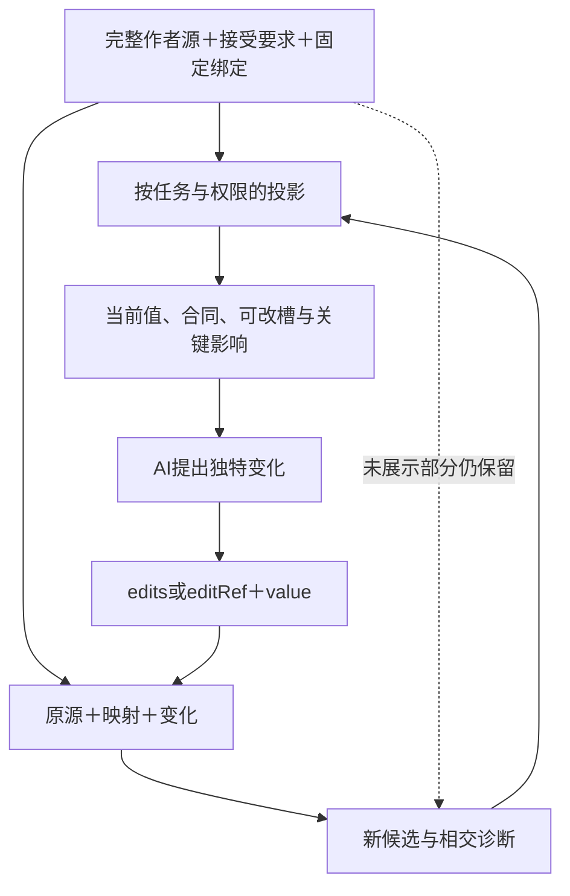

# 上下文取得与任务投影

> **阅读范围**：采用范围内的设计规范；实现状态另查未决。

## AI是可受委派的开发者，不自行扩大任务

当前首期只有AI/脚本开发客户端；后续其他客户端仍共享工程对象和变更协议，不在首期实现人类编辑体验。AI可以组织需求、提出模型、创作算法、比较实现、执行获准检查并提交或应用有权的修改，不是只能填表或提建议。哪些选择能自动采纳由真实政策与委派决定，不由“这是AI”一概否定，也不由模型说“我是开发者”自动许可。真实观察、授权根和必要的独立复核各有来源；人也不能凭作者身份绕过这些边界。

每次工作先绑定目的、范围、禁止项、数据披露、允许的作用和预算。只设计时，AI 可以修改设计候选和交付文档；不能因为发现可运行原型有价值就自行实现。授权实现时可以修改候选源码，但不能顺便集成、发布或改权。任务目的的扩大需要真实用户请求或既有有效政策，不从模型自行生成的计划取得。

同一规则适用于所有入口和子代理，不能在 GUI 里受限而通过工具接口绕过。用户持有本地工程的管理权时可以选择退出某项管理范围；系统如实缩小保证，不以锁死原生资产维持控制。

## 一个任务相关视图，不复制四套上下文

### 图解：完整作者源与最小任务投影

展示省略不修改完整源；模型只创作真正差异，工具完成定位、展开与保持检查。

任务目标、作者源、候选、实际结果分别由原责任保存；面向模型的内容是对这些数据的一次**任务投影**，不是新增的作者源、语言或压缩IR。完整规范、完整源码可以按需保存，AI每次仅取得当前决定所需的合同、可修改位置与变化。内部分析仍然读取实际必要依赖，不以模型看到了多少字决定语义闭包。

三层明确分工：**作者源**决定程序和主动控制；**任务投影**决定本次展示与允许提出的局部变化；**编译IR**承载真实分析或降低所需的不变量。投影中的省略号、折叠实现和摘要没有资格覆盖未展示的作者内容。完整处理见[任务投影协议](#任务投影的读取编辑和回写协议)。

小函数原文已经是最短可用材料时直接给原文。大型模块先给相关公开合同和本次变化；只有诊断、改算法或接口依据不足时展开相交实现。不能只给一个不熟悉的名字再要求AI猜含义，也不把全部底层展开、锁和日志附在每次工具返回。

### 来源资格、撤回与部分观察

composeContext 先固定任务 scope、用途、当前可读资格与实际来源，再取得片段；旧 QueryIndex、上次摘要或 sourceSpan 可定位不证明本次可再披露。源被删除/改写、角色迁出、解析更替、租户或权限变化时，旧命中从当前输出排除并重核相交任务视图，不能在补充提示里继续引用已失资格旧正文。需要历史研究时显式取得有权的历史快照，不以跳过刷新把旧缓存冒充当前源。

完整枚举中无事实、Provider/索引失败造成缺口、调用者无权知存在性是不同结果；后两者不能总结为不存在，也不能泄露隐藏名称/数量。已发送给外部模型的明文无法由删除索引技术性追回，后续保留/删除义务交真实数据宿主。SourceRevision、语义修订、索引 generation 与集合 scope 分别绑定，不能拼成未经证明的原子全库修订。

SEARCHED 只在明确范围与代际检查完成时使用；PARTIAL_SOURCE_COVERAGE 和主动未刷新的 UNCHECKED 不支持完成负查询。源片段的取得/摘要证明也不证明模型理解或全部依赖已读取。派生上下文独立输出时重定位其相对链接；无修改复用只对仍准确、合格、可披露的来源成立。

## 不让模型重新承担已由工具确定的决定

任务属于已经定义的筛选、分组、极值、窗口、状态或其他可组合关系时，先给该关系的准确调用与本次差异，不默认展开嵌套扫描或临时变量。需要修改定义实现时才展开算法。词汇增长按所用符号局部取得，不自动加载全部库；但陌生名字必须给准确合同，不能把短提示变成猜谜。一个短editRef只减少运输，长作者主体仍需单独审查；不得拿模型没看见的复杂度当作已经消除。

先从任务根与真实来源区分五种内容：作者明确差异、已经接受的定义/缺省、可确定推导、已委派实现选择、仍影响结果的开放项。AI只对需要创作或决定的部分工作；普通解析和展开在工具内完成。五种是结果解释角色，不是每个请求的五个必填数组。

正常响应以任务变化为中心：哪些含义改变，哪些来源保持，实际生成或作用到了哪里，剩余什么问题。库来源、目标绑定、类型或完整影响图可通过已有query投影展开。结果字段省略只减少重复展示，不能把重要的未知、违反或部分作用省掉。

成熟生态中的调用方可只写一个已有定义的参数变化；新算法作者在同一语言中写真正逻辑；新库贡献者维护完整合同与实现。角色可以在一个AI任务中变化，不要求普通使用者了解库全部内部，也不要求库作者的复杂工作从总成本中消失。

当原任务要求保持排序，而候选只改变库版本，AI需要看到排序合同是否变化；若没有变化，只看到相关采用和成本。若新的规则改变相同值的未来固定关系，也要显示来源差异。真正未解释的要求进入开放项，不能只凭短摘要给出全任务满足。

已有语义解释不因模型会话重启而重做；新的自然语言创作可能有不同候选，当前被接受的结果一旦固定便沿精确输入重建。模型记忆不是源库；所有“以前约定”在需要用于决定时要解析到已有记录或当前有权重作选择。

## 上下文生成与完整性边界

先从当前任务对象选择相关定义与直接边界，再沿该动作实际需要的依赖扩展。已知硬约束、负读取、范围查询、冲突与影响当前动作的未知必须保留。预算内优先展开决定性材料，其他范围保留继续查询方式与截断标记。

这里最多能检查“已声明读取合同中的必要项是否被提供及其修订是否有效”。不能证明模型理解了全部知识，不能证明整个开放世界不存在遗漏，也不能要求所有设计任务先消除全部未知。

预算不足时允许继续无关或可逆的设计，给出局部结果与未满足义务；需要该缺失事实的危险作用则不准入。安全未知、权限隐藏和不存在是不同结果。权限不允许公开存在性的对象不暴露具体名称、数量或可猜测摘要。

恢复会话时返回原目标、当前候选、发生变化的事实、失效的证据和待决动作。聊天摘要不是恢复权威，模型换了也不改变工作状态。参考句柄和缓存中的许可不能跨会话自动复活。

## 任务接受依据和组合诊断的最小投影

AI取得的是当前要改变的含义，不是所有实现备选和证明图。bootstrap/context在受信边界绑定任务目的、当前要求及候选；查询结果只展开被编辑对象、相交合同、未满足连接和可选后续动作。一个接口已经有明确输出保证时，下游不必默认读取其全部实现；保证太弱或证据不足，再定位性地下钻。

组合失败时的默认诊断包含四件事：哪条任务要求仍然有效；哪个生产者在哪个使用点提供了什么；消费者需要什么；有哪些在当前权限和目标内可行的修复。例：“增加16的结果可到271，但编码器只接收0至255；原任务规定饱和。请在该连接实现饱和，或提出明确目标变更。”不用先返回整棵IR，也不能只给`invalid`。

诊断可能包含受限信息。服务先检查披露权限，提供允许范围内的冲突与定位；不允许枚举的对象不通过反例或候选名称泄露。授权服务无法披露细节时仍保存内部可审计原因，由有权主体处理；不能为了模型自助而扩大其读取范围。

父任务分解时沿现有子任务委派携带要求引用和编辑范围。子代理可以提出新的实现与设计假设，不能以它自己的测试期望修改父任务的接受标准。拼接多个子候选时重新检查跨分支连接和共享约束，不以“每个代理都报告完成”合并绿色。

普通已知函数不新增一次强制query；声明或上下文能提供所需事实就直接处理。观察摘要更新但数值相同，只有消费相应来源/资格的AI说明需要刷新；上下文保留的引用不自动证明模型已经读过内容。模型、缓存或实现选择更换都不自动重置已消耗预算或任务范围。

## 任务上下文怎样实际组装与逐步补全

本节的C1—C5合并到下方[任务投影协议](#任务投影的读取编辑和回写协议)：固定任务与基础、取得实际决定边界、按权限形成可读可改视图、按预算分段、保留原源补充并回写。旧入口保留用于定位，不再维护第二份完整上下文算法。

每次继续应当新增相交事实、缩小一个未决点、产生精确候选，或者准确结束。无变化地反复读取、重新总结同一源不算进展。用户要求全量设计审查时仍需实际分段读取该范围；任务接口可短，不能代替完整规范审读。

## 紧凑协议不省略的语义边界

默认中立source由服务取得准确文法、类型和基础库；AI不需要复制整份类型树或先寻找全部能力。修改传base与差异，声明身份延续由共同映射处理；映射歧义只返回实际相交部分，不根据名字“猜对”后继续写。

拿到源检查通过、TS产物a1、Java产物a2时，AI收到的是不同主体的结果。工具应直接给出所需artifactRef与可披露诊断，不能要求AI从多个类似路径中猜“最后一个”；小产物直接返回正文，大产物才分页。目标尚缺不取消源设计，源检查通过也不授予作用。

契约写明、逻辑在假设下通过、目标案例实际通过和已写入文件是不同结论。AI可以继续修正实现或要求，但改变要求的权限不能由修复代码任务自动取得；后置条件失败也不能通过抹去先前外部作用解释成没有执行。

## 短输入不省略实际比较对象

普通源与已绑定函数无需重新查询整个能力目录。只在请求目标diff时以compareTo给出那一份真实父产物；其他预览不多带字段。工具返回实际未覆盖的嵌套模式、契约入口错误或目标策略缺项，AI修改相交作者源，不通过选择一份旧通过结果掩盖新失败。

服务固定正在处理的内容引用，AI不手填pin、证明消解记录或每个节点的身份。明确保存可以保留不完整草稿；上下文引用过期、不可读或被回收时返回真实原因，不暗换最新工程。六工具和任务目的不变，不把定向补充设计变成产品实现。

## 完整工程变化的最小决策视图

AI默认看到相交的作者源和合同，不是生成器私有计划。对[工程操作](../../领域/状态关系与流/事务与交付.md)，共同视图按四件事提供必要信息：这次业务含义改变了什么；哪些状态和记录必须共同成立；什么会在提交后独立发生；当前哪些实现/权限/证据不足。没有实际相交时不展开其余项，普通纯函数不读取运行协调手册。

原定义和绑定已经已知时，直接改源或差异，名称、版本、生成布局、稳定子身份由工具解析。改一个规则不要求AI重建整套状态机；确实改变原子域、目标或交付顺序时则不能只给局部文本假装影响有限。

任务上下文与源码中的actor不同：前者约束当前AI能做什么，后者由目标应用的可信身份创建。用户准许AI设计权限规则，不等于AI取得该规则代表的生产权限。仓库注释、事件负载、模型摘要、原生提供者自述都不能向任一层注入更高权威。

历史待办续做按原始业务事件和执行版本解释；新的AI会话不必阅读全部旧聊天，也不能把重新推理的方案当成旧操作的精确意图。需改变意图时产生新候选或有权迁移，不重贴旧ID。

### 仓库设计查看：既有入口与仍缺失的关系生产

Gift 自身仓库的工程查看采用本章的原源投影方向：Task Capsule 保存任务与范围，Operation Read Plan 组装实际取得的规范、源码观察和证据引用，各自含义仍由原 owner 拥有。拒绝把编译 pipeline 的阶段／依赖图冒充完整工程设计，也不把产品 ExplainGraph 改成仓库开发的第二权威。阶段图能说明执行顺序，不能据此产生已接受目标、设计决定、作用权限或恢复责任。

入口选择是复用现有 `check --affected --plan` 的准确选择与结果，而不是另建 source-proposal CLI、请求文件、图 registry 或第二次全仓分析；这是查看接合的设计选择，不表示完整设计视图已经实现。仅附加任务引用、规范标题与显式 unknown 的有界视图候选仍**暂缓、未资格**：该视图未随 affected 执行链的依赖顺序修复一并采用，尚未取得真实保留输入上的正向使用验证。完整设计关系另缺真实 accepted design relationships 的 producer，已有 affected 入口也不填补这条边。标题、文件取得回执和正确摘要只证明所取内容，不证明设计闭包或 Claim 已满足。

重开该视图候选时，先确定真实消费者与原 Read Plan owner 的最小接合，在同一 subject 上区分引用、实现依赖、接受关系和验证关系；缺失 producer、不可读、漂移与截断分别保留。先复用已经需要产生的观察，不仅为查看器另启全仓编译；以真实保留输入证明 bounded view 的正向用途、无作用及有界读取后，才能报告该有限范围可用。完整设计关系则继续由其原 owner 生产与接合，不能从有限引用视图推得。没有独立使用价值时直接读取原文，不能为保存候选投入维持第二套模型。

### 仓库设计视图的真实接受关系

有界 affected/read-plan 视图只能消费真实 Task Capsule/已接受设计关系的 producer，不由标题、注释、普通 Markdown 链接或模型猜测生成 authority。关系必须能追到准确主体/目标、边类型、有权采用来源、source revision、scope 与覆盖；提案另列，不混入接受关系。预算结束、循环、不可读与漂移分别保留，枚举不完整时不能批准删除。

该视图仍须有真实仓库关系 producer、下游使用者、区别于直接读原文的正向价值及防错删反例，才能获得所声明有限资格。此前保持未资格并使用原文/准确影响查询，不另建手填 design-relations 真源，也不为查看器另启第二全仓编译。其内部请求/关系示意不是新增 wire；公共编码须回相交 owner 协商。当前产品实现与有效采用仍按真实消费者读回，设计文字不宣布功能已装入。

## 任务投影的读取编辑和回写协议

任务投影由已有 query、候选、来源映射与语义增量承担，不新建 ContextIR、另一本简写源码或常驻压缩服务。展示数据可在内存中构造；缓存只在有复用收益时保存。任务投影不是把全源码压成自然语言后再反向猜回，而是**隐藏部分仍在原源，修改只针对已明确的槽或源范围**。

### 必要数据与默认处理

输入是当前任务目的、不可变作者基础S、所选语言与库绑定、当前披露许可、可用预算，以及该客户端本会话已经实际取得的内容。保存的映射M记录来源对象、槽位/语法范围、映射版本、可接受变化和必要检查。S和M由工具持有；AI不用重新发送其完整内容，M也不赋予授权。

输出默认由三个可缺省部分组成：本次需要理解的合同或局部源；确定的可编辑值及其定位；必须知道的变化、冲突或未决。一个枚举项可附短editRef，一个完整算法修改可直接附源码。仅有引用不使模型自动理解；首次相关合同要给内容，已取得且不变时只补差异。服务端“已经缓存”与模型“本会话已经读到”分开。

### P0至P7的正向算法

**P0 固定任务。** 取得当前S、请求目的与许可；确定此次是读、改参数、改算法、检查还是实际作用。无基础的新建程序直接接收完整小源，不凭空制造可编辑句柄。

**P1 找真实决定。** 从要改对象沿类型、库合同、公开输入输出与实际消费者找影响此次选择的条件。稳定库内部已由合格合同承担的细节不默认向AI展开；无法确定决定是否满足时，再读相交内部或交给有能力的方法。内部所需读集允许大于模型展示集，二者分别记录用途。

**P2 选择最小可用呈现。** 已知原文的唯一小修改用文本差异；已定位的标量/枚举用确切编辑槽；算法主体用原语言的紧凑源；接线用有限管脚；纯解释用有来源摘要。选择同时计入查询、回答、模式说明与后续修复成本，不以单次最短字符作为全部目标。

**P3 保留必须可见的区别。** 本次可能改变的顺序、误差、效果、权限请求和任务范围不能只显示一个含糊“优化”。已知但不宜披露的约束由服务检查，在允许范围内给可行动诊断；不能为了给更详解释泄露存在性、名称或秘密。不相交的底层结构保持折叠。

**P4 签发定位。** 对明确可编辑槽生成绑定S、对象、语义角色、映射修订、值域和编辑类型的句柄。句柄只说明在哪个基础上提出什么变化，不允许任意调用、执行代码或跳过当前读写许可。大对象仍用已有内容引用，不把字节base64化塞回提示。

**P5 处理输入。** 短值按描述符解码，不按代码解释；算法源按所属语言解析；结构请求按已有联合读取。先核完整输入，再降低成原semantic-change；不能因为短请求省去旧基础、作用域、共享约束或原要求检查。

**P6 回到唯一源。** 使用S及其未展示部分、M与本次Δ修改实际作者源；重新解析和绑定，检查允许的变化与保持范围。只形成新候选，不覆盖活动工作树。视图有遗漏不是删除授权；修改会扩大到公开客户时给出真实影响。

**P7 返回与结束。** 小修改返回新候选、原基础和语义差异；代码仅在请求时或判断必需时展开；运行状态准确保持未执行。源后续改变，旧视图不自动改指最新。可继续在仍可取得的旧快照上建分支，必须明确是哪个基础；要应用到当前树仍比较真实前像。过期且无法取得原源或映射时返回重新定位，不从摘要恢复缺失源。

### 可回写性与三个反例

设read(S,M)得到V，update(S,M,Δ)得到新候选S′。这只定义在该映射实际支持的变化内，不宣称任意自然语言摘要都有逆函数。空Δ返回原作者字节；有效Δ的回读必须显示所接受的新值及声明允许的规范化；被替换范围以外的作者内容保持，关联修改必须有明确生成/重构规则与可见影响。

**相同短句，不同基础。** 两个视图都显示`keep=first`，但一个来自项目A，另一个来自项目B，或绑定的排序合同不同。值相同不使句柄可互换；M与S必须区分。

**隐藏字段不是删除。** 只展示一个函数参数时，提交新值不清空同一文件的许可说明、其他函数和原注释。直接重写完整文件时则须取得对应源与明确写入范围，不能将投影作为完整文件提交。

**隐藏依赖变化。** 过滤函数名字未变，库的错误/排序合同改变。即使视图文字尚可压成同一行，分析和更新资格仍取决于实际库修订；缓存不能只使用显示文本摘要作为ActionKey。

### 冷启动、异常、成本与退出

没有任何上下文时，提供所选语言与工具的最小实际合同及当前任务所需符号；不传世界词表，不以模型训练知识自动代替刚升级的规则。模型或会话重置后，按真正需要补回内容；服务记录传输不声称知道模型理解。

读集完整但展示超预算时，先拆可独立决定的变化或扩展上下文能力；共同条件不能安全压入当前窗口时保留明确未决。代码语法错误可以按原草稿规则保存；失效定位、非法值、权限与映射不可用分别返回。故障不会改成使用最新默认或覆盖同名文件。

计量完整冷/暖轨迹：必要说明、查询、输入、返回、拒绝、重试、检查、恢复和重新定位；源码作者维护量、磁盘、内存、模型上下文四种体量分别报告。没有实际AI实验，不从短输入推断成功率。读取原源码更省时就直接读取；这个机制不强制所有任务使用抽象视图。

来源参照：LSP的代码动作允许先提供有限动作信息，再按请求解析较贵的编辑；此处只复用按需解出结果的组织方法。版本与能力协商仍须实际成立；LSP编辑不是Gift的语义保持和授权证明。[原始说明](https://github.com/microsoft/language-server-protocol/blob/gh-pages/_specifications/lsp/3.18/language/codeAction.md)。

## 减少模型输入与减少作者维护是两项验收

任务投影减少每轮读取和修改的冗余，不自动缩短第一次写出的程序。如果一个Gift作者模块仍重复原生代码、类型、事实表和同义契约，必须删并相同作者责任，不能仅将其藏到模型看不见的文件中。结构交换体与派生IR允许较长，独立必须维护的内容则逐项说明收益。

当前默认：可推导声明不重复录入；共享规则作为一个真实库定义维护；实例只写独特差异；暂未支持的高层算法仍可直接写中立源。没有规定的业务含义不能由压缩器补造；用户不承担所有内部分析注解；没有必要的边界不添加封装壳。公开独立要求与实际实现发生冲突时仍分别保留，不能以去重删掉要求。

直接使用相同成熟库的普通语言可能具有同样短的调用。Gift必须另外证明共享约束、跨产物和连续修改的收益，不能把它与故意不用库的低层展开作比较。当前不接受“未来生态会强”作为增加当下无收益必填项的理由；U019继续保留实际成本义务。

同等任务、同等库和相同保证下，一种作者形式若只增加独立录入或绕路而无对应收益，不把它强制为该任务默认。应修订那项表面、推断、库或组合规则，而不是以“文法已定”为由让作者承担额外负担。当前任务投影只解决已定义行为的相交交互，不能代替这项作者面裁决。

## 从全量工程信息取得具体任务上下文

[信息接入与检索](../../信息/接入检索与派生.md)为本章提供真实来源切片、版本、覆盖与当前可披露范围；ContextBundle仍是当前任务投影，不是工程全集。减少本次显示量不得删除仓库里的独立信息，也不得让未展示规则变成不适用。名称不明确先查对象/精确词与相关关系，语义相似仅生成候选；要改合同就读完整相关定义、错误、前提与消费者。

规则、来源、作者要求、推断和工具输出保留实际角色。回传与委派时不将受限来源的标题、命中数或关系邻接泄露给无权主体；相交撤权在下一受控返回边界复核，已送出的字节不能被下一步拒绝“撤回”。保存审查所需的公开输入/输出和来源即可，不默认采集全部对话或私密推理。

## 需求、作者内容与工具结果的确定交接

本节沿上方 P0—P7 规定任务上下文的实际内容，不另建需求摘要、作者 IR 或第二套可写模型。[跨软件需求合同](../../作者/组合/跨软件需求合同.md#cross-software-intent-contract)拥有需求含义，[结构化作者源](../../作者/结构化源码.md)拥有实际定义和组合。当前新产品从结构作者源与准确合同进入；计算文本、原生源及局部管脚按所在区域和本次任务使用，不要求模型每轮重新选择作者语言。

### NeedsAuthorContent必须回到实际作者内容

需求投影提供对象域、期望关系、保持项、允许决定和真正未决，源码投影提供本次相交的原短文本，两者按准确引用关联。已给准确源码差异时直接核含义与消费者，不先重建全世界需求或要求使用者排列全部组件。类型/别名推导减少句法输入，不能省略时间、状态、结构和全工程变更的含义，也不能把函数值、可省类型与别名恢复成重复长代码。

面向作者的待问投影消费原[关系消简结果](../../作者/组合/跨软件需求合同.md#author-question-reduction)，不能把内部所有缺值展开成独立问题。保留已问决定与派生项的准确来源；回答或基础变化后只展示重算仍必要的区别，不重述整个参数表。折叠展示不删除完整要求、独立接受或尚无推导依据的未知，权限与现实事实仍由各自入口取得。

计划返回 `NeedsAuthorContent` 时，当前获准开发 AI 必须取得原要求、准确编辑范围、可用导出、必要相交源码与应产生的入口。AI返回现有 `source/files/edits` 中的完整内容或精确差异；只给功能名、“使用适当算法”或一份未闭合计划不能进入物化。已有定义足够就引用；缺能力先区分缺语义和缺实现，新的关系/组合回真正定义，独特实现由有权供给创作承担，不默认暴露到产品作者文件。接受后的明确候选保存为作者源，正常重复构建不重新请模型创作相同业务，生成器不自动调用开发 AI。

只返回本次改变的关系、仍保持的关键条件、已委派的实现决定、原源位置和残余。批次共同修改给联合范围与依据，不强迫每步全工程绿色或逐次查询所有端点。摘要保留决定性否定、例外、未读范围、未知和真实信息来源；同样程序字节不证明显式固定、默认依据或保证不变。用户请求构造可删除功能不授权现在删除，设计权限规则不取得其生产权限。设计者被授权自行选择时，在原硬目标与作用范围内完成可逆选择，不要求逐步重复批准；依据不足的公开含义仍保留未决。

### 按任务选择作者工作面

按[作者控制与唯一修改入口](../../作者/需求关系与能力边界.md#作者实际控制什么以及唯一修改入口)和[操作选择](../用途与任务范围.md#authoring-route)形成最小可用工作面。已有参数直接改原源或 editRef；独特算法给必要完整主体；连接变化才取真实端点并沿 [set-input](../../作者/组合/结构编辑与身份保持.md#三类精确结构编辑沿原协议进入)形成增量；限定目标外形走 control-change；运行数据变化不重写程序。不要求先寻找 block、写类或逐项填画像、效果、寿命、身份与锁；模型仍能查看和修改普通主体，不被一个局部枚举入口永久限制。

| 当前任务 | 必要投影与保留边界 |
|---|---|
| 源编辑 | 当前入口/公开合同及相交实现；已知原文与唯一位置直接 edits，不先查询节点 ID |
| 计划解释 | 真正选中的算法、表示、资源和未定；固定 candidateRef 不要求另想三套方案 |
| 运行启动 | 准确产物、入口、输入和允许动作；沿[构建运行扩展](../工具协议/构建运行接口.md#计算构建运行与定点观察的可选操作扩展)协商能力，SDK事前固定 requestId 与内容引用 |
| 失败修复 | 实际诊断、真实源映射、必要反例及下节的原责任，不默认重写公开要求 |
| 性能优化 | 准确阶段、同口径计量方法及可改变策略；不能把改变数值、随机或排序含义伪装成实现提速 |

仅改图间距时给布局定义、受影响布局和保持项；增加边导致全图分量合并则显示真实影响。任务短不能隐藏依赖、复制/共享计算或条件内外移动等行为选择。局部控制 var/while/return 按已绑定计算语言直接使用；确需 ABI、精度、内存序或设备才展开相交合同。单文件任务不强迫 app/lib 和重复配置；保存为可迁出工程时由工具形成真实清单和锁。没有请求的数据库、Outbox或协作设施不成为普通计算任务前置，已发生作用的恢复责任仍不因当前优先级改变而消失。

结构入口未覆盖已有中立构造时，继续编辑同一源并保留结构能力缺项，不强制转到另一语言。结构操作失败保留原候选，真实写回仍核前像。管脚/关系图消费[图投影合同](../../作者/共同语义关系.md#图的角色投影与消费合同)：折叠仍在原源，摘要路径不新增直接调用/授权，隐藏对象的存在与数量服从披露；展开、坐标和排版不改代码，空间本身是领域数据时按该领域合同。规范图不是可执行计划，未取得渲染像素不报告视觉已检查。

### 环境合同、旧结果与解释变化

首次进入实际上下文取得当前语言、库、目标及必要工具说明；已知符号直接按绑定使用，陌生定义只取相交公开导出、签名、行为、错误、效果及必要调用示例。语言代号只用于解释、诊断或发行能力，不成为每个任务的配置工作。固定参数 lambda、类型推断与默认别名由共同检查器解释，显示完整类型不要求作者抄回源；只有固定公开接口或真实歧义才提供相交注解。私有库实现仅在维护任务且获准时展开；工具为内联/类型检查读取内部，不表示 AI 已读或可披露全部内容。

按[语言路线](../../演进/实施/主线前沿与准入.md#language-roadmap)选择新产品、原生读改或受管回源；目标语言计划及 Gift 核心实现分责分别由该前沿和[语言机制 owner](../../架构/实现语言与机制演进.md#compiler-kernel-rust-substrate)维护，不从旧 Java 示例扩大当前任务、不将 TS/Rust目标采用解释为迁写核心或启用全部后端。原生任务固定真实源、相交符号与要求；受管回源另固定原产物、原作者、当前作者和具体写回规则，工具提供真实 EditCorrespondence。旧 TS元层方案保留在历史理由，不混入当前作者协议，也不把仍合法的结构入口误称为被否决方案。

环境切换或精确解释变化明确通知并失效；相同解释/依赖复用已取得合同，无关插件/库新增不扩大提示。原 `import/let/as` 不逐轮教学。已有功能通过真实供给实现时给输出根、合同、参数及实际供给/目标缺口，不要求打开不存在的 Gift 函数；供应商内部不可读不自动成为重写其算法的理由。同名库、生成签名和网页摘要不构成已装配供给，返回真实读取范围、锁节点与生成状态。

RunRecord、输入、观察和产物各按准确引用绑定。旧运行值仍指向旧源/运行，不能因新函数同名显示成新行当前值；没有运行不展示运行输出。大数据可先给形状、已得摘要和样本；精确统计需实际扫描，不能把样本代替全量要求。源生成、目标构建、实际运行、正确性/需求验证和性能分别返回。即时运行是明确 compute-eval，不是 preview 的隐含后半程。

### 修复投影落到实际责任

反馈按局部注解、共享合同、缺失成员或环境条件给可行动范围；不能把所有错误归为“意图不清楚”并让 AI 反复改正确需求。

| 真实缺口 | 修复位置 |
|---|---|
| 需求不完整或需改变已接受行为 | 有权作者决定，保留原接受范围与新候选区别 |
| 参数/调用错误 | 实际调用位置 |
| 表示、初始化、异常或 ABI 映射错误 | 原适配 owner |
| 映射正确而供给违反合同 | 上游实现或另一合格供给 |
| 缺库、类型声明、宿主或工具中止 | 环境/目标/tool owner；不改无错业务源码 |
| 产物缺资源 | 原成员组合 |
| 图拓扑、模型回调、目标适配、活动或保证范围出错 | 状态领域各自 owner，按实际诊断区分 |
| join重复倍增、目标codec不可表示、输入未收齐、差量断档 | 分别回关系/任务含义、codec、读取、增量维护 owner |

状态任务仅给本次对象、活跃/结构语义、guard/action、冲突与可改槽，不发全部配置或引擎资料。“deep改shallow”是真实历史行为变化，返回受影响恢复路径；历史能恢复叶而不能恢复资源的区别在相交任务才展开。关系任务先给相交源、字段类型、重数、缺失与排序，ValueOps、索引、SQL与维护差量由工具承担；数据行、连接秘密及其他租户错误不因解释计划进入提示。规则变化与数据变化分别显示，结果暂同仍保留来源/支持数差异。

数值/图/渲染/解析/压缩任务取合同、数据形状、算法与目标，普通纯算法不加载事务/身份/工单手册。Clamp、精度或随机映射改变是含义变化，已允许块尺寸或内存方案改变才是实现选择；无需维护每个像素 ID 或全部派生图。[未请求部分处置](../../演进/适用性与能力协商.md#不需要部分的处置与退出协议)不抹掉真实开放项。

### 连续修改、协议恢复与完整成本

任务投影带准确候选/解释，不把整个 EngineImage 或后台函数与数据结构变成 AI 必填字段；具体承担者由[编译值服务](../../编译/内核/编译值服务.md#当前选定的首个编译实现方案)维护。短句柄减少运输，不自动承诺丢失响应后的永久幂等。需精确重放的客户端发送前选择完整变化协议并保存 changeId；不能假称已知仅存在于丢失响应里的 ID。真正写入沿 apply.requestId，原候选、前像与实际作用结算仍分别处理。

首次写源、二次修改、错误修复与保存续接沿[固定开发会话](../../../examples/连续开发/组合结构与任务轨迹.md#作者源从首次创建到下一次修改的固定会话)核工具与编译器共同结果，不等语言全部实现后才检验交互。冷启动说明、查询、诊断可行动性、拒绝/失败分母及完整作者维护量都计入成本；源面已可简洁而客户端仍强制逐行 propose、复制配置或图操作，是客户端缺陷。压缩后恢复原源和精确规则，不从摘要生成新规范。

Gift自用仍是同一流程和权限，不因仓库名称绕过前像/独立采用，也不先要求把整个编译器迁写成 .gift。设计 Gift本身先核[成品总架构](../../架构/协作与状态边界.md)和[物理合同](../../架构/装配/模块与运行实例.md)，除非目标是迁移，不以旧实现缺口重造产品定义。进入实现消费[有限准入](../../演进/实施/主线前沿与准入.md#验收门禁与证据计划)，区分设计已定、实际实现未核与未选扩展，不把所有U机械当编码阻塞，也不把建议实施当当前授权。[L0—L6](规则装载与任务恢复.md#任务启动的原则装载与动作检查)继续拥有规则装载/动作检查；L6按[实际设计交付门槛](../../维护/规格写作与完整性.md#从分析到实际设计交付)核产出，未运行不把已定设计退回未决定。
