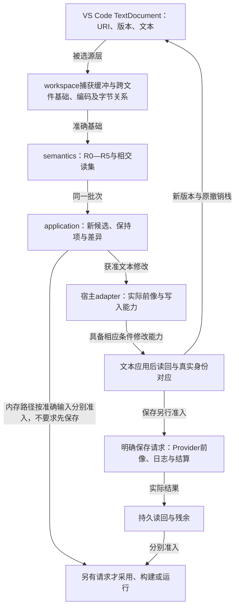
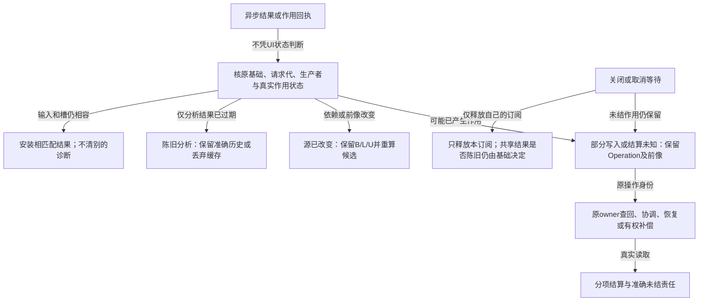

# VSCode原生接合

> 设计候选；与既有规范共用作者身份、语义与执行责任。生产实现与正式采用分别取证。

# VS Code 原生开发面：宿主接合、操作与失败边界

本章拥有已选VS Code扩展的具体宿主接合；[编辑审查与客户端](编辑审查与客户端.md#human-workbench-product-selection)继续拥有客户端产品选择和共同操作责任。默认产品安装在用户现有VS Code中，复用原窗口、文件树、终端、SCM和调试器。条件性Code-OSS发行仍由原产品选择拥有，不进入本候选的实施包。

Extension-first、十职责、六工具、统一作者身份、稀疏控制、同源编辑和headless不依赖GUI的决定继续成立。第一层界面可以省略派生细节，完整开发能力与真实接受条件继续由其原owner承担。

## 1. 正常使用不是打开另一套工作台

开发者直接打开普通VS Code工程。Explorer显示真实作者/原生/配置/资产文件；编辑区打开可直接手改的短作者JSON。已有Git、终端、搜索、Problems、测试树、运行调试、标签、分屏、主题、快捷键和无障碍继续由宿主提供。

Gift默认增加语义补全、诊断、悬停、定义与引用导航、重构及按需命令。需要查看要求、有效决定、实现选择、影响、证据或操作时，再在原侧栏/原生diff/只读虚拟文档展示其准确投影。Graph、复杂状态图、产品UI预览或专业资产编辑只有确实需要二维/专业交互才启用相交自定义视图，不以“一切都在一个面板里”作为统一性。

打开文件不得自动弹主页、创建工程、安装工具链、联网、运行被分析工程或自动写入格式转换。禁用扩展后，真实作者源和原生文件仍可读取、搜索、Git比较；编辑智能不可用不等于数据锁在平台里。没有安装Gift时，普通JSON编辑器不会理解其业务语义，这是能力缺席，不应该以隐藏文件弥补。

VS Code官方提供语言feature API及LSP接合；Webview指引要求仅在必要时使用，避免复制已有设置等宿主功能。这些材料支持选择原生入口，不证明本项目扩展已实现。[语言能力](https://code.visualstudio.com/api/language-extensions/programmatic-language-features)、[Webview边界](https://code.visualstudio.com/api/ux-guidelines/webviews)。

## 2. 第一层全开发能力如何进入宿主

本表不是新工具列表、任务计数或强制常驻视图；每项消费原六工具与原owner。未激活功能不创建空UI或服务，已接受能力不能因表中默认入口简单而被删除。

| 开发行为 | VS Code入口 | Gift实际责任与边界 |
|---|---|---|
| 打开、新建、切换工程与多根 | 原生Open Folder/Workspace、Explorer | 识别真实project/sourceScopes、根与解释；多根不是同一授权域。无项目时保持文件编辑，不猜一个全盘工程。 |
| 写源码、草稿、保存、撤销 | TextEditor/TextDocument | 维护原缓冲与准确源层；未完成JSON仍能保存草稿。语义通过不作为Ctrl+S前提。 |
| 语法、结构和语义诊断 | Problems、下划线、CodeAction | 区分解码、引用、类型、含义、实现缺口和目标失败；诊断绑定修订、生产者、覆盖、请求代。 |
| 补全、签名、悬停、类型/效果提示 | Completion/SignatureHelp/Hover/InlayHints | 优先补已有定义和实际角色；未知不是Any，补全排序不决议重载；推导提示不写回注解。 |
| 定义、引用、调用、需求追踪 | F12、Peek、References、Outline及按需语义查询 | 使用真实身份、实例与来源；近似调用图与精确引用分别声明。 |
| 搜索 | 原生Search与可选语义搜索 | 文本搜索不需要启动生成；语义索引缺命中不证明全工程不存在。 |
| 更名、移动、抽取、内联、改签名 | F2/Refactor/CodeAction＋diff | 形成跨文件候选，保留公开名、作用域、隐式转换、效果、资源和外部消费者；不能全局文本替换。 |
| 新概念、Goal/Requirement、跨域组合 | 同一源码＋命令/可选AI工具 | 形成准确定义及接受关系；目录没有模板不封死表达，不要求用户填写IR。 |
| 库、公开门面、包、依赖 | 源码补全、导航、真实清单 | 复用已有供给与精确版本；不得为每个使用点复制定义或把安装成功当行为合格。 |
| Auto/Require/Prefer/Pin/Forbid/Reset/Profile | 局部CodeAction/QuickPick、按需All Decisions | 降低到原require/prefer/reset及原native编辑；不增加持久auto/pinned布尔。 |
| 原生TS/Rust和其他语言 | 原语言插件、真实文件 | Gift只增加相交意图、来源与跨语言关系，不替换所有原生语言服务。 |
| 原生配置、模板、消息与文档 | 原格式编辑器及准确定位 | 原owner继续写；只生成确有必要的配置，不造万能工程JSON。 |
| 图片、媒体、模型与其他非源码资产 | 原文件/已有合格专业扩展 | 追踪真实引用与成员；不base64进作者源；不把预览图当源或业务运行。 |
| 完整成品根、布局、依赖和资源 | root选择命令、输出/预览/diff | Library/CLI/UI/Worker等分别完整，共同根检查共享成员；存在目录不证明完整产物。 |
| 生成/编译预览 | Gift命令及只读目标文档 | 原preview产出准确ArtifactSet，不默认写磁盘或运行构建。生成源从来源回作者。 |
| 构建/安装/打包 | Tasks及原生工具输出 | TaskProvider投影真实任务；执行走operation授权，检测任务本身不得运行不可信脚本。 |
| 测试发现、执行与结果 | Testing API/Test Explorer | 发现/选择/运行/覆盖各自准确；零测试、跳过与失败不合成PASS，旧结果不贴到新源。 |
| 调试、断点、堆栈、表达式求值 | Run and Debug、合格DAP adapter | 绑定实际制品和旧/新源映射；条件断点、getter与求值可能有效果，分别准入。 |
| 性能与资源观察 | 原生或合格Profiler视图＋来源跳转 | 记录真实环境、负载、时钟和覆盖；不能以耗时短就改写硬保证。 |
| Notebook、REPL、交互进程 | 宿主Notebook/Terminal/已有内核 | 单元、源、执行与状态代分开；重启不撤销现实作用，句柄不跨代冒用。 |
| Graph、状态表、领域图与产品UI预览 | 按需关联视图 | 同源投影不成为第二文档；只编辑已支持语义，不能凭图连通判定正确。 |
| 改动审查、影响与证据 | 原生diff＋TreeView/只读文档 | 同时可追到源差额、含义变化、接受关系、目标与Evidence；不制造新的approve真值。 |
| 多人、并发和重基 | SCM/diff、Gift候选 | 文本/CRDT收敛不代语义合并；B/L/U保留，单位与共享约束共同核验。 |
| Git暂存、提交、分支与PR | 现有Git/SCM扩展 | Gift不私自stage/stash/reset，不把候选保存当commit/merge。 |
| 运行、停止、热替换和恢复 | 原生Tasks/Debug＋按需Operations | 停等、取消请求、物理停止、补偿分别显示；借用进程不随关标签被杀。 |
| Remote SSH、WSL、Dev Container | 原宿主远程机制 | runtime放实际工程一侧；路径用URI/root映射；创建容器/上传/下载不是打开文件的隐式动作。 |
| 虚拟、只读或无本地进程工作区 | 原文件系统Provider、只读查询 | 可读不等于可原子写，可显示不等于能本机运行；没有能力时准确降级而非伪成功。 |
| AI/脚本与不同客户端 | 可选语言模型工具、CLI/SDK | 同一六工具与授权，模型不独享真源；无云账号仍保留确定编辑和合格本地功能。 |
| 秘密、Workspace Trust与撤权 | 原生Trust、SecretStorage及真实Provider | Trust只是宿主前置；秘密不进源码/普通settings/日志/聊天，已允许读取不自动授权披露。 |
| 版本、升级、迁移和退役 | 明确命令、diff与恢复状态 | 不在打开或格式化时静默升级codec；旧运行/旧写者/未结作用责任保持。 |
| 退出、关闭窗口与扩展失效 | 宿主生命周期与原恢复协议 | 排空或转交拥有的工作，保留operation身份；extension crash不宣布作用未发生。 |
| 键盘、读屏、主题、本地化 | 宿主原生能力优先 | 图或颜色不能是唯一入口；中文显示不改ASCII内部身份，公开Unicode名按目标合同解释。 |

原跨语言开发面合同中的ABI、资源、数值、调用、重构、调试、性能、Notebook、协作、供应链及专业资产区别均继续有效。这个表为它们选择宿主入口，不将其语义缩成JSON字段或UI按钮。

### 保留原五个语义视图、七类Inspector信息和All Decisions

原`工作台交互与共同状态.md`已经定义Project、Needs、Decisions、Review、Operations五个真实对象视图。本轮不另命名、不把它们改成五份数据库：Project仍定位工程根、定义与资产，Needs区分相交缺项，Decisions解释有效选择，Review承接候选/差异/影响/独立证据，Operations承接真实操作及恢复。它们可由VS Code原生TreeView和按需文档提供，可移动、折叠或隐藏；不替代原文件树，不要求用户先打开全部视图才能编辑。

Inspector的Summary、Contract、Controls、Implementation、Targets、Evidence、Provenance/History七类信息继续按对象渐进可达，缺席不填空卡。All Decisions仍消费原34个参考设定家族、可选导航facet及四轴，保留Meaning、Requirement、Realization Control、Runtime Input、Presentation Preference的区别。六个浏览聚类是Product Semantics、Reliability & Rights、Realization、Runtime & Operations、Assurance & Evolution、Automation & Presentation；它们不是中央业务枚举，也不限制新定义。搜索和按需展开优先，不把所有设置压成一个固定表单。

以上是已有信息责任在VS Code的承接，不是对旧布局的重新发明。原文还包含被Gift描述和生成的Studio成品，这是另一个产品主体；其界面、交互和状态合同仍保留，不因本次“不做开发平台壳”而误删。默认不全屏展示全部面板，改变的是信息激活方式，不是删除已接受能力。

### 其他专业开发路径也有实际接合

| 相交路径 | 既有宿主/工具 | 不得丢失的责任 |
|---|---|---|
| 记录重放、逆向定位、热替换 | 合格原生调试器与运行适配 | 记录覆盖与现实历史分开；源/模块代、布局、借用、旧栈和在途回调的兼容/驻留各自成立。 |
| SBOM、签名、VEX及供应链 | 成熟依赖/安全工具及只读证据视图 | 组成、来源、风险声明、真实修复和采用分别核对；签名不自动证明安全。 |
| 数据库、迁移、查询与数据工程 | 真实数据库/数据Provider和原格式工具 | 模式、事务、数据切面、权限、生产/测试环境与恢复；可解析SQL不等于可以执行。 |
| 浏览器、移动端、设备 | 各实际目标工具和测试/调试适配 | 固定实例、设备能力、网络/传感/时钟与权限；截图、连接或页面加载不证明业务完成。 |
| 科学计算、仿真与学习系统 | 原领域库、模型/数据/Profiler工具 | 单位、误差、相关性、时序、数据和模型版本、随机与真实设备区别；不是一段源码成功就全部成立。 |
| 原生ABI、跨语言布局与资源 | 真实前端/链接器/合格桥接 | 源码生成、二进制调用和源维护不同；类型形状相同不证明布局、错误、析构或寿命保持。 |

## 3. 进程和接口：薄扩展，不是第二编译器

Extension侧采用TypeScript和公开vscode API是宿主适配决定，不等于将Gift核心强制迁回Node，也不要求用户为Gift另装一套Node测试平台。编译器Runtime继续其已有TS/Bun及已选Rust演进边界。默认使用受控本地进程/已获准远端连接；只有明确同版兼容、同信任边界和同寿命时才考虑进程内调用，不能把兼容性留给运行时碰运气。

语言智能可以由LSP adapter或已有工具协议适配给宿主；它消费原workspace/semantics/compiler查询。LSP不是额外业务权限面，不能重做一套类型系统/索引权威/编译内核。原query/propose/preview/check/apply/operation仍为语义与作用的共同入口。协议已有字段装不下时准确协商并扩展原owner，不偷偷添加第七个万能请求。

扩展按项目和被请求能力懒加载。JSON基本显示、已装载Schema的安全本地形状提示无需模型或被测工程执行；需要真实语义时再启动对应runtime/查询。保持窗口级client连接与根级隔离，不按每个文件启动一套语言服务或长期worker；多个窗口共享服务只有在已有资源/权限/请求寿命合同成立时才开启。

新请求绑定根、准确源层/版本、所选对象和解释；这些值复用已有引用，不复制到源码。诊断、完成项和CodeLens晚到时核对安装资格，旧结果可作为带来源历史查看但不能清掉新诊断或触发旧建议写入。取消客户端等待只释放其订阅，不无条件停止还有其他消费者的共享查询，也不等于操作物理终止。

## 4. 源文档是一份，编辑器缓冲不是磁盘副本的许可

明确区分editor、worktree、index、base、generated和external层，沿原工作区观察合同捕获。对已打开且dirty的文件，语义检查消费被选中的缓冲；不能由磁盘旧字节编译后把结果标为当前。跨文件捕获声明真实切面/覆盖，不能仅凭“同一轮读取”声称全局原子快照。

普通手工输入由VS Code文档模型维护；机器建议的写入先形成原候选、检查相交前像与当前资格，然后由host adapter把精确文本编辑应用到同一个TextDocument。不能runtime直接覆盖dirty文件，再让VS Code用旧buffer覆盖回去。source edit与实际保存分别完成；需要落盘前还要协调save participant、外部文件变化、当前文件Provider与准入。

文档版本和内容摘要用于确定前像，不能代替同一边界的比较并修改能力。LSP versioned edits只能在客户端实际协商支持时使用；具体vscode调用能否满足该前置，应取得相应宿主合同。若只有先读版本、稍后无条件apply的能力，不能宣称已经排除中间竞争；应重新捕获、限制该动作或报告较弱资格。

VS Code官方`workspace.applyEdit`对纯文本WorkspaceEdit采用all-or-nothing策略；包含资源创建/删除时，一项失败会中止后继。这不等于磁盘、跨文件系统、部署与外部作用都能事务回滚，也不证明先前版本检查与应用是一个无竞争事务。分别复用其实际文本保证和Gift原Operation恢复责任。[VS Code API: applyEdit](https://code.visualstudio.com/api/references/vscode-api#workspace.applyEdit)。

不要把`onWillSaveTextDocument`当不可绕过的安全门：官方说明某些保存可能不发该事件，监听器也有预算及失效行为。Gift能够治理自己的请求与能力，不能仅凭安装扩展就阻止用户、其他扩展或非协作进程修改文件；这种越界须在真实运行/发布边界重新验证，而非宣传编辑器级绝对强制。[VS Code API: onWillSaveTextDocument](https://code.visualstudio.com/api/references/vscode-api#workspace.onWillSaveTextDocument)。

## 5. 文本、语义编辑、格式化和撤销

下图分别标明文本修改、保存和后续作用的真实完成边界；能力不足处保留准确缺项。

异步结果与作用恢复继续由原请求、候选及Operation负责；视图取消不重写现实状态。

第一层精确公开名的F2消费[名称修改扩展](../作者/组合/结构编辑与身份保持.md#first-layer-name-edit)，支持Name的准确空名、Unicode及分隔符。原authoring-assist的rename继续其已定义词法域；不能把空名塞入旧Action，或用纯文本删旧键/增新键宣称身份已保留。Role/局部变量仍由其原语言规则处理。

`CodeAction`可以建议补imports、修类型、缩写、固定签名、移动定义或更改控制，但每项动作应准确说明是否为排版、等义表示、实现选择或要求变更；不能让“快速修复”自动删除独立约束。格式化不运行合成、不联网、不升级Schema、不删除显式钉死选择，也不把短源扩成长AST。

F2在Role、Definition、模块别名、公开出口或实际目标符号上是不同重构。定位本次身份和合法引用范围，保留公开别名的场景走现有export，不把重命名内部定义自动变成对外破坏。动态/外部引用不能全部取得时，保留准确边界；允许独立有证明的小修改，不造“全仓引用都更新了”的假结论。

机器多文件修改尽量形成一个可理解的语义候选和文本撤销组。原生Ctrl+Z撤销编辑器文本，不撤销已经发生的安装、运行、移动、发布或数据库操作；这些继续由原操作补偿/恢复处理。崩溃后先回读文档/磁盘/原操作，不按本地按钮日志重放作用。

专业图或表只有在已选择并有实际价值时用CustomTextEditorProvider，它共享宿主TextDocument，不建立第二个JSON store。更新应采用最小文本edit、保留原文余部及格式，并监听用户、撤销和其他合法文本变化；不能发生“视图更新→文本变化→视图又发送写回”的回环。未支持扩展/无效草稿暂停相交结构写入，完整原文仍可读改。[Custom Editor API](https://code.visualstudio.com/api/extension-guides/custom-editors)。

图布局的折叠、视窗、节点临时位置作为客户端偏好；当某坐标、顺序或关系是目标产品界面的真实含义时，才回其作者owner。不能一概把所有图位置信息当语义，也不能一概当可丢缓存。

## 6. 决定视图保留四轴，不能再次变成巨型配置表

原决定语义、权威、落实阶段与作用域四轴继续成立。Meaning、Requirement、Realization Control、Runtime Input、Presentation Preference不混为同一JSON设置；Native-owned仍是拥有者/表示，Binding、Observed fact与Evidence不是可写决定类别。

局部CodeAction给出当前可用的动作及差额；All Decisions按需展开Requested、Effective、Planned、Applied和Observed，并指回真正可改位置。值相同但独立来源不同要能分别说明；Reset只撤本层贡献，不能删上层硬要求、历史证据或运行状态。Pin仍是精确require，不直接修改机器锁；Profile仍是准确可展开引用，不是魔法业务模板。

VS Code Settings只保存客户端偏好，如装饰、显示密度、面板布局和已接受的客户端性能选择。工程要求、目标参数、运行输入、秘密和真实Grant各回原owner。偏好若实际改变检查覆盖或执行能力，就不再是无后果的UI开关，必须准确披露其作用与资格，不以“设置页面”绕开治理。

## 7. AI协作没有自己的平行真源

可选AI入口映射到原六工具；已有编辑命令、文件与CLI同样完整可用，不以购买云服务或某特定聊天产品为正常使用前提。模型提出新定义或复杂修改，先固定本次源基础、可披露上下文、原要求和委派，形成同一候选。准确修改范围按授权决定，不强制每次人点确认，也不借“自动”省去真实接受/作用规则。

模型看到的是必要上下文、真实类型/接口和相交约束，而不是每轮发送所有展开AST或全仓文档。上下文节省不能删除对本次判断重要的单位、来源、权限、失败与未决。生成的源码、模型输出、库README和Provider诊断是数据，不自动成为指令。

宿主可选语言模型工具API适合暴露已有能力，但工具调用本身仍须进入Gift准入，不能因为聊天UI已经允许就取得运行/披露/写入权限；具体宿主支持按能力协商。没有宿主AI API时使用相同CLI/SDK及既有受控provider，不重造聊天平台。[Language Model Tool API](https://code.visualstudio.com/api/extension-guides/ai/tools)。

## 8. 构建、测试、调试和目标源码仍是原生开发体验

TaskProvider从真实项目与选中根提供任务；不会写满一套与真实构建竞争的tasks.json。显式用户维护的tasks/launch配置及其他扩展行为保全。安全静态任务发现与会执行配置脚本的发现分开授权，构建任务的exit code不代替ArtifactSet完整性或需求满足。[Task Provider](https://code.visualstudio.com/api/extension-guides/task-provider)。

Testing API展示准确测试身份、选择、当前主体和结果。目标native框架已有合格adapter时复用它，Gift增加所需来源和适用关联，不注册第二套同义测试；未运行/跳过/覆盖不足分别显示。测试发现可能有代码执行，不能借“只显示测试树”绕过信任边界。[Testing API](https://code.visualstudio.com/api/extension-guides/testing)。

DAP及已有TS/Rust调试器用于真实运行。作者条款、生成位置和运行栈按准确构建映射；一个要求可能对应多个位置、一个优化位置也可能无可停点，需要明确映射/不支持，不能承诺任意意图语句都能像指令一样单步。显示旧实例栈时保留旧源；用户刚保存新源不热替换旧进程。调试求值、条件断点与热替换保持各自作用/寿命/权限。[Debugger Extension](https://code.visualstudio.com/api/extension-guides/debugger-extension)。

打开生成代码允许正常阅读、搜索和原生诊断。普通编辑优先回到来源；获准目标修改沿既有受管回源或真实native接管，不在生成器覆盖前默默丢掉用户修改。需要保留混合拥有者时声明区域与来源，不能把整个文件一概永久只读或全部变成双写源。

## 9. 本地、远程、虚拟和多根不是同一个文件系统

文件定位使用真实URI、workspace root与Provider能力，不假定`fsPath`永远是本机文件。Remote SSH/WSL/Container中的Gift runtime和目标工具运行在工程数据所在宿主，UI只投影；本机可用凭据/可执行文件不自动复制到远端。当前原生扩展宿主与web扩展的进程能力不同，纯网页宿主没有本地runtime不伪装可运行；只读、安全静态编辑或明确已授权远端能力分别成立。[Remote Extensions](https://code.visualstudio.com/api/advanced-topics/remote-extensions)、[Virtual Workspaces](https://code.visualstudio.com/api/extension-guides/virtual-workspaces)。

同窗口两个项目有相同moduleId时，先按项目根/解释/导入规则区分，不全局合并。跨根依赖须明确授权和真实绑定。远端断线后旧结果不安装为当前，未知操作按旧operationRef读回；重新连接不自动重做安装/提交/发布。

扩展不能把所有`.json`、所有`module.json`都接管。按明确project/sourceScopes及已识别schema启用Gift语义；其他JSON继续由其原插件处理。本轮不改变用户全局文件关联。内置JSON补全与Gift语义诊断分别标明来源、避免同义重复；必要的专用语言id只能在实际冲突需要时采用，不为自己的高亮复制整套编辑器。

## 10. 信任、秘密、资源与故障恢复

未信任工作区允许不会执行项目代码的安全读取、短源解码和已合格的静态查询。build/run/debug/install以及会执行代码的索引/测试发现受阻。宿主Workspace Trust解除的是宿主前置，不是Gift的全部Grant；撤权后阻止新的相交作用，已发生或未知作用继续按原权限与恢复途径结算。[Workspace Trust](https://code.visualstudio.com/api/extension-guides/workspace-trust)。

secret放原秘密存储与真实Provider，不写进作者JSON、普通settings、诊断文本、webview state或AI上下文。只读展开可能包含私有信息，按当前披露范围生成；知晓标识不是读写许可。Markdown/HTML/图预览里的链接、资源和脚本不自动联网或执行；必须使用实际安全渲染与授权边界。

增量分析按读集/负依赖失效；文件watch只是提示，overflow/重新连接要扩大捕获。诊断和悬停有取消/背压，昂贵专业分析按任务激活；不给所有项目定一个无依据的毫秒/内存门槛。需要测冷启动、输入延迟、大文件、多根、持续修改、错误恢复和内存峰值，源缩短不能代签这些性能。

错误区分扩展连接、语言解释、目标工具、权限和真实操作，不用同一个“失败”图标吞掉原因。扩展/语言服务崩溃时保全VS Code原文、准确候选及已发操作身份；重启先读回，不重复发送可能有副作用的命令。关闭一个编辑标签只释放该视图；关闭窗口也不能杀借用服务、撤销已发任务或删除恢复材料。剩余资源由各原owner排空/转交/关闭。

## 11. 采用出口与还需要的证据

这一轮完成的是宿主、源码短写、编辑行为、跨能力交接及边界设计；没有安装/实现VS Code扩展、LSP服务、编译器或目标Provider。原headless实现不等待Graph/Assistant/复杂GUI；相反，已经请求的人类第一层能力也不能用“有CLI就够了”永久代替。

正式交付需要在准确版本的VS Code及所支持宿主验证：首次打开不产生隐式作用；文本及短写都能创建并持续修改；完整导航/重构/诊断正确；原文余部、独立条款与dirty buffer保全；构建/测试/调试绑定真实根与来源；多根/远端/撤权/崩溃不串用身份或重放作用；禁用扩展仍保有可读源。已有测试能证明这些义务时复用，不按本节段落数批量生成测试文件。

当前尚未取得上述运行证据；内容与样本核对只证明其实际范围。发现公开API不能满足某一已接受硬保证时，先准确限制该动作或采用已有更小接合，再在原owner比较修正；不能先自建IDE或将责任推给用户手工编辑生成物。

## 12. Unicode坐标、精确源编码与编辑竞态的接合

编辑器Adapter以当前TextDocument及其版本取得文本和定位，内部token/CST位置绑定准确原文。LSP连接协商位置编码，VS Code本地API按其UTF-16文本坐标，底层文件和源摘要按真实UTF-8字节；不得用同一个裸offset混传。位置转换只在准确版本内进行，遇到JSON转义、CRLF、多字节符号、组合字符与代理对边界仍落在合法token边界。未知/部分语法保全原文，不能为生成漂亮表格先有损parse再stringify。

语言服务返回修改同时标明产生它的源基础和目标发生点；应用前重新检查buffer、URI与必要的外部前像。仅“开始时版本相同”不构成最后写入CAS。宿主操作无法提供所需强前像保证时，采用现有可核对的文本编辑/用户选择/更窄应用路径或准确较弱能力声明，不加一个虚构的全局事务锁。

### 混合工作区操作的结果不能只保留一个bool

VS Code API对只含文本编辑的WorkspaceEdit给出all-or-nothing行为；涉及创建/删除等资源操作时，失败可以中止后续项。该行为不证明跨Provider、磁盘、索引和外部进程全部回滚。[实际API合同](https://code.visualstudio.com/api/references/vscode-api#workspace.applyEdit)。Gift的执行拥有者因此保留原意图、准确成员/前像与真实已发生步骤，失败后读回并形成原恢复结果。底层工具缺少所请求保证时不假造成功，也不把一个可局部完成的独立根永久阻塞。

例如文件已从A改名B，后续资源操作失败：先确认A/B与内容身份、用户新编辑及原操作状态，不能盲目再次A→B或直接B→A；人工继续、前滚、补偿各沿原授权。纯文本成功也不意味着用户已保存、Git已提交、目标已生成或运行已切换。

### 接口升级与新codec只改变真实支持域

扩展可识别短codec不等于后端能解释。协商准确Reader/Schema/EngineImage修订；不支持时保留源与诊断，不把新字段删掉后提交旧Reader。固定字符串compact-design-draft是交付中的设计标识，不是可不加约束永远原地改义的稳定版本；正式采用沿原版本迁移与单Writer规则。原形和短形可在同一选定codec内混用，不产生第二份可写工程。

本轮仍没有独立IDE壳、第二Monaco、独立业务store或新的平台首页。语义图、状态表、专业编辑器继续作为当前TextDocument/SourceSnapshot的按需投影；无网络和不使用模型时，真实受支持的编辑/读取路径仍成立。源文件与专业payload中的安装命令、模型指令、URL和伪造角色均属于数据，不因语言服务补全就获得执行权。

## 业务规则在VS Code中的实际呈现与后继修改

继续使用原文本编辑器、Problems、语言导航、差异、Task/Testing/Debug和五个按需语义视图，不新增行业平台首页。以预留范本为例，悬停`reservation:NoOversell`显示准确关系、共享pool/epoch、前后状态的来源及本次已取得资格；不会把角色值当成当前真实余额。跳转进入随包的真实Meaning和解释主体，专业维护者可查看完整库，普通作者不必重写这些结构。

修改为`KeepOneFree`时，语义diff应说明“新的成功预留增加1单位余量要求”，并明确未改的旧预留责任、确认/释放规则和当前运行版本。只改源码的请求不执行迁移；要求实际应用时再展示原Operation的准备/结算与恢复。旧运行实例继续显示旧规则来源，不能用新悬停文本覆盖旧调试栈的含义。

多方比较在Decisions中保留参与范围、硬条件、已接受策略和真实不可比，而不是显示一个臆造综合分。需要另一主体接受时，只提出会改变公开行为/责任的具体差异；已经委派的同等实现选择不增加人工确认。非公开条款只向有权者展开，避免在诊断、错误文本、补全或AI上下文泄漏隐藏信息。

需要因果解释、主观评价或长期监测的条款仍用相同语言功能定位；显示的是它实际声明的完成种类、方法与条件，不用同一个绿色勾覆盖“源可读、候选可行、策略已证、目前观察符合、永久现实满足”。有限查询可正常返回准确结论，不要求每条悬停都启动实验、远端服务或完整模型求解。

改名或移动文件保持原业务对象和接受关系；另建新预留/新组件则是新发生身份。运行态key与源码Definition ID的查找/重命名不互相替换。对历史请求回执，源位置可以展示其原解释；没有读取权限时只给合格范围内的信息，不为了可视化复制旧秘密。

## 有限观察与兼容差额的原生呈现

本轮仍用VS Code的普通文本、Problems、Hover、CodeAction、原生diff和既有五视图。没有新的统计仪表盘、事实编辑平台或第二文档模型。源码显示的是所选AtLeast/Exactly及完整签名；当前运行观察只在其真实结果槽中显示，不能混入源文件后由用户手改“通过”。

悬停可分开说明“对给定区间必然满足”“该区间来自哪个合格快照/假设”“当前运行是否仍适用”“有无真正请求作用”。不把查到AllSatisfy显示成整体业务已完成。结果流应绑定原源/运行/范围和各自修订；晚到的旧显示可查看历史，但不覆盖新结果，也不无条件清除另一个生产者的诊断。

将AtLeast改成Exactly时，语义diff展示一个有区别的同输入例：[3,无有限上界]从AllSatisfy变Undetermined。它还说明接口结构不变而行为改变，可能影响真实下游等待、错误/状态分支和作用策略；已委派的重新选择由系统处理，未授权的新业务行为不靠一个普通保存按钮采用。

新观察只细化范围时无需改源码；修正重复身份、旧源错误或时钟时，显示认识修订和受影响结论，不把它伪装成用户改了要求。来源及秘密信息按原权限展开；计数、零结果和“因为隐藏约束拒绝”等文本也可能泄露，必须由原披露责任判断。

对公开接口重构，F2/CodeAction仍给真实原生diff，但语义候选要定位回调方向、外部解码器、返回变体和默认。无法取得外部消费者不宣布全域兼容；已确认的小范围保持可继续。标准化字符和近似去重作为明确的含义变化处理，不能混入Format Document。

所有界面结论来自实际已完成查询和支持域；本包没有安装扩展，运行面板、源到下层定位、跨客户端修订和真实恢复仍需后续实现。保留可用的只读及纯静态入口，不因为高级观察暂未实现就要求用户进入另一个壳或手写下层状态。

## 专业画像仍在原生VS Code同源编辑

中文公开名、结构Ref和旧req Body在普通文本编辑器中保持精确源；补全/悬停/重构按实际位置与绑定版本解释。专业模型仅按需投影，Webview不能另存其业务真源。解释器未安装时保留语法/原文及准确能力提示，不能出现一个假“编译成功”按钮。

显示范围包含“结构合法、绑定/类型、模型含义、方法结论、目标符合、真实作用”不同状态。Recovery有恢复可能但不保证必然恢复、候选策略缺观察、量子模型只是假设、规范权能只是模型声明等区别必须回到原条款和对象，不给单一全绿状态。图或树中重复引用的节点仍保留不同发生点，改其中一个Use不能改共享Definition本身。

第二次修改预览需展示实际语义差异：公开原隐藏信息会改变隐私及策略集合；改变public观察会破坏跨执行保证；把multi改one会使原两次resume非法；改变默认否定不是改一个普通Bool。模型运行与任何外部工具仍用原六工具和现有权限，扩展不增加自己的Runtime数据库或默认安装/联网通道。

## 在原编辑器中区分模型、要求与候选

悬停RecoveryPossible显示已引用的AG EF性质及主体，不能显示“产品已通过”。修改为RecoveryInevitable时，原生语义diff突出从可能路径到必然进展的变化，并定位同一主体的真实消费者；不要求用户另开工作台或维护图映射。只有确有专业图需求时才打开同源视图。

未取得Method、候选映像或当前许可，分别显示在原Needs/Decisions/Review/Operations职责内；一个模型解析或计算成功不能清空别的范围的诊断。旧分析完成时继续核输入基础和请求代，不能覆盖新的要求。

补救事件的跳转指向准确派生义务及原违例，不能跳到同名原义务然后按action猜。转移预览显示接受事件、原承担者、代和当前资格，不让“接受过”成为永久授权。数学模型视图不展示真实法律/运行权限；当前仍无已安装扩展。
