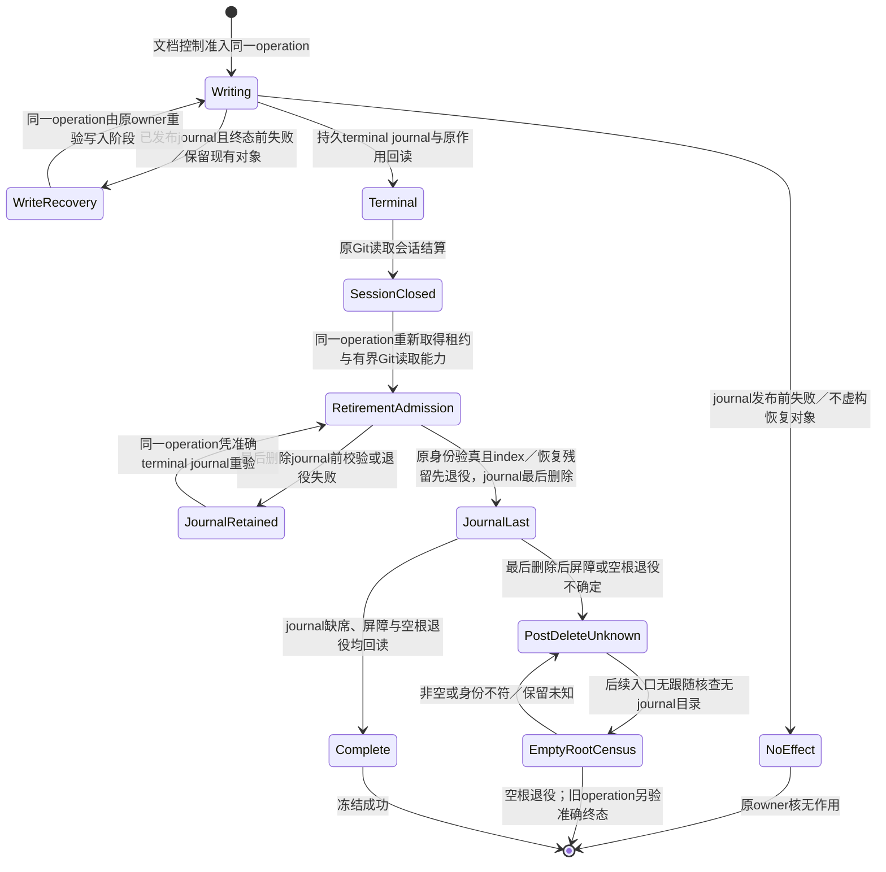
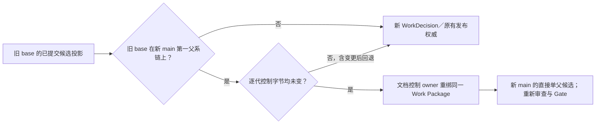
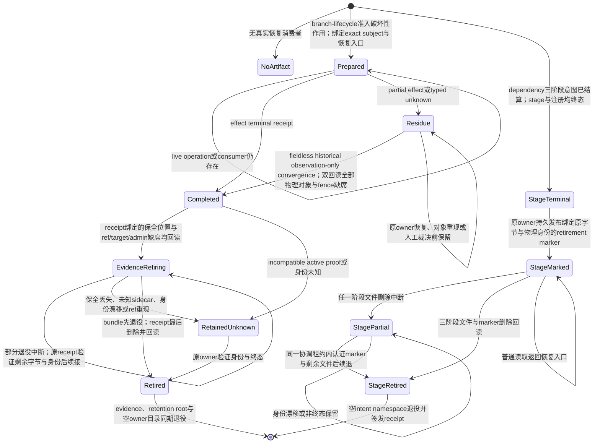

# Gift仓库Git冻结与资源退役

本章拥有Gift自身仓库的原生Git候选冻结、准确ref退役、评论运输卫生和分支/工作树/依赖恢复的实现接合。通用VCS开发流程由[版本控制与集成](../版本控制与集成.md)拥有，工作身份和继续条件由[工作身份与续接](工作身份与续接.md)拥有。退役不扩大删除授权；原operation、保留载体和未知作用仍由对应owner结算。


<a id="repository-freeze-native-index-decision"></a>
**文档冻结的原生 Git 方案。** 采用既有 Git scratch owner 持有的可写私有 index，通过原生 `update-index`／`write-tree` 形成候选树，真实 repository PRE 仍为受保留只读输入，最终发布仍由原文档控制 owner 的 journal、CAS 与读回承担。私有 index 的锁与替换归受保留父目录；不能把受限只读文件句柄直接当可替换输出，也不能让原生工具改变真实 PRE。严格输入／NEXT 编解码、对象类型与存在性、准确路径、环境隔离及原预算继续保留。

不采用被其替代的手工逐目录树重建、子树结果缓存、符号 delta 续接与专门扩额冻结框架作为并行生产路线：原生 Git 已承担树构造，额外模型会重复承担树语义、观测和恢复成本。这个理由支持删除重复机制，不证明所有平台已通过，也不从进程数减少推出完整提交或发布更快。现有平台、非合作外部 writer／ABA、资源及终态未知边界仍适用。只有真实原生接口缺口、不能保持的观察合同或同等保证下的完整成本证据推翻当前选择时才重开；须由同一 owner 给出最小差额与退出，不因历史候选已写成而重新启用。

文档控制的独立生产冻结入口只在持久 `terminal` journal 已回读后结束其有界 Git 读取会话；终端验证与 index／恢复残留退役是同一 operation 的独立有界续接。续接重新取得工作区租约与 Git 读取能力，核对原 journal、manifest、候选树和物理路径后才退役，且仅在两段均结算后报告冻结成功。journal 发布前失败不虚构恢复对象；发布后到最后删除 journal 之前的失败保留已存在的 journal 与未退役残留供同一 operation 恢复。最后删除 journal 后的屏障或空目录退役失败属于终态未知：后续入口仅能按无跟随物理目录核查退役空根，旧 operation 的完成须另由准确投影与作用回读证明，不能凭 journal 缺席补签。新会话不能刷新写入阶段的预算、跳过终端回读或重复发布作用。



文档冻结的 Git index 在发布前按准确 PRE/NEXT 字节与恢复制品判定作用切点；日志已到 `index-published` 或更后阶段时，原生 Git 可能只刷新 index 的 stat/cache 字节，恢复改以无 `index.lock` 且外部 scratch `write-tree` 等于日志绑定的候选树证明已发布状态，不重放 index CAS。日志、指针、滚动计划和恢复制品仍各按原始字节及身份验真；树漂移、锁或异物保留为未结算，不能凭相同文件名继续作用。

并发工作使 main 前进时，已提交且来源可核验的候选只有在旧 base 位于新 main 的第一父系链上，且该链每一代的 current-state、活动指针、滚动计划、指针所指清单与工作选择源相对旧 base 均保持相同 Git 字节，才能沿原文档控制 owner 重绑同一 Work Package。新候选必须是新 main 的直接单父提交；旧滚动投影须绑定旧 base 与可核验的候选源提交、树、清单和控制字节，目标 package、tracking 与清单路径保持同一身份。任一代控制字节变化（包括后来回退）仍须取得新 WorkDecision 或已发布投影的原有权威，不能把旧候选投影冒充 main 发布事实。重绑只重新签发准确 main 与候选的控制投影，不延用旧 head 的审查或 Gate 结果。



提案不接收或产生 WorkDecision、MainHealth repair、激活回执或集成授权；普通激活仍消费真实工作选择，选择失败不能隐式降级为提案。重试与恢复拒绝跨提案／激活路径消费日志，已有激活日志继续按原合同恢复。提案合入默认分支后，指针清单与默认分支内容相同仍只表示没有活动任务，不会因文件已经发布而自动获得执行权限。


### 原生远端 ref 退役

日常已合并 PR 分支沿用 GitHub 原生 `delete_branch_on_merge`；它只处理 Provider 实际允许自动删除的分支，不证明积压分支、未合入成果或本地工作树已清理。旧分支积压按明确审核集合一次使用原生 Git 删除并独立回读，不再要求专用 maintenance workflow、Actions 执行身份、MainHealth、托管依赖安装或逐项自写执行平台。

删除前固定真实 repository/default branch 与本批 exact ref→old OID 前像，核对完整 open-PR head/base 消费者、活动工作及工作树归属。默认分支、受保护分支、活动分支、有未整合独有成果或任何未知项保留；分支名字、年龄、closed PR、旧测试绿色和 caller 自述都不构成可删除证明。普通合并用 Git 祖先关系；压缩合并、重基或替代成果须审查准确源码差异及其当前承接，不能把 tree 不同直接视作无价值，也不能把“已关闭”当作“已合入”。

恢复证据在作用前可重新取得并经过验证：保存批准集合、准确 tips/trees、成果承接和 native bundle 的校验/完整历史证明，以及执行者、目的和保留责任。已有合格证据直接复用，不为每条 ref 重打包；本地临时路径或上传成功本身不证明持久可恢复。原生 Git 的准确旧 OID 条件用于拒绝前像漂移，不允许 force、改保护或扩大删除集合；作用前刷新相交消费者。远端不提供所需条件或拒绝操作时保留 blocker，不能换身份或退回无条件删除。审核与 Git 事务不是跨 GitHub 状态的原子快照，无法排除的外部竞态保留未知。

保存原生命令的逐 ref 响应，再独立读取远端目标。报告分别列出已观察缺席、仍存在、读回未知以及本次作用已确认/未知/未尝试；缺席不能反推由本次删除，进程退出不能替代目标回读。响应丢失先重读，不自动重放删除；漂移、重建或新消费者只阻断相交项。只有确需重复且不能直接由原生命令可靠完成的检查才增加薄层脚本，不建立第二套身份、健康或持久编排。

```text
准确审核集合 + 可恢复证据
→ 刷新前像与活动消费者
→ 原生 Git 有条件删除
→ 保存响应 + 独立远端回读
→ 已确认 / 保留 / 未知及其恢复责任
```

旧 v1/v2 请求、preparation、结果 receipt、run/attempt 与 artifact ID/digest 继续按原格式只读解释。历史 receipt 读取复用已有 GitHub artifact 读取能力，验证原 workflow/run、repository、main、request digest 和 archive bytes；它不取得新的 dispatch、CAS、comment 或重放权限，也不把历史终态声称为当前 ref 状态。恢复前仍须按原 carrier 身份与实际期限取得准确 bundle，校验摘要、`git bundle verify` 与 expected heads。原 artifact 的保留义务、失败归因和未结责任不因取消新执行入口消失；过期、来源失配或恢复字节不可验证时明确阻断依赖该证据的作用。成功不自动删除唯一恢复载体，只有合格替代或原保留责任实际结算后才可退役。CodeQL 继续消费 GitHub Code Scanning 原生 check/alert，不新增 projection workflow。

### 评论运输垃圾退役

评论卫生分成两个不同 authority lane，禁止再把 GitHub Actions installation token 当成通用 Conversation 管理员。

**历史 comment 请求只读兼容。** v1 的 exact-comment-retirement 仍可解析 1..64 条互不重复的 #313 exact comment 身份，用于解释原请求与历史证据；解析不签发新的 comment 删除权限。旧自动 trigger 清理入口及其无消费者实现已退役，不再承诺当前 hosted CLI 提供该 DELETE lane。旧 SHA 的运行仍保留其原有作用、失败与回读解释，未结责任不会因为新源码删去 helper 而被视为已完成。其他独立 comment owner 和通用 GitHub API 保持自己的准入与作用边界；不为保存历史 parser 重新增加 comment job、公开评论或自动删除。

**PR Conversation hygiene lane** 不走 repository-maintenance DELETE。真实运行已经证明：`github-actions[bot]` 对普通 PR Conversation 评论（包括维护者自己的 `@codex review` 以及其他 GitHub App 的 Codex summary/setup/quota 消息）会收到 GitHub `403 Resource not accessible by integration`。因此当前 adopted 动作是：由已连接的 maintainer identity 对明确的运输噪声执行正文退役，将其替换成不可见 HTML tombstone；评论对象本身仍存在，不能报告为物理删除。已观测的 disposable prose 仅包括精确 review-trigger 命令、Codex review summary、environment setup hint 与 quota/upsell transport；扩展该集合必须重新核作者、用途和 consumer，不能按年龄或 bot 身份泛删。

CodeQL projection、真实 review submission、inline finding/thread、人工裁决、事故/失败复盘以及仍被 current owner 引用的 evidence 不属于运输噪声，不做 tombstone。对被平台权限阻塞的物理删除，保留最短 blocker receipt（HTTP status、owner、run/artifact）即可；不得留下整批原始 JSON 继续污染 #313，也不得把 tombstone 表述成 delete。

辅助工作树退役先由 generated-state 与 compiler-dependency owner 结算受管 `node_modules` locator，再由 `worktree-physical-closeout` 删除 Git 登记和物理目录；不得直接以 `git worktree remove` 作为完整清理。Windows 上受管 locator 是 Junction，原生 Git 可能先注销 worktree 再因该 reparse point 返回 `Invalid argument`，形成未登记的物理残留；这种残留不能被第二次 Git 命令证明已清理，也不能未经目标与 link target 回读就递归删除。

编译依赖的可复用物化身份消费有效的安装配置，不因 `bunfig.toml` 只含非安装配置或文件缺席而拆成两代；同一运行中的输入栅栏仍检查该文件存在性与准确内容，防止观察后替换。linked worktree 的 locator 与物理 generation 分属 consumer 和 source owner：恢复只以记录的 owner root、当前 canonical generation、准确绑定和物理身份重建源资格。故障若发生在新 locator 已发布、生命周期登记尚未完成，原 transition owner 在这些条件复核后补完登记，不把“缺少登记”解释成外来对象并永久阻断清理。源 owner 换代后旧 generation 缺席而 consumer locator 悬空时，locator 生命周期 owner 仍以未跟随的准确链接身份、目标路径和缺席事实签发退役，再从当前源 owner 取得新代；共享 consumer census 只允许各 root 回收自己的 canonical generation，其他 root 的记录只参与对应 owner 的使用人数判断。

工程依赖的项目链接和隔离副本直接消费编译器已认证的 runtime materialization，不再生产 `.shared-deps` 投影。Bun 安装缓存位于 Runtime Cache 的 `bun-install`，可由多个工作树同时使用；清理它须由同一 owner 协调安装与清理，并在物理回读后报告完成。在该共同准入和结算能力建立前，`deps clean --bun-cache` 与 `deps clean --all` 于任何删除前返回 `IMPORT-AUTHORITY-004`，不能把旧 `.shared-deps/.bun-cache` 当成当前缓存或报告空操作成功。`deps clean --shared` 只退役已登记的旧共享目录；未知或未登记目录保持保护。

本地分支/工作树 closeout 的 recovery 只保护尚未结算的破坏性作用，不是默认永久归档；历史 hosted exact-ref carrier 仍按其原明确保留期限与可验真替代条件处理。bundle、checksum、authorization、receipt、worktree operation generation 与 retained proof 由 branch-lifecycle owner 按同一终态释放：本地分支删除已有 durable receipt、该 receipt 绑定的成果承接关系仍由当前目标满足且当前 ref 仍缺席后，释放该 operation 的 bundle family，并按 branch 与内容摘要回收没有 pending preparation、journal、receipt 或其他 lifecycle evidence 的裸重复 bundle；一旦存在 lifecycle evidence，必须由对应 branch receipt 或全部 operation journal 各自绑定的 `completed` receipt 证明整个 family 终态，缺少 preparation 不能降级成可回收；默认 recovery 根为空时一并退役。worktree evidence 只有在 receipt chain 为 `completed`、目标目录和 Git admin 都物理缺席、且本地分支 authority 已消失时才回收；同一 authorization 绑定的 generated-state retention root 也在验证原 receipt 与物理身份后同期退役，空的 worktree evidence owner 不继续残留。编译依赖的 stage intent 由 dependency owner 在工作树物理退役准入前核实终态、stage 与注册关系、准确字节和物理身份后退役；active、partial、异物或漂移保持原位。generated-state 在搬迁 `.tmp` 前完成依赖域退役，避免失去已绑定 generation 的原始路径。`residue`、`prepared`、活分支、仍有 active recovery proof 的不兼容旧代际和未知内容保持。当前 field-bearing／fieldless 恢复使用已采用的 authorization schema，不为这次历史终态兼容另造竞争 writer、宽松 parser 或新的授权入口。这是当前恢复路径的具体选择，不是永久禁止格式演进。新增必填含义是否进入原载体的新版本，或由独立 owner artifact/receipt 承担，按[授权与证据载体的版本解释](../../演进/兼容迁移与退役.md#authority-bearing-format-migration)核其签发责任、生命周期、原子关系及真实消费者；未完成该迁移前，现行字节格式、验真算法和下述历史恢复边界不变。当前 field-bearing writer 与历史 fieldless bytes 均由同一 canonical parser按各自原始字节和 operation 算法验真，但只有原始记录确实缺少 generated-state 字段的历史对象，才可在已有同 authorization 的 unregister 成功与 durable retirement phase 后，于同一 workspace write lease 内经过初始与 effect-boundary 两次回读，确认 target、Git admin、tombstone、retained proof 和 retirement fence 全部缺席，无删除作用地补签 `completed`；显式 `null` 不能冒充 fieldless 历史事实，任一对象重现即 typed blocker。历史 authorization 除该终态收敛与退役自身 evidence 外，不取得删除其他对象的 authority。不得把未知 `.tmp`、依赖状态或普通目录手工搬入 recovery 根来绕过 closeout；它们必须先由原 generated-state/dependency owner 分类并结算，不能结算时返回 typed blocker。

编译依赖阶段意图的退休在首个文件删除前持久发布绑定三阶段原字节与物理身份的标记；任一删除切点中断后，原 dependency owner 在相同协调租约内认证标记并续退。普通读取遇到该标记必须返回明确恢复入口，不把缺少阶段文件误判为外来残片。

本地 `refs/heads/*` 删除由唯一 Git 物理 owner 执行：branch-lifecycle 与托管验证的消费者先取得准确内容与恢复准入，并在作用前持久化 bundle、authorization 或对应 journal；作用时持有共享 Git common-dir 的协调租约，复查工作树绑定与准确旧 OID，再用原生 `update-ref` 旧 OID 比对事务删除，独立回读 ref 与工作树后签发结果。消费者的进程、输入和输出预算必须由该物理 owner 的实际事务上限与准确输入测量签发；同时需要 repository-root 租约时，先取得 common-dir，再取得 repository-root，并把同一个 common-dir token 传给物理删除，避免相反锁顺序。已被工作树绑定、前像漂移、租约失效或回读不确定时保留 ref 与恢复责任，不能把远端删除或进程退出解释为本地结算。协调租约排除参加该协议的 Gift writer；Git 的 ref 事务不能把任意外部原生 Git 的 worktree 绑定纳入同一原子操作，外部竞态若使终态不明则保留证据并报告 outcome unknown，不签发完成。

已合并分支的 closeout inventory 另绑定本次 operation 的准确 PR 编号、head branch、head SHA 与 base branch。普通发现仍按物理分支及 open PR 选择相关对象；作用前、作用后及恢复回读由原 inventory owner 按编号重新向 Provider 读取这个目标，即使本地与远端 ref 都已缺席，也保留终态所需的准确 merged 见证。列表与准确回读重复或矛盾、仓库／head／状态漂移、观察不可用或原有列表额度耗尽均阻断完成；选择器仅限定观察对象，不签发删除或完成权限，也不允许复用旧 PR JSON 代替新回读。

merged/retained residue closeout 在同一 common-dir 与 repository-root 租约内、ref CAS 前，由 `development.commit` owner 分类并退役目标 ref 的全部提交 journal；ref 已缺席的续跑也执行同一前置检查。任一 journal 的 applied 回读、准确字节/物理身份退休或能力不可证实时，保留 ref 与 recovery 并返回 typed blocker，不能先删 ref 再借已消失的 reflog 补判提交结果。

关闭但未合并的准确 PR head，只有在 head 是当前 main 的原生祖先或其树与可达 main 的准确锚点相同时，才可用 main-absorption proof 结算；证明绑定 commit/tree 和持久摘要，作用前重验 live Git 关系。不能由这些原生关系证明的差异仍需覆盖完整路径集的维护者采纳审查，不能把 PR 关闭或旧分支名当作内容吸收。proof 已按终态退役后，重启从已认证终端 receipt 与当前 Git 关系回读，不能凭文件缺席自行重签完成。没有准确 PR head 的本地 ref 只在调用者明确选定分支及旧 OID 后进入 retained closeout；内容等价是删除资格而不是选择授权，未选 ref 保持，已落盘授权按原目标集合续跑。

retained closeout 还可消费用户明确选定的远端后继保全位置。原 owner 从真实 Provider 读取 repository、remote URL、完整 `refs/heads/*`、准确 OID 与 tree，以原生 Git 祖先关系证明该后继保存目标 head；授权及 ref CAS 前均要求准确 OID，不能由本地 tracking ref 或分支名补签。新 retained authorization 按新版本绑定此位置，旧 v2 继续按原 main-only 字节和摘要解释；维护者采纳审查仍消费其原 main 绑定，不能自动扩张到任意后继。原 owner 在作用后重新核本地 ref/worktree 缺席与保全关系，才签发 terminal receipt。退役恢复材料时允许同一远端 ref 前进，但原保全 OID 必须仍是当前 tip 的原生祖先；ref 消失、改写丢失祖先、URL 换向、对象或观察不可用均保留恢复责任。跨 GitHub 与本地 Git 的外部竞态继续保持原 unknown 边界。

重复 bundle family 的退役也必须能在每个删除切点续接：发现同时覆盖 bundle 与其剩余 sidecar，名称只定位，不签发资格；先验证所有现存 journal 各自匹配完整的 completed receipt，再退役 preparation/journal、bundle/checksum，最后删除自包含终态 receipt。bundle 已缺席时仍须由这些原 receipt 绑定原恢复摘要与终态；未完成 operation、未知 sidecar 或前像漂移保持原位。没有 lifecycle evidence 的裸重复包则保留 bundle 到最后，避免失去发现入口。

terminal receipt 是部分退役的恢复依据。新 retained receipt 自包含原 canonical authorization、物理根与保全绑定，重启不要求调用者再次选择目标。原 owner 在 terminal 验真及当前缺席/保全回读后，按原 family 顺序退役 bundle、checksum 与已验证 sidecar，随后退役 authorization，最后删除 receipt；各切点中断均按该 receipt 与剩余准确字节、身份续接。pending operation 必须保有完整恢复材料，未知 sidecar、物理漂移或 ref 重现阻断续接。旧 v2 terminal receipt 与原 authorization 同在时，可由同 owner 在验真后生成自包含的新版本 receipt；已孤立且缺少必需授权上下文的历史 v2 receipt 保持 unknown，不能由当前环境重建丢失的历史 authority。


