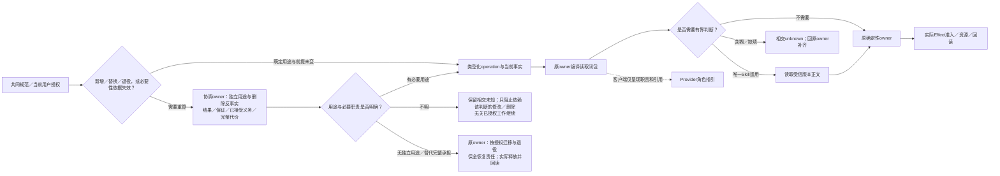
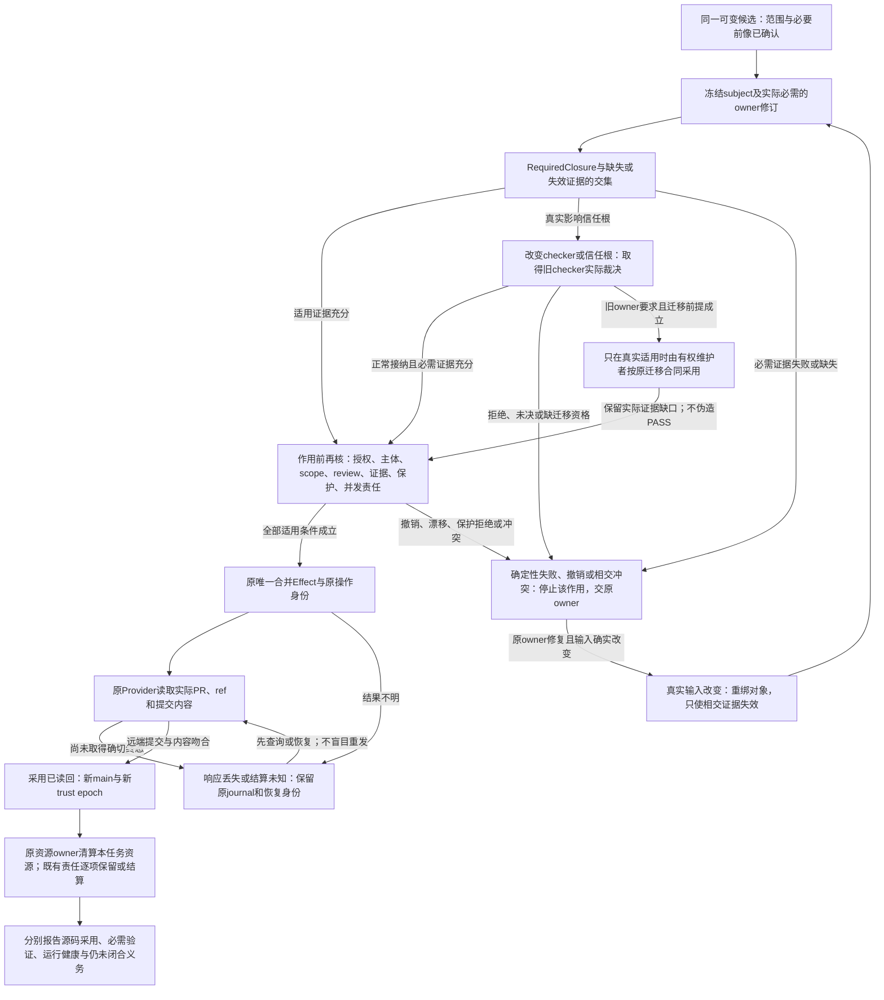
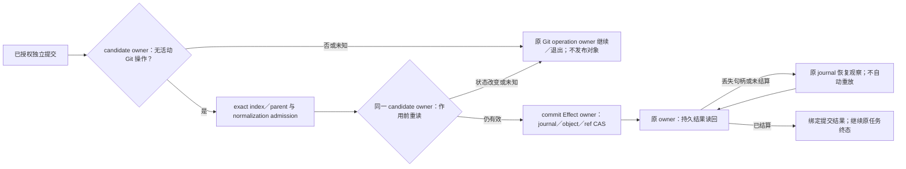
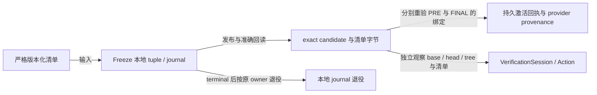

# Gift仓库工作身份与续接

本章只拥有Gift自身仓库的工作准入、源码检查点、正式采用分流、候选绑定和恢复。产品通用的规则装载与委派由[规则装载与任务恢复](../AI协作/规则装载与任务恢复.md)拥有；验证与凭证传输见[验证与传输边界](验证与传输边界.md)，实际Git冻结和资源退役见[Git冻结与资源退役](Git冻结与资源退役.md)。本文不是Gift目标工程必须复制的控制面，也不从工作身份推导作用权限。


## Gift自身仓库开发的行为准入、工作身份与恢复

本节只规定 **Gift 自身仓库实施与自举** 怎样把[通用任务约束](../AI协作/规则装载与任务恢复.md#任务启动的原则装载与动作检查)接到现有机器控制面；它不是所有使用 Gift 的目标工程都必须拥有的第二套 Work 系统，也不改变产品、作者、编译、验证和执行各自的规范拥有者。仓库现有 `WorkDecision`、`TaskCapsule`、`OperationReadPlan`、Skill applicability、Operation envelope 等名字是 self-hosting profile 的实现载体；保留与替换依据其实际承担的结果、保证和未结义务，不能只凭调用关系决定。迁移完成后可以换表示，不能反向要求当前 main 上的现行规范迁就旧载体。

<a id="engineering-behavior-routing"></a>
### 工程行为：共同规则、操作、Skill 与客户端指引

工程行为覆盖设计读取、任务选择、实现／重构、测试设计、验证、审查、提交、推送／集成、恢复和退出；不等于每项行为都需要一个 Skill。共同规则（Universal Policy）由产品要求、原则与[通用规则装载协议](../AI协作/规则装载与任务恢复.md)拥有，本章只拥有Gift仓库的接合，`AGENTS.md`提供入口；确定性选择、身份、准入、证据和结算交回已有类型化 operation／领域 owner。只有无法由它们决定的有界判断才进入既有 Skill；客户端角色指引只约束该次角色，不成为另一套政策或作用许可。

| 行为与触发 | 读取／判断入口 | 实际结果与执行 owner |
|---|---|---|
| 新任务、恢复、范围或规则变化 | `AGENTS.md`与本章相交装载；已有同版完整读取可复用 | `dev:status`按下述源码检查点／正式工作分流取得所需观察与continuation；读取本身不产生active Work或Effect权 |
| 确有全仓审计要求或跨域缺陷 | [repository-audit](../../../.agents/skills/repository-audit/SKILL.md) | `audit`及Source Program的准确tree census；普通局部读取不冒称全仓覆盖 |
| 公共合同、所有权或生命周期需重算 | [architecture-evolution](../../../.agents/skills/architecture-evolution/SKILL.md)；系统性行为偏航交[heuristic-governance](../../../.agents/skills/heuristic-governance/SKILL.md) | 原规范／类型／状态owner裁决，按文档写入准入保留或修正文；不为纯实现变更制造新规范 |
| 已冻结scope内实现、修复、重构 | [worker-development](../../../.agents/skills/worker-development/SKILL.md) | Task Capsule／Operation Envelope限定纵切片；原producer/consumer及资源owner承担实现，不因Skill存在扩大写集 |
| Claim需要新case或oracle判断 | [test-design](../../../.agents/skills/test-design/SKILL.md) | requirement／assurance与CasePlan拥有测试语义；仅执行或重跑已有测试不重新设计oracle |
| 引入／替换外部能力、通用机制 | [external-capability-governance](../../../.agents/skills/external-capability-governance/SKILL.md) | 原能力台账与Provider owner分别承担采用、物化、凭证和实际作用；跨owner不自动扩大权限或新造work |
| 验证和证据复用 | 原selector与VerificationSession；需设计测试才进入test-design | `check`／`test`／`typecheck:verified`执行RequiredClosure；`typecheck`仅编辑反馈；已有PASS／确定性FAIL／in-flight按准确ActionKey复用／停止／join |
| 独立审查冻结候选 | [exact-head-review](../../../.agents/skills/exact-head-review/SKILL.md) | ReviewSubject绑定head/tree及required revisions；Role配置、报告标题与绿色测试不代签独立性或Gate |
| 分工及角色交回 | [task-delegation](../../../.agents/skills/task-delegation/SKILL.md) | 主线程保留集成与原任务责任；角色交回不等于用户任务完成，保留单写者和更窄scope |
| 提交、推送、合并、发布 | 原明确授权终态与当前准入；无需为每个命令新增Skill | `dev commit`／`commit:recover`拥有提交；远端传输、integration与`sec:closeout`各消费本身准入／读回；不得从Skill推导push／merge／release权 |
| 失败、取消、恢复及资源退出 | [failure-recovery](../../../.agents/skills/failure-recovery/SKILL.md)定位根因与恢复owner | 原operation、branch/worktree、generated-state及资源owner结算；`dev:continue`只是续作投影，不能签发新权限；未结算制品不能被通用清理删除 |



**采用与拒绝。** 采用共同规范→typed operation/envelope→零或一个相交Skill→客户端指引的责任方向，减少相互冲突的规则副本。拒绝一份“全行为万能Skill”、仅凭角色名加载全部Skill、把审查/提交/清理另建授权系统，以及从candidate指引签发自己的采纳资格。新事实改变scope或根假设时，重新选择相交判断；不以加载顺序或更长提示词替代裁决。

**当前接合与未完成范围。** 现有纯Skill evaluator只消费role、operation kind、候选及准确修订；目录覆盖只是候选提示。合法的`a0/design`在多个候选未收窄时保持ambiguous，零候选可为none-required，不造兜底Skill。生产hosted activation当前只接`worker/implement`；其他角色的元数据登记不证明同等生产准入已接通。`.codex/agents/*.toml`是当前客户端指引，未有生成器与实际装载证据时不称其为已生成、已验证的通用政策投影。适用性选择回执不证明正文已读取、理解或被Provider强制；不能补造ReadReceipt。

**候选隔离与复核。** 修改Skill、其操作owner或Provider指引时，候选内容仅是被审查对象，沿既有quarantine使用受信修订。路径分类无法证明`.codex/`文件永不包含指令：`config.toml`可直接携带developer instructions，也可引用角色配置；即使当前只有普通设置，仍保守纳入该命名空间的启发式路由与候选隔离。这不将配置提升为Skill authority，也不修改其实际sandbox设置。命名空间分类不证明已取得配置引用的完整闭包；指向域外文件的配置引用必须由原读取／装载owner绑定受信来源后才能消费，未知引用不能按普通文件默认取得指令资格。当前没有生产装载闭包证明时如实保留该缺口，不为本次分类添加第二配置解析器。对应有限检查位于[Skill合同测试](../../../tests/contract/agent-skills.test.ts)、[适用性测试](../../../tests/unit/skill-applicability-decision.test.ts)与agent runtime入口测试；它们分别检验路由、选择和真实入口，不证明所有工程行为都已自动执行。主分支前进后撤销旧代作用资格，已有Review/Evidence保持原绑定并由原owner判断失效和复用，不全部销毁也不自动升为新代授权。

### 事实、决定、计划、授权和完成必须分层

Gift 自身开发的一次机器任务按下列信息组合，不允许任何一层替代另一层：

| 输入或载体 | 可以决定 | 不能决定 |
|---|---|---|
| 用户目标、non-goal 与明确授权 | 本任务要达到什么、作用上限 | 当前仓库事实、实现已经正确 |
| live Git／工作区／Provider 观察 | 当前 base/head/tree、dirty、能力与外部状态 | 产品目标、设计采用、完成 |
| `WorkDecision` | 当前 ordinary work 的合法选择与优先级 | 设计真值、Effect 权限、PASS |
| `TaskCapsule` | 纯任务规划内容和需携带的稳定引用 | Scope、写权、实现完成 |
| `OperationReadPlan` | 本次行动所需的最小完整读取闭包 | 修改许可、事实 owner 的含义 |
| Skill applicability | 零或一个当前仍不可机器化的有界判断程序 | 事实、决定、权限、Evidence |
| Operation envelope | actor、role、operation、subject、预算与禁止作用的上界 | 新增父任务没有的能力 |
| Effect／Provider 准入 | 某次真实作用是否可以开始 | 产品要求和设计本身 |
| settlement／readback／独立检查 | 实际发生了什么、相应 Claim 是否成立 | 反向改写原目标 |

因此仓库行为准入可以表示为同一批现行 owner 的交集，而不是一个新总控对象：

```text
AllowedRepositoryAction =
  accepted task authorization
  ∩ current live facts
  ∩ applicable current-main design constraints
  ∩ selected work identity when selection is required
  ∩ operation envelope
  ∩ effect/capability admission when an Effect is required
  ∩ current resource and safety bounds
```

任一相交项为 unknown、stale、conflicted 或明确禁止时，只阻断依赖它的动作。Issue、PR、branch、聊天、rolling projection、测试绿色、commit 或 Agent 自述都不能补足缺失交集。当前实现如果以 `MainHealth = ordinary | repair | locked` 之类的机器状态先行约束工作选择，该状态只负责它已有的控制面消费者；稳定规范不保存某一时刻的 current main，也不把该枚举推广成所有项目的产品状态模型。

已经明确授权的仓库终态形成持续到 settlement 与 readback 的作用义务，不能在本地验证、commit 或某条传输路径失败后退回等待用户重复下令。若 Provider 以保护规则拒绝直接更新默认分支，而同一内容可经任务分支与 PR 到达原授权终态，则创建最小任务分支、推送、创建 PR、等待必需检查并按既有合并合同收口，属于该已授权作用的传输闭包；路径切换不得扩大内容、受众、权限或发布范围。只有新路径需要 force、修改保护规则、额外发布或其他超出原作用上限的效果时，才阻断该新增效果并请求相应授权。

<a id="source-checkpoint-publication"></a>
### 独立源码检查点与正式采用分流

独立源码检查点保存已经明确授权、可审查的准确源码，不声明正式工作激活、验证通过或产品采用。其授权与作用边界是固定仓库、base／必要前像、唯一writer、完整owned paths及准确非默认分支；提交与推送分别消费当前用户授权及原Effect owner的准入。**正式工作选择、active Work Package／operation、MainHealth、完整Gate及共享控制投影不是这条源码发布路径的前置。**缺失这些结果不阻断独立源码检查点，也不因此补签或伪造它们。反之，本地Git、提交规范化、所用传输Provider或真实凭证／保护拒绝仍只由原owner处理，不能借分流绕过。

`dev:status -- --source-checkpoint --base <exact-sha> --expected-head <exact-sha> --owned-path <exact-path>`是现有状态入口的独立只读模式，可重复给出准确owned path；它不读取formal Work或MainHealth，也不调用GitHub观察来决定本地源码是否可以进入下一owner。它读取固定base的仓库／默认分支身份与Git源码事实，核base ancestry、expected HEAD、非默认本地ref，以及提交差异、index、工作树和untracked的完整路径集（rename/copy包含两端），并重复观察以暴露漂移。参数是待核scope，输出是观察而非授权；路径匹配也不能证明dirty字节属于调用者。唯一writer、完整前像及dirty归属必须在原任务与实际写入边界核实。输入不完整、对象未知、非祖先base、HEAD漂移、未归属路径、默认分支或共享active／rolling／Work Package投影变更均返回阻断或观察失败，不以未观测当通过。

源码稳定后，由既有`development.commit` owner冻结并复验准确parent、ref、index/tree，消费canonical normalization与提交Effect；未完成原生Git操作、未知提交／推送结果和未结journal仍由原owner恢复，不由status提前判为已结算。取得exact head/tree独立源码审查后，在已授权的准确分支进行正常传输并读回远端ref及内容。默认分支更新、保护修改、force、额外发布、凭证设置都不属于源码检查点。会触发hosted检查的发布仍遵守已有证据预算；push成功只证明源码入库，保留未验证项。

正式采用由原准入owner按实际动作区分下述两种来源：需要自主选择、委派或执行工作的动作继续消费正式`dev:status`、WorkSelection、适用MainHealth、Work Package与activation；维护者已明确指定的有界源码采用，消费其真实授权主体、准确采用对象与完整范围，不再以自主调度系统重新选择该工作。两者共享原Verification、Review、Scope/Effect、平台保护、唯一集成执行器与readback；检查点的status、commit、Review或远端存在均不单独产生采用资格。

集成owner在实际base与窗口就绪后核当前main delta及相交闭包，只有实际需要共享工作投影时才由原producer生成；复用仍有效的源码与focused证据，旧审查和Gate不得冒充新组合树的通过。先复用原维护者入口和Provider已有能力，不能从自动Gate的manifest字段推出所有源码采用都必须迁移Scope/Session协议。只有实际跨载体新增authority含义时才严格迁移相交消费者；上层缺失接合仍保持明确未实现，不能用调用者开关、空Work Package或候选自述代签。现行入口拒绝不等于可以绕过保护；适用的受信根迁移仍按本章原合同处理。

选择这条分流是因为源码保全／审查运输与正式采用具有不同结果及前置；强制先恢复完整控制面会让已授权修复被它正在修复的依赖锁住。保留原提交和传输owner比新增发布授权registry更小，也避免第二writer。独立性无法成立、scope变更或正式作用被请求时，返回相交原owner重算，不扩大检查点资格。这条status模式只实现观察与路由，不声称用户授权、语义审查或所有宿主API已经由机器统一强制。

<a id="bounded-source-adoption-and-autonomous-work"></a>
#### 有界源码采用与自主工作执行：完整职责和失败闭包

**本节是目标设计，不是完整机器接合已经完成的证明。** 原Scope、Session与integration的自动验证合同绑定manifest；原GitHub Provider另有由真实维护者权限发行、绑定仓库与预期head的merge capability。两者各自存在不证明完整有界采用闭包已经接通，也不证明必须先迁移全部自动协议才能采用源码。旧的“任何合并都必须先由自主选择器选中”前提在此撤销；它不能作为继续增建目录登记、activation或资格包装层的理由。源码检查点能力及全部既有自动执行、恢复和资源责任保留。

根因是把两种不同问题混为一个前置：WorkSelection回答“系统现在应自主执行哪项工作”，当前明确授权回答“维护者允许采用哪份有界源码”。前者不能反过来决定后者是否存在。若新增工作目录必须先进入main，而目录自身的采用又必须由main上的该目录先选中，就产生自举循环；应删除这个错误依赖，不能以再加一个登记registry解决。

| 来源／动作 | 必需对象与唯一责任 | 不产生的资格 |
|---|---|---|
| 独立源码检查点 | 原commit和传输owner绑定parent/ref/index/tree、owned paths及授权，完成准确分支读回 | 不签默认分支采用、自动工作、Gate或运行通过 |
| `explicit-bounded-source` | 原Scope／integration owner验证当前明确授权及撤销、真实认证主体与平台权限、仓库和目标ref、准确base/head/tree、完整owned/forbidden范围与禁止作用；验证owner另算适用证据 | 不创建Issue/catalog/Active Work/activation，不取得自主执行、部署或额外发布权 |
| `autonomous-work` | 原WorkSelection先确定合法工作，原Freeze/activation/operation限定本次实际执行，再由各Effect owner消费当前资格 | 目录、工作编号与选择结果不独立签发合并、权限或PASS |
| 共同采用闭包 | 同一Verification、独立Review、Scope、平台保护、集成Effect及main readback；按真实变化和Claim决定必需证据 | 没有第二套Gate、缓存、merge执行器或恢复状态机 |

两种来源是采用责任的语义区分，不要求新建一个名为adoption subject的协议或工作数据库。先沿原维护者入口、Provider及集成owner核真实消费者；能由已有能力直接承担的保证不重复包装。每种来源只能消费其已验证含义：自主分支保留真实manifest/operation关系；显式源码分支绑定真实授权来源和准确内容，不用空manifest假装Active Work。只有真实载体需要表达新的authority含义时，才显式版本化并同步其strict decoder、digest、发布与恢复消费者；不能给旧协议添一个可被忽略的布尔位。调用者写`maintainer`、`skip-work`或复制一份JSON都不能签发作用权。原凭证／授权owner不能确认真实主体或当前范围时，返回typed unknown，不自动切换来源绕开拒绝。

**完整路径图。** 各节点代表其原owner的责任；虚线只运输源码和仍有效证据。图不表示所有操作都要执行所有节点，也不以节点存在证明机器已接通。

##### 来源、必要前置与共同采用链

```mermaid
flowchart TB
  goal["当前目标、明确授权、禁止作用"]
  facts["原Git与Provider：仓库、目标ref、base/head/tree、dirty归属"]
  route["原准入owner判定本次实际动作与来源"]
  checkpoint["独立源码检查点：原commit、分支传输及读回"]
  bounded["明确有界源码采用：真实授权主体、完整scope、准确采用对象"]
  autonomous["自主执行：需要系统选择、委派或执行工作"]
  selection["原WorkSelection、适用MainHealth、真实工作身份"]
  activation["原Freeze与activation：本次operation和执行边界"]
  subject["原采用合同按真实来源与动作核必要前置，不互相代签"]
  closure["原Verification：按实际变化计算必需证据与相交健康Claim"]
  proof["冻结准确对象：独立审查、本地验证、必要hosted证据"]
  scope["原Scope与集成准入：真实主体、当前授权、完整范围和证据"]
  platform["原Provider：实时required checks、review、权限与保护"]
  merge["唯一集成Effect：最后核base/head/tree，按预期head合并"]
  readback["原readback：远端main、提交父关系、内容与作用结果"]
  settle["原owner：新代次相交义务、资源结算、准确完成声明"]
  goal --> facts
  facts --> route
  route -->|仅保全或运输源码| checkpoint
  route -->|用户已指定此次采用| bounded
  route -->|需要自主选择或执行| autonomous
  autonomous --> selection
  selection --> activation
  bounded --> subject
  activation --> subject
  checkpoint -.->|源码和有效证据；不携带采用权| subject
  subject --> closure
  closure --> proof
  proof --> scope
  scope --> platform
  platform --> merge
  merge --> readback
  readback --> settle
%% portable-canonical-v2:eyJhY2Nlc3NpYmlsaXR5IjpudWxsLCJkYXRhIjp7ImRpcmVjdGlvbiI6IlRCIiwiZWRnZXMiOlt7ImZyb20iOiJnb2FsIiwidG8iOiJmYWN0cyJ9LHsiZnJvbSI6ImZhY3RzIiwidG8iOiJyb3V0ZSJ9LHsiZnJvbSI6InJvdXRlIiwibGFiZWwiOiLku4Xkv53lhajmiJbov5DovpPmupDnoIEiLCJ0byI6ImNoZWNrcG9pbnQifSx7ImZyb20iOiJyb3V0ZSIsImxhYmVsIjoi55So5oi35bey5oyH5a6a5q2k5qyh6YeH55SoIiwidG8iOiJib3VuZGVkIn0seyJmcm9tIjoicm91dGUiLCJsYWJlbCI6IumcgOimgeiHquS4u-mAieaLqeaIluaJp-ihjCIsInRvIjoiYXV0b25vbW91cyJ9LHsiZnJvbSI6ImF1dG9ub21vdXMiLCJ0byI6InNlbGVjdGlvbiJ9LHsiZnJvbSI6InNlbGVjdGlvbiIsInRvIjoiYWN0aXZhdGlvbiJ9LHsiZnJvbSI6ImJvdW5kZWQiLCJ0byI6InN1YmplY3QifSx7ImZyb20iOiJhY3RpdmF0aW9uIiwidG8iOiJzdWJqZWN0In0seyJhcnJvdyI6Ii0uLT4iLCJmcm9tIjoiY2hlY2twb2ludCIsImxhYmVsIjoi5rqQ56CB5ZKM5pyJ5pWI6K-B5o2u77yb5LiN5pC65bim6YeH55So5p2DIiwidG8iOiJzdWJqZWN0In0seyJmcm9tIjoic3ViamVjdCIsInRvIjoiY2xvc3VyZSJ9LHsiZnJvbSI6ImNsb3N1cmUiLCJ0byI6InByb29mIn0seyJmcm9tIjoicHJvb2YiLCJ0byI6InNjb3BlIn0seyJmcm9tIjoic2NvcGUiLCJ0byI6InBsYXRmb3JtIn0seyJmcm9tIjoicGxhdGZvcm0iLCJ0byI6Im1lcmdlIn0seyJmcm9tIjoibWVyZ2UiLCJ0byI6InJlYWRiYWNrIn0seyJmcm9tIjoicmVhZGJhY2siLCJ0byI6InNldHRsZSJ9XSwibm9kZXMiOlt7ImlkIjoiZ29hbCIsImxhYmVsIjoi5b2T5YmN55uu5qCH44CB5piO56Gu5o6I5p2D44CB56aB5q2i5L2c55SoIn0seyJpZCI6ImZhY3RzIiwibGFiZWwiOiLljp9HaXTkuI5Qcm92aWRlcu-8muS7k-W6k-OAgeebruagh3JlZuOAgWJhc2UvaGVhZC90cmVl44CBZGlydHnlvZLlsZ4ifSx7ImlkIjoicm91dGUiLCJsYWJlbCI6IuWOn-WHhuWFpW93bmVy5Yik5a6a5pys5qyh5a6e6ZmF5Yqo5L2c5LiO5p2l5rqQIn0seyJpZCI6ImNoZWNrcG9pbnQiLCJsYWJlbCI6IueLrOeri-a6kOeggeajgOafpeeCue-8muWOn2NvbW1pdOOAgeWIhuaUr-S8oOi-k-WPiuivu-WbniJ9LHsiaWQiOiJib3VuZGVkIiwibGFiZWwiOiLmmI7noa7mnInnlYzmupDnoIHph4fnlKjvvJrnnJ_lrp7mjojmnYPkuLvkvZPjgIHlrozmlbRzY29wZeOAgeWHhuehrumHh-eUqOWvueixoSJ9LHsiaWQiOiJhdXRvbm9tb3VzIiwibGFiZWwiOiLoh6rkuLvmiafooYzvvJrpnIDopoHns7vnu5_pgInmi6njgIHlp5TmtL7miJbmiafooYzlt6XkvZwifSx7ImlkIjoic2VsZWN0aW9uIiwibGFiZWwiOiLljp9Xb3JrU2VsZWN0aW9u44CB6YCC55SoTWFpbkhlYWx0aOOAgeecn-WunuW3peS9nOi6q-S7vSJ9LHsiaWQiOiJhY3RpdmF0aW9uIiwibGFiZWwiOiLljp9GcmVlemXkuI5hY3RpdmF0aW9u77ya5pys5qyhb3BlcmF0aW9u5ZKM5omn6KGM6L6555WMIn0seyJpZCI6InN1YmplY3QiLCJsYWJlbCI6IuWOn-mHh-eUqOWQiOWQjOaMieecn-Wunuadpea6kOS4juWKqOS9nOaguOW_heimgeWJjee9ru-8jOS4jeS6kuebuOS7o-etviJ9LHsiaWQiOiJjbG9zdXJlIiwibGFiZWwiOiLljp9WZXJpZmljYXRpb27vvJrmjInlrp7pmYXlj5jljJborqHnrpflv4XpnIDor4Hmja7kuI7nm7jkuqTlgaXlurdDbGFpbSJ9LHsiaWQiOiJwcm9vZiIsImxhYmVsIjoi5Ya757uT5YeG56Gu5a-56LGh77ya54us56uL5a6h5p-l44CB5pys5Zyw6aqM6K-B44CB5b-F6KaBaG9zdGVk6K-B5o2uIn0seyJpZCI6InNjb3BlIiwibGFiZWwiOiLljp9TY29wZeS4jumbhuaIkOWHhuWFpe-8muecn-WunuS4u-S9k-OAgeW9k-WJjeaOiOadg-OAgeWujOaVtOiMg-WbtOWSjOivgeaNriJ9LHsiaWQiOiJwbGF0Zm9ybSIsImxhYmVsIjoi5Y6fUHJvdmlkZXLvvJrlrp7ml7ZyZXF1aXJlZCBjaGVja3PjgIFyZXZpZXfjgIHmnYPpmZDkuI7kv53miqQifSx7ImlkIjoibWVyZ2UiLCJsYWJlbCI6IuWUr-S4gOmbhuaIkEVmZmVjdO-8muacgOWQjuaguGJhc2UvaGVhZC90cmVl77yM5oyJ6aKE5pyfaGVhZOWQiOW5tiJ9LHsiaWQiOiJyZWFkYmFjayIsImxhYmVsIjoi5Y6fcmVhZGJhY2vvvJrov5znq69tYWlu44CB5o-Q5Lqk54i25YWz57O744CB5YaF5a655LiO5L2c55So57uT5p6cIn0seyJpZCI6InNldHRsZSIsImxhYmVsIjoi5Y6fb3duZXLvvJrmlrDku6PmrKHnm7jkuqTkuYnliqHjgIHotYTmupDnu5PnrpfjgIHlh4bnoa7lrozmiJDlo7DmmI4ifV19LCJkZXNjcmlwdGlvbiI6bnVsbCwiaWQiOiJhZG9wdGlvbi1yb3V0aW5nIiwia2luZCI6ImZsb3djaGFydCIsInNvdXJjZVNoYTI1NiI6IjVhNTRhZTgyMTJjYjZhYTIwMTkzMDQ2MjNmMmNkYjBhYmRjNzRmMDc0YTdlMWI3YjgyM2IzNTE5OTdiMWQzN2YiLCJzdHlsZXMiOltdLCJ0aXRsZSI6Iuadpea6kOOAgeW_heimgeWJjee9ruS4juWFseWQjOmHh-eUqOmTviIsInZlcnNpb24iOjF9
```

<!-- mermaid:id=adoption-routing -->


##### 漂移、失败、未知作用与迁移的闭合

<!-- mermaid:id=adoption-recovery -->


**保证和生命周期。** MainHealth继续保护它实际拥有的自动选择、修复路由和运行资格。若其中某项稳定性Claim确实是本次源码集成所需保证，原Verification／集成owner必须将该Claim纳入RequiredClosure；不能跟随工作身份前置一起静默删除，也不能把一个不相交的本机能力缺口推广成全部源码采用的否决。只读status/observe继续只观察，不隐式启动昂贵资格生产。真实运行资格仍在原物理root、单次operation、预算和撤销寿命内消费，历史JSON不使其复活。

漂移只使实际依赖它的证据和作用准入失效；同一logical run保留同一候选。已有active Work、dirty、journal、原生Git操作或未结外部作用，先由各原owner判断是否与本次内容或Effect真实相交；相交冲突必须恢复或停止，不能由新来源吞掉责任，也不要求无关生命周期全部完成。确定性失败在输入未变时不重跑；合并响应丢失先按原operation读回PR、ref和内容，不能盲目再合并。原GitHub REST merge的expected head比较不提供原子base CAS；作用前必须最后读取live base，作用后核合并父提交与冻结base、提交树与已审候选一致。窗口内base漂移或内容不符时，保留实际已发生作用并由原owner重算，不能把事前读取升级成原子保证。采用后立即重绑new main/trust epoch，结算本任务资源；源码已采用、必要验证通过、运行健康、产品部署及未闭合义务分别报告。

**迁移和退出。** 修复这些准入owner本身时，候选不得批准自己的checker或权限解释。先取得旧checker对真实影响闭包的实际结果；只有原有外部维护者迁移前提确实成立时才使用该合同，保留未证明范围、独立准确版本审查、平台保护和expected-head合并。新subject的正常入口取得完整消费者证据后，退出错误的全局Work前置；旧自动工作分支及已有journal恢复仍由原owner保留，不以清理旧名字删除现实责任。

**验收反例。** 没有Issue/catalog/Active Work的明确有界文档采用，仍应可通过同一适用验证和受保护集成；不得隐式创建这些对象。相同候选一旦缺授权、主体、独立审查、必需证据、保护或准确tuple，必须无merge Effect地拒绝；不得fallback到维护者来源。自主执行仍必须取得原Work/operation资格，不能拿源码subject运行其他Effect。并发内容、授权撤销、base/head、保护或恢复责任改变，必须由作用前栅栏和原readback暴露。只有设计图、类型或局部Mock通过，均不能签发上述端到端能力。

本仓库 `development.commit` 只拥有独立单父提交，不拥有 Git merge、cherry-pick、revert 或 rebase 的续跑与结算。本仓库 candidate owner 在冻结 index 前以及 journal/object/ref 作用前，以 worktree-specific Git directory 的原生 no-follow 观察拒绝未完成操作状态；两次观察消费同一个判定，不用 index 未变代理操作已结束。原生 Git 操作必须由其原入口完成或明确退出；文件树相同不能证明 ancestry 已合入，不能把 staged merge tree 包装成单父提交后宣称合并完成。历史消息文件和 `ORIG_HEAD` 不单独构成活动操作。

开发提交 journal 退役必须同时比较准确字节和物理 FileId，并在原生删除作用前重新核验；进程内 mutation lease 不能代替这个比较。Windows 的保留只读句柄以 `share-read` 排除写入与删除，因此不能在该句柄仍存活时另开删除句柄：journal owner 先释放观察句柄，物理删除 owner 再用同一受保留父目录约束的可读删除句柄完成字节与 FileId 栅栏和删除回读；该 CAS 路径不得为取得删除权先投影文件 ACL。删除作用前的分享冲突或内容/身份漂移保留 journal；作用后的缺席回读或父目录 flush 失败属于未知结算，必须按原 operation 重新观察，不能宣称 journal 必然仍在或重新执行删除。不把盲目重试、裸路径删除或放宽分享模式作为恢复。Linux 的 `unlinkat` 只删除名字，现有能力不能在非合作并发换名/写入下签发准确字节 CAS，因此当前退役返回 typed capability-unavailable 并保留 journal，直至原生命名空间与写入排他合同具备；这不是跨平台完成。此接合仅说明当前自举 journal 的安全边界；更大范围的恢复与状态所有权演进仍由相交唯一 owner 重算，不从该实现反推产品通用事务规则。

该 Linux 缺口是未完成的迁移义务，不是可长期保留的正常降级：每个 ref 的 journal 有有限尝试上限，无法退役会确定性耗尽写入能力。目标协议由 `development.commit` 独占 journal 语义，以每个 attempt 一个私有 Git ref 指向不可变 canonical blob；Git Provider 在原 operation 授权下提供精确旧 OID 的创建、更新、删除和持久读回，不能把仅检查后的 `unlinkat`、进程锁或加大上限当作替代。旧文件 journal 先只读发现与逐 attempt 分类；迁移必须绑定原字节、物理身份、目标 blob/ref 和恢复切点，未结算或无法准确退役的旧文件保留并报告 typed blocker，不让它成为第二个活动 writer。新协议未通过受信 Provider、Linux 故障切点及旧代际迁移验证前，现行文件协议和 capability-unavailable 结果不变。



默认分支身份、仓库质量证据和本机执行能力必须分别按所证明的对象消费。默认分支的准确 SHA/tree 不表示检查通过；注册的仓库检查结果不表示本机容器可用；本机容器的运行回执也不能替代仓库检查。未被某动作要求的本机能力不能因观察失败而否决该动作。需要容器、宿主文件或服务的操作仍须取得对应能力并验证物理身份，不能借文档操作获准而跳过这些条件。

必要证据缺失时，恢复入口负责请求或加入同一准确对象的证据生产，并回读实际结果；请求本身不签发健康状态。修复准入机制自身的工作不得要求该机制先恢复正常，应保留受明确授权、有界修改、独立审查和结果回读约束的恢复路径。该路径只覆盖已证实的失效依赖，不能将未完成的产品交付连带判为通过。


### 仓库动作闭包：一个候选、各自的唯一 owner

本仓库的脚本、Hook、CI workflow 与人工入口只能投影下表已有动作，不因入口数量生成多套状态。动作之间传递 exact subject、需求和已结算结果；不能传递“上一步跑过”的口述结论。一个 logical run 只维护一个可变候选，冻结后任何内容变化产生新的 head 与失效闭包，而不是在旧 head 的证据上补跑几个检查。

| 动作 | 唯一事实／决定 owner 与输入 | 产物和可继续条件 |
|---|---|---|
| 定向 | Git 与文档控制面读取 live main、candidate、dirty 归属、Work Package 和未结算 operation | 准确 continuation route；unknown 只阻断依赖它的作用 |
| 编辑反馈 | Git changed-path owner 决定是否需要 affected；原生 TS7 只给本机快速类型反馈 | 可供编辑的诊断，不产生候选 Gate；空集和纯文档闭包不构造 Source Program |
| 冻结验证 | VerificationSession 编译 `RequiredClosure ∩ MissingOrStale`，按[显式运行位置](验证与传输边界.md#repository-local-verification-placement)由测试责任目录、依赖代际与各 Action owner 生产结果 | quick 需可靠影响选择；full 直接覆盖完整 fast/slow 清单，不再为选全量扫描 affected；同一 ActionKey 的 fresh PASS 或 authenticated in-flight 复用／join |
| 独立审查与合并 | 审查 owner 绑定 frozen exact head；集成 owner 消费 Gate、Review、Scope/Effect 与当前 main | expected-head/tree merge 及 main readback；提交、PR 或绿色检查均不是合并终态 |
| 发布 | 发布 owner 从已合入的 source revision 构造、安装、验真并提升 artifact | 发布构建不由普通合并隐式启动；测试 fixture 的构建只属于相应测试证据 |
| 退役 | 原 dependency/generated-state、branch 与 worktree lifecycle owner 按各自 receipt 结算 | 无活跃竞争 writer、未结算 effect 或物理残留；unknown 以 typed blocker 留存 |

每个实际命令与子动作共享可核对的父子阶段：开始、等待／复用／join、物理执行、结算、回读和终态均报告墙钟时间；静默长阶段定期报告仍在运行及已耗时，失败也输出最后已知阶段和总时长。阶段并行时墙钟总时长取父动作起止观察，不求子阶段之和。进度只做展示和诊断，不得写回 ActionKey、工作授权或受信 PASS；没有可关联的原始观测就报告 unknown。依赖准备、typecheck、测试和发布若处在不同 subject 或环境，不能为减少日志中的次数而跨边界借用结果。

入口收敛按消费者迁移而非别名堆叠：已被 full inventory 覆盖且无独立 Claim 的 affected Gate 退出 full；缩小的 affected 路径继续保留它的精确选择与 fail-closed。脚本级串联只投影同一动作图，不得重新决定要求或强制 cold materialization。旧 Hook、workflow、手动命令和恢复路径逐一核实际消费者，确认 terminal receipt 与回读后才退役重复动作；不删除仍证明不同 Claim 的 Gate，也不以跳过受信验证换速度。

受信根自身迁移时，候选不能签发自己的采纳资格。Gift 自举允许已有明确授权的外部维护者消费旧受信检查器的实际结果、未能证明的范围、真实候选执行证据和独立精确版本审查，执行有界迁移。该动作绑定 base/head/tree 与受信根变更闭包，由已认证的维护者身份按预期 head 比较后合并；不可变合并提交保存处置及证据边界，其父提交必须等于冻结 base、树必须等于已验证候选，随后回读提交、身份与默认分支。候选范围清单只约束归属和测试选择，不产生 active Work 身份、健康、自动集成授权或通过结果。旧检查器要求人工迁移或仍有未决时必须如实保留；不能将它改写成绿色 CI、降低普通验证要求或修改保护设置。迁移后的新 main 仍由当前正常拥有者生成新的健康证据。

外部维护者迁移所需的候选提案由现有文档控制面的显式 `proposal-only` 路径编译。当前指针所指清单须与准确默认分支中的内容逐字节相同，活动解析为 `none / matching-default-blob`；目标是不同身份且 `tracking:none` 的后继清单，按[清单版本与候选绑定](#repository-work-package-format-and-binding)核对本次准确默认分支：V1 的清单 `base` 必须相等，V3 则由本次 Freeze 的原 tuple 绑定准确 base/tree。指针、滚动计划、旧指针清单退休、索引发布与回读仍由同一编译器和事务拥有者完成。机器投影绑定准确 main/tree 与目标清单身份，明确标记 `authority:none`；结果及恢复日志保持 `PROPOSED`，摘要只保护表示完整性。

<a id="repository-work-package-format-and-binding"></a>
#### Work Package 清单格式与候选绑定

仓库清单由[原 Work Package 解码器](../../../src/adapters/self-hosting/control/task/contract/work-package.ts)按显式 `schema` 读取。共同必需字段为 `schema`、`id`、`tracking`、`manifestState:frozen`、`requiredProfile:quick|full`、`ciRevision`、`tasks`、`forbiddenPaths`、`acceptance`、`tests`；`authorityRefs` 是可选的规范文档 UUID 列表，激活入口仍要求它存在并向受信身份表核对。任务归属、路径互斥、测试路径、字符串、YAML 与当前 CI revision 的原严格检查继续适用。

| 清单版本 | `base` 与兼容合同 |
|---|---|
| `codex-development-work-package-v1` | 必须保存小写 40 位 Git SHA 的 `base`；消费者将它与独立观察到的本次准确 base 比较，漂移即拒绝 |
| `codex-development-work-package-v3` | 禁止 `base` 字段；稳定计划与本次运行的 base 分开，由各动作的原 owner 独立绑定准确 base/tree 与候选 |
| 已退役的 `codex-development-work-package-v2` 或未知版本 | 拒绝；不能复用旧 V2 的 `evidenceComposition` 含义，也不从缺少 `base` 推断为 V3 |

两个可读版本都拒绝未知字段及混合形状。清单路径继续是 `config/repository/work-packages/<id>.md`；`manifestDigest` 对**整份原始字节**计算 SHA-256，含 frontmatter、正文、验收文字和换行。V3 只消除稳定计划内的重复 base，不创建归一化摘要、第二份绑定表或授权记录；相同清单字节可以参与不同候选，但它不能证明候选的基线、准入或证据相同。pointer、唯一当前清单及后继原子替换／旧清单退役仍按[原控制面](../../../config/repository/README.md)处理；同路径同字节清单已在 default 时仍是 `none/matching-default-blob`。

运行绑定保持三个独立生命周期。Freeze 的本地 tuple/journal 保存准确 base/tree、PRE index、candidate tree、清单与控制字节，通过原 CAS、终态回读及退役完成一次本地事务；它不等待未来 VerificationSession，也不作为常驻激活数据库。激活 PRE/FINAL 的原持久回执另外保存并验证受信 base/tree、候选 head/tree、清单与控制摘要、scope、WorkDecision 和 provider provenance；FINAL 重读 PRE 所指对象及当前事实，基线、控制或范围漂移不能沿旧 PRE 继续。VerificationSession 则由其受信入口独立观察准确候选、清单、依赖、权限、Review 和 MainHealth，生成本次 Session/Action 的绑定；这里没有从激活回执直接读入 Session 的新接口。清单字节未变不使旧 head/base 的 Review、Gate 或 Session 成为当前通过；只按各原证据 owner 的实际输入和资格复用仍有效部分。

下图只表示准确对象的生产／观察与 Freeze 的局部结束；边标签不签发权限，也不要求激活与 Session 按图的位置顺序运行。各入口的失败、恢复和退休条件继续由其原 owner 承担。



格式迁移先部署兼容读者：读者变更自身仍使用 V1 Work Package，经原准入、审查与集成后，回读实际 trusted main 的 commit/tree 与受信运行闭包。只有该读者闭包已采用，原 Work Package owner 才能为另一后继工作生成 V3 清单并重新准入；不原地改写已冻结的 V1 清单，不让候选内的新解析器授权自己的 V3。旧读者遇到 V3 仍拒绝，保留原候选与有效证据，先补齐受信读者采用再恢复。该迁移不改变唯一活动包、作用前 CAS、主干漂移检查或后继退役，不据此宣称多活动工作的分配与互斥已经实现。


### 当前仓库载体的保留与退出

`WorkDecision`、Task Capsule、Read Plan 等当前结构已经存在真实 TypeScript producer/consumer 时，文档收敛不能先删语义再留下孤立代码，也不能因代码存在就恢复旧文档为 authority。实现融合遵循：

```text
current-main normative owner meaning
→ census current producer / parser / consumer / test
→ classify each existing carrier as preserve | adapt | replace | retire
→ shadow / migrate consumers when representation changes
→ remove the old writer/parser only after consumer-zero and readback
```

载体若只是把当前规范已有关系投影给当前控制面，应保持派生身份；若它拥有当前规范中不存在且确有消费者的独立语义，先把那项语义归入本规范的唯一 owner，再决定实现表示。历史交付号只定位原版本及其迁移责任，不签发当前规范权威。路径、schema 名、版本号和测试数量都不能成为保留理由。

### 继续、失败与新 main

恢复任务只从持久、可重新取得或 live 的事实重建：当前 main 身份表定位的现行规范、仍有效的用户目标/授权、exact base/candidate 身份、未结算 operation 引用，以及该边界要求重新读取的 Provider 状态。聊天摘要、checkpoint prose 和“刚才已经通过”只能定位这些对象，不能恢复权限或完成状态。

同一输入和同一根因的确定性失败默认复用失败，不靠抬 timeout、换 shell 或新 requestId 重试；Provider handle 丢失、外部响应丢失或部分 Effect 先按原 operation 身份 readback／join／recover。只有相关输入、事实或重试准入真的改变，才产生新尝试。发布到新 main 或 trust epoch 变化会使旧的 Effect grant、Review/Integration 授权和依赖旧 head 的结果失效；如果用户的长期目标和授权仍成立，系统从新 main 自动重新定向，不要求用户重复说“继续”。


任务只有在现行规范对应 owner 已能观察到目标结果、候选与所需 Claim 闭合、真实 Effect 已结算和读回、旧竞争 writer/route/临时状态按要求退役或留下明确 blocker 后，才能报告该范围完成。绿色测试、commit、push、PR、merge response、Issue close 或 clean worktree 中任意一个都只是相应层事实。
