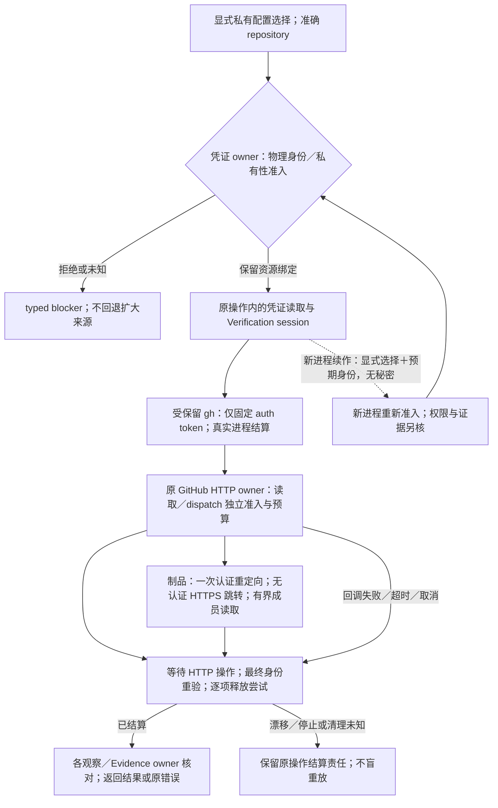
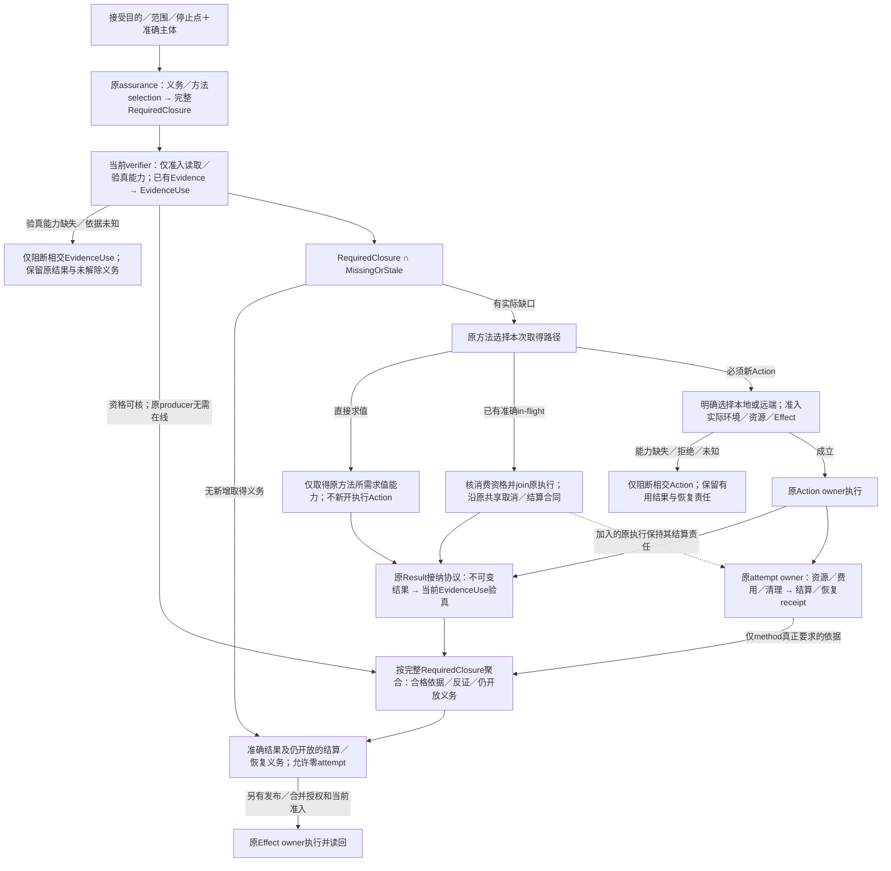

# Gift仓库验证与传输边界

本章拥有Gift自身仓库的凭证传输、本地验证接合、平台观察保证和已采用或暂缓方案的理由。通用验证义务与证据接纳由[会话集成](../../运行/验收/会话集成与结果复用.md)拥有，仓库工作身份由[工作身份与续接](工作身份与续接.md)拥有。准备、真实运行、证据使用和仓库集成分别按原owner准入；运行位置不签发权限或保证。

### GitHub 凭证与异步传输：采用、拒绝与平台边界

仓库状态、开发 runner 与受信 closeout 入口可通过 `--github-credential-store <绝对目录>` 显式选择当前操作工作树之外的 GitHub CLI 私有配置资源；未选择时保持标准凭证来源。选择只绑定资源，不扩大 GitHub 权限或替代工作准入。凭证 owner 不从 ambient `GH_CONFIG_DIR`、HOME、XDG 或普通 token 变量取得该绑定；Linux 标准位置从有效 OS 账户查询，显式位置以 no-follow 目录身份、当前用户所有权和私有访问检查接入。显式后端当前要求 Linux 目录模式 `0700`，已有 `config.yml`、`hosts.yml` 为同用户、单链接的普通 `0600` 文件；不读取配置内容来签发目录资格。固定 token 读取仍只准入 repository-maintenance 的既有 Actions 身份；Verification session 传输另准入准确的 compiler-pr-validation／repository_dispatch 与 merge-gate／workflow_run 身份，核对 github.com、仓库、main ref、workflow SHA、run 与 attempt，且只作凭证来源准入，不代替原 CI owner 的 live run、actor 与 Effect 授权核验。固定 token 读取与同一操作内的 Verification session HTTP 传输共同消费该资源绑定；只有固定 `gh auth token` 凭证子进程取得该保留目录，HTTP 请求通过原类型化 GitHub API session 消费最小凭证，仓库身份与凭证资源身份分别绑定，读取前后重新核验；fresh-process handoff 必须重新准入同一物理身份，不能仅重用路径或继承环境。回调失败保持原错误与结算责任，作用开始后的资源漂移属于 settlement 未决，不能标成可安全重放的前置拒绝。当前 Windows 显式私有配置后端返回 `unsupported-platform`，标准 Windows 认证不受影响；具有私有读取权限证明的后端才能扩展同一合同，写者可信不能代签凭证保密。凭证的保存、撤销和退役仍由已授权的原生 GitHub CLI 及用户拥有，秘密不进入工作树、普通缓存、日志或交付制品。

这里的共同绑定只复用[凭证生命周期](../../运行/权限与资源管理.md#密钥秘密凭证与身份会话生命周期)与[执行准入／结算](../../运行/权限与资源管理.md#准入分配执行与结算的正向协议)，不创建新的权限签发者。Verification session 的远端读取、证据制品下载和 hosted wake-up dispatch 保持不同的实际作用类别，分别绑定准确 repository、固定 GitHub endpoint、所需操作授权及输入／输出／期限预算；能取得凭证不表示可以派发验证，也不表示制品已经可信。返回数据仍由各观察与 Evidence owner 核对来源、对象和完整性。无显式选择时保留标准来源合同；显式选择失败不能回退到 ambient token、其他配置目录或更宽 Provider。

调用方必须等待所有仍使用该绑定的异步操作及[进程资源结算](../../运行/发布运行与资源生命周期.md#进程树端口浏览器容器与数据库资源)，再释放所拥有的目录和可执行资源；请求返回、Promise 拒绝或直接子进程退出均不代签整项资源已结算。回调错误不能跳过最终身份／私有性重验或释放尝试，多个独立失败各保留其责任，公开诊断不泄露秘密。fresh-process 恢复携带显式选择及预期物理身份，在新进程重新准入；该交接不携带秘密，不产生外部维护者资格，也不将旧 Work／验证结论自动提升为新代次 authority。

#### 为什么采用这一凭证方案

本项是仓库接合层对[REQ021](../../产品/产品要求与工作约束.md#req021)、[REQ028](../../产品/产品要求与工作约束.md#req028)及[组合保证](../../决策/设计理由-约束与演进.md#d63-组合保证显式检查边界而非叠加绿色)的采用：保持准确主体、最小披露、异步进展和资源结算，不由凭证取得改变作用权限。

| 状态 | 方案与理由 | 复核位置与重开条件 |
|---|---|---|
| 采用 | 固定 token 获取保留异步、受保留的 `gh auth token` 进程；Verification session 观察与 dispatch 扩展原类型化 GitHub HTTP operation owner，使用封闭 query／REST 操作、准确repository、独立read／dispatch作用与预算，避免第二网络执行器 | [HTTP验证测试](../../../tests/unit/github-api-verification.test.ts)、[operation session测试](../../../tests/unit/github-api-operation-session.test.ts)与[凭证测试](../../../tests/unit/github-api-credential.test.ts)；新增操作、消费者或取消路径时重核闭包 |
| 拒绝作为网络后端 | 将全部 Verification 网络请求迁入精简环境的 retained gh 子进程。凭证命令可运行不证明相同隔离环境中的API网络可达；继承全部环境或代理秘密来弥补不满足最小披露。保留合格的固定token获取，网络复用原HTTP owner | 网络环境差异是可检验反例；能读取viewer或某个PR只证明相应请求，不代表完整closeout、dispatch或正式Gate已成立 |
| 采用 | 制品先在认证API取得唯一允许重定向，再通过准入的HTTPS无认证请求读取；重验id／name／run／size／hash，使用锁定yauzl的lazy exact-member读取，不写盘解压 | [制品与重定向反例](../../../tests/unit/github-api-verification.test.ts)覆盖来源、字节预算和成员边界；拒绝跟随任意多跳、转发Authorization或另写ZIP解析器。锁定版本与依赖许可由包输入承担 |
| 拒绝 | 另建同步 spawn 路径或用 Atomics 阻塞等待 Promise；前者产生不同生命周期／凭证规则，后者阻塞同一事件循环所需的异步进展。把整个调用链改为可等待，而非伪造同步完成 | 相交调用者必须等待观察、分页、制品与 dispatch 结果；不以类型断言或未等待的 Promise 数组代签结算 |
| 采用 | Linux 标准 home 从有效 OS 账户原生查询取得；环境中的 HOME／USER／LOGNAME 不拥有账户事实 | [启动前污染与原生查询失败测试](../../../tests/unit/linux-user-home.test.ts)覆盖 Bun 环境值影响及缺记录、非法指针／编码等拒绝分支；宿主 ABI 或运行时改变时重新验证 |
| 拒绝 | 直接信任 ambient HOME、GH_CONFIG_DIR、XDG 或普通 token；显式配置选择失败后切换来源 | 环境值不是资源绑定或授权；[私有配置测试](../../../tests/unit/github-credential-store.test.ts)核身份、私有性、交接及失败结算 |
| 有界采用／平台未满足 | Linux 显式私有目录只在上述身份与读取私有性条件成立时使用；Windows 显式后端仍拒绝 | 不能用 writer ACL 证明秘密不可被其他主体读取；只有具备 reader 私有性证明及同等恢复测试后才能采用 Windows 后端，标准 Windows 认证不因此撤销 |

这里的“采用”指机制决定，链接指相交验证入口，不表示某个候选已经通过全部测试、合入或发布；验证结论仍绑定其准确树与平台。

### 验证责任与运行位置分离：本地优先及旧拓扑退出

仓库验证默认在本次明确选定的本地计算机执行；“本地”相对于调用者选择的执行环境，不等于某位用户的桌面或特定操作系统。验证要求及[运行位置与阶段合同](../../运行/验收/会话集成与结果复用.md#21-验证义务运行位置和作用阶段)由原 `VerificationSession`、Action 及其证据拥有者确定，运行位置由组合入口明确选择；共享准备函数不得用缺省参数偷偷选为 GitHub Actions。本地准备、执行、发布与合并是不同作用阶段，选择本地不新增发布或合并权限。

**采用的最小部署是一个本地协调入口，加上按所选 Action 实际需要创建和结算的临时执行边界。** 控制作用、独立验收和候选执行是权限及证据责任，不是三台常驻机器、三个注册 runner 或三个必建服务。同一计算机可以按顺序承担这些步骤；共享物理宿主不允许候选取得协调者的凭证、写权限或结果签发能力，也不消除方法真正需要的独立来源。是否必须新进程、只读快照、隔离命名空间或独立宿主，按实际威胁、方法和可强制能力决定，不按角色名推定。

| 原拥有者 | 本地入口必须消费的义务 | 不能从运行位置推得的结论 |
|---|---|---|
| Git、工作范围与 Session | 准确 base/head/tree、前像、有效 scope、当前工作及所选 Action；准备只产生准确准备结果 | 当前目录、分支名或本机权限不授予采用和合并权 |
| 工具链与物理执行 | 实际可执行映像、依赖代际、显式环境、资源与时间预算、取消和全部子进程终态 | 已安装某命令不证明它是受信版本或可安全复用旧结果 |
| 仓库观察 | 在需要严格零写的阶段保持覆盖完整、连续且可结算的物理观察能力；由平台选择返回实际 provider binding | Linux/Windows 字样、事件零计数和前后 hash 相同均不签发严格保证 |
| 源码分析与候选执行隔离 | 按方法固定读取域、禁止修改域、凭证不可达、网络及资源限制，并读取真实执行边界和清理结果 | 普通 `spawn`、私有路径或 chmod 不能冒充不可绕过的隔离 |
| 保证、审查与集成 | 原生产者的准确 Evidence、必要独立审查、MainHealth 及预期主体作用前重验 | 本地测试绿色或远端 workflow 绿色均不能独自代签完整 Gate |

正常顺序为：固定接受目的、范围、停止点与准确主体，沿原义务/方法选择取得完整RequiredClosure；先只取得必要的读取验真能力，对已有Evidence重核主体、义务、selection、coverage、freshness、来源及方法真正需要的cleanup/readback，形成当前EvidenceUse；再以`RequiredClosure ∩ MissingOrStale`选择新增取得工作，按方法直接求值、核资格后join准确in-flight，或为新Action选择运行位置并准入实际环境、资源与Effect。合格反证参与裁决，确定性失败复用并停止该失败路径；所有义务已由合格历史依据解除时允许零attempt。新结果沿原Result协议接纳并验真供Claim使用，attempt的资源、费用与清理另由原owner结算/恢复；只有方法真实依赖的结算依据影响对应EvidenceUse。Claim满足不证明operation完成，仍开放的结算和恢复责任必须返回。最后只进入当前另行授权的发布或集成阶段。准备命令不得为取得“可执行”状态而运行候选、启动沙箱、发布状态或合并；编辑反馈维持其原有限范围。

已有结果验真所需的读取/校验能力与原生产方法的执行能力分别取得。原producer已离线不自动否定可独立验真的结果；验真能力缺失则保留相交EvidenceUse未知与未解除义务，不为恢复一个旧结果先物化原执行环境，也不把未知自动转换成无条件重跑。

仓库 `verification-session prepare --pr <n> --request-output <path>` 缺省选择本地，显式 `--execution local` 同义；原准备 owner 固定准确候选并生成准备请求，仅写调用者指定的输出，不执行验证或合并。`--execution hosted` 才选择已实现的远端准备路径。既有 hosted `status`／`resume` 必须明确选择 `--execution hosted`。本地 `status`／`resume` 只投影保存请求和原 owner 已有的持久验证记录，不创建运行状态、不访问远端或启动验证；记录不存在只能表示未观察到，已保存记录只说明绑定对象的历史计算结果，不能证明当前候选、活的资格或集成许可。`resume` 返回下一步准确入口，明确本次尚未执行，不能把本地请求交给 hosted reader。本地准备输出使用独立 `sec-verification-session-local-preparation-v1` envelope，固定 `executionPlacement: local` 与 `authorityStage: preparation-only`；hosted reader 在取得运行状态、Git、凭据或远端 Provider 前拒绝该 envelope，显式 hosted 参数不能覆盖已保存的本地放置。缺 placement 字段的旧准确 hosted schema 只在显式 hosted 入口保持原恢复语义，不由缺字段推导远端选择；本地输出不得使用该旧外层 schema。请求输出的 `preparation-only` 与 `not-run` 范围必须保留。已获准的本地验证从原 `sec:closeout --verification-only --request <path>` 进入；该入口只接受本地准备 envelope，重新观察准确候选并准备当前 Session/Action 环境，逐项比较保存请求的全部身份与摘要后才调用原 SourceTransition。验证沿用原租约、当前主体重读、尝试／计算／采纳日志与资源结算，在持久 artifact 回读后结束，不签发集成许可、不发布远端状态或合并；缺少实际能力保留准确失败及已完成记录。需要作者决定时以同一入口显式提供准确 `--test-author-comment` 并重新核验，保存请求不能代替当前决定。完整集成仍由原 `sec:closeout --pr <n>` 单独选择，保留原恢复与作用准入；`--request` 不得与完整 closeout 混用，不能从准备、只读续接或验证选择推得完整 closeout 授权。

本地能力缺失返回准确的 `unsupported`、`unavailable` 或未决，不检查远端 runner 是否在线来代替本地事实，不隐式 dispatch、轮询或切换机器。远端是显式选择的执行后端；所需 GitHub API 读取、源码/制品运输和最终仓库作用分别按实际请求准入，不要求先注册远端执行器才能做独立本地分析。此前已经开始的远端操作按其原主体、来源和回执继续恢复；不能将本地请求误交给 hosted resume，也不能因新默认值不同而丢失旧操作。

固定 `control/trusted/sut` 三实例新建拓扑退出支持范围。旧 `start` 仅保留无作用的明确退役响应，不再申请 registration token、创建容器或发布初始生命周期；既有 `status` 保持只读，`recover` 与 `stop` 保持原准确 ID、租约、当前权限和终态回读，不能以退役为名删除未知或忙碌资源。已经提交的 routing intent 可以由原恢复 owner 结算，未提交的 provisioning 继续按其原退出规则处理；这不重新开放新建。旧镜像、依赖和制品只在真实消费者与恢复责任清零且取得相应授权后退役。

选择这一结构是为了去掉无必要的常驻拓扑和远程前置，同时保留原方法需要的保证。拒绝把三角色合并为一个持有所有凭证并直接运行候选的普通进程，也拒绝删掉 hosted provider revision 中的角色字样来伪称旧证据已适用于新边界。旧 Action、Session、镜像和恢复状态保留原身份解释；新的执行边界必须有自己的真实 provider 身份，不能靠重命名复用资格。本地受信镜像与工具链的最终供给应只含实际所需组件，不以 Actions runner 注册、监听器或三实例生命周期为依赖；已采用固定镜像的字节在新供给真实物化、验真并迁移前保持原身份，不编造替代 digest。

### 仓库观察与测试进程：采用边界、反例与待验证方案

本项消费[观察覆盖 D65](../../决策/设计理由-约束与演进.md#d65-观察切面按一致性和覆盖使用)和[物理假设 D66](../../决策/设计理由-约束与演进.md#d66-保证依赖模型工具与物理假设)。严格零写要求区分“未观察到事件”“当前内容相同”和“期间没有写入”；执行器则必须同时保持准确程序映像、每文件隔离、资源预算及真实停止，不因宿主限制降低原保证。平台中立的观察 owner 只选择和保留真实后端，所有消费方使用该后端签发的 requirement、contract 与 provider identity；Windows 后端的有效身份不因接口解耦重签，未实现的平台没有默认降级后端。

| 状态 | 方案与裁决理由 | 仍需证明的边界 |
|---|---|---|
| 拒绝作为严格零写证明 | 单凭 Linux inotify 零事件或前后内容相同签发通过。目录外 hard-link 写入后恢复的 ABA 可绕过所选目录事件；共享 mmap 写入也可能不产生对应事件，甚至留下持久内容变化 | 更多递归 watch、轮询或延迟等待不自动补足全部写通路；反例要求回到实际覆盖，而非调整“零事件”的名称 |
| 未满足／待验证 | Linux 严格连续观察的合格后端。没有覆盖并发、别名、映射写入及启动／退出缺口的真实机制和证据时，保持 typed capability／unsupported 拒绝 | 内核能力、更强隔离或其他后端只是待比较方案，不在证明前宣布已采用；较弱观察可准确报告，但不能替代严格合同 |
| 采用的身份要求 | 受保留执行器跨父、子、孙进程交接时，验证实际 bytes、同一 sealed image 与原来源关系；仅复制路径、fd 数字或环境字段不构成 provenance | [进程资源测试](../../../src/adapters/runtime-state/physical/runtime/process-resource-session.test.ts)与物理 retained-file 测试负责映像、漂移、失效句柄和多跳交接；环境只传递候选定位，真实 descriptor 才参与验证 |
| 拒绝 | 为避开 Bun 并行 isolate 内部 posix_spawn 的失效路径而关闭隔离、合并全局状态，或回退到未保留的磁盘可执行路径 | 单次启动成功不证明后继 isolate 仍能找到并执行同一映像；测试全局状态、PID、资源和清理边界不能因此丢失 |
| 候选方案／待验证 | 由 Gift 现有 retained process owner 为每个测试文件启动独立进程，仍消费现有选择、wave 与并发上限 | [测试 runner 策略测试](../../../tests/unit/test-runner.test.ts)及真实并发 retained-process 场景应共同证明选择完整、隔离、波次／预算和后继进程身份；局部测试不签发整体受信 Gate |

本节保存长期裁决、反例与重开条件，不保存现场日志或某次测试数量。具体实现候选未满足上述义务时，保留其未验证状态；禁止以文档采用词或局部成功覆盖未满足的正常执行路径。

本仓库 `bun run check -- --affected` 的编辑反馈先由 Git authority 签发准确 `HEAD`、index、worktree、Provider 与 changed-path 观察，再决定是否需要 Source Program。changed-path 集为空时，`bun run check -- --affected` 形成 `not-applicable` 计划，保留 Git identity 并把 source observation identity 明确记为不存在；它不为了证明空集而构造 TypeScript Program、测试投影或第二套空模型，后续真实 Effect 仍须按原边界重读 Git。全部 changed-path 均属文档验证且不属于 Source Program/tool 输入时，同样只签发 Git-bound `docs:doctor` 计划，不构建 ProjectInput、Source Program 或测试投影；`.documentation/documents.json` 与 `baseline.json` 仍走语义路线。其他非空变更必须将同一进程内签发的 Git selection 与原 session、base 和 transition 绑定后才能进入完整 Source Program；普通对象、路径摘要或调用方声称的文档列表不能触发快速路径。

昂贵验证只对准确对象生产一次。相同 source tree、tsconfig、依赖 generation、compiler/provider 与环境的受信 typecheck PASS 按既有 ActionKey 回读；任一输入变化才重新执行 compiler。当前用户授权的临时编辑期命令 `bun run typecheck` 直接运行仓库锁定的 `@typescript/native` TypeScript 7 原生编译器，而不是 `typescript` 6 的 JS `tsc`；它复用仓库外、按 checkout 与原生版本分离的 build-info，并打印进度与编译器耗时。本地 `bun run check -- --affected` 所选的 typecheck 步骤调用同一原生入口，不再暗中执行旧受信 checker；源码影响选择仍须独立完成准确证据。该命令只报告该次编辑反馈，不签发 VerificationAction、Git/依赖 authority 或最终 Gate。`bun run typecheck:verified` 保留原受信 owner，`bun run check -- --scope full` 明确消费该入口；原生缓存文件不进入候选或交付。Repository Audit 同时保留当前绝对库存和 transition enforcement：unknown、candidate、dominance、test finding 与 architecture violation 的绝对集合供迁移和审查，不得在 exact self-comparison 中再次冒充本候选新增失败；阻断只消费准确 before/after 的 finding delta、reconciliation、architecture evolution、test retirement 与 supersession receipt。比较缺失、不可比、观察退化或 receipt 未决仍 fail closed，不能借“历史存量”规则把真实新增回归放行。

当前性能欠账须由既有 affected selector 与 Source Program owner 消除：除准确空集和纯文档闭包外，`bun run check -- --affected --plan` 仍会取得全工作树快照并构建完整 TypeScript Program；执行模式先在零写入围栏内取得 Git-only 选择，结束该围栏后才按选择准入依赖；准确空集跳过依赖，纯文档闭包仍取得所需运行时依赖但跳过 Source Program，其他语义路径继续编译。可能写入的 materialization 不能移进零写入围栏。受信 typecheck 为求 ActionKey 又先解析模块，cache miss 后重新构造 Program。阶段日志分别记录 Git selection、依赖代际、快照、ProjectInput、Source Program、fact identity 和 checker 的耗时。受信 typecheck 的快键若改用保守输入上界，必须覆盖新增、删除、改名、负依赖解析、嵌套 package/tsconfig 与依赖 generation，并在 miss 时以真实 Program 反核；不能以已知 import 列表、路径后缀或裸 `tsc` 创造第二权威。已完成的依赖顺序修复和纯文档 Source Program 跳过，不消除其余语义路径的完整分析与重复解析欠账；临时原生编辑反馈不替代最终受信验证。

#### 受信原生检查复用：暂缓独立前置协议，先审既有产物接合

当前保留原候选验证与合并后 MainHealth 的各自检查；**暂缓**为省一次检查而新增 pre-Session 启动、独立私有工作区、完整复制、原生专用调度与恢复桥的整套方案。该方案增加了真实准备、解析域核验、资源保留与退役工作，却没有同一终局操作的净收益依据；调用方切换 Runtime State 根还可能隐藏原根中的 pending attempt，当前根的物理身份验证不能证明另一根没有未结算工作。解析域完整性、真实隔离平台及跨 reader 资格同样不能由编辑期类型诊断或局部 custody 测试代签。这是未具备采用资格，不是原生检查不可复用的证明，也不授权为优化先建设通用 enrollment／根迁移框架。

优先调查的较小方案是：由**既有候选 gate／container 的原产物 owner**在退役前导出真实原生子 Action 的结果、准确输入、诊断、原始产出时间与来源，再由 MainHealth 的实际读者独立核对当前输入、方法和信任资格。外层 gate PASS 不能充当子 Action terminal，候选 JSON 和摘要不能签发生产者权威；不存在或不可认证的已引用产物应拒绝复用，不能因此隐式新开前置任务。该接合仍是待资格方案，不因已有 artifact reader 或设计描述而视为已运行。

重开实施须先证明这个既有 owner 接合能保持原 Action 身份、导出先于销毁、当前输入／策略资格、全部真实读者及失败结算，并比较所省检查与新增捕获、验证、复制、持有和恢复的完整成本。若不能在这个边界内取得资格和净收益，就继续原检查；独立成立的源码分析优化不以采用该整套方案为前置。
