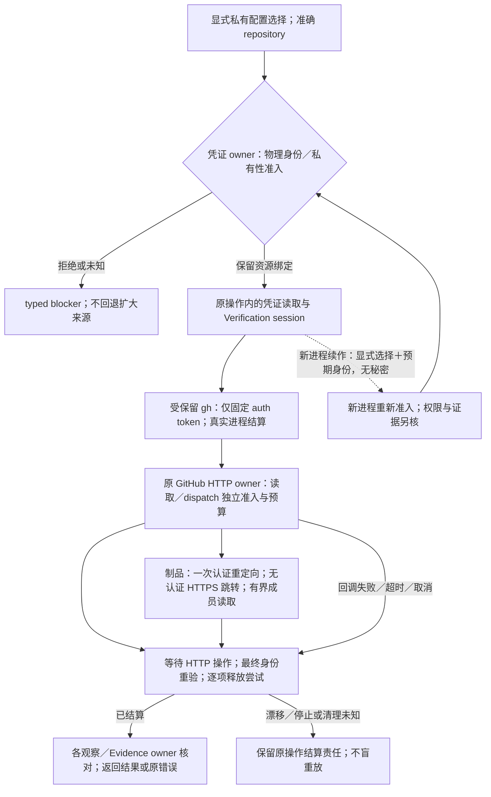
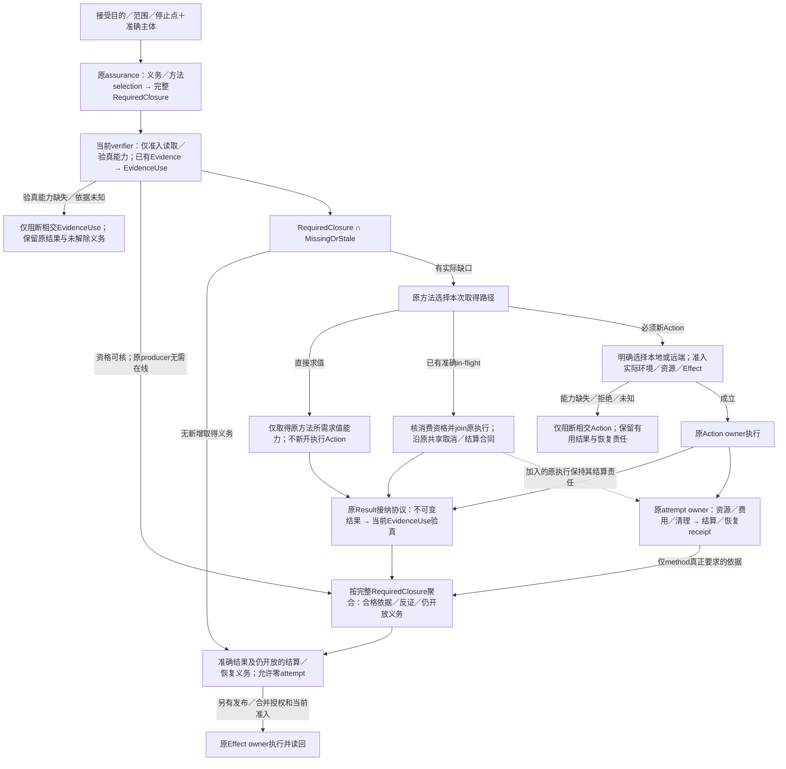
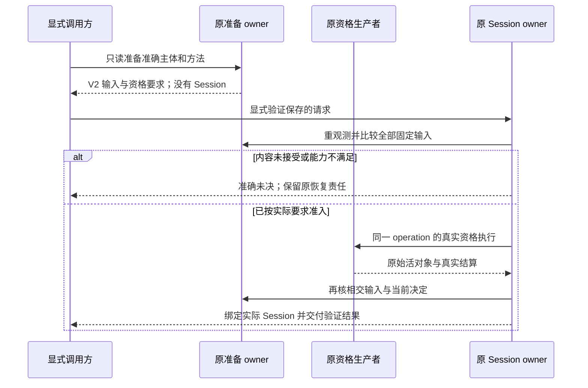

# Gift仓库验证与传输边界

本章拥有Gift自身仓库的凭证传输、本地验证接合、平台观察保证和已采用或暂缓方案的理由。通用验证义务与证据接纳由[会话集成](../../运行/验收/会话集成与结果复用.md)拥有，仓库工作身份由[工作身份与续接](工作身份与续接.md)拥有。准备、真实运行、证据使用和仓库集成分别按原owner准入；运行位置不签发权限或保证。

### GitHub 凭证与异步传输：采用、拒绝与平台边界

仓库状态、开发 runner 与受信 closeout 入口可通过 `--github-credential-store <绝对目录>` 显式选择当前操作工作树之外的 GitHub CLI 私有配置资源；未选择时保持标准凭证来源。选择只绑定资源，不扩大 GitHub 权限或替代工作准入。凭证 owner 不从 ambient `GH_CONFIG_DIR`、HOME、XDG 或普通 token 变量取得该绑定；Linux 标准位置从有效 OS 账户查询，显式位置以 no-follow 目录身份、当前用户所有权和私有访问检查接入。显式后端当前要求 Linux 目录模式 `0700`，已有 `config.yml`、`hosts.yml` 为同用户、单链接的普通 `0600` 文件；不读取配置内容来签发目录资格。固定 `gh auth token` 读取仅使用已存储认证或显式私有配置，不消费 Actions token；Verification session 传输由独立 API owner 准入准确的 compiler-pr-validation／repository_dispatch 与 merge-gate／workflow_run 身份，核对 github.com、仓库、main ref、workflow SHA、run 与 attempt，且只作凭证来源准入，不代替原 CI owner 的 live run、actor 与 Effect 授权核验。固定 token 读取与同一操作内的 Verification session HTTP 传输共同消费该资源绑定；只有固定 `gh auth token` 凭证子进程取得该保留目录，HTTP 请求通过原类型化 GitHub API session 消费最小凭证，仓库身份与凭证资源身份分别绑定，读取前后重新核验；fresh-process handoff 必须重新准入同一物理身份，不能仅重用路径或继承环境。回调失败保持原错误与结算责任，作用开始后的资源漂移属于 settlement 未决，不能标成可安全重放的前置拒绝。当前 Windows 显式私有配置后端返回 `unsupported-platform`，标准 Windows 认证不受影响；具有私有读取权限证明的后端才能扩展同一合同，写者可信不能代签凭证保密。凭证的保存、撤销和退役仍由已授权的原生 GitHub CLI 及用户拥有，秘密不进入工作树、普通缓存、日志或交付制品。

这里的共同绑定只复用[凭证生命周期](../../运行/权限与资源管理.md#密钥秘密凭证与身份会话生命周期)与[执行准入／结算](../../运行/权限与资源管理.md#准入分配执行与结算的正向协议)，不创建新的权限签发者。Verification session 的远端读取、证据制品下载和 hosted wake-up dispatch 保持不同的实际作用类别，分别绑定准确 repository、固定 GitHub endpoint、所需操作授权及输入／输出／期限预算；能取得凭证不表示可以派发验证，也不表示制品已经可信。返回数据仍由各观察与 Evidence owner 核对来源、对象和完整性。无显式选择时保留标准来源合同；显式选择失败不能回退到 ambient token、其他配置目录或更宽 Provider。

调用方必须等待所有仍使用该绑定的异步操作及[进程资源结算](../../运行/发布运行与资源生命周期.md#进程树端口浏览器容器与数据库资源)，再释放所拥有的目录和可执行资源；请求返回、Promise 拒绝或直接子进程退出均不代签整项资源已结算。回调错误不能跳过最终身份／私有性重验或释放尝试，多个独立失败各保留其责任，公开诊断不泄露秘密。fresh-process 恢复携带显式选择及预期物理身份，在新进程重新准入；该交接不携带秘密，不产生外部维护者资格，也不将旧 Work／验证结论自动提升为新代次 authority。

#### 为什么采用这一凭证方案

本项是仓库接合层对[REQ021](../../产品/产品要求与工作约束.md#req021)、[REQ028](../../产品/产品要求与工作约束.md#req028)及[组合保证](../../决策/设计理由-约束与演进.md#d63-组合保证显式检查边界而非叠加绿色)的采用：保持准确主体、最小披露、异步进展和资源结算，不由凭证取得改变作用权限。

| 状态 | 方案与理由 | 复核位置与重开条件 |
|---|---|---|
| 采用 | 固定 token 获取保留异步、受保留的 `gh auth token` 进程；Verification session 观察与 dispatch 扩展原类型化 GitHub HTTP operation owner，使用封闭 query／REST 操作、准确repository、独立read／dispatch作用与预算，避免第二网络执行器 | [HTTP验证测试](../../../tests/unit/providers/github-api-verification.test.ts)、[operation session测试](../../../tests/unit/providers/github-api-operation-session.test.ts)与[凭证测试](../../../tests/unit/providers/github-api-credential.test.ts)；新增操作、消费者或取消路径时重核闭包 |
| 拒绝作为网络后端 | 将全部 Verification 网络请求迁入精简环境的 retained gh 子进程。凭证命令可运行不证明相同隔离环境中的API网络可达；继承全部环境或代理秘密来弥补不满足最小披露。保留合格的固定token获取，网络复用原HTTP owner | 网络环境差异是可检验反例；能读取viewer或某个PR只证明相应请求，不代表完整closeout、dispatch或正式Gate已成立 |
| 采用 | 制品先在认证API取得唯一允许重定向，再通过准入的HTTPS无认证请求读取；重验id／name／run／size／hash，使用锁定yauzl的lazy exact-member读取，不写盘解压 | [制品与重定向反例](../../../tests/unit/providers/github-api-verification.test.ts)覆盖来源、字节预算和成员边界；拒绝跟随任意多跳、转发Authorization或另写ZIP解析器。锁定版本与依赖许可由包输入承担 |
| 拒绝 | 另建同步 spawn 路径或用 Atomics 阻塞等待 Promise；前者产生不同生命周期／凭证规则，后者阻塞同一事件循环所需的异步进展。把整个调用链改为可等待，而非伪造同步完成 | 相交调用者必须等待观察、分页、制品与 dispatch 结果；不以类型断言或未等待的 Promise 数组代签结算 |
| 采用 | Linux 标准 home 从有效 OS 账户原生查询取得；环境中的 HOME／USER／LOGNAME 不拥有账户事实 | [启动前污染与原生查询失败测试](../../../tests/unit/runtime/linux-user-home.test.ts)覆盖 Bun 环境值影响及缺记录、非法指针／编码等拒绝分支；宿主 ABI 或运行时改变时重新验证 |
| 拒绝 | 直接信任 ambient HOME、GH_CONFIG_DIR、XDG 或普通 token；显式配置选择失败后切换来源 | 环境值不是资源绑定或授权；[私有配置测试](../../../tests/unit/providers/github-credential-store.test.ts)核身份、私有性、交接及失败结算 |
| 有界采用／平台未满足 | Linux 显式私有目录只在上述身份与读取私有性条件成立时使用；Windows 显式后端仍拒绝 | 不能用 writer ACL 证明秘密不可被其他主体读取；只有具备 reader 私有性证明及同等恢复测试后才能采用 Windows 后端，标准 Windows 认证不因此撤销 |

这里的“采用”指机制决定，链接指相交验证入口，不表示某个候选已经通过全部测试、合入或发布；验证结论仍绑定其准确树与平台。

### 验证责任与运行位置分离：本地优先及旧拓扑退出

仓库验证默认在本次明确选定的本地计算机执行；“本地”相对于调用者选择的执行环境，不等于某位用户的桌面或特定操作系统。验证要求及[运行位置与阶段合同](../../运行/验收/会话集成与结果复用.md#21-验证义务运行位置和作用阶段)由原 `VerificationSession`、Action 及其证据拥有者确定，运行位置由组合入口明确选择；共享准备函数不得用缺省参数偷偷选为 GitHub Actions。本地准备、执行、发布与合并是不同作用阶段，选择本地不新增发布或合并权限。

**采用的最小部署是一个本地协调入口，加上按所选 Action 实际需要创建和结算的临时执行边界。** 控制作用、独立验收和候选执行是权限及证据责任，不是三台常驻机器、三个注册 runner 或三个必建服务。同一计算机可以按顺序承担这些步骤；共享物理宿主不允许候选取得协调者的凭证、写权限或结果签发能力，也不消除方法真正需要的独立来源。是否必须新进程、只读快照、隔离命名空间或独立宿主，按实际威胁、方法和可强制能力决定，不按角色名推定。

| 原拥有者 | 本地入口必须消费的义务 | 不能从运行位置推得的结论 |
|---|---|---|
| Git、工作范围与 Session | 准确 base/head/tree、前像、有效 scope、当前工作及所选 Action；准备只产生准确准备结果 | 当前目录、分支名或本机权限不授予采用和合并权 |
| 工具链与物理执行 | 实际可执行映像、依赖代际、显式环境、资源与时间预算、取消和全部子进程终态 | 已安装某命令不证明它是受信版本或可安全复用旧结果 |
| 仓库观察 | 在需要严格零写的阶段保持覆盖完整、连续且可结算的物理观察能力；由平台选择返回实际 provider binding | Linux/Windows 字样、事件零计数和前后 hash 相同均不签发严格保证 |
| 源码分析与候选执行隔离 | 按方法固定读取域、禁止修改域、凭证不可达、网络及资源限制，并读取真实执行边界和清理结果 | 普通 `spawn`、私有路径或 chmod 不能冒充不可绕过的隔离 |
| 保证、审查与集成 | 原生产者的准确 Evidence、必要独立审查、MainHealth 及预期主体作用前重验 | 本地测试绿色或远端 workflow 绿色均不能独自代签完整 Gate |

远端恢复协调者代表原人类授权主体产生 terminal Session 时，实际 producer、transport actor 与 Scope issuer 分别保持真实身份：恢复协调者的 bot run/attempt 和实际权限不能被改写成人类，也不从 Scope issuer 继承权限。原直接人类产物沿原来源及当前权限合同验真；受委托的恢复产物使用原 Session artifact owner 的有限独立解释，完整绑定恢复信号、原请求、Scope、Session 与 Action closure，并将这些关系纳入制品完整性域。解释选择和摘要只核形状与关系，不签发委托或作用资格；新含义不能作为可忽略字段塞入旧载体。读写及退役方向遵守[授权与证据载体的版本解释](../../演进/兼容迁移与退役.md#authority-bearing-format-migration)。

受委托产物的真实消费者由原 native 来源 owner 重新核验准确的生产 run/attempt、固定 job、finalize/upload 阶段、受信 workflow/base、Actions App 与实际 actor，并沿保存的原因独立回读 emitter、已完成 Action 的 terminal/resolution、原 parent archive/request 及人类当前权限。资格绑定准确制品字节、实际 producer 和该原因，不由 caller JSON、人类姓名、权限字段或旧进程对象恢复；历史读取也不能借用当前事件文件冒认产物来源。缺档、过期、身份漂移或授权依据未知时保留相交 unknown 和原恢复责任。派发恢复信号只唤醒原 Action；执行仍由 child 独立重建当前准入并核 claim/ticket。HTTP 已进入而结果未知时，不因未见 provider 状态、reducer 状态变化或换进程而推定未发送并自动重发；真实 carrier/outcome 的 join 与此前 HTTP 是否结算分别声明。

正常顺序为：固定接受目的、范围、停止点与准确主体，沿原义务/方法选择取得完整RequiredClosure；先只取得必要的读取验真能力，对已有Evidence重核主体、义务、selection、coverage、freshness、来源及方法真正需要的cleanup/readback，形成当前EvidenceUse；再以`RequiredClosure ∩ MissingOrStale`选择新增取得工作，按方法直接求值、核资格后join准确in-flight，或为新Action选择运行位置并准入实际环境、资源与Effect。合格反证参与裁决，确定性失败复用并停止该失败路径；所有义务已由合格历史依据解除时允许零attempt。新结果沿原Result协议接纳并验真供Claim使用，attempt的资源、费用与清理另由原owner结算/恢复；只有方法真实依赖的结算依据影响对应EvidenceUse。Claim满足不证明operation完成，仍开放的结算和恢复责任必须返回。最后只进入当前另行授权的发布或集成阶段。准备命令不得为取得“可执行”状态而运行候选、启动沙箱、发布状态或合并；编辑反馈维持其原有限范围。

已有结果验真所需的读取/校验能力与原生产方法的执行能力分别取得。原producer已离线不自动否定可独立验真的结果；验真能力缺失则保留相交EvidenceUse未知与未解除义务，不为恢复一个旧结果先物化原执行环境，也不把未知自动转换成无条件重跑。

仓库 `verification-session prepare --pr <n> --request-output <path>` 缺省选择本地，显式 `--execution local` 同义；原准备 owner 读取准确候选、清单、变更选择、依赖来源、当前调用者和相交作者决定，固定验证方法及资格要求，仅写调用者指定的请求输出，不执行候选、生产 MainHealth、发布状态或合并。`--execution hosted` 才选择远端准备路径；既有 hosted `status`／`resume` 必须显式选择该运行位置，不能从缺省参数或保存请求改选后端。

共同本地请求入口先按最多 1 MiB UTF-8 文本和四层 JSON 深度准入，再选择版本；拒绝重复键及非规范形状，不先无界解码再检查 V2。合法 V1 的固定字段和解释保持。

本地新准备输出为 `sec-verification-session-local-preparation-v2`，保留 `executionPlacement: local`、`authorityStage: preparation-only` 和 `purpose: verification-only`。请求固定 repository、PR、base/head commit 与 tree、manifest 与完整写集、源事实及验证计划摘要、调用者和 SourceTransition 绑定，并固定 trusted revision、原生产者身份、native profile、已接受内容摘要或准确未决、MainHealth 方法及相交政策。`requestDigest` 保护这些输入的完整性；`requestOperationId` 标识同一有界准备意图，不能当作运行 nonce、Scope、健康事实或执行授权。未取得 native 内容时字段保持未决，不能填替代镜像或虚构摘要。准备请求不含尚未成立的健康结论、最终 Session revision 或 Action key；只读准备完成不证明所需宿主已经合格。

已获准的验证由原 `sec:closeout --verification-only --request <path>` 执行。它先重新观察并逐项比较冻结输入及要求，漂移须重新准备；仍缺已接受内容时返回准确的资格未开始结果，不创建假 Session。输入成立后，原 MainHealth 生产者在当前 operation 的真实物理边界执行并结算；只有原私有生产者对象及 publication authority 都有效，原 Session owner 才以同一固定来源和真实资格绑定具体 Session/Action。取得资格后再重观测相交输入，不能把晚绑定解释成换用 latest 来源、改变 base/head 或跨 operation 恢复授权。相同请求的再次执行仍须重新准入；原 Action Evidence 仅按其准确输入和资格复用。

持久数据继续归原本地验证 owner：V2 以准确 request operation 定位同一操作目录，保存原准备输入与既有 attempt、pending、adoption 和 Action/artifact 记录，不增加另一套健康回执或授权平台。已有计算记录没有匹配的原准备输入、输入不同、实际 Session/Action 漂移或原租约/资源终态未知时，停止对应复用并保留恢复对象；不能靠重建目录清除未结算责任。中断、取消、原生产者失效和重开仍由原 attempt、租约和资源 owner 结算，保存请求、目录存在或复制 JSON 不恢复活的资格。验证在原持久 artifact 回读后结束，不签发集成许可、不发布远端状态或合并。

本地 `status`／`resume` 只读取保存请求和原 owner 已有记录，不创建运行状态、访问远端或启动验证。尚未绑定时准确返回没有 Session；存在计算记录时只展示其中实际 Session 与历史结果，保留未独立核实的准备字段、当前主体及活资格边界。`resume` 返回下一步显式验证入口，不能重放旧 grant。旧 `sec-verification-session-local-preparation-v1` 请求保持原有健康提供者和 exact Session/Action pin 比较及历史读回；不得读入 V1 后静默升级、替换预期 Session 或新开 V2 operation。新需求应重新准备为 V2。hosted reader 在取得运行状态、Git、凭据或远端 Provider 前拒绝两种本地 envelope；显式 hosted 参数不能覆盖保存的本地放置。缺 placement 字段的旧准确 hosted schema 只在显式 hosted 入口保持原恢复语义。

这一分离消除“准备先证明健康、证明健康又要等准备”的伪前置：固定的是检查所需的准确输入和资格要求，健康事实与具体 Session 由真实生产者稍后产生。它不授予修改受信根的权限；缺失 producer 的迁移仍须由原 trust／Work／Effect owner 接纳独立有权授权，新 candidate 不能批准自身。需要作者决定时显式提供准确 `--test-author-comment` 并由原 owner 重验；保存请求不能替代当前决定。完整集成仍单独选择 `sec:closeout --pr <n>`，保留原恢复与作用准入；`--request` 不与完整 closeout 混用，准备、只读续接或验证请求均不授权集成。

本地能力缺失返回准确的 `unsupported`、`unavailable` 或未决，不检查远端 runner 是否在线来代替本地事实，不隐式 dispatch、轮询或切换机器。远端是显式选择的执行后端；所需 GitHub API 读取、源码/制品运输和最终仓库作用分别按实际请求准入，不要求先注册远端执行器才能做独立本地分析。此前已经开始的远端操作按其原主体、来源和回执继续恢复；不能将本地请求误交给 hosted resume，也不能因新默认值不同而丢失旧操作。

固定 `control/trusted/sut` 三实例新建拓扑退出支持范围。旧 `start` 仅保留无作用的明确退役响应，不再申请 registration token、创建容器或发布初始生命周期；既有 `status` 保持只读，`recover` 与 `stop` 保持原准确 ID、租约、当前权限和终态回读，不能以退役为名删除未知或忙碌资源。已经提交的 routing intent 可以由原恢复 owner 结算，未提交的 provisioning 继续按其原退出规则处理；这不重新开放新建。旧镜像、依赖和制品只在真实消费者与恢复责任清零且取得相应授权后退役。

选择这一结构是为了去掉无必要的常驻拓扑和远程前置，同时保留原方法需要的保证。拒绝把三角色合并为一个持有所有凭证并直接运行候选的普通进程，也拒绝删掉 hosted provider revision 中的角色字样来伪称旧证据已适用于新边界。旧 Action、Session、镜像和恢复状态保留原身份解释；新的执行边界必须有自己的真实 provider 身份，不能靠重命名复用资格。本地受信镜像与工具链的最终供给应只含实际所需组件，不以 Actions runner 注册、监听器或三实例生命周期为依赖；已采用固定镜像的字节在新供给真实物化、验真并迁移前保持原身份，不编造替代 digest。

### 仓库观察与测试进程：采用边界、反例与待验证方案

本项消费[观察覆盖 D65](../../决策/设计理由-约束与演进.md#d65-观察切面按一致性和覆盖使用)和[物理假设 D66](../../决策/设计理由-约束与演进.md#d66-保证依赖模型工具与物理假设)。严格零写要求区分“未观察到事件”“当前内容相同”和“期间没有写入”；执行器则必须同时保持准确程序映像、每文件隔离、资源预算及真实停止，不因宿主限制降低原保证。平台中立的观察 owner 只选择和保留真实后端，所有消费方使用该后端签发的 requirement、contract 与 provider identity；Windows 后端的有效身份不因接口解耦重签，未实现的平台没有默认降级后端。

Linux 的严格零写路径使用原 privileged unit owner 准备的不可变输入：完整源码与 Git 身份、依赖内容均经原 issuer 在新物理根签发及独立进程回读，再由可信父进程冻结真实私有 tmpfs superblock；执行者必须非 root、无 capabilities、禁止提权，并通过原 namespace fence 与 retained kernel facts 准入。只读 bind、chmod、环境标志或前后内容相同都不能替代这条证明。取消、失败和正常结束同样要求原 unit/cgroup 子树停止、输入与私有挂载退役及实际回读；资源终态未知时保留恢复材料，不发布成功。

MainHealth 的运行时 readiness 可以消费同一 unit owner 单独签发的本机工具字节快照。该输入只允许准确同一 main head/tree、固定 `bun --version` 和 fresh observe，不导入候选依赖，不取得通用 Action 或 privileged SUT 权限，也不签发 native runtime 的 acceptedContent；原已接受 native manifest 的入口继续独立验真。GitHub 的命令文件只作为与固定命令比较的数据，不能成为 shell 或任意 argv。两个输入形状的真实 manifest、provider、policy 与 operation 仍各自绑定。MainHealth v4 receipt 仅证明启动、成功退出及原资源释放，旧 v2/v3 receipt 不升级为当前资格。源码接合及本地静态检查不替代实际 Linux 平台资格。

工具快照的闭包包含实际使用的 ABI 入口、动态库与原生工具数据文件，不能只按可执行文件存在判定完整。离线依赖导入保留已认证内容的相对链接拓扑：在实际投影内逐组件展开目标及祖先链接，拒绝逃逸、环、悬空和投影外目标；复制保持原目标字节，以原 no-follow 句柄和完整内容回读核验，不扩大普通目录复制的默认准入。

原 privileged helper 与控制工具的后代共同归属同次 systemd control scope，原工作单元以 `BindsTo` 与 `After` 持续依赖该 scope；ready 只证明准入观察，不承担 manager 受理身份登记。恢复先按原 manager、InvocationID 和 cgroup 结算控制域，再结算该次工作单元，最后退役原私有对象；进程号消失不证明后代或挂载已结束。正常退出的实际非零状态仍是失败结果，manager 为保留退出观察而采用的状态分类不得改写它；ready 前已经退出的原单元，按准确受理身份、原生退出状态与空 cgroup 进入失败收口，保留其有界原因，不把已退役 cgroup 路径误判为身份替换或继续等待 ready。迟到但失去控制域的启动不得重新执行。公共恢复编译与原操作／恢复操作的核验由原 unit owner 承担，调用者只管理自身借用资源；恢复成功不重新认可已失效结果。首个持久意图之前没有可信原生身份、未提交记录或对象完整性未知时，继续保全准确未知，不从名称、PID 或当前修复反推历史终态。

挂载交接必须取得目标 namespace 中真正可用的挂载视图；跨 namespace 的目录 FD 可读，不证明它可直接作为目标挂载或 systemd 路径策略的输入。原 unit owner 的固定受信准备进程先核原 namespace、目录能力和物理身份，进入源 mount namespace 后立即建立私有副本，再从内核映射的当前目录取得本地句柄，保持同一文件系统及 generation。管理器继续拥有 unit/cgroup、网络与 IPC 隔离、系统调用约束；其私有设备树通过原生 detached mount 接口导入，新根不暴露宿主控制组。准备阶段所需能力在工作负载准入前退回原画像，实际 UID、capabilities、namespace、根与可写输出仍由原观察签发，不能从配置推定生效。旧的跨 namespace 路径接合不作为降级后端保留。

PID namespace 的初始进程持续承担孤儿回收责任，不能把普通运行时的子进程等待等同于 namespace init。原固定入口在 ready 与准入后启动主工作负载，回收被收养的后代并转发终止信号；主工作负载结束后，由 namespace 退出和原 unit/cgroup 结算剩余后代。公开退出码保留正常码或信号的标准数值映射，管理器原生 ExecMain 字段仍描述其实际包装进程，两者不能互相冒充。

失败摘要不承担完整错误的保管。原有界运输保留实际退出状态、已捕获 stderr 的准确字节与完整性、异常链和独立清理失败；原 retained 进程结果同时保留观察到的退出码与信号，不能从兼容数值投影反推正常退出。管理器在工作负载标准错误重定向之前失败时，另取原 unit 与 boot 绑定的有界原生日志。完整诊断由真实运行制品消费者保留，解析失败也保留原运输数据；诊断写入或清理失败不得替换主因。诊断对象不签发执行资格、恢复权限或成功终态。

同一 main 的 MainHealth 请求保持同一 operation 身份。连接中断后的请求结果保持 unknown，恢复只观察并接续准确运行，不因列表暂时缺席而重发 POST，不换 nonce 或以新提交掩盖旧请求。原生 concurrency 只保证队列约束，运行列表只提供观察，两者不能签发原子认领或 exactly-once；没有真实原子认领能力时不新增列表选举、轮询稳定计数或去重台账。失败、取消、跳过或运行记录缺失均不能签发健康 Evidence。

Git 候选历史以原生 bundle 文件传输，完整保留准确 base／head 的可达历史；两者相同也不省略已删除内容或祖先。制品字节容量与进程诊断消息分别计量，不把整包历史读成 stdout 消息或再次装入内存发布。原 owner 在私有独占目标完成 Git 写入和进程结算后，按 retained file 同句柄的实际大小、流式摘要、原生 bundle verify 及物理回读准入；传输复制限定准确文件并比较源／目标摘要。制品必须落在消费者实际剩余输入预算内，Linux unit 继续合计依赖、bundle 与可选 SUT 制品；后验文件准入不签发写入期总磁盘硬上限。清理只采所需身份与权限元数据，权限恢复仍重验同一所有者、原模式与 retained 目录，不为退役再次读取历史内容。

测试 invocation 的正常清理由原 runner 先取得真实 native process settlement，再释放原临时资源；无 guard 的 orphan 不按 PID、TTL 或新 guard 自动接管。当前用户另行授权丢弃的 disposable fixture 可由原临时资源 owner 解除准确对象的当前保留责任：可信维护组合层审查固定 invocation／owner 与实际 binding，作用前核原字节、物理身份及相交消费者，先退 TMP／Cache，最后退保有恢复绑定的 State 与准确旧 lease；漂移、外来或 reparse 对象拒绝。结果只证明该次获授权对象退役，旧 attempt／子树 terminal 仍为 UNVERIFIED，不补签测试 PASS、旧 lease release 或恢复完成。

独立测试的普通失败只在已正常退出、观察完整且原临时资源释放后允许继续其他独立 invocation，整批仍保留首个失败结果。继续前核整波结果，任一观察拒绝、未知终态或不完整观察均停止；较早的普通失败不能遮盖同波的不安全结果。剩余执行继续消费原预算、取消和期限，不重派已执行项，也不为收集失败增加另一套运行入口。

| 状态 | 方案与裁决理由 | 仍需证明的边界 |
|---|---|---|
| 拒绝作为严格零写证明 | 单凭 Linux inotify 零事件或前后内容相同签发通过。目录外 hard-link 写入后恢复的 ABA 可绕过所选目录事件；共享 mmap 写入也可能不产生对应事件，甚至留下持久内容变化 | 更多递归 watch、轮询或延迟等待不自动补足全部写通路；反例要求回到实际覆盖，而非调整“零事件”的名称 |
| 实现路径／待平台资格 | Linux 不可变输入由可信父进程、只读 tmpfs superblock、无特权执行及 namespace fence 共同约束；任一真实内核前提或覆盖不可证时，保持 typed capability／unsupported 拒绝 | 仍须在实际 Linux 验证并发、hard-link／mount 别名、映射写入、线程与 descriptor、启动／退出及资源退役；源码或局部数据检查不能签发平台通过 |
| 采用的身份要求 | 受保留执行器跨父、子、孙进程交接时，验证实际 bytes、同一 sealed image 与原来源关系；仅复制路径、fd 数字或环境字段不构成 provenance | [进程资源测试](../../../src/adapters/runtime-state/physical/runtime/process-resource-session.test.ts)与物理 retained-file 测试负责映像、漂移、失效句柄和多跳交接；环境只传递候选定位，真实 descriptor 才参与验证 |
| 拒绝 | 为避开 Bun 并行 isolate 内部 posix_spawn 的失效路径而关闭隔离、合并全局状态，或回退到未保留的磁盘可执行路径 | 单次启动成功不证明后继 isolate 仍能找到并执行同一映像；测试全局状态、PID、资源和清理边界不能因此丢失 |
| 候选方案／待验证 | 由 Gift 现有 retained process owner 为每个测试文件启动独立进程，仍消费现有选择、wave 与并发上限 | [测试 runner 策略测试](../../../tests/unit/verification/test-runner.test.ts)及真实并发 retained-process 场景应共同证明选择完整、隔离、波次／预算和后继进程身份；局部测试不签发整体受信 Gate |

本节保存长期裁决、反例与重开条件，不保存现场日志或某次测试数量。具体实现候选未满足上述义务时，保留其未验证状态；禁止以文档采用词或局部成功覆盖未满足的正常执行路径。

本仓库 `bun run check -- --affected` 的编辑反馈先由 Git authority 签发准确 `HEAD`、index、worktree、Provider 与 changed-path 观察，再决定是否需要 Source Program。changed-path 集为空时，`bun run check -- --affected` 形成 `not-applicable` 计划，保留 Git identity 并把 source observation identity 明确记为不存在；它不为了证明空集而构造 TypeScript Program、测试投影或第二套空模型，后续真实 Effect 仍须按原边界重读 Git。全部 changed-path 均属文档验证且不属于 Source Program/tool 输入时，同样只签发 Git-bound `docs:doctor` 计划，不构建 ProjectInput、Source Program 或测试投影；`.documentation/documents.json` 与 `baseline.json` 仍走语义路线。其他非空变更必须将同一进程内签发的 Git selection 与原 session、base 和 transition 绑定后才能进入完整 Source Program；普通对象、路径摘要或调用方声称的文档列表不能触发快速路径。

昂贵验证只对准确对象生产一次。相同 source tree、tsconfig、依赖 generation、compiler/provider 与环境的受信 typecheck PASS 按既有 ActionKey 回读；任一输入变化才重新执行 compiler。当前用户授权的临时编辑期命令 `bun run typecheck` 直接运行仓库锁定的 `@typescript/native` TypeScript 7 原生编译器，而不是 `typescript` 6 的 JS `tsc`；它复用仓库外、按 checkout 与原生版本分离的 build-info，并打印进度与编译器耗时。本地 `bun run check -- --affected` 所选的 typecheck 步骤调用同一原生入口，不再暗中执行旧受信 checker；源码影响选择仍须独立完成准确证据。该命令只报告该次编辑反馈，不签发 VerificationAction、Git/依赖 authority 或最终 Gate。`bun run typecheck:verified` 保留原受信 owner，`bun run check -- --scope full` 明确消费该入口；原生缓存文件不进入候选或交付。Repository Audit 同时保留当前绝对库存和 transition enforcement：unknown、candidate、dominance、test finding 与 architecture violation 的绝对集合供迁移和审查，不得在 exact self-comparison 中再次冒充本候选新增失败；阻断只消费准确 before/after 的 finding delta、reconciliation、architecture evolution、test retirement 与 supersession receipt。比较缺失、不可比、观察退化或 receipt 未决仍 fail closed，不能借“历史存量”规则把真实新增回归放行。

当前性能欠账须由既有 affected selector 与 Source Program owner 消除：除准确空集和纯文档闭包外，`bun run check -- --affected --plan` 仍会取得全工作树快照并构建完整 TypeScript Program；执行模式先在零写入围栏内取得 Git-only 选择，结束该围栏后才按选择准入依赖；准确空集跳过依赖，纯文档闭包仍取得所需运行时依赖但跳过 Source Program，其他语义路径继续编译。可能写入的 materialization 不能移进零写入围栏。受信 typecheck 为求 ActionKey 又先解析模块，cache miss 后重新构造 Program。阶段日志分别记录 Git selection、依赖代际、快照、ProjectInput、Source Program、fact identity 和 checker 的耗时。受信 typecheck 的快键若改用保守输入上界，必须覆盖新增、删除、改名、负依赖解析、嵌套 package/tsconfig 与依赖 generation，并在 miss 时以真实 Program 反核；不能以已知 import 列表、路径后缀或裸 `tsc` 创造第二权威。已完成的依赖顺序修复和纯文档 Source Program 跳过，不消除其余语义路径的完整分析与重复解析欠账；临时原生编辑反馈不替代最终受信验证。

导入规范化同样先由唯一 Source Program owner 取得绑定完整 index 身份、Git provider、仓库根与准确比较基线的选集，再决定是否读取源码 blob。真正没有可规范化目标时，authoring check/freeze 经同一 session 的 index readback 返回 canonical；commit normalization 签发 opaque `not-applicable` admission，`actionKey` 与 Action terminal 均不存在，不伪造一次成功验证。实际 commit 的候选前像、CAS 与最终 fence 仍由原 Git owner 承担。非空选集须与完整 snapshot 的同代身份相符，再进入原 kernel；默认基线仍为 `merge-base(HEAD, origin/main)`，clean index 不等于没有待检查差异。

#### 运行时 readiness 与变更验证分责

MainHealth 不承担候选的 import、类型、架构、文档或全 fast 验证，也不通过另建前置工作区、产物导出协议或恢复桥来重复取得这些结果。变更验证由既有 Action owner 按 `RequiredClosure ∩ MissingOrStale` 选择；相同输入、方法、环境和 ActionKey 的有效结果复用，在途结果 join，确定性失败修根因后才重跑。普通启动不得默认触发全仓 inventory。运行时、变更 Evidence、发布与合并读回各自证明其声明，不能互相代签。

## Source Program Transition：事实、作者采用与仓库验证接合

本节拥有 Gift 自身仓库的 Source Program Transition 资格、迁移判断与实现缓存接合；目标工程通用的[测试发现与执行](../测试发现与执行.md#developer-test-selection)继续由原测试篇承担。以下来源事实、作者采用、执行证据与真实作用保持各自准入，不因归入仓库篇获得新的运行权限。

**仓库迁移与外部作者输入。** 完整输入未变的同一编译可以保留准确自比较。普通变化中，原发现位置及已观察定义输入未变的旧测试记为`retained-unassessed`；未评估的必要性、未知读取前沿与运行时共享状态隔离仍显式保留，不因此获得证据复用、义务覆盖或退役权。比较分别核对本次新增／变化的finding与历史finding。测试、oracle、已知helper／fixture、负资源路径、目录读取范围、Bun preload或根dotenv路径发生交集变化时，要求准确受影响范围的作者判断；被测实现变化是否需要新执行仍由原VerificationAction选择与证据规则决定。不能因callee出现在actual一侧就把它当作纯SUT：它也可能生成输入或执行oracle。只有已接受的责任／方法边界才能单独识别被测目标；本切片未铺设持久的原源角色解析，legacy导入闭包变化须用有界retain-unassessed作者判断继续，不要求给未改测试全面补写Claim。同文件内注册位置或序号移动时，活作者可对准确旧／新registration作`retain-unassessed`判断，但同owner、路径与完整注册内容必须在两侧清单中各自唯一，且形成一对一对应；重复内容、歧义或注册内容变化不能沿此路径保留。该判断仍覆盖完整变化定义输入并重新绑定当前主体与作者权限；内容匹配只限定作者判断的对象，不自动证明责任等价，不恢复旧批准或执行证据。原同registration判断保持其历史表示。真正无界且身份未变的历史未知前沿只按未评估迁移债务保留，不声称完整输入闭包已获证明。根dotenv不在源码快照时保持未观察状态，不能据此推定文件不存在或加载已禁用；不为判断而读取秘密值。新增模块仅继承准确未变的共享未知前沿时显露该债务；新模块自身的未知前沿或共享前沿变化仍需处理。全量模块membership／发现清单身份保留为inventory证据，不混入逐测试共享语义比较；局部未知按准确definition-input身份比较，不能被旧共享unknown遮蔽。共享输入的完整Git路径交集另行绑定，连快照之外的dotenv／负资源变化也会使原共享债务失效。活作者判断仅能让准确受影响路径上的未知债务继续：必须覆盖该路径全部当前registration，保留原unknown与finding对账，不赋予覆盖／等价／复用／退役证明。新增或变化的已知Test Value违规、缺失编译上下文与test-observation-receipt-unresolved协议失败继续阻断。

仓库级作者输入保存在候选之外，避免把批准修订写回被批准源码形成固定点。首个生产路径消费明确指定的同仓库PR评论：GitHub provider观察真实作者身份、当前maintain/admin角色、准确评论正文／编辑版本与PR归属，Test Value owner采用其有界语义；payload自身的owner或hash不产生权限。定义输入未变但SUT依赖变化的旧测试可批量作有界`retain-unassessed`判断；需要改写责任时使用REWRITE与准确责任绑定，不要求每例单独请求用户批准。

**已接受基线责任与语义退役的后继接合。**

现行无替代DELETE继续消费原consumer-zero封印证明；下列是原Source Program/Test Value owner的有界后继设计，不从文档存在推断已有reader或作用资格。需要按已撤销的语义要求退役测试时，只消费删除前已经由原责任owner独立接受、属于准确BASE的完整TestResponsibility及全部binding。接受事实绑定准确registration身份、完整注册内容和责任owner；缺失、歧义或尚未评估的legacy基线保持unknown。删除批次不能自造、缩小或补签旧义务，须先由原owner完成独立基线采用。

源码物理修订、源内容摘要和定义输入摘要由原sealed生产者在责任载体之外绑定，避免源码包含自身摘要的固定点；Claim的subjectRevision保持原已接受语义修订，Requirement、Claim、ProofObligation与测试实现可以分别有owner。语义退役消费原spec的规范引用、旧/新准确修订及内容、Claim/义务修订、subject、scope、环境和全部binding。缺文档、缺测试、作者reason或缺当前调用不能证明责任退出；仍required、owner/范围/原引用不符或没有真实修订时拒绝该通路。调用者只提交准确测试与接受事实的定位和比较引用，不提供一份可自行改写的旧责任正文。

反序列化facts只支持conditional candidate，不能恢复sealed compiler receipt。真实DELETE仍由原封印生产关系和活宿主接合准确源码Action/attempt、当前解释器与policy、同仓库PR主体和真实作者观察；临近作用时重核原要求来源、policy、actor、权限及必要读回，撤销或漂移使采用失效。只改变评论不重跑仍fresh的源码Action。新reader、责任表示或评论版本须先在原已接受输入及政策下采用，候选不能给自己发行权限。

输入设计的`GIFT_TEST_ACCEPTED_RESPONSIBILITIES`字面量、128项/512KiB/32层限额及v2评论是该候选的具体表示，不发布为当前入口或通用默认。保留其严格有限解码、完整注册绑定、拒绝重复/歧义/错误owner与缺失保持unknown的责任；实际表示与限额由原版本化decoder消费。仓库角色是否有权接受某个语义owner的退役，由已采用policy决定，不把某一用户或maintain/admin角色硬编码为所有产品的权限规则。

**源码事实、作者采用与集成的完整流程。** 本用例服从既有[职责与静态依赖方向](../../架构/装配/模块与运行实例.md#需求关系变更计划与实现的实际接合)、[单一验证会话和合法复用](../../运行/验收/会话集成与结果复用.md#验证会话结果复用与主分支健康)及[证据接纳](../../运行/保证/解释与证据接纳.md#evidence-acceptance-steps)。application协调本次业务步骤与需要什么结果；assurance拥有义务、适用性及采用决定；execution拥有准入、预算、取消、尝试与结算；具体TypeScript／Git／文件／进程／容器适配器实现窄端口；entry只解码与呈现，bootstrap装配。这里补齐本业务的接合，不建立新的流程控制器、缓存权威或任务台账。

本业务的可发现控制入口固定为`src/application/source-program-transition.ts`的`runSourceProgramTransition`。它直接表达固定输入、inspection／integration目的、取得／复用／join事实、并行独立验证的等待、活作者判断及最终分支；返回observed、accepted、needs-author、blocked、incomplete、cancelled或failed，并保留各子结果和真实失败。inspection只返回观察，不能产生集成采用。CLI、受信closeout和相应E2E案例消费同一入口；bootstrap注入原能力端口，源码编译、资格判定和资源状态机不搬入入口。入口可以等待独立结果，但不得代签权限、重置预算或自行恢复缓存／attempt。

阅读视图从该入口实际消费的有类型控制结构、端口合同、原owner声明和已观察Action／结果关系派生，由既有Operation Read Plan组装到当前任务视图；不复制为另一张手写业务规则表，也不拿产品ExplainGraph替代。视图在同一处展开步骤、条件分支、数据依赖／并行等待、owner及实际effects／写域、预算／恢复、复用／失效和代码／测试关系。未取得的绑定、资格或实际执行直接标注未知；超链接提供定位，不代替关系内容或完整性证据。

现有过渡接线先在普通验证容器计算源码Action，再在未执行SUT的新私有容器重算并取得活资格。第二次计算保护了真实隔离边界，不能直接删掉后接受第一次的JSON。目标接线把这个合格私有生产者前移为源码Action的**首次物理执行**：取得一次已结算的源码事实，再做作者采用和Session聚合。首次执行已满足所需生产资格时，不再为同一命题安排“普通计算后再资格重算”；旧的未合格Action结果仍须走原独立新attempt，不能追认它已受隔离。该变化不声称历史运行已采用新路线。

1. **固定输入与必要范围。** 用例固定repository、base/head及各自tree、采用解释器、分析画像、编译器／配置／依赖与测试定义输入，形成原Action及Session引用。Q4请求只产生测试义务转换必需的源事实、测试观察、Test Value差分、退役和supersession；一般候选finding、实现dominance及整程序比较不作为隐藏前置。未请求部分显式为`not-requested`，完整模块清单、未知前沿及必要负依赖不能伪装为空。既有作者的必要性／重写／退役决定可以在此确定所需业务判断；定位信息仍须绑定后续实际发现的registration，不能据此发明测试身份或Claim。测试作者判断不清除整程序生产finding，不自动证明实现签名等价；原整程序比较保持原语义。
2. **由原Action owner选执行、复用或等待。** 只消费同一ActionKey下当前仍合格的完整结果；正在执行且可认证的同一代次join，确定性失败保留，缺件／陈旧才取得新执行。source-only ActionKey不包含后来作者payload和批准观察；这些值只在采用点加入。来源、隔离或保管不能证明时返回相交unknown，不能把文件存在或相同digest当作事实生产资格，也不能把普通Action journal的终态擅自升级为发布资格。
3. **首次即合格地取得事实。** 原私有权威workspace由采用基线的代码和显式Bun配置启动，禁止自动dotenv加载；候选只作为准确数据，计算域不执行SUT、不挂载SUT可写共享依赖缓存。Source Program owner各自取得所需的current/baseline事实，并在准确同revision时使用已有同一编译复用；不同revision仍保留独立身份、完整失效条件和必要比较。原保留Bun worker、协议读回、generation退役、容器setup／owner-operation／cleanup结算及采用代码的实际加载证据继续存在。只有完整事实和全部所需结算都成立，宿主原issuer才签发活观察；其结果可以包含业务阻断或待作者输入。
4. **计算完成与业务通过分开。** 源码Action的完成只表示准确事实已完整产出并由真实生产者核验。编译失败、deadline、取消、缺失输出、协议错误或未结算资源仍是失败／未完成；“需要作者判断”“仍有finding”留在独立的条件评估和采用结果，不能让它们阻止已完成事实进入正确的后续消费者，也不能把完成标成Q4或Gate通过。CI对该Action的状态解释须消费此明确结果合同，不能继续仅用表达业务阻断的退出码代替事实生产状态。
5. **在真实事实之上采用活作者判断。** 用例取得候选外的作者输入；GitHub provider核同仓库PR、真实身份、当前角色、正文及编辑版本。原Test Value／transition owner重新解释准确事实并作REWRITE、INTRODUCE或有界retain-unassessed判断，保留完整变化定义输入与未知。原私有relocation配对由这一解释重新建立，不能从反序列化结果恢复；GitHub凭据不传入源码计算或SUT容器。仅作者输入变化时，未失效的合格源码事实继续使用，只重新观察权限及计算采用；新增finding、缺失上下文及未满足义务仍阻断。历史已带作者解释的评估继续要求原解释一致，不重写旧事实。
6. **汇合实际必需的验证与效果。** 其他RequiredClosure动作按其真实依赖执行／复用／join；缺作者决定只阻断依赖它的采用、最终Gate和效果，不给独立检查建立伪前置。原Session将首次合格源码Action的准确输出、物理attempt和采用结果接合到完整Action计划，不再在普通SUT容器重复执行这项源码Action，也不以caller skip开关或伪造PASS补齐计划。发布／合并前仍重新观察主体、评论、权限、review和main条件；普通测试执行证据、MainHealth运行时readiness及expected-head效果保持各自义务。

**保管、失效和恢复。** 可复用对象是由原生产／接纳owner持有并核验的事实及准确输入关系，不是另一份全局baseline缓存。身份至少覆盖两侧源码／清单与负依赖、实际生产者／解释器、编译器、配置、依赖代际、定义输入、环境及隔离画像；任一真实依赖变化按原失效规则重评。作者角色或评论变化使采用资格失效，不单独改变未受影响的物理计算身份。事实完整性、来源、未撤销、适用范围及声明有效窗口仍须在消费点成立。

当前活观察和qualification的私有issuer关系可以在其真实宿主寿命内复用；进程退出、仅剩历史或SUT可写JSON时，不能恢复这种关系。跨进程恢复必须由已有Action／execution owner从可认证的原attempt、结果写权限、围栏、物理结算和当前保管读回，而不是新增文件注册表或凭hash签发。当前接线尚不能证明这种恢复时，明确保留缺口并取得一次新的合格首次计算；不能先再做一遍无资格的普通计算。准确baseline未来若要跨不同候选复用，仍须满足下节的真实后续消费者和合格保管条件，本流程不自动启用其事实包。

同一运行在准备前由原operation owner固定一个有限聚合deadline；current、baseline、后续比较、worker和读回共享剩余池，子操作受其原有限上限及父deadline共同裁剪，结算保留原独立份额。聚合容量由原operation唯一声明并在准备前读取；物理worker的上限与结算预留保持独立。它不能从单个worker的容量推定完整比较的容量，也不能被解释为所有仓库的固定性能保证。显式更短的请求仍生效；阶段切换、缓存命中、晚到回调及恢复都不能重置原deadline。取消、超时和未知完成按[原尝试最终性](../../运行/持久化提交与恢复.md#attempt-finality-and-retry)及[资源结算](../../运行/发布运行与资源生命周期.md#当前计算运行主线与结果寿命)处理：先观察／停止／结算，保存真实失败；有据可继续时由原owner接续或签发后继attempt，不无限等待、不盲重放，也不将未完成源事实用于采用。

历史Gate JSON仍可读取和校验，但不能通过改schema、删除可选标记、重算hash或调用纯Evaluate工厂获得发布权限。独立saved-result发布CLI不把文件解码视为授权。原hosted工作流尚未完整接入本transition Action／保证，不能据其运行宣称没有测试变化；该生产路径仍是未决。旧bundle若未选择该Action，与新Session身份不同，须沿原会话迁移；未改变测试义务时无需作者评论。此审计不代替先前测试执行的生产者／隔离保证。

闭环验收覆盖一次合格生产被实际复用、业务待决而事实完整、作者变化不重算未变源事实、主体／工具／定义输入变化真实失效、污染输出／克隆JSON不能恢复资格、旧表示不被重写，以及短预算、取消、部分输出、资源未结算和迟到结果。首个正常使用必须完成准确原候选的事实→作者判断→Session接纳链；单个helper测试或一次延长后运行成功不代替这条链。

**基线事实缓存的采用决定。** 对一次评估后即退役、缓存不被后续合格消费者保留使用的新权威容器，不采用无条件发布基线事实包。写出、编码、回读与结算只有冷写成本，不能减少本次已经完成的基线分析；缓存命中也只消除其实际覆盖的计算，不能把仍须执行的程序绑定、测试观察与仓库投影算作已省工作。当前选择是沿原分析与新权威执行边界完成必要结果，不为没有消费者的未来命中增加强制交付步骤。

共享缓存的内容摘要和准确键用于完整性核对与失效判断，不认证语义事实由谁正确产生。同一操作系统用户下的SUT能够写入共享缓存时，即使目录在候选树外、权限为仅所有者访问、包内生产者摘要完全匹配，也不能据此签发新权威资格。生产者源码的准入观察只说明观察切面的源身份，不证明运行进程已经加载或执行这些字节。隔离生产者的真实执行、物理receipt、退役与宿主采用仍由上文原owner承担，不能被缓存JSON或调用方摘要替代。

仅用于本地诊断或历史分析的缓存复用可以作为独立范围评估，但不由此决定自动启用，也不升级为发布或Gate的活资格。重新考虑基线事实包发布，须先定位在缓存寿命内真正消费它的后续操作，或已有合格保管链所覆盖的跨操作消费者；由现有缓存与执行owner绑定实际生产者、编译器、配置、依赖和准确源码身份，保留exact与predecessor复用的区别、陈旧输入拒绝、失败回退及资源结算。还须证明所省计算覆盖新增读取、编码、保管、资格核验和恢复成本，并明确哪些阶段仍会运行。没有这样的消费者、事实产生可信性与完整成本依据，保持本决定，不另建缓存权威或以单项命中率重开强制路径。

同次编译内，不采用当前按共享依赖尾部重分组的测试观察候选。有界同输入比较保持完整输出一致，却未显示该阶段变快；单次样本既不证明普遍收益，也不足以认定统计性回退。它只省去部分遍历、输入投影与排序，逐测试完整定义输入集合及其摘要仍须生成。冷分析成本继续由原Source Program owner承担；重开此优化须证明真实省工覆盖分组、集合复制、合并和保留内存成本，并保持循环、准确上下文排除、未知读取及原操作期限。此决定不否定已有同次编译索引或其他已证明净收益的复用，也不把完成共享尾部当成完成全量分析。

**已保存评估的条件追踪查询仍待资格。** 只读查询已有 Source Program Transition Assessment，可以沿原 producer 的条件责任、Claim 与选择关系提供双向查看；不从代码依赖推导业务必要性，不把 expected-head 相等或保存 JSON 重新签发为当前活资格。当前独立查询候选暂缓采用：现有有界发现未取得可用的已完成评估供真实消费者正向使用，不能用合成载荷、解析器通过或缺件拒绝代替这个接合，也不宣称所有历史都没有产物。

重开时先取得已有且来源可核验的准确评估，或复用原本就必须执行的 producer 结果，由原 owner 保持关系类型、准确 subject、缺失／错误与有界查询；不为了验证查看器另外启动一次全仓分析。正向查询可用、当前资格和完整业务映射分别报告，尚无独立使用价值时保留原入口，不仅因候选已经写出而发布新 CLI。
