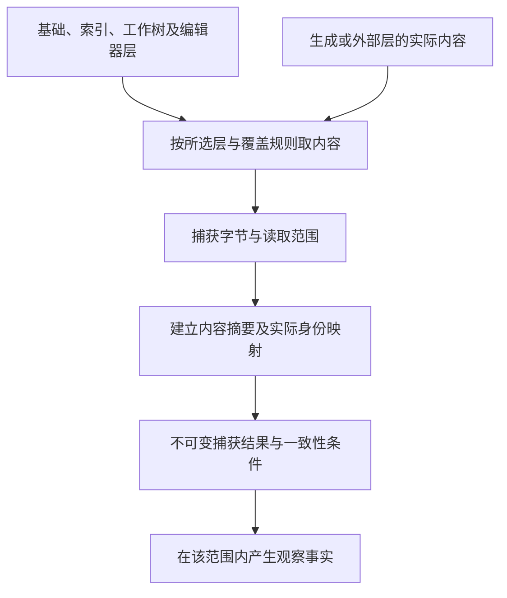

# 工作区观察与捕获

本章唯一拥有所有作者工程共用的工作区观察合同、内容层选择、固定字节捕获、watch及编辑器前像协调。新工程和原生工程使用同一机制；[原生导入](原生维护/导入观察与原生资产.md)消费这里的有限观察，不反向定义它。VCS提交与集成由[版本控制](版本控制与集成.md)拥有，实际修改与恢复由[持久化提交](../运行/持久化提交与恢复.md)拥有。


## 工作区精确观测

### 1. 目的

工作区观测建立所有源码分析、编译、计划和验证共同使用的物理事实。它回答“系统实际读取了什么”，而不是“目录里大概有什么”。

### 1.1 “精确”的适用边界

本文中的“精确观测”只表示：对一个已声明根、作用域、覆盖层、观察算法和一致性策略，产生可验证的有限观察切面。它不表示对开放外部世界、分布式系统、未来执行或隐藏物理状态获得全局同时真值。

```text
WorkspaceObservation
  = ObservationCut
  + declared consistency class
  + coverage and skew bounds
  + dependency evidence
  + unknown frontier
```

只有文件系统快照、版本控制树或等价证明在本次要求的完整域成立时，才能声明 `AtomicSnapshot`。结果保证采用 `AtomicSnapshot`、有实际偏斜依据的 `BoundedSkew` 或 `BestEffortWithCoverage`；`StableMetadataRead`、`ContentAddressedRetry`、`VCSSnapshot`、`FilesystemSnapshot`、`EditorSnapshot` 是取得策略，不能仅由策略名称推导保证等级。下游不得把较弱等级升级为全局精确。

### 2. 内容层

```text
base       版本控制基准
index      暂存区或候选索引
worktree   磁盘工作区
editor     未保存编辑器缓冲区
generated  受控生成层
external   显式挂载或远端只读层
```

每层拥有独立 revision、来源和可写能力。有效内容按显式 `OverlayPolicy` 组合。

### 3. 观测模型

```ts
interface WorkspaceObservation {
  readonly observationId: string;
  readonly rootCapability: PhysicalPathCapabilityRef;
  readonly requestedScope: ScopeExpression;
  readonly entries: readonly ObservedEntry[];
  readonly overlayPolicy: OverlayPolicyRef;
  readonly configuration: readonly ObservationRef[];
  readonly environment: readonly ObservationRef[];
  readonly cut: {
    readonly sources: readonly ObservationRef[];
    readonly readInterval: ObservationRef;
  };
  readonly consistency: {
    readonly claim: 'AtomicSnapshot' | 'BoundedSkew' | 'BestEffortWithCoverage';
    readonly evidence: readonly ObservationRef[];
    readonly skewBounds: ObservationRef | null;
  };
  readonly coverage: ObservationCoverage;
  readonly dependencies: readonly ObservationRef[];
  readonly unknownFrontier: readonly ObservationRef[];
  readonly generation: GenerationRef;
}
```

`ObservedEntry` 至少记录：规范路径、物理绑定、对象类型、内容摘要、字节长度、编码观测、权限、符号链接信息、来源层和读取前后元数据。

`cut.sources`绑定实际内容层及其版本/游标，`readInterval`绑定读取区间；这些引用必须能取得对应观察事实，普通字符串或内容摘要不签发一致性。`consistency.evidence`保存本次保证的实际依据，`BoundedSkew`必须有可核的偏斜界，其他保证没有偏斜界时显式为null。`coverage`只拥有已读/排除/失败的成员范围，`unknownFrontier`记录尚不能成立的事实与原因，`dependencies`保存实际读依赖及负事实；三者不能用空数组把未知伪装成完整覆盖。`generation`是生命周期身份，不代替切面或一致性证明。

### 单代物理捕获供语义消费者使用

同一准备动作中的Plan、Lock、Manifest、Policy和语义合同读取集绑定同一WorkspaceObservation修订及其真实切面/一致性范围。parser消费已捕获的no-follow成员身份、kind、mode、准确字节与摘要，及可重证对象/代际栅栏或不可变快照；不能取得凭据后另开ambient pathname，把未捕获的新字节拼入原修订。身份散列中的排序与用户locale/展示排序无关；别名、hardlink、reparse、大小写和Unicode按真实Provider合同处理，不另造第二文件系统。

两次内容组合相等、mtime稳定或反复扫描本身不能排除ABA，也不提供跨文件原子性。外部干扰、成员缺失、预算或资格不足保留准确Stale/Unknown/Rejected和覆盖；弱宿主只声明已有假设及其允许用途。generation、coverage和dependencies继续按上述模型解释，不能取代cut与consistency的实际依据。

### 3.1 分类、负事实与差异

观察覆盖必须分别记录 `tracked`、`untracked`、`ignored`、`excluded`、`vendor`、`submodule`、`lfs-pointer`/`lfs-object`、`generated`、`binary`、`secret`、`protected`、`temporary`、`symlink`、`junction`/`reparse`、`hardlink`、case/Unicode normalization collision、`unreadable` 与 `unknown`。Git object、index、worktree 和 editor layer 分开；`.gitignore` 不产生删除许可，untracked/ignored 仍可能具有业务价值，LFS pointer 不等于对象内容，read-denied 不等于 absent。

`NotFound(x)` 只有在所需命名空间、revision、principal、root 与枚举覆盖完整时成立；目录中“没看到”不是一般性的不存在证明。观察差异按 entry identity 与 byte identity 比较；rename/copy 只是派生候选，除非 Git/object/provider 提供相应 Evidence，不能冒充权威 identity continuity。

### 4. 路径能力

观测不接受任意字符串路径直接访问文件系统。`PhysicalPathCapability` 绑定：

- 允许根；
- 读、写、遍历和创建权限；
- 符号链接策略；
- 大小写和 Unicode 规范；
- 设备、网络共享和特殊文件限制；
- 有效期和撤销 epoch。

路径规范化后仍需验证物理目标未逃出允许根。

### 5. 一致读取

普通文件系统通常不提供全工作区原子快照。观测器必须选择并声明策略：

```text
StableMetadataRead
ContentAddressedRetry
VCSSnapshot
FilesystemSnapshot
EditorSnapshot
BestEffortWithCoverage
```

读取前后元数据变化时重试或标记 `changed-during-read`。元数据不变仍可能存在时间粒度不足、恢复时间戳、并发写入或 ABA，不能据此证明一致读取；读到的字节哈希只标识本次字节串。需要原子快照保证时使用确有该保证的快照/锁协议，并绑定其范围；普通稳定元数据策略只提供相应弱证据。

### 6. 编码与文本

编码是观测事实，不是默认假设。需要区分：

- UTF-8；
- 带 BOM 文本；
- 可识别其他编码；
- 二进制；
- 无法判定；
- 非法字节序列。

换行和 Unicode 规范化只在语言前端或生成后端明确允许时进行；内容摘要默认基于原始字节。

### 7. 配置、依赖与环境

工作区观测同时包含影响语义的：

- 编译器配置；
- 模块解析设置；
- 包管理锁文件；
- 条件编译和环境变量白名单；
- 工具链 revision；
- Host 能力；
- 目标平台画像；
- 生成代码来源；
- 可见 Provider 能力。

未被声明和观察的环境输入不能在后续 pass 中偷偷读取。

### 工作区观测流水线

下图呈现[O1—O5](#捕获算法)的输入与输出，具体捕获算法由该节唯一维护；hash只固定已捕获字节，不增加原工作区的一致性保证。



不可变捕获结果表示后续读取同一批字节，不证明活动工作区曾同时呈现这些内容。需要一致快照或精确不存在条件时，必须取得对应源能力；内容摘要不签发来源权威。

### 8. 增量观测

观测缓存键至少闭合：

```text
physical identity
+ previous metadata
+ read strategy
+ overlay revision
+ path policy
+ observer revision
```

上面的元数据键只是快速候选键；只有文件系统一致性、变更追踪或重新内容校验的前提足以证明未变时才正式复用。mtime/size 相同不能独立签发内容未变。

文件监视事件仅作为失效提示，不作为最终事实。溢出、丢事件或重命名不确定时扩大重扫范围并记录覆盖变化。

<a id="workspace-watch-invalidation"></a>
### 8.1 Watch subscription、cursor与重新观测

持续诊断、增量编译、test watch和IDE refresh可以消费文件系统watch Provider，但watch状态只决定**哪里需要重新观察**，不成为文件内容、rename identity或语义Delta的authority。

```text
WorkspaceWatchView = derived {
  rootCapabilityAndPhysicalIdentity,
  providerAndWatchRevision,
  subscriptionGeneration,
  baselineWorkspaceObservationRef,
  providerCursorClockOrSequence?,
  watchedScopeFiltersAndRecursion,
  eventClassesAndOrderingGuarantees,
  symlinkInodeAndRootReplacementSemantics,
  overflowFreshInstanceOrLostCoverageState,
  lastReconciledObservationRef
}
```

**W0 建立基线。** Provider能从扫描切面追溯变化时，先取得合格WorkspaceObservation，再从对应cursor建立订阅并核其覆盖。不能追溯时，先建立有界通知保护，再扫描并reconcile扫描期间的失效提示；cookie/cursor/clock只有在Provider真实保证其范围时才能消除间隙。多次重叠扫描本身不证明连续，不能取得所需覆盖时明确保留窗口unknown。

**W1 事件只排队invalidations。** create/change/delete/rename等事件按Provider实际语义合并为待重观测scope。事件里的filename、cookie、inode或path只用于定位候选范围；真正内容、对象kind、physical identity、存在性和作者层由新的WorkspaceObservation读取。相同路径收到10个Changed可以合并一次重读；10个event不能解释成10次业务编辑。

**W2 atomic save与replace。** 编辑器常以temp file + rename/replace保存；Provider可能报告delete/create/rename/change的不同组合。不得据event sequence直接建立“同一文件连续身份”；重新读物理对象和作者/VCS对应后再决定是同一逻辑source的新revision、rename、replacement还是冲突。

**W3 overflow/fresh instance是coverage失效。** watcher buffer overflow、Provider restart/recrawl、cursor太旧、remote disconnect、root move/replacement或任何“可能丢事件”都使自上次可靠cut以来的增量coverage失效。此时按所需scope做完整枚举/快照重建；`is_fresh_instance`、blanket change或类似信号绝不能被解释成“没有具体event所以没有变化”。

重建同样先保护新捕获窗口，在私有候选内完整枚举所需scope并协调期间提示，随后共同安装WorkspaceObservation、实际读集与coverage，成功后再退役旧保护。失败候选不覆盖原合格结果；恢复当前状态不补造遗漏历史，Journal/VCS/业务事件仍由原owner保全。

**W4 inode/path寿命。** 某些Provider实际盯inode，删除后同路径重建时旧watch可能继续盯旧inode；另一些Provider按目录/路径报告。subscription绑定真实Provider语义和root physical identity，root/device/network mount被替换就建立新subscription generation并重取基线。

**W5 去重按观察，不按event。** 两个watchers、antivirus/build tool或Provider可能产生重复/附加事件。多个event可以触发同一重观测；只有重观测得到相同实际revision/read-set时才停止传播。不能用event ID去重掉一个真实后续内容变化。

**W6 关闭。** watcher取消/进程结束只关闭未来通知和相关资源，不回滚文件变化。关闭前后窗口若任务要求连续保证，先取得同步cut/最终reconcile；否则准确报告停止后无覆盖。

watch本身有descriptor/handle/buffer/thread/remote subscription成本，按资源预算限制root数量、递归深度、队列和debounce。为了性能忽略目录时，该ignore/filter也是coverage条件；被忽略区域不能支持“全工作区无变化”。

### 9. 编辑器与写回

若有效观测来自 `editor`，变更执行必须选择同一可写层或先协调：

```text
ObservedLayer != WritableLayer
→ WritableLayerDiverged
```

合法处理：保存、通过 IDE Provider 写缓冲区、放弃缓冲区重新规划、或生成显式三方协调候选。

### 10. 安全与资源

观测器必须：

- 限制文件数、总字节、单文件大小和递归深度；
- 避免跟随设备文件、循环链接和归档炸弹；
- 将忽略规则本身作为输入；
- 对秘密和敏感路径进行最小读取与审计；
- 在取消和截止时间后停止新读取并结算已读取资源；
- 保留恢复和诊断所需空间。

### 11. 验证

- 读取中并发写入；
- 符号链接逃逸；
- Windows 大小写和文件占用；
- 监视器事件丢失；
- 编辑器与磁盘分歧；
- 权限在读取中撤销；
- 超大树和资源耗尽；
- 同一字节跨路径复用但保持不同物理身份；
- 干净扫描与增量扫描生成等价观测。


## 从输入范围取得可用快照的正向协议

本协议的输出是可重复消费的字节切面及其解释条件，不要求所有输入同时存在于一个文件系统事务。输入采用现有WorkspaceObservation的根能力、范围表达式、OverlayPolicy、一致性要求、当前预算和解释版本。观察器只改变自己的读取占用与临时记录，原工作树、编辑器缓冲、索引和远端对象保持原状。

### 捕获数据与来源

每个最终条目保留：逻辑路径、来源层与该层修订、物理对象或内容引用、实际字节及摘要、大小、编码判定和观测结果。结果可以是取得内容、已确认不存在、无读取权、不能解释、读取失败或在预算内未完成；这些值不能共用空字符串。存在性、内容和新鲜度是不同观察，不相互替代。

有效层顺序由OverlayPolicy指定。例如明确选择编辑器覆盖工作树时，已经取得编辑器版本的文件使用该版本字节；没有该缓冲的文件才沿下层解析。缓冲关闭与删除磁盘文件不是同一动作。若两个层对同一角色存在无法按政策决定的写权冲突，返回冲突而不使用文件修改时间挑赢家。

### 捕获算法

**O1 确定读取宇宙。** 验证根能力，展开当前范围所允许的文件/对象枚举，记录包含、排除和无法遍历的区域。只读一个指定文件时不必扫描全仓；需要判断“所有匹配模块都已读”时，匹配规则和枚举结果进入依赖。符号链接、挂载、大小写与规范化按宿主合同解析，真实目标不在权限内时记录不可读取。

**O2 取得版本或读取凭据。** Git不可变树、实际文件系统快照或编辑器固定版本可以直接提供其范围的稳定读取。普通工作树使用明确的弱一致读取：取得前元数据、打开文件、在预算内把实际读到的字节复制进捕获缓冲、取得后元数据。元数据变化允许有限重捕获；相同元数据只支持本次字节身份，不自动证明未发生ABA或跨文件一致。

**O3 固定一次捕获的字节。** 摘要、解析、清单和后续制品都使用这一次已经捕获的内容，不在每个阶段再次从活动路径读取。重复读取同一固定来源且版本未变时可以共享缓存；无法证明来源仍相同时重新捕获并形成新的观察，不修改旧观察内容。

**O4 检查请求的一致性等级。** 如果请求接受“人为冻结的各文件字节集合”，该集合可被确定编译，但报告它不是原工作区同一时刻的原子图像。如果需要原子源快照，必须取得具备该范围保证的提供者；否则返回一致性缺项，不能给弱读取加AtomicSnapshot标签。已有无关文件读取失败，不使明确闭合的小根必然失效；属于根所需依赖时则保留阻断前沿。

**O5 解释和发布。** 编码检查、文本解析和配置解析以固定字节执行，非法文本仍保全原字节。解析失败附原位置与字节身份；二进制资产保持二进制，不作有损文本转换。完成后一次发布条目集合、范围结果、层选择和一致性声明；未完成的枚举不能以已读条目数量冒充完整覆盖。

### 精确缺失与弱否定证据

指定键或路径的“不存在”，来自该提供者在明确版本、权限范围和成功读取下的否定回答。范围扫描中没看到某项，只有枚举已闭合且没有排除/失败覆盖那个项时，才支持对应集合的不存在结论。统计抽样未看到事件可以支持带覆盖和置信条件的风险判断，但不能直接支持create-if-absent、去重未发生或取消授权等强前提。

即使读取时确认不存在，真正创建或提交时仍需在该目标的原子比较、唯一约束或等价协议中重新确认；不能拿较早文件列表代替提交前提。负观察随相关键、目录、过滤规则或提供者修订变化而失效。

### 两条轨迹与替代

合法轨迹：观察到工作树版本W1和缓冲E3；政策明确E3覆盖同一路径；捕获内容C后磁盘变化到W2；本次仍用C解析和生成，并记录来源E3。后来写回时比较实际目标前像，而不是把观察成功视为允许覆盖W2。

失败轨迹：目录列举到一半遇权限错误；文件x未在已读条目中；结果是该子树未覆盖，不能生成x不存在的事实。另一个已闭合文件y仍可独立分析。若重试取得不同字节，形成新观察，旧结果只按其旧来源保留。

更强快照提供较清楚的一致性，却可能要求宿主支持或额外复制；弱捕获更易取得，允许的结论较少。默认选择足以支持当前目的的较小机制，完整性要求提高时扩大机制而非扩大措辞。


## 编辑器覆盖层、索引、磁盘与写回协调

有效读取消费前述内容层与OverlayPolicy；写入绑定一个真实可写载体，不另定义第二套内容层。

Language Service 的内部版本号不是全工程 revision，二者映射必须进入绑定。Autosave、format-on-save、code action 和插件都可能成为额外 writer；参与时建模其 Effect 或限制作用范围，否则不能声明唯一 writer。

### 2. WritableSourceLayerBinding

```text
WritableSourceLayerBinding = exact {
  contentViewRef,
  effectiveObservedLayerRef,
  writableLayerRef,
  semanticSourceRef,
  providerBindingRef,
  exactPreimageRef,
  reconciliationPolicyRef,
  conflictAndFailurePolicyRef
}
```

### 3. 允许路径

- effective layer 与 writable layer 相同且前像精确；
- editor Provider 对未保存 buffer 提供原子 CAS 和 readback；
- 用户或明确 operation 先 save/reconcile，再重新观察和计划；
- 生成层有独立 owner，写入目标不是手工层。

### 4. 必须拒绝

读取editor中的B却按B的前像覆盖磁盘中的A；读取staged blob却写working tree；未使用准确生成对应就把generated view当成作者源；隐式保存所有文件；写入后把另一层仍旧的内容冒称同步完成。有来源的合法generated-edit不是禁止项，必须沿原回源和真实保存协议。

### 5. 冲突

层间差异不是普通文本冲突，还可能是 ownership、format、source-map 和 semantic revision 冲突。无法自动调和时返回 `writable-layer-diverged` 并提供最小差异和合法下一动作。

### 6. 验证

- editor 与 disk 并发编辑；
- partial staging；
- remote IDE 断线；
- formatter 修改工作树但索引不变；
- generator 重写同一路径；
- save 后 source revision 变化导致计划失效；
- accepted 写入后所有投影重新读回一致。

<a id="text-workspace-capture"></a>
## 直接编辑与成组捕获：文本是正常作者入口

AI脚本、已有编辑器或其他获准工具可以直接修改作者文本，不必为每次击键、每个变量或每个文件手写`propose.draft`。首期不开发专用人类IDE；复用现有工具的文件或缓冲能力即可。Gift内部仍在分析、生成或提交所需时固定一次准确候选，候选身份由工具产生，而不是用JSON仪式替代正常编程。

**同一路径只选择一个本次有效层。** 未保存缓冲优先只在该请求明确绑定它时成立；磁盘、索引、远端覆盖各有自己的真实基础。来自不同客户端的两个未保存版本不能按最后到达者自动覆盖。保全未知字段和未保存内容，不替用户隐式保存或回滚。

### 文本改动进入同一内核的算法

**E0 选工作集。** application取得明确工程、输出/分析范围、有效内容层、角色、基础与读取许可，并区分用户已有 dirty、当前任务新增和并发外部变化。未触及文件不默认进入写集，其公共消费者可以进入读取依赖。旧候选只是基础，不能使执行者自动获得写权限。

**E1 捕获版本。** 调用[O1—O5捕获算法](#捕获算法)，固定接收缓冲批次的文档版本向量、字节，以及共享语言、配置、锁和相交资产的读取基础。整批候选的形成由E2—E3负责，捕获的一致性域与实际保证由O4核定；编辑流程不另行签发快照保证。

**E2 取得完整批次。** 收齐明确的改动、删除和保留成员，再按实际语言/格式取得角色与依赖；同一候选允许中立 `.gift`、原生 TS、JSON 配置、图片和说明并存，未实现语义适配仍保全字节与来源。活动磁盘只能得到逐文件观察集时，准确返回该覆盖与稳定性，或要求在已支持的合作边界取得一致捕获；不能把混合时刻内容冒称原子工作区。当前捕获的字节自身固定，不等于原工作区的原子快照。

**E3 建立候选。** 复用同一个候选构造器、SourceBlob和声明映射；`files + base`、`edits + base` 与内部 `WorkspaceChange` 只是完整文件、前像差异和版本化编辑器变更的不同输入。文件增删与改名使用真实身份规则。语法和类型错误可以留在草稿，路径越界或非法编码则不得被静默吸收。源码本来由外部编辑器改过时，错误诊断不能触发恢复旧文件。

**E4 按请求分析。** 查询只取得相应语法、类型或关系；TypeScript 使用仓库锁定的 Compiler API/Language Service，正则只定位候选，不签发符号或类型事实。预览固定候选后生成所需根。自动诊断或watch策略必须明确启用，按版本合并连续改动；同一批多文件变化可以共享一次相交检查，不为每个文件重复 full check，也不为每次击键发布持久操作、编译所有目标、运行程序或写盘。新版本出现后旧任务可取消或作为旧结果保留，不得贴到新版本。

**E5 保存与再次修改。** 原编辑器已经保存的内容不再为“走完流程”执行一遍`apply(save-source)`。工具在内存产生的另一候选需要采用时，才按当前目标前像进行真实写回。发布候选的批次原子性不代签多文件写入原子性；部分文件写失败沿原恢复合同处理。撤销编辑、丢弃候选、Git revert 和反向业务 Effect 分属不同层，不能由一个 undo 代签。下一次编辑以实际内容层为基础，不使用全局lastCandidate。

### 受管生成文件也能直接改，但有不同的回写责任

用户可直接在目标文本中完成许多修改。此时先将完整变化保留为目标草稿，依据G0/C0/M0与当前C1做一次联合回源；不要求每行手填generated-edit。已有工具适配器可以从完整字节派生有序差异，随后复用相同协议。生成器在未解决的目标草稿存在时不能覆盖相交文件。

支持的变化回到原源或稀疏控制；未知变化保留，不丢弃后声称全部映射。当前generated-edit的对应验证会重新生成相交目标，这是逆向正确性检查，不是自动构建、运行或全工程编译。失去映射的巨大改动仍可逐区域判定；需要真正转移作者权时明确接受，不能自动把全部文件降为不透明区。

构建或测试未保存内容时，宿主可以将整批候选物化到受控临时根，或使用工具提供的内存/overlay 输入；必须绑定 candidate、来源映射、根和资源，不能悄悄运行旧磁盘内容并把结果归给新候选。工具不支持该输入时明确要求先保存；是否自动保存只由已有政策决定。

### 大批修改与资源边界

小改动使用现有差异，整文件或多文件重写使用现有`files`，本地大工作集使用固定内容引用，不反复传输未改字节。同批中的相互引用和暂时错误在最终快照上判断；有序edits仍按每步前像匹配，不偷换为无序补丁。rename、删除与新建不因内容相似自动继承身份。预算不足时保留已接收草稿与准确覆盖，不将截断输入按完整程序编译。

同一合作式写入批次可以产生一个候选，后续解析和检查可按依赖增量进行；外部多个写者没有共同屏障时，不凭一次watch通知认定批次完整。取消只结束当前计算或等待，已保存作者字节不因取消消失，正在使用的输入仍按资源协议保持。


<a id="developer-workset-handoff"></a>
## 开发工作集交接：从缓冲到可运行的准确输入

本节细化原E0—E5的消费者，不建立另一候选存储。一次开发输入可以包含原生TS、中立.gift、配置、消息、测试和其他原资产；每项角色从已有准确工程配置取得。新建无路径缓冲由客户端提供临时文档实例和明确语言角色，保存取得实际路径后形成后继及对应，不把内容相同的临时页合并为一个文件。

正常路线是：读取实际编辑范围及可用同步版本；合并未保存文本覆盖层与未覆盖原资产；固定解释、依赖锁、生成器输入和根；按同一候选分析；请求运行时再用这份准确输入准备产物。打开但零命中的缓冲、删除后重建同路径、目录移名、符号链接/大小写别名和跨根相同相对路径沿原身份规则处理。读取一次mtime只能是观察线索，不证明所有输入在一瞬间一致。

增量修改引用的实例或版本不连续时，不把更新贴到最近内容。可重取该文档完整字节并创建新候选，已取得其他正确文件无需全部重读；如果缺失的是共享配置/解析上下文，则相关模块要重新解释。关闭编辑器缓冲先处理真实脏内容去向；自动丢弃或写盘不是close的隐含语义。外部工具已经写盘的变化捕获为新作者事实，不能再次apply旧内存候选覆盖它。

### 未保存候选的构建和测试输入

要对C2运行构建/测试，而磁盘还在C1，选择一种真实可执行方法：把C2完整成员映射物化到隔离目录；或由工具实际支持并验证的覆盖文件系统/内存输入提供C2。两者都包括相关配置、资源、测试和真实工具，不只替换报错的一个文件。绝对路径、工作目录、生成文件和来源对应随实际映射记录；源目录写回不被沙箱路径伪装。

工具只能读取原磁盘且没有合格映射时，明确请求按任务保存后捕获该新头，或保持“C2尚未运行”；不自动saveAll，不用C1通过贴C2。保守小实现可以始终全量物化准确的有限工程切面，不要求先开发透明VFS；稀疏物化只有输入/目录与负依赖覆盖可靠才省略未用项。相关文件不能取得时保留已有候选与阻塞范围。

准备产物后若用户继续改为C3，C2任务仍可完成并作为历史结果，不能取消它就当从未执行，也不能将结果发布为C3。停止当前等待与终止实际构建由原任务/操作拥有者负责。产物每个成员绑定真实源位置，调试/测试失败回到C2作者；用户选择修到C3时沿真实重基，不以同路径直接写旧范围。

### 附加资产与未知区域的有限支持

笔记本、嵌入模板、远端/只读/虚拟资源可被保全和部分分析，但未实现的区域编辑不能伪装成整文件可写。查询显示真实作者拥有者和可定位片段；把合格局部源映射回原载体时要维护外层语法/元数据。没有合格写回可导出独立差异/说明供明确处理，不能修改派生页并称修改原件。原生反射、动态模块、构建插件和代码生成的未发现消费者，在引用覆盖与重构资格中保留未知。
