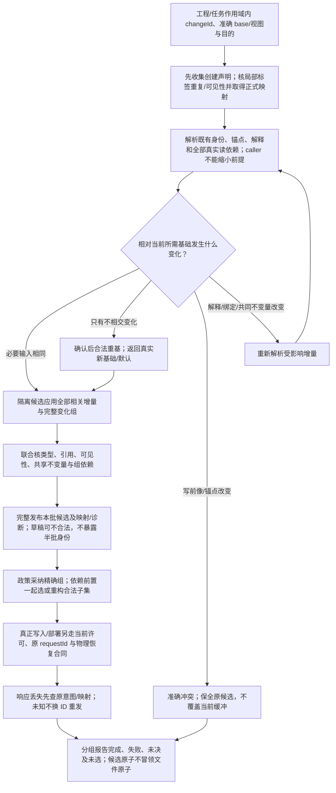
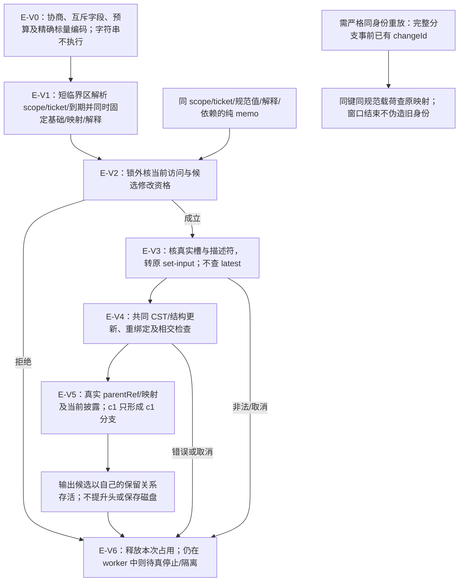
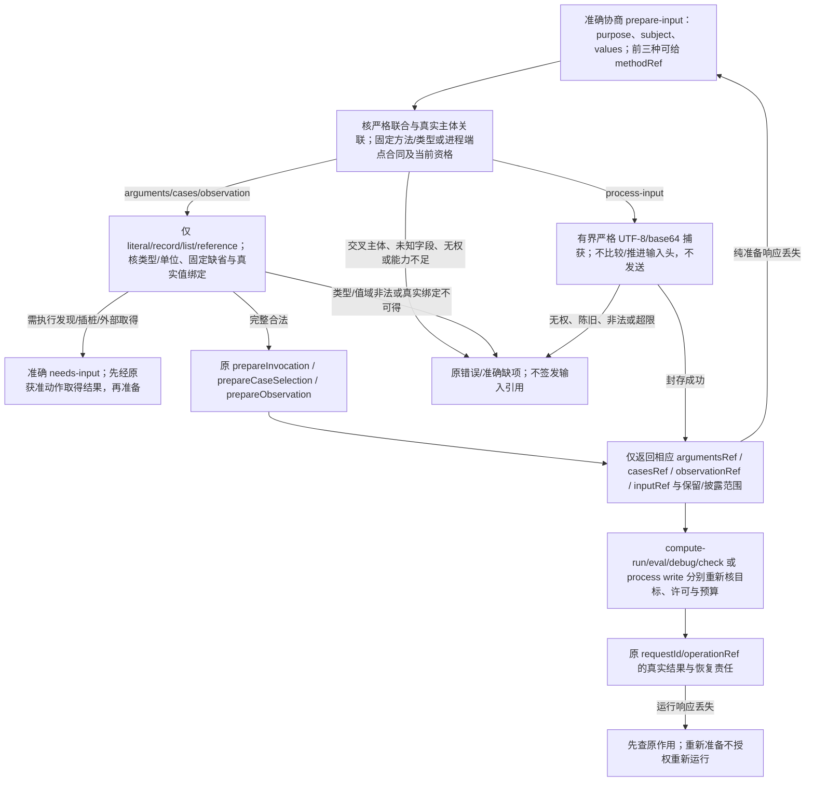

# 候选修改与批量

> **阅读范围**：采用范围内的设计规范；实现状态另查未决 · [共同上下文](六工具与请求.md)。


## 语义增量、临时身份与前提

[机器结构](../../../schema/tools/semantic-change-1.schema.json)为现行 `gift.semantic-change/1` 确立可交换作者候选：根必需 schema/base/operations；常见 `set-input`、`replace-expression`、`rename` 是互斥的精确字段分支，`EditValue` 恰选 source / 当前 SourceProfile 中有类型的 shared Expr 或后继 ExecBody tree / from。结构 tree 两种语法的标签域不同，Reader 必须按原base已绑定的确切作者格式选择其一；不能因为两个Schema都成功读取而悄悄将旧主体重解释为后继体，跨画像需要明确等义转换、源身份保持和兼容迁移。领域和资产专有编辑仅通过 `op:"extension"` 连同已锁定 dialectRef/bodySchemaRef/bindingRef 接合，不把任意op名或 payload 交给不受信执行器。局部分组明确 opId及 atomic/independent 关系；有分组时所有被引用 opId 必须唯一存在，漏组/重复组/操作跨组与实际共享读写集由消费者检查，不能仅靠字段名决定独立。请求可省changeId由服务在候选内分配，但需要跨响应幂等续接必须在发送前已有对应稳定changeId；语义变更与真实Apply Operation requestId始终分开。真实SourceReader/Linker/Control Owner会添加和验证不可由调用者省略的读/负读前提。该结构为设计载体，不声明生产Decoder或通用扩展已经发布。

当前机器联合的三个基础编辑（`set-input`、`replace-expression`、`rename`）只针对已存在且可解析的结构目标；它们不能声明新Definition、Module、文件或删除现有对象。完整创建/删除及多模块变更由已有 `propose(source/files)` 在固定作者基础上给出；需要保持语义身份与局部前向引用的结构创建，须先协商有准确 `dialectRef/bodySchemaRef/bindingRef` 的 `op:"extension"`，其中实际创建声明、临时标签的定义域和引用规则由所绑定的专业Schema与Reader固定。基础 `opId` 只是操作标识，不是新定义标识，也不能单靠 `groups` 产生对象。这两条合法创作通道最终都经同一SourceOwner、Linker、写前像、权限及候选采纳；未具备合格创建扩展时仍能用文件作者通道完成创作，不许客户端捏造通用 `create`/`delete` 操作。

本节规定编辑候选的共同合同，不把它当成外部效果信封。设计名称为 `gift.semantic-change/1`；它是本文的协议草案，不是已发布API或新增SDK。既有 `gift.design-transaction/2` 只承载准备提交的有限最终写集，两者不能仅更换schema字符串互换。

| 内容 | 候选阶段职责 | 默认或省略含义 |
|---|---|---|
| `schema` | 序列化交换必需字面量 `gift.semantic-change/1` | 内存调用可由类型边界承载，不要求用户填写 |
| `changeId` 与 `base` | 标识这次逻辑变化，引用冻结基础及视图种类 | propose.draft可由服务分配changeId并返回；需要幂等重试则携带原身份；长期交换保留完整身份；改现存对象须固定base |
| `purpose` | 本次是设计、实现候选还是其他被请求目的 | 由当前任务继承；不因客户端提供更强目的就扩权 |
| `operations` | 现有三种基础编辑或已绑定的专业扩展；仅确有合格创建声明时可引用本批新对象 | 空列表是无修改候选，不是业务任务自动完成；`opId`不创建对象 |
| `preconditions` | 实际读取、写前像、缺失观察、成员集合和解释依赖 | 工具补入其真实读取；调用者省略不能移除必要条件 |
| `groups` | 必须共同成立的操作组与真正独立组 | 未指定分组时一个候选组，不默认为全部独立 |
| `annotations` | 开发者的说明、假设和理由引用 | 不把说明当授权或实际回执 |

序列化的逻辑变化身份至少在工程与当前任务作用域内解释，不能把另一项目的同名changeId当作本操作；外部作用身份仍另按效果合同处理。`base`必须是可解析的固定快照引用及视图种类；全新候选可明确使用空基础，不能用省略基础来覆盖现有对象。

小编辑器动作可以在内部携带基础和读集，不强迫用户填表；长任务或远程调用序列化相应部分。规范所需信息可以通过固定引用解析，不能通过可变“latest”延后猜测。

常见作者变化包括创建定义、修改属性、增加/移除关系、重命名、调整有序成员、删除、原生区域补丁和作者模式转换。这是需要覆盖的**变化目的**，不是当前 `Operation.oneOf` 的八个已发布op。完整源或文件变化走原 `source/files`；专门语义编辑须由已登记的基础分支或固定修订的扩展实际承载。新领域的行为通过已知构造和已绑定定义表达；确需新的解释原语时显式协商画像，不能把任意operation字符串直接交给新执行器。任意数据对象里的 `set` 不能绕过实体kind变更、权限策略变更或作者源接管的专门条件。

在已协商且确实包含创建声明的语义扩展中，创建才使用批次局部标签，作用域为这次变化及其组；只有该扩展明确允许的其他操作可以前向引用标签。工具先按扩展Schema收集声明、检查重复、引用作用域及可见性，再分配正式身份并返回完整映射。普通 `source/files` 创建则使用明确的模块、定义和文件身份及其真实公开引用，不隐式添加临时标识。分配采用每次实际创建的新不透明身份，身份不等于显示名或内容哈希。同一变化的幂等重试必须取得原映射：持久提交可在同一事务/提交记录保存映射；纯内存候选失去会话时重新建立候选，不能宣称新身份与旧外部引用等价。把原候选复制为独立方案要使用新变化身份和新建对象身份，引用既有对象则保持引用。

属性与关系使用稳定对象身份定位；有序集合还需稳定成员身份或明确的前后锚点。成员只是无身份的普通值时，可以用整个集合前像加索引，但不能在集合已变化后沿用旧索引。增加到“最后”也是读取当前顺序的操作，不是天然可交换。删除引用目标时必须重新检查引用和所属范围，不因本批次已删除一个文件就推断所有消费者消失。

### 基础程序结构增量的精确分支

基础结构作者体、`set-input`、`replace-expression`与`rename`的字段、作用域和处理由[结构作者与语义编辑](../../作者/组合/结构编辑与身份保持.md#三类精确结构编辑沿原协议进入)拥有。它们沿本节的schema/base/purpose/preconditions/groups进入；不新增顶层工具，也不把工具内部体格式要求成每次作者载荷。

处理器先在base中解析实际句柄，再校验操作与输入联合；只有在已绑定扩展确实声明了新对象时，才分别处理局部标签与既有身份。既有目标先固定，联合候选最后检查；不根据每一步新排版重新搜索旧位置。未知op、无权限或失效句柄拒绝；已知对象上形成的语法/类型错误可保存为诊断草稿。`from`只引用当前区域真实可用值，不自动复制调用、创建let或读取历史运行结果。

公共rename检查真实引用与具名实参标签。编辑结构名字也要检查局部捕获；类型相同不能替代引用保持。缺失后端或CST写回能力返回准确缺项；已知文本仍可直接修改，不以该适配器的限制宣称用户必须写原生代码。语义变化协议不是RFC 6902，未知字段和前提按本协议严格解释，不依赖通用JSON Patch的扩展成员行为。


<a id="intent-authoring-protocol"></a>
## 意图发现、候选展开与再次修改

`gift.intent-authoring/1` 是扩展原六工具的设计能力，不新增顶层工具或永久意图数据库。协商分别确定 intentCatalog/intentOccurrence 只读视图、draft.kind=intent-action、准确 descriptor/动作编码、参数/展开/分页预算及图形写入资格；支持目录读取不自动支持写入，支持一个 facet 不证明所有 facet 已安装。未协商 view/kind 明确拒绝，不忽略后执行默认动作。

[机器结构](../../../schema/tools/intent-authoring-1.schema.json)将当前可协商的 query 和 propose 输入及两类只读投影条目固定为独立分支：query.view 恰为 `intentCatalog` 或 `intentOccurrence`，find.kind 各为 `intent-catalog` 或 `intent-occurrence`，后者必须给已绑定 subjectRef；propose.draft 恰为 `kind:"intent-action"` 并提供 `base/facetRef/action/subjectBindings/values`。值 map 可以为空表示该 Descriptor 无需额外参数，但不能绕过 descriptor-required slot；额外键/未知 action 由实际类型化消费者拒绝。Projection 复用原 result-view 的 coverage/diagnostics，不让提示词或候选自己声明资格；新字段仅在准确 capability、Reader 和 Method 已受信加载后接纳，旧端严格拒绝。该 Schema 是当前设计的机器表示，不代表已实现 Decoder/Provider。

目录按原 query 的准确 at/find/limit/cursor、基础与披露范围取得 Catalog/Occurrence 投影。Occurrence 定位已有作者主体或输出根；条目携真实角色、basis、覆盖、诊断和继续位置。游标只能续同一视图与固定基础；空、过滤、截断、未装配与不可读分别保留，不泄露隐藏计数或租户内容。投影引用既有源/Definition/Use，不因 UI 展开创建业务实例。

显式 draft 内的 intent-action 由 base、facetRef、稳定 action、subjectBindings 和 values 构成；后两者必需但可为合法空对象，参数合法域/省略/默认由 descriptor codec 拥有。missing、null、显式默认与未知值不同；载荷不能夹入 Grant、Provider endpoint、shell、秘密明文、当前健康或被偷选的 Binding。展开结果是普通 CandidateRef/AuthorDelta、差异与 Need，不是已接受含义；AI 推荐和自然语言相似不提供 Meaning/Method 资格。

propose/preview 只形成候选或纯投影；check 仍显式选择既有方法；apply 仍按 mode/base/targetRef/requestId 保存或写出；真实业务动作另沿 operation。候选身份去重绑定 base/facet/action/payload，不代替保存与效果幂等。再次修改先读已接受源和准确当前前像，facet 新默认不覆盖显式设置；缩短保留期等源变更不自动删除现实数据。冲突保留候选与双方前像，原操作未知不换身份盲重发。

当前 [IntentFacetDescriptor机器联合](../../../schema/tools/intent-authoring-1.schema.json) 在原模块贡献的合法范围内提供 facetRef/publisherModuleUseRef/revision、形式主体角色、具类型和 codec 的参数/默认来源，以及声明的动作集合、写者/可用scope、Requirement/能力/Claim模板和展开Method。动作ID在本Facet/Revision内唯一，名称遵守与 FacetAction.name 相同的 Identifier（字母/下划线开头，后续字母数字下划线）而不是显示标签或动作列表下标，严格提案请求也按这个词法拒绝未声明的带连字符动作名。只读facet可以有空 actions，但必须有实际 readProjectionRef 并只能供目录/Occurrence只读消费；显示可发现或可读不授权写入，缺真正的动作则不会出现可执行 intent-action。同行为的动作名重复而Method或scope不同属于描述符绑定冲突，不能按首项、数组顺序或uniqueItems整个对象决定谁胜。绑定时跨模块身份、当前有效权限及兼容性仍需实际解码器与能力Provider保证；该结构不持有当前Grant、运行值或新作者源，也不创建另一个可写 Descriptor 管理库。

意图辅助描述符属于有修订的模块贡献，按准确ModuleUse固定主体角色、参数类型/单位/codec/默认来源、允许动作与写域、Requirement及语义/能力/运行需供模板、Claim模板、展开方法、兼容迁移和只读投影。它不持当前权限、秘密、健康、报价库存、实际结果或已选Binding；描述符声明与实际装配、静态符合、绑定、当前准入及Evidence分别判断。配方的最小专业合同由[定义与接口](../../作者/组合/定义与接口.md#组件协作保留的五个切面)拥有。

目录缓存的读集包含真实描述符、可见导入成员、解释修订及负依赖，不只保存分页位置；未装配、不可见、预算截止和完整范围内无匹配分别返回，隐藏计数不能泄露受限对象。查询不安装、联网或执行初始化。目录不可用只阻断发现，具有完整固定依赖的准确作者源仍可按原入口编译，不把目录服务变成所有构建的前置。

Occurrence只沿真实作者对象、修订、有类型来源和可见关系派生。展开须保留准确provenance；同结构但未记录来源时只报告可能匹配、歧义或未记录，不能反推唯一原意。模板更新不自动覆盖原定制；关闭画布或停用辅助UI不删除普通作者源，也不结束在途Operation及资源结算。

<a id="structured-files-design-extension"></a>

### 多文件角色的可协商补充

现行 files 已允许 context 绑定结构 JSON、原生源与资产角色；无 context 的兼容简明分支仍只接收已明确的中立文件，二者不混淆。可选 `gift.structured-files/1` 仅增加 fileProfiles（path 到已锁定 SourceProfile 引用），用于上下文确实不足时声明新文件角色，不撤销原 context 路径，也不强迫所有客户端维护另一映射。

该协商扩展不放宽基础 `propose(files)` 的作者差异前像规则：若 `return:"diff"`，则 `base` 必需且要绑定已捕获的当前作者源；无base的新建 files 可以形成内容候选及 summary/source，但不能要求 diff。仅有 `context` 或 `fileProfiles` 不构成可比较的旧作者版本；真实新建可在已有固定空作者基础时另选择有base分支，不从宿主目录或最后一次候选猜前像。该条件现由严格扩展 Schema 强制，导入旧分支仍保持语义不变。

该分支与 source/edits/entry/draft/editRef 互斥；base/context 与角色映射必须相容，已有文件不得借 fileProfiles 重解释，真正迁移另走原合同。删除项不能带新角色，映射不得指向本批不存在的成员；每个所需新角色须可从合法映射/上下文准确解析。未协商端拒绝新字段；合法旧 files 继续按原规则工作。结构载体见[工具设计结构](../../../schema/tools/README.md)，路径别名、前像、批量原子候选、未知保全及写权仍由本页和六工具 owner 检查。

## 基础视图与陈旧变化的处理

`base` 明确来自编辑器缓冲、结构化草稿、磁盘观察或版本库快照。跨多个编辑器文档时固定每个内容版本和相关成员范围；没有可原子捕获的宿主能力时采用明确的观察切面，并在需要时重查，不声称天然全工程一致。

工具为每次查询记录已披露内容与所需依赖，包含定义解释、名称解析、不存在、集合成员和映射版本。服务可以返回客户端不可见依赖的安全前提标记，而不泄露受限源码或隐藏对象是否存在；提交端仍按真实依赖检查。客户端列出的读集是补充，不是可任意缩小验证范围的授权。

陈旧有四种不同处理：完全相同的必要输入可复用；只有相交范围外变化时重新确认并重基；写前像或有序锚点改变时返回精确冲突；语言定义、别名绑定或共同不变量改变时重新解析受影响增量。工具可自动选择第一、二种，但须返回实际基础和重新采用的默认，不把旧批准无条件挪到新内容。

规则版本或名称含义改变时，原 `rename`、`connect` 之类语义操作名不会自动保持原意。合并依据原基础、候选和当前状态，检查联合结果，而不是只比较两条变化有没有写同一字段。没有可靠重基能力可以保留旧候选并要求重做受影响部分，不能直接覆盖当前缓冲。


## JSON补丁、文本补丁与领域操作的边界

JSON Patch可以作为精确JSON值的低层补丁；先固定原文档身份和前像，再按其顺序语义执行，最后做领域校验。数组插入会改变后续索引。RFC 6902要求未定义的操作成员被忽略，因此不得把 `expectedRevision`、批准者或秘密范围塞入一个普通Patch操作后假定标准实现会强制它；这些前提属于外层受检查合同。[RFC 6902](https://www.rfc-editor.org/rfc/rfc6902)

文本补丁绑定编码、原文版本和范围；语义补丁还绑定解析与映射。编辑器协议的文档版本有助于防止错改缓冲，但不承担业务约束和授权。LSP 3.17的版本化文档编辑明确区分编辑器文档版本与未知版本情形，本设计不把该版本等同工程代际。[LSP 3.17元模型](https://microsoft.github.io/language-server-protocol/specifications/lsp/3.17/metaModel/metaModel.json)

在语法不完整时可以保存原始文本草稿；格式化、字段排序和结构化编辑不得删除无法解释的扩展或覆盖外部未保存内容。只能映射整个函数就采用整个函数前像，不宣称具备表达式级安全往返。显示布局、业务布局及含义注解是否影响输出，由对应语言判断。字节/UTF-16/字素单位、无修改保全、共享helper与三方重基沿[编辑往返合同](../../编译/表示/编辑与受管回源.md#编辑往返的具体合同)，不是另一种批次身份或授权协议。


## 联合候选、部分接受与真实作用

处理顺序为：固定基础与目的；解析批次声明和引用；收集真实前提；在隔离候选中应用全部相关增量；校验类型、共享不变量与可见性；给出每组结果；由相应政策采纳需要接受的组。候选批次原子表示只发布完整的本批作者快照及其诊断，不暴露半批引用映射；这个快照可以是语法或类型不完整的草稿。只有所需根已合格才生成对应产物，批次完成不等于模型合法；随后多个文件、服务和设备仍不因此获得共同物理事务。

某组依赖另一组的新对象、约束或实现选择时，选择它也必须选择其前置，或重新构造不再依赖的合法候选。不能从失败总候选中直接抽几份源码发布。多个独立组可以部分完成，结果明确保留成功、失败、未决和未选范围；一个无关组失败不抹掉已完成的独立输出。

候选结果保留规范化后的实际操作、临时身份映射、默认选择、诊断、输入覆盖及后续资格。内容相同的缓存结果可以减少计算，不消灭这次变化的来源、目标和当前权限。批准绑定有权主体、精确选择、所需范围与条件；语义、目标或风险前提发生有关变化时重新处理，不因只是排版变动就一律重复审批。

### 一个并发开发情形

### 逻辑变化、联合约束与实际采用图



人正在将 `TicketClosed` 的显示名改为“已关闭”，未保存缓冲已经形成新版本。AI基于获准的这个版本，同时增加关闭原因约束与管理员重开转换，新转换先用临时标签引用新增角色检查。工具收集声明后解析标签，并检查共享的状态、角色和历史约束。

期间另一开发者撤销了该角色的重开权限。显示名变化仍可独立保存；AI那一组涉及角色前提的变化变陈旧，必须重查，不能因为修改的是另一文件而自动通过。若另一个无关模块只改注释，且相关语言确认注释不影响本次目标，则不使这组任务全量归零。

该例可以始终是设计工作：返回设计差异、条件和理由后结束，不运行生成器或修改目标工程。取得实现/应用任务后，才从同一候选产生相应计划，并在每个实际作用边界重新取得必要许可。


<a id="single-author-operation-production-ingress"></a>
## 作者修改操作的唯一生产写入入口

CLI、Workbench、AI 或其他客户端表达 Meaning/Requirement/Control/原生资产的改变时，输入先解码为拥有者定义的**类型化作者编辑意图**；只读解释、提案与 Preview 不写现场源。具有 `EngineeringOperation` 等词汇的独立辅助函数不能因测试存在就算已经成为真实产品入口：它必须被实际客户端通过已批准的 Operation/Mutation owner 消费，否则只作为候选算法并按代码迁移决策退役；绝不为它保留另一套无消费者 Writer。

任何影响正式作者源的 `apply` 必须先冻结 `operation identity + expected source/subject revision + exact scope + granted capability + candidate change + cross-asset prerequisites`，在真实写边界重新比较对象、权限和前像。原生/结构编辑进入同一候选和已定义的事务／恢复 Owner；客户端不得绕过它直接覆盖 Project/Plan/Schema 或把已接受的上一轮内容当当前基础。并发替换返回有来源 Conflict/Stale，不能 last-wins；外部结果未知先 Readback/Recovery，再决定是否允许新 Attempt。终态只来自拥有者的发布和读回，不由客户端自己填写 Delta/Verification PASS。

必须有至少一个真实生产入口证明完整正常、非法输入、未授权、并发冲突、故障恢复和第二次修改的同义；孤立 helper 测试和纯内存候选仅支持其自身有限合同。若现有规范已有完全等价的 Mutation Owner，优先复用并迁出重复词汇，不新建“作者操作管理服务”。

## 撤销、重试与跨会话继续

本地编辑撤销组恢复作者动作，不要求每个按键持久化。已保存或已采纳的变化需根据当前状态建立逆向候选，检查其相交前像；不能把旧撤销栈直接套到别人后来修改的工程。临时对象变成已被其他操作引用的正式对象后，撤销创建也要处理引用，不静默删掉外部依赖。

返回响应丢失不代表修改没有提交。同一逻辑提交用稳定身份查询其结果与新ID映射；同键不同规范载荷拒绝。尝试身份可以不同，作用意图不能偷偷改变。跨会话继续从已保存的候选、基础和实际结果恢复；旧权限不复活，聊天摘要不代替这些内容。 查询所得404、空结果或前像仍相同，不单独授权一次新的有副作用尝试；须按[尝试关闭与重试依据](../../运行/持久化提交与恢复.md#attempt-finality-and-retry)核晚到可能、实际去重范围和当前准入。内部RetryBasis不加入现有公共请求字段，客户端不靠自报该标签获得重发权。

分页、快照、订阅与重连的完整协议见[远程、事件与重连](客户端与并行会话.md#远程事件与重连)。变化身份不因重连而改变；重同步只更新查询投影，不覆盖未保存候选。


## 本节的验收与反转条件

反例覆盖：临时标签重复或越组引用；重试分配另一正式身份；同键异载荷；数组插入后旧位置命中另一对象；文本补丁携带被忽略的权限字段；角色规则改变却沿用旧批准；部分接受切断必要引用；不同字段联合破坏唯一性；旧缓冲覆盖新内容；撤销删除他人新增引用；隐藏依赖在错误里泄露；候选原子被冒称文件原子。

有效情形覆盖：连续人类编辑与AI成组变更得到等价含义；无关修改自动重基；不完整草稿可保存；合法组独立完成；无AI仍可开发；纯候选无需数据库；通过真实 `source/files` 公开名或具备合格创建声明的扩展，新建对象可前向互引；多个工作区不会被一个恢复操作全局阻断。这里是协议设计的验收义务，不是已执行的产品测试。


## 批量与部分接受

共同规则见[联合候选、部分接受与真实作用](#联合候选部分接受与真实作用)。物理分组依据真实读写、共享不变量、资源及提交能力，不以“一个任务一个PR”或“同一文件只能属于一人”为普遍规则。没有精确区域能力时保守协调，但不能凭一个独立组失败停止全工程。

严格执行前置成环是调度缺陷；递归调用、声明互引与固定点关系不是同一种边。任务完成绑定原目的，Git主分支不是所有设计工作的完成条件。


## 功能级变化如何复用共同增量

查询、定义、实例化、修订、编译和按权应用是当前操作的语义角色，不是为每种业务发明一个端点。功能实例化可以产生多个相互引用的定义与绑定：完整新模块或文件使用既有 `source/files` 形成单一候选；需要结构局部创建和标签时，只有协商成功的 `gift.semantic-change/1` 创建扩展才能编码这些声明。两条通路的共同前像、联合链接、依赖、同批接受和权限不可旁路；没有扩展资格时不伪造一个基础 `create` op，也不另设宏写路径。

调用方可使用局部标签指向同批创建的函数、实例与参数。服务解析正式身份、公共可见性、所选规则和生成所有权，返回映射及诊断。所返回展开可按需读取；AI不必把它完整抄回下一次修改。改变实例参数、局部定义或原生函数分别产生必要的作者变化，其影响闭包可以大于输入载荷。查看展开是查询，不新建一份可独立写入的展开源。要求局部具体化时，返回所选定义基础、可编辑的来源边界与本实例的候选变化，经同一语义增量检查后才接受；无法唯一映射的目标片段不伪造逆向。上游变更、局部差异与新候选按三方基础处理。完整含义由[渐进具体化](../../作者/组合/抽象与开放定义.md#通用表达与渐进具体化)拥有，不增加一套绕过原协议的宏修改入口。

大功能内部可能跨越独立子目标。默认先形成候选，不在创建实例时执行部署或迁移。可独立接受的子组按真实依赖拆分；共享不变量、联合命名或共同效果需要一起检查。批量动作和细粒度动作应有相同语义结果，不能因选择宏入口静默跳过约束。

语义组合合同由[工程语言与用户定义](../../作者/组合/定义与接口.md#意图粒度与可复用功能组合)拥有。本节只规定接入同一变更协议，不把特定产品示例固化为新的通用操作枚举。


## 工程声明的有限入口与语义差异

六个工具名称及其目的不变。`sourceLanguage: "gift.transaction/1"`在现有显式语言字段或已冻结上下文中选择[事务作者画像](../../领域/状态关系与流/事务与交付.md)；没有该选择时不根据陌生单词自动升级语法。多文件通过原files/context输入，模块间仍按真实公开引用解析。普通`.gift`片段的缺省基础画像不变。

query的contract视图按当前对象返回已有语义的紧凑投影：业务输入与判断、会被共同提交的状态/审计/事件、相应权限与交付条件、真实缺项及相交来源。不是增加第七个工具，也不默认复制整个IR、所有失败日志和整个能力目录。

propose只改变作者候选。preview沿固定选择展开规则和目标映射；仅源码检查可以在无数据库环境中完成；缺存储能力限制含真实变更保证的应用，而不否定独立纯决定输出。check继续区分作者、实际artifact和独立cases。apply的write-output只写指定代码制品，不会执行源中名叫close的业务操作；真正部署及目标业务调用属于不同的真实作用画像和权限域。

一次变化从“关闭要求原因”改成“增加图片事实”时，默认差异应显示规则和事实来源变化，不给AI一份重新填写的事务树。改成外部异步复核则必须显示新增等待状态、事件/回调/超时与相关身份，不能报告成只增加一个Bool。表示紧凑不许省掉会反转结论的条件。

将同一candidate生成TS与Java后分别返回实际产物；不得把有一个后端通过当成另外一个后端或真实存储已验证。运行事件查询、业务操作取消与开发候选撤销不共用一个裸operationRef而丢失作用域；引用解析必须识别其真实域和相应权限。


## 控制差异与非源码资产沿同一候选协议进入

draft分支规定两种有版本合同的变体：`control-change`与`asset-change`。二者必须有实际解码器、消费者和产物检查；能保存字段不证明控制或资产修改已经执行。完整字段与默认分别由[语言能力映射](../../作者/组合/稀疏控制与目标限定.md#6-控制描述符与实际使用过程)和[全工程资产](../../作者/工程源/资产与非源码.md#6-非文本和移动仍使用原六工具)拥有。

处理顺序共用原协议：先校验唯一输入分支；解析draft.kind及其确切合同；固定base和实际作用对象；执行字段、权限、前像与组合校验；形成同一候选内的源/控制/资产增量；记录相交依赖；返回候选和必要差异。kind未知、对象歧义或控制值不支持时保全请求并返回具体诊断，不把任意对象传入插件执行。

source/files继续直接运输短源文本，不要求为了控制一个值将整个程序改写为结构树。控制差异只能改变明确声明的对象要求或可委派目标策略；不能用Java class的外形选项给纯值增加未声明的共享可变状态。asset-change可以引用二进制、目录和链接对象；跨网络取得内容和实际写入仍是独立获准作用。

query现有contract/origin/impact视图返回当前使用点需要的控制值、来源、合法范围和后果，已知符号与已有目标由服务自动解析。未使用语言和控制描述符不因增加库而全部进入AI上下文。preview返回目标代码及相交配置/资源候选，check只运行请求且有权的方法，apply对真实资产根和属性执行比较及读回；操作数量不等于副作用数量。

保存作者源包括实际源及作者主动固定的稀疏控制和资产编辑；控制消费[gift.controls/1唯一编码](../../作者/组合/稀疏控制与目标限定.md#稀疏控制的持久编码)。其中target始终表示已绑定生成目标键；apply.targetRef始终表示物理作用目标，两者不得透传替代。control-change的reset是当前来源的一次删除，不是需反复执行的持久命令。没有支持的控制记录读取器时，保全源并返回相交不支持，不静默丢掉要求后生成。

write-output只写所选产物及其明确成员，不改变源、描述符或作者覆盖。发布库、部署服务、数据迁移不被两个apply模式隐式包含。公共协议中具备requestId的作用请求同ID异载荷拒绝；没有该字段的短候选分支仍使用自己的既定重放边界，不凭本段新造严格永久重试承诺。私有对象的存在性或错误详情仍服从披露范围。


## 意图视图、补全结果和问题引用的接口接合

六工具的基础输入分支保持；准确位置辅助与已准备的编辑建议仅按[authoring-assist/1](作者辅助接口.md#authoring-assist-contract)显式协商，不扩大旧解码器。任意自然语言要求由开发AI转成合法source/files/edits或已有类型化draft；source字段仍只接受所选语言，不隐式变为一个万能提示执行器。无需新业务工具，每个库函数与实例继续由已有语言调用与解析。

`query(view=contract)`在给定对象上投影实际输入域、结果、允许选择和必需关系；`origin`说明当前内容来自作者、缺省、推导还是固定实现；`impact`给真实变化范围与相交问题；`state`分别显示候选、实现、产物和实际操作。投影数据来自同一源与真实结果，不独立维护一份可编辑的“意图模式”。

`propose`产生的语法草稿可以带未解释要求和问题定位；它不会因此成为具有完整含义的可运行程序。`preview`区分没有函数体但存在合格实现绑定，与真正没有实现路径：前者可生成，后者保持源和已完成分析。`check`对实际主体报告范围内结论，不从源规范自述推导全任务通过。`apply`沿旧合同保存或写出精确选择，不因补全成功获得新的执行权限。

省略值的有效来源与缺口种类由[I0—I8](../../作者/组合/跨软件需求合同.md#11-意图进入同一作者源的完成与缺省算法)唯一解释。类型、名称、父缺省改变引起相同值的新依据时，先更新依赖再决定是否要新生成；公开结果不强制回显全部内部推导。重要未决要在摘要显露，细节可按既有查询继续读取。


## 管脚与结构编辑仍消费同一操作合同

`query`的既有`contract`可按相关定义投影参数、结果、错误和所需能力；`origin/impact`负责来源与影响。管脚展示不增加每个业务的顶层工具，也不要求每个普通函数先查询端点。已知内容直接用紧凑source/edits；适合关系修改时使用既有`gift.semantic-change/1`的属性与关系操作，经同一个`propose.draft`进入候选。

调用者提交实际基础、目标对象/关系和变化；服务解析稳定身份、读取必要合同并检查连接。后续写回由该区域唯一作者适配器承担。没有合格映射时可返回局部不支持或原文候选，不能改另一份派生JSON后宣称已改源。结构作者入口的参数形状来自当前实际体合同，不能以一段未定义的通用`connect(a,b)`调用冒称接口已经实现。

[布局稳定](../../编译/目标/结构稳定与作者回源.md#跨次生成的结构稳定合同)沿实际目标Binding和CompileRequest.layout使用。`compareTo`严格只负责目标差异比较，不改生成输入；变更结构策略走既有类型化control-change，不增加第七个工具。请求严格保持而基础缺失时，报告相应缺项；可另外提供明确的canonical预览，不自动应用它。

工具处理前装载当前适用原则，实际作用时执行宿主准入。派生策略表、对话中的“已批准”和普通外部文件不能替代授权。写入文档的规则尚需实际工具符合性；没有运行就不报告已实现自动装载和执行。


## 已定位值的紧凑编辑分支

`edit-value/1` 是 `gift.ai-tools/2` 内的可协商能力。服务声明并实现它后，query 的相交 contract/source 结果、已有候选或冲突修复结果，可以对一个确切标量槽附 editRef。未取得该能力时继续使用 edits 或 draft；旧服务不接受新字段，不靠静默忽略实现兼容。

### 输入与槽描述的精确合同

新propose分支只接受`editRef`、`value`和可选`return`；return沿原summary/diff/source，默认summary。不得同时携带base、source、files、context、entry或draft，防止同请求存在两个竞争基础。base从句柄绑定取得，return=diff比较该真实作者基础。

editRef为不透明、有限、受服务作用域约束的定位引用；它内部必须能解析到：候选基础、作者对象及单一槽位、映射版本、所属解释、值类型/有效域、允许动作、展示所需上下文和保留期。它不是可执行文本，不是权限令牌，不是目标运行对象。宿主每次重新核当前允许的读取和候选修改；持有句柄不签发任意写回。

首期value只覆盖**精确标量**：Bool使用JSON布尔；Text/枚举使用字符串；Int使用该槽说明的规范十进制字符串。除非该槽的正式值域明确支持，否则null、浮点数、数组和对象均拒绝；null不表示reset。字符串永远按值处理，不被eval或解析成作者表达式。复杂表达式、函数、连接、资产和控制reset继续使用已有正确分支，不为缩短参数牺牲类型与作用语义。

一个显示为first/last的槽，其真实描述符仍绑定所属库版本的行为与错误合同；不能只返回两个单词，让新会话猜“last”的顺序含义。工具只对当前可编辑、能够准确回写的槽签发句柄；未实现的编辑能力不得假签。

### 处理顺序和等价关系

先核协议能力、字段与预算，再解析句柄及原候选，核当前许可、映射有效性、槽可见性和新值；将值构成原语言字面量，降低为同一条set-input或已有控制更新。之后执行原CST/结构更新、类型和相交合同检查，产生新候选。输出应与同一基础上显式提交等义semantic-change的结果一致，不以短入口绕过检查。

```text
gift.propose({editRef: "e7", value: "last"})
```

e7仅是设计范本，实际必须由本次服务返回。它表示“在被绑定的c1中，把这一处已知去重调用的keep输入改为last”，不表示寻找全工程所有同名字段。新结果可直接为`candidateRef:c2`与`keep:first→last；输出按保留项原位置排列；尚未生成/执行`的必要摘要；不重新回显整个源码和IR。

同一活句柄与相同值可以命中纯候选memo；跨响应丢失必须保持同一候选身份时，使用发送前已持有changeId的完整semantic-change分支。短分支没有changeId字段，不承诺缓存回收后重建旧身份。真实apply的requestId及结算继续独立；具体算法见[短值处理器](#短值处理器的内存接口与真实重试范围)。

### 分支与失效

| 情形 | 正向处理 |
|---|---|
| 句柄已回收且基础或映射不可取得 | EDIT_REF_EXPIRED，要求重新定位；不改指latest |
| 值类型或枚举不合法 | EDIT_VALUE_INVALID，保留原候选，给允许域内的诊断 |
| 服务未实现该分支 | 明确能力不支持；已有edits/draft仍可使用 |
| 原c1仍可取得，但当前头已是c3 | 在c1上形成准确标注的分支候选；后续采纳/应用按真实前像冲突处理，不覆盖c3 |
| 存在适用的共享约束或公开影响 | 执行相交检查，返回必要影响；不能仅因只传一个值就省略 |
| 提交的值与现值相同 | 原位无语义变化，返回原候选或准确无变更；不制造执行 |
| 权限撤销或不能披露存在性 | 先执行披露规则，返回允许的拒绝，不泄露隐藏对象 |

短请求只形成候选，不自动改写原任务的接受关系。原要求若固定first，改成last必须作为行为变化呈现，再由已有合法委派/采纳关系决定是否接受；字符串合法不表示仍满足旧要求。

本分支减少已定位变更的传输与重复字段，不能证明总任务更便宜。已知源时直接文本修改无需先调用query。首次取得一个陌生合同的成本、短句柄的解析/保留成本与失败后重新定位成本，都进入冷暖任务比较。


### 短值处理器的内存接口与真实重试范围

短编辑是无外部作用的候选变更，不无条件承诺同一候选身份的跨响应丢失重放。需要严格重放时，使用完整 semantic-change 分支，并在发送前由客户端持有 changeId。不为每次改一个值增加强制请求 ID，也不把未收到的响应标识当作客户端已知。

现有会话内维护有界`EditTicket`索引，不新建数据库。每条实际记录为：`ticketId、scopeId、baseRef、subjectRef、slotRef、mappingRevision、languageBinding、valueDescriptor、createdAt、expiresAt`。其中时间仅控制新查询能否取得ticket，不进入程序语义；可编辑权限由当前准入判断，不能永久缓存到ticket中。ticket对基础和映射的引用按现有保留合同登记，引用本身不是秘密或权限令牌。

处理器使用以下内部分工（方法名为设计）：

```text
resolveEditTicketAndAcquireInputs(scope, editRef) -> EditLease | LookupFailure
checkCurrentCandidateAccess(subject, lease) -> Allowed | Denied
coerceValue(descriptor, payload) -> TypedLiteral | InvalidValue
buildSingleChange(base, slot, literal) -> SemanticChange
applyCandidateChange(base, change, language) -> CandidateResult
publishCandidateResult(subject, result, parentRef) -> VisibleResult | Denied
releaseEditLease(lease) -> void
```

**E-V0 解码。**检查协议能力、确切字段、大小和value的编码；scope取自真实会话。未知字段拒绝；字符串按描述符解码，不执行。重置仍走现有control-change，不把null当reset。

**E-V1 解析与固定。**在会话索引及内容保留协调的短临界区内解析ticket，验证scope和到期状态，同时为基础、映射与解释内容增加本次占用。查到引用再离锁、随后才pin会产生回收窗口，因此不能分成两个无协调步骤。涉及远程内容时沿原内容发布协议完成等价固定；普通本地优先用同一进程所有者。

**E-V2 当前准入。**在不泄露隐藏对象的条件下核查读取和候选修改范围。权限服务不在索引锁内等待；拒绝释放占用，并按披露政策统一错误范围。权限未知不因ticket存在而变为允许。

**E-V3 校验与变化。**从base取实际槽、类型与映射，验证描述符仍相符；解码Bool/Text/枚举/规范Int，将其降低为原set-input。修改的是该base，不查询最新同名对象；相同值返回准确无变更，但显式控制固定的含义按原控制合同处理。

**E-V4 正常候选处理。**调用共同CST/结构修改，必要token编辑、重解析、重绑定及相交检查。协议非法和绑定错误拒绝该结构动作；合法创作产生类型错误时，可以返回带诊断的新草稿。不得把原通过产物贴给新草稿。

**E-V5 发布。**将结果与真实parentRef及身份映射一并发布，再生成可披露摘要。当前头已更新到c3时，旧ticket对c1只能得到c1分支；不提升头、不保存到磁盘。策略要求在结果披露前再次核权限时执行该检查；撤权不会倒改已经发生的计算事实，但可能限制返回内容。

**E-V6 释放。**正常、错误或取消都释放本次占用；处理中到期只阻止新请求，不回收正在使用的源。不可协作取消的worker仍持有输入时，等其停止/隔离结算后再释放。输出候选通过自己的保留关系接续存活，不依靠旧ticket永续。

同一scope、ticket、规范值、解释及有效依赖可以使用**纯结果memo**，但命中仍核当前披露权限。memo存在时可返回原候选；memo不在而base仍在时可以重算等义新候选，身份可能不同。需要严格重放的完整分支用事前已有changeId核同键同内容；键保留窗口结束后准确报告，不能重建旧身份。实际apply使用原requestId和真实前像，其业务幂等不由这个纯memo代替。

同进程临界区只操作短索引/引用计数，不在锁内执行parser、类型分析、磁盘I/O或模型请求。候选形成后有相应版本，任务投影只显示相关内容；完整作者源没有因为隐藏而被删掉。


### 短值编辑的占用、候选与释放图



## 重构计划沿现有作者批次交付

私有函数抽取和有限内联的保持规则由[结构编辑](../../作者/组合/结构编辑与身份保持.md#私有函数抽取与局部内联)拥有。当前用既有files/edits或已声明的联合变化提交，不增加未协商的extract-function工具字段。一次抽取必须同时包含新定义与调用点，固定同一base；遗漏一半只能是普通错误草稿，不能被报告为已完成的保持式重构。公共契约、未改资产与目标布局仍按原协议判断。


<a id="developer-input-routing"></a>
## 开发面到原六工具的输入归一与能力对账

[完整动作目录](../编辑审查与客户端.md#developer-surface-contract)不增加公共工具。客户端先辨别本次输入是新源、现有源修改、工程控制/资产、运行输入还是外部宿主动作，再使用下表；不因为界面上只有一个“继续”就把它们混填成同一请求。

| 实际输入/目的 | 合法调用或真实提供者通路 | 不能采用的捷径 |
|---|---|---|
| 完整临时模块 | propose或preview的source；需要时固定context/sourceLanguage/name | source+base不合法；不能按看见class就猜语言 |
| 修改现有同代作者 | base+edits或base+files；宿主文件已改则准确捕获后继候选 | 不能给每个文件使用不同的隐含最新基础；未列文件不删除 |
| 新原生/混合源码 | 合格固定context/draft或宿主原生捕获，真实语言与区域归属 | 简单files分支不因.ts后缀自动支持新原生文件创建 |
| 真实局部值/语义重构 | editRef+value或已协商semantic-change，按原字段表 | null不通用表示默认；不能将newName等字段塞入普通edits |
| 补全/修复/格式化结果 | 语义/原生提供者解析后生成普通files/edits/semantic-change，再物化 | query所得标题/建议不是可执行命令；LSP command须独立辨别作用 |
| 改生成源码 | generated-edit绑定原artifact及当前base；或先origin定位作者再改 | 改了目标源不等于修改了作者，source map不等于edit map |
| 查看源差异或生成差异 | propose(return=diff)看源候选；preview(return=diff)另给compareTo产物 | 不能把源Candidate冒充compareTo的Artifact，也不能混用target和targetRef |
| 检查/测试 | check的精确主体/methods；cases另需由真实选择生产的casesRef和artifactRef | 不接受任意shell测试命令、不默认先生成或装依赖 |
| 建造/运行/观察 | 已协商compute-build/run/eval；准备真实argumentsRef/observationRef | compute-eval不是任意表达式eval；argv不是shell命令 |
| 文件写回 | save-source或write-output的真实targetRef/base/requestId | commit、安装、发布与部署不是本v2的mode |
| 调试/交互输入 | 精确debug-session或下述process-session联合 | 旧会话/pid/暂停句柄不能作为新对象继续用；不能发未知DAP/终端命令 |
| 准备环境/集成VCS/发行 | 宿主执行入口与注册Provider的具体计划，实际结果再进入原操作查询/捕获 | 只有六工具而无该Provider时不能虚构install/commit/publish分支 |

`prepareInvocation(entry, authoredValues, fixedContext)`是entry/application内部输入服务：读取已固定签名和参数模式，按现有类型值编码处理位置/命名参数、缺省、单位、文件引用、秘密引用及环境；拒绝未知字段与非法互斥，不调用目标程序试错。缺省来自本次模式，不来自随时变化的cwd/env。成功后封存真实argumentsRef；缺项返回准确字段及可见帮助。作者输入一般是值或现有配置文件，不手建内容库。外部六工具客户端通过下述prepare-input进入同一服务；读取大文件/网络作为运行输入时，捕获/流式能力和完整性按其真实合同决定，不能用文件名代替内容。

`prepareCaseSelection`同理由宿主/assurance生成已有casesRef；`prepareObservation`固定既有ObservationPlan和真实目标制品。三个内部入口不成为另一套公共API；下述扩展只为原propose补齐外部调用接合。服务返回引用只是定位，仍按当前许可消费。

<a id="input-preparation-contract"></a>
### prepare-input：同一工具准备运行、案例、观察与进程输入

[机器结构](../../../schema/tools/input-preparation-1.schema.json)把四种 `prepare-input` 的精确 subject 联合及 prepared/needs-input 分类型结果落到同一协议修订。前三种沿被动值递归闭包，只允许当前 Shared Semantic 的 literal/record/list/reference，不允许 call、field/getter、运算或新函数执行；每个子节点必须仍是被动值。即使引用语法合法，方法仍须核其准确当前名义类型、不可变值源、授权、寿命与当前环境，不把字符串路径/secretRef 当作读取许可。process-input只捕获下述明确字节，不进入Expr求值。这里只提供明确协商后可加载的结构设计，不代签生产准备服务与实际Runner。

`gift.input-preparation/1`是未发布、需准确协商的有限能力。请求为`gift.propose({draft:{kind:"prepare-input",purpose,subject,values,methodRef?}})`；外层只有draft，不接原return、source、files、base或其他字段。purpose仅为`arguments/cases/observation/process-input`，其他kind/字段拒绝；process-input不接受methodRef或expectedInputRef。它不修改作者源，成功不返回candidateRef；不能借原propose默认结果形状伪装一次源码编辑。

| purpose | subject的严格形状 | 输入模式与真实消费者 |
|---|---|---|
| arguments | `{candidateRef,entryRef}`或`{artifactRef,entryRef}`恰一；候选入口为原SourceEntryRef，产物入口沿compute-run解析 | 原公开调用签名、参数缺省及当前固定输入画像；prepareInvocation封存argumentsRef，供compute-eval或compute-run/debug-launch消费 |
| cases | `{candidateRef,artifactRef}`，二者必须准确对应 | 原绑定验证方法的CaseSelection输入类型；prepareCaseSelection核准确案例、期望、义务/方法修订、环境/fixture与覆盖后封存casesRef，供原check(cases)消费 |
| observation | `{artifactRef,entryRef}` | 原绑定观察方法的ObservationPlan输入类型及真实Runner能力；prepareObservation封存observationRef，供原compute-run消费 |
| process-input | `{operationRef,inputContractRef}` | 本次真实进程端点的只读输入合同；沿原内容捕获封存inputRef，供原process-session/2的write-input消费；准备不比较/推进输入头、不入队或发送 |

前三种purpose的methodRef仅定位subject当前固定上下文中已获准且支持该purpose的准备方法及准确输入类型，不是任意插件方法名或执行权限。省略时须有唯一已绑定方法，否则返回具体待选择/不支持；可从subject的原query(contract)取得真实methodRef、输入合同及当前可用被动值的准确reference绑定。arguments的基本参数准备由原调用合同确定，不要求调用者另注册一种业务参数kind。cases/observation按各自原方法类型读取，不能凭JSON字段拼写猜方法、期望或观察器。

**前三种purpose的values只有一个编码。**复用[共同Expr](../../作者/组合/结构编辑与身份保持.md#基础表达式的结构与执行区域)的被动子集：literal、record、list、reference，沿原tag/字段/类型及预算读取；子节点递归满足同一限制，list.tail若存在也必须满足。Int仍是规范十进制字符串，Bool/Text/Unit遵守原规则，未知字段拒绝。reference只能读取subject固定上下文中已存在、当前获准且可保留的不可变值；不得调用函数、重放初始化、读取原生getter或构造资源/Grant。call、lambda、let、region、运算及其他Expr在本有限输入分支均拒绝，不提供通用表达式求值服务。名义记录、单位、枚举、文件/秘密等按预期类型、表示权限及真实值绑定取得；不能用一个路径或字符串自动产生文件读取或秘密披露资格。没有合格受控值绑定时返回准确缺项，宿主按原授权取得它，准备分支不自动读取网络/设备/配置脚本。

arguments的顶层values为list或record：list.items按真实参数位置提供；record.fields按签名实际允许的公开参数名提供，不混用两种传参形式。它们只是已有调用实参的被动值载体，不为类型参数/参数包另造kind。重名、未知名、超出位置、必需值缺失或类型不符均诊断；省略的可选参数只取该固定签名/画像的缺省。零参数可用空list或空record，成功后仍产生明确argumentsRef。记录类型的单个位置参数须作为list中的一个record，不能把记录字段误当参数名。cases/observation的values直接按已取得方法输入类型读取，无无类型options或任意shell selector。

案例选择不要求一个无法取得的discoveryRef。准确已知入口/案例可按原CaseSelection合同直接准备；已有静态清单或合格发现记录可由原query读取并作为该类型要求的固定输入。必须动态发现时，沿[测试发现T2](../测试发现与执行.md#开发检查案例发现与失败后再修改)明确准备、获准compute-run发现入口，query读取其实际输出，application/assurance核其候选/目标/方法/范围后在该subject上下文中给出可查询的不可变值reference，再交本准备分支；不把outputRef字符串冒充结构reference，也不由客户端自签绑定。prepare-input不把发现执行藏在只读准备里。发现不全、期望/方法/环境未定或选择依赖尚不存在时返回缺项，不造casesRef，也不把当前已加载孩子当全选。观察需要插桩时同样先取得原生成/构建接口的派生观察产物，不偷偷替换subject。

**结果与处理。**成功为`{state:"prepared",purpose,subject,argumentsRef,diagnostics}`、将argumentsRef换为casesRef、observationRef或inputRef的相应形状；只出现与purpose一致的一个引用。未完成为`{state:"needs-input",purpose,subject,diagnostics}`，须有实际可补缺项，不含输入引用；非法值/交叉主体/类型错误按原错误合同拒绝，不签发引用。前三种依次核协商与严格联合→固定subject/方法/类型与当前许可→读取被动值并核真实前提→调用原准备服务→按原短引用保留/披露协议返回。process-input按下述字节捕获算法。准备成功不表示执行、测试通过或可永久保存；没有target的候选可在源签名足够时准备arguments，未定类型则缺项，compute-eval需要的目标仍在运行准入时独立核验。cases/observation必需真实artifact，不把源分析结果当产物。

同候选参数从(2,3)改成(5,8)重新准备，取得绑定新值的argumentsRef并用新requestId运行；旧引用和旧RunRecord仍保留原主体。候选/签名改变时重核原参数绑定，不能换candidateRef标签沿用旧资格。准备的响应丢失可以按原准确输入重新进行纯准备，可能产生不同短句柄；已经发生的运行则按原requestId查回，不能以重新准备为由重放作用。

**process-input的字节捕获。**客户端先从原operation的state/status取得inputContractRef，再以query(contract)读取原端点/ProcessProfile的准确投影，详见[交互进程合同](交互进程接口.md#process-session-contract)。values恰为`{encoding:"utf-8",text}`或`{encoding:"base64",data}`；前者只接受有效Unicode scalar并精确编码UTF-8，不插入BOM/回车/换行、不规范化；后者使用标准有padding的base64，拒绝空白、URL字母表、缺少应有padding及非零pad bits，有界解码后规范重编码须完全相同。空字符串表示零字节，不是EOF、关闭或signal。

1. 核准确协商与封闭联合，在原引用解析准入取得operation/合同保护占用，核端点出生身份、当前输入阶段、合同、披露与内容保留资格。输入头只属于后续写入排序，此处不比较或推进它。
2. 分配前核编码输入及可证明的解码长度上界，再核合同maxInputBytes、调用/会话额度、临时解码与拷贝内存、内容保留预算；不以帧长度代替全部预算，也不部分捕获后假成功。
3. 沿原内容服务封存全部准确字节，typed InputRef绑定operation、endpoint、inputContractRef、实际长度、编码来源、披露与有限占用；发布前重核合同及披露。失败释放本次无人使用的临时捕获，既不改输入头、作者源，也不启动或写入进程。
4. 成功只返回匹配inputRef，后续write-input仍独立核发送准入；无权、关闭、陈旧合同、非法编码和硬额度失败按原错误合同拒绝，不能伪装needs-input。诊断不回显载荷/秘密。

这里复用原ContentRef/InputRef及占用，不建第二内容库；内部相同字节可复用存储，却不合并权限和端点绑定。SourceRef、Artifact、路径、outputRef不能换标签成InputRef。宿主已有合格InputRef仍可直接沿原发送合同消费。秘密捕获只在真实获准传输、内存及披露域中进行，不能把正文写进普通历史/telemetry，端点回显及输出保护仍按原进程合同核验。

纯准备丢响应可查本会话callId或重新捕获并取得新柄；输入头并发推进不使该准备失效，端点/合同代改变则须准确重准备。已经接纳的write由原Operation保留准确字节及旧InputRef关联，覆盖其承诺恢复窗口，客户端短租约过期不能提前回收。发送回执未知必须持原operation/requestId/inputRef/expectedInputRef查回，不因准备出新柄就换requestId重发。该新增purpose属于未发布草案的新准确修订，旧strict reader拒绝它；会话须绑定真实修订，不按同名`/1`猜读。

查询结果可按对象既有contract/state返回有来源的下一步说明和当前能力，不新增view枚举。精确动作已知则直达；批量查候选/诊断应合并机器处理，不能让模型为每条依赖手工调用一次。响应中的源/规则/框架字符串、测试输出与建议载荷永不取得指令权限。


### 被动输入准备到真实运行的边界图



<a id="editor-edit-normalization"></a>
## 编辑器范围批次不能直接当作顺序edits

原`edits[{path,old,new}]`按数组顺序工作，old在每一步当前文本中必须恰好出现一次；规则保持不变。一个编辑器TextEdit[]通常把本组全部范围指向同一旧文档S1。二者不可仅改字段名相互转换，也不能通过把空old当通用插入绕过原唯一性规则。

**E0 固定。** 取得实际文档实例、源内容/编码、协议位置单位、工作集候选和每组原版本。无版本的宿主编辑不被默认为当前强版本；只能针对实际捕获的源准备候选，写回时再比较。外协议规定的位置规范化先在适配器按该协议完成；Gift辅助输入本身拒绝越界，不静默钳制。

**E1 解释操作组。** 对同一文档版本的一组TextEdit，在原S1上同时转换所有range为准确字节区间，检查边界、重叠与原协议插入顺序。WorkspaceEdit若含create/rename/delete和多组文档编辑，按规定顺序在私有资产树解释，每一步核对应资源/版本；不能将所有组误当初始同一文件，也不能跳过删除/创建。

**E2 生成新文本。** 一次构建S2或用不改变S1坐标意义的方法实施。普通文档编辑允许的同位置多插入按原数组顺序；具体协议更严格时按更严格的实际分支，比如LSP completion.additionalTextEdits连同位置插入也不允许重叠。不把“两个新文本相同”当作可以静默去掉一次插入。重叠替换无明确合法合同则拒绝计划，不能任取顺序。

**E3 合成候选。** 把S2和本次真实读集/变化组交给原候选物化。单纯文本替换可用已有files，需保留保持/引用组前提则用同一EditPlan/semantic-change。不回写整个工程以包办局部变更；未改编码、换行、BOM和无关字节保留，宿主自行规范化换行需作为真实转换显露。

**E4 写回与结算。** 候选原子不证明宿主缓冲或磁盘原子。真实客户端能力不足时返回可读候选与准确较弱边界，强要求拒绝或等待合格方法。写回有版本比较、分项回执和恢复；客户端报告尝试undo不等于所有效果已撤销。

例：原文`abcDEFghi`的同组编辑把[0,3)改成`X`、[6,9)改成`Y`，结果必须是`XDEFY`。第一处先缩短后再把原[6,9)用于已修改串，会错位。位置单位同样不能猜：行`A😀B`中B的起点是UTF-8的5、UTF-16的3、UTF-32的2；用UTF-16的2会落在emoji的代理对内部。CRLF的两个物理字节不能被错误地算作两个显示列。

本节是源编辑适配合同，不是宣称已实现LSP。外部依据与准确读取范围见[开发协议来源](../../依据/来源/表示编辑与协议.md#developer-surface-protocol-sources)。
