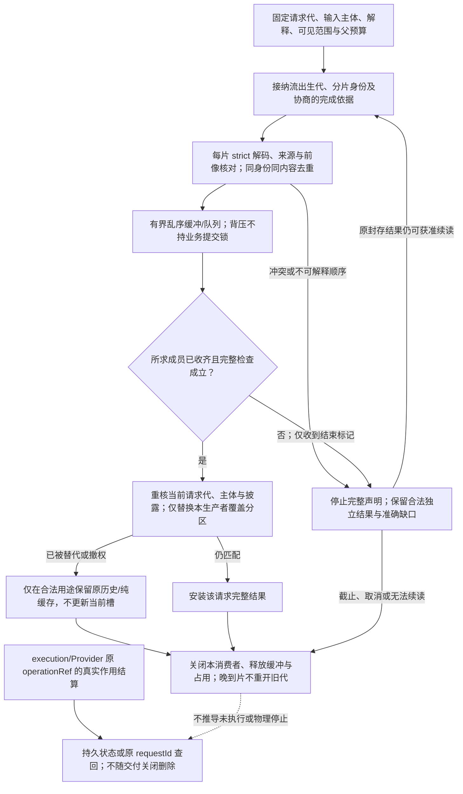
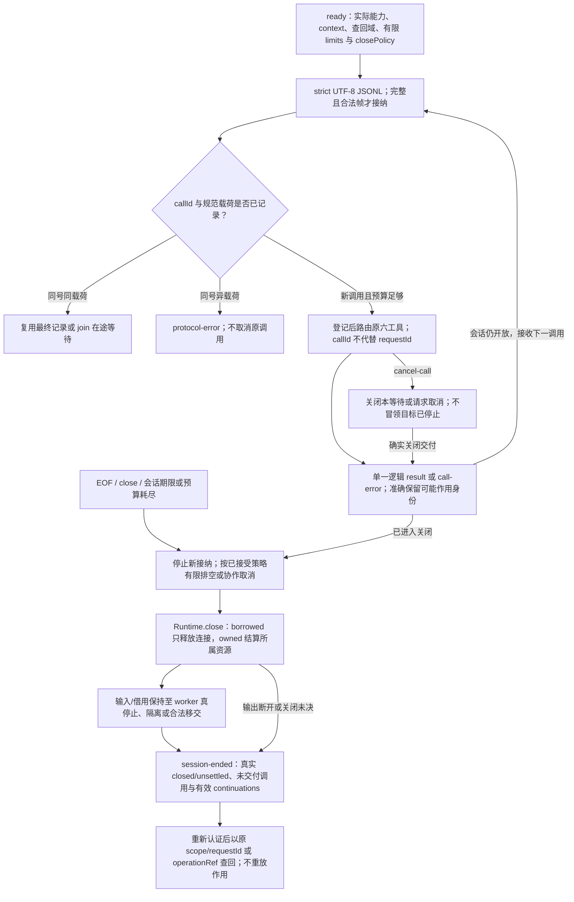

# 客户端与并行会话

> **阅读范围**：采用范围内的设计规范；实现状态另查未决 · [共同上下文](六工具与请求.md)。

## 客户端适配不复制领域规则

当前首期只有机器客户端，优先成组读取、明确基础、局部补丁、稳定诊断和续传。未来人类或其他客户端接入时仍消费共同语义，可以使用不同交互，但不因编码或主体种类改变采纳、效果和并发含义。首期不为未来界面预建专用流程。

机器操作的最小组合分为读取、提出变化、检查和实际作用。读取需要范围与可见性；候选增量绑定基础、目标选择和必要前像；纯检查绑定被检查对象；真实作用才需要当前许可及稳定效果身份。小请求可以内联组合，不能为了形式统一强制四次网络往返或全字段信封。

批次的分组、临时身份和陈旧处理由[语义增量](候选修改与批量.md#语义增量临时身份与前提)至[联合候选](候选修改与批量.md#联合候选部分接受与真实作用)完整定义；所有客户端使用这一规则，不自行推断数组顺序、全部成功或隐式批准。

用户看见的确认和AI收到的待决对象指向同一选择基础；审批角色按政策确定。具备委派权限的AI可以提交被允许的选择，未具备权限的人类操作者也必须被拒绝。候选提出、校验执行和独立裁决是否分离，由该风险范围规定，不作“人总是最终签发者”的硬编码。

### 检查主体、差异基础与披露的确定性

无artifactRef的`check(methods=["types"])`可以在尚无后端时检查中立源的解析、绑定、类型与声明效果，不顺带生成或运行。提供artifactRef时，同名types方法检查该目标实际使用的工具与构建范围，并引用已有源检查；不能将二者合成一份无主体的PASS。cases必须有明确目标及独立casesRef；没有该候选/目标的产物就诊断，不能内部偷偷先生成并扩大执行范围。

`preview(return="diff")`指目标产物差异，必须以`compareTo`显式指定已有artifactRef；其他return模式禁止compareTo。服务核对它与候选基础的关联、实际输入、目标语言与映射范围，以及当前读取权限；不依据缓存里“当前唯一”“最近”或猜测相似文件名选择。没有合法基础为`NO_ARTIFACT_BASE`，可另请求完整code。不同工具/布局版本可以作真实文本比较，但明确标示差异来源；比较本身不证明行为等价或允许直接应用。`propose(return="diff")`指作者源差异，绑定源base。两类diff直接标明subjectKind；不能把TS与Java文件做文本差分再称同一语义变化。实际值相同但上下文、资格或布局不同，仍保留其差别。

save-source只保存当前作者内容，不能因给了产物而写入生成结果；write-output只消费已绑定的实际产物，不在apply中重新选择后端或生成。sourceLanguage/target的变更产生新的解释或产物请求，不能在旧candidateRef上原地重解释。当前支持矩阵只是所需能力入口，不从模式完整或名称存在推导运行资格。

任何引用解析先校验作用域与当前披露权限；候选不匹配、不存在和无权访问可以按泄露策略统一返回，不先泄露另一个租户的产物身份。游标续同一查询；携带原查询字段只能完全一致，不允许悄悄改过滤、排序或快照。引用释放、撤销与内容不存在分别处理，不能从不可读推断产物没有生成。

以上为工具/2尚未发布草案的补充；实现时固定这些分支与错误。短preview仍可只有source，明确artifactRef由工具返回后自动用于后续请求，不需要AI编造长哈希。

### 引用生命周期、执行占用与草稿保存

短context/candidate/artifact引用是定位柄，不是持久内容本身。开始一项读取或计算时，服务在同一解析准入中校验作用域、内容存在性和预算，并为实际使用的不可变内容建立有界占用；“刚检查过存在”与随后GC之间不能有未保护窗口。活动引用保护延续到该次工作结束，不能因为原查询游标先到期就删掉执行中的输入。长期未结算作用所需内容归恢复意图保护，不依赖模型会话TTL。

内容保护不锁住权限。披露、检查启动和真实写入仍按相应边界复查当前许可；撤权阻止后续返回/作用，但不使已发生的作用变成未执行，也不授权提前删除必要恢复资产。停止、崩溃和预算耗尽都有有限回收/转交机制，不能用“被pin”永久泄漏内存或对象；租约到期只回收已确认可回收的占用，不能猜测不受控执行器已经停止。

含语法错误的设计草稿可以保全原字节和诊断，save-source按该任务的草稿保存合同处理，不先将它格式化成另一个程序。合格生成仍需对应语义闭合。保存到已有作者区继续需要前像和当前写入权，不能因为对象叫draft就绕过覆盖保护。源保存不表示采纳，也不让旧有效AST覆盖新但未完整的文本。

短默认请求不新增生命周期字段：服务管理引用及占用，调用者只在长期保留/跨会话迁出确有需要时选择相应保存目的。普通多文件可直接使用files；原结构增量继续处理身份移动和语义图变化，不因精简工具面恢复手写全IR。

## 远程、事件与重连

短查询可同步；长效果返回明确操作引用。HTTP成功、进程退出零和连接关闭不重定义工程终态。请求超时按[幂等合同](../../运行/持久化提交与恢复.md#幂等授权与出站交付协议)处理，不用新身份盲重放。

### 分页查询的快照合同

第一页固定查询定义、过滤/排序/投影、解释版本、内容切面、可见范围和稳定并列排序键；续页游标是受保护的不透明引用，绑定这些条件与保留窗口。默认使用固定快照上的键集续页，不对持续变化的结果使用裸offset。多个相同排序值用稳定对象身份决胜，避免漏项或重复。

内容快照不是历史授权。每次返回按当前披露政策复查；权限相关版本改变、过滤改变或快照已回收时，使游标失效并重新取得合格快照，不把“剩余页为空”伪装成查询完整结束。可以采用重新授权后仍读原内容快照的专门协议，但需保持相同可见成员集合或明确返回变化，不能偷偷拼接。

跨数据源没有共同原子快照时，返回每源版本与观察切面；需要联立不变量的查询再做协调/重查。未完成、缺权、部分覆盖和确实空集合保持区别。客户端不能凭“已读最后一页”推导未获准观察的隐藏对象不存在。

### 快照与事件之间的无缺口接合

宿主在一个可解释切面固定快照和随后事件位置；支持MVCC的实现可取得修订R的快照并从R之后的保留事件续接，或先建立有界事件缓冲再捕获对应快照。不能先读一个不带位置的列表，再从“现在”订阅，遗漏两步之间的修改。

排序域明确到工作区、对象或操作；不强迫所有系统拥有一个全球序号。客户端按事件身份去重，只应用可解释的前后版本；缺口、逆序且无前像、历史压缩或换了投影权限时进入`resync-required`，读取新快照并原子替换本地投影后继续。候选和未保存文本另外保留，重同步不覆盖作者修改。

控制器消费同一握手，但通知如何合并到正在处理的工作，由[调和排队交接](../../运行/发布运行与资源生命周期.md#reconcile-wakeup-handoff)拥有；它不重新定义本节游标，也不将被合并的通知当已执行命令。活动查询更换真实依赖时还要接上[订阅保护](../../编译/查询增量与性能.md#live-projection-dependency-handoff)，固定快照查询不承担无关的持续订阅。

事件是状态的投影。普通进度可合并或丢弃并标记不连续；改变终态、权限和恢复责任的信息必须可由持久状态或受信操作查询重建。队列满不能在持有业务提交锁时无界等待慢客户端，也不能把无法重建的终态当普通进度丢掉。长期断线、保留窗口过期只撤销续传资格，不抹掉真实完成事实。

游标及进度按可见投影生成，不公开全局事件计数、隐藏键或精确跨租户版本差。每次披露检查当前权限；过去已经披露的数据无法靠换游标撤回。客户端断开是否取消由已接受政策决定，已发生作用仍须结算。

[etcd v3.6 API](https://etcd.io/docs/v3.6/learning/api/)提供带修订读取、从指定修订Watch以及压缩后显式失败的具体参照。本协议可用轮询实现，不强制采用etcd、长连接或全局数据库；所选宿主必须实际提供声称的切面与保留条件。

### 结果分片、完成屏障与取消后的结算

进度、结果分片和原操作的结算观察分别消费。一个`done`标记可能说明生产者已结束计算，也可能只是传输结束；只有协商合同说明其主体、范围与前序交付保证，接收者才能据此判定当前结果完整。不能把较快到达的结束回调当成缺失分片不存在的证明。本节补足上文快照/事件握手，不改变各领域的结果含义，也不另建全局流服务。

生产者按既有请求、结果或操作身份固定准确主体和结果范围；需要多路复用、重连或乱序时，entry适配绑定流的出生代及分片身份，不能只使用会复用的序号。传输中的身份可以来自原协议，不要求作者手填新的sessionId。完整性依据优先使用原协议可证明的有序交付和终结边界；协议不能提供时，才采用当前可见结果的封存成员/范围及完整性校验。仅有摘要不证明成员已经收到，也不证明内容真实或有权披露。

| 责任 | 拥有者 | 输出或约束 |
|---|---|---|
| 结果是否在所求范围完成 | 原compiler/assurance/其他领域生产者 | 固定主体、覆盖、实际结果及尚未满足项；不由网络层改写 |
| 分片是否属于同一份结果并已收齐 | entry的协议适配与有界接收器 | 按协商的顺序、身份和结束规则装配；不改变领域语义 |
| 哪一代结果可以更新当前用途 | application与当前客户端返回槽 | 按[请求返回代](#request-result-routing)核输入与代际；批处理仍按原请求返回 |
| 作用是否成功、失败或仍需恢复 | execution及真实Provider | 原operationRef的结算；不依赖结果面板是否打开或分片是否保留 |

接收算法按以下顺序执行，纯本地原子返回可直接满足对应步骤，不新增网络往返：

1. **接纳本次流。** 固定请求代、结果主体、解释、可见范围和字节/成员/在途预算。未协商的字段与事件类型按原协议拒绝或明确不支持，不把未知必需含义忽略为成功。
2. **核对每份内容。** 先解码、校验边界及来源关联，再按实际分片身份接收。同一身份同一内容的重复可去重；同一身份出现不相容内容则停止将该流当成合格完整结果，保留冲突和独立已知事实。无依据的乱序不靠到达顺序猜测前像。
3. **有界保留与展示。** 完整的独立子结果可按其真实范围展示或交付；未完成聚合明确标partial。乱序缓冲和消费队列有界，超过预算按合同背压、终止交付或重同步，不在持有业务锁时等待慢客户端。不能为了保持内存上限丢掉语义分片后仍声称完整。
4. **验证完成屏障。** 只有当前结果的全部所求成员已按原协议收齐并通过相交完整性检查，才形成完整交付。结束标记先到而成员不足时，保留“生产者报告结束、当前交付不完整”两个事实；可在预算内续收，或从同一已封存结果的获准引用重新取得。不得以另一请求、另一可见范围或新运行的片段补齐旧结果。
5. **安装当前结果。** 完整交付仍需核当前返回槽、主体与披露资格；范围变化、撤权或请求被替代时不覆盖当前结果。旧内容只在仍被允许的保留用途下进入历史/缓存，不能因输入名字再次相同自动复活旧回调。安装时只替换该生产者和覆盖分区，不能清除其他工具或未覆盖根的结果。
6. **关闭本消费者。** 交付完成、截止或取消后释放本消费者的临时缓冲与占用。晚到分片不能重开已关闭的接收代；明确续传按保留合同建立新接收并绑定原封存结果。原作用的恢复资产仍归其操作拥有者，不能随流关闭删除，也不能靠永久保留所有输出代替恢复合同。

取消可以结束本调用者的等待，但不能把已经收到的成功结算改成“从未执行”，也不能把未收到回执的作用判为取消成功。恢复查询沿原operationRef/requestId；重新读取同一封存结果不等于重新执行原作用。权限改变导致不能再展示细节时，返回不泄露隐藏主体的不足/受阻说明，不通过成员总数或摘要暴露原不可见内容。

### 同一接收合同在开发工具中的实际消费

| 消费者 | 可以接受的正向结果 | 必须挡住的反例 |
|---|---|---|
| 诊断与检查 | 完整分区的空诊断可以清除该生产者原分区；其余生产者保留 | 取消后收到空的部分批次，把所有错误清空 |
| 搜索、引用与影响查询 | 已收到命中可先显示；只有完整声明范围才报告确实无命中 | 只读一页、索引未就绪或预算截断却回答“不存在” |
| 测试发现与执行 | 发现范围完整且为空，与已选择测试全部通过分别表达 | 测试尚未发现、加载失败或全被过滤，就冒领测试通过 |
| 编译与产物成员 | 独立根完成可以单独返回；共同产物按其成员/配置条件闭合 | 最快根先结束，缺失资源和类型成员却发布完整产物 |
| 调试、Notebook与交互进程 | 控制回执、运行状态与输出交付分别呈现 | 收到输出结束就认定程序停止；旧执行输出混入新单元结果 |
| Agent与批量任务 | 文本说明与真实操作结果通过固定引用关联 | 模型文本结束、批次数组最后一项到达就认定全部作用已完成 |

有限正向轨迹：分片B先到、A后到、重复B、最后封存边界确认A/B构成所求范围；接收器去重并在当前返回代安装一次完整结果。对应反例是封存边界先到但A永久丢失，此时保留部分结果并查询同一封存对象或报告交付未完成，不盲重跑产生作用的任务。支持严格有序交付的通道不需要实现乱序重排；小型一次性结果也不需要额外分片摘要或持久记录。

## 可协商结果投影与安全重连

`gift.tool-result-view/2` 是独立、尚未发布的结果投影设计，不能强加给未协商旧端。其封闭外壳由 [result-view-2.schema.json](../../../schema/tools/result-view-2.schema.json)固定：status 为 completed/rejected/failed/incomplete，subjectRef 和 basis 均可准确解析，coverage 列出 requested、complete 与带原因的 incomplete。complete 与 incomplete 范围不得相交且均属于 requested；完整请求还须解释所有请求范围。结构校验之外，由真实结果 producer 检查这些集合及引用关系。

results 采用 reference/code/diff/summary/check 鉴别联合：code 携语言与 path/content 成员；diff 明确 author/artifact 及 baseRef；check 携 claimRef、verdict 和 evidenceRefs；不能内联的领域值以有角色的准确引用交付。diagnostic 可定位 sourceRef 及合法 JSON Pointer/字节范围，范围端点与真实内容另核。effectRef 只引用真实已有操作，next 只给六工具内合法建议，不签发执行权。completed 表示本次请求返回完成，查询可以完成并准确返回“不支持”，不等于 Claim PASS、目标完整或外部效果成功。

远程游标绑定主体/租户、授权代、查询摘要、来源切面、排序、投影代际/进程 incarnation 与到期，使用服务端不透明随机句柄或认证编码；可自行重算的裸摘要不具防伪资格。每页、每批以及排队后实际发送前重核披露，撤销后不得继续发送已失去资格的块；旧明文已交付给不受控端时不能声称协议可收回全部副本。

订阅恢复绑定原订阅与快照/事件水位。日志缺口、游标丢失、ACL 或来源范围变化时返回明确重新同步要求，重新取得合法完整切片，不能用新代剩余页补旧代；扩大权限也不自动取得过去隐藏历史。当前选择变更只影响呈现槽，旧请求、候选和真实操作仍按自身身份查询。

流内序列、streamId 与 final 只界定传输。乱序/重复/缺序按真实保留窗口重放或要求新快照；传输 final 可以交付未知效果及原 operationRef 后结束，不能把 EOF 改成效果成功，也不能为等待不可确定效果无限挂住最终响应。取消显示和取消后继调度不抹去已派发的恢复责任；单次小结果不强制分片或持久数据库。

## CLI 与 IDE 适配

### 流交付与当前返回槽的控制图

该图展开前述接收算法，原operation结算独立于流与面板寿命。真正的空结果只有在所求范围完整时才能清除该生产者的原分区。

首期CLI按机器调用提供版本化结构；可选的人类显示只投影相同任务结果，不成为独立业务入口。进度与结果分流；非交互调用不能弹窗等待或默认确认。输入文件、stdin、编码、大小、凭证与错误码有明确约束，参数中的路径不是无限读写许可。

### 单请求与有界连续会话

单请求CLI只处理一个原工具请求；依赖其临时candidate/context/artifact引用的后续调用必须继续使用同一个Runtime，不能把进程已经关闭的短引用传给下一条独立命令。SDK直接复用[RuntimeHandle](../../架构/装配/模块与运行实例.md#runtime-assembly-scopes)的`handle/close`。CLI增加显式的`gift --stdio-session --protocol gift.cli-session/1`模式，与单请求`--request`模式互斥；这是待实现的版本化设计，不是已经安装的命令。

会话复用原六工具，客户端以自己的普通程序处理分支、迭代和并行，不要求预先写任务DAG、安装daemon或把业务意图再翻译成工作流语言。启动参数只选择实际宿主/工程画像；解释上下文由bootstrap沿真实范围和供给构造。没有足够配置时返回具体缺项，不能为了ready而伪造通用context。

传输为UTF-8、LF定界的strict JSONL，每行恰好一个对象；拒绝重复键、非法编码、未知字段和超限帧，源内换行使用JSON转义。stdout只输出协商帧，stderr用于有界且去秘密的诊断。底层可以切分字节，只有完整帧解码后才派发；小结果完整返回，大结果沿原分页/结果引用协议，不隐式截断成success。

| 方向与`kind` | 字段 | 精确含义 |
|---|---|---|
| 服务`ready` | `protocol, capabilities, initialContexts, limits, referenceLifetime, closePolicy`；准确修订支持时另有`requestScopes` | 实际协议/扩展支持、已准备且可披露的`{role,contextRef}`列表及有效预算；没有准备的context不列。requestScopes给事前查回域的准确映射，ready不签发业务能力或权限 |
| 客户`call` | `callId, tool, request, budget?` | tool为原六名，request由原严格读取器解释；budget只能收窄有效预算 |
| 服务`result` | `callId, result` | 原工具的最终响应及其真实引用；领域失败保持原语义 |
| 服务`call-error` | `callId, reason, diagnostics` | 本调用的接纳拒绝或最终交付失败/等待取消；已经可能派发的作用须披露可用的原requestId/operationRef，不能声称未执行 |
| 服务`protocol-error` | `reason, diagnostics, relatedCallId?` | 非法输入帧或重号异载荷的错误，relatedCallId仅定位；不终结、替换或取消该标识原先接纳的调用 |
| 客户`cancel-call` | `callId, targetCallId` | 取消目标调用尚未开始的工作或本调用等待，不替代真实operation的cancel |
| 服务`cancel-result` | `callId, targetCallId, state` | state为`requested/wait-closed/already-complete/unknown`，不证明目标进程物理停止 |
| 客户`close` | `callId` | 停止新接纳并进入关闭；直接EOF有相同语义 |
| 服务`session-ended` | `state, incompleteCallIds, operationContinuations, diagnostics` | state为`closed/unsettled`，列真实可查回的continuation及剩余责任；不以即将过期的裸引用冒充恢复能力 |

`limits`复用Runtime资源单位，明确帧字节、会话总输入/输出、调用数、活动调用数、墙钟期限、引用保留额度、默认调用预算和关闭期限；调用预算约束实际CPU/内存/工具及输出。所有有限上限在ready给出，不创建第二预算引擎，也不扩大Grant。默认串行即可；operation start及时返回真实operationRef后可继续查询、输入和取消。会话耗尽拒绝新调用并进入关闭，不淘汰去重记录后继续接纳。

requestScopes属于本未发布会话草案的准确规则修订，须随基础[requestId查回](六工具与请求.md#request-identity-lookup)能力一起协商；旧strict reader不静默忽略后宣称恢复支持。其值为有限`{scopeRef,subjectRefs,retention,continuation}`记录数组，记录不接受其他字段。scopeRef为非空受保护定位字符串；subjectRefs为非空数组，每项恰为`{targetRef}`或`{contextRef}`，只含实际获准引用并准确对应原去重域。retention恰为`{untilUnixMs}`，值是非负安全整数的UTC毫秒截止；session的有效期另止于该会话实际结束。continuation仅为`session/reconnect`，reconnect只在原持久owner、该截止内的跨会话定位和重新认证能力确实存在时声明，不因名为scopeRef而升级。尚未准备的目标可从其query(contract)取得同形映射；发送作用前客户端须已持有其唯一适用域，多域歧义先解决，不遍历全部域碰撞查询。截止只描述该查回记录的有效承诺，不授权提前清除仍需恢复的作用责任，也不把短内容引用延长为永久恢复资产。

声明`gift.input-preparation/1`时，call仍只路由原propose；draft.prepare-input按[唯一联合](候选修改与批量.md#input-preparation-contract)准备实际引用，客户端不需要另一个内容API、手造哈希或daemon。它与原候选编辑结果不同，client按purpose消费argumentsRef/casesRef/observationRef。没有此扩展的会话准确限制为已有输入引用的有限运行画像，不声称能从空会话完成任意作者参数运行。

**从空ready到第二次运行。**客户端取得真实context C及公开入口合同；原files/source创建候选S，preview取得产物A。参数准备请求使用`draft:{kind:"prepare-input",purpose:"arguments",subject:{artifactRef:A,entryRef:E},values:{tag:"list",items:[{tag:"literal",type:"Int",value:"2"},{tag:"literal",type:"Int",value:"3"}]}}`，其中E来自A的真实公开入口而非猜测。得到I1后原compute-run消费A/E/I1与事前requestId R1；把两个literal改为"5"/"8"重新准备I2，以新R2运行，不能把旧I1改标签。零参用空items；错误类型准备失败，无假I；源签名未定返回缺项。仅有源签名时可对candidate入口先准备参数，但无目标的compute-eval在目标准入处返回缺项，不伪装已运行。案例从准确已知选择或真实query/发现结果进入同一准备分支再check，观察从实际方法输入进入observation分支再compute-run；没有动态发现或插桩能力就给准确缺项。

**首回执丢失。**发送R1前保留对应requestScopes/target contract给出的Q。服务已接纳但operationRef响应丢失后，重连只发`operation({scopeRef:Q,requestId:R1,action:"status"})`；原短A/I1已过期也不重做运行，found取得原操作后再按operationRef查结算。scope只支持session、保留过期、记录不可得或重连撤权时返回安全unknown/拒绝，不将其变成未执行或让新R3覆盖旧责任。纯prepare响应丢失可按同主体/值重做准备，作用查回不得借此重放。

`callId`是有界无控制字符的会话关联标识，覆盖call及控制帧，不能代替真实作用requestId。接纳前登记标识和规范载荷；同号同载荷只复用已保留结果或加入原在途等待，不再次派发，同号不同载荷拒绝。记录保留至会话结束；预算不足拒绝新调用。跨进程的作用去重仍沿原requestId、权限及真实查回，不承诺传输恰好一次。

每个已接纳call只有一条逻辑最终交付记录：`result`或`call-error`互斥。同号重放可重发该记录的相同内容，不产生第二结论。输入重号异载荷只产生protocol-error，原调用继续；未接纳的合法关联请求也登记其拒绝，后续不重新派发。cancel-result只答控制请求：`wait-closed`时须同时将原调用交付关闭为等待取消的call-error；尚不能关闭则为requested，原调用仍可正常完成。交付关闭后迟到结果留在原operation或内容owner供合法查回，不再发另一个最终响应覆盖它。资源预算须预留有界终结信息；输出故障或无法交付时列入incompleteCallIds并保持恢复责任，不谎称客户端已收到最终记录。

### EOF、取消和Runtime关闭

完整接纳之前的截断尾帧从不派发；非法帧可恢复边界时给有界错误，不能可靠继续或超过预算时进入关闭。EOF、close或会话期限到达后停止新接纳，按ready公布的closePolicy在期限内排空或协作取消accepted调用，再调用Runtime.close。输入和借用保持至真实worker停止、隔离或合法交接；cancel-call、关闭等待与operation终态分别记录。borrowed Runtime只释放本连接占用；owned Runtime结算其应关闭资源，不杀附加的外部目标。

作用准入先核关闭责任是否可兑现：可能越过本进程的作用若既无独立持久查回/恢复或合法移交，又无法在允许关闭期限停止结算，则拒绝该作用并报告缺失能力。已有持久Provider操作可按原授权继续，continuation须在会话退出后仍有效。输出管道断开也不能抹掉恢复记录或重放作用；客户端用原requestId/operationRef查回。session-ended只报告实际取得的结算，退出码区分正常关闭、已知未完成和无法可靠交付，不代替各工具结果。

连续调用及第二次修改按[开放组合验收](../../运行/验收/开发面案例.md#open-intent-composition-acceptance)检查。

IDE 必须参与未保存缓冲区、文档版本、选区映射、修改预览和冲突读回。语言服务器或编辑协议只提供能力之一，不是业务授权根。编辑器和后端使用相同前像，不能一边改缓冲区、一边直接改磁盘后仍宣称一致。

脚本与批处理保留同一目的边界；脚本能调用的底层接口也必须执行校验。传输适配的重试不能绕过效果幂等。定位 URL、路径和文件名可以变化，稳定对象身份及其权限仍由合同确定。

## 计算任务与未启用能力的接口语义

同一个`source/candidateRef/context/target`协议接收计算核、库、编译器与事务应用，不增算法专用工具。计算例的`sourceLanguage`仍是`gift.semantic/1`；其实际库和实现安排由冻结上下文/目标Binding提供。没有新设任意`fast`、`inplace`或`schedule`工具字段，也不要求AI填写内部循环计划。

`query(view="contract")`按相交对象返回不同合同：计算对象返回输入形状、边界、数值、顺序、内存/设备与当前缺项；事务对象才返回提交、授权和交付。它们都是现有合同投影，不新建两套权威。完整低层计划和未选能力的处置理由只在需要解释时展开，不能每次把全部平台模型返回。

无相交的未选项不显示为失败；当前必需但unsupported的输出继续明确报告；“forbidden”不能通过preview快捷路径或后端回退绕过。候选/目标仍按原规则绑定；保存一个纯计算源不会关闭另一份已部署事务应用或删除其恢复记录。

## 多客户端、当前结果与准备态后继

### 请求身份不等于当前显示槽

同一工程可有两个AI任务、两个编辑器窗口和一个批量构建；不能使用进程级`currentCandidate`、`lastArtifact`或`lastOperation`协调它们。六工具的明确base/at/candidateRef/artifactRef继续是主体，客户端上下文只提供已经固定的缺省输入，进入处理器后不再随着其他请求改变。

entry/application内部可以维护一个**返回槽**，其键为当前连接或本地调用者、具体用途与对象选择；槽内保存本次请求代及固定基础。它只用于回答“哪些结果可以更新这个当前展示”，不进入作者语言、锁文件或所有编译缓存，也不新增公开必填sessionId。无当前展示的批处理直接按请求返回结果，不需要建立槽。

一次请求进入时固定`requestGeneration`；用途、候选、目标、比较基础或当前接受要求改变，建立新代。完成回调先核返回槽仍指本次代与输入，再披露并更新；旧结果可以保存为原主体的历史结果或合格缓存，但不能覆盖新代。即使选择经历C1→C2→C1，也不让第一次C1请求凭候选名相同自动更新第三次选择；合格结果可以被第三次请求明确复用，而非冒充它的回调。

`operationRef`指真实作用，独立于返回槽。用户切换页面或开始新候选后，原保存/运行已发生的事实仍须可查询和结算；不能因为结果不再“当前”就删除作用记录、隐藏失败或再启动一遍。任务接受关系改变，同样只影响新请求与资格判断，不重写旧操作意图。

基础控制先用operationRef+status取得同一次观察的controlRef，再发送operationRef+controlRef+action；客户端保留该三元组至原控制接受结果可查回。控制响应丢失或重连时只重放同一三元组以查回/join原意图，callId变化不产生新控制。取得较新status不把旧未知动作自动迁到新controlRef；新一轮请求须核原动作关联与真实下一步资格。旧回执保留在原控制代，不能更新当前暂停的显示槽。scopeRef/requestId查回仅先找到原operationRef，随后status才取得当前可披露控制引用。服务只在原记录、保留和重新认证能力成立时承诺跨会话恢复；旧端未协商controlRef规则时禁用相交控制，不降级为无围栏cancel/resume/rollback。

### 内部续接的客户端消费

客户端消费application返回的结果与未完成原因，并按本页的请求代、当前显示槽和披露规则呈现。内部准备态与补取去重、冲突、无进展及释放算法由[请求准备与续接](../../架构/装配/请求准备与续接.md)唯一拥有；它们不自动成为新的公开响应字段，公开必需含义仍须原版本能力协商。

### 传输失败、超时与部分结果的正向路径

纯查询的响应丢失，客户端可按原精确输入重读或复用有范围缓存；产生外部作用的请求按原requestId及去重合同查询，而非重放命令。没有持久重试窗口的实现不能声称跨崩溃恰好一次。请求要求完整组结果时，分项早到只能标进度或独立成果，不能先发全组success。

披露在返回前核当前范围；流式分片也必须遵守其当前披露与截断合同。断开连接不证明目标已停止，局部超时不删除完整候选。与本任务无关的其他连接不因一个坏输入被清空，真正共享资源故障则报告其实际影响，而不是永远假装请求互不影响。

该协议由[Runtime作用域](../../架构/装配/模块与运行实例.md#runtime-assembly-scopes)、原[调度取消](../../编译/递归并行与远程编译.md)和[持久恢复](../../运行/持久化提交与恢复.md)共同消费；不建立另一份请求数据库或重复权限引擎。
