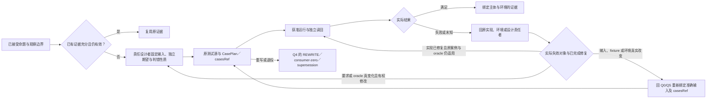

# 测试发现与执行

> **阅读范围**：采用范围内的设计规范；实现状态另查未决 · [共同上下文](../运行/保证/要求证据与裁决.md)。

## 开发者测试面：发现、选择、固定期望、运行与复跑

本节是原V1—V6和`check(methods=["cases"])`的具体消费者，不新建测试框架或第二套Verdict。 上游先按[验证义务与方法选择](../运行/验收/方法与独立证据.md#verification-obligation-selection)判定是否需要物化案例；本开发面不把全部Verification转成TestCase。性质、变形、差分、模型和故障方法只要实际生成案例，都消费同一[TestResponsibility](../运行/验收/测试生成与形式方法.md#test-responsibility-binding)合同。开发者可以指定一例、一文件、一组、受影响范围或全选；使用实际测试框架的发现、运行、调试和覆盖能力。工具支持某个运行模式不等于所有案例都支持该模式。

### 已有物理测试、VS Code 与 Gift 引用的统一接合

开发者在 VS Code/通常仓库中编辑的是普通测试源码及明确的 fixture：`src/**/*.test.ts` 的共置模块、`tests/{unit,contract,integration,e2e}/<domain>/` 的不同观察层、`tests/{testkit,helpers,fixtures,setup}/` 的支持设施。`catalog/registry/official/*/files/tests/` 和编译器测试模板是在目标工程**安装/生成之后**才成为该目标的真实测试；Python 文档工具与 `*.typecheck.ts` 则消费各自发现/编译入口。各条的物理归属以[测试导航](../../tests/README.md#物理测试源码与运行边界)为准，目录形状不能代签 runner 身份、业务保障或已实际运行。

仓库当前以 `package.json` 的 `test` → SEC development runner、`bunfig.toml` 的测试预加载及既有 fast/slow/平台选择作为已采用 Bun 测试执行入口。Bun 原生测试/Mock、发现、覆盖及筛选是可复用能力，不为 VS Code 包一层新的平台 GUI、Node 兼容运行器或第二套 case runtime。VS Code Testing API 是编辑器接合选项，不是 Gift 编译器必须接管的 UI。Gift 只把已接受的 Claim/MethodSelection、真实源码注册与参数实例、现有 runner/provider 的 CasePlan/casesRef、执行回执和原 Evidence 对应起来，不复制测试体、expected、测试列表或运行器；动态发现有副作用时仍走真实获准 execution，不将查询伪装为执行。

**一例一主责，但可关联多个义务；一项义务可由多层合格证据共同承担。** 发现时必须保留源声明、物化后实际实例、测试原始用例所需环境及外部资源。测试模板只是源，不自动计入当前宿主 Bun 执行；Python 方法、类型级模块与间接导出 suite 不和 `test()` 静态调用混计。文件迁移、注册合并或产生新动态参数，不能只按标题或源码行数保持身份；原作者的 REWRITE/consumer-zero 和执行资格沿 Q4—Q6 结算。

### Q0—Q6 形成真实casesRef

**Q0确定目的与主体。**普通功能案例、契约、性质、兼容、回归、安全、负载和基准是不同请求。固定候选、准确目标、方法/环境及需要覆盖的范围。source的types可以先做，cases必须有对应artifact，不能因用户说“测试”而运行整个工作区所有脚本。

**Q1取得发现能力。**先读取已有准确清单或静态声明。运行模块、参数工厂、装饰器、框架插件、配置或外部服务才能发现案例时，这是实际工具作用：先准备隔离、权限和预算，由原execution/宿主Provider执行。query仅读取已有发现结果，不能把执行藏在展开测试树。开发者可以选择直接运行已知入口，但它只证明该运行实际范围。

**Q2保留发现结果。**每例标识含测试提供者、准确源/声明及参数实例，不按显示名称或数组序号跨版本冒认。目录包含父子范围、实际可用的run/debug/coverage等画像、已发现/未展开/不支持/发现失败及来源。空结果与已穷尽分开；动态参数集合改变使旧选择需要重新解析。

**Q3固定选择。**显式case IDs、范围和排除规则解释在一个发现快照中。父节点“全选”表示覆盖请求，不能只选择当前已加载孩子；按需展开取得完整范围，不能取得就保持覆盖不足。受影响测试是由真实依赖或保守规则选择的子集，不冒充完整回归。多分片固定分配成员与种子；不能靠重复分片补覆盖数量。

**Q4固定独立期望。**保留每例输入/fixture、oracle或性质、允许差异、随机种子、环境、运行顺序/隔离条件与清理责任。成熟框架可以把它们保存在真实测试源和配置，Gift只引用，不复制成第二套案例源码。生产builder、formatter、catalog或命令路由若沿同一生产调用链生成actual与expected，二者相等只证明共同实现自洽，不能充当独立oracle；应改用固定公共合同、独立实现、外部读回或明确的性质/变形关系。两个生产结果基于不同输入、模式或往返方向的比较可以是有效性质，但测试必须让这项差异和所证命题可见，不能仅复读同一结果。Source Program的Test Value只对能证明共同生产lineage且没有直接生产actual的正向等值oracle签发阻断finding，不用词法相似或函数名字猜测。删除/放宽断言、更新golden或snapshot是显式作者变更；符合新要求时可接受，但必须显露理由、旧反例与所支持命题的变化，不由测试器自动批准自身输出。删除测试若由其他测试承担重写后的责任，沿现有Test Value owner形成一次性REWRITE作者决策。该决策绑定准确的旧／新commit、tree、Source Program与测试编译身份、实际发现的registration id、各自责任owner、变化的定义输入，以及原有Claim／ProofObligation／MethodSelection组成的TestResponsibility；相同引用与修订不得指向冲突内容。类别、生产路径、capability名、标题、断言数量或测试体哈希只能定位候选，不能独自证明旧义务被保留。REWRITE明确是作者判断，不标成语义等价、严格超集或旧成功断言仍受覆盖。历史仅绑定路径的批次不自动授权新的修订；没有替代者的DELETE继续要求原consumer-zero退役证明。对于没有基线出现的新测试，INTRODUCE仅接纳真实比较中新增的准确registration id与各自当前TestResponsibility，不代替任何旧义务，也不授权退役。决策不列runner命令、不创造第二份测试inventory。

Gift 自身仓库的 Source Program Transition、作者判断、基线缓存与制品查询接合见[仓库验证与传输边界](仓库维护/验证与传输边界.md#repository-source-program-transition)。这些规则不成为所有目标工程测试发现的前置。

来源事实、作者判断与接纳已归入[仓库维护正文](仓库维护/验证与传输边界.md#source-transition-qualified-fact-flow)。

基线缓存采用与失效已归入[仓库维护正文](仓库维护/验证与传输边界.md#source-transition-baseline-cache-decision)。

制品查询采用与边界已归入[仓库维护正文](仓库维护/验证与传输边界.md#source-transition-artifact-query-decision)。

**Q5封存选择引用。**宿主`prepareCaseSelection`把发现引用、选择、准确期望、runner/profile、环境/fixture及覆盖要求封存为casesRef。 同时绑定每项所选ProofObligation与VerificationMethodSelection的准确身份和修订；相同方法名但Oracle、环境或接纳规则变化时，旧casesRef及其证据重新判定，不能只按testId复用。它是已存在casesRef的生产接口，不是作者要手工造的哈希。缺少必须发现/输入时返回Needs，冲突给准确对象。选择被签发不代表实际用例已执行或具有执行权。

**Q6运行与对账。**原check消费candidateRef/artifactRef/casesRef；其实际结果按被选例及框架组合语义记为满足、反例、跳过/不适用、取消、基础设施失败或未完成，并附executed/reused。重试产生新的attempt，失败历史保留，flaky不改成首次成功；重试用新的随机种子时明确变了实验。先选后被工具过滤的案例仍是未运行，不凭框架进程exit 0宣称全部覆盖。

### 必要测试准入与单一资源主责

测试治理先决定有效保障及最小充分承接集合，再整理实现。重复验证、无采用依据的现状约束及其独属准备先退役；只有仍必要的用例才做 fixture 迁移。发现缺陷须保持既有保证，但不得把删除任务无界改写为逐例修复工程；阻挡本组正确性的缺陷最小闭合，其他问题沿原责任者处理，不以修复数量充当删除成果。

- **冻结新增由任务授权决定。** 用户要求清理且冻结新增测试时，拒绝新增测试文件、注册及新展开义务；优先加强、迁移或合并已有合格用例。改名、参数化、拆分和先删后增不能绕过冻结。确有新能力且既有集合无法承接，须取得用户对该例外的明确授权；Q4 的 INTRODUCE 作者决策不能自行解除冻结。原义务的精确 REWRITE 仍按原身份、输入与资格比较，不把标题变化误判为新义务。
- **主责与借用分开。** 测试只请求其保障真正需要的 fixture；复用既有 testkit、资源结算与原生 owner，按同一生命周期归属收敛重复准备，不另造通用测试平台。一个资源仅一个释放负责人，借用者不得提前释放；新资源取得后立即进入该负责人作用域。转交成功才解除原负责人的责任，部分准备失败仍结算已经取得的资源。
- **依赖先结算，资源再退役。** 保持原执行并发和完整 join；进程及其输出流的真实终态先于依赖句柄、权限与目录退役。互不依赖的清理分别尝试、收集全部错误；依赖项失败则阻止下游破坏性释放。Promise 完成、账本 settled、session.close 返回或期望错误文本均不能单独证明进程树终态。未知须保留实际依赖资源与可定位诊断，不伪造恢复成功；操作错误和清理错误独立保全。
- **共享到不改变实验的边界。** 不可变、已完成的工具或输入基线可在合格作用域复用；可变目录、Git index/refs、进程、权限状态及独立故障窗口保持隔离。fixture 只准备待验证转换之前的状态，不能预做被测动作。不得把冷启动、跨进程、平台、fast/slow 或独立预算压成一个共享世界。测试资源 owner 自身的必要故障验证可以直接操作其受测资源，不以“禁止重复准备”删除该验证。 机械迁移必须按原注册身份核完整回调边界、实参和平台/窗口，禁止跨注册的模糊文本捕获；数量相等或替换可逆不构成语义证明。候选的解析/词法检查与边界对应核验须在发表前完成，检查范围不足如实保留未知。
- **现有入口执行机械规则。** 原发现/Source Program 比较负责准确的新旧文件、注册、展开与依赖事实，原任务作用准入消费冻结约束，原 audit/lint 对已明确归属的绕过 fixture 模式阻断；未知映射不得自动通过。语义价值、资格承接与资源依赖仍由相应 owner 复核，数量、重复检测或覆盖率不能代签。规则须接入实际入口并取得绑定版本的结果才可称已强制；文档、Skill 或尚未实现的规则不是阻断证据。 当前 Source Program 接受链拒绝没有精确旧义务承接或 INTRODUCE 决定的新增注册；当前 Source Program 识别的 TS/JS 空测试模块另由 `test-module-without-registration` 及 finding 差量阻断。已知原地 literal 参数表的增长会改变完整注册定义摘要，必须进入原作者 REWRITE 判断，不能以未评估保留放行；这不是新增的全量展开计数门。动态、外部表及其他未解析展开继续保留未知，语义承接与任务冻结仍须原 owner 处理；该接受链不代表拦截任意 Git push 或覆盖所有语言的测试入口。

采用成熟的 fixture 作用域、依赖与释放模型，但不因发现重复代码就迁移 runner 或引入第二套构建系统。Bazel 的依赖图、隔离与缓存不代替测试价值裁决或资源所有权；仅当独立需求与迁移收益成立时沿原工具链准入评估，不把既有自建实现当拒绝成熟能力的理由。

### 开发者怎样继续

测试设计先判断已有证据是否在同一主体、环境、观察与权限边界下充分覆盖接受条件；等价覆盖和严格超集都可以复用，源码变化只使实际依赖的结果重新判定有效性。新增案例必须补足具体必要观察，其独立期望或性质能区分一个现实错误实现；已有性质已提供区分条件时，不强制造一个专门反例。夹具只建立待证明转换之前的状态，不能预先完成该转换再以终态断言自证。可逆且不改变行为的文本修改没有新增验证义务时，不为文件变化机械创建测试。

图表示测试证据的设计与消费责任，不新建执行状态机。设计语义不足时由原责任者补齐，普通实现者不得自行改接受条件；已有授权仍成立时继续原任务。测试文件身份由已有发现规则决定；声明位置本身不能证明文件存在、普通文件属性或执行已发生。

Source Program 的运行时依赖观察仍由 exact TypeScript Program 负责绑定：隔离外部 ambient declarations 的工作区只对已知 Node/Bun intrinsic `process`、`Bun` 使用无本地 symbol 的运行时合同；参数、局部、导入或仓库声明的 shadow 不取得该身份。测试修饰器工厂自身不是案例；直接链式调用只由最终注册调用拥有 title、callback 和断言，不能把 `skipIf` 的条件调用重复计入案例清单。

模块图描述可证明的导入、再导出与类型依赖，不独自证明任意程序没有副作用。模块图与完整语义事实消费同一exact TypeChecker的加载调用分类，不能各自凭名称识别`require`。字面量加载及不可变别名保留准确依赖；缺少操作数与计算操作数保留为未解决，而不是空依赖或编译器异常。加载解释合同进入编译器身份，合同变化后旧事实分片不得以相同身份复用。TypeScript前端保留`import("…")`类型表达式和`typeof import("…")`的类型边；同一目标存在值导入时，运行时成员取并集，不被后出现的类型边抹除。计算得到的动态导入、已识别但解析根未知的原生加载器以及语法失败进入`unresolvedFiles`，已有准确边与反向消费者仍保留。不得静默丢弃未知路径，不把`createRequire`的实例解析根猜成本文件目录；普通同名函数或参数也不凭名称取得CommonJS加载器身份。边界门禁不能将缺边解释为闭合，受影响选择须保守扩大或返回未解决；观察不足本身不是High finding，缺陷严重度仍由具体违反的不变量、反例和影响决定。

失败到源的定位携带准确artifact/源、测试输入、期望、实际结果和必要运行日志。可只重新跑失败/受影响例，但共享fixture、顺序依赖或进程污染要求整个相交组时不能强拆；新的源版本需要重新核选择与期望，不能按旧测试显示名对接。调试测试要有真实测试入口与适配，不能把私有测试函数强当公开compute-eval入口。

覆盖率分别标记行/分支/函数、实际插桩和范围；覆盖过不等于验证正确，未测文件不得被分母消失。基准固定输入、环境、预热、测量方法与比较基线；调试器/覆盖插桩的额外成本不能归为原运行性能。历史结果可以按V3复用，但不能把“没有新运行”伪装成刚执行一次。

终止测试时结算其真实进程、fixture、临时文件及外部资源，报告清理失败；不因为框架叫test就允许删除任意目录或发出生产请求。零个适用义务可以得到“无适用项”，只有已有合格证据能满足原义务时才给复用通过；零用例本身永不证明测试通过。

VS Code的官方Testing API提供懒发现、运行/调试/覆盖画像及现有框架接合，这是可复用界面机制，不是Gift必须实现该GUI或安装特定框架的决定。具体来源和采用范围在[开发客户端资料](../依据/来源/工作台与替代路线.md#developer-surface-sources)。

**参数案例的身份补充。** 两个参数展开实例即使打印相同名称或相同值，也不自动视为同一案例。若runner把它们定义为两个执行实例，发现结果保留其准确实例/出现身份及所属发现代；进程内偶然数组位置只有在该固定发现结果内才可作区分。重新发现改变次序后不能把旧数字当长期ID，须由真实runner稳定标识或重新选择并解释变化。复制结果或失败重试也不是新独立案例。

## 开发检查、案例发现与失败后再修改

开发者要的是知道本次修改是否达到明确目的，以及下一步改哪里，不是每次填一套检查框架。类型检查仍用原check(types)，只有请求目标时检查具体artifact；案例沿原casesRef与artifactRef进入check(cases)，不把自然语言要求或目录名自动当成已执行案例。

### T0—T7：从选择到准确结论

**T0 选择目的与真实源。** 固定当前候选、待测目标、真实接受标准、所选检查方法和资源/执行许可。仅检查类型的任务不加载测试进程。按当前光标运行最近案例、上次失败集合、命名集合、受影响集合或全部已发现集合，选择来源明确；它们不是同一个覆盖声明。

**T1 读取已有测试入口。** 使用工程已经采用的测试配置、源模式、标注或工具能力，不重新维护一份容易分叉的测试配置。静态枚举可由合格只读解析器进行；框架加载、执行模块、插件扫描、参数化fixture展开或连接外部服务可能有作用，不能放在query/补全下偷偷运行。静态发现未完返回该事实，不用空列表表示零测试。

**T2 动态发现的明确路径。** 需要执行时，先按原生成/构建流程准备包含准确测试源/配置与已绑定工具的发现入口，沿获准compute-run执行该入口取得不可变发现记录；发现进程的网络/文件/数据库作用遵守其实际画像。application/assurance读取记录并核其对应候选、目标、方法和范围，形成实际casesRef供原check消费。发现器尚不能在同一绑定上列举时不伪造casesRef，不为绕过而把未知selector叫精确案例。静态可列举或已有合格记录时跳过该次执行；不要求所有测试先执行一次发现。

**T3 准备准确CasePlan。** 内部沿原检查计划固定定义/出现身份、选择/排除、发现依据、输入与独立期望、运行器/参数/环境、fixture资源、随机种子和限额；计划内容可由真实框架和任务自动形成，不要求作者手写哈希。重复测试名、参数化实例和新版本同名案例不按名字合并。未保存候选按[工作集运行输入](工作区观察与捕获.md#developer-workset-handoff)物化或真实覆盖，不能读取磁盘旧版。所需产物尚未生成则返回依赖步骤，不由check暗中换目标。

**T4 执行与清理。** 开始前登记真实运行与独占fixture责任，执行匹配的准确案例；动态运行时注册集合若偏离固定发现，记录不匹配/新增与未执行范围，不能默默扩大或缩小选择。并行仅在fixture隔离或共享合同允许时启用，清理失败独立记录；超时取消按真实任务/操作规则结算，不当作断言失败。没有合格执行器时保留已有源分析和明确未运行。

**T5 收集分项结果。** 区分通过、断言失败、被明确排除、跳过、发现失败、启动/工具错误、取消、超时、未结算。整套零案例不是“全部行为正确”；任务明确允许空选择时可完成该选择，但不得覆盖要求必须验证的性质。失败重跑保留每次尝试、环境及顺序；一次绿不能抹去已见不稳定，隔离不稳定用例必须显露剩余风险，不能删掉分母。

**T6 回到真实作者。** 测试差异/堆栈沿具体artifact和所有转换来源回到其作者候选；优化后无法对应准确声明该限制。修复源、修改独立要求、更新快照期望和更换环境是不同变化。批准源编辑不自动批准“接受新快照”；确实要求更新预期时先展示实际行为差异和原接受依据，再形成完整候选。可以自动重跑本任务已获准且绑定仍适用的纯/隔离检查，不能借此不断触发真实外部效果。

**T7 再选和发布。** 新C3按真实影响选择检查；精确选择以合格读集/消费者覆盖为依据，否则保守扩大到相关目标或明示用户选择，不把启发式test-impact当作完整排除证明。缓存只复用相同主体、方法、输入/环境与资格的记录，存在非确定环境时说明证据性质。结果发布到原请求槽，新/旧运行不能相互清除。

### 面向一次真实修改的成本优先路径

默认先问本次改变的是：纯值/身份、公开协议、实际文件/进程/Git、平台权限、还是已接受的时间/吞吐/资源阈值。只选择能独立判错、又不牺牲必要反馈频率的最小观察集。普通功能不因为有 `Date.now`、循环、Promise、内部 getter 或源码变更就每次新增计时/次数测试；修复问题可由现存相同适用义务的回归见证承接。旧测试只有额外的真实失败模型、准入、隔离或频率保障才作为独立用例保留。

时间相关工作须分开三个证明：逻辑超时前/后的决策（可控单调时钟/受控步骤）；真实宿主对文件、进程、租约与资源的最终结算（具备 native 权限/fixture）；性能或容量指标（合格负载、环境、测量基线）。不得用实际 `sleep` 的微小门槛证明并发正确，也不得用 fake clock 冒充原生结束。测试 runtime timeout 只防卡死，不是产品性能，故障后要等待真实 cleanup；对确定性失败不通过重试碰运气。表驱动减少重复源，参数展开后仍按实例计成本，压力输入及 fuzz 仅在另有独立义务和已获准画像时选入。具体方法详见[测试生成与形式方法](../运行/验收/测试生成与形式方法.md#21-从保障到最小充分案例不能用测试越多越好代替设计)。

复用的实际顺序：既有 Bun 测试 runner 与隔离/时钟接口 → TypeScript Source Program 和正式 selector 的源码/消费者事实 → 已配置 Knip 的未达入口候选及 jscpd 重复文本候选。它们分别只证明执行、来源、可达性或表面相似；不存在“一键判断所有测试价值”的轮子。高维属性可按必要性只读评估 fast-check，AST 批量编辑可按必要性只读评估 ast-grep，mutation 工具只用于有界独立判错争议；没有安装/作用授权不得引入新框架、通过不合格 runner 重跑或让 CI 成为调试循环。真实失败后先查源、fixture、oracle、runner、shared state 和环境，基于相同候选的变化闭包重新选最小充分集合。

### 覆盖、性能与开发完成判断

任务声明的tests若表示强制义务，须绑定真实测试源/registration、源修订、冻结候选、环境、合格Runner/Provider与原TestImpact/Verification选择；清单不直接执行未知脚本或取得额外秘密、网络和无限预算。测试源未随候选捕获时返回所需源，不能因Manifest可解析判通过。硬要求未被Impact选中时，由有权选择者补入准确执行/复用范围，否则本次验证未合格；若仅为建议元数据，展示明确其非强制、非已执行，不让同一字段被消费者暗中改义。结果保留declared→selected→executed/reused→observed→verdict/coverage关系，跳过、未运行、无测试、Runner失败和缺输出均不代签通过。复用原CasePlan/Action/Evidence，不建立并行Runner，也不让普通文档修改强跑产品测试。

覆盖按实际源/制品、工具、插桩、测试选择和测量单位返回。分支覆盖、行覆盖、接口案例覆盖及需求覆盖不同；不同平台、版本或插桩路径的数字不能直接相加。无来源映射的生成行不得冒作作者行；未测区域、跳过用例、崩溃前部分数据和工具不支持保留为单独范围。

开发体验可测首次有效反馈、完成整个修改的墙钟时间/读取与调用量、需手填的必要信息、误改/恢复成本及重复任务收益。冷启动、暖缓存、小片段、大工程、多文件改签名、失败修复和迁出分别记录；保持同一功能、成熟供给和接受标准，不用只看成功样例的平均数制造“更快”。完成设计、实现工具、通过具体范围和用户采用四层分开。

本节复用成熟测试运行器而不是重建测试语言；测试发现与运行/调试/coverage以及复用已有框架配置的区分参考[官方Testing API](../依据/来源/工作台与替代路线.md#developer-test-and-build-sources)。该资料不证明Gift测试已执行。
