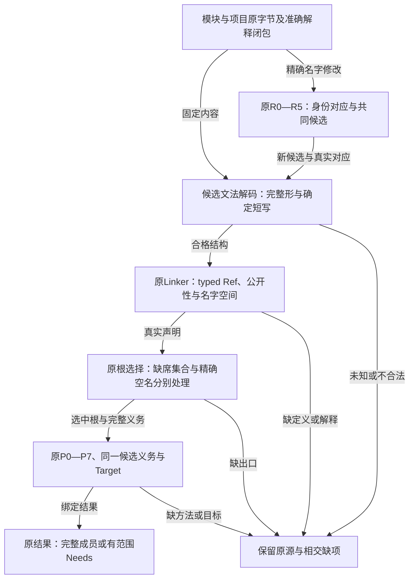
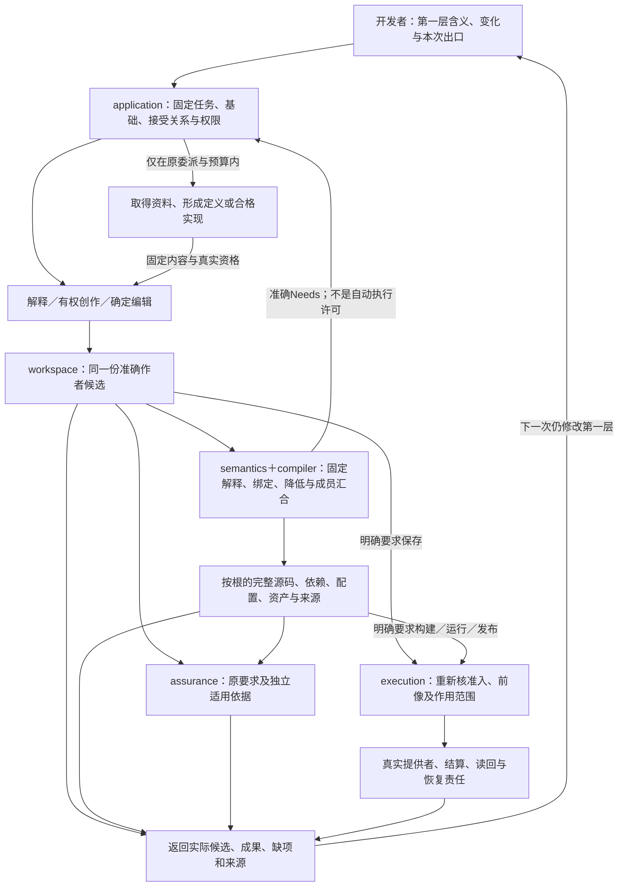

# 第一层编译承接

> 设计候选；与既有规范共用作者身份、语义与执行责任。生产实现与正式采用分别取证。

## 继承合同进入原编译链：只消除重复作者输入，不消除义务

本节落实[固有合同与作者差异](../作者/第一层语言.md#inherited-contract-author-delta)。它是既有I0—I8、`bindIntentScope/composeIntentConstraints`、C0—C6及P0—P7的接合，不建立新的Contract IR、全局合同数据库、公开工具或并行求解器。当前Task/SourceSnapshot、ModuleUse/Definition/Use、RequirementTerm、BoundaryView、MethodSpec/UseBinding和Claim已经承担输入、绑定、要求、实现及证据；下文只固定这些消费者之间必须保持的关系。

### 输入、工作项与输出仍由原对象承担

候选模块、工程与编辑使用同一[完整文法](../作者/紧凑结构与同源编辑.md#final-first-layer-codec)。下图是原owner间的交接，不增加编译阶段；根选择也不撤销独立已接受的义务。

输入固定本次目的、根及独立接受条件、作者候选和解释修订、精确导入/定义、实际Use及参数/主体绑定、适用政策、当前有据事实、默认与委派。运行时才应取得的值保留为有类型运行参数及其取得责任，不要求在编译时伪造值。外部资料、已部署能力和真实Grant按各自渠道取得，不能从引用成功推定。

一项待处理合同使用保留原发生点、被引定义与解释修订、词法绑定、主体、输入/环境域、条件与备选分支、时间/观察/单位、所求出口、来源和证据强度；这些是原义务工作表的派生上下文，不要求新增每条作者声明的字段。相同定义的两个Use不自动共享实例；相同命题的独立接受来源不因共享计算而消失。

输出是原有效Requirement/Obligations、实际读集及支持关系、可解释的作者差异和残余Needs；取得实现后才产生原UseBinding和目标贡献。作者源保留精确引用、独特决定、独立验收来源及有意义的显式固定，不回填全部继承条款、默认展开、推导类型或证明图为另一份可写长源。查询可显示完整有效合同；修改应回到真实owner，不能直接编辑派生结果。

### 取得、实例化与消解的确定次序

| 原责任中的动作 | 准确处理及消费者 | 缺项和失败出口 |
|---|---|---|
| 固定适用根与接受范围 | 从实际Root/Use、传递引用和独立已接受义务开始，沿已选定义取得其公开合同与精确解释 | 导入只令名字可见，不激活所有库要求；也不能省略一个Goal或删除本次输出选择来撤销已有独立义务。 |
| 绑定合同发生点 | 在定义自己的导入环境中解析参数、名义类型、主体、域和单位；卫生代换，保留量词顺序、共享见证及激活条件 | 身份不明、解释缺失和不合法类型分别保留，不以同名合并；旧画像不理解的新字段不能静默跳过。 |
| 保留合同的完整关系 | 将正常/失败、帧、不变量、进展、效果、资源与变体接到原Requirement及BoundaryView；保持All/Any/When及专业关系的结构 | 未选备选不成为执行前置；未知条件保留条件义务；不能把A⇒G扁平为无条件G，也不能把不同分支拼成未被接受的新方案。 |
| 核对前提与支持 | C0—C6对每个实际前提寻找输入契约、上游已合格保证、明确环境假设或真实观察；只在适用域闭合后使用其结论 | 条件性结果可准确交付；没有支持的环、候选自证和矛盾假设不取得无条件完成。缺证据不等于缺含义。 |
| 合成独立要求、默认与委派 | 硬条件按真实语义共同满足；默认仅消费其正式槽位与覆盖规则；可推导内容直接取得，已委派选择由有权系统固定 | reset不删除被引不变量或他方要求；默认冲突不能由后端换成另一个值冒充原省略语义；有意保留的合法选择不误报歧义。 |
| 复用判断并消简待问 | 沿原同语境共享或有据蕴含消解重复检查，同时保留独立来源、作用域、条件和反向消费者 | 无等价/蕴含依据时保留两项，不需要为去重求解一般程序等价；后继答案或基础变化后撤掉已可推导的问题。 |
| 取得同一合格实现 | Resolver用完整义务和Method的真实前提筛选、组合或创作；同一主体的共同要求必须由同一合法选择满足 | 方法只覆盖较窄输入、额外权限或较弱进展时，不能反写产品要求；找不到方法与已证不可实现分别报告。 |
| 降低、检查及作用 | P阶段消费固定UseBinding、输出成员和来源；assurance按准确Claim核资格；需要现实作用时execution重新核前提和权限 | 类型、结构、模型结论、目标生成和实际履行分别返回；不以合同已继承、模型为真或测试自洽直接签发产品满足。 |

本表没有增加八个新阶段。编译工作表按实际依赖推进；已固定且合格的库调用可直接复用，独立根不等待无关专业理论、运行观察或全部未来条件。缺语义时交准确解释创作，缺事实时在权限内取得，缺方法时交供给侧，真正未委派且影响接受结果的差异才交给有权作者。普通产品作者不被要求填写Method、解释器、证明项或目标源码来填补系统能力缺口。

### 两种闭包不能混为无限展开

**合同取得闭包**是准确源图中本用途实际需要的定义、参数、条款和依赖；它不枚举每个运行对象、无限量词域或所有未来事件。有限引用图按原SCC/发生点规则取得；递归定义收头并保留引用，参数化实例按原类型/特化规则有界处理，不通过递归内联制造无限或指数结构。未知分支保留符号条件，不能为方便取else。预算不足保留尚未取得的边及其消费者，不把当前前缀冒称完整闭包。

**逻辑后果闭包**涉及原条件在所选逻辑下能推出什么，一般不保证全部可判定或可有效穷尽。系统使用当前合格的摘要、推理规则、有限模型或证明，返回已支持命题及残余；无需枚举所有逻辑后果才允许普通编译。有限单调规则可以按其前提求固定点，非单调否定、开放观察、规范优先、概率和运行反馈按真实专业语义处理。原[义务身份与消解](../编译/组合前提与进展闭合.md#obligation-identity-discharge)仍拥有共享、到达次序和重新入队算法，本节不另设一个visited即完成的缓存。

工作共享绑定命题、词法环境、主体/输入、解释、条件、观察与用途。共享纯计算不合并独立作用、随机样本、运行实例或两次读时钟；结构相同也不自动是同一Claim。模型存在性、行为细化、跨轨迹、策略及概率保持使用相称方法，不能统一成轨迹集合缩小即保证更强。

### 前提还在运行时成立：把责任降低到真实边界

运行参数、时效性事实和动态权限可以在编译时未知，只要其合法域、取得位置、失败语义和使用边界已经确定。生成物必须真实取得并检查所需事实；能静态消解的前提不重复运行检查，无法判定的前提也不能伪造成一个总是成功的guard。若检查发生在不可逆效果之后，它只提供检测而不提供事前防止；硬要求需要提交边界能力时，绑定必须包含该能力。

例如预留的容量保证由一次准确pool/epoch上的条件提交或合格权利分配承担；外部支付保证还取决于Provider的操作身份、幂等域、保留期及读回能力。客户端超时、本地没有回执或同一内存对象均不足以证明未发生。前提失效后，按已接受合同停止不合格的新准入、重新观察、改用合格方法或保留未结责任；不可通过关闭不变量继续返回同样成功。允许的降级、补偿及较弱保证必须有独立接受来源。

不能用拒绝所有合法输入或永远等待来履行安全合同。若原要求有正常成功、进展、公平、容量或期限义务，方法必须同时取得它们；环境确实不足时保持具体冲突或条件性结果。编译可以合法生成接收未来输入的程序，不等于已经观察到那些输入，更不等于现在已经执行业务。

### 变更、缓存和恢复继续消费原来源图

读集除正引用外还保留实际消费的缺席、公开出口集合、变体/候选集合、默认、版本选择、政策生效、事实覆盖和证据适用性。合同未改字节但解释改变、Provider资格撤销、共享资源绑定改变或观察被更正，均可使相交结论失效。新增无关库不激活其义务；真实影响范围之外的合格结果继续复用。

去重不能删除撤回语义。两份独立接受要求内容相同，撤回一份后另一份仍约束产品；两份独立支持中一份失效，只有剩余支持仍合格时才保持结论。声明环不能靠互相仍被引用维持资格。新增更强义务即使命中旧计算，也重新核支持并保护新要求的发布归属，旧回调不能清空新残余。

切换Definition变体、修改独立产品政策、把默认改成显式同值固定、替换Method、更新运行事实和撤销Grant是不同变化。前几种可能需要作者候选与消费者兼容，方法替换须保持旧合法输入及完整保证，事实/权限变化由相应运行及证据责任处理。旧源、在途调用、既发效果和恢复材料保持原修订；升级不将历史执行改成新合同。共同提交失败按原候选/前像/恢复协议保留双方，不新增第二合同日志。

### 具体消费者和可检验出口

`bindIntentScope`负责确定同一任务、根、对象与接受范围；`composeIntentConstraints`消费完整继承条款及条件，在原义务集合保留其来源；原BoundaryView与C0—C6传递前提/保证、效果/资源和联合残余；`resolveUse`及目标组合器消费同一合格选择；assurance使用独立接受条件和真实证据；编辑、Explain与Impact读取这些既有结果，不拥有一份可写effective contract。

源码例中的CanonicalTouch/CanonicalOverlap及预留关系由定义承担完整保证，应用源只引用选中的关系并给独特参数。其规范、来源和算法改变都能沿同一链定位；具体正反条件见[第一层验收](../运行/验收/第一层开发面.md#inherited-contract-acceptance)。这些是实施合同，不是已运行Reader、方法或端到端符合性证据。

## 第一层请求由产品承接，不把后续各层交还开发者

所选第一层候选以[唯一文法](../作者/紧凑结构与同源编辑.md#final-first-layer-codec)和[配套Project](../作者/工程源/清单模块与绑定锁.md#converged-project-roots)共同进入原P0—P7。P0固定模块/项目及传递Schema的准确解释，P1/P2按typed槽绑定Unicode名字/结构Ref和公开根，后续消费原声明与实例；不得在嵌套Goal中回落到旧字符串Reader。根的export缺席与空串分别处理，缺Method/Target只阻塞实际依赖，不将新源重写成旧格式来消除诊断。名称修改沿原R0—R5形成同一新候选，再使受影响根/Claim/目标成员失效；旧Operation不随新候选改义。

本节承接[第一层作者合同](../作者/第一层语言.md#first-layer-author-language)和[同源编辑](../作者/紧凑结构与同源编辑.md#first-layer-source-and-editing)。本节的“编译器代劳”指Gift产品内application、workspace、semantics、compiler、assurance及有权execution的协作，不要求确定性编译内核直接执行模型推理、网络检索、安装或任意现实动作。用户只有一个常规意图作者面；产品内部仍按原十职责和六工具分责。现有“开发AI”可以是产品取得的受控解释/创作能力，不是要求每个用户另组一套会填写全部下层接口的外部代理。

### 输入与输出的最小承接

application从现有Task与会话取得原要求、目的及本次停止点、准确工程基础或明确新建上下文、已选择主体/根、独立接受条件、可读取材料、设计委派和真实作用上限。已有字段与引用足以承担时，不建立新的必填请求信封。普通作者不必知道candidateRef、EngineImage、MethodDescriptor或各阶段名称；协议客户端负责传递它实际取得的引用，不能以此免除准确基础检查。

一次第一层变更向用户返回：本次被理解并接受的变化；实际结果及其准确对象；系统作出的有后果选择；真正仍需其决定的差异；具体缺项和不受阻的结果；若已发生作用，则返回其真实结算与残余。可以按需要展开证据、源差异及下层细节，不默认打印整棵中间表示。未展示不等于已完成，解释不可替代来源。

### 承接算法与正常成功路径

1. 在原Task上固定目的和基础，取得相交源、接受关系及已知上下文。已有精确结构修改直接进入相应owner，不强制再自然语言解释一次。
2. 使用既有I0—I8处理独立含义、推导、默认、委派及待问消简。常规声明、实例化、私有辅助定义和必要导入由系统生成；只将尚未委派的公开区别交给有权主体。
3. 将候选解释落实为一份准确作者候选。需要创作新概念时，系统形成其签名、真实定义/规则、观察、组合及区别见证；不得只给一个新名称。候选保存可以尚未通过所有语义检查，但不能标可生成或满足原要求。
4. 在固定解释及真实绑定下进入原P0—P7。可复用方法直接进入；缺Method/Target或资料时，内核返回原Needs，application只在当前权限和预算内取得、适配或创作，固定新输入后继续。固定编译本身不暗中联网或猜新意义。
5. 选择与创作必须同时承接原独立接受条件和真实共同约束。生成程序、生成测试以及使二者互相一致，不能单独证明原要求满足；需要独立依据时由assurance按原合同取得。
6. 按根汇合真实实现、公开接口、依赖、配置、运行资产、来源及本次所需检查。Library、CLI、UI、Worker等共享成员由同一布局责任协调；只完成一个根保留其成果，不签发整个共同交付成功。
7. 目的只到设计/生成时就在该出口结束。保存、构建工具、运行、部署或迁移有真实请求和准入才执行；目标程序具有某动作，不授予本次开发过程该动作的权限。
8. 返回或保存可以跨会话继续的准确对象与未结责任，关闭本次拥有的临时资源。新要求再从同一第一层修改；系统沿真实影响更新实现、目标及检查，旧运行继续绑定旧制品，未结操作仍按原身份恢复。

这不是八次用户交互，也不是新的状态机。没有实际阻塞时应在一次合法请求内完成已委派工作；有真实缺项时只停止依赖它的后继。

### 下层缺口如何返回第一层

| 真正缺口 | 产品必须做什么 | 不允许转嫁给作者的内容 |
|---|---|---|
| 指代/对象不明确 | 先读选择、源与已知上下文；剩余有差别时说明具体候选对象 | 让用户手填内部节点ID以代替可取得的定位 |
| 含义存在独立未决 | 给出会改变公开结果的选择和后果，并重求原待问闭包 | 将所有尚未具体化字段变成问卷 |
| 含义已定而定义机器内容不足 | 系统形成准确声明与解释候选，取得所需资格 | 要求应用作者先写语义库、Decoder或IR |
| 缺适用实现 | 复用、适配、合成或受控创作；固定方法与支持范围 | 让用户默认改写为普通函数或手工拼目标代码 |
| 目标/生态不具备所需保证 | 说明相交保证及所需适配；在有权范围形成其他合格方案 | 偷换目标、缩小输入域或删除硬要求 |
| 真实环境、私有事实或凭证缺失 | 在权限内主动读取，无法取得时只请求具体事实或授权 | 编造事实、推导秘密或让文本许可变成真实Grant |
| 证据、预算或求解尚不足 | 保留已有可行候选与准确覆盖，允许独立工作继续 | 将未找到写成无解，或把有限测试写成全部正确 |
| 并发变化、部分作用或恢复未决 | 查准确前像、原操作和实际提供者，保持双方内容及残余 | 让用户手改journal/lock来“恢复绿色” |

分类用于将原诊断解释回作者问题，不增加新的公共错误码或字段。下层路径、错误码、精确对象仍可展开，不能为了友好提示删掉排错所需信息。

### 创作与确定重建的接合

创作可以有多个候选，但被采用的作者含义、解释及实现内容须固定。普通重建不重新邀请模型解释同一句话，不悄悄升级库、重新接受假设或更换业务政策；显式再优化/升级产生新的候选及其相交检查。实现自由可以被合法重新选择，却不能改变已接受公开含义。

一次补取返回新资料时，固定其内容、身份、允许用途与实际读集；外部文字只作为材料，不取得任务指令权。原预算、作用限制和不可信材料边界传递到子任务，不能借“编译器负责一切”赋予无限执行权限。出现同输入的确定失败时不盲目循环；只有输入、资格或适用方法真实改变后才按原续接合同继续。

### 六工具的唯一接合

用户的查含义/看影响由query承接；作者差异及系统补齐的声明由propose或直接文件捕获承接；生成由preview承接；准确主体的检查由check承接；保存/发布到约定目标由apply的原模式承接；真实执行及原操作控制由operation承接。每种工具只做自身已协商的事，不增加一个可以绕过现有合同的`doAnything`或第七工具。

没有现成Facet的新定义仍可由系统物化为完整files候选，不把`intentCatalog`变成语言的表达上限。基础六工具不接受的扩展必须准确协商；旧客户端/Reader保全或拒绝未支持的字段，不忽略后假装已经完成全部意图。

### 一层作者面与内部责任交接

此图只展开本节创作/生成及其条件性作用，不将纯查询强制经过全部节点。资料取得与创作也可能有需要准入的外部动作，Supply节点不构成权限旁路；创作候选不是已获接受内容。返回准确结果与真实作用结算仍是不同出口。

### 从短输入到准确源：沿原接口落实，不增加万能请求对象

以下是已有责任之间必须实际存在的交接，不是新的公开API、IR或阶段枚举。对照原Task、SourceSnapshot、Definition/Use、EngineImage、UseBinding、Obligations、ArtifactSet及Claim/CheckRecord完成即可。

| 交接 | 取得的准确输入 | 返回及实际消费者 | 失败/恢复边界 |
|---|---|---|---|
| 输入取得到作者解释 | Task目的、基础修订、已选择对象、原话/结构差额、独立接受条件与委派 | workspace上的来源位置、对象绑定及候选作者内容；供propose/preview继续 | 源不可读/指代不明时保留材料与准确缺项，不创建假对象 |
| 作者解释到语义闭合 | 严格解码的定义、导入锁、专业解释、参数/角色绑定 | 现有类型/效果结果、准确意义、残余Needs与原条款来源 | 错误字段、名义冲突、歧义和缺解释不混成同一个“无法编译” |
| 已定语义到实现选择 | 同一被选根的硬条件、实际观察、可用方法/供给及预算 | 原UseBinding或待补取/创作请求；供降低器和保证评价消费 | 实现候选不得反改原要求，外部供给失败保持原源和独立结果 |
| 实现到目标贡献 | 准确主体/绑定、Target画像、公开接口、真实依赖和资源 | 原LoweringResult/贡献、布局和SourceMap；由同一目标组合器汇合 | 成员冲突、隐含运行依赖、目标不支持不能用空文件补齐 |
| 完整目标到检查/作用 | ArtifactSet、独立Claim、实际环境/方法和当前权限 | CheckRecord或原Operation/Attempt回执，分别对应准确目的 | 检查失败不改写期望；作用未知先查原操作，不换新ID盲重放 |
| 后继修改到继续 | 原源身份、B/L/U、变化后的接受关系和未结运行责任 | 新候选和相交失效；不相交成果按资格保持 | 旧结果不能安装到新基础，旧运行及未结作用仍属于原代 |

类型、角色方向、时序和比较政策来自各自已接受定义与实际连接；接口不要求作者再维护一份“输入输出角色表”。系统能唯一推导时自动形成；真正存在独立业务选择时回原澄清过程。统一交接的目标是每个结果都有真实消费者，不是把所有数据复制进一个全局当前对象。

### 每次精化保留什么，谁检查

解释阶段保留原任务中的独立区别、来源和接受关系；精化阶段保持输入域、公开结果、错误、效果、时序与所选质量；目标阶段保持所声明语言/ABI/资源和成品成员；真实采用则重新核当前前提与权限。每次变化都沿原Claim/来源说明其保持关系与残余，不新建另一份永久“精化证书数据库”。

这里有三种必须分开的差额。等义表示只改变编码或组织，不能改变接受行为；合法实现精化在原允许行为内作选择，但保留全部量化、概率、上下文和进展保证；要求变更改变允许行为或责任，只能来自有权的新接受。变得“更确定”不一定安全：共享一个随机位给两个本应独立的输出，就是同时缩小轨迹集合并破坏联合分布。

原先纯值性质的证明只覆盖纯值；没有写入的声明还要由实际效果/实现路径支持。SourceMap能定位原条款但不能证明降低正确；目标编译成功不证明原任务满足；一个候选与自己生成的测试一致也不足以独立确认意图。系统优先复用同对象、同前提、同方法的成熟证明和实际证据，只为新增差额取得必要检查，不把“独立”误作每次必须另叫一个AI或重跑全部上游测试。

观察不可得、来源互相冲突或方法不支持，继续保持原四态证据与准确Needs，不把未知变false后套not。不能因为某个强Claim未证实，就丢掉已有较弱且适用的结果；也不能用较弱结果代签原强要求。

### 用最小合格方法求实现，不先建设一个全域求解平台

系统先消去准确复用、定义展开、唯一推导、纯默认和可证明的简单结构差额；已有合格原生实现直接绑定，无差额时不造转发层。其余问题按真实性质选择有限匹配、约束求解、关系/状态方法、程序合成或受控创作；方法资格、候选域、目标和预算由原实现选择模块拥有。查询与创作共享原问题身份、输入和预算，不建立相互调用却没有终止条件的另一套协调器。

SyGuS把背景理论、语义要求与候选语法分开，是专业合成的可复用责任划分；本设计采用这一分工，不把SyGuS语法替换为开发者必填输入。系统可以从现有供给和所选目标形成候选语法，但语法外没有找到程序只能说明当前搜索空间不足，不能宣称原业务要求不可能。[SyGuS 2.1标准](https://arxiv.org/abs/2312.06001)

候选取得后，先检查与独立原要求的关系，再固定实现内容与绑定。反例驱动的修正保留被反例击中的原义务、准确输入和已知负候选；确定同输入同方法已经失败时，不无变化重试。一个Method改变后复核其真实消费者及选择资格；不是只更新版本标签。支持域外的内容可以生成设计候选，不能以完整生成状态输出只有签名或总是报错的实现。

搜索退出按事实分开：找到合格可行方案、在准确有限域或有证明的方法下证明无解、缺输入/能力/许可、预算用尽、方法故障、取得但尚不合格的候选。它们复用现有状态/Needs，不从本节新造公共枚举。仅有公平枚举不证明能在给定期限内找到结果；把穷举范围扩大也不等于进展。是否继续优化由原目标、政策和共同预算决定，不能为了“最好”无限阻止已符合请求的交付。

最优结论必须绑定候选域、环境、观察、成本模型、误差与证明范围。可以交付已证可行、有限域最优、具有真实比较优势或未支配候选；没有可比依据就不捏造排序。当前既有的成本政策继续生效，但统计不确定、未知边界和硬要求不能被它抵消。研究中的不可实现证明可用于限定特定搜索域；例如NOPE论文针对SyGuS语法内的问题，并不说明所有替代语法或专业方法都无解。[Proving Unrealizability for Syntax-Guided Synthesis](https://arxiv.org/abs/1905.05800)

### 冲突解释与自动修复不能改变原任务

系统先把冲突追到具体作者发生点、被接受条件、实际对象/单位/时间和方法假设。对同一对象相互矛盾的硬要求，返回可核的冲突子集或反例；可以尝试得到不可再删的冲突子集，但未执行最小性证明时不称“全局最小原因”。也要区分要求自身冲突、当前实现方法冲突、所选目标不支持和证据不足；后面三者不要求撤销业务要求。

自动修复顺序由真实语义保持决定：先补已有缺失资料或绑定；纠正不影响原义的表示/适配；在现有委派里更换合格实现或调度；仍不足时给出会改变行为或资源承诺的准确替代。最后一类是要求变更候选，不能自动作为原任务的完成。若无剩余授权，可返回局部成果和当前不可完成的具体交点，不将整个源置空。

下层错误需要同时能被第一层理解和被维护者定位：报告哪条要求受影响、在哪个输入/环境失败、实际受阻责任与原错误对象、可保持的结果以及后续所需区别。对无权披露的内部信息保留受控细节，不通过“友好摘要”删除具有权限的维护者所需证据。

### 第二次修改的影响不只沿数据值传播

对一个已接受差额，先核是对象身份变化、业务含义变化、默认/委派变化、实现绑定变化、目标画像变化、现实观察变化还是仅呈现变化；同一个操作可以同时影响多项。沿实际来源与依赖传播，不因显示名或JSON片段未变就复用旧结论。

有效读集包括正引用及真正消费的缺席条件、集合成员、导出选择、候选集合、解释版本、政策与用途。新增一个Provider、删除一个导出或更换同名解释，可能使原选择不再有资格，即便当前源值相同。反过来，无关文件改动也不要求全系统作废；按原增量方法保留有依据的结果。相交证据的主体、覆盖、方法、环境或接受条件改变时重新评价，不能只比较测试输出。

同名格式标签不证明解码兼容。共享`/2`设计内容发生变化时，读取、编辑、链接、目标与回源必须绑定准确内容修订；旧客户端不理解新字段时保全/拒绝，不能删字段后重打印为“兼容”。若要升级现有工程，使用原单写者迁移和前后像恢复，不将候选设计分支的采用等同生产Reader已经切换。

固定重建不禁止运行时自适应。编译固定的是策略、可用观察、允许动作、目标/资源边界和解释；实际反馈数据仍可在运行时改变合法选择。适应策略超出该域、修改业务承诺或替换当前运行代码时，须进入原升级/准入过程，不能凭“自动优化”取得任意自修改。旧调用与未终结操作保持原代责任，取消编译不销毁已经采用的运行实例。

删除作者要求、取消某根本次输出和退役已发布产品是不同动作。最后一项仍可能有外部使用者、数据、兼容和恢复义务；系统负责求其闭包，不能让第一层删除一个节点就物理删除所有历史成员。没有这些义务的纯未采用候选可按原资源归属释放，不为它建立永久流水账。

### 简洁性由实际工作量和重复信息验证

短输入的成功标准不是把复杂定义藏到一个预置名字后面。独立业务信息仍需存在，但系统形成并维护其机械编码、引用、接口和实现，不让用户重复决定。第一次自动创建的定义若之后只能靠用户手写下层内容维护，就不满足第一层闭环。

默认路径复用既有源和固定供给，局部改动先做相交分析；纯查询不持久化操作日志，不启动后台服务；必要的完整定义可以首次形成，后继按准确定位读取和编辑，不重复把整库发送给模型。静态值与普通原生库不因全局治理而被包装成一组服务。真正的权限、证据和未结作用责任则不能为了短延迟省略。

评价使用同任务、同保证、同成熟库条件下的首次创作、第二次修改、失败恢复和交接成本；既计用户决定与维护，也计AI推理、读取、生成、检查、供给维护和真实执行。没有实测就只声明本设计取消了哪些必填重复和责任转嫁，不宣布Token、时间、内存或总成本改善的百分数。

### VS Code 接合不改变编译器承担的工作

VS Code扩展是原entry的客户端适配者，语言智能读取现有语义查询；它不是第二编译器、Plan writer或运行权限源。用户手动编辑源、AI建议和结构操作都进入同一文档/候选关系。短源码的确定展开由Reader/semantics承担，不依赖AI推断，也不在扩展端秘密维护另一个业务模型。

本轮宿主接合保留原四轴控制、决定链、原生维护、资产、跨语言、运行调试、协作和恢复全部责任。实际新建、修改、导航、编译与作用的接口/失败规则见[VS Code原生开发面](VSCode原生接合.md#vscode-native-author-surface)。专门操作只有在本次任务激活时才启动；纯文件阅读不执行安装，保存源不代签构建，Ctrl+Z文本不回滚现实作用。

## 四态投影不单独签发满足或运行资格

保留原两位证据代数：T=(1,0)、F=(0,1)、BOTH=(1,1)、NEITHER=(0,0)，否定交换两位，合取(s₁∧s₂,r₁∨r₂)，析取(s₁∨s₂,r₁∧r₂)，蕴含仍是¬A∨B。这是已固定公式的证据汇总，不是把世界改成四种Bool，也不是任何提供者返回一个位对就取得独立证明。

新的实际反例是A=NEITHER、B=BOTH。¬A∨B=(1,0)，¬B∨A也为(1,0)，因此双向蕴含的合取得T。这个结果符合原代数，不能靠偷偷改变iff表修补旧格式；但若直接把T当“两个含义已经一致且可以批准”，就把缺观察与互相矛盾的支持联合洗成了成功。

实际接纳仍由原Assurance/Claim consumer处理，不新造第二证据数据库：

1. 固定被判断的语义域、对象、范围、解释、时间和独立已接受义务，保留所用支持/反证的出处与方法修订。Scope或时刻不同的观察不能因命题同名而直接合并。
2. 两位投影可用于显示、排序和专业计算，但完成要有**对应方法合格的推导或观察见证**。拼接证明时核实际使用的共同前提；同一语义主体上的p与¬p不能被当作共同一致前提签发普通经典通过。特殊容错/矛盾逻辑画像按其原明确资格报告，不自动继承经典结论或HostGrant。
3. `any(P,Q)`若P有独立合格见证，Q未知或冲突而又不是独立硬义务，不应被全局“必须每个叶都确定”误阻塞。所用分支、共同条件和单独义务各自判定；未使用的冲突不被悄悄删除，但不凭它阻断不相交根。
4. 对普通总Bool函数，可用独立定义相等/关系证明完成相应等价Claim，无须先采样所有输入。该证明绑定它真正的经典语义及假设，不把NEITHER经逐原子投影得到的旧FDE公式重新贴成T；证明结论与观察汇总分别保留。
5. 候选自己的实现和同一个builder生成的oracle不是两份独立证据。超时、观察缺失、适用性未知或有冲突，只阻止依赖它的结论；不把正常纯值关系全部改成永久未知。

对本反例可以给出有限且具体的接纳算法，不要求先决定一般理论一致性：原子的证据身份包含准确Meaning/实参/观察域/时刻/解释修订，正负见证记录到这个身份而非显示名；候选推导按原规则合并实际所用见证，发现同一身份的相反使用或尚未处置的BOTH即不能签发普通无冲突通过。逻辑OR只选择真正有资格的一支，AND汇合同一个用途的前提；互斥冲突出现后可在原预算内寻找另一个见证，不能为了消除冲突删除独立硬要求。这个反例的两条蕴含分别依赖B的正见证和负见证，汇合时可直接检测冲突。

签名/身份精确相等足以检测这一类冲突，不冒称它解决了任意公式之间的逻辑不相容。更强理论关系用所选专业方法和实际证明基础核验；尚未证明适用的前提只产生带前提的结论，不能从条件证明变成无条件产品满足。可信域政策允许舍弃过期/不适用观察时，保留舍弃理由与原观测，不仅为让候选通过就挑选有利来源。多个证明路线不预先展开成指数个组合：用已有证明/查询服务惰性取得有限候选并计真实预算；正常准确Bool解释无需建立全世界证据图。

上述接合修的是“证据投影→接受/作用”边界，不改变已有无冲突Bool范本的正常路径，不让开发者维护证明图。后继数据改变证据、方法、主体或解释时重核相交Claim；原绿色缓存不授予当前权限。当前没有生产消费者运行证据，故不能报告已修复一个实测运行漏洞。

## 有限源码不能因为简写展开变成指数级机器工作

令F₀=p，Fₙ=iff(Fₙ₋₁,qₙ)。源中每一层只增加一个iff和一个原子；在all/implies各计一个节点且尚未再次展开implies的口径下，朴素树复制的展开满足C₀=1、Cₙ=2Cₙ₋₁+5，得到Cₙ=6·2ⁿ−5。30层仅61个源节点，却可制造6,442,450,939个展开树节点。即使最终只解释两位值，先把树物化也会在进入业务分析前耗尽资源。

确定展开应复用现有纯项图/查询和源发生点：一个源节点在固定词法环境与解释下形成一次结构，父构造用边引用；各独立条款和使用发生点保留自己的身份、来源、作用时刻和接受关系。必要时由已有let/函数引用与目标贡献保持共享，不要求作者写缓存、人工抽取临时函数或设置编译步骤。已绑定定义不默认递归内联，SCC、普通函数递归、有限宏展开和领域固定点沿原责任分别处理。

共享的是结构或有资格的纯计算，不是把两次IO、随机读取、不同时间观察和不同权限主体合成一次。相同表达式内容不自动拥有相同运行实例或相同Claim。目标语义要求独立求值时保留每次事件；缺目标共享表达手段时，使用合格封装方法或准确报告成本/目标限制，不声称线性输出。查看展开视图按节点与需要惰性展开，编辑映射回源发生点，不将整棵复制树写进磁盘。

资源预算分别计输入字节、节点/边、引用解析、推导工作、活跃缓冲、外部动作和输出。额度不足保留原输入和准确未完成范围，不能通过不断重启子任务清零预算；也不能把一条节点共享结论夸大为所有组合推理都线性。纯普通程序不为此被迫初始化持久作业平台。

### 原有专业规则的实际接合，不重开已定语义

公开类型、内部表示、原生ABI、错误/取消、资源与效应分别消费原合同。开发者指定“不写输入”时，实现读取者检查实际effect/borrow和宿主能力，不用返回内容相等替代零写；某个关系解释函数effects=[]也只说明该解释计算，不证明所选择的业务实现纯。

单次应用请求含多个文件时，冻结候选、编辑器文本应用、磁盘保存、Git索引和外部效果是不同步骤。采用原journal与前像读回；不能因为一个编辑API返回成功就发布整个根。无法获得强原子边界时，选真实较弱画像、暂存并按能力发布，或准确拒绝相交强保证；不把强要求默默改成best effort。

后继修改的“只改第一层”并不保证每次只改一个产物文件。私有参数可局部影响，公开协议、共享单位或全域约束可能影响整个根；系统负责真实重核，而非为了漂亮diff保留错误旧产物。受管目标编辑只有有准确逆映射时才回源，否则形成显式作者接管候选，旧生成路线和未结责任一起处理。

## 业务规则到真实作用：必须生成的接合，不强制所有业务使用同一数据库

共同要求沿原接口精化成读/写/观察、前提、不变量、正常与拒绝分支、进展及恢复义务。这里的“产生义务”不意味着增加作者必填字段或建立中央事务管理器。纯数值关系保留直接计算路径，状态性业务才激活相交存储和执行机制。

### 局部合法变化不能直接当成合法并发组合

容量为1的同一pool，两个分区都从空状态接受各1单位的新预留；每个分区单独满足容量约束，合并两条成功预留后占用为2。复制状态最终收敛不修复这项违约，选择任意一条记录丢掉也会撤销已经给出的成功承诺。

实现选择必须对本次具体操作与不变量判断合并是否保持，而不是给“最终一致”“CRDT”“事务”名称统一评分。Invariant confluence研究提供了操作/约束相交分析的成熟基础，其结论依赖论文给定的事务、合并和有效状态模型；不推广为Gift全部运行语义的无条件决定器。[Coordination Avoidance in Database Systems](https://arxiv.org/html/1402.2237v4)

本例有两条真实可用路线。其一，在真实状态拥有者提供的原子条件更新、事务或等效受信串行边界中检查并发布；失败重试重新取得准确基础，不先返回成功。其二，预先分配不重叠的权利预算b_i，保持sum(b_i)<=capacity，各节点只在自己的剩余预算内接受。节点间转移权利必须保证同一份权利不同时算在两端；未决转移保持不可再次花费，不能以两次独立余额更新代替转移协议。后者可支持有限离线准入，但不能承诺每个节点在本地权利耗尽后仍不通信成功使用全局所有剩余容量。

没有这两类实际能力而又要求任意分区节点都独立成功接受当前唯一资源，同时永不超额，不能靠代码优化满足：各节点在只有自己收到请求的世界必须成功；分区并发世界给它们相同的本地观察，就会同时成功。这个反例限制的是这组共同条件，不否定通过协调、权利分配、可接受等待或改变明确交付约束形成合法实现。其他不变量如无额外约束的标签集合并集，可以选择真正保持性质的无协调方法，不被迫共用本例的锁。

### 原子判断、公开答复和未知结算的执行顺序

具体方法消费准确pool/epoch、源解释与政策、请求主体/权限、业务key与payload，以及所选边界的预期状态修订。先准备合法纯候选；在真实提交边界重新核相交前提；将状态变更和其内部回执按实际能力共同提交；只有已取得所承诺结算，才返回相应成功。CAS失败不是业务拒绝的自动证明；可以在原预算和授权内重取状态，必须按新的真实基础重新判定。

外部提供者不能加入本地原子提交时，沿既有Operation/Attempt/journal隔离准备、发出、确认和恢复。超时留下未知，不因本地余额未改就推断外部动作未做；也不因为对方返回accepted就报告业务已完成。选择Outbox、Saga或其他成熟路线仅在其保证匹配时采用，名称不能升级为外部全局原子。补偿必须明确是新动作，消费新权限和原历史；原请求若要求不可分割共同成功，较弱补偿不能静默代替。

原接口校验input/output类型只是一部分。真正的Binding还要关联接口调用、被选Goal的角色、观察拥有者、状态作用域、源/策略修订、效果边界、返回语义和Claim。无法形成这些对应时报告准确缺项，不从before/after或函数名字自动猜，也不把补表交给应用作者。模块已有全部可确定信息时由系统完成这一绑定；真实秘密、权威和现场输入缺失另行取得。

### 活性、公平、期限、容量与取消分别取得

每条已接受申请都要有符合原协议的终结或明确持续状态。实现不能通过永不处理来满足“永不超额”，也不能用不断生成pending把有限资源承诺隐藏掉。排队/工作器/外部提供者须说明准入、容量、被服务顺序、取消与故障接管；系统生成所选实现，不要求用户写调度器。

弱公平指动作从某时刻起持续可执行时不能永久不执行；动作反复变得可执行但又被其他动作关闭时，弱公平不保证它最终执行。一个请求只在每个偶数状态可执行、每次却都被别的请求抢先，可以永远等；需要更强公平或队列保留/权利等合格机制，并保持环境假设。公平也不自动给出固定时限。[Lamport, PlusCal Tutorial Session 9](https://lamport.azurewebsites.net/tla/tutorial/session9.html)

固定期限另需服务与环境界。例如一个串行资源、三项每项至少4时间单位的必需工作、共同10单位期限，至少12>10；排程不能消除差额。系统应在已接受约束内寻找真实并行、预先取得能力或其他等义实现，不能只改超时常量。也要保留正常边界：到达率高于服务率不单独证明某个固定FIFO请求永远不得服务，却可能使等待无统一上界、积压超有限存储；不要混淆最终进展、稳定队列、有限容量和期限。

请求已取消、确认停止、目标资源可释放和业务已补偿也分别成立。调度器取消不自动释放仍由设备/外部提供者使用的资源；无法确认时转原恢复责任，不以回到Initial状态抹去历史。

### 规则升级的读集与时点

查询、候选与作用必须分别记录其实际消费的规则域和生效选择。新的规则可以只使未来准入失效，也可以影响已有活动对象；依准确接受范围计算，而不是所有源码变化都强制全域回滚。任何异步迟到结果保留原解释，是否能安装到当前槽位另核；旧事实仍可被查询，不被当前政策渲染成旧时也适用。

对已发动作，原业务承诺与当前执行许可可能出现真实张力：承诺未被解除，但当前已撤权。系统不能继续越权，也不能把义务删掉；用有权读回、移交、替代履行或明确未结责任处理。只有实际取得这些结果，才能更新完成状态。

### 非固定成功判据的任务也不被强制转成假Bool

探索、创作和协商可以生成候选集、比较关系、指定主体的接受以及条件结论，复用原结果协议。编译器不得自行把代理评分当作原质量目标；需要用户判断时只呈现真实有区别的选择，不把无关内部算法全部变成问题。因果目标按准确模型与证据支持的方法求解；资料只能识别等价模型族时，仍可以交付族、共同结论和必要新观察，不能挑一个任意模型后伪称现实效果已知。

这些任务不要求所有语义都编成同一个Bool解释器或数据库工作流；源定义、专业方法、目标与作用仍经原接口组成一条责任连续的产品路径。已有相交规范已包含的内容直接复用，不以这次补充创建第二知识/规范/偏好/操作存储。

## 从有限观察到可用决定：覆盖、变换、结算各有真正消费者

本节复用既有查询、Observation、四态接纳、Frontier、Lowering与Operation。原流规范已区分严格Frontier、WatermarkEstimate、End和Failed；原关系规范已有反连接与ValueOps；本轮不重新定义这些信号，补充其如何支持第一层“有/无、至少/至多/恰好、全部”及动作消费者。

### 固定范围，再构造足够精确的查询摘要

application固定这次目的、原要求、实际根/资源、解释、时间与允许变化；Provider/Source owner取得所需切面及准确成员/未覆盖部分。semantics选定计数的是事件出现、唯一实体、集合值还是多重集重数，以及相关相等与单位。领域方法产生保守且有依据的界或更精确摘要；assurance接纳其前提与范围；compiler将正确关系和所选运行更新策略降低。用户不写这些内部层的接口表，内核也不自行联网补未知事实。

对仅要求存在/下界的结果，可以在取得足够有效见证时早返回。对否定、上界或精确数，取得足够覆盖或专门证明后返回；未取得时交付可用界和准确残余。不能把“没有查完”一概变成无可用结果，也不能把全部partial结果都称final。

### 完备性要穿过真实变换，不能沿数据流边自动复制

| 变换 | 可保持或需取得的具体依据 | 反例及正常继续 |
|---|---|---|
| 过滤 | 选定论域上谓词的解释与成功评价范围；正确处理未知/失败 | 不可解码、超时、无权行不能被当false后宣布其余结果完整；完整可判谓词可正常过滤 |
| flatMap/展开 | 每个输入的合法子域、子结果终结及总范围 | 输入源结束不证明异步子任务已产生全部后继；没有子任务时走直接路径 |
| 连接/反连接 | 同一连接键/时间域的双方覆盖和共同身份 | antiJoin右侧查到零条不证明不存在；精确按键索引的否定见证可替代扫描完整右表 |
| 并集/去重/分组 | 跨源相等、重复出现与对象身份，必要的不重叠见证 | 两源各三项只能推出唯一并集在3..6之间，不能直接报6；若确有互斥域则可相加 |
| 求和 | 缺失贡献的值域与项数界 | 当前和10，仍可能到达−100，不能把10当最终下界；非负贡献才有相应单调下界 |
| 平均/质量聚合 | 分母、权重、总体和相交样本 | 100个零与1个100的总均值为100/101，不是两个组均值的平均50；原组资料足够时直接加权 |
| top-k/排序/截取 | 未见成员可能排名的上界和稳定/并列规则 | 先到k项不等于最终top-k；只有合格剪枝/完整范围才能最终化，预览仍可早给 |
| 采样/近似方法 | 本次总体、抽样模型、误差与所要求的概率资格 | 估计区间不冒充确定全域界；任务本来要求统计区间时可正常交付 |

这些是现有领域方法的具体前提，不增加所有算子统一携带的巨型对象。固定有限输入的普通库可以通过静态结构完成，不启动运行监测；跨源不支持某项强结论时保留较弱但有依据的摘要。抽象包络太粗时，由更精确专业方法细化；精度问题不通过更强的结果标签解决。

### 时间前沿与更正通道的联合闭合

对事件时间窗[a,b)，某源的严格Frontier≥b可以关闭该源合同所承诺的新事件域；估计水位和到时触发没有相同保证。联合结果还要处理所有实际相交分区、动态成员变化、处理中缓冲、子计算和输出时间变换。分区安静不等于分区结束，不能为了推进min-frontier把它移除；有权缩小所选域或得到真正idle/finish合同才改变集合。

尤其要查明源是否允许另一个通道更正、撤回或重新解释旧事件。关闭新事件通道，不等于更正通道也关闭；若更正仅影响另一修订的结果，保留两代输出的准确关联。没有终局证明但请求低延迟时，可返回带范围的可修订结果；任务要求不可修订的全量结果时，等待实际充分条件或准确报告所缺能力，不能偷偷采用“晚到丢弃”。允许丢弃/结算截止的业务必须在第一层被真实接受，该截止定义的是业务政策，不证明现实无迟到。

Beam对事件时间、处理时间、水位和触发分责，并允许对迟到数据生成新结果；这里借用其成熟区别，不声明每个Beam配置都提供严格世界完备性，也不引入Beam作为默认依赖。[Beam Programming Guide](https://beam.apache.org/documentation/programming-guide/#watermarks-and-late-data)

### 更正传播与不可逆作用不共用一个撤销标志

纯查询结果按源/规则/范围新修订替代；正向依赖和实际消费的缺席、成员上界、前沿也参与失效。撤回一个事实不能无条件撤销所有由它曾经支持的结论：尚有独立合格见证时保留该结论并更新来源；没有真实种子的循环支持不能自续。按实际用途对原支持图重算，不新增全局证明数据库，也不拿一个整数引用数证明所有支持独立且仍有效。

需要“保持纠错后总额正确”的消费者，按原结果代和修订接收替换值或明确差量，防止重放累加两次。通知、发货、删除、授权等现实消费者还要有独立作用政策。已经发出的效果不能通过删除旧查询结果抹去；改进后的认识只阻止不再合格的新动作，已发生/未知作用继续由原Operation恢复、移交或获准补偿结算。

执行边界重新核实际源版本、结论资格及当前权限；若查询和作用之间会发生相交变化，需要Provider提供真实条件提交、租约或相应已接受较弱保证。TTL未过、同一内存对象、当前UI绿灯均不替代此边界。程序能接受任意假设CountRange进行纯计算，不等于它能对真实资源作动作。

### 有限资源下的正常退路

某个分区或更正通道无限停顿时，不能以无界缓存等待来兑现有限内存。优先使用合格增量摘要、可授权重读/外部存储、背压或准确的部分返回；需有限期限而环境没有给出最终化能力时，返回冲突或所缺前提。没有获准的丢弃/截断就不能默默修改语义。保留已发生作用的恢复材料与可以丢弃重算的纯缓存不同，不能把两者用同一个回收策略处理。

### 接口替换检查用真实方向，不用包名等级

原兼容比较保留输入、输出、环境、效果、成本和历史责任；对每个新绑定，进一步核回调/事件/返回值方向。一个新提供者接收更多输入通常有利于旧调用者，却不授权它给旧回调传更多种输入。对公开结果新增字段或变体，检查实际旧解码/穷尽性及其开放约定。类型相同而语义从AtLeast变Exactly，本例给出真实反例，不能按结构相同复用旧消费者接受。

这些判断可用包含关系、有限实例、已有证明或有资格的适配完成，不能决定的部分准确保留；不要求实现一个通用程序等价决定器。已有合同明确许可的扩展可以直接继续，不把每次改变都升级成全系统迁移。

## 完整专业解释到同一编译/保证/作用链

本轮具体接合读取[供给与共同结果](../../schema/author/first-layer/SEMANTICS.md#consumer)及[逐用途出口](../../schema/author/first-layer/SEMANTICS.md#consumers)。方言供给清单绑定真实规范和结构摘要；设计签名不提供可执行代码。模块解码、名字类型、模型资格、方法选择、Claim接纳与目标作用逐一交接，缺实现准确为NOT_IMPLEMENTED/NeedsMethod，不把已表达内容退回“不可表达”。

优先取得合格成熟方法，不因本包给了语义就另建全域求解器。确定内核只消费固定映像与准确输入；资料取得/创作由application在现有权限内组织，运行由execution结算。旧调用保留原方法代、源和恢复责任；新方法替换按真实行为与前提检查，不按包名或签名相同就代签。

新源码里的主模型、状态/时间、策略可见性、类型证明、read-from或规范事件是完整的已声明对象，不等于现场事实。运行提供者必须把其真实观察映射到相同主体/修订。某画像的局部模型验证不扩大整个ArtifactSet或其他产品根的资格。

## 专业声明进入真实require及保持依据

复用主干既有性质保持、原C3/C4义务闭合和UseBinding，而不是再建一套验收内核。当前具体方法先把专业模型解释为声明，在同一实际主体上形成义务，再选择候选/观察映像及适用方法；不能将`S⊨φ`直接作为`C⊨φ`。一条前向模拟限制允许行为，但存在恢复、策略、知识和跨执行性质仍需相称保持依据或直接候选检查。完整规则在[合同使用](../../schema/author/first-layer/SEMANTICS.md#model-contract-use)及[资格搬运](../../schema/author/first-layer/SEMANTICS.md#qualification-transfer)。

候选只有一条永远等待路径时，虽然路径属于原规范的允许行为，也不能满足“随时有恢复路径”。同样，两个部件各自条件保证成立，不证明共同进展；合法反馈仍可用真实初态/一步保持和进展论证，不一概拒绝环。变化沿模型、公式、解释、目标映像、证据和现实准入分层失效，按需复用有效计算。

查询可以交付准确模型结论；生成必须取得真实主体及完整目标成员；运行再消费当前授权和物理资源。没有方法时系统继续按原供给创作责任处理，不将缺口改名后交还应用作者。
