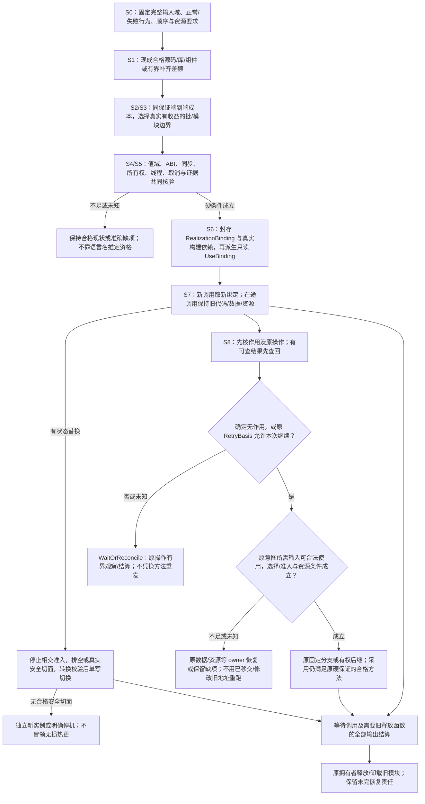

# 实现供给、原生代码与分段优化

本篇拥有“什么可以提供实现、哪些部分能独立优化、怎样在不改产品含义的前提下替换”的共同交接。作者表示见[成品边界](../作者/成品形态与公共边界.md)，原生取得与回源见[原生维护](../开发/原生维护/导入观察与原生资产.md)，实际选择沿[实现选择](../编译/实现选择与设计搜索.md)，版本与最终作用仍由[恢复规范](../运行/持久化提交与恢复.md)拥有。本文不建立新供给管理器、第二套IR、编程语言或动态插件必装平台。

## 1. 当前实施选择

**产品意图采用现有结构作者模型；实现默认直接使用合格原生源码、包和成熟工具。新`.gift`文本前端不是Gift首期的必需产品组件，也不是可信编译种子。** 原有计算文本及其语义保留为明确选择的实现/校准画像；冻结文本意图方案仍在备选目录。没有独立意图的普通原生工程也能直接维护，不制造要求镜像。

Gift自身现有TS实现作为已接受基线保留；其逐能力迁移按[实现语言与机制演进](实现语言与机制演进.md#compiler-kernel-rust-substrate)的K0—K5执行。该规范已选定Rust编译内核与TS/Bun产品控制面的长期分责：新增编译内核能力直接按该方向实现，不要求先完整实现一代TS核心再重写。原生模块、Wasm和成熟子系统仍可作为合格供给，不能因接入一种供给而另开核心生产语言。具体机制按硬保证及端到端成本选择；未知性能不被当成足够，也不凭语言名称预判必然更快或更易改。语言候选、身份／表示边界与同口径改模验证由该规范唯一维护。TS与Rust也均属于目标计划；目标语言、编译器实现语言和参考模型语言是三个独立选择。

`.gift`不因被设为非必需而从历史正确设计中抹掉。它可用于研究一种已定义中立计算画像，或供给维护者自愿采用；其字面文法、默认参数、对象/资源规则必须由相应实现真实支持。不能因为结构要求里有精确Int，便强迫每个算法先写成该文本。也不能因为不用它就把目标的Number近似值当成精确Int。

## 2. 供给种类与共同责任

`MethodSpec`声明候选方法的实际输入、承诺和贡献；有权决定形成的`RealizationBinding`固定所选供给及修订，`UseBinding`则为使用点与Target只读派生必要适配。三者不共用一份可写选择记录。不同种类使用其真实载体，没有每种形式一个平台级Manager。下面是高频承载形态，不是供给种类的封闭枚举；新增种类仍须由真实接口解释，字符串不能自行获得执行含义。

| 供给方式 | 可直接交付什么 | 必须固定/检查的独立边界 | 合适的优化粒度 |
|---|---|---|---|
| 原生源或源码包 | TS、Rust、C/C++、Go等实际源、公开符号与构建定义 | 模块模式、工具链、原锁、源码中的可观察行为与必要资源 | 独立函数、模块、整个成熟子系统 |
| 既有二进制/动态库 | 已生成库、符号和实际依赖 | OS/架构、ABI、调用约定、布局、运行库、签发来源及加载策略 | 稳定窄接口、高批量调用 |
| Wasm/组件 | 模块、导入导出、内存和资源合同 | 标量范围、字符串编码、宿主导入、线程/共享内存、栈与陷阱映射 | 跨平台纯计算、有限隔离组件 |
| 进程或工作器 | 可运行程序、输入输出协议和启动定义 | 序列化、流控、身份、取消、子进程、崩溃与部分输出 | 粗粒度分析、隔离不可信原生代码 |
| GPU/设备核 | 核、映像、参数布局、装载与同步需求 | 精度、设备驻留、传输、并发、同步、故障与不可抢占任务 | 大批量数据并行，不为细小调用强上设备 |
| 远端提供者 | 版本化服务合同和实际调用方法 | 当前权限、数据离域、延迟、去重、回执、计费和可用性 | 输入已远置或确有整体成本优势的任务 |
| 生成器/模板 | 根据确定输入产生目标源码和资产 | 模板准确内容、生成工具、隐式读取、输出归属和后续检查 | 机械适配、稳定接口差额 |
| 显式选用的中立计算体 | 某计算画像内已定义的程序 | 画像解释、真实读取器、目标保持和运行库 | 需要该语义/多目标保持且实现已合格的范围 |

接口完全相容时可以直接使用、导入或重导出；没有差额就不加转发层。调用框架名、文件后缀和语言名不是资格证。WIT公开边界不描述内部行为；Node-API的ABI保证也不自动覆盖V8、libuv或第三方库，见[采用依据](#sources)。

## 3. 共同输入不是一份作者必填清单

### 开放供给的资格与退出

新的库格式、设备、服务、生成器、编译工具或作者实现，通过既有MethodSpec/Provider接口准确声明身份与修订、可履行义务、适用域、输入输出、效果/资源、Target贡献、失败/恢复、来源/许可和Evidence前提，即可参与候选发现；不要求Core增加品牌、语言或行业分支。需要修改中央品牌switch、复制权限/恢复系统或把行业字段塞进公共IR才能接入时，应修对应供给边界。

发现候选、资格成立、有权选择与真实执行各有不同条件。Provider可以在获准范围生产真实测量、轨迹、证书等有来源的证据材料；材料按[原证据接纳合同](../运行/保证/解释与证据接纳.md#evidence-interpretation-boundary)核准确对象、信任与独立性。Provider不能凭自述给自己的代码签发Grant、被接受的保证/Verdict或发布资格，不能把Unknown自报为Satisfied；需要独立Oracle的要求不因材料来自Provider而放宽。安装、探测、benchmark和实际调用仍走Execution；静态可读声明不等于过程代码可执行。

稳定绑定固定实际method/provider/content revisions和必要闭包，Registry顺序、网络latest和新装插件不能改变它。升级形成后继选择，旧运行、恢复、Artifact及释放函数的消费者归零后才退役旧解释和供给。精确选择与使用点投影由[实现选择](../编译/实现选择与设计搜索.md#realization-binding-use-projection)拥有。

既有方法描述必须能解析出以下信息；能由源、工具与已接受配置取得的，由系统取得。普通使用者不重复填写全部字段。

| 实际信息 | 来源/拥有者 | 取得失败的结果 |
|---|---|---|
| 被实现的准确主体、要求及生效域 | 作者快照、需求实例化、公开定义 | 结构/条件未定；不以实现反改要求 |
| 方法、源或制品、依赖及构建条件 | MethodSpec与实际供给内容 | 缺供给或不可取得；不按同名最新替换 |
| 公开参数、结果、同步/异步、错误与进展 | 实际接口加接受合同 | 差额需合格适配；不存在则不采用 |
| 数值/字符/布局、所有权、别名与生命周期 | 领域语义和目标ABI合同 | 保留不支持边界，不用unsafe标签消解 |
| 外部作用、加载/初始化、线程和回调要求 | 真实代码分析、方法声明、宿主能力 | 作用未知按所请求保证处理，不当纯值 |
| 输出成员与必要宿主进口 | LoweringResult、Artifact组合 | 规格、组件和独立应用分别判断完整 |
| 依据、成本测量与其覆盖 | 实际生产者；assurance评价适用性 | 未测不是零开销，签名不替代证据 |
| 有状态替换所需格式与安全切面 | 实例拥有者与迁移方法 | 继续旧实例或重新启动；不假装热替换 |

源码中的类型可以描述接口，但不自证其实现遵守要求。进程内的类型品牌只减少受信代码误用；反序列化、插件返回和原生边界仍要校验。恶意原生库可破坏进程内所有类型假设，必须在可信边界内才允许同进程加载，否则隔离并接受隔离成本。

## 4. S0—S8：合格实现的选择与机制演进

**S0 定义不变的契约。** 固定精确输入域、正常和失败行为、顺序/同步合同、观察与资源要求。值正确但错误位置改变、输出顺序改变、开始联网、泄漏秘密或无限阻塞，均不是单纯优化。

**S1 获得可工作的候选。** 现成方法优先；缺差额由受委派实现工作补齐。TS基线、成熟本地库或已合格高性能组件都合法，不要求两条路线都做完。缺实际性能数据时记录未知，先提供功能合格结果而非性能保证。

**S2 取得端到端成本。** 分别观察冷启动、稳态计算、编码与复制、FFI/IPC、排队、宿主/设备同步、结果交付、峰值存活内存以及失败收尾。成本是相同工作负载与保证下的总量，单个核更快不足以选中。执行时预算及时钟/单位来自实际画像，不发明统一毫秒阈值。

**S3 选择有收益的边界。** 连续调用共享数据、跨语言复制占比高时，优先把连通的纯计算区域合为一个批接口；不要每个标量调用都跨FFI。只在真实同寿命和布局允许时零拷贝。大缓冲批次加大吞吐，也可能恶化延迟和取消，按原优先级比较。

**S4 联合核对适配。** 候选必须保持该区域及真实消费者：精确整数采用足够的表示或显式范围检查；UTF-16偏移不能直接代入Unicode标量位置；原生异常与缺陷不得跨C ABI展开；借用指针在同步返回后不能继续使用；跨线程回调需合法调度与存活环境。公开同步API不能被远端异步方法直接替换。能在合法受限线程阻塞也须满足其响应和重入合同，不能把`.then`外面套一层名称就称同步。

**S5 取得符合性依据。** 对真实旧实现/关系定义作边界、错误、随机和对抗输入的差分或证明；检测复制、内存上界、取消、重入、长时运行和目标平台。已有可靠原理可复用，适配新增的差额另查；测试数量和包名不等于覆盖成立。纯值候选可影子运行；有收费/写入等作用不能默认双执行。

**S6 按既有偏好选择并封存。** 硬条件先过滤，高层未知不被低层更快绕过。有权决定在RealizationBinding固定方法、供给及必要构建依赖，再按使用点与Target派生只读UseBinding；无可靠差异时保持合格现状或执行已委派的稳定可行选择，不随机每次换方法。

**S7 发布后继而非热改旧实例。** 无状态的下一次调用可以取得新绑定，已开始调用保持旧代码、数据与资源引用直至结算。有状态方法先停止相交准入，排空或取得真实安全切面，转换并校验状态，原子切换实际拥有者；无法证明不丢输入或兼容时启动独立新实例/明确停机，不伪造无损热更。

**S8 失败回退按原意图。** 有可查的原结果先查回；作用可能已发生或未知本身不提供重发依据，也不能仅凭换方法重复作用。确定无作用，或[原RetryBasis](../运行/持久化提交与恢复.md#attempt-finality-and-retry)确实允许继续时，再核原固定合格分支或有权后继选择、当前准入、输入及资源条件；受保护收敛仅在原任务和全部附带效果允许的范围内成立，不证明历史恰好一次。依据不足则保持WaitOrReconcile及原Operation/Attempt责任。输入已转移/修改不可重用是独立条件：不能拿旧地址重跑，须由原数据/资源owner取得合格输入或保留准确缺项；纯调用的在途占用与[纯重入条件](../编译/递归并行与远程编译.md#pure-attempt-reentry)也不因无外部作用而消失。撤销信任或新错误证据应禁用后续采用并保留在途隔离/恢复责任，不悄悄销毁仍在用的模块。

### 本地编排、任务缓存、环境物化与持久工作流

这四类供给按实际责任选择，不用一个“工作流引擎”统一替换。短CLI或嵌入调用直接采用宿主异步调用与有界并发；需要可重建计算结果复用时接任务缓存；需要固定工具和依赖环境时接包管理器或容器物化；任务确实必须跨进程/宿主失败、外部等待和部署继续时，才选择持久工作流提供者。具体竞争方案、未采用理由与重开条件见[D57/D58](../决策/设计理由-约束与演进.md#workflow-provider-selection)，外部命题见[供给依据](../依据/来源/构建分发与迁移.md#workflow-provider-sources)。

正常接合由原Application/Execution owner固定当前请求、输入闭包与准入，向供给传入该能力真正需要的值；供给返回绑定输入和环境的结果或准确失败，原owner再判定证据适用、效果结算和采用。计算缓存键不保存当前Grant；缓存命中不免除新候选的采用检查。持久工作流的历史也不恢复进程内能力：恢复先取得当前准入，再按原操作身份查回外部效果；未知已发生作用不能因换工作器而自动重发。

替换单位是原owner的一段可删除机制，而不是其名称。新实现必须承接选定消费者的取消、已启动工作汇合、失败聚合、资源上限及恢复期限；原生进程API的信号发送不等于子进程树已结算。重建缓存、活动物化和唯一恢复资产继续按[依赖生命周期](../运行/宿主生态与技术约束.md#依赖解析物化与垃圾回收)分开，缓存GC不能接管后两者。只需要现有合格CI、包管理器或原生API时不另加同名调度器、缓存或服务。

迁移仍执行S0—S8：先固定相交合同、旧消费者和退出条件，再核新边界与原证据的差额；有状态恢复控制器在安全切面单写切换，保留必要历史后退役旧活动路径。若新供给只能包住原通用实现而不能删除相交机制，或当前缺乏真实消费者/必要资格，保留条件候选而不安装、开服务或声明采用。这个选择不修改[TS控制面与Rust内核边界](实现语言与机制演进.md#compiler-kernel-rust-substrate)。

### 对部分输入合格的方法

性能方法可以只在真实子域合格，产品仍保持原完整输入域。[有条件实现](../编译/有条件实现与公共行为保持.md)先将方法/分支选择固定到RealizationBinding，再向使用点的只读UseBinding投影纯守卫、一次求值、成本依据及目标成员；不要求作者填写运行分派。内核只支持i64不允许把精确整数要求改窄，合格通用分支可承接剩余输入。同步消费根也不因工作器更快而改变返回合同。

跨实现调用的实际数据、借用/转移、回调、取消与模块释放按[数据寿命合同](../运行/跨实现调用与数据寿命.md)执行。旧模块不仅要等调用返回，还要等待所有需要其释放函数的输出结算；公开结果与物理可回收分开。

### 一个可复算的选择边界

设同一批输入的TS耗时为18ms；某原生核计算3ms，但编码和双向复制12ms、调度5ms，则总计20ms，不能称该替换更快。若在不改变延迟/取消合同的批量条件下，编码与复制降为2ms、调度1ms，总计6ms，才有该假定工作负载的优势。这是量纲明确的示例推算，不是本产品测量或阈值。常驻服务可能摊薄初始化，却增加空闲资源与部署成本；不能只比较暖路径。

## 5. 原生互操作的默认选择

### 实现选择、在途寿命与失败回退图

本图把S0—S8的候选资格与运行作用分开：更快的核不是默认合格，替换后旧模块也不因新绑定出现立即释放。跨实现值的详细借用、转移和释放规则仍由[跨实现数据寿命](../运行/跨实现调用与数据寿命.md)拥有。

JS/TS同进程优先普通模块API；确需合格原生加速且允许同进程风险时，优先窄的稳定接口及预构建二进制，记录每目标ABI/依赖。对于Node兼容宿主，可采用已核验的Node-API适配；它不要求终端用户额外安装Node，只要求实际宿主提供需要的兼容能力。Bun的兼容范围要逐功能验证，不能从Node的文档推断完全等价。

截至本篇引用资料的读取，Bun官方仍将`bun:ffi`标为实验、存在已知缺陷并不建议生产使用。因此当前默认不把裸FFI当生产加速必经路；合格Node-API、Wasm或独立进程可以按成本和保证选择。未来能力变化可重新比较，不将临时成熟度判断升成永久禁令。跨平台原生编译可以在提供方完成，消费者不因一个已有预构建库被强制安装C++工具链；本地生成新二进制时才需真实构建工具。

ABI不仅是字段类型：还包括字节序、对齐/填充、长度边界、分配器与释放方、句柄代、线程亲和、回调重入、异常及错误、版本与CPU指令集。硬期限和密钥处理需要额外的时序/侧信道保证，单纯吞吐成绩不能覆盖。安全关键方法不能自动回退到失去该保证的TS实现。

## 6. 对既有模块的具体接合

| 既有责任/拟定文件 | 处理 | 结果与拒绝边界 |
|---|---|---|
| `application/prepare-job.ts` | 固定请求、源、平台和当前输入资格 | 已准备任务或准确Needs，不固定未来写权 |
| `semantics/native-contract.ts` | 连接原生公开接口与准确要求；区分观察事实、声明和已验证范围 | 可比较合同与缺项，不生成同义算法 |
| `compiler/resolve-use.ts` | 消费原RES的稳定MethodSpec/适配选择，在实际调用点检查 | RealizationBinding的只读UseBinding投影；保持条件不足回交原选择owner |
| `compiler/lower-bound-use.ts` | 读取实际方法生成调用/核/进程或现成引用 | 原LoweringResult及残余进口，不自行运行下载器 |
| `compiler/compose-target.ts` | 按根汇合源码、二进制、资源、许可、安装与启动条件 | Artifact成员；原生设备缺失只影响相交根 |
| `assurance/method-qualification.ts` | 评价精确方法/环境下的关系和成本依据 | 合格/不满足/未知；不改作者接受条件 |
| `execution`与实际适配 | 准入、加载、调用、停止、卸载及旧尝试恢复 | 原Operation/回执；不能通过新方法名称绕过旧意图 |

文件是实现责任设计，未声称产品仓库已有它们。成熟工具接入可以合并文件，不强制一个函数一个包。

## 7. 成品连续变化

结构工作台的替换计划可以先由TS计算；以后用Rust原生模块进行快照上的匹配/编辑计划计算，界面、源模型、计划接受和保存协议不因此改写。该模块只产生纯计划时可作离线差分；最终模型写入和磁盘保存仍由原真实拥有者承担。

新增CLI消费形式只增加编码和进程边界，不把原生核复制为另一算法。HTTP异步接口可以采用工作器实现，但同步库根不能被同一映射强迫异步。高性能缓存若改变公开状态、时序或隐私，先视为有新增义务的实现变化，不放进“纯性能优化”免检区。

## 8. 原始依据与采用限制

2026-09-11读取[Node-API](https://nodejs.org/api/n-api.html)的独立C API、ABI保证及其不覆盖Node C++/V8/libuv/第三方库的边界；读取[Bun FFI](https://bun.com/docs/runtime/ffi)的实验状态和生产建议；读取[WIT worlds](https://component-model.bytecodealliance.org/design/worlds.html)的进口/出口与内部行为区别。它们不证明Gift已实现、全部宿主兼容或本例原生性能更优。工具版本固定在实际绑定中，活动网页不替代本机事实。
