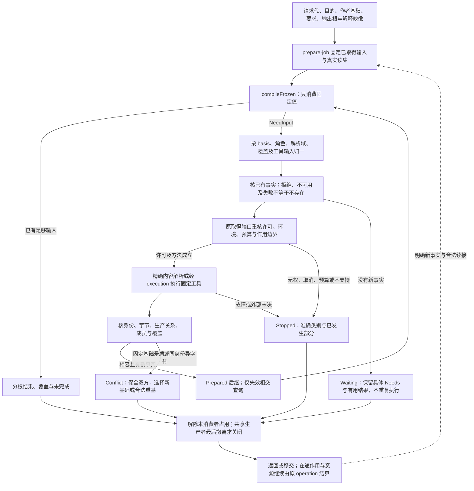

# 请求准备与续接

本章唯一拥有application层的固定准备输入、缺输入协调、PreparedJob后继及内部返回状态。公开请求身份、协议协商、当前显示槽和重连由[客户端与并行会话](../../开发/工具协议/客户端与并行会话.md)拥有；解释映像字段及E0—E6由[源绑定与解释映像](源绑定与解释映像.md#engineimage解释装配和更新协议)拥有；资源接纳与关闭由[模块与运行实例](模块与运行实例.md#解释升级与关闭的实际转换)及原运行owner拥有。本章不新增服务、状态库或作用授权。

## 固定准备态与实际交接

每次准备固定本次作者基础、要求、输出根、解释image及已取得输入，未捕获项明确保留。输入修订形成已有PreparedJob的后继，不创建第二套快照；改变已经固定的要求、来源版本或解释时，显式选择合法新基础，不在旧查询中换义。

| 交接 | 实际责任 |
|---|---|
| transport → application | 固定公开请求代、目的与上下文；请求记录不签发读取或执行权 |
| application → compiler | 提供已经固定的值、解释和真实读集；compiler纯计算结果或Needs |
| compiler → application | 描述具体缺内容或外部结果；不发任意命令或偷读latest |
| application → execution/资源owner | 按实际取得方法重核当前许可、环境、预算和效果边界 |
| application → transport | 返回准确分根结果与未完成；公开字段仍消费原版本能力协商 |
| application → 原operation/资源owner | 返回后仍在途的取得、作用和占用继续结算或明确移交 |

`compileFrozen`的纯性不能通过把任意网络/文件操作藏进只读回调取得。`NeedInput`区分**缺内容**与**缺外部分析/生成结果**：前者定位内容或解析请求，后者引用有明确类型的工具合同及其固定输入。二者都是描述数据，不能携带任意命令让协调者照抄执行。

application用已装配的获准解析器处理：已锁的内容读取精确版本；未选依赖可在允许集合解析一次并固化选择；外部工具执行经execution，结果带真实输入、方法和覆盖。普通纯生成不因此允许联网、安装或运行作者模块。

preview/check的准备在跨越任何真实Effect前消费[事前请求身份](../../开发/工具协议/六工具与请求.md#request-identity-lookup)：客户端已持有requestId与唯一scopeRef映射，原Operation/Attempt已保留准确接纳载荷、解析后的默认和固定输入，才可委派执行。缺少这些前提时PreparedJob保留具体Need；不能先运行外部生成器或fixture，再把第一条operationRef响应当作唯一恢复入口。重入读取同一接纳记录，默认更新不改写原准备；PreparedJob、遥测RequestRef与transport callId均不产生第二去重库或扩大原操作保留承诺。

准备接纳消费的域必须已绑定请求中的不可变主体，或本会话固定的默认上下文/映射修订。事前query返回后默认切换不能把同一请求路由进另一个域；无此固定关系的裸source先返回Need，改用已有显式context再接纳。恢复先按原映射定位，再比较原载荷；不能先用当前默认选择域才声称支持同ID查回。

### 固定输入、补取和恢复分别由谁执行

`application/prepare-job.ts`只取得本次原输入，`application/resolve-needs.ts`处理已有Needs，`compiler`只消费固定值。协调器的每次重入必须返回以下一种明确结果：

| 返回 | 内容与成立条件 | 后继 |
|---|---|---|
| `Prepared` | 原要求下，取得相容的新内容/观察/方法绑定，形成新的PreparedJob及真实读集 | 仅重算相交查询；旧完整结果按依赖可复用 |
| `Waiting` | 真实缺少外部决定、可恢复输入或允许稍后取得的能力，保留具体需要和有用结果 | 返回调用者，不持CPU槽/文件锁无限等待；新事实到来后显式继续 |
| `Conflict` | 新内容与原固定基础、作者前像或要求不相容 | 保全双方；要求明确新基础、合法重基或重新规划 |
| `Stopped` | 无权、明确不支持、预算结束、取消或工具故障等原类别 | 返回准确影响根与已完成部分；不自动降低原任务 |

它们是内部协调结果，公共响应仍使用原版本已定义的引用/诊断/分项状态；新增公开结果字段必须走版本能力协商，不能让客户端忽略必需含义。

### 补取去重、无进展和矛盾观察的处理算法

1. **归一需求。** 需求按固定basis、角色、实际解析域/精确内容、要求覆盖及选定工具输入识别。相同名称不同版本、不同根的查找或不同输出形状不能合并；多个消费者所需内容完全相同时可以共享取得。
2. **核已有事实。** 已取得found就核内容和范围；exact-absent只在原精确查找范围成立；denied/unavailable/failed不转为不存在。当前认证/披露影响是否可返回或继续，不能缓存一条拒绝后宣布全体用户永远无此库。
3. **选择取得方式。** 本地只读内容、缓存核验、获准外部取得与实际工具执行分别调用其已有端口。不在resolver里执行任意工作区脚本；缺工具安装不是普通读取的隐式后继。
4. **验证结果。** 新内容核真实身份、字节、编码、生产关系与覆盖；工具成功但输出缺少所需成员仍未满足。发现相同不可变内容标识对应不同字节，隔离该结果并保留冲突，不能覆盖内容库旧值。
5. **形成后继。** 同一作者候选补齐固定依赖时仅更新准备态；作者字节实际改变时形成新候选或报告前像变化。新增解释方法按原EngineImage协议准备新映像，不在旧调用中热改规则；原要求固定旧版本时不因新版本可用就升级。
6. **判断进展。** 新取得的内容、覆盖、已接受决定、方法或可用能力必须改变一个真实等待条件。重复相同需求且没有新事实时返回当前未完成原因，不再次调相同工具。复杂生成持续产生新输入仍受真实节点/空间/时间预算限制；“键每次不同”不是允许无限执行的理由。
7. **释放与返回。** 解除本消费者已不需要的占用。若别的获准消费者仍等待同一纯生产者，不由当前请求取消它；最后撤离与关闭接纳按[共享代际](../../编译/递归并行与远程编译.md#shared-producer-generation)共同协调，新加入者不接到已经Closing的实例。其输入和资源仍等实际终止或责任移交再释放。

新观察与旧观察矛盾时，不在同一基础里同时留下“缺失”和“已存在”并任选有利者。需要的是新观测基础与重新解析，或者明确识别观察能力不足。跨文件非原子捕获也不能通过补几个摘要伪装成原子快照。

## 快照闭合与来源依据

### 准备、缺输入与返回的控制图

图中循环只由真实新事实推动；固定基础的替换走冲突分支。取得方法的具体资源寿命由前述资源拥有者及共享代际合同展开，不由准备态自行释放仍在途的输入。

只增加此前未固定的内容；已经固定的同一来源出现不同版本时返回捕获冲突，需要新基础就显式重建，不覆盖旧值。输入集合产生新身份后，后继结果绑定新输入；真正未变的子查询才可复用。不为每次补读重建无关领域。

一个目标要求同一时刻的一致快照时，取得具备对应保证的提供者；普通工作区逐次读取只能声明真实的合成捕获范围，按[共同捕获协议](../../开发/工作区观察与捕获.md#从输入范围取得可用快照的正向协议)核保证与覆盖。

严格同一快照的缺失读与稍后变化不可混用。第一次确认不存在、后来发现同一名对象出现，说明范围或版本改变；不能在同一动作键下同时声称二者真实。Bazel把环境隔离和源身份共同用于封闭构建，支持这里不能只固定源码、仍从任意宿主读取工具和库的判断；具体设计并不要求Gift使用Bazel。见[Hermeticity](https://bazel.build/basics/hermeticity)。
