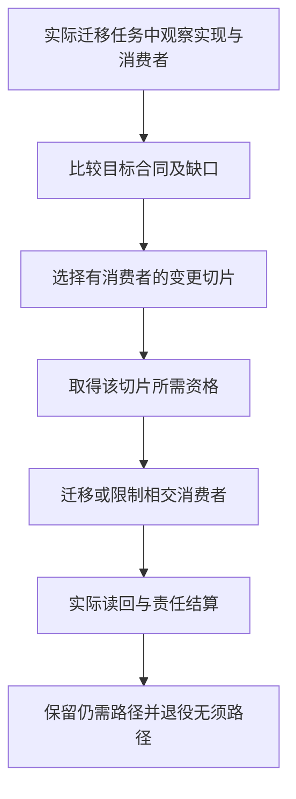

# 仓库迁移与自托管

> **阅读范围**：采用范围内的设计规范；实现状态另查未决 · [共同上下文](主线前沿与准入.md)。


## 当前仓库到目标系统的重构总图

### 1. 目标

迁移不能以“大重写”开始，也不能把目标设计直接当作当前实现事实。先从 exact repository revision 产生 Observed Architecture，再与 Target Design 做 Reconciliation。

```text
TargetDesignGeneration
+ CurrentRepositoryObservationGeneration
→ ReconciliationGeneration
→ preserved | drift | required-unmaterialized | surplus | unknown
→ focused migration slices
```

### 2. 当前观察维度

- public/runtime entrypoints；
- 模块和依赖图；
- canonical data/schema/serializer；
- source readers/writers；
- semantic owner 与重复实现；
- direct filesystem/network/process Effects；
- tests/verification/workflows；
- dependency/package/lock；
- generated/control/recovery state；
- release/distribution；
- branch/worktree/ref 和平台 enforcement；
- unknown/dynamic consumers。

### 3. 迁移动作

这些值表达对现有对象采取的动作；对象与目标设计的符合性另按[观察分类](#3-映射分类)判定，两者不能相互代替。

```text
preserve
adapt
refactor-in-place
wrap-temporarily
migrate-data
replace-provider
split-owner
merge-duplicate
retire
investigate
```

每项映射绑定当前 symbol/path/revision、目标责任、消费者、证据和退出条件。

### 4. 迁移原则

先明确新旧合同与相交义务，按风险选择静态保持、独立符合性、隔离影子或实际故障检查，再迁移真实消费者。单一冲突域不设竞争权威writer；每个切片按其实际作用检查保持与读回，旧活动消费者迁移/排空或拒绝，历史责任另处理。不以目录搬迁冒充架构完成，也不为纯移动强制双实现。

### 5. 第一纵向切片

第一产品切片采用“作者定义→同一编译器→独立目标程序→真实消费者→再次修改”，具体范围由本篇[纵向切片与自举计划](#纵向切片与自举计划)拥有。以下存量改写链仍然成立，但只约束实际需要接管已有工程的切片，不是纯生成前置：

```text
精确存量观察 → 显式采纳相关含义 → 对应变更计划
→ 获准的有前像写回 → 读回与所需验证
```

工程允许先向隔离候选生成代码，经既有原生接口接入一个消费者；不要求先把全仓源码逆向成完整业务模型，不要求先有持久控制和任意多文件恢复。反过来，取得生成结果不授予已有工作区写入、Git集成或发布权限。

### 6. 自托管

Gift可用成熟工具开发自己的首个产品切片。自托管采用从只读和低风险子系统逐步扩大；这不是“先让Gift安全修改自己，才有权实现编译器”。修改TCB仍走独立bootstrap。

### 7. 完成定义

不是所有旧代码一次消失，而是每个已迁移责任只有一个 owner、旧路径无 consumer、真实入口使用新路径、证据绑定 current main，且下一普通变更不需要手工旁路。


### 自举前设计冻结与真实施工闭包

完整设计范围由已接受产品目标决定，首个可运行切片只选择编译器自身实际消费的闭合能力，不缩小全部设计，也不要求先实现所有未来领域。冻结的是公开可观察合同、责任与迁移义务：准确输入输出、类型/意义、默认/拒绝、依赖/权限、状态、失败恢复、失效、资源和验证出口；私有容器、目录数与优化机制保持实现自由。设计已定、代码存在、当前采用、资格成立和真实自举分别取证。

施工先从准确仓库取得十职责的真实文件/符号/调用者与验证映射，再固定机器结构、严格 reader 和阶段合同。最短 headless 纵切依次贯通捕获、固定语义、方法资格、完整目标与按需真实检查/写出，客户端随后消费同一结果；可独立设计的业务配方不必等待全部内核编码，但其生产资格按真实消费者取得。已有正式 TS 能力只有逐能力通过语言迁移门禁才切换，设计中的 Rust 路径不创造已存在的实现。

自举根沿真实签名、主体、默认、效果、生成、反射保留及选定 Method/Target 求依赖闭包；合法递归按原 SCC 合同保留。停止条件是实际依赖均有消费者与保持资格，不是找不到 TODO，也不是一次运行调用图。旧种子不理解的新构造必须经旧能力写桥、构建过渡编译器并核旧样本后采用。文件/网络、外部工具、输出发布、签名与凭证仍在受权宿主边界；原生透传部分明确登记，不计为已语言自举。

切换保持单一生产 owner。若将内核作者源迁为 Gift，合格目标生成的 Rust 与手写源不能长期同义双写；保留原生余部及退出条件。真实源码、种子、工具链字节、硬件/宿主、预算、发行权限和阶段产物必须现场取得，不能以包中历史运行叙述代签当前事实。相同输入的固定点比较、独立保证和恢复演练各按自身主体/环境绑定。

### 首个部分自举职责与阶段适配

Manifest图解析及真实调用者可作为有界部分自举迁移职责的参考。其[历史仓库坐标](../../依据/来源/语言编译与目标工具.md#manifest图部分自举参考的历史源码观察)只提供观察来源；施工前必须重新核准确源码、上游校验、调用者与工具链，不能宣称已在当前仓库采用，也不改变正式实施主链或活动Work Package的选择。输入保持上游已验证条目，不把任意读取或安装混入算法；Gift 作者计算须实际承担闭包、冲突和排序，整段原生源码字符串透传不算语言自举。

相交保持义务包括：显式选择顺序、同 ID 的版本相等/冲突、能力 provider 闭包、零/多候选诊断、选中 provider 的全部依赖边、声明冲突，以及动态 ready 集合中持续取最小 rank 的拓扑序。rank 的 kind 优先和 ID 的 UTF-16 码元比较不能被层序或 Rust 默认标量排序代替。原未调度 blocked 集合可包含受环阻塞的后继，不改称最小环见证。适配器按稳定输入索引/引用重建原条目，保留上游未知字段与实际可观察引用关系。

种子与阶段输入固定 source closure、依赖锁、seed 来源/字节、native toolchain、build/host/target、调用选项、允许环境、比较政策及恢复引用；缺值返回 Need，不预填假摘要。StageRunner 逐阶段用独立拥有的 staging 捕获源码集合、原生构建和二进制集合；先核全部成员再逐字节比较，源码与二进制分别报告，不能混入旧残余。允许归一化的时间/路径等在比较前声明，不失败后增加排除项。跨架构 host 编译器须在真实可运行环境执行。

先保留旧生产消费者并只读对照；合格后原调用点选择一个生产 owner。比较失败保留旧调用，撤回和退役依据真实 import/consumer、修订、工具和回退材料，不因文档已设计删除旧实现。标准库只取该算法的真实整数、序列、比较、Map/Set、错误与优先队列闭包，公开顺序不随内部哈希迭代随机化；该窄切片不限制语言未来表达范围，也不预装不相交领域设施。

## 现有仓库迁移方法

### 1. 不预设当前事实

迁移前对精确仓库 revision 重新观测。本文不把任何临时分支、目录或旧文档状态写成永久事实。

### 2. 三个输入

```text
TargetDesignGeneration
ObservedRepositoryGeneration
ReconciliationGeneration
```

观察包括源码、测试、构建、依赖、工作流、运行路径、文档和当前消费者。

### 3. 映射分类

每个当前对象相对目标合同的观察结果为下列之一；分类本身不决定删除、替换或其他[迁移动作](#3-迁移动作)，须结合真实消费者、保持与恢复条件选择：

```text
Conforms
Partial
Extra
Missing
Conflicting
Unknown
LegacyMigrationCarrier
```

不能因为名称相同判定符合，也不能因为目标中无名称就判定无机制。

### 4. 迁移单元

按真实消费者与不变量选择可独立交付的纵向切片，不按目录整体改造。记录目标责任、现状、前提、候选合同、资格方法、实际切换/回读、失败与恢复、旧支持安排。影子实现和双读/双算是可选方法；没有相应风险不建立它们。

### 5. 实施优先关系

先取得本切片需要的明确输入、身份和错误语义，再接消费者真正需要的查询、生成、检查与作用。只生成纯函数不等待持久控制面；已有工作区修改才需前像与恢复；团队部署才接对应权威与目标端。精确依赖已满足的工作可并行，不以固定十步顺序阻断与之无关的能力。

### 现有仓库迁移闭环



本图仅适用于已经请求的存量迁移；不要求最终架构设计先读取旧仓库，也不要求所有设计都进入写入或部署。

### 6. 影子、差分与替代

具备可比较输入且不会重复外部效果时，影子/差分可以比较规范结果、诊断、失效与性能；对新增行为或已知旧缺陷，旧输出不能自动成为正确Oracle。没有可运行旧实现时可用明确期望、保持证明或独立方法。所需范围未满足不切相交权威消费者，但可以继续无作用设计、保全候选与独立合法输出。

所有方法对应假设、覆盖和代价。实际观察足以暴露不等价，不代表未观察差异必然不存在；接口、资源或数据变化推翻假设时回到对应合同，而不是用更长影子阶段维持旧模型。

### 7. 控制面迁移

期望状态、实时观测和解析结果分开存储。禁止把“默认分支当前是否含某文件”等 live observation 固化为长期 desired state。

### 8. 数据和 Schema

读取、写入、回填、切换和收缩次序由[读写组合](../兼容迁移与退役.md#读写组合与迁移准入)确定；先防止旧写者丢新内容，再启用相交新写。旧字段、事件与恢复路径按支持和保留义务计入，不要求先删所有历史读者。

### 9. 代码移动

代码移动保持语义身份和公共合同。使用静态依赖、导入改写、契约测试和消费者清点，不通过长期聚合门面维持旧结构。

### 10. 失败和回退

每个切换定义：

- 停止条件；
- 观测指标；
- 可安全回退窗口；
- 数据是否可逆；
- 前滚修复；
- 旧写权恢复条件；
- 事件响应。

### 11. 清零

旧机制删除前搜索：源码 import、动态加载、配置、脚本、测试、CI、文档、备份、离线工具、支持流程和外部消费者。清零证据内容寻址并复核。

### 12. 验收

- 迁移绑定 exact revision；
- Target/Observed 差异可追踪；
- 每次只切换有限消费者；
- 新旧差分和故障证据；
- 失败可恢复；
- 旧写权撤销；
- 无隐藏兼容门面；
- 最终消费者清零；
- 迁移完成后重新观测系统符合目标。


## 纵向切片与自举计划

### 实施裁决与不变目标

本章定义实现次序，不以命令或验收方案自动取得产品实施权。当前首期是**结构意图与原生供给的完整开发闭环**：分片JSON直接表达产品决定，捕获真实定义/依赖与必要原生源码，按准确主体选择或创作实现，生成TS目标并由真实消费者使用，再修改同一作者源。实现阶段以已有TS工具链形成种子，不实现新`.gift`文本语言作为前置。解析控制、数组和反馈计算例只在所用方法需要时校准，不要求应用作者迁写其算法。第一个Gift自用单元选已有规则目录与导航的只读派生，不碰权限、采用或证据签发；当前Python文档工具本身不是Gift已自用的证据。事务、账户、消息与服务不是普通工具前置。TypeScript与Rust均已纳入[通用目标计划](主线前沿与准入.md#language-roadmap)，TS先完成首个闭环，Rust按真实消费者逐项实现和验证；Java暂缓。采用C/Rust/Wasm等热点供给是局部实现选择，不能被误算成完整目标后端已经交付。真实源码和消费位置在实施前捕获，历史HALO仅是线索。

首版不是“18个词都能被parser接受”，也不是整个世界语义。它要让AI完成一项实际的有限开发工作，程序含义、目标、错误和修改链可以解释。没有全语言/全域最优证明不妨碍当前有界选择；核心作者方法未定则不得让实现者临时另造。

### 语言级设计准入，而不是逐关键词打补丁

作者形态、文件与导入、当前合法语法、类型/效果、求值/错误、接口字段、产物关系和一条完整开发轨迹在对应编码前确定。本版选择位置是[作者实施基线](../../作者/可替换表示与适用范围.md#当前作者面实施基线与决策状态)和[完整会话](../../../examples/连续开发/组合结构与任务轨迹.md#作者源从首次创建到下一次修改的固定会话)。结构作者字段由结构规范拥有；只有显式采用计算文本画像时，其基础文法才由对应语言章约束。本节选择产品支持范围，不为结构源另加文本解析步骤。

某构造缺少当前必须的语义/算法/错误规格，先补这一块再实现；缺真实运行数据则在获准实现后取得，不能循环要求“实现前先有实现通过的证据”。未纳入当前能力的时间、并行状态或其他高级画像，保留其义务但不阻止本范围。

### 当前MVP范围与支持清单

这是当前产品的第一条可采用支持范围，不是新增计算语言的开发清单。以一个可复用结构定义、准确原生供给、库/CLI两个消费根和连续修改检验完整性；工作台的更多宿主能力逐项开启。内部首个提交可以更窄；正式声明本MVP时必须覆盖下面无条件纳入的内容及该请求实际激活的条件分支。计算文本、函数计算入口、原生深维护、受管目标回源和高级领域各按实际请求激活；未选择它们不影响结构原生首轮出口，选择后则不能免除其完整合同。

| 对象 | 当前纳入 | 默认实现或处理 | 当前不承诺 |
|---|---|---|---|
| 作者 | AI/脚本直接结构模块、原生files及唯一基础的差异 | 六工具消费同一候选；小定义可以内联，不强建工程 | 强制新文本语言、图形客户端、任意语法猜测 |
| 模块和库 | 结构定义的导入/出口、公开主体、默认参数、准确身份与依赖；原生库沿其真实门面 | 直接结构绑定与原生合同适配，缺省私有；需要表示隐藏时使用所选原生或中立方法 | 任意远程自动获取、核心自建所有class/trait语法、全语言提升 |
| 计算与数据 | 所选需求实际使用的精确值、关系与错误；方法首先来自真实TS或合格其他供给 | 原生类型/对象/控制由其工具链处理，中立接口保留数值、效果与资源合同；既有计算画像可单独启用 | 核心必须先实现所有计算文本构造、未定义同步的共享可变内存或任意宿主执行 |
| 参数化与闭包 | 结构的有型值/主体参数，以及原生供给公开的有限泛型与回调 | 原生工具核内部语义，边界核捕获、错误、调用次数与寿命；选择中立计算时沿其显式泛型规则 | 原生支持被冒称核心已实现所有类型推断，任意资源跨挂起 |
| 要求 | 结构硬要求、条件/量化、默认、公开边界及独立接受引用；计算契约按所选画像 | 联合主体与方法，保留检查或合格消解；不必先部署SMT | 自动求解任意规格、按同类型合并主体、以样本代签全输入 |
| 高层价值 | 已有成品形态范本的一份结构行为、原生实现及库/CLI两根完成真实消费；第二次改默认或边界 | 保持类型/编码/顺序/资源与共享主体；TSV、数组和反馈只作相交额外反例 | 一个范本代表全生态、仅换语法证明收益、强迫先建设三款产品 |
| 真实构建与运行 | 库/CLI精确产物实际构建、消费、取得输出，再返回结构源修改；观察/剖析按请求开启 | 合格BuildRunner/Runner固定源/产物/输入/环境；函数计算请求才使用compute-run扩展，复用成熟调试与测量能力 | 只接内部Execution.run就称公开可用，或以check(cases)替代所有普通运行 |
| 生成与维护 | TS目标、结构变化后的准确再生成及未修改原生供给的保全；原生TS深维护和受管目标回源按请求开启 | 先捕获与确定生成，再优化增量；原生语言服务和有来源映射按需复用，所选维护能力满足其完整保全/回写合同 | 逆向是新产品前置、Java前置、任意全语言互译、无来源还原原设计 |
| 修改与错误 | 首次创建、结构参数/公开边界/供给修改、新组合、错误草稿、陈旧冲突、保存后继续；直接改受管目标按请求开启 | 保留准确原生前像；选择原文维护时直接改原生源，选择受管回源时形成目标草稿，再依法回写原源并重新生成 | 只在输出打补丁却遗失原作者更新；强制全部源转为Gift |
| 采用与自用 | 一个真实外部/目标消费者，并将同一机制用于Gift自身一处可隔离职责 | 先读真实前像，旧/新输出对比，获准后有限采用；自用不获得自授信任权 | 首版完整编译器自宿主、发布治理全接管、事务/多租户/消息同时全交付 |

有限泛型实例可以受实际编译预算限制，但不能暗改合法源的含义：目标可以返回尚不支持或预算不足，不得截断类型或输出Any。该限制属于具体实现支持程度，不取消总体语言的自由。普通无此需求程序不承担这些分析费用。

首个被采用的输出必须有真实消费者，并用封装定义的再次修改检验是否摆脱业务特化。选择的是现有只读规则目录/导航派生这一自用责任；真正代码文件、接口与写集在实施时捕获，不据此另造一个样板程序。包内双模块、网格和工作台都只是对应范围的范本，不是生产采用记录；源与供给的主线选择不因消费位置待捕获而悬置。

### 通用局部控制与即时运行的实施闭包

本节只适用于显式启用中立计算方法的实现任务，使用[局部控制与寿命](../../领域/对象与控制/控制流与存储寿命.md)中的有限语法、绑定、类型和退出算法；它不是结构产品的首期前置。可以按需接通var/while与结构体，再按目标生成直接局部代码；原生实现继续由其成熟工具链处理。对象构造的MustInit/MayInit、before、函数ensure及资源清理必须消费同一出口关系，不各自增加一个return解释器。

按入口执行通过compute-eval复用上述检查与目标方法，再进入已有Runner；成熟运行引擎提供解释/JIT执行，当前不自研字节码VM。调用者可以直接得到选定根的结果，不先生成所有发行目标。需要明确产物或观察时仍用原preview/build/run，不把不同对象的引用混用。

有限同步资源作用域必须实际实现region逃逸检查、close结果和停止责任后，才宣称该能力可用；没有资源的纯模块不受它未完成影响。硬无GC、弱内存、内联汇编和裸机目标各自激活具体ABI、指令与运行义务，不作为本地普通工具的统一开工前置。新增语言组合固定新revision/content，旧基础专用入口保持。

### 决策发生的明确时点

| 时点 | 必须已有的决定 | 可以留给之后的内容 | 当前正向出口 |
|---|---|---|---|
| 开始相交产品编码前 | 作者形式、默认含义、支持范围、完整会话、错误与结果、模块边界 | 需要运行才能取得的成本与符合性证据 | 当前设计选择写入唯一正文；实现按本版而不是临时再选语言 |
| 首个内部端到端提交 | 一小段真实语义到一个后端、诊断与输入身份 | MVP其余构造与库 | 只是内部里程碑，不称产品完成 |
| MVP采用前 | 无条件纳入项和请求实际激活的分支均有相应实现、工具与真实消费；再次修改成立；缺项准确 | 未激活画像及尚未承诺的目标能力 | 有界产品可用声明，记录已执行范围与成本，不宣称普遍更优 |
| 正式稳定兼容承诺前 | 解释版本、公共API、格式、支持矩阵、迁移和回退边界 | 向后兼容增加或显式新版本 | 形成真实发行身份；不是聊天里增加一个版本字符串 |
| 以后新增反例时 | 哪个假设或规则被推翻、影响到谁、暂时合法路径 | 无关范围继续 | 只重开相交决定；旧运行和恢复记录保持其原义 |

这不是固定工期，也不要求全部工作串行；它使“何时定”可以按事件检查。设计、正式发布和权限采用各自有明确状态。设计、实现、实验与生产准入不能用一个“冻结”状态全部取代。

### 首期生产路径

以下顺序只展开当前结构原生任务的真实依赖。新增请求激活计算文本、受管回源或其他画像时，沿各自拥有者补入所需检查与恢复，不另设一条全产品必经路线；剩余设计、实现和目标支持状态直接读取原U条目，入口见[问题主登记](../../状态/前沿与登记规则.md#已知问题主登记)。

1. 固定本次实现范围、已接受合同和允许写集；修改现有仓库时读取其真实源码及消费者，复用相交能力；新建独立模块不以旧仓库迁移为前置。采用已定产品职责，不让旧目录决定公共语义，也不绕过真实写入保护。
2. 接通同一个入口的结构模块读取、定义/主体/字段与条件绑定、准确原生供给以及TS输出；最早以一个已定义行为和真实原生模块检验，不先编写新的文本编译器。算法先正确全量，内部索引和缓存可替换。
3. 将结构定义、准确原生实现、独立接受要求、合法修改和失败输入接入六工具；连接合格BuildRunner/Runner，让库/CLI实际构建和消费。compute-run只在选择函数计算入口时启用。保留作者原件、候选、产物与运行输入，客户端与编译接合同步实施。
4. 接通本地复合定义、公开主体、参数默认和稳定消费门面，核真实值域、目标布局与实现替换。不规则控制、数组和反馈只在相交供给中检验，不成为每个作者项目的义务。文件/设备作用按真实请求，不引入无关事务或消息；优先成熟正确供给，按全路径成本与硬要求选择热点实现。
5. 完成结构侧参数、公开边界和供给绑定的连续修改；按需验证原生TS原文维护及有来源的目标修改回源，识别共享来源与目标专有控制，不按文本相似猜回写。已选Rust目标按真实消费者及前提安排，不成为TS首个闭环的统一前置；若真实热点可用C/Rust等已有供给，则按本次调用边界单独采用，不要求等待完整后端。
6. 在获准环境取得实际运行结果、有限边界值/剖析与来源定位；测完整首次任务、参数变化、非预装组合、库私有表示变更与故障修复。探针制品和原制品分别计量；保存/输出按实际前像和许可。随后在Gift实际一处隔离职责使用相同开发闭环，保留独立期望和旧实现回退。失败进入相交设计修订，不用缩小原要求或手修产物换取绿色。

现有存量写回与恢复能力实际需要时复用。首个纯计算载荷不为“工程完整”制造账户、事务、消息或部署设施。真正选择事务应用时另完成其自身闭环，不以纯计算结果替代保证。

### 两个独立出口：语言可用与工程抽象可用

结构作者可用检验定义、参数、主体及要求能否准确组合；启用计算画像时另验其一般计算构造。任务出口检验真实工作是否从作者、目标、消费者到下一次修改闭合。二者不是必须先算术再做事务的阶梯。高层组合与用户自定义算法使用同一内核；新的普通函数若必须增加核心业务case，视为当前设计/实现反例。

单一原生任务若使用成熟工具已经足够，可以直接走该更小路线；不得为证明Gift必要而强行加入结构层。结构意图产品的采用理由应由共同约束、实现选择、重复维护消除或准确变更带来的实际价值检验，缺少该价值时不能只凭重拼代码宣称收益。对照也可使用成熟库、生成工具和既有知识，不让基线徒手重复所有细节。没有实测时记录预测与书面判断，不制造token、速度或成本数值。

### 语言支持逐项增长

每个前端的保全、解析、类型观察、语义提升和往返，与每个后端的生成、目标检查和运行保持分别声明。TS先行不绑定公共数值与状态；Rust的已选目标能力按实际消费者逐项落实，其他前端/目标仍需真实需求与支持范围，不由窄C示例预定；Java暂缓。扩展Go/Python/C++等支持时，按具体值、错误、内存、ABI和模块机制补相交映射，不普查全球关键字后才能动工。

### 成本、返工与重新裁决

作者源角色、公共含义、接口和状态不能因实现者方便随意改变；缓存、线程数、私有IR分片和等价布局可以在对应预算和保持条件下优化。根假设失效就修根，不依赖兼容壳掩盖；没有新证据则按当前基线实现，不把“有更完美可能”作为重复设计整个作者面的触发器。

### 当前路线的片段与目标结构验收

无目录函数、双模块和实际工程中的选定模块共用输入语义；上下文区域另外承担捕获/控制出口，不能由闭合函数测试代签。后端默认普通函数/模块，只有实际必要时产生其他结构；生成、检查、写回与部署分别报告。首期不安排人类编辑器。


## 自托管、逐步接管与旧机制清零

### 1. 自举有四个对象，不是一条权限升级捷径

| 对象 | 目标 | 当前次序和支持条件 |
|---|---|---|
| 产品自用 | 用Gift观察、定义、生成、修改Gift自身一部分工程 | 第一条产品链可用后就选真实隔离单元，不等待整个编译器自宿主 |
| 库自用 | Gift标准库和工程定义使用同样的模块/包/目标机制 | 随库能力推进，不额外引入一套官方特权语言 |
| 编译器自宿主 | Gift能够按其本身实际源形式管理并重建自身的一部分或全部 | 当前TS控制面的原生种子保持；按实际阶段源闭包固定各语言的H，真实Rust能力加入才纳入相应源与原生工具链。原生委托与Gift实际处理分别报告；另选中立计算才验证其语言子集，不以改写为`.gift`或仅cargo/rustc透传定义成功 |
| 开发控制自管理 | Gift管理自己的变更、集成、发布及策略 | 待真实作用与恢复能力合格后逐项采用，独立权威不随候选一起升级 |

前三项不会自然授予第四项。自用程序通过，也不表示有权删除旧编译器、修改自己的验收期望或提升生产权限。完整自举不是首个产品能力的循环前置，但保留为明确的演进目标而非无限延期的口号。

### 2. 当前采用顺序与第一对象

**外部工具形成种子。** 沿现有生产责任使用成熟实现语言、工具链与库，先构建能处理当前作者子集的种子C0。无需先把自己翻成.gift才准开始。

**只读自观察。** C0读取自己的一个真实模块，产出签名、依赖、解释与影响；旧人工/成熟工具结论作为有范围对照，不自动成为绝对正确的Oracle。

**隔离模块自用。** 从真实产品仓库选择一个有实际消费者、输入、公开合同和恢复边界的隔离职责，用相同准确输入比较原成熟流程与Gift结果，获准后只切换该消费者。规则目录与导航的只读派生只算知识工具dogfood，不代替产品Target自用或编译器self-hosting。脚本存在不证明完成，不新造无人消费的样板库；实施前读取实际文件，保留可重建的合格旧实现。

历史设计在修订`0536dca0`的源码读取基础上，曾明确选择`resolveManifestGraph → prepareManifestResolution`作为隔离接合对象。这是当时的有界选择及迁移来源，不证明当前源码仍同构、该消费者已切换或结果合格；实际采用须重新捕获当前来源、精确合同、输入与依赖、资格、权限及恢复边界。不能把历史选择降为无内容的参考，也不能以该记录代签新一轮执行或强制与当前事实冲突的旧接口。

**定义与编译器逐模块采用。** 每次检查公开合同、原生边界、性能和恢复后采用；可以继续使用TS原生源，并由结构工程管理其选择和交付。未采用模块不必迁写，部分采用不宣称全部自宿主。可选中立库按真实收益进入。

**编译器全链。** 满足源码子集后执行[种子到固定点](../../编译/内核/确定性与自举.md#编译器自举可信根与版本演进)，比较同一冻结输入、工具、库和目标，不要求每次日常开发执行全阶段。

**控制面渐进采用。** 依次选择变更计划、低风险写入、集成建议与真实发布；每项先有它自己的准入、结算、回退和独立检查。不是把开发控制面一次性交给候选。

### 3. 新语法的引导不能形成环

只有实际选择新计算前端或升级实现语言时，才激活本段引导规则：新编译器源码若用C0尚不认识的语法，先用C0可读源码实现桥接，或用受信外部工具升级种子，再采用新源。可选`opaque`计算画像遵守同一规则，不是结构产品新增文本语言的开工要求。不能要求旧种子先解析只有新编译器才会解释的源码，又称自己已经可重建。

### 4. 采用、退出与失败

每次采用将旧内容、候选内容、输入语料、公开合同、真实依赖和当前许可固定。差分通过后仍要运行普通后续开发任务，观察消费者是否确实切换。发现关键差异时停止相交采用，定位规范变化还是实现缺陷；不改期望以凑字节一致。

旧路径是否删除，由活跃消费者、未结算操作、格式读取与恢复需要决定。危险旧版本可以先撤去新执行权，再保留隔离的历史读取和修复能力。不要永久维护两套竞争写者，也不要删除唯一能救回新系统的可信途径。

### 5. 自用不替代外部产品验收

Gift自身是重要消费者，不是所有目标程序的代表。至少还需要所选范围内的另一真实消费者或独立接口场景，避免只优化自己的编译约定和类型。费用、诊断、目标与多轮维护分别测量；没有运行数据时仅记录设计。

本章只拥有采用次序与对象选择；编译阶段由编译章拥有，独立性与故障判据由验证章拥有，不维护第二套BootstrapEpoch字段表。


## 旧来源归属的版本化适配

迁移时从精确旧版本的真实消费者取得来源合同。旧 Block、独立作者模块和原生单位进入内部归属联合时，保留各自种类、身份、来源与解释，不把必需的旧字段直接改成可空，也不为新函数创建虚假 Block。

旧输入继续执行其原合法性检查；新输入检查真实模块、体解释和公开导入。不能给旧 JSON 更换标签或强制转换类型，就宣称具有完整中立函数语义。归属解释或读取依赖变化时形成新的输入身份；展示记录和会话句柄不影响目标名字。

先提取明确的纯计算交接，再由原作用入口承担真实锁、前像、保存与恢复。采用新入口前核对所有实际消费者；仍有版本、在途操作或恢复责任的旧路径保留，确无责任后退役。源码路径和函数名由具体迁移任务取得，不写成最终架构的永久输入。
