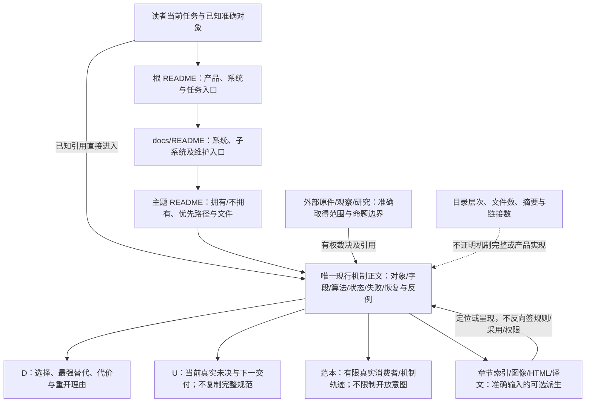
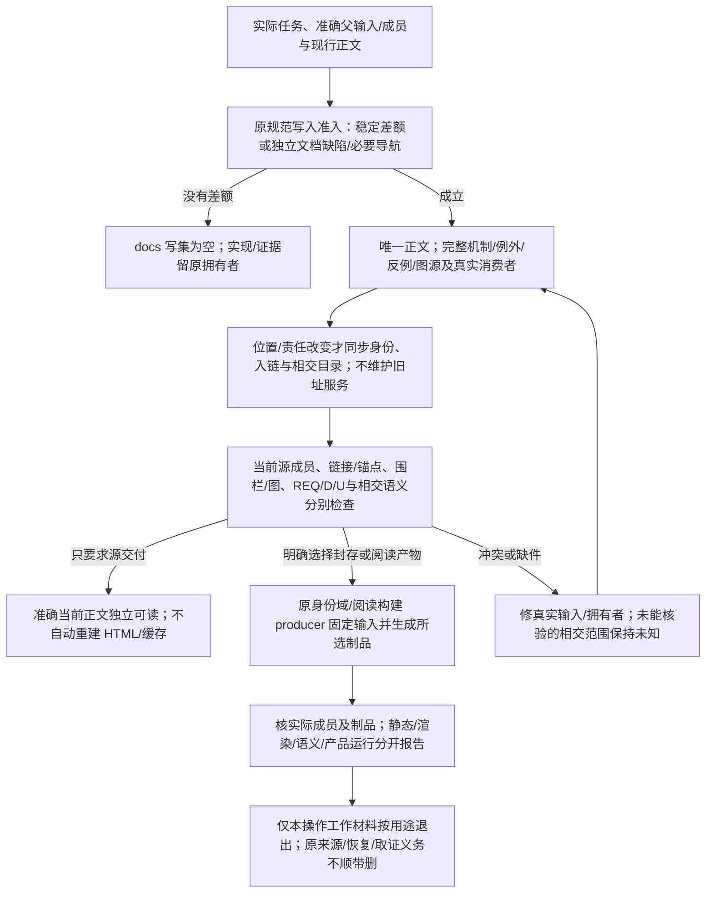

# 本设计包的文档架构

本篇拥有当前Gift设计包的信息组织与维护接合。它不修改Gift的产品目标、六工具、十职责或作者表示选择；它也不代表产品的联邦知识库、存储服务或权限系统已经实现。产品的信息机制仍由[信息主题](../信息/README.md)拥有。

## 系统概览与机制正文如何分层

系统入口回答产品用途、环境、主要职责和协作边界；子系统入口回答该责任中的概念与分解；精确机制正文保留字段、算法、状态与反例。具体词是否常见不决定它应在最高层；作者表示、编译方法和恢复协议都不能用来单独代表完整Gift。全量章节表可以用于定位，但不能让读者从它自行重建缺失的总体架构。

物理归属按真实内容维护：完整系统的[架构与装配](../架构/README.md)独立于编译方法；作者当前表示与可选计算实现分开；基线采用归本库维护，不与产品能力重复。拆分按完整机制或完整U条目，不按平均字数；含紧密状态、算法和恢复条件的长章可以保持长文。原改动过程及逐版统计只在复核材料中保存。

## 包的三层入口

根README说明产品与系统入口，再选择任务和当前成果。docs/README先给系统层，再给子系统与判断维护入口。主题README说明本主题拥有和不拥有的内容、优先路径及实际文件。完整章节导航留在当前页；全量文件目录是备查入口，机器的全量章节与图源核对放在独立复核档案；当前必要身份、内容基线和当前入链随源保留，不附带历轮旧址定位。

这不是三层审批，也不是要求读者先读三页才允许打开文件。已知文件、协议或引用时直接进入准确位置。逐层展开服务于不知道位置的读者；准确名称检索服务于已知问题的读者。两种入口指向同一正文。

## 物理位置与内容责任

| 位置 | 维护内容 | 不是 |
|---|---|---|
| docs/产品 | 要求、原则、术语、质量目标、完整能力边界 | 当前UI截图或某个范本反推的产品定义 |
| docs/架构 | 系统上下文、完整职责协作、状态与运行装配 | 一个编译阶段或另一组产品模块 |
| docs/作者 | 工程含义的表示、定义、公开边界、组合、源与绑定 | 每个用户必须手写的内部IR |
| docs/编译 | 装配、输入阶段、表示、方法、目标、增量与诊断 | 操作授权或磁盘事务 |
| docs/开发 | 客户端、工具协议、编辑、测试输入与协作 | 新产品主源码 |
| docs/运行 | 实际作用、资源、提交、恢复、保证与验收设计 | 已通过测试的断言集合 |
| docs/领域 | 计算、对象、状态、关系、流与数值的不同语义 | 第二套通用编译体系 |
| docs/信息 | 产品所管理的内容、配置、检索和保留机制 | 本包必须部署的信息平台 |
| docs/演进 | 支持、迁移、实施接合与独立能力前沿 | 已执行任务日志 |
| docs/决策、状态、依据 | D理由、U未决、来源和理论 | 多份竞争的接口定义 |
| docs/维护 | 本文、写作、图文派生、身份、来源与任务规则 | 目标软件必须复制的目录 |
| examples/结构化工作台 | 当前结构作者JSON、有限结构合同与工程清单 | 已启动的工作台产品 |
| examples/其他主题 | 完整连续开发、领域、计算或原生校准范本 | 普通产品作者必须重写的全部程序 |
| alternatives/文本意图 | 冻结的可选语法与文本源 | 当前JSON主面的前置 |
| .documentation/ 与 tools/ | 当前成员、身份、要求定位与只读核对工具 | 产品配置、历史兼容服务或采用权 |
| 按需包外原件 | 确有来源或证据用途的原始材料 | 当前包的组成、强制附件或缺失正文的替代 |

文件处于docs不自动使它成为全局要求。性质和范围来自正文及采用关系，首页“阅读范围”只是入口提示。文本计算语义可以继续供实现与校准使用，移动到领域或可选目录不删除其有限合同，也不使它重新成为必选作者语言。

同一文件、表格或阅读入口可以同时包含规范、理由、来源与可重建导航，按实际命题及使用关系判断责任。人工维护的README或图谱若含唯一范围、消费条件或选择理由，该部分仍是需要保全的作者内容；只有完整输入和生成规则可得的派生区块才可按重建处理。同字节副本若承担不同的固定版本范本、独立构建根、许可或证据用途，也不能仅因内容相同取消其责任；先保全独立含义与真实消费者，再消除竞争定义。

## 主题页怎样完整，又怎样避免巨卷

一个可独立修改和消费的机制可以成页；其对象定义、前提、正常过程、状态后继、失败、恢复和反例不得被切成没有上下文的卡片。完整表格、代码围栏、图源与其邻接解释保持整体。一个领域的例外不能因为当前不影响主结论就删去。细机制的名字在其规范内保留；更高层用系统目标、输入输出、责任和状态说明关系，不全局替换技术名词。

被拆开的原章仍有共同上下文入口和分题路径。新增页不复制原章全部规则；需要的前置通过准确链接取得。当前同义重述可保留为总览或危险动作旁的提醒，但完整字段表和状态机只有原拥有者维护。相似词句先核对象、条件、时序和消费者；只有确实同义的段落才合并到一个位置，其他页保留准确引用。

原章节中的编号保留其局部引用含义，不当作新目录中的阅读先后。未来针对独立机制重写标题或编号时同步入链和稳定引用，不为数字连续性一次重写所有文档。新增工作应回到相应章节，不持续在文件末尾追加新的“本轮补充”主专题。

## 同一信息怎样服务多个问题

以“替换不覆盖用户后来的输入”为例，产品接受条件、作者结构、生成方法、最终写入边界、失败案例和研究依据各有真正不同的信息，不能融合成一条万能规则，也不应各自复制完整合同。

读者从本次实际作者源及[需求合同](../作者/需求含义与实现责任.md)进入具体要求；本地工作台任务可直接读其[结构范本](../../examples/结构化工作台/说明.md)。需实现时沿[编译主线](../编译/README.md)找到方法；需恢复时读[持久化协议](../运行/持久化提交与恢复.md)；当前缺项仍见[未决](../状态/README.md)。这些是实际导航关系，不自动证明方法满足要求，也不是另造一份手填需求追踪表。

按读者任务、组件、协议、版本、信息角色形成的视图可以并存。一个文档只有一个当前编辑位置；多入口不是多副本。 规范拥有定义与机制；范本承担指定范围的完整用例；D保存选择与替代，研究保存来源与未证实条件，U保存准确剩余。现实观察与外部规范可以存在合法分歧，不能用唯一编辑位置删除事实冲突。文件身份、源包字节身份、派生制品身份、内容版本、采用状态和主体权限分别判断。源包包括声明的规范、范本和制作工具输入；制作工具变化可以改变源包字节身份，不自动改变产品规范含义。查询索引、图像、编译IR和报告不拥有另一份规则。机器索引负责定位，不负责凭相关性自动裁决事实、授权或采用状态。

设计资料检索先明确用途和范围：规范查询从当前规范责任读取；研究、反证、比较或取证显式取得相交研究和历史材料；联合结果按材料角色分组，不在同一未分域候选池中让相关度决定权威。无命中不自动扩大读取或披露范围，也不能在源缺失、索引陈旧或覆盖不完整时证明不存在。第三方索引、IDE、Agent与直接全文搜索须按实际能力说明其范围；目录和本条文字本身不证明外部读取器已经实施隔离。

索引和语义投影必须携带其实际源、配置、解释版本与覆盖；源变化或解释变化使相交结果失效。历史索引仍有定位价值不等于仍可披露旧文本：继续返回旧命中须确认该源仍在当前可读范围且准确字节仍符合所声明的命中依据；删除、改写、脱域或撤权不能只加“陈旧”标签后继续披露。具体查询、游标和恢复机制仍由[接入检索与派生](../信息/接入检索与派生.md)拥有，本库不因此新增知识数据库、查询命令或实现支持声明。

### 采用发生分歧时的核查入口

| 目的 | 实际入口 |
|---|---|
| 查看或创建新产品的意图/Block源码 | 本次要求与作者源 → [需求含义](../作者/需求含义与实现责任.md) → [开放定义与组合](../作者/组合/抽象与开放定义.md) → [结构体编码](../作者/结构化源码.md)；本地可扩展工作台的有限实例另读[Studio JSON](../../examples/结构化工作台/model/studio.json)与[完整范本及后继](../../examples/结构化工作台/说明.md#structured-source-delivery)，其规则目录不限定其他工程的合法定义 |
| 修改作者主面或质疑路线 | [全部已取得要求](../产品/产品要求与工作约束.md) → [D02](../决策/设计理由-目标与核心.md#d02-中立语义与可替换作者表示) → [当前未决](../状态/前沿与登记规则.md#whole-project-frontier)；不从最后生成的范本重定义产品 |
| 实现编译器和全系统 | [总体装配](../架构/协作与状态边界.md#whole-system-assembly) → [直接需求根降低](../编译/内核/输入与阶段总览.md#intent-root-lowering) → [实际职责](../架构/装配/能力接合与文件责任.md#intent-physical-seams) |
| 维护具体计算或供给 | [计算表示与需求的关系](../领域/计算基础/作者表示与实现分工.md) → [28模块可选实现范本](../../examples/实现校准/内存编辑器计算范本.md) → [计算语义/可选文本](../作者/可替换表示与适用范围.md)；不是每个产品的必写源码 |
| 开发操作、辅助和连续维护 | [动作族](../开发/用途与任务范围.md) → [工作台交互](../开发/编辑审查与客户端.md) → [原六工具](../开发/工具协议/六工具与请求.md) → [完整开发范本](../../examples/连续开发/全工程连续开发.md) |
| 原生工程与逆向 | [导入与原生资产](../开发/原生维护/导入观察与原生资产.md) → [Code-OSS专项](../../examples/原生维护/Code-OSS搜索替换.md)；它们不是新建产品作者形态的前置 |
| 所有约束、领域和已有成果 | [任务规则](设计任务规则.md) → [全体系能力与边界](../产品/全体系能力与边界.md) → [按任务进入](../任务路线.md) → [全库导航](../内容索引.md) |
| 信息组织、证据、发布与恢复 | [全体系信息结构](../信息/全体系信息结构.md) → [信息路由](../信息/信息类别与生命周期路由.md) → [配置基线](../信息/对象关系与配置基线.md) → [完整生命周期](../../examples/连续开发/工程信息全生命周期.md) |

### 入口、正文责任与信息角色图

## 稳定身份、片段和当前基线

当前源边界由Gift树内的`.documentation/baseline.json`声明，该声明本身进入源身份。普通核验直接读取真实输入；交付目标中的`.documentation/source-manifest.json`记录这次捕获的源摘要，不作为编辑输入提交。简短交付编号、文件修改时间和助手消息不决定哪份规则有效。需要比较多个输入时核对准确字节和来源，再完成语义裁决；文字合并无冲突不证明要求相容。当前正文自足地表达采用含义、条件、理由和真实未决，不让读者沿父稿链或旧文档位置拼接。

文档身份与文件路径分开，移动更新当前位置；新增或合并内容直接同步本版入链。当前登记不保存历史拆分链，当前包不提供旧文档路径查询。旧稿内容的保全靠语义和实际字节比较，不靠一张指向新页的地址表。

明确锚点与自动标题发生冲突时，区分同位置重复与不同位置歧义，修正当前标题、片段和入链。无当前消费者的旧别名不构成永久支持承诺；来源论文或产品公开接口的版本引用有其独立目的，不能机械删除。

当前基线在Gift树内`.documentation/`只声明现行源边界；稳定文档身份随实际移动或删并更新。普通字节修改直接核验源，不要求手工刷新摘要、要求定位或范本锁；明确封存交付时才由[身份域合同](文档身份与重组协议.md#documentation-identity-domains)的生产者生成并核验相应投影。相交目录和引用随实际责任或位置变化同步，不升级无关产品语义。父输入、差异和制作检查属于包外工作材料，不随本版继续积累。

## 当前作者、派生材料和原始证据

示例只保留能解释独立机制或检验真实消费者的输入；有限样例集合不限定开放意图，也不证明产品完成。工作台model内十份JSON、完整后继源以及gift.project.json不因文档整理改义。contracts是有限结构合同，目前没有从正文自动生成它们的工具；保留真实字段、类型、身份和source/section。真实语义、位置或章节变化才维护相交映射；措辞、排版和无关字节变化不引发样例摘要刷新。不得将没有producer的手写文件声明为派生只读材料。

日常核验直接读取当前源及其实际消费者，不另外维护设计材料锁、正文摘要副本或固定样例数量门槛。显式封存由既有源捕获工具自动固定整个交付输入；真实产品依赖与方法选择继续使用[工程绑定锁](../作者/工程源/清单模块与绑定锁.md)，不能用设计材料快照代替。新增辅助材料前须明确它的独立信息、实际用途与取得者、真实producer和失效条件；没有这些责任时回到原正文或原验收，不建立同步维护链。

当前采用的结论、理由和未决必须已在现行正文。历史报告和父谱系只在确有追溯用途时作为包外材料，不列为交付依赖；派生索引也不递归随版积累。保留当前核验器只为校验此包的准确成员和有限结构，不提供文档历史服务或未来模型永久记忆。

HTML、SVG、译文、全量章节表按明确用途从固定源生成。没有实际请求时不重复维护，不让旧HTML假装反映新的规范。图的字段含义、顺序和省略由正文解释，图能显示不等于产品已运行。

### 公开阅读与本地化

当前主题正文与范本直接承担公开阅读源，不另维护一棵可独立改义的公共教程库。入口按首次访问、学习、使用、原生接入、扩展、构建迁移排障、贡献、架构及研究任务组织，可以组合多个规范的解释，但完整合同仍回到唯一拥有者。删除一个按需生成的阅读站、搜索索引或本地化视图，不改变产品语义、编译结果、运行支持或验证事实；站点框架只是发布工具。

首个完整阅读语言为简体中文。后续译文绑定同一文档身份、源版本、读者和语言，API、Schema、ID及错误码保留精确机器标识。公开引用核对当前文档位置及真实片段；源变化使相交译文和摘录失效，不能用旧译文覆盖新规范。由机器合同能确定生成的参数、配置与错误参考不长期手抄，稳定教程也不写死当前SHA、PR、运行、Work Package或包版本。

示例按教学、可执行、参考工程、负例或迁移用途说明；教学范本不冒充已运行成果，可执行声明绑定实际命令和结果合同。读者需要的失败、unknown、unsupported、stale、权限、恢复与迁移边界由相交规范与案例共同给出，详细程度服从[规格写作](规格写作与完整性.md)，不要求每篇页面复制同一长模板。Agent执行权限仍来自实际授权与控制机制，不来自公开教程。

### 当前采用与既有作者路线

六工具、十职责、开放定义、简洁作者输入、精确类型/效果、成熟供给、原生维护、受管回源、任务/流/数值、权限恢复与全信息生命周期沿各自规范保持。目标计划按[REQ002](../产品/产品要求与工作约束.md#req002)采用TS与Rust，TS端到端路径先行；目标画像、具体后端实现和运行符合性分别判断。Gift自身实现语言由[实现语言与机制演进](../架构/实现语言与机制演进.md#compiler-kernel-rust-substrate)独立决定。结构化作者源进入同一编译体系，图形界面和新文本语言都不是前置；两份工程JSON承担清单与准确锁，不表示完整工程只有两个文件。无需求不安装数据库或服务；既有`.gift`程序与候选文本的有限语义、源码和反例按适用范围保留。

当前设计与源范本不是已安装的Gift、已生成工作台、已通过产品测试或已部署服务。文档核验不能提供平台永久记忆；后续任务仍需实际取得当前要求及相交规则。

## 容量增长时哪些信息放在哪里

已取得用户上传的《工程文档规模规律》完整两轮导出（chat.md，872行）。[逐段核对](../依据/来源/工程文档规模会话核对.md)保留原问题和回答的范围，分别标明继承、限定与未证实判断；原件在独立依据档案按精确字节保存。取得这两轮不等于取得此前所有Gift会话。原答复中的行数配额、所有文档都是派生物和图是唯一真源等强断言没有自动升级为现行规范。

设计规范可以详细，但没有预设万行、文件数或目录深度目标。图纸、媒体、数据集、模型、运行日志、制品、备份和历史版本依各自真实存储、权限和保留需求管理；不会因其达到TB级就将人工正文扩成TB，也不将它们全部base64写进Markdown。当前包只创建已有材料所需目录。

未来真实产品源码与测试依原工程布局；API文档由对应结构生成；运行回执和不可重放操作记录由实际执行系统保管；大对象由实际提供者及可验证引用取得；秘密不进入一般文档索引。完整信息家族仍见[信息类别路由](../信息/信息类别与生命周期路由.md)，本页不重新建立第二套分类表。

## 修改及验证怎样运行

先确认准确父输入和任务，**先做[规范文档写入准入](规格写作与完整性.md#documentation-write-admission)，再决定本次是否应当有docs写集。**实现、测试、重构、性能或目录变化没有改变稳定公共合同、架构责任、长期保证、理由或未决，且原文不存在独立缺陷时，保持规范文档不变；不因为“代码变了”建立同步义务。原文的错误、遗漏、歧义及必要表达、导航修正也可准入，不要求先改变实现。准入成立后才沿主题入口找到唯一拥有者，内容修订同步真实消费者与相交D/U；移动或拆分则迁移完整区间、局部引用、身份与派生目录。最后分别检查成员、链接与锚点、代码与图源、要求/决定/未决、来源锁和所交付制品的实际成员。只有发现确切矛盾或稳定语义差额才改变设计，不为获得“新问题数”或提交对称性改动旧正确内容。

本文不声称文档读取能够由哈希强制，更不声称静态检查证明所有语义正确。查找路径测试只证明所选入口确实可到达目标；人类理解、全量语义依赖和运行符合性需要各自证据。

### 维护源、日常核验与按需交付图

## 采用的成熟材料与边界

2026-09-10直接读取[Diátaxis](https://diataxis.fr/)对读者用途的区分，用于分离解释、参考和任务入口，不强建四套重复正文；读取[arc42构件视图](https://docs.arc42.org/section-5/)的层次展开和接口责任，用于导航与实现视图，不采用删掉用户要求保留的独立细节；读取[CERN EDMS功能说明](https://edms-service.web.cern.ch/faq/EDMS/pages/features.html)的多项目关联与版本/权限分工，用于一份内容多入口，不照搬每文档审批流程或全局单一发布状态。

先前大型资料实例及全部来源采用边界继续在[工程信息组织依据](../依据/来源/工程信息组织依据.md)。这些材料支持各自的机制，不证明这棵目录是世界唯一最优或全部未知信息已经穷尽。

## 入口与图的抽象层次

系统级图先区分Gift、作者工程、实际供给、目标产物与运行环境；子系统图展开状态拥有者和接口；机制图再给出精确字段、时序、分支和恢复。图中采用相同名称不意味着同一实体：作者定义、Gift实现模块和目标运行实例须在图例或相邻正文说明。一个目录层次不是强制的运行层次。总览不删除细图，细图不取代总览。

本库当前实例见[总体设计](../架构/总体设计.md)的系统边界与协作图。实例调用图、静态依赖图、源到目标关系图和部署图可以并存，但各有边角色；不要把它们并成无含义的“全局图”。完整图文维护与核验在[图表与阅读派生](图表与阅读派生.md)。

成品详解位于作者主题，字段、目标边界和供给接合分别有准确拥有者。原意图JSON不复制为实现源码；类型声明仅说明选定目标的消费合同，不作为已执行程序。文档范围是当前设计，不在正文维护本轮统计或旧址历史。
