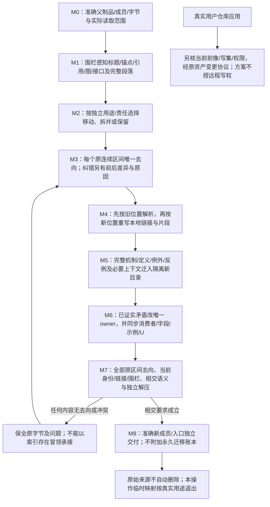
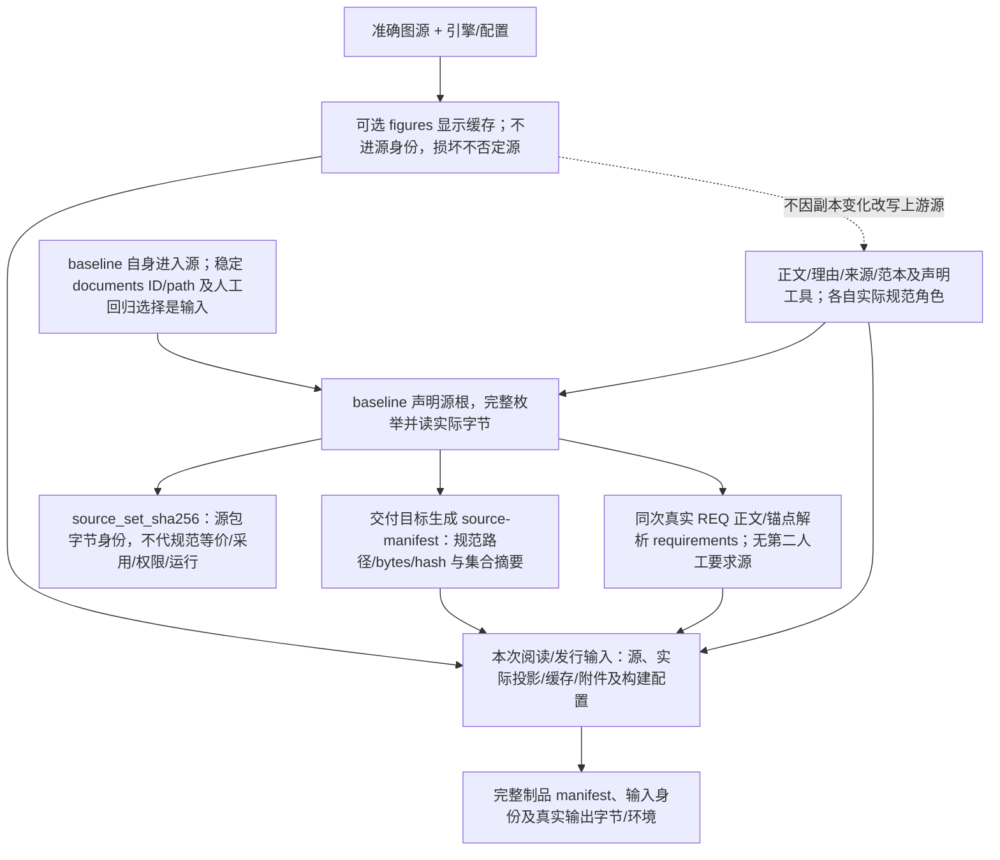
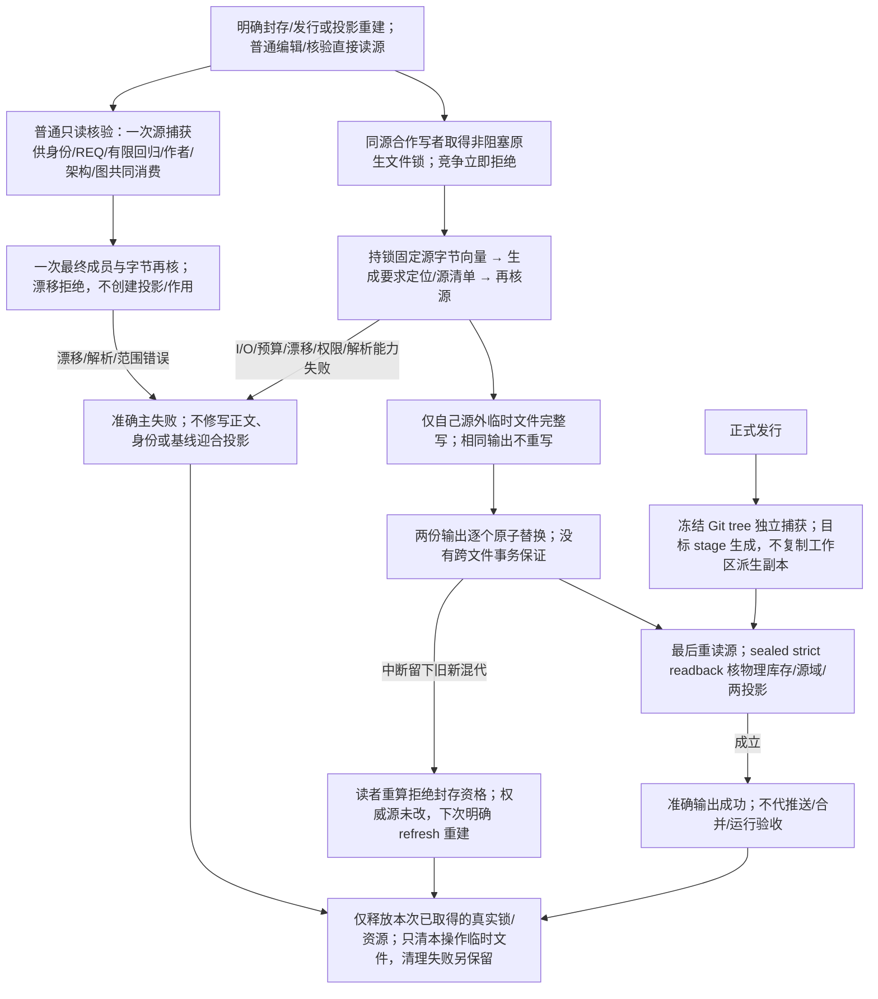

# 文档身份与内容重组协议

> **阅读范围**：本设计包维护；不是Gift运行时接口。


本篇拥有当前文档移动、拆分、合并、入链更新与内容保全的具体算法；[文档编写与维护](规格写作与完整性.md)继续拥有写作、语义保全和审查要求。不建立第二份问题台账或独立原理数据库。

## 1. 哪些身份持久，哪些位置派生

当前已登记文档沿用`document_id`，`.documentation/documents.json`仅记录其当前位置，避免普通移动无意义地重建身份。标题、行号与内容摘要不替代该身份；文件不需要为每个自然段建立永久对象。历史拆并对应仅用于当次保全检查，不进入现行登记。这个小型定位表不是产品AssetView实现，不要求所有目标工程复制。

产品合同与REQ/U/D保留各自明确身份；本版内部链接所需的显式锚点保持有效。标题slug和行范围只用于这份准确内容的定位。拆分形成新页时分配新的当前ID；合并或删页时同步当前登记与全部入链。原分工及独立内容的去向在工作核对中检查，不为了证明搬迁而永久保留空父页、旧别名或历史身份链。

选择支持Markdown语义编辑时，解析须无损保留章节、字段、表格、链接、围栏及准确SourceMap；普通章节、行和cell可用当前源修订内的定位句柄，不强加永久身份。小字段/cell修改只在字段、列与行定位唯一且前像准确时形成最小CAS候选，写后重解析同一语义位置核预期值；重复列、歧义行、修订漂移或不能证明往返保持时拒绝相交修改并保留原字节。复杂结构由所选Profile形成候选，不先改派生IR再猜回源；不要求作者序列化可推导的层级、父项或行ID副本。实际文件锁仅约束参与同一协议的写者，不能签发任意外来编辑器下的原子CAS。该可选画像不前置于直接Markdown阅读或普通Git编辑，也不声称当前仓库已有相应工具。

同一库内重名标题按所选Markdown规则解析；变更后更新所有受影响的当前链接，不通过旧址路由弥补断链。无当前用途的旧别名可去掉；不能按文档排序重新编号既有身份。外部已经发布的文档站点若另有明确兼容合同，应在该站点的发布机制中处理，不据假定的未知读者为本设计包新增兼容义务。

## 2. 批次重组的正常流程M0—M8

| 步骤 | 实际动作 | 保持与失败规则 |
|---|---|---|
| M0 固定源 | 记录准确父制品、成员、字节和工具读取范围 | 文件名不是版本证明；源缺失不能声称零损失 |
| M1 解析结构 | 围栏感知地取得标题、显式锚点、引用定义、图源、接口和完整段落 | fenced代码中的`#`不是章节；原文解析异常先保全/定位 |
| M2 选择责任 | 按独立用途与拥有者决定移动、拆分、合并或保留 | 不依“最重要”删枝；长而内聚的协议不为文件数拆碎 |
| M3 建立对应 | 每个原连续区间有唯一去向；真实纠错注明前后内容与原因 | 31个来源都指概述不能证明内容已承接；正文无去向阻止完整迁移 |
| M4 转换引用 | 按原文件位置解析相对链接，再按新位置重写；处理片段和引用式链接 | 不做全仓字符串替换污染代码/历史路径；外部URL不随本地目录改 |
| M5 迁入正文 | 移动完整定义、例子、反例与共同上下文；补最小引导 | 拆分所需引用定义可派生复用，不复制完整语义合同 |
| M6 修正设计 | 对已证实矛盾改唯一拥有者，同改字段、消费者、例子及U状态 | 纠错与纯移动分开；不能以原字节保全保留错误规则 |
| M7 核对 | 全部原区间有去向；链接/锚点/围栏/身份；相交语义反例；新包独立解压 | 结构检查不证明全语义；统计增长不弥补局部内容丢失 |
| M8 交付 | 核对准确当前成员与入口，新包可独立阅读和实施 | 不携带旧路径路由或强制附带迁移台账；原始输入不因制作新包自动删除 |

当前批处理只写隔离的新目录，不对用户原工作区实行破坏式移动。实际仓库实施时再取得真实前像、写集和权限，通过原资产变更协议应用；文档方案本身不授权远程推送。

### M0—M8完整区间、引用与交付图



## 3. 三类核对不能互相代签

**字节和结构保全。** 全部来源成员/连续区间与目标对应；纯移动正文除链接定位变换外相等；变更区间有实际前后差异。JSON能解析、ZIP能解压、本地链接能定位，均只支持所执行检查。

**内容与设计。** 对实质变化说明触发、错误谓词、正常修复路径、失败和消费者，检验当前规则是否已覆盖。新提出的风险没有实测就不说已发生；已有覆盖不再叠加相同原则。所有旧文语义全面正确，不能从结构核对推出。

**产品与运行。** 本包没有运行Gift、实际ACL、Provider GC或业务测试。书面案例是未来验收输入，迁移脚本自身的测试只验证文档处理功能；不能把它们计入Gift能力通过率。

## 4. 导航索引的生成和失效

`内容索引`按实际现有文件生成，提供文件职责/角色与链接；`任务路线`是少量人工维护的使用路线，各主题入口、源码真实标题及按需派生的页内目录提供逐层定位。阅读版目录消费同次解析的标题和锚点，源码无需手写第二份章节列表，也无需先生成HTML才能阅读。它们链接同一内容，不复制字段与算法。完整章节索引可以是独立机器可读派生物，按固定源和解析器记录；不让作者每次修一个段落都同步写JSON。

源变更先保存，索引可以稍后重建；索引失败不丢源。若发布声称全文入口完整，则该制品中的索引必须对其实际成员复核。文档身份表只含必要持久身份和来源关系，大小、散列、标题及章节属于派生清单，不重复手工维护。

### 当前链接与内容承接

本设计包不提供历轮文档旧地址到当前位置的查询协议。旧路径只在编辑者比较材料时提供线索，不是现行读者的输入，也不能代替旧内容的实际融合。移动时改完当前入链，拆分时把完整机制、必要定义及反例迁到准确拥有者；链接仍在但独立信息已丢失，属于失败交付。

当前规范引用另一规范时，必须直接指向当前目标和真实片段；索引、目录和示例同样更新。无唯一当前落点时应解决当前组织或保留具体未决，不能把读者导向多个旧版本自行选择。来源论文、标准或真实历史证据仍按其准确版本引用，不适用“旧文档路径全部去掉”的机械处理。

`python tools/documentation/check_docs.py`只检查当前包的成员、身份、要求引用、准确资料及章节结构；不查询旧包、不恢复历史内容，也不运行Gift产品。它只依赖当前包，旧映射、原聊天及复核附件缺席不影响现行设计阅读和本地核验。

## 链接、阅读与编辑共享的定位含义

链接核验、阅读投影、查询与编辑定位应消费同一已声明的Markdown支持范围：可见标题、大小写、标点、空格、同页重复标题的序号，以及显式锚点各自按同一解释形成地址；代码围栏、行内代码中的示例不产生正文标题或锚点。显式锚点不吞掉阅读画像正常产生的标题地址。解析或定位解释变化时，使相交索引和旧定位失效，不能继续沿用旧行号或旧标题结果。

同一`path#anchor`必须最多定位一个现存目标；不同位置声明同一显式锚点，或不同可定位对象竞争同一地址时，阅读、导出和编辑都拒绝歧义，不按首次命中裁决。普通标题、行号和临时表格定位符只在其准确修订内有效，不因被索引就升级为稳定身份。稳定文档ID和明确采用的长期锚点仍遵守本篇原身份合同，不从路径、标题或hash生成另一套规范身份。

定位唯一性在同一准确修订的整个可定位地址域中检查，不能分别建立heading与table-row字典后各自宣称唯一；跨种地址竞争同样拒绝，重复显式锚点在建索引前拒绝。`row-n`、标题及行范围绑定实际源修订和解析画像；查询的`qid`仅定位相应查询结果，不成为公开稳定身份。

结构解析先识别围栏，再识别围栏外标题、锚点和表格。关闭围栏使用同一字符且长度不短于开启；围栏内部标题、HTML锚点、链接示例和竖线保持字面量。行内代码按等长backtick串配对，表格同时识别反斜杠转义与该画像的行内代码边界，只切真实分隔符，不用裸split或先去转义再猜列。无法消歧时保留原字节并返回解析能力缺项，不猜可写位置；列名、行定位和地址在正确解析后核唯一性。

包外阅读物的链接从实际输出位置和准确作者源位置计算并正确转义，不假定输出永远在源的子目录或同级目录。阅读物移动后重新生成；需要脱离原文件系统的可移植版时，独立封装完整源、附件和入口，不能用只在制作机有效的相对链接冒充自包含交付。捕获前后的多文件一致性仍受真实SourceSnapshot及宿主隔离保证限制，逐文件读取不自动成为全库原子快照。

正文、字段或cell编辑绑定源修订、准确原字节区间和区间前像；先在冻结前像形成完整候选，再按SourceAdapter真实CAS能力提交。提交后读回准确结果并重新解析同一语义位置，核改动与范围外保持项。源变、区间重叠、地址歧义或读回不符时保留候选和实际冲突，不把旧span套新源，不盲目恢复旧字节覆盖其他写者。合作文件锁只能协调参与者；读取后再比较再rename不保证对任意外来写者的原子CAS，强保证由真实宿主能力承担，缺能力就限制相交写入。

## 5. 当前工作材料与永久设计的不同保留

迁移前后字节、工具日志、ZIP统计和差异仅在确需时保留为工作记录，不进入现行规范。新的共同规则进入当前拥有者，新的独立反例进入相应机制或原U/D；已完成的移动过程不继续占用全工程前沿，也不默认追加一套必须长期维护的审计资料。

原始来源不可读、重复是否真同义无法判断时，说明对当前设计的具体影响；可取得材料的有效内容继续融合，不以缺完整历史为由停止。清理过程信息不能抹掉设计未决，也不能把未实现内容写成已验证能力。


<a id="document-registry-format"></a>
## 本设计库身份文件的准确格式

`.documentation/documents.json`使用`schema="sec.documentation-identity/1"`；`documents`中每项只需当前`document_id`与相对根的`path`。ID与路径各自唯一，路径属于当前库且不得逃逸。已有ID在普通改名后保持；新增页取得新ID，移除页同步当前登记。

历史`split_from`、父修订和迁移日志不属于当前定位表。先前字段的去向只在制作核对中比较，不提供历史格式查询服务。大小、散列和文件成员由当前源清单派生；标题和行号直接从当前文档读取，不再持久维护一份同义章节库。

登记和正文在交付时共同核对；草稿仍可以先保存，不能为追求清单一致覆盖未完成的作者内容。该元数据不签发权限，不证明信息完整、语义正确或后续模型已读取。

<a id="documentation-identity-domains"></a>
## 文档输入、派生物、缓存与发行身份

本节拥有本设计库的身份域和生产消费合同；通用的事实/规范/权威分离由[根原则](../产品/原则总纲与归属.md)拥有，修改何时应进入规范及完整变化的闭合由[写入准入](规格写作与完整性.md#documentation-write-admission)与[完整变化原则](规格写作与完整性.md#complete-change-closure)拥有。不得因所有文件位于`.documentation/`，就认为它们都是源、都是缓存或都能重建。

### 责任和采用分开

| 对象 | 真实责任 | 生产、失效与禁止事项 |
|---|---|---|
| Markdown规范、理由、来源、例子与被声明的制作工具 | 各自已声明的正文、研究或实现输入；共同组成这份可交付源包 | 不因计入源包就取得产品规范效力；工具源码可以改变源包字节而不改变产品规范 |
| `baseline.json` | 源范围、审查范围、入口、交付标签及角色边界的输入声明 | 自身是源成员，不保存自己或源集合的生成摘要；改边界须审查，不能用排除范围掩盖缺件 |
| `documents.json` | 已接受的稳定文档ID与当前位置 | 保持既有ID；不是任意可删除重算的缓存，也不签发规范采用权 |
| `known-regressions.json` | 人工选择的有限检查条件 | 检查选择有独立内容；合法规范变更可以相应修订，不把词句禁令当作语义证明 |
| `source-manifest.json` | 交付包中准确输入的路径、字节数、摘要及集合摘要快照 | 从冻结源在交付目标生成，不作为作者输入提交；不进入自己的源域；不能只比两个相等的摘要字符串 |
| `requirements.json` | 同一次源捕获中REQ正文派生的ID、位置和段落摘要 | 在交付目标生成，不作为作者输入提交；无第二份人工需求定义；稳定显式锚点优先于标题slug |
| `figures.json` | 可选、可淘汰的显示缓存 | 不进入源身份；缺失/损坏不能否定源。被阅读或发行选择时另按其实际字节、图源、引擎与安全合同验证 |
| HTML、文档包及其manifest | 一次具体交付结果与实际输入/输出字节 | 另绑制品身份与生产环境；源相同不保证字体、渲染器、配置或压缩字节相同 |

元数据目录只登记上述已知角色，新增未知载荷先报告未分类，不因它恰好出现在目录里就接受为新权威。普通声明源根内仍完整枚举，不以名字类似`node_modules`、临时文件或隐藏文件为由默默省略内容。文件是否是产品规范由其已接受责任与适用范围决定，不由Markdown后缀、路径、hash、AI生成或手工创建决定。

### 两种内容身份与另外三种判断

```text
权威输入（正文/声明/稳定身份/检查选择/已声明构建定义）
  ├─ 完整枚举并读取实际字节 ─→ source_set_sha256
  ├─ 源REQ + 解析规则 ───────→ requirements.json
  └─ 图源 + 渲染器/有效配置 ─→ 可选figures.json

权威输入 + 本次实际携带的投影/缓存 + 构建配置/工具观察
  └─ 阅读/发行 ─→ 输入记录 + 完整制品manifest/制品字节摘要

源包字节身份 ≠ 规范含义等价 ≠ 采用/授权 ≠ 运行或语义核验结果
```

`source_set_sha256`表示**声明源包的字节身份**，不是整个世界的知识真值或产品规范的语义等价类。一个注释、制作工具或许可输入的真实字节变化可以改变它。单独重渲染缓存、重建要求定位或重排派生JSON不得改变它。发行包真正携带的每个源、投影及缓存文件仍由外层manifest校验，不能以“不属于源”免除交付完整性。工作区`.tmp`和产品运行记录不进入文档源。

某阶段输出可以成为另一次构建的合法输入；这是显式数据依赖，不是输出反过来定义上游规范。正式机器schema可以拥有自己的结构合同，正文可以拥有解释与行为合同；冲突须处理，不按载体格式自动给其中一方更高权威。实现反例和研究证据允许触发有权修订，不能将“禁止反向定义”误写为“规范不准被现实反驳”。

### 输入身份、派生内容与制品身份图



### 当前格式与规范化字节

`baseline.json`使用`sec.documentation-baseline/2`，准确字段为`schema, source_root, source_roots, source_manifest, audited_namespaces, non_documentation_roots, excluded_from_source_hash, entry, delivery_number, archive_name, scope, authority_limit`。不再有`source_set_sha256`字段。`source_root`为`..`；`source_manifest`为`source-manifest.json`；`entry`为`../`之后的规范包内路径，必须属于源成员。`source_roots`不得缺失、重叠或通过链接逃出根；`non_documentation_roots`只允许审查命名空间内且与源根不相交的显式非文档区域。

`excluded_from_source_hash`只允许已登记的三个输出：`.documentation/source-manifest.json`、`.documentation/requirements.json`、`.documentation/figures.json`。它不是任意glob排除机制。基线自身必须被源范围覆盖并进入摘要；未知字段、重复key、非有限数字、非法UTF-8、非规范路径及别名冲突拒绝。相同路径不能以大小写、分解Unicode、反斜杠、设备名或尾点/尾空格获得第二个逻辑含义；不同宿主的全部文件别名规则不因此被宣称已证明。

`source-manifest.json`使用`sec.documentation-source-manifest/2`，只有`schema, source_set_sha256, members`；每个member恰有`path, bytes, sha256`。`bytes`为非负安全整数，不接受布尔值、负零或超出消费预算的值；摘要为64位小写十六进制SHA-256。成员按规范UTF-8路径字节顺序排列；计算输入为UTF-8紧凑JSON数组，每项字段顺序固定为`bytes,path,sha256`，Unicode不转成ASCII转义，不添加换行。源hash算法域改变由schema分开，不能把旧域的数值与新域当同一种证明。

Python生产者和TypeScript消费者共享该协议而非各自发明序列化。TypeScript的默认UTF-16排序不是协议顺序；两边用包括中文、补充平面字符及空文件的相同向量核对。现有一般`canonicalJson`继续拥有其原合同，不为文档协议私自改变全产品的排序。源清单的内容须从实际边界重新枚举并逐字节验证；伪造成员数组、两个一致但错误的摘要、漏列新文件、基线被替换、未知元数据都不能通过。

可移植归档成员使用相对根路径和`/`分隔；拒绝绝对路径、盘符/UNC根、`.`/`..`/空分量、NUL、反斜杠、Windows保留设备名（含`CON.txt`等带扩展名形式）、尾点/尾空格、非法字符`< > : " | ? *`及控制字符。全体成员同时检查原路径重复、NFC或NFD结合casefold后的别名碰撞；规范化仅检测冲突，不默默改名或合并。无法无歧义运输时返回具体路径缺项，由有权源修改及消费者迁移解决；这是所声明的可移植画像，不假称涵盖所有文件系统别名。

manifest与payload消费同一次冻结捕获，路径、确定次序、长度和摘要均取自该捕获；写出前后成员或字节漂移使发行失败，不拼新payload与旧manifest。独立读回逐实际成员次序、路径、长度及摘要比较，拒绝缺件、额外、重复与冲突别名；仅外层摘要或CRC一致不替代这些检查。沿原源清单与制品身份各自责任，不另建第二清单或改作者源迁就输出。

### 生成、读取和失败恢复

普通文档核验先完整枚举并捕获一次源字节；稳定身份、REQ、有限原文回归、作者引用、架构和图结构都消费同一捕获，不边检查边重新读取各自文件形成混合切面。末尾只再做一次完整成员和字节核对，拒绝期间的漂移；独立设计检查使用同一入口，作为文档核验子步骤时复用原捕获。封存阅读也直接核其即将呈现的捕获，出版前保留原成员／字节再核，不能靠重复全检查掩盖不同输入之间的空隙。

`tools/documentation/source_inventory.py --write`只生成要求定位与源清单，不写基线、正文、身份表、检查规则或图源。同一源根的合作写者用`.tmp/documentation-projection.lock`上的非阻塞原生文件锁协调；竞争立即拒绝，不等待、不按超时偷锁。锁的存在不是持有事实；打开的锁文件不删除换名，避免出现两个锁身份。操作/进程结束释放实际锁；网络文件系统或其他不支持该锁语义的环境不得声称支持多写者。

生成在持锁范围内先固定源字节向量、重建索引、再次核对源，然后在源范围之外的自己临时文件中完成写入，再逐个原子替换派生文件，最后重读源。相同输出不重写。这里没有跨两文件的数据库事务：中断可留下旧/新投影组合，读者通过重算拒绝其为已封存结果；权威输入没有被改，下一次明确refresh从源重建即可。残余临时文件只由创建它的操作清理，不扫描或删除未知`.tmp`内容；协调文件可以在确认没有任何打开者的维护边界退役，不把它当历史账本。

日常源核验和普通阅读直接捕获真实输入，不打开两份本地派生文件：缺失、损坏或陈旧副本均不影响源判断，也不会被检查器自动修写。作者只维护正文、边界、稳定身份与人工检查选择；编辑、提交和普通核验不增加refresh步骤。要求绑定从真实可见REQ标题和锚点生成，围栏或注释里的示例不成为需求。要求定位器支持本库已采用的REQ标题与稳定显式锚点；无稳定锚点的富文本标题返回解析能力缺项，两端不产生相互不兼容的定位。普通Markdown阅读不因此被限制，正文也不会被生成器自动改写。REQ新增/删除是源与采用审查的事项，不通过复制一个永久数量到生成器来定义允许的需求宇宙；当前修改仍须保全全部既有独立要求。

显式`--sealed`核验与阅读消费已经封存的包。本库包含REQ权威正文，必须取得源清单和要求定位两份准确投影并从真实输入核对；缺失、陈旧、混代或伪造均拒绝。通用发行读者按实际源边界决定REQ投影的适用性：包含REQ权威时必须生成与核验；没有该源时不得携带孤立的要求索引。上述`--write`仅用于明确需要本地封存输入的操作，输出由Git忽略，不成为日常维护义务。阅读模式明确区分图源版、缓存版、浏览器待渲染与构建期全渲染；缺失/不可信缓存只能阻断真正需要它的模式。缓存恢复记录真实图源、SVG、引擎/配置，不凭自填摘要证明渲染正确或签发运行权限；SVG仍按阅读安全合同隔离，图源原字节保留可检查。

正式发行从冻结Git tree捕获真实源，独立枚举声明根及审查命名空间，读取实际成员字节，在目标stage生成源清单与要求索引；不读取或复制源工作区的两份派生副本，不要求先把生成摘要提交到Git。文档基线作为源成员只复制一次。复制按所捕获字节校验，REQ正文与同次捕获对齐，最后重捕获源以拒绝漂移。实际选择的缓存作为不具规范效力的字节附件随外层制品绑定。目标包strict readback同时核物理库存、源域、源集合摘要和两份派生对应，不只校验外层包hash；目标派生缺失或被篡改仍失败。发行目录内多出来的非源/非登记派生文件拒绝。构建采用先完成文档成员、再构建runtime的顺序，避免一个成员失败快返后另一个成员仍写入共同stage；若以后确有收益而并行化，必须先取得在途成员全部终态才能清理共享stage。该局部顺序不改变两个成员的共同来源合同。

只读观察的逐文件身份检查、成员重读与字节向量重读只提供其明确观察保证，不是对任意恶意并发写者的全文件系统原子快照。正式构建使用冻结/隔离源；普通编辑核验需要静止切面。I/O、超额、链接、源漂移、解析器能力不足、权限缺失和未能证明的清理分别保留，不归并成“文档错误”。主失败与清理失败同时发生时两者均保留。输出成功、已推送、已合并、完整运行验收分别报告。

### 投影生产、锁、混代拒绝与恢复图



### 迁移、选择理由与重开

从混合域迁到分离域时，一次改变基线格式、源枚举器、要求生产者、检查器、阅读版、self-hosting路由、release解析与readback及相交fixture。旧基线只由明确迁移改写；refresh不能偷偷把权威声明升级。新消费者拒绝旧域，不并列维护两个活动写者；已有旧发行包按原版本保留为历史制品，不由新hash重新解释。源清单和要求定位在目标的**真实当前源**上重建，不用其他版本的成员摘要拼出一个看似当前的库。

独立交付包保留源清单，是因为无Git环境仍需要自己的范围与字节核验；Git commit/tree另绑定仓库来源，不能由子集hash反推整个仓库。源工作区退出两份生成文件的版本跟踪，普通路径从真实输入计算，发行目标按需生成，消除了正文每改一次就要额外提交摘要的双重维护。已有旧包按原协议核验；这次改变生产消费位置，不改变`sec.documentation-*`或REQ绑定的已实现机器schema。保留可选图缓存，是为已明确的离线阅读用途，而不是它不可重建；不让缓存污染源域。保留稳定ID与人工回归条件，是因为它们含独立决定；不把所有JSON一起删除。元数据仍在现有目录，避免为了分类创建新服务、数据库、每段注册表或同义规范。

未来若增加新的派生格式、改变公开身份语义、转换Unicode排序/解析规则，或出现多个必须始终同代可见且无法重建的权威文件，重新评估协议/存储；不要直接追加通用排除glob或冒用本次两投影的恢复保证。安全/资源上限有真实owner，增量缓存是正确全量观察的优化；不能因规模增长改为抽样后继续声明完整。世界资料和项目事实按命题、版本、来源与实际用途研究，有限覆盖不得声称已穷尽全部未知。

### 外部依据及未采用内容

W3C的[PROV-Overview（2013-04-30工作组说明）](https://www.w3.org/TR/2013/NOTE-prov-overview-20130430/)提供entity/activity/agent及派生关系的区分；这里借用关系分责，不声称provenance证明内容真值，也不引入RDF服务。Reproducible Builds的[可复现定义](https://reproducible-builds.org/docs/definition/)将源、环境、构建指令及指定输出区分；这里据此分开源包和制品身份，不从相同源hash推断任意环境下HTML字节相同。

[SLSA 1.2 Build Provenance](https://slsa.dev/spec/v1.2/build-provenance)将构建定义、已解析依赖、运行详情和输出subject分开；这里采用这项关系，不宣称取得SLSA等级或完整attestation。SLSA通用provenance的忽略未知字段与空/null等同规则**不引入Gift的exact-JSON合同**。以上网页在2026-09-20核对，来源只支持对应机制，不认证本项目实现或完整性。原生非阻塞锁分别依[Python fcntl](https://docs.python.org/3/library/fcntl.html)和[msvcrt](https://docs.python.org/3/library/msvcrt.html)接口；具体宿主仍需自己的运行证据，不能用Unix结果代签Windows。
