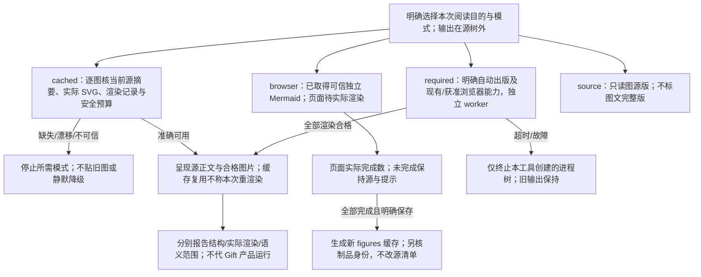
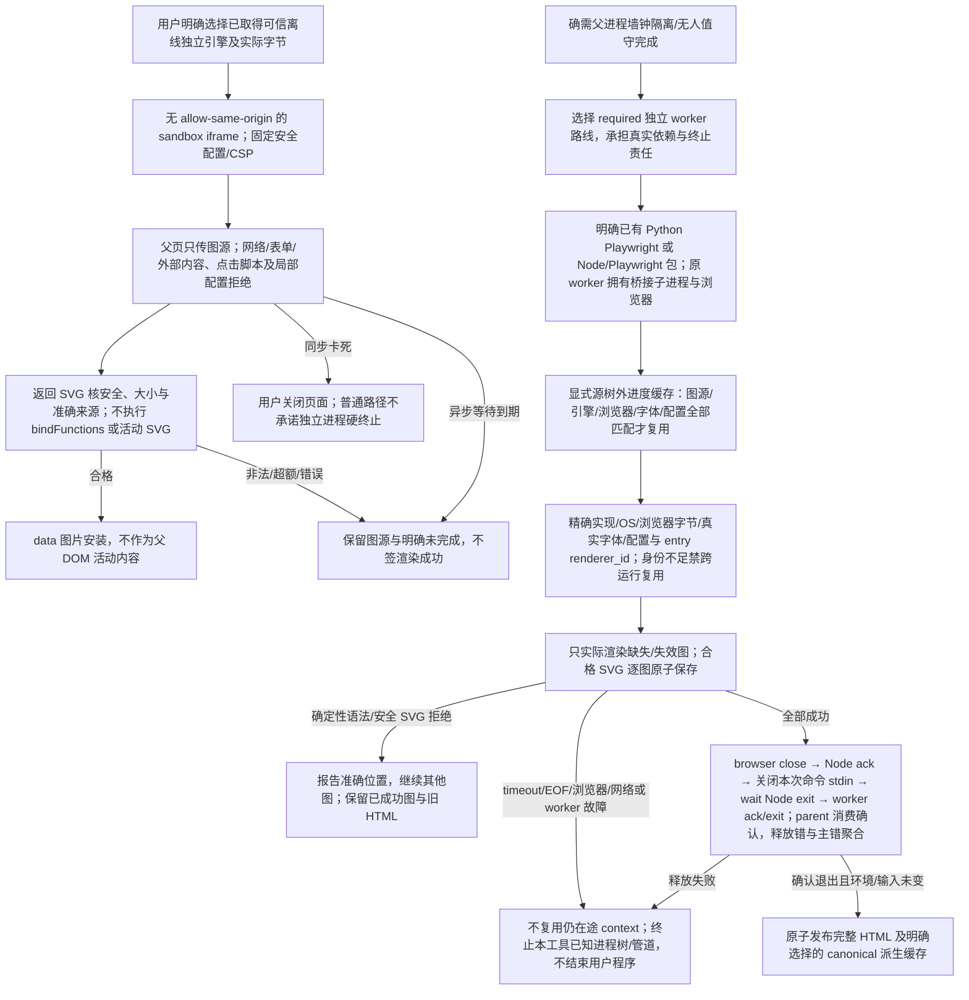
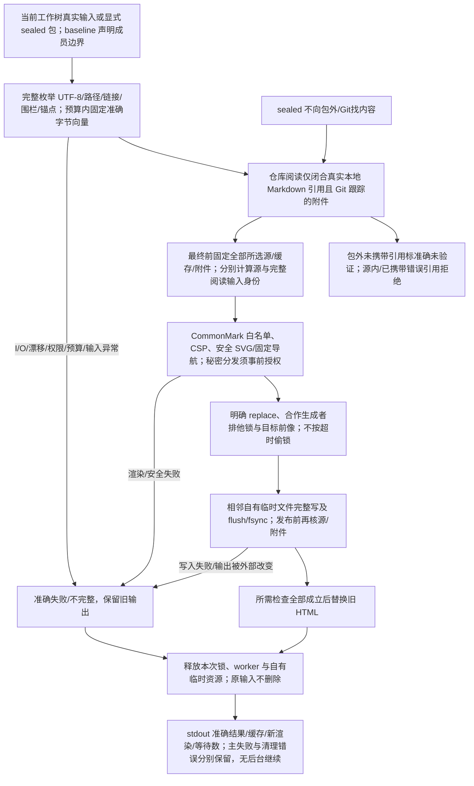

# 按需生成完整阅读版

本篇拥有这份设计库的HTML构建方式，不是Gift产品编译器或新作者界面。Markdown、图源和真实作者文件是维护源；HTML及图缓存只负责呈现。完整性、绘图完成、语义正确和产品运行分别判断，原则见[图表与阅读派生](图表与阅读派生.md)。

## 1. 日常生成：Python与小型Markdown解析器即可

要求Python 3.10或更新版本。一次安装只用于文档的`markdown-it-py`与其`mdurl`依赖；不安装Node、npm、Playwright、Chromium，也不加入Gift产品运行依赖。下列命令均在设计源根目录执行，不要求检出目录具有固定名称；阅读输出放在源树外：

```sh
python -m pip install -r tools/documentation/html-requirements.txt
python -B tools/documentation/build_html.py --output ../Gift.html
```

脚本默认`--diagrams cached`，读取`.documentation/figures.json`中与**当前每幅图源摘要严格匹配**的图像。缓存可以随包提供，也可以缺席；读取时按当前图源、实际SVG和渲染记录判断，不把历史渲染数量当作当前证明，也不把缓存变成第二套规则。正文改动而图源未变时无需启动任何图引擎；节点、边或文字改变造成缓存缺项时停止，不把旧图贴给新源。源码地址/行号由当前文本取得，图像内部渲染ID不冒充工程身份。

再次生成已存在文件须明确`--replace`，且只有全量成功后替换旧HTML。`--root`省略时指向脚本所在Gift根，输出必须在源树外。按需查看源时只修改当前Markdown/JSON，不要求编辑旧HTML、缓存中的SVG或图注。

```sh
python -B tools/documentation/build_html.py --output ../Gift.html --replace
```

图缓存是可删除后重建的显示资产，不是额外作者源、产品依赖、历史快照或不可替代证据。缓存记录图源摘要、SVG摘要/长度、渲染器与实际配置；解码有大小预算，活动SVG和错摘要被拒绝。它不证明图语义正确或渲染环境可信，来源不明的缓存不能凭自填摘要自动采纳。当前缓存只保存当前所需图，不按版本递归积累。

### 阅读模式、缓存资格与真实渲染图



## 2. 改图：使用已有浏览器，不安装无头浏览器

图源变化时，可以让平时使用的浏览器执行本地图渲染：

```sh
python -B tools/documentation/build_html.py --diagrams browser --output ../Gift-review.html
```

打开页面，在“可选：在当前浏览器重新渲染图”选择**已取得的可信离线Mermaid独立JS文件**，点击开始。本地浏览器所需的绘图引擎仍是真实依赖，不能凭一个Python脚本凭空去掉它；但不需要npm依赖树、Playwright或再装一套Chromium。标准引擎必须暴露`window.mermaid`，不能传入仍需网络加载的ESM入口。文件可以来自实际确认的发行工具包；本工具不下载，也不要求每个终端用户具有Node运行时。

已有引擎时可直接内嵌到本次页面，省去文件选择：

```sh
python -B tools/documentation/build_html.py --diagrams browser --mermaid-js tools-local/mermaid.min.js --output ../Gift-review.html
```

引擎在没有`allow-same-origin`的沙箱iframe中运行，父页只传图源及固定安全配置；网络、表单和外部内容被CSP拒绝。返回SVG只在校验后作为`data:`图片安装，不将SVG或`bindFunctions`作为活动页面执行。图中的局部配置/点击脚本拒绝，超大输入和返回拒绝。引擎是用户明确选择的可信工具，不应加载不明来源脚本。

页面显示实际完成数；未完成的图始终有可读源和明确提示，页面生成成功不被称为全部图已渲染。全部成功后点击“保存当前图缓存”，明确用新`figures.json`替换源根的`.documentation/figures.json`，随后普通命令即可生成无图引擎运行依赖的静态阅读版。此缓存替换是文档派生更新，不修改图源；缓存字节不进入源身份；封存发行必须重算包含所选缓存的制品/阅读输入摘要，不为缓存刷新改写源清单。

浏览器渲染的异步等待有期限，但同步卡死引擎可能阻塞浏览器所在执行进程；用户可关闭页面，**不承诺普通浏览器路径具备独立进程的硬终止边界**。需要自动出版、图全部在构建期完成和父进程墙钟超时隔离时使用下一模式。不能为了减依赖把这种差异隐藏。

### 浏览器引擎、安全输出与等待边界图



## 3. 可选自动静态出版

只有自动出版/无人值守渲染才安装重型依赖：

```sh
python -m pip install -r tools/documentation/html-export-requirements.txt
python -m playwright install chromium
python -B tools/documentation/build_html.py --diagrams required --mermaid-js tools-local/mermaid.min.js --output ../Gift-static.html
```

可用`--browser`选择已经存在的Chrome/Chromium；无需再下载一个浏览器。没有指定时使用明确安装的Playwright浏览器。浏览器沙箱默认开启；仅在已隔离容器确需时显式使用`--allow-no-sandbox`，不把制作机器的条件变成普通电脑默认。`SEC_MERMAID_JS`可绑定引擎路径。

已有 Node Playwright 而没有 Python Playwright 时，可明确同时提供 `--node <现有可执行文件>` 与 `--playwright-module <现有包目录>`，继续使用同一构建器、固定绘图配置和独立 worker；不临时解析或安装包。桥接进程、其浏览器及管道属于本次 worker，退出与墙钟超时沿原进程树边界释放。

批量实际渲染可显式提供源树外的 `--diagram-cache <派生缓存文件>`。每幅安全 SVG 成功后原子保存进度；只有图源摘要、真实引擎字节、渲染实现修订、OS、浏览器可执行文件字节与版本、Playwright/桥接运行时、实际字体环境及固定配置全部匹配，并核每个 entry 的 `renderer_id`，才跨运行复用。Windows 字体身份来自系统／用户字体注册、替换映射及有界字体文件字节；Linux 使用已存在的 fontconfig 字体与配置文件枚举，连同相关语言／配置环境计算字节摘要。取得身份失败或超额时禁跨运行复用，不凭字体族字符串推定环境相同。渲染完成后再次核环境未变。

只有确定性语法或安全 SVG 拒绝可收集准确位置并继续其余图；图 Promise 超时没有取消在途渲染，浏览器关闭、协议 EOF、网络尝试与其他引擎故障均立即停止本次 context，并终止本工具已知进程树。关闭次序是浏览器关闭、Node 返回 terminal ack、父 owner 关闭本次 Node 命令 stdin，再等待 Node 真退出；不能保留命令写端并等待接收方退出形成相互等待。随后 worker 返回 terminal close ack，parent 消费确认并等待 worker 退出。全部图成功和这些真实释放成立后才发布 HTML；主失败与释放失败合并保留，不吞掉关闭错误。失败保留旧 HTML 和已成功的派生图，下次只处理缺失或失效图；缓存不签发语义正确，也不成为规范清单。

可在实际成功的 required 构建中用 `--write-diagram-cache .documentation/figures.json` 由同一 owner 原子发布完整派生缓存，使日常 cached 阅读复用；源树内仅允许该已排除于规范源身份的 canonical 位置，其他缓存输出须在源树外。缓存输出不改变 HTML 必须在源树外的合同。

原来的完整静态渲染与独立工作进程超时机制保留，按每幅图固定配置和非零绘制种子；父进程超时只终止本工具创建的进程树，不结束用户目标程序。此模式不需要有效图缓存，失败保留旧输出。所有模式均不调用AI、云服务或目标工程程序。

明确只读图源时仍可使用`--diagrams source`；这是文字/源版，不是缺缓存时的静默降级，也不标成图文完整版。

## 4. 准确输入、全部文件与整体视图

默认捕获当前工作树，适合修改后立即看新版；`--sealed`要求当前源与已生成的源清单一致，不将旧清单更新标题当新证据。全部输入按实际字节固定，发布前核成员与内容仍未变化；这提供一个准确捕获向量，不是操作系统的全目录原子快照。多文件并发修改且需要更强保证时，使用静止导出或真实快照。

源范围严格由`baseline.json`的`source_roots`声明；声明根内完整枚举，不按`node_modules`、`__pycache__`等名字静默省略。只有身份域合同登记的清单、要求定位和图缓存排除于源摘要。阅读输入还包含实际携带的派生物、缓存和引用附件；`source_set_sha256`只绑定原源域，`input_set_sha256`绑定完整阅读输入，附件不会因此取得规范身份或责任。未分类文件、无效UTF-8、符号链接、越界、源域内缺失引用、重复锚点或未闭合围栏拒绝，不悄悄省略。原始字节全部内嵌，意味着源里包含秘密也会被带入，生成器不是脱敏/授权工具；分发前必须选择合适内容。

仓库阅读从实际Markdown本地链接计算所需的仓库引用附件。附件须位于当前仓库内并属于实际Git跟踪集合；只捕获被引用的成员，Markdown附件的相交引用按同一规则闭合，仍受文件数、字节、路径及内容预算约束。完整闭包在最终渲染前固定，Markdown附件生成真实正文及锚点，其他附件生成真实源码或下载目标；发布前同时核源域和附件的成员、字节。无需维护附件路径清单，也不读取源码导入图来扩大阅读范围。

`--sealed`只消费包内实际携带的文件，不调用Git或向包外寻找源码。包内携带的引用附件照常呈现；baseline之外且未携带的仓库引用，保留准确路径、显示“本包未携带的仓库引用”，并记录未验证范围，不生成虚假的可点击目标。源域内真正缺失的文件或锚点继续拒绝；已携带Markdown附件的错误锚点也继续拒绝。阅读生成成功只证明该包实际携带的内容可呈现，不证明未携带的仓库引用存在、正确或已实现。

全部Markdown按原顺序呈现；JSON、计算源、工具及配置作为准确源码阅读，原件可取得；二进制说明其仅作为附件，不宣称已读懂其内容。跨文件相同标题以文档作用域区分，同版相对链接变成页内准确地址。外部论文只保留链接，不下载也不冒充包含全文。

架构模块依赖图由[唯一依赖表](../架构/装配/模块与运行实例.md)实时派生：没有独立手写第二份边。`tools/documentation/check_design.py`检查实际模块、禁止方向、无环及实际U条目的唯一身份、采用与执行字段和导航，再按同一表生成依赖SVG；不另固定边数或U总数。图是静态依赖，不是运行步骤；其公开端口和状态责任仍由原表/正文完整说明。其他机制继续在原文拥有其图源，不强塞一张万能全图。

## 5. 呈现安全、预算和失败写回

Markdown采用固定CommonMark、表格和删除线规则；安全白名单保留当前排版结构，未知标签转为可见文本并提示，原始字节仍完整保留。泛型应写在代码跨度中。外部事件属性和脚本不被执行，来源里的命令不变成工具授权。默认CommonMark允许任意HTML，故不能仅凭解析器成功宣称安全；见[官方安全说明](https://markdown-it-py.readthedocs.io/en/latest/security.html)。

静态页只有固定导航脚本，CSP按哈希限制；browser模式额外允许固定工具脚本与隔离iframe，不允许任意正文活动内容。图像通过安全SVG检查后以图片嵌入，不作父DOM。长表、图和代码局部滚动，标题/摘要允许换行；不靠隐藏内容或缩小全部字形修复窄屏溢出。

最终输出在相邻临时文件完整写入并flush/fsync后替换。合作生成者以排他锁协调，外部改变输出则拒绝覆盖；崩溃遗留锁需确认原生成已结束再移除，不按超时偷锁。它不能阻止任意绕开协议的外部写者，也不承诺所有文件系统断电耐久。源、图、缓存、链接、预算或写入失败均保留旧HTML。

单文件/总字节、图源、SVG、图数及执行时间均有实际预算。超额报告不完整，不裁剪后报告成功。超出单页适用范围时可设计分册或站点，不能把TB原数据全部base64塞进Markdown/HTML。最终stdout报告结果及缓存/新渲染/等待数，错误走stderr；无后台继续工作。

### 固定输入、附件闭包与失败安全输出图



## 6. 复核与准确完成声明

```sh
python -B tools/documentation/check_docs.py
python -B tools/documentation/check_design.py
python -B -m unittest discover -s tools/documentation/tests -t tools/documentation -p test_build_html.py
python -B -m unittest discover -s tools/documentation/tests -t tools/documentation -p test_reading_modes.py
```

上述是文档工具和有限反例，不运行Gift产品。每次阅读构建检查已选原件、链接、唯一ID、准确图源和实际呈现模式。只有原源与缓存精确匹配才可以复用图；缓存复用不宣称本次重新渲染。浏览器路径必须由实际页面完成数说明，自动静态出版另核全部图及其真实渲染结果。

同一输入、引擎、字体、浏览器和配置可以检查重复生成字节；这些条件改变后需要实际对照，不能单由确定性配置推断跨平台同几何。当前图文应形成完整可追踪整体，但图像可显示、结构有效、语义正确及产品已运行分别有证据。原工具、安全和失败处理的有效机制不因减少日常依赖被删除。

Mermaid提供浏览器运行方式，见[官方usage](https://mermaid.js.org/config/usage)；本库仍使用明确取得的引擎版本而非自动追随网页最新版。缓存实际渲染来源与本次生成来源各自记录，不分发容器字体，不把显示缓存变成新的人工规范。

缓存中的渲染器身份记录其真实来源和配置，不由发行文件名推测。本工具可以运行合格的标准独立浏览器包或经明确加载层封装的等义本地引擎；两者的实际字节和测试范围分别记录。生成器不默装图引擎、不分发未知许可的依赖或字体，也不承诺操作系统的本地文件/下载策略都相同。实际页面注入、文件打开、浏览器版本和导出路径需要按交付范围分别验证，环境阻止某路径时不改安全政策来伪造通过。
