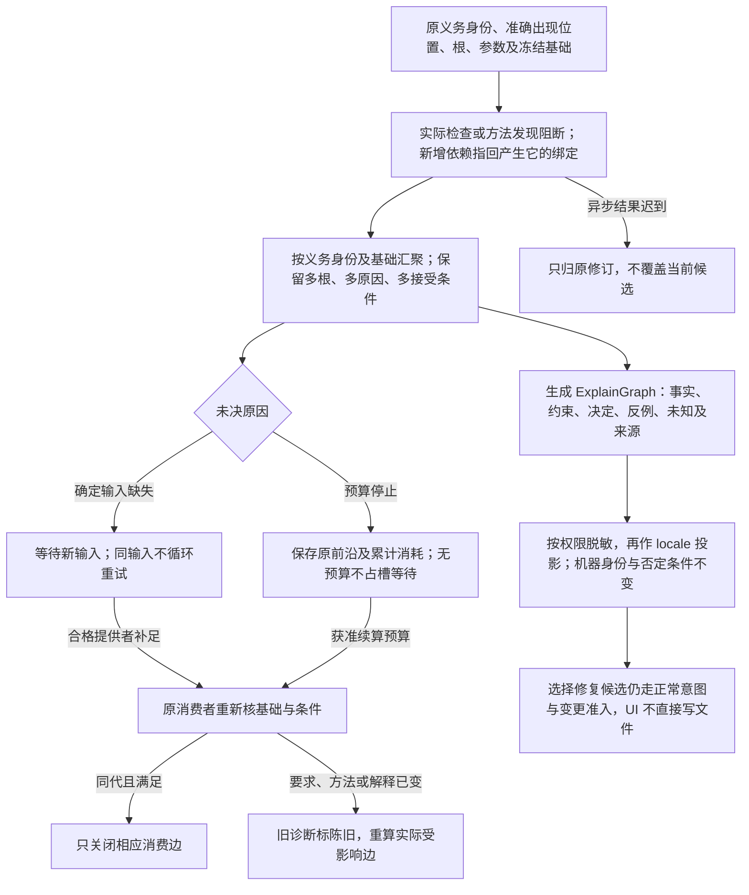

# 诊断与追踪

> **阅读范围**：采用范围内的设计规范；实现状态另查未决 · [共同上下文](输入与阶段总览.md)。


## 诊断、解释与决策追踪

### 1. 目标

工程编译器必须解释“为什么得到这个设计、实现和变更”，而不仅输出结果。解释本身是从规范图、求解回执和来源生成的投影，不是人工拼接日志。

### 2. 解释图

```text
ExplainGraph = {
  question,
  answer,
  supportingFacts,
  constraints,
  decisions,
  rejectedAlternatives,
  evidence,
  unknowns,
  counterexamples,
  sourceLocations
}
```

图节点引用规范对象；自然语言只是 locale 投影。

节点种类沿原Intent、Definition、Observation、Fact、Constraint、Candidate、Decision、Binding、Plan、Admission、Effect、Readback、Evidence、Verdict与Unknown，不另造解释事实。边保留derived-from、rejected-by、selected-because、authorized-by、depends-on、invalidated-by、observed-by、supports、conflicts-with及replaced-by的实际关系。解释须能回答局部变化如何传播、何种授权允许作用、哪些输入会反转结论，以及如何恢复或反转。

最小解释覆盖该结论必需的因果与约束，只在声明的有限模型内承诺最小性；保持identity、source、counterfactual与expansion handle，不能为简短删掉改变结论的条件或未知。解释与实际decision/receipt digest一致；输入排列不改其语义，删关键节点必须被validator发现，自由文本不能改变决定。同一reason code可定位不同实例，不能把分类码当实例身份。

解释默认引用摘要与受控查看句柄，不复制秘密、完整源码或个人数据。不同主体取得各自有披露权的投影，底层事实不因查看者改变；结论可更弱或隐藏，连受限证据的存在也须有披露依据。仍应提供有权采取的下一动作。

### 3. 典型问题

系统应回答：

- 为什么这个文件受影响？
- 为什么选择库 A 而不是 B？
- 哪条约束阻止编译？
- 哪个未知导致不能冻结？
- 为什么某缓存失效？
- 为什么需要人工批准？
- 为什么这项验证必须重跑？
- 哪个输入改变会使结论反转？
- 这个生成代码对应哪个意图和设计对象？

### 4. 诊断生命周期

诊断绑定：

- 对象 revision；
- 编译阶段；
- 算法 revision；
- 作用域；
- 来源位置；
- 相关诊断；
- 可能修复；
- 陈旧条件。

输入变化后旧诊断进入 `Stale`，不能继续显示为当前错误。

诊断的当前性由其实际依赖决定：改变无关输入不必废弃仍成立的诊断；相交输入、解释、检查器或权限视图改变时，重新核验后才能安装为当前结果。异步检查返回前，再比较请求绑定的修订与当前候选；迟到结果可保留为原修订的诊断，不能覆盖新候选的诊断集合。取消或预算终止只表示本次检查未完成，不自动清空尚未重新核验的旧问题，也不产生“无错误”的结论。

<a id="obligation-provenance-and-resumption"></a>
### 未决义务的归因、汇聚与恢复

未决沿既有Obligation、Result及来源图传播，不建立第二份错误或状态协议。每项须能从原引用解析出：原义务与准确出现位置、所选根及实际参数/主体、冻结输入基础、发现它的检查/方法、当前阻断的出口及消费阶段、应补的事实/内容/决定与合格提供者、恢复入口和失效条件。尚未选出方法或生成成员时不伪造Binding或目标路径；同一错误码或文本不能作为义务身份。

实现选择、降低及目标组合保留原义务并增加真实消费边；降低新引入的辅助、导入或资源义务反向指向产生它的绑定。多个根共享同一外部事实时可共用一次取得与检查，但保留根、原因和接受条件的多对多关系。汇聚按准确义务身份与基础去重，再沿实际边计算受影响根，不由并发返回顺序决定哪个错误覆盖其余原因。TS根补足ABI不顺带消解Rust根；一个独立根完成也不证明共同发布组完成。

补足输入后必须由原消费者重核，提供者不能自行将义务置为完成。输入同代且新事实满足原条件时关闭相应消费边；要求、方法、解释或目标改变则使旧诊断陈旧并重算相交消费者。缺确定输入的查询没有新输入就不循环重试；预算截止则保留原搜索/检查前沿，在获准剩余或新增预算内可继续，即使业务输入未变。续算重核基础并累计已耗资源，不因换会话或attempt刷新总预算。无合法续算预算时返回原前沿，不占用工作槽等待。缺供给、目录读取失败、无权、已证矛盾及超预算保持各自原因，不因后端都无法发射而统一为缺实现。

### 5. 不满足解释



约束失败以图呈现：

```text
目标
→ Requirement
→ 冲突约束
→ 来源和有权 owner
→ 受影响候选
→ 可放宽项
→ 修复候选和后果
```

不能只输出求解器内部表达式。

### 6. 解析解释

实现选择显示：

- 候选闭包和完整性；
- 硬资格逐项结果；
- 被拒绝原因；
- 成本向量；
- 政策或人工决定；
- 适用范围和失效条件。

### 7. 变更解释

每个物理编辑可追到：

```text
工程意图
→ 目标声明
→ 语义对象
→ 设计 Delta
→ Target 节点
→ MutationOperation
→ 文件范围
```

格式化噪声和语义变更分开显示。

### 8. 隐私与安全

解释不自动暴露：

- 其他租户对象；
- 秘密值；
- 内部安全规则细节；
- Provider 原始敏感错误；
- 模型隐藏上下文；
- 未授权源码片段。

脱敏发生在投影层，原始证据按权限保存。

### 9. 多语言

错误码、对象 ID、路径、字段和代码保持不变；标题和说明通过 `messageKey` 派生。翻译必须保留否定、条件、数值和权限模态。

### 10. 可操作修复

`RepairCandidate` 包含精确 Delta、前提、权限、风险和验证。用户选择修复后进入正常意图和变更编译，不能由诊断 UI 直接写文件。

### 11. 验收

- 关键决定有完整解释路径；
- 解释引用真实对象而非复制文本；
- 不满足核心可理解；
- 诊断随输入局部陈旧；
- 来源映射能在其声明范围内双向导航；需要写回时另按[受管编辑回源合同](../表示/编辑与受管回源.md#managed-edit-roundtrip)核对应规则、准确基础和可写域，导航成功不代签逆向编辑；
- 敏感信息负向测试；
- 多入口展示同一机器事实；
- 修复候选不绕过准入；
- 解释生成确定且可缓存。
