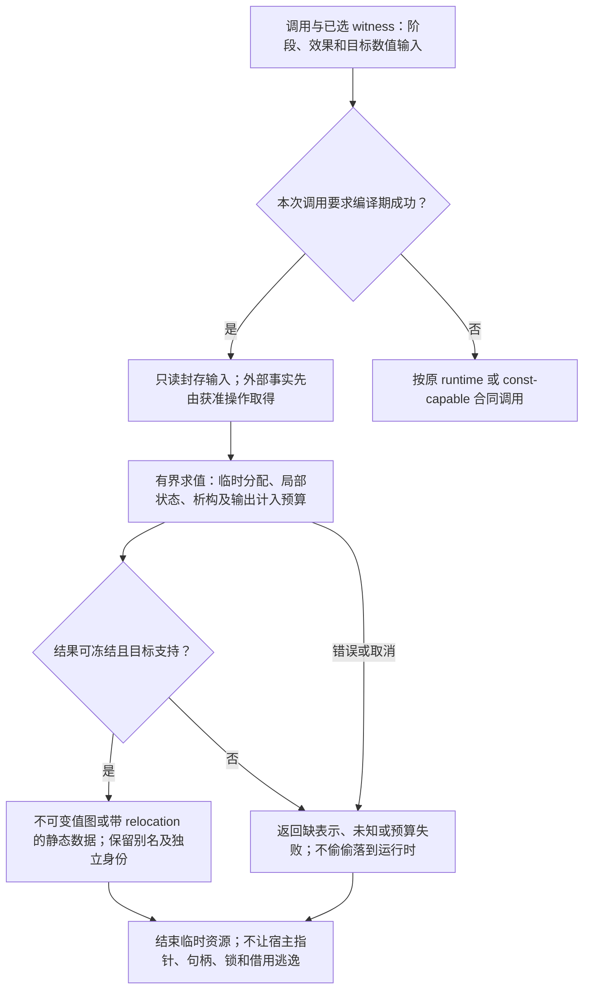
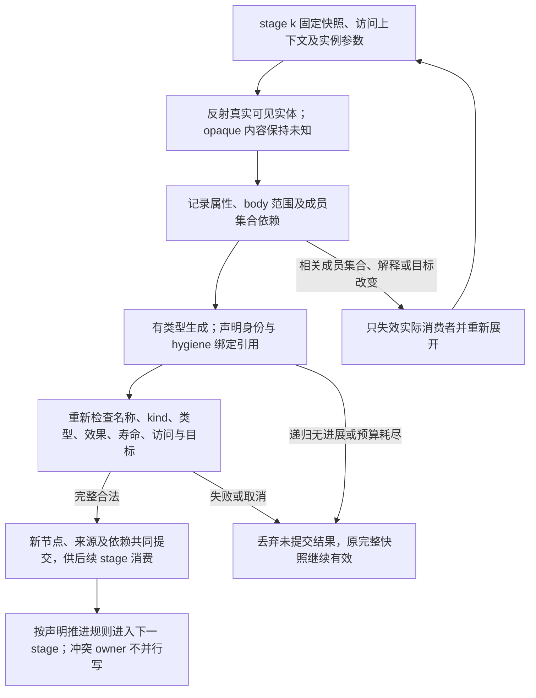

# 阶段求值与反射生成

> 条件能力设计；不改变已固定的基础画像，不表示实现或目标符合性已完成。

本页补充[编译值服务](编译值服务.md)中的相交能力；原章节继续拥有其已采用的有限语义。**当前选择：保留编译器内部求值/查询；公共反射独立决策。** 查询类型和生成代码是编译器工作，不等于必须让用户运行任意语义元程序；需要时才稳定其权限、阶段及API。

条件采用、合同记法与公开扩展边界沿用[共同准入](../目标/能力履行与接口差额.md#conditional-capability-contract)。

### 三种阶段，不复制三套函数语义

函数具有 runtime、const-capable 或 compile-only 阶段合同；const-capable 仍可以运行时调用，compile-only 不产生运行时可调用入口。显式编译期调用、类型级计算与静态断言要求 compile-time 成功，失败不能偷偷落到运行时。Rust `const fn` 与 const context 的区别正说明这两种承诺不能混同。[依据](../../依据/来源/Rust与C++能力比较.md#baseline-s07)

同一个泛型函数能否在编译期调用，取决于实际选定 witness 的阶段与效果，而不是仅检查函数名字是否标了 const。阶段分支允许为编译期与运行时选择不同实现，但二者共同承诺的可观察结果必须相符；有意提供不同效果时，差异必须进入该函数合同。

编译期解释器仅消费已封存输入。时钟、随机、环境变量、文件、网络若确是输入，先由获准操作取得并形成可追踪输入；纯编译不能偷偷读取宿主。依赖缺失时准确失败，不采用“当前目录碰巧有这个文件”。

### 常量堆与冻结

编译期可有有界临时分配、容器、局部可变状态和析构；这些资源由编译任务隔离管理。逃逸到结果的只能是可验证的不可变值图或带 relocation 的目标静态数据。宿主指针、文件句柄、锁、未完成借用和执行器状态不能成为目标常量。

冻结图保留对象别名；两个内容相等但要求独立身份的节点不合并。循环不可变图需要目标 relocation 或明确句柄编码支持。目标不支持该形式时可以返回可选择的表示方案，但不能自动改变原生地址合同。

### 反射看到什么

反射对象分为类型、声明、成员、签名、常量、模块、模板／类型函数及可用的 typed body／expression view。所有引用绑定语义快照、访问上下文与实例化参数。反射后的字符串仅用于显示，不代替实体身份。

反射对象不是“随便可写的 compiler AST 指针”。可查询结构、类型、效果、布局要求、可访问成员及来源；对不透明 foreign 类型，只返回真实可得信息。读取未公开函数体、私有布局或敏感 annotation 需要其 own access contract；拿到 reflection token 不自动扩大权限。

C++26 的反射提案提供语义实体、splicing、成员查询等能力，但也有构造器／声明注入等具体限制；本设计不把提案泛称成“任意改写编译器的一切”。[依据](../../依据/来源/Rust与C++能力比较.md#baseline-s19)

### 生成和拼接

生成器接受有类型参数、查询已固定快照，输出带来源的声明／表达式结构。引用通过声明身份与 hygiene 绑定，不通过字符串拼名字。注入结果重新执行名称、kind、类型、效果、寿命、访问和目标适用性检查，不能因为生成器自称可信就免检。

生成按分阶段 DAG 工作：stage k 读取其输入快照，输出对后续 stage 可见的新节点。需要递归生成时必须显式声明推进规则；无限新增声明／反射自己新输出的环在预算或无进展诊断处停止，不发布半张语义图。

一次生成事务失败，旧快照仍有效；新快照、声明集合、来源映射与缓存依赖共同提交。并行生成只对互不冲突的输出owner开放，稳定顺序不依赖线程调度。静态展开复用本typed expansion；具体作者入口由实际采用语言画像的精确语法、结构编码及能力协商决定，不因`template for`记法新增现行入口，也不另建代码生成框架。

### 失效粒度

反射调用记录实际查询过的成员集合、属性及 body 范围。新增公开字段必须使消费“所有公开字段”的序列化器失效；改无关私有方法不必重编没有读取它的布局查询。读取“全部成员”本身是一条集合依赖，不能只记录当时已经出现的字段而漏掉将来新增者。

## 再次修改与失效

元程序读取的成员集合、理论、源解释或目标数值输入改变时，重新展开受影响内容；原作者源和上一份完整生成结果仍保留，失败不能发布半图。

## 使用点与可检验出口

这些分支保留各自的真实输入、替代路径与边界，不按条数声称更多底层能力；[比较记录](../../依据/来源/Rust与C++能力比较.md)不拥有另一套语义。

- **friend**：普通封装先用已有规则；有实际授权主体差异再加局部机制，不能从 friend 推出全局 capability 平台。 硬边界示例：固定模块边界、公开 API 与单个特权主体都不可改，且确需绕过普通私有性；[具体比较与出口](../../依据/来源/Rust与C++能力比较.md#a06)。
- **用户字面量后缀**：字面量/DSL 属作者层可选便利；保留解析错误与数值精度，不是新系统控制缺口。 硬边界示例：必须兼容既有后缀语法或无宏入口的第三方常量协议；[具体比较与出口](../../依据/来源/Rust与C++能力比较.md#a20)。
- **decltype / decltype(auto)**：编译器内部类型查询本来必要；是否向作者开放为语法/API，是独立决定。 硬边界示例：编写通用库必须在类型位置复用任意表达式类型，且不允许改写为新 trait/辅助入口；[具体比较与出口](../../依据/来源/Rust与C++能力比较.md#a23)。
- **值参数包**：区分值序列计算与类型身份；只在实际输出依赖时保留编译期参数，不整套复制 NTTP。 硬边界示例：任意结构值/符号序列必须原生成为公开模板身份，或需要未合作外部泛型接口；[具体比较与出口](../../依据/来源/Rust与C++能力比较.md#a25)。
- **pack indexing**：作为包/反射的派生操作；C++26支持按实际编译器核验，不混入已成熟C++23比较。 硬边界示例：要求对外暴露原生通用 pack 索引，且不能接受另一套表示；[具体比较与出口](../../依据/来源/Rust与C++能力比较.md#a28)。
- **广义非类型模板参数**：保留真正需要的形状/值身份；不要默认纳入全部浮点NaN与符号指针模板规则。 硬边界示例：开放原生 API 必须按这种值身份自动匹配，或类型计算无法被有限提前展开；[具体比较与出口](../../依据/来源/Rust与C++能力比较.md#a29)。
- **泛型常量表达式进入类型**：静态尺寸有真实价值；先常量求值/库映射，在高频需求下再扩展作者表达。 硬边界示例：原生 [T;expr] 公开 API 被固定，或编码复杂度/编译时间实际不合格；[具体比较与出口](../../依据/来源/Rust与C++能力比较.md#a30)。
- **SFINAE/requires 结构式探测**：这是比没有默认参数更实质的抽象限制；Gift有需要时用已有语义查询，不必因此照搬SFINAE所有历史规则。硬边界示例：公共通用库必须接受未来未适配类型并按成员存在性分派；[具体比较与出口](../../依据/来源/Rust与C++能力比较.md#a34)。
- **if constexpr 丢弃依赖分支**：可在实例化/生成阶段解决；先复用分派，避免把它误称CPU控制能力。 硬边界示例：一个开放泛型定义必须按未知T的结构探测自动选依赖分支；[具体比较与出口](../../依据/来源/Rust与C++能力比较.md#a35)。
- **consteval**：编译期执行合同有用，但只对确实需要的调用生效；不要为简单常量计算复制整套历史constexpr机制。 硬边界示例：要求函数名在任意正常调用处强制编译期，并参与开放泛型组合；[具体比较与出口](../../依据/来源/Rust与C++能力比较.md#a38)。
- **更广泛泛型 constexpr**：保留阶段和目标数值输入；先做真实所需操作，不默认开放无界元程序/整个编译期堆。 硬边界示例：需要通用库操作在目标语义下静态运行、类型检查一致，不能另写host脚本/复制算法；[具体比较与出口](../../依据/来源/Rust与C++能力比较.md#a39)。
- **语义静态反射**：编译器内部查询与用户开放反射分开；用例足够才稳定后者，C++26实现成熟度单列。 硬边界示例：需要无额外opt-in地检查未知类型语义，并把结果参与泛型实例化；[具体比较与出口](../../依据/来源/Rust与C++能力比较.md#a40)。
- **reflection splice**：hygiene和绑定正确性必须保留；公共splice不是编译器项目天然必须暴露的语言功能。 硬边界示例：通用反射结果必须无损保持语义实体绑定，不能依赖字符串/显式metadata协议；[具体比较与出口](../../依据/来源/Rust与C++能力比较.md#a41)。
- **template for**：归入真正需要的静态展开；不与24/27/40再重复累计成多个底层控制缺口。 硬边界示例：无适配开放的反射/参数包迭代是公共API硬要求；[具体比较与出口](../../依据/来源/Rust与C++能力比较.md#a42)。
- **语言级contracts**：保留真实安全前提与检查，是否提供通用契约语法按需求决定；不能因此宣布Gift必须有全套effect/refinement系统。硬边界示例：必须兼容C++契约语义/诊断模式，或公共API工具必须消费标准contract实体；[具体比较与出口](../../依据/来源/Rust与C++能力比较.md#a64)。

实际组合与拒绝条件见[验收案例](../../运行/验收/跨语言控制与组合案例.md)；从作者要求到再次修改见[连续开发情景](../../../examples/连续开发/跨语言能力连续开发.md)。

## 编译期容器、目标事实与卫生生成

编译期临时容器与构建脚本不是等价的语义入口。能由既有 const 方法计算的小值直接使用；合格受控生成器可用临时容器建立结果，但其分配、销毁、循环、节点和输出大小进入该编译任务预算。过程结束只能输出可冻结的值/结构及已绑定引用，不能带出宿主地址、文件句柄或运行中资源。未知或超预算不改为运行时执行，除非原需求明确接受该独立方案。

目标字长、对齐、数值规则和可用能力作为固定输入，而非读取构建机器后假定同一。一个临时 vector 计算成功不证明任意分配器、所有泛型调用或永久分配都可常量求值。若利用外部构建步骤，取得其实际输入、工具内容、产物成员和来源；运行该步骤仍是获准作用，不藏在解析中。

结构生成保留词法绑定，而不只保存字符串名。替换、内联、宏展开和抽取须采用捕获规避的绑定映射；可使用已有符号身份/去布鲁因表示等合格实现，不规定新的全局身份表。例如替换 `λy.x` 中的自由 x 为 y，须得到与 `λz.y` 等义的结构，而非错误的 `λy.y`。未选择的分支依原阶段规则处理；生成中途失败不安装半成品定义，成员集合查询及否定查询都参与增量失效。

## 宏展开与引用卫生的受控能力画像

真实要求激活公开元编程时，采用纯、确定、在类型检查前受约束的AST准引用转换作为有限画像。其`MacroDefinition`固定模块修订、阶段、语法参数种类、结果AST种类、作用域合同、依赖政策、资源预算及源所有权；这些是所选画像的输入责任，不新增现行作者Kind、保留词或wire。`quote`形成待按该画像解析的语法，`splice`只嵌入允许种类的节点，`gensym`产生不会与调用者碰撞的声明身份。可读拼写不代表唯一绑定，展开后按定义点作用域及明确引入点规则解析；默认卫生，故意捕获或重绑定必须显式指向有权可见的准确来源，不能拼字符串绕过模块私有性。

固定宏定义修订与调用点CST/AuthorSource后，先检查输入种类和访问域，再递归展开；深度、节点数、计算工作和总输出字节共同消费父任务预算，不因递归建立新任务而重置。每个生成节点保留`expansionOrigin{macroRevision,callSiteSpan,templateSpan,scopeMark}`，然后经过原名称、类型、效果及目标检查再降低。循环或预算耗尽返回带调用点的`EXPANSION_INCOMPLETE`，不发布部分宏结果。相同AST字节也不能跨宏定义、阶段或解析环境变化复用旧绑定；成员与否定查询均进入实际依赖。

展开诊断同时定位调用处和宏定义处。缺少从生成节点到作者内容的合格逆映射时，只修改真实调用参数或宏定义，不把生成AST另存为第二作者源。区别反例包括两处同名`x`、嵌套展开、递归耗尽、跨模块私有引用，以及宏改变而调用字节不变；分别检查捕获、来源、预算、可见性与失效，不能由一个展开成功样例代签。

需要文件、网络、环境、时钟、随机或外部工具的生成器不属于上述纯画像：先返回准确Need，由原execution/Provider在授权与预算内取得并固定输入，再继续纯编译；普通check不隐式安装、上传或执行命令。动态插件的分发信任、签名和隔离仍由原供给与宿主合同承担。返回目标语言字符串也不自动取得语义IR或跨目标保持资格。

## 元编程、反射与自生成的无环引导

元程序只消费前一阶段已经能理解的固定语法、类型、定义和内容引用，输出仍经后继消费者检查，不以生成对象绕过作用域、类型、效果或权限。新语言能力先用旧能力写出bridge，按[原自举合同](确定性与自举.md)独立核验后再迁入；语法宏、类型导出、反射遍历和有作用构建脚本分别取得能力，不因同在编译期而相互授权。

Schema或解码器自生成时，源规则由旧阶段可读的固定格式提供；独立消费者按公开合同核输入、输出及拒绝行为，不能让新规则生成的唯一验证器自证规则正确。过渡引导表保留实际源坐标与再生方法，后继能独立重建后才退役。失败保留原源及完整输入cut，取消不撤销已独立提交的源；重新求值须保持声明的确定性，生成器及依赖规则修订进入原缓存身份。

反射只读取获准公开结构并产生作者候选或制品，不改变当前运行Image的解释规则。热加载形成新Image，原请求按原快照完成或取消；实际采用仍走原作者、制品、权限及恢复边界，反射调用不取得写执行目录或自授采用的资格。
