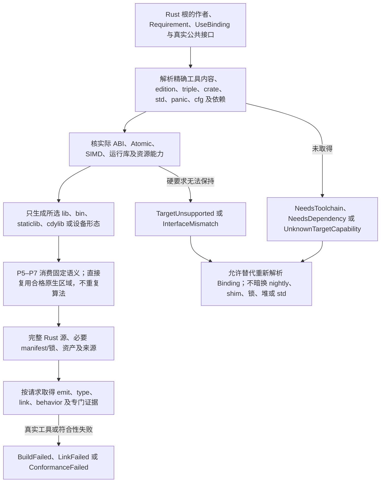
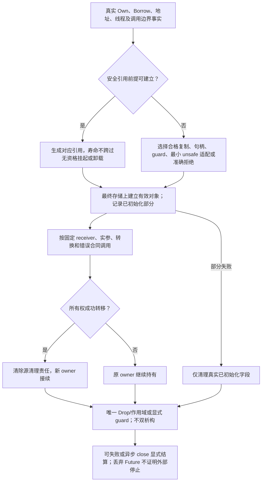
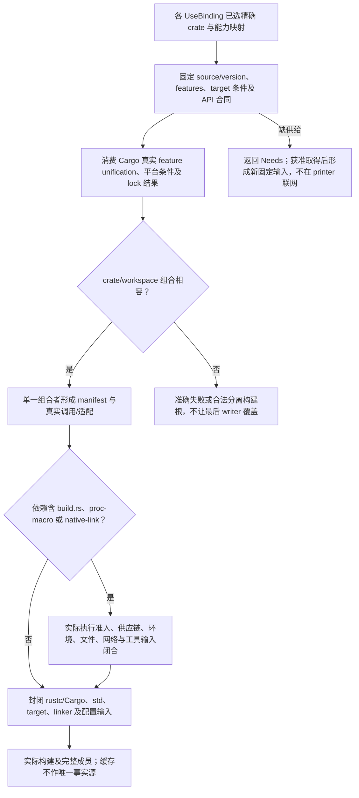
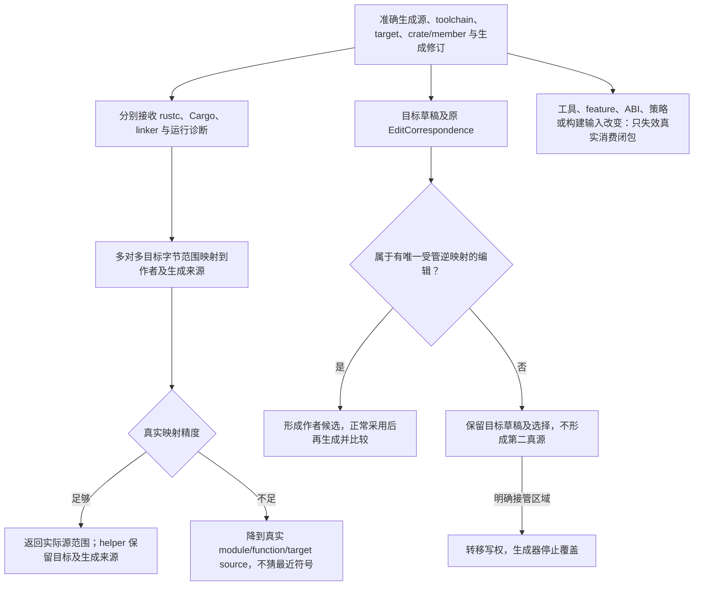

# Rust目标画像与降低

> **范围**：Rust 已进入当前通用目标语言计划；TypeScript 仍先行。本篇闭合 Rust 目标的设计边界，不表示后端、工具链、Cargo、ABI、调试或运行符合性已经实现，也不授权迁写 Gift 核心。

本篇是 [目标组织](README.md)、[原生能力映射](../原生映射/README.md) 和 [原生与跨语言编译](../内核/原生与跨语言编译.md) 在 Rust 输出上的具体消费。作者语义、对象/资源/数值/原子规则仍由其原 owner 拥有；这里固定怎样选择实际 Rust 工具链、怎样降低已绑定语义、怎样组成 crate/产物以及怎样保留诊断与再次修改。Rust 的缺失或额外能力不能反向修改原 Requirement，目标能够表达某种写法也不证明本次 MethodSpec、依赖或运行环境已经合格。

## 1. 采用决定与目标边界

当前默认顺序是：

1. 对已选 Rust 输出根固定作者候选、Requirement、UseBinding、所需公共接口和产物形态；
2. 从真实供给解析一个**精确 RustTargetBinding**，而不是在打印器里使用“当前最新 stable”；
3. 在 P5—P7 中降低为普通、可独立构建的 Rust 源和必要工程成员；
4. 用实际 rustc/Cargo/链接器取得所请求级别的证据；
5. 保存目标源码及来源映射；若允许目标编辑，再沿既有 EditCorrespondence 回源。

Rust 是目标语言，不是新的 Gift 语义真源。已有 Rust 原生作者区域继续保持其 own source 与真实语言解释；如果它已经满足本次根，可直接绑定/重导出，不生成同义 Rust 副本。外部 C/C++、Wasm、GPU 或系统库仍只是明确依赖或原生边界，不因为 Rust 目标存在就变成“纯 Rust 实现”。

## 2. 请求画像与解析后的精确绑定

作者/产品请求只表达真正硬要求，例如目标平台、库/应用/FFI 形态、是否 no_std、公开 ABI、禁止依赖、地址/原子/时限等。工具版本、具体 linker、依赖解析结果等由供给解析后固定；作者不手填编译器内部表。

内部视图可以概括为：

```text
RustTargetBinding {
  toolchainRef,
  cargoRef?,
  rustcVersionAndIdentity,
  edition,
  targetTriple,
  crateShape,
  stdProfile,
  panicStrategy,
  cfgAndFeatures,
  dependencyResolutionRef,
  linkerAndRuntimeRefs,
  codegenProfile,
  targetFeatures,
  sourceMappingProfile,
  capabilityFacts,
  unresolvedNeeds
}
```

它复用现有 Binding/TargetProfile/ReadSet，不发布第二套公共 schema。实际值均来自固定输入或已取得供给：

- **toolchainRef / rustcVersionAndIdentity**：精确可执行内容与版本，不接受裸字符串“stable”作为可重放绑定；
- **edition**：由目标画像明确；新项目可以由产品策略提出默认，但解析后必须成为具体值；
- **targetTriple**：编译/运行目标，不从当前宿主推断；
- **crateShape**：library、binary、staticlib、cdylib 或本任务真实需要的组合；不为未请求形态生成占位；
- **stdProfile**：std / alloc+core / core-only 及其真实供给条件；
- **panicStrategy**：unwind / abort 与跨边界限制；业务错误不靠 panic 模拟；
- **cfgAndFeatures**：Cargo feature、target cfg 与编译 feature 的已解析集合；不能从本地环境暗读；
- **dependencyResolutionRef**：真实包、来源、版本/commit、features、checksum/path 与锁关系；
- **linkerAndRuntimeRefs**：只在本目标需要时存在；
- **codegenProfile**：优化、调试、LTO、overflow 等会影响目标结构或观察的选项；
- **targetFeatures**：CPU/平台特性，不能用构建机能力代替运行目标；
- **capabilityFacts**：实际 Atomic、ABI、SIMD、no_std、unwind 等供给，不由“Rust 能做到”一句话代签。

“支持 Rust”是这些精确绑定在本次根上的相交结论，不是一个全局布尔值。

## 3. 产品形态到 crate 的映射

| 请求根 | 默认 Rust 形态 | 额外条件 |
|---|---|---|
| 可复用库 | lib crate 与明确 public exports | 不自动生成 bin/main；公开泛型与有限实例必须如实区分 |
| CLI / 批处理 | bin crate；必要共享逻辑可放同 workspace 的 lib | 参数、退出码、stdout/stderr、输入/输出文件由成品合同拥有 |
| 服务/请求处理器 | lib/bin 组合或宿主要求的入口 | async runtime、监听器、TLS、shutdown 都是显式依赖 |
| C ABI 库 | staticlib/cdylib + `extern "C"` / `repr(C)` 等合格边界 | 只允许真实 FFI-safe 形状；C++ 仍需匹配桥接 |
| Wasm/嵌入式 | 对应 target triple 与 std/no_std 画像 | 宿主导入、allocator、panic、原子/线程、启动入口分别核验 |
| 仅源码交付 | 普通 Rust module/crate 源及明确依赖合同 | 不冒充已经 build/link/run |

workspace 只在多根真实共享代码、配置或依赖时建立；单库不为“工程化”强制生成多 crate。crate/package 名从公开产品名、稳定语义身份和目标命名规则确定；关键字碰撞使用 Rust 合法 escaping/重命名，不能因 printer 顺序产生漂移。



## 4. 类型和值的 lowering

目标类型选择消费已经固定的中立类型、UseBinding、表示与公开接口要求。优先使用最简单的标准 Rust 表达；不能用目标方便性改变值域、失败、身份或布局。

| 中立/边界含义 | Rust 默认 | 需要另行判断 |
|---|---|---|
| Bool / Unit | `bool` / `()` | FFI wire 表示可能不同 |
| 固定宽整数 | `i8..i128/u8..u128` | 溢出/转换必须按原合同，不能依赖 debug/release 偶然行为 |
| 无界/大整数 | 合格库或专门实现 | 依赖政策、no_std、性能和公开 API |
| F32/F64 | 观察合同允许时`f32/f64`；逐位F64使用私有u64载体 | codec、算术、动态舍入、扩展精度和ABI分别核数值画像，不能用数值cast代替位转换 |
| Text | `String`、`&str` 或其他已选编码边界 | 拥有/借用、UTF 合法性、FFI/bytes |
| Bytes | `Vec<u8>`、`&[u8]`、固定数组或实际 buffer 类型 | 地址稳定、零拷贝、共享内存 |
| 固定数组 | `[T; N]`（当目标可表达） | 复杂 const 表达式可先由 Gift 具体化；不能冒领开放原生泛型 |
| List/Sequence | `Vec<T>` 或明确容器 | allocator、no_std、稳定地址及外部接口 |
| Record | `struct` | field visibility、layout、repr、非字节字段 |
| Sum/Variant | `enum` | wire tag、FFI representation、unknown variant |
| Optional | `Option<T>` 当表示/ABI允许 | nullable pointer 与 Option 不能无条件等同 |
| Fallible result | `Result<T,E>` | 原生 unwind/foreign exception 另处理 |
| Tuple | Rust tuple 或生成 struct | arity、公开命名与 ABI |
| Borrow | `&T / &mut T` 或合格 view/guard | 只有真实 alias/lifetime 前提成立才生成引用 |
| Callable | 泛型 `Fn*`、函数指针、具名状态对象或字典 | 开放多态、捕获、一次性调用、FFI |
| Opaque foreign | pointer/handle + owner API | 不伪造大小、Drop 或可解引用引用 |

整数运算如果 Requirement 要求 checked/wrapping/saturating/exact，就生成明确操作；不依赖 Cargo profile 是否开启 overflow-checks 来改变业务语义。相同原则适用于浮点重结合、原子顺序、内存布局和 panic。

后继固定std基底消费[同一逐符号算法](具体降低与领域输出.md#finite-pure-basis-lowering)与准确类型实例。数学Int须有已资格化的大整数或等义实现；`std:IntDivMod`先判零构造准确Err，再用精确向零商余及一次修正生成欧几里得结果，不直接把Rust整数`/、%`或panic当该Result合同。只有值域、`MIN/−1`与所有中间运算的保持成立时才使用定宽优化。Result/Option/Ordering及商余记录由准确构造和ABI决定，不能因同名就转为宿主类型。序列的复制/移动、Text相等、allocator/no_std及结果载荷寿命继续核原条件，缺项不以通用Runtime补猜。

精确Decimal和F64Bits消费[同一数值叶算法](具体降低与领域输出.md#exact-numeric-leaf-lowering)：Decimal复用已选数学Int并保留刻度，显式转换按整数商余及准确舍入生成；逐位F64默认保存u64，只有实际运算需要才作`from_bits/to_bits`投影，不能以`as`互换数值。表示决定贯穿函数、容器、AD和外部边界；原生f64优化必须保持全部相交观察。Cargo依赖、no_std、分配预算和ABI仍核本目标，私有载体存在不代签算术或外部返回值的NaN保持。

后继do/perform同样消费[原区域化表达式降低](具体降低与领域输出.md#structured-computation-lowering)：Rust块只是保持词法/控制/清理合同后的目标表示；perform按固定调用解释保留单输入、嵌套Result、取消和未结算责任，不默认将异步方法同步化或用`?`传播普通Err。

## 5. 所有权、借用、初始化与清理

Rust lowering 只在 Gift 已有所有权/寿命事实足以证明时生成安全引用。无法证明全局别名不存在时选择拥有复制、受管句柄、锁/guard、raw/unsafe 适配或准确 Unsupported，不能先造 `&mut T` 再运行检查。

- **Own**：移动后旧绑定不再可用；若源语义要求 moved-from 对象继续存在，使用已选 transfer/adapter，不把 Rust move 冒充 C++ move constructor；
- **Borrow**：生命周期来源于真实 owner/调用边界，不能跨越异步挂起、线程迁移或模块卸载而失去前提；
- **Pinned/address-sensitive**：在最终存储建立后才形成对应 view；需要堆/arena/slot 的成本与硬约束进入 MethodSpec；
- **partial initialization**：生成能区分已初始化字段的结构/guard 或采用目标能证明安全的构造形式；
- **cleanup**：同一资源只能有一个实际 cleanup owner。使用 Rust Drop/作用域时不再生成第二次手工 destructor；使用手工 FFI 清理时精确阻止双重 Drop；
- **fallible close**：显式 Result/close operation；Drop 不冒充异步、可失败或远端结算完成。

`unsafe` 不是目标能力兜底。只有已选方法确需且具有具体安全前提时生成最小 unsafe region，并把其前提、来源与验证消费保留下来；普通 lowering 不因为性能偏好转入 unsafe。



<a id="rust-managed-graph-lowering"></a>
### 普通共享循环图的成熟管理器与具体生成

原[受管图合同](../../领域/对象与控制/控制流与存储寿命.md#managed-graph-roots-and-edges)在普通std、合格平台、允许停顿和保守滞留的Rust目标中，采用**BDWGC v8.2.12非增量收集器、显式外根与堆内边、窄C ABI**作为确定设计路线。该选择不声明当前依赖已安装或平台已验证。固定版本内容、构建/线程模式、CRT、ABI与链接进入原RustTargetBinding/依赖锁，禁止全局替换Rust allocator、运行中切换收集器或由别的组件启用增量模式。无GC图需求不引入此依赖；原栈/Box、可证明无环的Rc/Arc或区域优化保持其资格。

选择依据是原生所有权/引用计数不能单独回收任意共享环；gc-arena的单线程arena可作相应专业供给，MMTk精确追踪需VM根/停顿接合，均不作为本路线运行失败时的自动fallback。精确回收时限、只按live heap计算硬界、noGC/no_std、硬实时或无锁等真实要求另取满足它们的合格方法，不能由本路线代签，也不删掉这些要求；没有被当前根要求的条件不阻断普通图。普通预算仍计根、退休节点、管理器元数据、保守滞留及native内存，OOM沿固定Fault/abort策略处理，不伪造业务E。

**表示。**Rust侧`Root<T>`是不透明外根包装，持有由`GC_malloc_uncollectable`建立、会被扫描的根单元；普通Rust堆内的引用计数只管理这个根单元的拥有者。GC堆内`Edge<T>`仅为对齐对象基址或内部空槽，不嵌入Root/Arc根包装。闭包捕获var和mutable字段指向同一受管Cell，循环内新声明仍建新Cell；对象相等用原实例身份，不比较Root包装地址。普通Rust Future、错误载荷和回调队列中的Root可保活图，不假定系统allocator或TLS会被扫描。这个可见性差异由[BDWGC官方C接口](https://www.hboehm.info/gc/gcinterface.html)明确；此处的Root/Edge生成接合是Gift自己的责任。

堆载荷使用生成的无任意Rust Drop布局：标量/标签、GC指针槽和字节数据分开；容器、闭包、变体生成可追踪存储，不将原生String/Vec/Arc按字节塞入GC对象。每个固定布局生成size、align、bitmap、变体指针槽及数组stride，按固定版[typed接口](https://raw.githubusercontent.com/bdwgc/bdwgc/v8.2.12/include/gc_typed.h)建立一次descriptor和对应typed/atomic分配；标为指针的槽只存真实引用或零，不复用为任意整数。数组长度/乘法及实际分配对齐先核，typed对象不使用GC_realloc，扩容先建后备块再按原语义转移/发布。库在descriptor资源不足时可能给保守近似，不能冒称精确扫描或精确空间界。源的额外过对齐/地址要求必须由实际allocator/ABI资格满足。

**封闭接合面。**Edge、裸指针和布局描述只在通用storage runtime/C桥内部构造，公开Root不实现可逃逸Deref/DerefMut；不从可能别名的对象生成长期`&mut`，内部可变访问使用符合Rust规则的raw/UnsafeCell及原同步保护。每项ABI操作固定下表的取得/失败责任，不执行用户代码，panic/unwind不越过不支持的C边界。Arc不证明T可Send/Sync；只有源类型、捕获、转移和共享同步资格成立才生成对应窄实现。

| 内部操作 | 输入/输出与线程前提 | 正常步骤与失败后责任 |
|---|---|---|
| 准备空根并分配对象 | 已登记线程、固定layout/size、预算；输出Root或原资源故障 | 先取得普通堆退休节点、管理器占用及空根单元，再分配对象并在C桥内装根后返回；用固定版keep-alive保持桥内临时。任一步失败撤本次部分取得，原输入根不变，不返回无根裸对象 |
| 私有初始化/发布 | 有根的零存储、逐次取得且保活的输入、原部分Own清单 | 按源顺序填值和初始化位，全部成立才发布；失败解除私有根让GC收存储，原Own按原逆序清理，零槽不成为源语言隐式null |
| 外根clone/转移 | 已有合法Root及原转移/共享资格 | clone只共享外部RootState或取得独立根，move交接同一拥有关系；后继成立才放前者，计数/额度耗尽走已定失败，不复制图身份或Own |
| 读边/标量 | 父Root、准确字段与原guard、已登记访问段 | 可能失败的结果空根准备先于边读取；保护内加载边并装入结果根，再释放父保护。标量按值取出，不返回逃逸引用；不在读出唯一裸边后才分配根 |
| 写边/标量 | receiver/RHS各已求值和保活、原写权及同步、已登记段 | 真实检查后一次安装；非增量模式无需Gift新造三色屏障，库dirty-store不代线程同步。求值失败不写，访问段不跨普通用户回调/await |
| 最后外根退休 | 预留退休节点与管理器占用；调用方可未登记 | 只将既有普通堆节点交给下述退休入口；不读取/修改GC槽、不临时分配、不执行用户代码。已登记drainer唯一清槽/free根单元，随后释放节点和占用 |
| 线程进入/退出 | 原线程身份、真实栈基与管理器代 | 首次GC访问前按固定库API登记，仅注销自己成功取得的登记；已有登记不可重复拥有。退出前交接访问/回调，后续TLS Drop走退休通路，不依赖TLS析构顺序 |

**最后一个Root的退休算法。**每个可发布RootState预先拥有一个普通Rust堆退休节点和runtime寿命占用；取得失败时整体失败。末次Drop把此节点的所有权转给原runtime退休入口，节点仍持不透明根单元。默认用成熟std同步原语保护一条由这些既有节点串成的有界待退役链，只接已有节点，不在push分配容器容量；锁内只接链/认领，不调用GC、用户代码或等待任务。已登记drainer锁外取唯一节点、清根/释放单元，再释放普通节点和占用。锁状态恢复不能丢节点；不可继续的进程故障保留终止/未结算，不能正常返回并静默漏根。

停止普通准入后仍接受所有已拥有节点的退休，直到已发布RootState、在途回调/GC访问和退休链全部结算；runtime/释放代码由这些占用保活，不能先销毁队列。即使最后Drop发生在未登记executor线程或注销后的TLS析构，它也只修改普通同步元数据，GC槽保持可扫描，drainer仍有责任。该路径不在退出时碰运气申请内存，也不靠GC finalizer反过来关闭runtime。

**异步、重入与共享线程。**Future/完成槽/队列保留Root；await前保存活跃值，恢复到另一工作线程时先取得合法GC访问段。native回调独立持其根与代码占用，取消Future不撤销真实回调；晚到按原任务代/结果安装合同交付或清理。字段访问段结束后才执行普通用户调用，因此重入不持旧RefCell借用/互斥guard。跨线程共享边按原mutex/atomic合同同步，不把collector线程安全当源数据无竞争；原要求显式复合guard者仍保持该guard含义。

外部线程访问GC前显式登记，真正停顿交固定库已有平台机制，不自写第二停世界器。原生opaque、外部资源和任意Drop对象走原Own/FFI生命周期，不能藏进可复制Edge。运行结束先停准入、结算/移交任务与回调及Own，再排空根与GC访问；根回收不证明设备、文件或远端操作已关闭。固定版[gc.h](https://raw.githubusercontent.com/bdwgc/bdwgc/v8.2.12/include/gc.h)的线程、keep-alive和失败接口须与实际二进制一致，不以头文件版本替代运行库身份。

P4固定管理绑定与全部资源/目标义务，P5生成布局/根边访问、挂起/线程接合及原清理路径；P6对实际布局独立核每个可达引用的根/边覆盖、线程和Own/区域保持，P7组合Rust模块、必要C ABI成员、库链接、固定flags与来源。不为每个record/type另建collector。验证至少覆盖有根/无根环、闭包Cell环、读边遇GC、唯一根在Future/错误载荷、重入、取消后晚回调、未登记线程/TLS末次Drop与关闭竞态、退休信用不足、部分初始化失败和错误Send/Sync；真实平台、ABI/LTO、内存与停止事实另需实施证据。

## 6. 调用、控制、错误与异步

已经解析的调用在 Rust 后端**不再运行另一套重载/特化选择**。后端只把固定 receiver、实参、转换、默认求值、结果和效果打印成合法 Rust。

- 顺序函数、分支、循环优先生成结构化 Rust；
- 不可约或地址/栈要求特殊的 CFG 使用已选状态机/原生局部方法，不靠 optimizer 猜 tailcall/goto；
- 业务失败优先 `Result` 或明确错误值；panic 是目标故障/控制策略的一部分，不自动等于业务异常；
- 需要 C++/foreign unwind 时走原生边界；不能让未匹配异常穿过不支持的 ABI；
- `async fn/Future` 只在冷/热启动、取消、Send/线程、资源 close 与结果领取语义可保持时使用；
- 需要特定 runtime（如计时器、网络、executor）时它是实际依赖，不把某个 runtime 设为全项目默认；
- 单纯异步语法不能证明调用可取消，丢弃 Future 不能证明远端作用停止。

同步库不引入 async runtime；没有任务/流需求的纯函数也不生成 executor glue。

## 7. 泛型、const、反射与实例化

Rust 原生泛型只在它真实表达所需接口时保留。目标选择按[四种导出边界](../原生映射/采用与导出边界.md)区分：

1. **可继续实例化的 Gift 定义**：交付定义与工具依赖，下游仍由 Gift 处理；
2. **Rust 原生泛型**：生成可由 rustc 对未来参数继续实例化的合法泛型；
3. **有限实例集合**：Gift 已经单态化为具体 Rust 成员；
4. **动态字典/对象接口**：运行时选择，承担实际间接调用、元数据与资源成本。

参数包、复杂 const 表达式、specialization 和静态反射可在 Gift 编译期消去，再输出普通 Rust。消去后仍可观察的布局、地址、错误、分配、原子与公开 API 差异必须保留。不能因为若干已知 T 成功生成就声称任意下游 T 获得同形 Rust 泛型 API。

Rust `const fn`/const generic 的实际可用范围由固定 toolchain 能力确定；需要 Gift compile-only 的元方法不必强迫 rustc 也支持同一元程序。运行时不需要的反射元数据不进入产物。

[trait 结构画像](../../领域/计算基础/作者表示与实现分工.md#structured-trait-profile)的声明、关联类型解、默认主体和覆盖主体分别生成准确 Rust trait/impl 成员。receiver 标记、显式类型/借用、方法泛型、错误层次和公共路径均需保持；不能从第一个参数叫 self 就推导 receiver。后端消费已选择 witness，默认主体调用仍分派该实现的覆盖方法。开放 Rust 导出需保留未来下游实现/实例化、Sized 与 `?Sized`、orphan/coherence 等原边界；不能用当前 regex/pcre2 两个实现的单态化代签。dyn/object safety、GAT 或 specialization 不因普通 trait payload 存在而取得资格；不支持时返回准确导出缺项，内部已合格的有限实例继续可用。

## 8. 模块、可见性、名字与源码结构

默认一个语义 module 对应稳定、可维护的 Rust module 区域；生成器可为循环声明、公开 API、私有 helper 与目标布局选择更合适的文件边界，但不能改变公共路径而无迁移说明。

- public boundary 使用 `pub` / `pub(crate)` / private 等实际 Rust 可见性；
- Gift 的现实授权、秘密和运行 permission 不由 Rust visibility 代替；
- 保留作者明确公共名字；机械 helper 采用确定性且冲突安全的名字，不向用户 API 强加 `gift_` 前缀；
- 关键字、Unicode 与 filesystem portability 由目标命名规则解决；
- module re-export 只有在无语义差额时直接使用；需要适配才生成 wrapper；
- 原生 Rust hand-written 区域不因同名被生成器接管。

布局策略、文件名和 helper 名只在真实消费者需要时成为稳定合同，不把打印顺序当语义身份。

## 9. Cargo、依赖与构建闭包

Cargo 是常规 Rust 工程的默认成熟构建/依赖供给，但不是语义 authority，也不是每个单文件输出的强制格式。

**依赖解析：**

- 每个 crate 来源、版本/commit/path、features、default-features、checksum/完整性与许可进入真实 Resolution；
- 生成阶段不从网络“自动补依赖”；缺包形成 Needs，由 application/execution 在有权范围内取得后重新编译；
- Cargo.lock 对可执行/应用及需要可重现闭包的构建按真实 workspace 责任保存；库发布与 consumer resolution 的边界另行说明；
- 不用“版本号相同”替代 registry/git/path 的真实来源身份。

**build.rs 与 proc-macro：** 它们是可执行构建供给，不是纯数据依赖。源码/二进制、环境、文件、网络、工具与输出必须进入实际输入/Effect 边界；没有许可不能在类型检查里偷偷执行。仅消费其声明结果不等于把执行权交给任意依赖。

**编译闭包：** Cargo/rustc、标准库、target support、linker、system/native libs、generated sources 和必要配置全部在目标成员/工具输入中。构建目录缓存不是作者源，也不进入发行包除非真实消费者需要。

<a id="rust-dependency-realization"></a>
## 9A. Rust 业务库的能力绑定、feature 解析与生成消费

Rust 后端不承担“看到某个业务词就挑最流行 crate”的职责。进入本页以前，resolver 已经按[实现选择与依赖冻结](../实现选择与设计搜索.md#dependency-resolution-freeze)把能力需求解析为精确 Provider/Dependency Binding；本页只负责把该绑定合法地投影为 Rust crate graph、Cargo manifest、源码调用与必要 adapter。

对每个被选 crate，目标绑定至少能解析：package identity/source、精确 version/commit/content、启用/禁用 features、default-features 决定、target-specific 条件、公开 API 合同 revision、许可/安全资格、build.rs/proc-macro/native-link effect、no_std/std 前提以及本次实际消费的 symbols/capabilities。Cargo 自己解析得到的 feature unification、平台条件和 lock 结果属于真实 Provider 事实；Gift 不另写一套看似相同但可能分歧的 Cargo 求解器。

生成器消费的是**能力映射**而不是字符串模板。例如同一个“HTTP client”能力可以由不同 crate 实现；Binding 固定后，adapter/method 决定构造 client、错误映射、async runtime、TLS、取消和资源关闭。后端不得只因 crate API 改名就在 printer 中猜另一函数；映射失配使该 Provider/Method 不合格并回到 resolver/Needs。一个成熟 crate 已经完整承担算法时，Gift 生成最小调用和适配代码，不复制其内部算法；只有相交差额需要本地产生代码。

依赖贡献由各 UseBinding 汇入一个 crate/workspace 级 composition：相同 package source/version 的 feature 要按 Cargo 真实规则联合，互斥/不兼容语义在组合阶段失败或隔离为不同可合法共存的 package identity；不能让最后写 manifest 的 method 覆盖前者。不同目标根若要求不相容依赖，可以形成不同 crate/workspace/构建根，不能为了“一个 Cargo.toml”降低业务合同。

build.rs、proc-macro 与 native dependency 都是可执行/外部供给。它们可以是成熟代码复用路径，但必须通过实际构建 Effect、供应链和可重现输入管理；不能因为“别人已有完美代码”就把未知脚本升级为纯编译数据。对于只需库 API 的普通业务，优先直接复用合格 crate；对于需要修改/学习候选实现的开发任务，可以把其源码作为有来源的外部/原生资产读取和比较，但不会因此复制成 Gift 作者真源或自动获得商业再分发许可。

该设计允许将“库怎么写最好”的大部分实现知识交给成熟生态，同时保持 Gift 对选择理由、版本、feature、行为差额和目标适配的控制。它不承诺存在一个对所有业务永远最优的 crate，也不允许网络搜索结果直接进入可重现生成。



选择UiNode来源的应用沿[通用视图树降低](具体降低与领域输出.md#ui-tree-lowering)生成已选框架的真实组件调用与状态/回调，不因选择Rust改写原树的角色、输入代或完成合同。组件handle、订阅和异步回调消费真实线程/执行器及寿命限定；主线程资格不由Send推导。crate、feature、资源和原生库由本节绑定及原成员组合器承担；更换组件实现后重核初始化、停止和焦点/输入法迁移，不默认照搬Web宿主行为。

## 10. rustc/Cargo 诊断与 SourceMap

生成 Rust 源时建立目标字节范围到作者 Definition/使用点/生成来源的多对多映射。映射是 artifact metadata，可另行派生为调试格式；不要求把内部 ID 写进用户源码。

rustc/Cargo 诊断接收后：

1. 核实际 toolchain、target、crate/member 与生成 revision；
2. 将目标 span 映射回最精确的作者范围；
3. helper/适配层内部错误同时保留 target span 与生成来源，不能错误指向一个“看起来最近”的用户符号；
4. 一个诊断涉及多个源时返回相关来源集合；
5. 映射不完整时诚实降到 module/function/target source 层级，不制造 token 精度。

生成源、rustc diagnostic、linker diagnostic 和运行 panic/backtrace 是不同证据。Cargo 命令退出 0 不证明 API、运行结果或用户 Requirement 全部成立。

## 11. FFI 与 ABI

Rust 原生 API 与外部 ABI 分开。

- Rust-to-Rust 公共接口可以使用正常 Rust 类型、泛型和 borrow，但必须满足下游真实 toolchain/API 支持；
- C ABI 只用真实 FFI-safe 边界或明确 shim，布局要求通过 `repr(C)` 等实际机制并由目标验证；
- C++ 对象、模板、RTTI、异常、allocator 与 vtable 继续由匹配 bridge/native toolchain 拥有，不宣称 rustc 提供完整 C++ ABI；
- 所有跨边界拥有权都固定创建者、借用者、释放者、线程与错误；
- foreign callback/模块必须在最后在途调用、对象、异常 payload、协程帧和 destructor 使用结束前保持代码世代驻留。

导出 `staticlib/cdylib` 不自动满足某个 SDK 的 ABI、许可证、线程或 unload 规则。

## 12. 并发、原子与运行时

默认使用 Rust 类型系统与成熟同步原语，但只在原 Requirements 允许相应阻塞/内存/进展语义时采用。

- `Send/Sync` 是否成立来自真实类型/实现，不由生成器字符串声明；
- Mutex/RwLock/Arc 不是对 lock-free、wait-free、hard realtime 的替代；
- atomics 按目标宽度、排序、进展和共享域选择；缺原语时不偷偷用锁满足硬无锁要求；
- async runtime、线程池、rayon 等只有实际消费者和依赖政策允许时引入；
- thread-local 与 task-local 分开；
- FFI/设备共享内存不能仅靠本进程 borrow checker 证明外部访问者遵守协议。

## 13. std / no_std 与平台画像

默认新通用项目可使用 std；只有明确目标、资源或部署要求时进入 no_std/alloc/core-only 画像。

no_std 路线必须闭合它真正需要的：

- allocator/alloc 是否可用；
- panic handler / unwinding 策略；
- startup/runtime；
- atomics/critical section；
- thread/time/io 是否存在；
- collections/formatting/math 的替代；
- linker script、设备库和目标特性。

缺这些供给时返回目标缺项，而不是在源码里放未链接 stub。普通桌面库不因为系统支持 no_std 就承担这套设施。

## 14. 产物成员与发行

Rust 根的成员按[完整产物](成员布局与完整产物.md)组织，典型包括：

- 生成/保留的 `.rs` 源；
- 必要 `Cargo.toml`、workspace 配置与锁；
- 真实 build/proc-macro/native 依赖声明；
- 本次要求的资源、schema、license/notice；
- SourceMap/来源映射（开发/受管交付需要时）；
- 可执行/库产物（当任务要求构建）；
- 调试信息、测试、benchmark 仅在相应任务需要时加入。

Gift 内部控制数据库、全部证据图和未请求测试不自动进入用户发行。反之，应用实际需要的 runtime/native 资源不能因为“不是 Rust 源码”被漏掉。

## 15. 受管目标编辑与再次修改

生成 Rust 是可读、可调试的目标，不等于所有 Rust 修改都可逆回 Gift 作者源。

- 无语义差额的字面量/局部表达式/明确参数修改可由 EditCorrespondence 转回原作者位置；
- helper 展开、多处共享定义、特化、所有权/借用重构、ABI/unsafe 区域等只有存在唯一/受管逆映射时自动回源；
- 无法唯一决定则保留目标草稿并给出选择，不让 target 修改静默成为第二真源；
- 用户明确接管某区域后转移写权，之后不再由生成器覆盖；
- 再次生成使用真实当前作者基础、target draft 和已保存 correspondence 做合并，不以相同文本摘要当同一语义。

Rustfmt/target formatter 只作用于生成/拥有区域；格式变化不提升为作者语义变化。

## 16. 缓存、增量与重建



缓存键消费真实语义/工具输入：作者闭包、UseBinding、RustTargetBinding、依赖 Resolution、目标成员及必要环境。路径、机器临时目录、Cargo target 缓存位置不作为语义身份；但 toolchain、target、features、build script/proc-macro inputs 等不可漏掉。

incremental/warm/cold/cache-disabled 在同一固定输入下应得到等价已承诺结果。rustc/Cargo 内部 incremental cache 可以复用，但不能成为唯一事实来源或掩盖未捕获输入。工具升级、依赖 features、target triple、panic/ABI、public generic strategy 或 build executable 变化使相交结果失效。

## 17. 失败分类与 fallback

Rust 路线至少区分：

- `NeedsToolchain`：所需 rustc/Cargo/target/linker 未取得；
- `NeedsDependency`：包/原生依赖缺失或未获准取得；
- `TargetUnsupported`：所需语义无法在允许 Rust 路线中保持；
- `InterfaceMismatch`：内部可生成但公开 Rust/ABI 形态不满足；
- `BuildFailed` / `LinkFailed`：真实目标工具失败；
- `ConformanceFailed`：生成可构建但违反 Requirement/对照；
- `UnknownTargetCapability`：平台/工具事实尚未取得；
- 资源、取消、权限和外部作用继续使用原类别，不折成“Rust 不支持”。

fallback 是新的方案选择，不得静默从 stable 变 nightly、从纯 Rust 加 C++ shim、从 lock-free 加 mutex、从 stack 改 heap、从 no_std 改 std、从精确 ABI 改动态 RPC。允许的替代由原硬要求与 preference 明确裁决。

## 18. 验收层与首批正向情景

设计验收至少区分：

1. **emit**：生成结构、文件、依赖和来源映射正确；
2. **parse/type**：固定 rustc/Cargo 在闭合输入上接受；
3. **link**：所需 native/runtime 成员闭合；
4. **behavior**：给定合同/Oracle 的正常、边界和失败行为；
5. **ABI/layout**：只有被请求时做精确工具/跨语言验证；
6. **concurrency/resource**：进展、峰值、cleanup、取消按相交要求；
7. **round-trip**：仅对声明支持的编辑类别验证。

首批不依赖高级扩展的正向路线：

- 纯函数 `add(i32,i32)->i32` 生成普通 `pub fn`，显式 checked/wrapping 合同不随 profile 改变；
- 记录＋Result 的解析函数生成 struct/enum/Result，错误分支和资源清理保持；
- 一个泛型纯函数在 Rust 能原生表达时保留泛型；复杂 pack 已固定为三个实例时只生成这三个成员并如实声明有限范围；
- CLI 根生成 bin + 参数/退出合同，不为库根额外生成 main；
- C ABI 样例只在 FFI-safe 边界使用 `extern "C"`/真实 layout，错误对象不直接越 ABI；
- address-sensitive/async/atomic 等高级情形消费[跨语言条件验收](../../运行/验收/跨语言控制与组合案例.md)，不能由上述普通路线代签。

这些是设计测试向量，不是当前运行结果。

## 19. 与 TypeScript 先行的关系

TS 与 Rust 共用作者、Requirement、UseBinding、TargetProgramIR/LoweringResult、成员闭包和保证框架；它们不需要产生同形源码。

- TS 可以依赖 GC/JS module/runtime 的合法路线，Rust 可以依赖 ownership/native compile 的合法路线；
- 一个目标无法表达某项硬要求，不抹掉另一个独立目标已完成结果；
- 两个目标均声称相同行为时，比较共同观察而非文件结构；
- 对 target-specific API，只验证各自公开合同，不为了“跨语言一致”强造最小公分母；
- TS 先行只决定实施顺序，不允许它的 number/GC/module 假设污染 Rust 中立语义；
- Rust 已进入计划，因此后续状态不得再写“第二目标未指定”。

## 20. 何时重开本设计

以下事实会使相交部分重评，而不是把整套目标设计推翻：

- 产品决定增加/删除公开 Rust 交付形态；
- 真实 toolchain 稳定能力改变且影响当前选定方法；
- 新硬要求必须由 nightly、native shim、特殊 linker/runtime 才能满足；
- 现有 type/effect/ownership 模型不足以表达真实 Rust 边界；
- SourceMap/编辑回源无法覆盖已承诺的开发操作；
- 实际构建/运行证据证明当前默认依赖、布局、资源或诊断策略不可接受。

工具升级、crate 版本变化和性能测量默认只触发相交 Binding/供给重评，不把“Rust target”重新当成未选产品目标。

## 21. 依据与未完成事实

Rust/C++ 的具体能力差异、当前研究版本及来源边界见[一手映射依据](../../依据/来源/Rust与C++映射依据.md)和[逐项比较](../../依据/来源/Rust与C++能力比较.md)。这些资料支持设计选择，不证明本仓库已经实现对应后端。

当前仍需实现/取得：RustTargetBinding resolver、具体 lowering、Cargo/rustc adapter、依赖捕获、诊断 remap、SourceMap、目标构建、ABI/平台符合性、受支持回源及各相交验收。它们是**实现与证据工作**；本篇给出了当前已明确 Rust 目标所需的完整设计接口、正常算法、失败、依赖、退路和重开条件。
