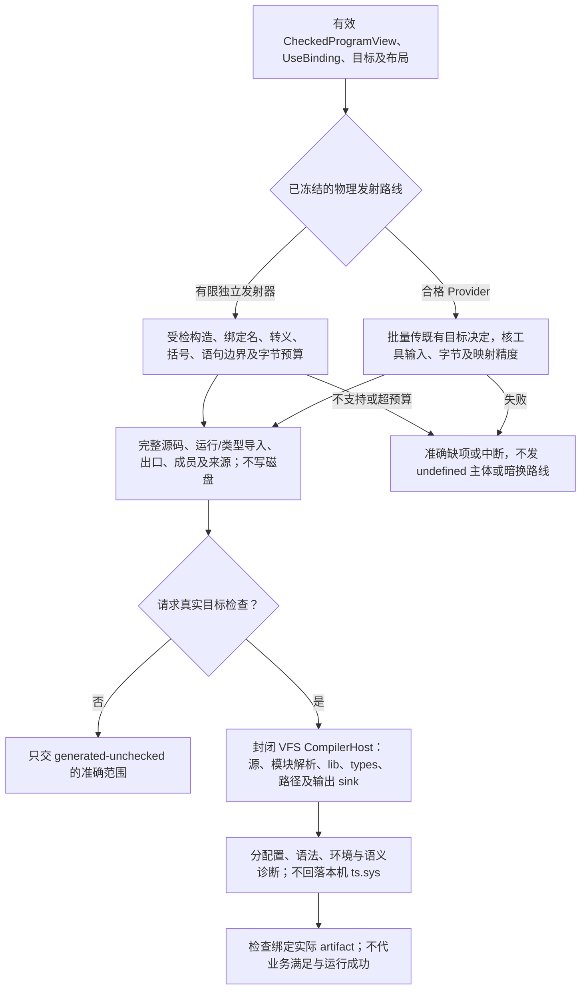
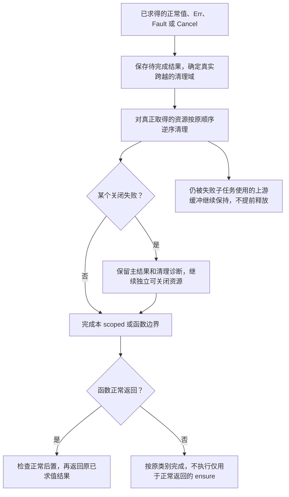
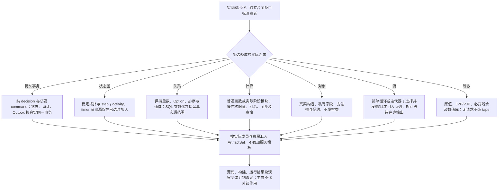

# 具体降低与领域输出

<a id="qualified-root-target-consumption"></a>
## 根义务到目标源码的资格边界

Target消费准确根、已解释Requirement、主体绑定、稳定RealizationBinding及其使用点×Target投影。抽象展开、角色绑定或规则形状检查只形成待履行义务，不等于已取得实现。未解释Requirement、条件触发或非法单位变换必须回到准确owner，不生成恒真谓词、空handler、固定状态更新或TODO冒充完成。

目标生成可由合格成熟组件装配承担，也可由已定义语义的专用lowering承担；二者在实际输入域、错误、效果、状态/事务、资源、ABI、依赖和Evidence前提下同样检查。生成普通运行框架不证明任意业务算法已合成；原生源码透传也不证明通用语义已降低。业务名称、目录和模板不是实现资格。

同一Root的多个相交方法必须保留同一主体、共享状态、生命周期和恢复协议。Target按真实行为路径贡献代码、配置、资源、依赖、入口及来源；缺一个必需贡献使该根不完整，其他独立根可分别完成。后端不得在打印时重新选择Provider或解释业务含义，真实外部作用仍由原Execution owner准入和结算。

> **阅读范围**：采用范围内的设计规范；实现状态另查未决 · [共同上下文](成员布局与完整产物.md)。


## 从组合到紧凑代码而不是运行解释器

高层组合可以降低成普通调用、融合循环、专门化函数或已有库调用；选择取决于已成立的保持条件和当前布局政策。已存在的高层抽象不要求在每次目标运行中解释JSON或回连Gift。

以先filter、后distinct为例：只有回调、输入读取与错误的观察合同允许，才融合为一个循环。原生getter/Proxy/迭代器或回调可能有作用时，先执行全部filter再执行key，与边过滤边取key并不等价；未知时保留原阶段顺序或限制优化，不暗标pure。分阶段求值不能在编译时执行用户业务来猜测结果。

私有临时Set与数组允许用于纯函数内部；其身份若只在结果数组上可观察，要保持输出的引用共享与变更合同。标准Set选取遵循目标的键等价；字符串场景用精确字符串键，不自动做NFC/大小写折叠。自定义相等需要相应哈希/比较或其他正确实现，不能机械换Set。

相同配置不是共享运行状态的许可。专门化可能增大代码与构建成本，默认保留未优化但正确的通用调用是合法退路；若没有合法目标表示，必须报告能力缺口，不能填空函数。运行时间、内存、产物体积与差异局部性分别评估，不以“源码最短”为唯一优化目标。

### 函数值根与短作者源的目标实现

合格静态函数别名、固定参数lambda与普通fn共用UseBinding和产物组合器。直接别名在目标和公开观察允许时重导出；需要新的公开函数名或调用适配时发出一份必要门面。lambda根据真实类型生成普通目标参数/结果，固定值可按合法规则内联或保留只读捕获；不得为了消除闭包提前执行其主体或重复原本一次的求值。

`pay = total => pricing.payable(total, {threshold: 500, discount: 20})`的目标保持一次payable调用、记录值和原契约入口。缺少给调用者用的返回类型注解是作者表面的省略，不是目标使用Any/undefined的许可。独立公开要求、配置和名义类型仍校验；不把省略视为取消原保证。

发射的完整形式是目标产物，不能反写成作者必须维护的expanded源。目标参数类型、捕获描述和导入别名的EditCorrespondence记录其真实约束/来源，不能把全部派生字段都称为可独立编辑的字面量。每份输出仍按原目标、布局、内容和检查分别绑定。


领域规则生成还消费[已绑定含义](../内核/领域方法与整体根.md#bound-meaning-method)、准确SubjectBinding、采用的实现Binding及TargetProfile。降低贡献将所消除/残余义务、新对象/效果/资源与成员映射回原应用和来源；新片段沿P6复核，原LoweringReceipt/CoverageBinding保留对应关系。printer只消费已定目标结构，不从Rule字段重猜业务。共有主体、坐标、时基、拥有权和见证关系没有合格映射时保留具体缺项，不能只因端点类型相同或代码可打印而签发完整产物。

## 中立语义与目标表示的逐项映射

工作流来源入口消费已冻结的[完成接合](../../领域/状态关系与流/工作流执行与激活.md#activation-completion-binding)：解析/专化由原语义与实现选择完成，Target生成持本次source能力的入口、捕获准确输入和同一Execution的Run，以及所选Complete调用。启动门复用原Execution协调，不能入口先启动再由wrapper重复启动；原结果/错误与取消分支、来源进度屏障及清理/恢复调用按已选方法生成，不能在printer临时猜等待、接纳或确认策略。TS闭包、Rust函数/async状态及必要持久重建各按真实目标布局实现；跨崩溃保存输入与原修订/Execution关联，不序列化闭包。P6同时复核单一完成权、Own、并发和出处，P7组合实际入口及依赖；只有控制数组没有这些调用的产物不算完整。

同源多route先由同一owner算法固定组及唯一共同完成绑定，再生成捕获准确分支Run/Execution的普通聚合Run；按已选顺序或原TaskGroup并行策略启动、按分支存原结果并调用聚合函数，外层Complete独持C且只调用一次。分支部分失败/未知保留原scope与恢复关联，来源屏障消费组策略；不能把每条route各自lower成独立发送/确认入口。新增聚合函数仍沿原M/P6工作表检查，既不按数组次序猜策略，也不创建第二运行结果代数。

同一作者源产生不同目标的前提，是每个实际采用的构造有明确表示和保持条件，不只是printer接受同一节点名。TargetBinding固定目标语言/版本、模块/ABI、库与必要运行支持；原生输入保留其自身语义，不因加入中立工程自动规范化。

| 中立含义 | TS目标可选映射 | Java目标可选映射 | 必须保持/拒绝的条件 |
|---|---|---|---|
| 数学Int与基础`/、%`的向零商余 | bigint及合格辅助 | BigInteger及对应操作 | 不经过Number/double；优化为定宽须有值域与错误保持依据；所有消费者保持本操作的准确商余解释，后继`std:IntDivMod`另按下述欧几里得算法 |
| Bool与Unit | 严格boolean及内部单位表示 | boolean及无结果/单位对象 | 不使用truthiness；Unit可被存入复合值时不能简单抹去所需位置 |
| Unicode标量Text | 校验边界并按所选标量操作 | 校验代理对并按所选标量操作 | UTF-16 code unit不是公共字符索引；无效原生串按明确解码策略拒绝或在原生域保全，不静默替换 |
| 不可变记录、List与和类型 | 封装/冻结/复制或受检封闭构造 | 不可变表示与受检所有权 | readonly/final不是递归不可变证明；含共享可变别名或访问器的原生对象需转换或明确更弱合同 |
| 函数、闭包与递归 | 合法函数值与必要尾调用转换 | 接口/类/静态方法或循环转换 | 捕获和实例身份、调用顺序、错误与资源保持；不让目标栈深差异伪装成业务Result |
| 业务失败与合同结果 | 明确带标签值/目标错误映射 | 带标签对象/目标异常映射 | 业务Err、契约违例、资源终止和宿主故障分开；异常不得穿越不支持的ABI |
| 效果与资源端口 | 绑定目标函数/对象 | 绑定接口/方法/资源 | 参数形状匹配不证明权限、纯度、线程、生命周期与幂等 |

表中是映射选择，不是当前后端已存在。只要请求不涉及某种构造，就不为它加载运行支持或建立空模块；同一目标的多种合格布局也不要求全局唯一最优。精确值的库成本、转换和可观察异常纳入产物合同。Java定宽算术的溢出与精确检测有不同规则，[Java SE25 Math](https://docs.oracle.com/en/java/javase/25/docs/api/java.base/java/lang/Math.html)提供目标参照；不能用共同的Int名字掩盖选择。

<a id="record-capability-lowering"></a>
### 字段存在、位置与有型余行的同一记录降低

目标直接消费[共同记录合同](../../领域/计算基础/通用计算与任务语义.md#record-presence-place-row)、已绑定的gift:record定义/方法、准确字段及行约束；不在发射器按`probe`等名字猜内在语义。收头/check先通过原共同语义参数固定R/N/S/T/Fx，有限字段/行方法形成真实参数、返回、效果和借用签名；P5只将已检查操作降低。普通Type应用保留未实例化的合法字段/余行关系，目标选择单态化或已有字典/泛型合同，不生成Any。

基线布局是required直接payload槽，optional独立presence加已初始化payload，mutable则指向原Place。T本身为Option时保留两层区分。显式rowType降低为准确tail:R或经证明保义的布局；隐式尾是当前值私有的有型行存储，携实际成员类型、初始化状态、move/drop/codec及合格Eq操作字典，不是全局注册表。开放尾的字段表和见证只占既有值/资源预算，不泄露opaque字段或授权原本不可见的叶操作。

1. 构造先核完整声明域、类型/名义资格、Record/Lacks与资源计划；初始化仍依fields数组逐个求值并保临时。新mutable字段建立新的Place，缺optional记Absent；全部成立才发布，失败沿原已初始化部分清理，不重排Effect。递归类型只memoize准确类型引用，布局工作表不无限展开。
2. has/probe固定receiver一次，取得实际读资格后检查同一presence，Absent构造None，Present才按copy/share合同取得T；required返回T。普通field遵守同一稳定存在和读取资格。withField生成fresh区域内的同步借用调用，所有出口结束读资格，结果U不得含区域；不以JS引用或Rust裸引用绕过noescape/捕获检查。
3. exchange/take将RHS先求到原受保护临时，核写资格，再准备旧结果位置；在唯一提交点swap或清presence。提交前后新/旧值责任分别落原槽与结果owner；交付失败只沿原结果清理，不逆做交换。put/clear准备联合结果，消费移交immutable项，保留所有未改Place及尾，返回准确record/previous，不默弃Own。
4. split按静态声明域分离known/rest，join先完整查静态及运行尾域冲突；结果空间和转移计划准备后才逐项移动并一次发布。动态冲突回Err且两原输入完整，不用last-wins；中途Fault/Cancel/分配失败按已移动/未移动真实owner清理，不冒充普通冲突。checkAs同样先建立合法检查关系，完整检查presence、余域及payload后才转移/形成合格视图；正常失败严格消费原owner的MissingRequired→UnexpectedRemainder→PayloadMismatch优先级，不按目标遍历顺序择错。瞬时mutable状态不产生无寿命保证的required视图。
5. 字段槽沿已有FieldSlot/ReadField/WriteField及M0—M5记录分配、别名、捕获、效果与逃逸。局部封闭可隐藏公开Read/Write但不删内部依赖；新构造不能因内容相同合并Place。默认Eq在原资格下比较immutable值和mutable位置身份，尾按实际类型的合格Eq，不把重复读取内容伪装原子快照。

TS生成私有presence/cell和受检wrapper，普通图交宿主GC；新构造建cell，浅别名/重构复制cell引用，不能只发`x?:T`后把undefined当Absent，也不让getter/Proxy/原型成员取得该内部合同。Rust在已证明局部唯一时用原生槽，真实共享图消费[同一通用受管方案](Rust目标画像与降低.md#rust-managed-graph-lowering)；不会为record另造堆或collector。具合法guard时用准确replace/take接住旧值，Drop与生成清理只有一个owner，guard及借用不自动跨await。Own的确定关闭仍在其原线性scope/aggregate owner，外根或cell本身不代签资源关闭。

原生/codec入口依准确类型分派：先完整核重复键、own data字段、预算和编码，required缺项及closed余项拒绝，optional缺项保Absent，open余项按真实有型见证保全；不能无条件套旧closed快照删除尾。序列化可传值但不自动持久化Place身份、别名或Own：要求保持图/资源身份时使用原有显式图/资源codec及恢复合同；普通数据快照明确生成新位置。纯default仍只准闭合不可变构造，运行输入物化活动Place须由原运行输入方法在真实owner/寿命下承担，准备引用不单独签发此资格。未知wire叶保留原编码/来源，不能在缺解释时执行其类型操作。

编码隐式尾时还按同一owner固定完整声明见证，生成实际外部Schema引用或wire描述的写入/校验步骤；只有真实codec已知的部分才省略。decode先核准确版本、声明域/Type/flags、presence、预算与Lacks，再建立尾的操作字典；不把仅缺席字段的尾当成空尾。见证的引用和解释进入真实ReadSet，缺解释保留wire，不能以空字典成功解码；布局/格式选择不增加全局类型注册表或反序列化代码执行入口。

P6复核八种flags组合、嵌套、泛型、原初始化/调用顺序、presence稳定性、无资源复制/遗漏和完整尾；P7组合实际helper/依赖及来源。类型/flags/字段/尾/方法、效果/借用或目标绑定变化先更新真实ReadSet，再使相交实例、布局、codec与回源失效。新增普通方法、无真实代码或仅Schema通过都不等于这些生成路径已实现。

<a id="exact-numeric-leaf-lowering"></a>
### 精确十进制与 binary64 位值的目标叶

输入是已检查的`DecimalLiteral(coefficient,scale)`或准确绑定的`F64Bits/decodeF64/encodeF64`调用，连同Type、数值政策、Target及Result构造身份。算法消费[原数值意义](../../领域/数值/格式环境与向量控制.md#numeric-policy-values)，不发明另一套数字字面量或全局转换API。

1. Decimal先把规范系数字符串解为精确Int，刻度`s`保留为精确非负整数。TS用bigint系数，Rust复用当前数学Int的合格表示；以有型二元组或私有包装保持`(c,s)`，不经浮点，不把`(120,2)`暗改为`(12,1)`。构造不必物化`10^s`；Type.scale、精度及值范围由本次准确类型检查。
2. 只有已请求的显式刻度转换才计算目标`t`。`t>=s`时`c'=c*10^(t-s)`；`t<s`时令`D=10^(s-t)`、`q=trunc(c/D)`、`r=c-qD`。`r=0`直接取q；否则toward-zero取q，up在`c>0`时取`q+1`，down在`c<0`时取`q-1`，ties-away在`2|r|>=D`时取`q+sign(c)`，ties-even在`2|r|>D`或相等且q为奇数时取`q+sign(c)`；其余取q。结果刻度为t，再核实际范围/精度。缺必需舍入政策不能自行选一项；拒绝不精确转换的合同在`r!=0`时返回原类型错误。平方求幂及全部中间大整数按真实位长、内存和预算计量，不能按固定节点数隐藏成本。
3. 需要保持位值的F64使用私有64位载体。TS以范围已检查的bigint或两个32位段保存，Rust以私有u64保存；两者继续拥有同一名义F64含义，任意Int不能直接冒充。decode先核`0<=b<2^64`，失败返回BitsOutOfRange；再取`exp=(b>>52)&0x7ff`，Reject且指数全1时返回NonFiniteRejected，否则构造保存准确b的F64。encode直接返回该b，保留负零和NaN payload。wire字节由所选端序作整数位移/位写入，不经宿主浮点再编码。
4. 算术消费原NumericPolicy，按实际运算的观察合同把位载体投影到合格原生或软件算法，并形成结果的准确位值。codec保位不承诺任意算术保留NaN payload；要求具体payload、舍入或环境的运算必须有同义算法。只有全部相交观察允许时，才能把载体优化为裸number/f64；这项表示决定同时覆盖容器、函数、SourceBody、AD与ExternalExport边界，不能让codec和后继使用者解释不同。
5. 生成真实构造、范围检查、编解码辅助及一等函数入口，callee和实参各求值一次。新增helper及依赖回到原工作表，P6核类型、效果、Result身份、表示和来源，P7在成员闭合后封根。预算中断保留原前沿；源非法、运行typed失败、资源Fault和缺方法各沿原出口，不输出近似值、零或半个Decimal。

上述保位载体是对宿主边界的设计选择：ECMAScript的[NumericToRawBytes](https://tc39.es/ecma262/2025/multipage/structured-data.html#sec-numerictorawbytes)允许为NaN选择实现定义编码，普通Number往返不能证明payload保真；Rust的[from_bits/to_bits](https://doc.rust-lang.org/std/primitive.f64.html#method.from_bits)提供位转换，但不是任意算术的payload保证。原生ABI的浮点参数/返回另核实际目标规则，不能把u64与f64的调用约定直接互换。

系数、刻度、精度、policy、codec、表示或Target修改时，仅沿实际值/类型/调用/布局与SourceMap读集失效；未变Int子结果可复用。旧Artifact和在途值保持原解释。验收至少分别核负数五种舍入、精确/不精确转换、超预算幂、正负零、两个不同NaN位值、Reject非有限、范围外位串及跨函数/容器/ABI一致性；静态设计与Schema接受不代签目标符合性。

### 原生边界的转换不是免费断言

不可信数据进入纯值区时，先按明确边界读取/解码，验证标签、字段、编码、范围和必要不可变性，再构造中立值或有期限的受信视图。读取getter或复制对象本身可能有作用，不能藏进纯preview。可证明上游已经满足合同的内部调用可消除重复检查；公开原生入口仍需其所宣称的边界保证。

新数组不等于深复制；浅冻结不阻止嵌套对象变化；同一对象的不同视图不能因内容摘要相同而合并运行资源身份。输出给原生消费者时，也要明确调用方能否修改，以及修改是否影响后续中立计算。不能一面重用可变对象，一面按纯值前提缓存和优化。

各目标的来源位置映射绑定其实际文本与编码单位；业务等价不表示字节相同。具体artifact身份与源候选、目标、布局和字节绑定，不能用同一candidate的另一个目标成绩签发当前输出。证明编码的保持条件见[契约到求解器](../../运行/验收/方法与独立证据.md#契约到求解器的语义保持)。

<a id="finite-value-boundary"></a>
### 有限值入口的闭合快照与精确算术

承诺闭合不可变值的公开TS入口逐层取得自己的快照，不保留调用者可变别名。记录核准确字段集合与数据属性，拒绝未知字段、访问器和合同未承认的Symbol成员；列表核真实有限长度、每个`0..length−1`索引恰有数据描述符，拒绝洞、额外普通键、Symbol和索引访问器，再复制并冻结。不能先用map/every跳过洞或执行getter后才验证。节点数、深度、文字标量与列表长度预算在复制途中扣减；共享或循环是否允许按所选值合同。描述符内省可以避免直接调用普通getter，不能阻止恶意Proxy trap，不构成任意JS realm沙箱；未取得合格输入边界的foreign对象继续按原信任与作用合同处理。

有限输入`{sku:"x",price:3,quantity:2,active:true}`可接受。`Array(2)`仅填索引1、sku或索引0改成getter、数组增加extra或Symbol均须拒绝；普通getter的调用次数为0。SafeInt中数学零只有一个表示，合法纯运算的−0输出规范为+0，不能把Object.is的宿主差异偷加为中立整数语义。加减乘先按精确整数计算后核范围，除法向零截断并保持相应余数规则，零除与越界分开；文本长度按Unicode标量计，拒绝孤立代理项。旧有限参考的4096字符、深度8、200000节点只是该预算画像，不是全局语言常量。

有限内存记录存储另核身份与回执：新增前检查重复键和容量，替换/变换不改主键。纯变换仅取得声明字段，不让调用者写机器管理revision；后像重新验证并冻结。回执容量不足先于写值拒绝。operationId绑定种类、对象、expected revision及按Schema稳定字段序形成的请求；变换还绑定准确转换Definition/Method修订与实际参数，action同名不足以证明同请求。相同完整请求先返回历史成功后像，再考虑当前修订；同id异请求拒绝。字段排列不能凭JS插入序改变身份。同步Map中的值/回执两次写入不是崩溃事务，持久目标仍消费原事务恢复合同。

### 计算工作界和输入输出快照分别证明

对有界List、有限record及无递归调用闭包的限定方法，按已声明调用图拓扑取得被调函数的证明；递归或未资格调用不借用这份有限证明。分别计算表达式工作界和入口/出口快照大小：固定标量计一个节点，record为一加字段大小之和，List为一加maxItems乘元素大小。普通运算加实参代价，if为条件代价加两支最大值与分派，调用加被调代价，遍历为source代价加界长乘每项主体及迭代开销，fold再加初值代价并保持累加器类型。共享DAG、编码展开、文字字节、大整数位成本及同时活跃空间独立计量；节点计数不是墙钟SLA。

预算在复制、物化或展开前核，不能以核心表达式很小证明巨大嵌套输入快照廉价。超出该方法预算返回相交资源/支持缺项，其他合格方法仍可选择；不宣称函数无定义、需求无解或公共语言禁止一般递归。原顺序与并行变换条件继续由[计算正文](../../领域/计算基础/计算结构与算法.md#迭代归约与稀疏计算的独立机制)承担。

### 逻辑值不规定低效的物理表示

不可变List的递归匹配不是每次必须复制整个尾部。`[head, ..tail]`可以用有寿命保护的数组区间、链式共享尾部或其他合格表示；区间不能逃逸到已释放存储，浅只读标记也不能掩盖外部可变别名。朴素实现每步复制尾部，n项递归可能累计复制n(n−1)/2项；前端表达简短不证明目标复杂度合格。

默认先保留简单表示与正确性，再在需要的成本范围避免无收益复制：内部共享的有限不可变DAG可按节点记忆化转换；输出编码若要求展开为逻辑树，计量展开字节而非只计物理节点数。不得因为发现共享就把两个有独立运行身份的资源合并。循环原生图在基础有限值中拒绝，或使用单独的显式图类型；预算用尽时不输出截断但自称完整的值。

对尾递归，先计算是否还有后置检查、清理或其他续体；有责任未完成时采用保持该责任的循环/续体或明确资源限制。stack overflow、辅助分配失败和服务超时都不能改写成业务Err。精确的栈/内存上界只有在所选目标与负载条件下才能承诺，不把此规则当成所有程序总终止证明。

自尾递归变成循环时，新实参先按源码次序各求值到临时量，再一起更新下一轮参数；逐个覆盖参数会使后续实参误读新值。互尾递归分量只有在返回、资源退出和异常合同相容时，才可降低为带私有标签的状态机；否则保留合格普通调用或采用保持相同观察的trampoline。非尾递归若承诺硬深度上界，须有显式帧或所选目标栈能力的依据，不能从递归函数可打印推导该保证。这些是可选Target/Method的保持条件，不强制所有目标采用同一表示。

闭包的CapturePlan只收集真实自由变量，并保持捕获的值、别名、寿命、身份和析构责任。目标的捕获方式与调用次数能力分别判定：Rust的move只改变取得捕获的方式，不自动使闭包成为FnOnce；是否只能调用一次由主体对捕获的真实消费决定。没有自由变量不为方便统一布局保留整个环境，也不提前执行闭包主体来确定捕获。

### 中立保证与原生可观察边界

跨目标保持针对已声明的输入域、结果、错误、作用轨迹及资源要求，不要求任意宿主反射都看不出编译器的内部选择。若中立函数不允许观察对象地址或构造器身份，TS导出的值却被任意代码用`===`、`new`、属性修改或反射操作，后端必须说明哪些是公共ABI，哪些不在保证域；不能同时承诺任意原生使用和完全透明的中立表示。

默认导出受检入口和最窄必要类型：值出入按实际所有权协议转换，受限资源句柄不暴露宿主凭证；公共函数表面、错误类别和初始化安排保持。原生资产原有的可观察行为继续按原生合同保全，不借“中立不观察”删除它。只在可信内部边界才消除冗余封装；对不可信同进程代码的完整隔离，需要真实宿主能力，普通包装不自称安全沙箱。

目标文件、辅助库和接口映射是产物依赖；函数值包装与检查策略进入实际绑定。不同目标不必字节相同，却都要满足同一被请求合同。


## Rust目标的完整降低边界

Rust 已进入当前通用目标计划，但不复制本篇 TypeScript factory/printer 细节。[Rust目标画像与降低](Rust目标画像与降低.md)完整定义精确 toolchain/target 绑定、crate 形态、类型与所有权、泛型、错误与异步、Cargo/依赖、诊断与 SourceMap、FFI/原子/no_std、产物、回源、缓存和失败分类。P5—P7 与本篇共同 TargetBinding/LoweringResult/ArtifactSet 不变；不同后端不要求产生同形源码。

TS 先行只决定实现顺序。Rust 的 target profile 已有设计并不表示 rustc/Cargo adapter、生成器、构建、ABI 或运行符合性已经取得；反之也不得再把 Rust 记成“第二目标未指定”。原生 Rust 作者源仍由其 own source/前端保持，能够直接复用时不生成同义副本。

## 首个TypeScript后端的逐构造降低

本节实现既有 P5—P7 和 L1—L7，不增加作者语言。目标语法、编译器自身实现语言和可选检查器分别绑定。对独立Rust内核发行，默认由有限Rust目标构造器/发射器生成所声明子集的TypeScript实现源码，不以Bun/Node或完整原生TypeScript前端作为纯源码生成的必装前置。

已绑定的TypeScript 6.x API族factory/printer继续作为可选目标Provider使用；其他API族独立适配，版本、标准库与Host按实际绑定取得，不混用私有编译器类型。选择哪条物理路线由ImplementationBinding固定，不因失败或缓存未命中临时切换。已有JS实现加.d.ts声明画像继续有效，但不是包含实际函数体的.ts源码画像；目标运行及实际检查仍需其真实宿主和工具。

### 输入、表示与输出

输入是该根有效的`CheckedProgramView`、已选实现、目标合同和布局基础。输出为有界目标结构或该实现的私有语法节点、实际运行/类型导入、公开导出、源来源与完整文件成员；打印不写磁盘。使用者没有指定目标库时由既有绑定算法决定，不让作者逐个填写helper与ABI转换。

第一条标量目标路径固定：`Int → bigint`、`Bool → boolean`、`Text → string`并保留合法Unicode标量边界、`Unit → undefined`。Unit存进记录、列表或函数返回时保留该值；只有确实不观察返回值的位置才可以省去显式`return undefined`。字段存在性用独立的成员检查，不把缺字段、显式undefined和Option.None混为一项。Option/Result与其他和类型使用带稳定变体标签的判别联合；标签来自类型合同与布局，不由线程完成先后分配。

记录用目标对象承载；内部访问对已经建立的中立纯值进行。数据字段与可执行标识符分别编码；`__proto__`、`constructor`和目标保留词不能触发原型写入或被当成隐含方法。选用计算属性、无原型记录或等价受检构造时固定其公开ABI；目标`readonly`不代签递归不可变，原生getter/Proxy的读取与复制不得偷偷进入纯值区。基础相等按类型编译：整数/布尔/合法文本采用对应值比较，记录逐声明字段，列表按长度和元素逐项比较，和类型先比实际变体。函数、资源和opaque表示不凭目标`===`获得新相等关系。需要显式相等实现时使用已有合格绑定。

列表公开ABI采用目标合同规定的只读数组；内部递归匹配允许用`{data,start,length}`切片视图承担尾部，避免每次复制。视图只读借用已固定的数组，在内部调用与闭包里保留拥有者；向要求数组的外部边界输出时才按合同物化。若当前后端还未实现视图传递或合法循环降低，就明确采用有成本说明的数组基线；任务要求的复杂度/内存不能满足时报告该策略不合格，不假称已具备优化。这个内部布局能力不成为标量函数的前置。

公开中立函数默认有受检入口，私有核心体只可在其前提已满足的内部路径调用。函数值保存受检入口，而不是把裸核心函数传给高阶消费者。已有ABI适配负责不可信值的检查与所有权；不是每个可信内部调用都深复制或做全量输入检查。

### 独立发射与可选Provider的共同边界

两条路线消费相同CheckedProgramView、已冻结UseBinding、目标合同与布局，不能各自推导业务含义。共享输出根/引用闭包、调用契约入口和来源；后端自己的语法、错误表示与Host适配仍属于实际实现。

有限Rust发射器只接受已检查构造和窄目标值，负责优先级、结合性、括号、语句边界、标识符/字面量转义、类型与运行导入及实际字节预算。不以任意RawCode字符串替代名称绑定；固定受信模板另有方法身份、参数和转义合同。当前不支持的语法/目标构造返回准确能力缺项，不伪造undefined主体。

可选Provider边界批量发送已有目标决定，返回字节、实际工具输入、诊断与可提供精度的映射；不传可变Rust对象图，不按节点逐个RPC，也不让Provider重新选实现。原生API版本变化只影响其adapter与相交绑定，目标源码语言版本不随工具升级自动改变。TS6的createProgram/factory/printer方式不能直接当成其他API族的能力证明。

无外部检查也可以交付合法范围的generated-unchecked源码；要求build/check时另取得真实工具结果。若有限发射器不能以可接受成本满足复杂语法、映射或维护要求，可在同一合同下改绑合格Provider；该替换不取消独立生成、错误和产物身份边界。

### 用区域化前置语句保持求值顺序



<a id="structured-computation-lowering"></a>
采用`lowerValue(expr, scope) → {before, value, type, flow}`：`before`是该表达式**在当前激活区域中**需要执行的目标语句，`value`是之后取值的表达式；`flow`记录是否存在正常后继。另有`lowerTail(expr)`将函数或分支末尾直接生成为return/throw/分支，避免为所有表达式生成IIFE。

关键辅助`sequenceValues`按照源码出现顺序处理各孩子：如果没有前置语句、无需重排且每值只用一次，可直接组成保持原顺序的目标表达式。只要后续孩子的`before`会跨过前一个尚未执行的value，或者最后要按参数槽重排/复用，就先把前值求到局部临时量，再运行后续前置。临时量名称由固定源身份与布局分配，不用全局自增完成时序命名。

例如，不能把`left = f()`留在最后表达式里，却先执行右侧产生的前置语句`g()`。必须保持f先于g；“二者都没写磁盘”也不允许改变陷阱或终止顺序。

| 表达式 | 具体降低 |
|---|---|
| literal/reference | 构造目标字面量或固定符号引用。引用let值不重放初始化；函数引用使用已选调用入口 |
| 普通一元/二元 | 用sequenceValues固定必要求值顺序，再应用该类型的目标操作或helper。未使用值也先保留其计算 |
| `&& / ||` | 右侧value和before放在条件激活区；右侧有前置时生成真实if，不把它提升成共同前置 |
| `if` | 条件先计算一次；两分支无语句时用条件表达式，否则生成分支内赋值或尾位置直接return。不能先构造并执行两边的前置 |
| `let / region` | 初始化按作者次序生成局部声明，绑定映射更新后再降低后继。相同文本出现不自动共享；未用且可能陷阱/不终止的初始化保留 |
| call | 先取得被调用值，再按原实参顺序求值，最后按已检查的formalSlot排列临时量进行一次调用。普通中立函数字段取出的值不靠JS receiver隐式传this；原生方法走自己的receiver合同 |
| lambda | 生成目标函数值；其body的所有before留在函数体。捕获当前词法绑定，不在创建时执行未来主体，不把调用方的result或局部跨范围保存 |
| record/list | 字段/元素与尾的前置和value按原数组次序计算；后继Expr.record直接消费同一有序`fields:[{name,value}]`，不从Type.record声明映射派生次序。目标字段排序仅对无行为作用的元数据适用，不重排初始化 |
| 后继do | 消费[有序eval/result解释](../../领域/计算基础/通用计算与任务语义.md#structured-sequence-and-perform)，在原词法激活内依次降低steps，每项value在下一项before前完成原eval消费；有正常后继才降低运行路径中的下一项。最终result暂存并沿原区域清理交付；不生成改变函数/捕获/异步边界的无条件IIFE |
| 后继perform | 从UseBinding取得唯一操作及I/O/E；唯一输入按sequenceValues求到临时值，已解析Unit空参构造单位值。再沿原准入/调用方法调用，以固定构造交付Result<O,E>；输入非正常则不调用，调用非正常或未知不伪造Result。不重新选方法、拆记录、展平嵌套Result或吞取消 |
| match | subject只计算一次；按作者顺序生成模式判定及命中分支；嵌套模式逐层检查标签/长度，匹配成功后绑定字段。证明覆盖不够时保持源未合格或要求明确兜底，不生成默认零值 |
| hole/错误节点 | 不生成本根可执行产物；保留源草稿和诊断，不能转成undefined或unchecked cast |

选中[受管错误画像](../../领域/计算基础/错误传播与契约保持.md#structured-throw-try)时，throw先完整降低payload再产生无正常后继的Raise；try的body与handler分别属于互斥激活区域，handler的before不得提升到body之前或其正常路径。匹配、清理完成、错误绑定、handler自身向外Raise与Fault/Cancel分流沿原错误owner；没有合格保持方法则返回相交Need/Unsupported，不用原生catch吞全部值冒充支持。

`lowerTail`需要同时查看函数后置条件和清理续体。尚有ensure或资源释放时，不能将末尾调用当作无条件尾调用优化；先保存正常结果，按顺序执行后置，再返回。函数失败没有正常result，不执行只适用于正常返回的后置。诊断、业务Err、计算错误和外部失败仍分开。

### 三个必须直接覆盖的目标反例

```mermaid
flowchart TD
  expr["lowerValue：当前激活区域中的表达式"] --> children["sequenceValues 按源次序处理孩子"]
  children --> cross{"后续 before 跨过尚未求值的前 value，或需重排/复用？"}
  cross -->|是| capture["先求前值到稳定局部量，再执行后续 before"]
  cross -->|否| direct["保留原顺序的直接目标表达式"]
  capture --> construct{"原构造"}
  direct --> construct
  construct -->|短路或 if| branch["右侧或分支 before 只放对应激活区，条件只求一次"]
  construct -->|call| invoke["callee 先、实参按出现序，再按 formalSlot 调用一次"]
  construct -->|lambda| closure["body 的 before 留在函数体，创建不执行未来主体"]
  construct -->|match| match["subject 一次；按源序逐层判标签/长度再绑定"]
  construct -->|let、record 或 list| ordered["初始化、字段、元素及尾保持原求值次序"]
  construct -->|hole 或错误| blocked["阻断本根可执行产物，保留草稿诊断"]
  branch --> tail["lowerTail 核后置与清理续体；责任未完不做裸尾调用"]
  invoke --> tail
```



**整数一元加。** 中立`+x`对Int表示求值后的同一整数；JavaScript一元`+`调用ToNumber，不是BigInt恒等。因此对`export fn positive(x: Int) -> Int = +x;`，TS体应保留x的一次求值并返回x，不能生成`+x`。这是一项Gift映射义务，不需要重跑整个JavaScript编译器测试。

**负整数字面量。** 负号与绝对值字面量用目标prefix-unary节点表示；不要把`-20n`强塞成只接受非负字面量的builder内容。零统一为语义零，源原拼写另由CST保全。所有数值均从规范十进制或已有bigint精确构造，不经Number。

**除零与条件。** BigInt除法的截断商与Gift基础`/、%`选择一致；它不直接实现后继`std:IntDivMod`的欧几里得商余。基础除零的目标异常类别仍按已接受的错误接口映射。若目标原生RangeError足以满足该有限ABI，直接使用它；需要中立错误标签时生成绑定的边界或小helper。未知异常不能一律改成除零。`if x==0 then 0 else 10/x`的除法只能存在于else激活区。

ECMAScript明确一元加走Number转换，而BigInt除法有自己的截断与除零规则；这些事实支持上述局部映射，不认证全部后端。[一元加](https://tc39.es/ecma262/multipage/ecmascript-language-expressions.html#sec-unary-plus-operator)、[BigInt数值规则](https://tc39.es/ecma262/multipage/ecmascript-data-types-and-values.html#sec-numeric-types-bigint-divide)。活动草案版本及用途在资料章记录。

<a id="finite-pure-basis-lowering"></a>
### 后继固定纯基底的生成算法

本节消费[有限保留符号及准确签名](../../领域/计算基础/文法类型与求值.md#successor-structured-std-int-add)，不建立新的名字解析器或可动态扩展的std表。先在固定解释中解析符号、实例化类型并检查完整签名，再由已选Method/Target固定表示、运算及Result/Option/Ordering的真实构造身份。需要的供给尚缺时返回相交Need；取得资格后按以下步骤生成，不能只交一个“调用某方法”的占位。

普通直接调用仍用sequenceValues保持callee与实参的源次序及各一次求值；作为一等函数值时，将同一已实例化算法生成为准确签名的目标可调用值。私有helper及名义构造归原布局/依赖owner，不用字符串符号在运行时猜分派。

| 固定符号 | 所选目标算法及保持条件 |
|---|---|
| `std:IntAdd` | 先以精确整数求和s。无界型直接保留；定宽checked比较原上下界，超域走原算术Fault；wrap取非负模值u，再将signed高半区解释为u−2ⁿ；saturate夹到原域。TS基线用bigint，原生定宽优化须证明中间值、溢出及错误保持，不能先用Number或宿主溢出结果 |
| `std:IntSub`、`std:IntMul` | 在数学Int表示中精确求差、积，TS为bigint操作；保持原预算/内存Fault，不外推IntAdd的有限位宽签名族 |
| `std:IntEq`、`std:IntCompare` | 对准确整数比较。Eq产生Bool；Compare依次判断小于、相等，否则大于，再构造准确Less/Equal/Greater，不返回−1/0/1冒充名义Ordering |
| `std:IntDivMod` | 先判零，再作下述一次欧几里得修正；成功与除零均构造准确Result值，不用普通`/、%`的目标异常代替声明错误 |
| `std:BoolNot` | 对已检查Bool取反，TS可用`!`；不对未知值使用truthiness |
| `std:SeqEmpty<T>` | 由准确T构造所选序列表示的空值，TS基线为受管不可变数组，Rust为合格容器；不猜元素类型 |
| `std:SeqPrepend<T>` | 建立新逻辑序列，先放新首项再按原次序保留旧序列全部元素。TS数组基线需复制外壳并按合同保护，时间/额外槽数为线性；共享尾链或其他布局只有在保持元素消费、别名与公开合同时才选，不隐式修改原序列 |
| `std:SeqUncons<T>` | 空时构造准确None；非空取得第0项及剩余序列，构造准确Some记录。内部尾视图可复用已有持有owner的切片方法，公开需要独立数组时物化；保持原元素Own/共享规则，不以复制外壳证明可复制受限元素 |
| `std:TextConcat`、`std:TextEqual` | Concat按原序拼接已合格Unicode标量序列，不附加规范化。Equal执行已固定Text型的相等规则；恰为原标量序列相等且目标编码唯一时，TS可用字符串严格相等。其他已选规范化/相等合同调用其合格方法；不猜locale、字素或大小写规则 |

**IntDivMod的确定步骤。** 下列伪代码的a、b已经各求值一次并固定为精确数学Int；`truncDiv`是目标中已合格的向零整数除法。Ok、Err、商余记录和除零错误值均指已绑定构造，不是新公开标签：

```text
euclideanDivMod(a, b):
  if b == 0:
    return makeErr(boundDivisionByZeroValue)
  q0 = truncDiv(a, b)
  r0 = a - b * q0
  if r0 < 0:
    if b > 0:
      q = q0 - 1
      r = r0 + b
    else:
      q = q0 + 1
      r = r0 - b
  else:
    q = q0
    r = r0
  return makeOk(makeQuotRem(q, r))
```

向零除法给出`a=b*q0+r0`且`abs(r0)<abs(b)`。r0非负时已满足要求；r0负时上述两个分支都保持等式，并恰加abs(b)，故`0≤r<abs(b)`，一次修正即足够。算法本身不在定宽类型中求abs(MIN)，所有中间运算仍须在精确域。若采用定宽优化，必须连同`MIN/−1`、乘积和修正中间值证明保持；否则沿已绑定无界实现或报告准确缺项，不能把源合法大整数改成错误。

零除分支先于任何宿主除法，只产生约定的ArithmeticFault错误值；其他Fault、取消、资源不足或构造失败保留原通道，不catch全部异常后伪装成除零。最小见证为`(-5,2)→(-3,1)`、`(-5,-2)→(3,1)`、`(5,-2)→(-2,1)`、整除、零被除数、零除数及超过安全浮点范围的整数，同时检查`a=b*q+r`、余数范围和实参各求一次。这里给出设计算法及独立数学依据，不宣称当前后端已生成或运行它。

### 具名实参的完整区分例

```gift
fn spin() -> Int = spin();
fn choose(a: Int, b: Int) -> Int = a;
export fn sample() -> Int = choose(b: 1 / 0, a: spin());
```

按现有源规则，先取得choose，再求第一个实际表达式`1/0`，计算错误发生后不调用spin。即使两个表达式没有外部效果，不能直接打印为`choose(spin(), 1n/0n)`；那会先进入不正常返回的递归。

设计输出形态是：取得被调值；第一个实参求到`argB`；第二个求到`argA`；最后`callee(argA,argB)`。名称只是示意，布局器分配真实私有名。保持方法适用于有错误、非终止或作用的参数；能够证明更短直接调用同义时才消除不必要临时量。此例是书面轨迹，没有运行无限递归或目标程序。

### 一个完整标量输出与来源定位

对：

```gift
export fn safeQuotient(x: Int) -> Int =
  if x == 0 then 0 else 10 / x;
```

在选择普通ES模块、BigInt目标和当前错误映射后，预期源码可为：

```ts
export function safeQuotient(x: bigint): bigint {
  return x === 0n ? 0n : 10n / x;
}
```

这只是目标形态，不是已运行产物。由于源没有约定JS可构造性、prototype和反射，此中立函数容器可由目标决定；原生作者箭头函数则不沿这条规则擅自改成普通函数。函数有require/ensure时按契约入口生成，不能为保持样例短而省掉它们。

分子从10改为20，只改变对应源表达式、相交分析与该目标节点；旧候选和未改文件不变。旧artifact的类型结果不能贴到新artifact。目标body生成完毕后，以实际打印字节重新建立目标位置，不拿打印前的暂定pos当准确最终位置。

### 虚拟CompilerHost与目标检查

目标检查是公共`check`或请求中实际选中的方法，不是preview的无条件附带动作。当前TS6适配使用`createProgram`及相应诊断接口，所有输入由冻结虚拟文件系统提供。

| Host责任 | 当前实现要求 |
|---|---|
| 源文件读取 | `getSourceFile/readFile/fileExists`只读当前VFS；按实际脚本种类、文件后缀和编码创建SourceFile，不落回ts.sys |
| 模块解析 | 使用当前API族的模块解析器并只传本VFS所提供的文件/目录操作；记录包入口、扩展名、候选未找到与实际所读package元数据 |
| 默认库与环境 | `getDefaultLibFileName`返回已绑定库入口；完整lib链、声明包和所需辅助均是捕获内容。固定`types`范围，防止自动扫描机器其他@types |
| 路径规则 | `getCurrentDirectory`为固定虚拟根；canonical名、大小写、realpath、目录存在性均用同一个目标/执行文件系统画像，不读取本机cwd |
| 输出 | `writeFile`写隔离的结果sink或在noEmit检查时拒绝调用；绝不直接写用户文件 |
| 诊断 | 配置、语法、全局及语义诊断分角色处理。缺失lib或不支持工具版本是环境/适配缺项，不能统一报作者代码错误 |

`strict/noEmit/noEmitOnError`等配置要固定实际值并按该次请求消费；目标至少支持BigInt所需版本，但不能为了生成成功暗中提高用户要求的运行最低版本。声明检查是否skipLibCheck也属于实际方法范围，默认不把跳过上游检查记成全部声明都已验证。

用`createCompilerHost`然后只覆盖writeFile，仍可能通过其他默认回调读取本机环境，因此不是闭合Host。Compiler API确实提供Host、Program和Printer分工，[官方接口说明](https://github.com/microsoft/TypeScript/wiki/Using-the-Compiler-API)是可复用基础；Gift仍需实现这层冻结输入与诊断归属。

### 源坐标转换与可复查错误

Gift内部源跨度采用冻结源的UTF-8字节半开区间；TS工具和JavaScript Source Map常用UTF-16码元。每份源记录换行起点和稀疏的字节/码元检查点，在检查点之间按Unicode标量扫描。ASCII一字节一码元，补充平面字符四字节两码元；CRLF是一个逻辑换行但两个实际字符/字节，原位编辑保留原字节。

转换必须拒绝或按诊断协议显式拓宽落在字符中间的范围，不能将UTF-16位置直接当UTF-8偏移切源。一个生成helper可能来源于多处输入，返回相关来源集合；没有精细映射只返回函数或模块级范围并标明精度。不能以运行堆栈或source map制造唯一逆向编辑权限。[ECMA-426位置单位](https://tc39.es/ecma426/)明确区分JS/CSS码元列与Wasm字节列。

打印器是否支持当前生成节点的精确映射，须按实际实现/API族核验；首个实现可以先保证声明/表达式来源表与精确源跨度，未实现逐token目标map时不返回假精度。后续格式化改变字节时，重新取得映射或明确降低精度，不能继续返回格式化前的精确位置；要求精细映射的根仍须满足该硬合同。此限制不阻断不请求细粒度调试图的合法源码生成。


### 有限结构与计算参考的真实输出范围

历史Gift98 TS目标从`gift.author-projection/1`取得已检查定义、值域及联合引用，将VersionedRecord、FiniteTransition、TransitionOnRecord、AllPredicate的准确参数降低为实体字段/Enum/WriteOutcome/Store、State/Event/initial/纯转移及组合函数，连接真实record/workflow算法；输出ES模块、index、package、tsconfig及产物摘要。名称经保留字和跨平台路径冲突检查，字面量沿目标编码。这是固定构造的真实函数体生成，不等于通用TargetAST完成。

BindCallable把固定源码字节放入`src/gift-methods/<stableRef>.ts`并形成有参数/结果类型的导出门面，是受检源码复用，不算未知算法合成。后继DataShape+Compute沿公共计算代数生成购物车、传感器、CheckedSafeInt及有限Bool/Enum表函数，不按业务名分派；准确范围为NodeNext/ES2022严格构建、有界集合、SafeInt防溢出、闭合输入输出、无跨Compute递归及未资格化原生导入。它未覆盖数据库持久性、网络/Host I/O、通用优化、任意原生导入、强安全沙箱、完整SourceMap或增量图；历史源码及文字不代表本轮重跑、正式消费者采用、Rust支持或一般最优。

<a id="ui-tree-lowering"></a>
## 通用视图树到真实组件调用

本算法消费已检查的`ui:view`根、UiParticipation/ComponentUse发生、有限UiNode树、有型数据源、Meaning/ActivationRoute以及准确Target/组件实现绑定。语义由[产品交互与呈现](../../领域/产品交互与呈现.md#product-ui-tree)拥有。它不把工作台或原生组件改造成统一运行解释器，也不按产品名称选模板。

1. 在准确视图发生内检查node id唯一、有限children树、角色、焦点/可访问性及数据/动作引用；运行身份由组件实例、视图发生和node id共同确定。render/control消费同一个参与use，不复制两棵树。子节点源次序是观察的一部分。
2. 已选GenerationMethod为本次实际使用的角色固定构造、属性更新、子节点接合、事件登记、移除和关闭配方。配方使用现有准确实现绑定的SourceBody或ExternalExport callRule，给出真实输入/结果类型、初始化依赖、错误与资源责任；不是新全局registry或只有名字的Method。container/text/input/button/list/menu/dialog/editor/tree/panel/tab/status在被采用时均须有正常配方；未知角色按原源版本规则处理。
3. 遍历树，把每份配方实例化为普通有型调用区域及局部临时值。构造/update/finish的真实先决关系形成有限依赖图；按拓扑顺序生成，保持声明的兄弟顺序、求值与登记顺序。有真实延后接合API的循环可按其阶段展开，否则报告初始化依赖冲突，不能硬造空组件再补齐。运行递归仍是实际函数调用。
4. display读取准确实例/版本的数据并经已绑定显示codec；edit保留原草稿、校验状态和输入代，提交通过editActionRef的Meaning及真实ActivationRoute/inputBindings进入原执行流程。actionRef指操作/事件含义，不直接写任意state/effect。组件变更通知、订阅解除和回调重入按已选配方生成，不能用一次赋值冒充持续绑定。
5. 事件闭包保持view/node/generation及输入版本，接纳和异步交付时核活跃代际、类型、路由与权限；过期结果不安装。请求交给原应用状态、任务、取消和[完成接合](../../领域/状态关系与流/工作流执行与激活.md#activation-completion-binding)。UI层不另造结果接纳、重试或外部完成规则。
6. 私有构造区域拥有已取得组件、回调、订阅和资源；全部必要步骤完成后才发布完整实例。失败按真实取得次序逆序注销/清理，保留未停止任务及其资源。宿主无法原子mount时，配方必须明确部分可见状态与恢复，不宣称事务原子。取消请求不等于真实停用。
7. 更新用同一真实节点身份、角色、组件方法及状态合同判断复用，按源次序生成修改。替换先撤旧输入与迟到安装资格，保持旧资源直到实际停止；再按宿主允许的顺序构造、接合新树。IME、selection、focus和可访问状态按原组件合同迁移；不能保持时明确重置/迁移结果，不能只凭同label复用。更新失败保留实际前后状态与恢复入口，不声称整树已替换。
8. 输出实际TS/Rust调用、callback、模块/import、资产/样式及来源/编辑对应，新增调用沿原M贡献和P6复核，P7组成完整根。具体框架组件的内部实现由合格供给承担；完整原生SourceBody及资产路线继续可用。缺已用角色、codec、路由、生命周期或必要可访问性配方时，保留此根的准确缺项，独立计算根仍可完成；空树和无操作回调不构成成功。

角色、树次序、数据源、Meaning/route、组件版本、布局或Target改变时失效相交子树的绑定、效果、生命周期和来源；真实共享组件/资产按原读集复用。目标手改只沿实际EditCorrespondence回源，不能把未知改动覆盖为模板。静态算法验收核重复实例同id、兄弟重排、动态绑定、旧回调、部分构造失败、替换未停止资源和输入法/焦点迁移；真实renderer及设备行为仍由原目标检查证明。

## 通用局部控制和托管资源的逐构造输出

局部let采用不可重新绑定的目标变量；局部var采用合格可变槽。未逃逸且只在本调用观察的位置可直接使用目标局部变量，捕获逃逸的位置使用闭包环境或盒；不同循环体激活产生不同位置，循环外槽继续共享。目标复制一个数值不等于实现按位置捕获。JavaScript和JVM的现成托管内存可复用；无GC目标要另外给出循环对象和逃逸闭包的合格管理，不生成悬空栈地址。

while正常输出为先条件再体的循环。continue跳到本循环下一次条件，break跳到后继，return进入当前函数的统一出口。先计算待返回值，再按[出口合并](../../领域/对象与控制/控制流与存储寿命.md#控制出口与清理结果的确定合并)处理真正跨过的清理域；记录主结果、清理顺序和未结算资源。一个close失败不自动跳过其他独立可关闭资源，也不能释放仍被失败子任务使用的上游缓冲。scoped先完成自己的业务Result映射；外层函数再按其正常结果合同检查ensure。

目标finally不能无条件return，也不能以最后抛出的异常覆盖主Fault/Cancel。Go的具名返回或Python的finally优先级只有在适配后确实保持本合同才使用。可直接使用成熟语言清理结构的简单情况不强制生成通用运行器；多个失败需要组合时由实际结果槽与有序诊断实现。返回值持有普通合法引用；保持的是已求得的值，不是原对象的隐式深快照。

目标中的私有位置仍有内部读写关系。外层公开效果隐藏不允许将`next()+next()`的两次位置更新合并；需要改成纯表达式时，应由另外的保持变换消除存储，而非删除效果注解。输入域、错误、资源与潜在函数效果也继续参与优化条件。

即时运行与发行采用同一降低规则。即时策略可输出隔离的最小模块；面向交付的源码继续采用固定布局。两种输出的名称与包装可以不同，但语言域、运行错误、调用次数、实际效果和独立资源保证不因“快速模式”变弱。无相关代码变化时，运行参数变化不重排整个源码结构。


## 有状态工程的目标源码和运行边界



[高层工单源](../../领域/状态关系与流/事务与交付.md)选择“TS模块化应用＋合格事务库”时，一种默认布局为：

```text
src/tickets/contract.ts       实际公共输入、结果和边界解码
src/tickets/decision.ts       纯关闭/重开规则，可独立检查
src/tickets/commands.ts       使用共享事务适配的业务处理器
src/delivery/subscriptions.ts 仅声明了订阅才生成
src/composition.ts            已选提供者连接与启动次序
migrations/...               实际数据变化需要时的显式候选
```

这是一种目标策略，不是作者必须创建的六个文件。小库可合并同文件，已有工程优先保持公共路径与框架；无迁移不生成空迁移，无subscription不生成工作器。Java目标可组织为同责任的类方法和配置，但公共业务中不出现Java类名或TS对象身份。目标源码可以依赖明确的框架、驱动和小运行库，不强制回连Gift开发控制面。

commands处理器不按“先写状态，成功后再写审计”的顺序分散责任；它在同一可用事务边界内完成必要状态、审计、Outbox和结果。策略/鉴权的观察点、期望修订、纯规则及错误顺序由作者画像固定，后端不能重排为业务上不同的实现。基础类型检查不认证数据库事务或外部交付。

共享运行辅助应只承载协议机械部分，应用独特规则必须来自中立源或明确选择的作者资产；不得把业务藏在未交付的手写Adapter后声称零原生应用作者。成熟驱动内部语言不计作应用双写。仅导出纯decision时产物不包含数据库连接池、Outbox、线程或权限平台。

事务共享范围由不变量决定，部署边界由独立信任、故障、扩容与发布条件决定。不能从aggregate数量推服务数量；不能为了生成一张漂亮目录树分裂共享事务。实际规模需要分拆时，要重审跨域不变量、可接受中间态和补偿，不静默改写原原子合同。

日志不默认记录原输入全文；公共错误根据目标披露策略投影，运维轨迹保留所需对象和尝试身份而不混入秘密。源码映射既能追到decision行，也应能追到operation条款和生成器规则，不能只定位到一个巨型总文件。


## 计算目标布局不是服务模板

[计算结构](../../领域/计算基础/计算结构与算法.md)拥有算法、数值和访问的完整合同；本章只负责落位。纯核可以生成一个函数；大型图/编译/图像程序按实际阶段和数据访问组织模块，不自动插入Controller/Service/Repository。真实共享不变量定义提交域，缓存行或GPU块的共享数据定义同步域，两者不能按名称合并。

源不可变并不强迫每步深复制。目标可以使用局部可变数组、就地更新或滚动缓冲，前提是保留旧值依赖、别名、线程同步与寿命；唯一外部所有权不能证明算法内部没有读后写冲突。sharpen的顺序基线为旧输入加独立输出，合法优化的私有缓冲属于实现，不进入作者谱系或业务审计。

数组尺寸与字节乘法先检查，数值中间量和地址类型分别选择；布局/向量化/后端版本进入实际Binding。编译期内核生成、目标构建、设备上传、启动、同步和结果回传各报告实际成本。发布普通CPU库不生成GPU占位核，没有订阅的计算应用不链接消息工作器。

只读源码预览无需创建目标运行实例或分配完整输入尺寸的设备内存。配置/目标选择允许的退路可以采用，不支持硬实时、精确浮点或强制设备时不得偷偷改为不同承诺。


## 状态图的普通源码形态与结构稳定

状态图默认生成有限只读拓扑/转移表、纯step/reducer、回调及必要类型，不枚举全部正交组合，不按state拆服务。无activity/timer的模型只需要逻辑运行辅助；选用动态解释器、Qt或其他库时列实际依赖，不能宣称没有运行库成本。

固定模型顺序与稳定节点映射决定分派和诊断。改显示位置不重排语义表；改列表次序有可观察优先级影响；改节点名字而身份/顺序保留时，不按字典序重新生成优先级。持久化记录存稳定状态/模型引用，不存只在某次生成中有效的数组下标。

一个模型产物及其运行库、Provider配置、图标与明确资产构成真实输出闭包。pure-step产物可以独立完成，实际活动未绑定时不能将完整应用标完成。生成class只是某目标代码容器，不把有限状态库变成全部对象语言实现。


## 关系结果的普通源码与SQL边界

目标默认按[关系规范](../../领域/状态关系与流/关系查询与维护.md)生成普通函数、集合/桶索引和排序辅助。主例releaseTotals可在条件成立时采用release键集合、资产遍历和kind精确和，最终按规定Text次序输出；不是为每个关系节点生成一个服务或把整计划JSON放进运行解释器。

选择SQL时，值参数化，列与表从真实模式标识生成；外连接添加不可混淆的右侧存在位，Option层次、空sum、ALL重数、排序及Int/Text范围逐项映射。用户回调部分保留本地时，源范围和传输仍须合法。target class外形、文件布局与preserve规则继续生效，选择查询计划不暗改公开名。

SQL生成成功不是SQL执行成功，更不是完整报表已经写出。代码、依赖、配置与报表文件通过原Contribution/ArtifactSet汇合，CheckRecord独立追加；无必要时不生成数据库配置、迁移或Outbox。


## 完整计算程序的目标组织

默认目标是按真实职责组织的库或模块化应用，不是按Gift内部每个类型生成一个类或服务。模型/算法、必要数据结构、宿主I/O、可选会话/展示和入口分别承担责任；小工程可以同文件，具有独立公开合同或寿命才分开。公共函数、类型、资源名按既有布局基础稳定，私有循环、缓冲和临时值由后端生成。

图分析应用可以生成graph、layout、scene、io与main等模块：graph保存校验和SCC，layout使用组结果，scene保留每条边出现，io编码和导出，main处理实际参数与错误。需要交互时增加本地会话和取消关联，不增加账户、数据库、消息和分布式协调。另一个解析器可用树与显式栈；数值求解器可用迭代与工作区；不把这棵示例目录当普遍模板。

源码制品、可运行制品、调试/观察变体和实际运行结果是不同对象。生成命令行入口时保留参数解析、退出分类、错误输出和结果文件规则；库目标不被强加main。目标编译器、加载器和包工具尽量成熟复用，Gift负责真实绑定与中立语义保持。

观察模式只在对应任务请求时贡献source map、调试信息或探针，记录实际转换并核布局/公开接口保持。无法保留某个优化值就返回不可用；编译成功和有调试文件不等于全部源级观察完备。默认制品不携带Gift管理数据库、全量记录和作者隐藏秘密。


## 对象、流与导数的具体输出形态

对象区域输出真实构造入口、私有字段与方法槽；适用目标可以采用本地class或显式接收者/虚表。公开要求是否真的生成，仍由控制后置核对；未承诺反射的内部布局可以调整，不扩大成所有原生观察等价。

无并行与窗口的流默认融合成普通循环或迭代器。选择并发、热源或窗口时才带必要队列与运行辅助；driver与应用资源装配，不复制Gift的开发控制数据库。控制信号及End必须等待相交在途输出。

导数生成原值与JVP/VJP区域、确实需要的残余和数值库引用；无求导请求不生成tape，普通函数引用未变不因新增求导消费者重写原作者源。观察版可以显示形状和有限残余，但不得将调试保存成本当作无探针运行成本。

三类输出共用实际文件布局与ArtifactSet成员组合。只存在一个功能表项或格式合法的代码壳，不能作为相应运行能力完成。


## 对象前态捕获与发行范围的目标保持



[对象契约](../../领域/对象与控制/对象构造与分派.md#前态契约一个明确入口而非整堆快照)中的before沿现有表达式顺序降低：先取得接收者与实参，执行槽前置，再读取必要不可变字段到局部值；随后调用主体，只在正常返回时检查后置。真实字段写入若已经发生，失败路径不把capture解释成回滚快照。新捕获变量使用稳定的私有命名与CST/源映射，不改变公开参数表，也不在调用者中重复求接收者。

默认语言组合包含对象语法不代表目标需要对象运行库。直接函数输出仍为普通目标函数；有限对象可以采用TS/Java类或等价布局/槽表；硬基类、反射或ABI要求另行判断，不用结构加函数冒充。库、资源和入口只从本根的实际输出需求汇合。一个打印成功的class还需真实构造、方法和契约实现；无方法时该根保持缺项，不输出空类取得通过。
