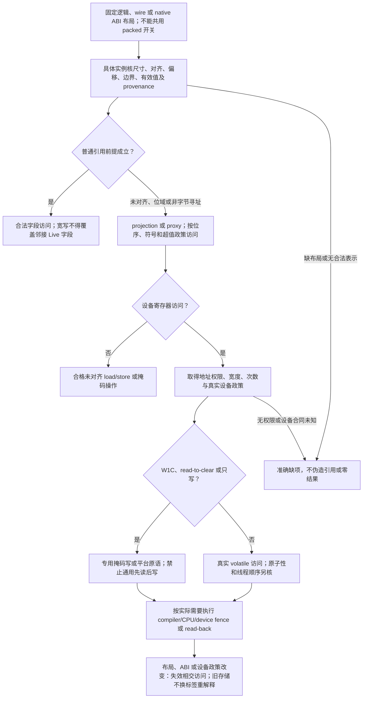

# 布局与设备访问

> 条件能力设计；不改变已固定的基础画像，不表示实现或目标符合性已完成。

本页补充[成员布局与完整产物](成员布局与完整产物.md)中的相交能力；原章节继续拥有其已采用的有限语义。**当前选择：保留目标约束，不扩成所有对象的自定义布局语言。** wire/MMIO/nativeABI分离正确；精确位/字节合同局部启用。

条件采用、合同记法与公开扩展边界沿用[共同准入](能力履行与接口差额.md#conditional-capability-contract)。

### 三种布局对象

**逻辑布局**规定字段与对象身份；**wire layout**规定可交换字节及编码；**native ABI layout**规定某个编译器／平台实际可观察的大小、对齐、偏移、基类与传参布局。三者不得共用一个“packed=true”开关。

```text
LayoutRequirement {
  domain: logical | wire | native_abi,
  size?, alignment?, field_offsets?, bit_order?, byte_order?,
  padding_policy?, address_identity_requirements?, abi_profile?
}
```

问号表示仅在作者要求或协议需要时出现，不强迫每个普通结构填写这些信息。泛型布局表达式在具体实例上计算并验证；必须分别满足目标支持的对齐、尺寸上限、字段边界和对象有效性。

Rust 泛型结构的对齐可通过实际 T 字段或 `[T; 0]` 等载体随 T 改变；仍需检查零尺寸、其他字段、具体目标布局和更强对齐要求。[依据](../../依据/来源/Rust与C++能力比较.md#baseline-s03) 对无法直接用 Rust `repr` 表达的布局，可选定合格的字节存储＋访问器路线，但这会改变原生字段访问接口；要求真正目标原生布局且没有合法路线时返回缺项。

### 位域与非对齐访问

位域定义必须固定宽度、符号扩展、字节序、位编号、跨存储单元政策及保留位处理。输入超出值域选择检查错误、显式截断或协议指定行为，不以宿主隐式转换偶然决定。C++ 原生位域的具体 ABI 布局交给匹配工具链，不能当成通用协议格式。[依据](../../依据/来源/Rust与C++能力比较.md#baseline-s22)

非字节寻址成员、未对齐成员和打包位域返回 projection／proxy，而不是伪造普通 `&T`／`&mut T`。访问器负责未对齐 load/store、掩码、符号及生命周期。

共享存储的位域读改写并非天然原子。设备寄存器还可能有 write-one-to-clear、read-to-clear、只写等行为；不能为更新一个位域盲目“先读整字再写回”。这类字段的访问政策由硬件合同决定，必要时仅允许直接掩码写、专用寄存器或平台原语。

### `no_unique_address` 的真正边界

提供“允许共享地址／复用 padding”的布局许可，但不承诺每个目标都能获得更小尺寸。需要字段地址唯一性、原生 C++ ABI 或严格尺寸时分别提出要求。

复用尾部 padding 不等于任意重叠有效字段。不得让一个宽 `&mut T` 或整对象复制覆盖另一个活跃字段；不得把未初始化 padding 当作稳定比较、哈希、序列化输入。可选路线是有证明的精确存储访问，或由原生 ABI 供给拥有该布局；不能把两个重叠对象随意包装成普通安全 Rust 引用。[依据](../../依据/来源/Rust与C++能力比较.md#baseline-s03)[依据](../../依据/来源/Rust与C++能力比较.md#baseline-s23)

ZST 地址重合、两个子对象共用一个虚基、tail-padding 复用是三个不同机制，不能因“没有额外空间”混为一项。

### 把 volatile 变成受控访问属性

`VolatileView<T, AccessPolicy>` 将访问宽度、地址空间、只读／只写、操作次数及平台所需约束携带在视图类型中。读取／写入生成真实 volatile 操作；隐式转换不能把它变成普通引用后执行常规内存访问。

volatile 不承诺线程间原子性、设备完成或硬件内存排序。需要 compiler fence、CPU fence、设备屏障或 read-back 时分别采用真实平台操作。MMIO 地址有效性和实际设备访问权限独立于“有此语法”；地址错误不能返回零来伪装成功。

### 原始存储、union 与对象有效性

提供原始字节、tagged union 和受控活动成员操作。切换活动成员必须履行旧成员销毁／新成员初始化；C++ 兼容的 union 生命周期及 common-initial-sequence 等规则属于单独 profile，不以普通 enum 近似替代全部。

`transmute`／bit-cast 只在尺寸、表示有效性、对齐、生命周期及指针 provenance 条件允许时成立。读取无效 bool、伪造引用、从整数恢复任意拥有指针不能因为两边都是“系统语言”自动获准。

<a id="tensor-layout-and-device-lifetime"></a>
## 张量形状、布局与设备生存期

张量实例固定 rank/shape、元素类型、单位、索引基准、广播轴匹配规则、stride/layout、设备/分片、拥有/借用和可变别名。shape 是语义维度，stride 是表示；二者不混。零维 scalar、长度为零的轴、负 stride view 和非连续 layout 必须明确支持或拒绝，不能因为后端不方便便隐式复制、隐藏成本或改变原要求。

广播按准确轴匹配规则检查，不从相似维数猜测。index/reshape/transpose 明确是共享原 allocation 的 view 还是新 allocation 的 copy；view 保留原拥有者、借用寿命及别名写约束，只有真实允许的变换才能共享表示。允许委派 copy 时显式计入内存、同步与延迟成本。跨 CPU/GPU 转移绑定真实 allocation 及其 generation、queue/stream 和 completion fence；host Future 返回或取消不证明设备已停止使用 buffer，释放沿[设备实际完成与资源寿命](../../运行/宿主生态与技术约束.md#accelerator-runtime-boundary)结算。

分布式张量绑定 partition、halo/replica、归约顺序和通信一致性；halo 的邻域来自实际全域，不能把分块边缘当全局边界。浮点归约换序的误差和确定性按准确数值 Profile 判断，不凭数学结合律宣称位级相同。设备丢失或 kernel 失败后，受污染 buffer 保持隔离，不回池或交给新消费者；取得覆盖最后设备访问的实际 fence/停止依据，或完成安全重建与责任转交以后才释放相交资源，未知作用范围继续保留。checkpoint 恢复固定逻辑内容、格式及新设备装配，不恢复跨设备/映像版本的旧 pointer 或 allocation 身份。

负案例包括：把 scalar 与 shape 含零轴混同、负 stride 越界、非连续 reshape 偷做 copy、别名 view 的 in-place 覆盖、广播错轴、halo 块边缘错误夹取、异步拷贝 Future 取消后立刻复用 buffer、device reset 后复活旧指针，以及不同归约顺序未经误差合同即复用同一结果资格。各项须由相交 lowering/Provider/数值与资源合同支持；未绑定真实驱动、ABI、layout 或 kernel 资格时，保留准确 Needs/Unknown，不把张量描述当设备实现证据。

## 再次修改与失效



布局、访问宽度、设备寄存器规则或 ABI 改变时，重核所有相交生成访问与外部布局；旧存储不能仅换一个类型标记便重新解释。

## 使用点与可检验出口

这些分支保留各自的真实输入、替代路径与边界，不按条数声称更多底层能力；[比较记录](../../依据/来源/Rust与C++能力比较.md)不拥有另一套语义。

- **成员指针**：常规访问器足够时不新造原语；确需字段投影时保留 owner/借用/不可寻址字段约束。 硬边界示例：要求精确 C++ pointer-to-member 表示，或既存泛型接口必须原生接收这种值；[具体比较与出口](../../依据/来源/Rust与C++能力比较.md#a10)。
- **泛型常量表达式进入类型**：静态尺寸有真实价值；先常量求值/库映射，在高频需求下再扩展作者表达。 硬边界示例：原生 [T;expr] 公开 API 被固定，或编码复杂度/编译时间实际不合格；[具体比较与出口](../../依据/来源/Rust与C++能力比较.md#a30)。
- **placement new**：撤回“Rust无原位初始化”；保留真实slot合同及部分失败清理，优先成熟封装。 硬边界示例：严格栈上限/固定地址/外来对象构造ABI要求无法由普通值临时满足；[具体比较与出口](../../依据/来源/Rust与C++能力比较.md#a47)。
- **依赖泛型的对齐**：撤销错误缺口；只对真实的精确布局要求建立检查。 硬边界示例：指定align表达式和原生导出类型必须同时成立，不能改表示/生成具体实例；[具体比较与出口](../../依据/来源/Rust与C++能力比较.md#a49)。
- **原生位域**：按wire、设备、nativeABI分开；设备W1C等操作不可被通用RMW掩盖。 硬边界示例：必须精确匹配某编译器C++位域ABI且无可用布局信息/访问器；否则常规库足够；[具体比较与出口](../../依据/来源/Rust与C++能力比较.md#a50)。
- **no_unique_address / 尾部padding复用**：保留可选布局需求，不保证所有目标缩小；不能以重叠普通Rust引用强行模拟。 硬边界示例：精确紧凑布局、正常字段引用和ABI必须同时保留，且字节数确实决定缓存/包布局要求；[具体比较与出口](../../依据/来源/Rust与C++能力比较.md#a51)。
- **volatile类型限定**：常规设备访问可库化；volatile不等于atomic或CPU屏障，分别履行真实硬件合同。 硬边界示例：固定外部类型/overload/volatile调用约定无法改，或未知代码必须靠原生qualifier传播；[具体比较与出口](../../依据/来源/Rust与C++能力比较.md#a52)。
- **泛型 atomic<T>**：按真实进展、表示和访问域选择供给；不因std少一个模板就自己重造atomic系统。 硬边界示例：禁止锁/分配、进程共享/ISR安全或精确复合ABI，目标原语和库不足；[具体比较与出口](../../依据/来源/Rust与C++能力比较.md#a59)。
- **atomic_ref<T>**：保留租约、对齐及混合访问规则；撤回Rust一概没有原子视图。 硬边界示例：既有共享内存布局/复合类型/无锁要求不可改，且没有匹配原语和访问协议；[具体比较与出口](../../依据/来源/Rust与C++能力比较.md#a60)。

实际组合与拒绝条件见[验收案例](../../运行/验收/跨语言控制与组合案例.md)；从作者要求到再次修改见[连续开发情景](../../../examples/连续开发/跨语言能力连续开发.md)。
