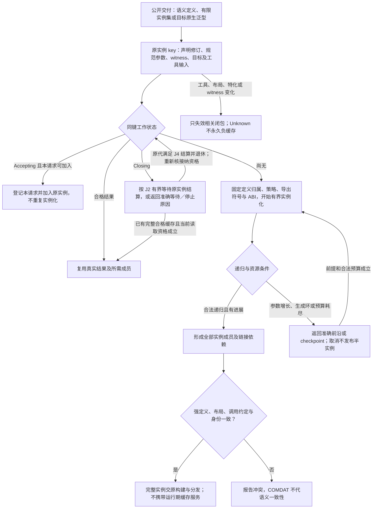

# 泛型分发与实例归属

> 条件能力设计；不改变已固定的基础画像，不表示实现或目标符合性已完成。

本页补充[成员布局与完整产物](成员布局与完整产物.md)中的相交能力；原章节继续拥有其已采用的有限语义。**当前选择：放在构建/分发层。** 实例复用、定义归属和真实导出边界有用；不要复制extern-template拼写或把缓存服务放进目标运行时。

条件采用、合同记法与公开扩展边界沿用[共同准入](能力履行与接口差额.md#conditional-capability-contract)。

显式 `instantiate` 选择具体参数集、目标及产物归属；`import_instantiation` 引用外部同一实例。生成 key 使用已有声明／语义修订、规范化参数、witness、相关目标画像与工具链输入，不新造另一套摘要或身份算法。

重复请求同一实例时复用同一个进行中任务或已取得结果。定义归属、导出符号、调用约定与布局必须一致；两个相同显示名、不同语义 key 的强定义是冲突。链接器是否合并 COMDAT 不能替代前面的语义一致性判断。

实例键中的声明身份消费[准确ModuleUse及名义等价](../../作者/工程源/清单模块与绑定锁.md)，不以裸DeclId或candidateRevision替代。相同代码体可以共享机器码，但不因此合并静态状态、可观察函数地址、分配域或运行实例。只加入仍接收该请求的同键生产者；已经Closing的生产者须完成原结算，不能重新打开，也不能换标签启动第二份同键工作；继续消费[共享生产者代际](../递归并行与远程编译.md#shared-producer-generation)的唯一生命周期。

公开泛型有三种交付形态：可供下游 Gift 继续实例化的语义定义；有限预实例集合；目标原生可表达的泛型。选择需要在公共接口中明确，不能把有限实例集合伪称成对任意 T 的泛型库。

单态化、字典传递、类型擦除由不同 strategy 实现。只有行为、ABI、资源、对象身份和作者硬约束都允许时才能改变 strategy。超出代码体积预算时，返回具体爆炸路径及可行替代；不能未经同意把无分配静态派发改成每次堆分配的动态派发。

实例化任务须检测直接递归、参数持续增长、重复查询、生成循环，支持取消与可重用 checkpoint。确定性失败缓存须绑定完整前提；缺依赖的 Unknown 不应永远负缓存成“不支持”。工具链、公共布局、特化集合或 witness 变更只使相关闭包失效。

原生符号控制包括内部／公开链接、显式导出名、外部定义归属和 ABI 版本。对象／函数地址属于可观察语义时，不能仅凭内容相同做跨对象合并。编译期和链接期控制不需要目标程序携带 Gift 控制服务。

## 再次修改与失效

定义、工具链、实例实参或导出集合改变时，重新核相交实例和产物成员；外部符号缺失不能被存在的类型元数据补成成功。

## 使用点与可检验出口

这些分支保留各自的真实输入、替代路径与边界，不按条数声称更多底层能力；[比较记录](../../依据/来源/Rust与C++能力比较.md)不拥有另一套语义。

- **类型参数包**：有反复用例可统一为 pack；否则复用列表与生成。不给所有程序强加变参泛型设计。 硬边界示例：外部库要求原生任意 arity 函数/tuple 接口；或编码的编译负担超出真实预算；[具体比较与出口](../../依据/来源/Rust与C++能力比较.md#a24)。
- **template-template 参数和包**：GAT 式设计足够则复用；作者高阶类型便利不自动意味着再造完备 kind calculus。 硬边界示例：下游通用库必须无适配地接受任意外部类型构造器，或要求原生签名完全一致；[具体比较与出口](../../依据/来源/Rust与C++能力比较.md#a26)。
- **重叠候选按专门程度选择**：优化分支可放优化器；语义差异必须在明示候选域/witness绑定中表达。不能默认全局开放特化。 硬边界示例：要求不改调用点、任意新类型可合作/不合作地加入选择，且全局唯一性必须维持；[具体比较与出口](../../依据/来源/Rust与C++能力比较.md#a33)。
- **显式模板实例化**：交给构建/导出策略，不把编译组织变成运行时语言机制。 硬边界示例：库发布要求精确的实例提供者/符号/构建归属，或编译资源有测得瓶颈；[具体比较与出口](../../依据/来源/Rust与C++能力比较.md#a36)。
- **extern template**：明确有限实例、可继续实例化定义和原生泛型三类交付；按真实构建成本采用。 硬边界示例：必须直接保留原生泛型接口、外部实例所有权和稳定构建行为；[具体比较与出口](../../依据/来源/Rust与C++能力比较.md#a37)。
- **语义静态反射**：编译器内部查询与用户开放反射分开；用例足够才稳定后者，C++26实现成熟度单列。 硬边界示例：需要无额外opt-in地检查未知类型语义，并把结果参与泛型实例化；[具体比较与出口](../../依据/来源/Rust与C++能力比较.md#a40)。

实际组合与拒绝条件见[验收案例](../../运行/验收/跨语言控制与组合案例.md)；从作者要求到再次修改见[连续开发情景](../../../examples/连续开发/跨语言能力连续开发.md)。
